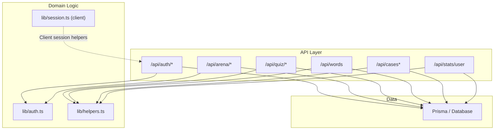
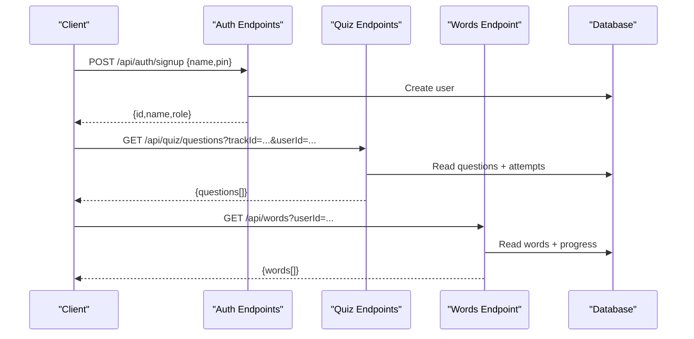
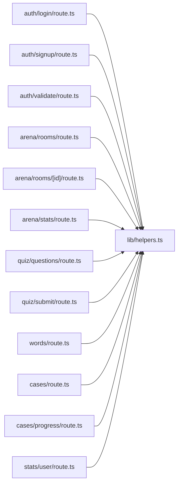

# API Reference

<cite>
**Referenced Files in This Document**
- [route.ts](file://src/app\api\auth\login\route.ts)
- [route.ts](file://src/app\api\auth\signup\route.ts)
- [route.ts](file://src/app\api\auth\validate\route.ts)
- [auth.ts](file://src/lib/auth.ts)
- [session.ts](file://src/lib/session.ts)
- [route.ts](file://src/app\api\arena\rooms\route.ts)
- [route.ts](file://src/app\api\arena\rooms\[id]\route.ts)
- [route.ts](file://src/app\api\arena\stats\route.ts)
- [route.ts](file://src/app\api\quiz\questions\route.ts)
- [route.ts](file://src/app\api\quiz\submit\route.ts)
- [route.ts](file://src/app\api\words\route.ts)
- [route.ts](file://src/app\api\cases\route.ts)
- [route.ts](file://src/app\api\cases\progress\route.ts)
- [route.ts](file://src/app\api\stats\user\route.ts)
- [helpers.ts](file://src/lib/helpers.ts)
</cite>

## Table of Contents
1. Introduction
2. Project Structure
3. Core Components
4. Architecture Overview
5. Detailed Component Analysis
6. Dependency Analysis
7. Performance Considerations
8. Troubleshooting Guide
9. Conclusion
10. Appendices

## Introduction
This document provides comprehensive API documentation for WeLearn’s REST endpoints across the following groups: auth, arena, quiz, words, cases, and stats. It covers HTTP methods, URL patterns, request/response schemas, authentication requirements, parameter specifications, error formats, rate limiting notes, examples, session-based authentication, permission checks, error handling patterns, status codes, debugging approaches, and versioning/deprecation considerations.

## Project Structure
WeLearn exposes a Next.js App Router API surface under src/app/api. Each endpoint is implemented as a route file that reads JSON bodies, validates inputs, interacts with the database via Prisma, and returns JSON responses. Authentication is handled client-side using a local session object; server endpoints validate user identity through userId parameters and optional team PINs for sensitive operations.

**Diagram sources**
- [route.ts:6-25](file://src/app\api\auth\login\route.ts#L6-L25)
- [route.ts:6-35](file://src/app\api\auth\signup\route.ts#L6-L35)
- [route.ts:5-16](file://src/app\api\auth\validate\route.ts#L5-L16)
- [auth.ts:9-25](file://src/lib/auth.ts#L9-L25)
- [session.ts:3-42](file://src/lib/session.ts#L3-L42)
- [route.ts:8-79](file://src/app\api\arena\rooms\route.ts#L8-L79)
- [route.ts:10-124](file://src/app\api\arena\rooms\[id]\route.ts#L10-L124)
- [route.ts:6-97](file://src/app\api\arena\stats\route.ts#L6-L97)
- [route.ts:9-59](file://src/app\api\quiz\questions\route.ts#L9-L59)
- [route.ts:82-155](file://src/app\api\quiz\submit\route.ts#L82-L155)
- [route.ts:6-40](file://src/app\api\words\route.ts#L6-L40)
- [route.ts:4-36](file://src/app\api\cases\route.ts#L4-L36)
- [route.ts:13-53](file://src/app\api\cases\progress\route.ts#L13-L53)
- [route.ts:5-101](file://src/app\api\stats\user\route.ts#L5-L101)
- [helpers.ts:39-41](file://src/lib/helpers.ts#L39-L41)

**Section sources**
- [route.ts:6-25](file://src/app\api\auth\login\route.ts#L6-L25)
- [route.ts:6-35](file://src/app\api\auth\signup\route.ts#L6-L35)
- [route.ts:5-16](file://src/app\api\auth\validate\route.ts#L5-L16)
- [auth.ts:9-25](file://src/lib/auth.ts#L9-L25)
- [session.ts:3-42](file://src/lib/session.ts#L3-L42)
- [route.ts:8-79](file://src/app\api\arena\rooms\route.ts#L8-L79)
- [route.ts:10-124](file://src/app\api\arena\rooms\[id]\route.ts#L10-L124)
- [route.ts:6-97](file://src/app\api\arena\stats\route.ts#L6-L97)
- [route.ts:9-59](file://src/app\api\quiz\questions\route.ts#L9-L59)
- [route.ts:82-155](file://src/app\api\quiz\submit\route.ts#L82-L155)
- [route.ts:6-40](file://src/app\api\words\route.ts#L6-L40)
- [route.ts:4-36](file://src/app\api\cases\route.ts#L4-L36)
- [route.ts:13-53](file://src/app\api\cases\progress\route.ts#L13-L53)
- [route.ts:5-101](file://src/app\api\stats\user\route.ts#L5-L101)
- [helpers.ts:39-41](file://src/lib/helpers.ts#L39-L41)

## Core Components
- Authentication utilities: PIN hashing, validation, and shared team PIN check.
- Session helpers: Client-side storage and fetch wrapper for authenticated requests.
- Shared helpers: Date utilities and standardized error response builder.

Key responsibilities:
- Validate and hash PINs securely.
- Enforce name/PIN constraints.
- Provide consistent error payloads.
- Manage client session persistence and default headers.

**Section sources**
- [auth.ts:9-25](file://src/lib/auth.ts#L9-L25)
- [session.ts:3-42](file://src/lib/session.ts#L3-L42)
- [helpers.ts:39-41](file://src/lib/helpers.ts#L39-L41)

## Architecture Overview
The API follows a simple stateless pattern: clients send userId in query or body to identify themselves. Sensitive actions require an additional team PIN. The server performs input validation, enforces permissions, updates the database, and returns structured JSON.

**Diagram sources**
- [route.ts:6-35](file://src/app\api\auth\signup\route.ts#L6-L35)
- [route.ts:9-59](file://src/app\api\quiz\questions\route.ts#L9-L59)
- [route.ts:6-40](file://src/app\api\words\route.ts#L6-L40)

## Detailed Component Analysis

### Auth API
Endpoints:
- POST /api/auth/signup
- POST /api/auth/login
- GET /api/auth/validate

Authentication model:
- Clients store a session object after successful login.
- Subsequent calls pass userId to identify the user.
- Some destructive operations require a shared team PIN.

Request/Response Schemas:
- POST /api/auth/signup
  - Body: { name: string, pin: string }
  - Response: { id: string, name: string, role: string }
  - Errors: Validation errors for name/PIN format; duplicate name; server errors.
- POST /api/auth/login
  - Body: { name: string, pin: string }
  - Response: { id: string, name: string, role: string }
  - Errors: Not found; wrong PIN; server errors.
- GET /api/auth/validate
  - Query: userId: string
  - Response: { id: string, name: string, role: string }
  - Errors: Missing userId; expired session; server errors.

Parameter Specifications:
- name: 2–40 characters, no < > { }.
- pin: exactly 4 digits.
- userId: non-empty string.

Error Responses:
- Standardized JSON: { error: string } with appropriate HTTP status.

Rate Limiting:
- No explicit rate limiting observed in these routes.

Examples:
- Signup example payload: { "name": "Alice", "pin": "1234" }
- Login example payload: { "name": "Alice", "pin": "1234" }
- Validate example URL: /api/auth/validate?userId=<userId>

Security Notes:
- PINs are hashed before storage.
- Team PIN is used for sensitive operations elsewhere in the system.

**Section sources**
- [route.ts:6-35](file://src/app\api\auth\signup\route.ts#L6-L35)
- [route.ts:6-25](file://src/app\api\auth\login\route.ts#L6-L25)
- [route.ts:5-16](file://src/app\api\auth\validate\route.ts#L5-L16)
- [auth.ts:9-25](file://src/lib/auth.ts#L9-L25)
- [helpers.ts:39-41](file://src/lib/helpers.ts#L39-L41)

### Arena API
Endpoints:
- GET /api/arena/rooms
- POST /api/arena/rooms
- GET /api/arena/rooms/[id]
- POST /api/arena/rooms/[id]
- GET /api/arena/stats

Core concepts:
- Rooms have modes: gd, debate, pitch.
- Lifecycle phases: lobby → live → rating → ended.
- Host/co-host roles control actions.
- Ratings use star grids per aspect; results include Elo changes and badges.

Request/Response Schemas:
- GET /api/arena/rooms
  - Query: userId?: string
  - Response: { rooms[], myActiveRoomId?: string|null, serverNow: number }
- POST /api/arena/rooms
  - Body: { userId: string, title: string, mode?: string, topic?: string|null, liveSec?: number, ratingSec?: number }
  - Response: { room: { id: string, title: string } }
- GET /api/arena/rooms/[id]
  - Query: userId?: string
  - Response: { serverNow, room, aspects[], participants[], me?, submittedBy[], mom? }
- POST /api/arena/rooms/[id]
  - Body: { action: string, ...action-specific fields }
  - Actions: join, leave, delete_room, cohost, set_topic, start_live, end_live, finalize, stance, key_argument, rate
- GET /api/arena/stats
  - Query: userId: string
  - Response: { gdElo, tier, gdsPlayed, gdStreak, eloRange, radar, rank, totalRanked, top10[], history[], badgeCounts, remarks[], avgStars, winRate, suggestions }

Action Details:
- join: Enter a room if not already present and not in rating/ended.
- leave: Leave a room; creator leaving deletes the room.
- delete_room: Host can delete; others need team PIN.
- cohost: Creator assigns co-host in lobby.
- set_topic: Host/co-host sets topic.
- start_live: Host starts live phase with optional timer.
- end_live: Host ends live and opens rating phase.
- finalize: Host finalizes ratings and computes results.
- stance: Set stance (for, against, moderator) during lobby/live.
- key_argument: Submit key argument text.
- rate: Submit star ratings per aspect for peers during rating phase.

Permission Checks:
- Host/co-host controls enforced by comparing userId with hostId and isCoHost flag.
- Team PIN required for delete_room when not host.

Error Responses:
- Standardized JSON errors with descriptive messages.

Rate Limiting:
- No explicit rate limiting observed.

Examples:
- Create room: { "userId": "<uid>", "title": "Debate on AI", "mode": "debate", "topic": "AI ethics", "liveSec": 600, "ratingSec": 300 }
- Rate peers: { "action": "rate", "ratings": [{ "rateeId": "<peerId>", "aspects": { "content": 4, "delivery": 5 }, "remark": "Great points" }] }

**Section sources**
- [route.ts:8-79](file://src/app\api\arena\rooms\route.ts#L8-L79)
- [route.ts:10-124](file://src/app\api\arena\rooms\[id]\route.ts#L10-L124)
- [route.ts:127-290](file://src/app\api\arena\rooms\[id]\route.ts#L127-L290)
- [route.ts:6-97](file://src/app\api\arena\stats\route.ts#L6-L97)
- [auth.ts:22-25](file://src/lib/auth.ts#L22-L25)

### Quiz API
Endpoints:
- GET /api/quiz/questions
- POST /api/quiz/submit

Behavior:
- Questions are fetched by trackId, optionally filtered by type.
- Correct answers are never sent to the client; grading occurs server-side.
- Attempts are idempotent per question per user.
- Speed bonus awarded for quick correct answers (non-pitch_pairing).
- Badges may be auto-awarded based on criteria.

Request/Response Schemas:
- GET /api/quiz/questions
  - Query: trackId: string, userId?: string, type?: string (scenario|red_flag|micro_math|pitch_pairing)
  - Response: { questions[] } where each question includes id, type, scenario, options[], difficulty, points, source, attempted, lastCorrect, lastPoints.
- POST /api/quiz/submit
  - Body: { userId: string, questionId: string, selected: number, timeSpent: number, timedOut?: boolean }
  - Response: { correct: boolean, selected: number, answer: number, explanation: string, founderNote: string, points: number, speedBonus: number, newlyAwardedBadges: string[] }

Validation:
- userId and questionId required.
- selected must be integer; timeSpent clamped to [0, 3600].
- Timed-out submissions are marked accordingly.

Error Responses:
- Standardized JSON errors for missing fields, not found, and server errors.

Rate Limiting:
- No explicit rate limiting observed.

Examples:
- Fetch questions: GET /api/quiz/questions?trackId=<trackId>&userId=<userId>&type=scenario
- Submit answer: { "userId": "<uid>", "questionId": "<qid>", "selected": 2, "timeSpent": 45 }

**Section sources**
- [route.ts:9-59](file://src/app\api\quiz\questions\route.ts#L9-L59)
- [route.ts:82-155](file://src/app\api\quiz\submit\route.ts#L82-L155)

### Words API
Endpoint:
- GET /api/words
- POST /api/words
- DELETE /api/words

Behavior:
- GET returns word bank and per-user progress map.
- POST creates or updates words; bulk support via array.
- DELETE requires confirmation PIN.

Request/Response Schemas:
- GET /api/words
  - Query: userId?: string
  - Response: { words[] } with term, definition, category, keyDefinition, source, usedInCrosswords, status, dueAt, timesSeen, timesCorrect.
- POST /api/words
  - Body: { words: [{ term, definition, category?, keyDefinition? }] } or single fields { term, definition, category?, keyDefinition? }
  - Response: { ok: boolean, created: number, updated: number, total: number }
- DELETE /api/words
  - Body: { ids: string[], pin: string }
  - Response: { ok: boolean, deleted: number }

Validation:
- Term length >= 2; definition length >= 4.
- Category defaults to "general".
- DELETE requires exact PIN match.

Error Responses:
- Standardized JSON errors for validation and server failures.

Rate Limiting:
- No explicit rate limiting observed.

Examples:
- Bulk create: { "words": [{ "term": "Agile", "definition": "Iterative development approach", "category": "methodology" }] }
- Delete: { "ids": ["<wordId1>", "<wordId2>"], "pin": "1408" }

**Section sources**
- [route.ts:6-40](file://src/app\api\words\route.ts#L6-L40)
- [route.ts:42-77](file://src/app\api\words\route.ts#L42-L77)
- [route.ts:79-91](file://src/app\api\words\route.ts#L79-L91)

### Cases API
Endpoints:
- GET /api/cases
- POST /api/cases/progress

Behavior:
- GET returns all case studies and per-user progress.
- POST upserts progress and awards point deltas when advancing status.

Request/Response Schemas:
- GET /api/cases
  - Query: userId?: string
  - Response: { cases[] } with id, slug, startup, tagline, sector, youtubeId, description, keyMetrics[], discussion[], source, progress?
- POST /api/cases/progress
  - Body: { userId: string, caseId: string, status: string, notes?: string }
  - Response: { progress: { status: string, notes: string }, pointsEarned: number }

Statuses:
- watching, analysed, deck_ready with associated ranks and points.

Error Responses:
- Standardized JSON errors for missing fields and invalid status.

Rate Limiting:
- No explicit rate limiting observed.

Examples:
- Update progress: { "userId": "<uid>", "caseId": "<caseId>", "status": "analysed", "notes": "Completed analysis" }

**Section sources**
- [route.ts:4-36](file://src/app\api\cases\route.ts#L4-L36)
- [route.ts:13-53](file://src/app\api\cases\progress\route.ts#L13-L53)

### Stats API
Endpoint:
- GET /api/stats/user

Behavior:
- Aggregates activity, puzzle attempts, case progress, terms known, GD sessions, quiz attempts, and pitch attempts.
- Computes streak, accuracy, minutes trained, daily series, module breakdown, today checklist, and recent activities.

Request/Response Schemas:
- GET /api/stats/user
  - Query: userId: string
  - Response: { user, totals, byDay[], byModule[], today, recent[], attemptHistory[] }

Error Responses:
- Standardized JSON errors for missing userId and server errors.

Rate Limiting:
- No explicit rate limiting observed.

Examples:
- Fetch stats: GET /api/stats/user?userId=<userId>

**Section sources**
- [route.ts:5-101](file://src/app\api\stats\user\route.ts#L5-L101)

## Dependency Analysis

**Diagram sources**
- [route.ts:6-25](file://src/app\api\auth\login\route.ts#L6-L25)
- [route.ts:6-35](file://src/app\api\auth\signup\route.ts#L6-L35)
- [route.ts:5-16](file://src/app\api\auth\validate\route.ts#L5-L16)
- [route.ts:8-79](file://src/app\api\arena\rooms\route.ts#L8-L79)
- [route.ts:10-124](file://src/app\api\arena\rooms\[id]\route.ts#L10-L124)
- [route.ts:6-97](file://src/app\api\arena\stats\route.ts#L6-L97)
- [route.ts:9-59](file://src/app\api\quiz\questions\route.ts#L9-L59)
- [route.ts:82-155](file://src/app\api\quiz\submit\route.ts#L82-L155)
- [route.ts:6-40](file://src/app\api\words\route.ts#L6-L40)
- [route.ts:4-36](file://src/app\api\cases\route.ts#L4-L36)
- [route.ts:13-53](file://src/app\api\cases\progress\route.ts#L13-L53)
- [route.ts:5-101](file://src/app\api\stats\user\route.ts#L5-L101)
- [helpers.ts:39-41](file://src/lib/helpers.ts#L39-L41)

**Section sources**
- [helpers.ts:39-41](file://src/lib/helpers.ts#L39-L41)

## Performance Considerations
- Batch operations: Words POST supports bulk creation/update to reduce round trips.
- Idempotency: Quiz submit prevents duplicate graded attempts per question per user.
- Efficient queries: Arena rooms list limits results and filters by recent activity.
- Lazy loading: Some heavy computations (e.g., finalize) are invoked only when needed.

[No sources needed since this section provides general guidance]

## Troubleshooting Guide
Common issues:
- Invalid credentials: Ensure name matches existing users and PIN is correct.
- Session expired: Re-validate via /api/auth/validate with current userId.
- Permission denied: Confirm host/co-host roles or provide team PIN for protected actions.
- Validation errors: Check field lengths and allowed values (e.g., PIN format, stance values).

Debugging tips:
- Inspect error payloads: All errors follow { error: string } format.
- Log server responses: Use browser dev tools to inspect network payloads.
- Verify userId presence: Many endpoints require userId in query/body.

**Section sources**
- [helpers.ts:39-41](file://src/lib/helpers.ts#L39-L41)

## Conclusion
WeLearn’s API provides a cohesive set of endpoints for authentication, collaborative arenas, quizzes, vocabulary management, case studies, and analytics. Authentication relies on a client-side session with server-side userId validation and optional team PIN for sensitive operations. Error handling is consistent, and performance optimizations are applied where appropriate. Future versions should introduce explicit API versioning and rate limiting for robustness.

[No sources needed since this section summarizes without analyzing specific files]

## Appendices

### Authentication Mechanism
- Client stores a session object after login.
- Subsequent requests include userId to identify the user.
- Team PIN is used for destructive operations requiring extra confirmation.

**Section sources**
- [session.ts:3-42](file://src/lib/session.ts#L3-L42)
- [auth.ts:22-25](file://src/lib/auth.ts#L22-L25)

### Error Handling Patterns
- All endpoints return JSON with an error field on failure.
- Status codes vary by context (400, 401, 403, 404, 500).

**Section sources**
- [helpers.ts:39-41](file://src/lib/helpers.ts#L39-L41)

### API Versioning and Deprecation Policy
- Current implementation does not include explicit API versioning.
- Backward compatibility: Maintain stable field names and avoid breaking changes to request/response shapes.
- Deprecation: Introduce deprecation headers and maintain legacy endpoints during transition periods.

[No sources needed since this section provides general guidance]