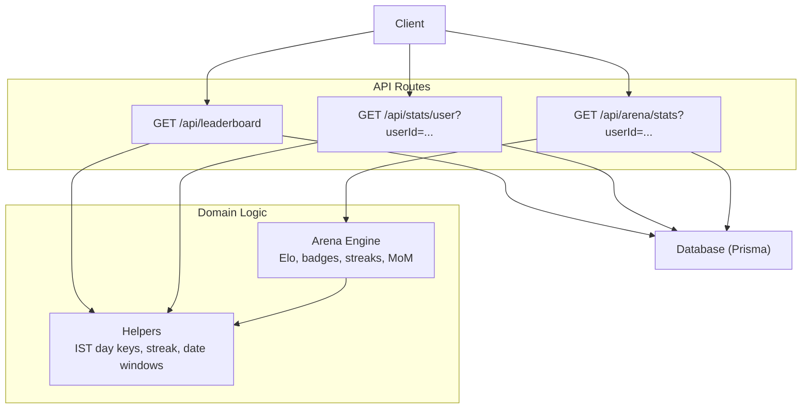
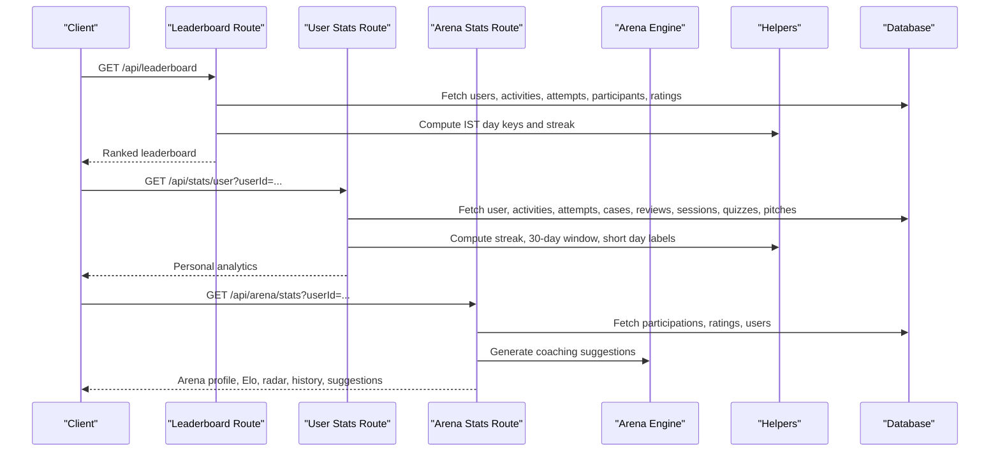
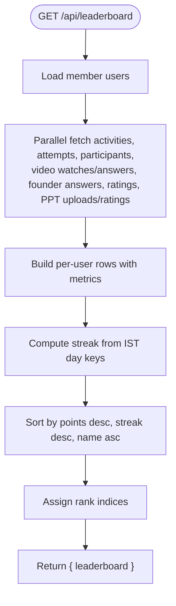
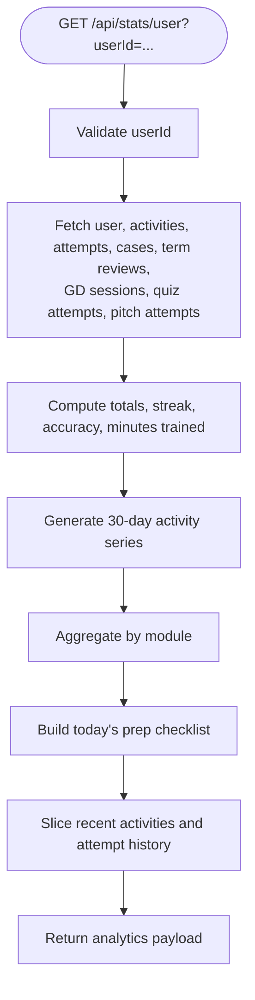
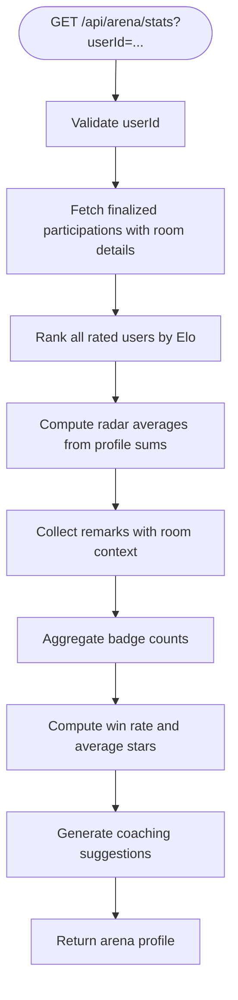
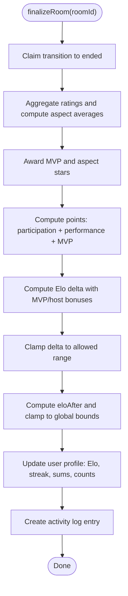
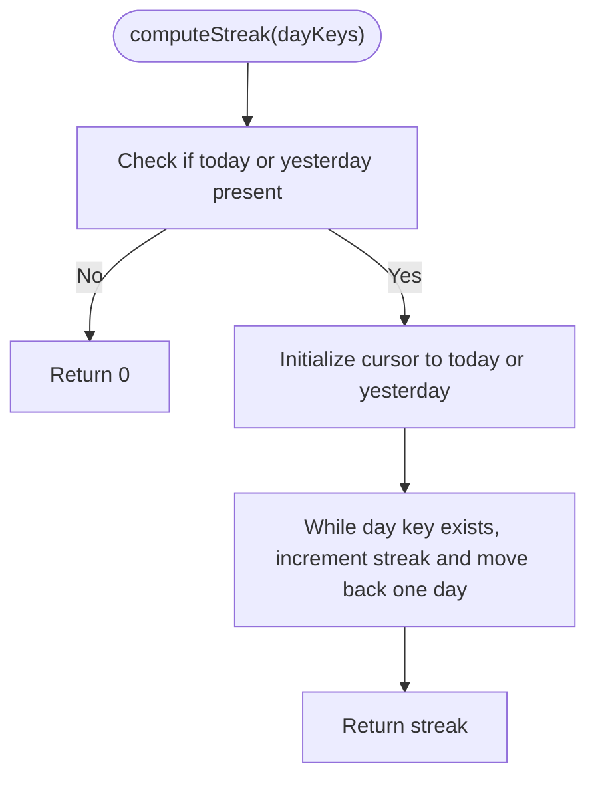
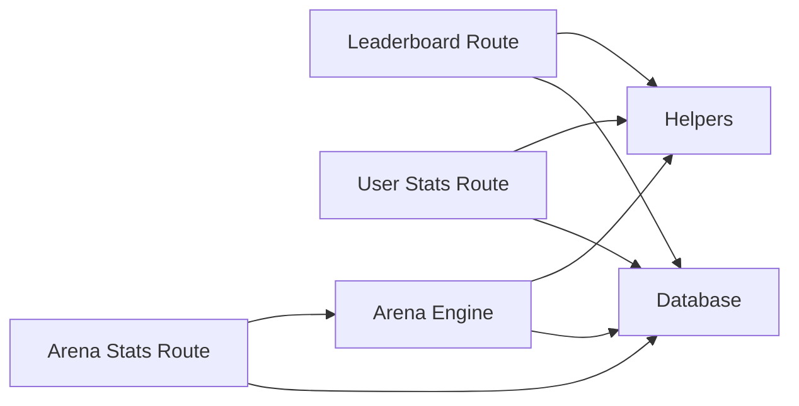

# Analytics & Leaderboard API

<cite>
**Referenced Files in This Document**
- [leaderboard route](file://src/app/api/leaderboard/route.ts)
- [user stats route](file://src/app/api/stats/user/route.ts)
- [arena stats route](file://src/app/api/arena/stats/route.ts)
- [arena engine](file://src/lib/arena-engine.ts)
- [shared helpers](file://src/lib/helpers.ts)
</cite>

## Table of Contents
1. [Introduction](#introduction)
2. [Project Structure](#project-structure)
3. [Core Components](#core-components)
4. [Architecture Overview](#architecture-overview)
5. [Detailed Component Analysis](#detailed-component-analysis)
6. [Dependency Analysis](#dependency-analysis)
7. [Performance Considerations](#performance-considerations)
8. [Troubleshooting Guide](#troubleshooting-guide)
9. [Conclusion](#conclusion)

## Introduction
This document specifies the analytics and leaderboard endpoints for the platform. It covers:
- User statistics collection across modules such as puzzles, cases, group discussions, terms, quizzes, pitches, videos, presentations, and arena sessions.
- Leaderboard ranking algorithms that combine points, streaks, and module-specific metrics.
- Performance metrics calculation including accuracy, training time, activity windows, and radar dimensions.
- Elo rating updates for arena-style sessions, streak tracking, and activity logging.
- Examples of analytics queries, leaderboard sorting, and performance reporting.
- Data aggregation patterns and guidance for caching strategies to support real-time leaderboards.

The APIs are implemented as Next.js App Router routes backed by a Prisma database layer and shared helper utilities for IST-based date handling, streak computation, and error responses.

## Project Structure
The analytics and leaderboard functionality is primarily implemented under `src/app/api`:
- `/api/leaderboard` returns a multi-metric leaderboard for all members.
- `/api/stats/user` returns YouTube-Studio-style personal analytics for a specific user.
- `/api/arena/stats` returns an Arena profile with Elo, radar, history, coaching suggestions, and rankings.
- The Arena scoring and Elo update logic lives in `src/lib/arena-engine.ts`.
- Shared date and streak helpers live in `src/lib/helpers.ts`.

**Diagram sources**
- [leaderboard route:1-71](file://src/app/api/leaderboard/route.ts#L1-L71)
- [user stats route:1-102](file://src/app/api/stats/user/route.ts#L1-L102)
- [arena stats route:1-98](file://src/app/api/arena/stats/route.ts#L1-L98)
- [arena engine:1-415](file://src/lib/arena-engine.ts#L1-L415)
- [shared helpers:1-42](file://src/lib/helpers.ts#L1-L42)

**Section sources**
- [leaderboard route:1-71](file://src/app/api/leaderboard/route.ts#L1-L71)
- [user stats route:1-102](file://src/app/api/stats/user/route.ts#L1-L102)
- [arena stats route:1-98](file://src/app/api/arena/stats/route.ts#L1-L98)
- [arena engine:1-415](file://src/lib/arena-engine.ts#L1-L415)
- [shared helpers:1-42](file://src/lib/helpers.ts#L1-L42)

## Core Components
- Leaderboard endpoint aggregates multiple signals per user: points, puzzle solves, quiz correctness, arena participation and stars, video watches and answers, founder case answers and ratings, presentation uploads and ratings, ratings given, total activities, streak, and last active timestamp.
- User analytics endpoint provides totals, 30-day activity series, module breakdown, today’s prep checklist, recent activities, and attempt history.
- Arena stats endpoint exposes Elo, tier, radar averages, rank among ranked users, top-10 list, session history, badge counts, remarks, average stars, win rate, and rule-based coaching suggestions.
- Arena engine finalizes rooms, computes peer-driven points and Elo deltas, awards badges, updates user profiles, and logs activities.
- Helpers provide IST day keys, consecutive-day streak computation, last-N-days window generation, short day formatting, and JSON error responses.

**Section sources**
- [leaderboard route:5-66](file://src/app/api/leaderboard/route.ts#L5-L66)
- [user stats route:5-97](file://src/app/api/stats/user/route.ts#L5-L97)
- [arena stats route:6-93](file://src/app/api/arena/stats/route.ts#L6-L93)
- [arena engine:200-366](file://src/lib/arena-engine.ts#L200-L366)
- [shared helpers:3-40](file://src/lib/helpers.ts#L3-L40)

## Architecture Overview
The system follows a clear separation between API routes, domain logic, and shared utilities:
- API routes handle HTTP requests, parameter validation, and data aggregation.
- Domain logic encapsulates complex processes like room finalization, Elo calculations, and coaching suggestions.
- Shared utilities standardize timezone-aware date operations and common computations.

**Diagram sources**
- [leaderboard route:5-66](file://src/app/api/leaderboard/route.ts#L5-L66)
- [user stats route:5-97](file://src/app/api/stats/user/route.ts#L5-L97)
- [arena stats route:6-93](file://src/app/api/arena/stats/route.ts#L6-L93)
- [arena engine:375-414](file://src/lib/arena-engine.ts#L375-L414)
- [shared helpers:3-40](file://src/lib/helpers.ts#L3-L40)

## Detailed Component Analysis

### Leaderboard Endpoint
- Purpose: Return a multi-metric individual ranking for all non-admin users.
- Inputs: None; filters out admin roles internally.
- Aggregation:
  - Points from activity records.
  - Puzzle solved count from actions.
  - Quiz solved count from correct attempts.
  - Arena sessions count and average stars.
  - Arena Elo from user profile.
  - Video watch count and video quiz correct count.
  - Founder case answer count and average received stars.
  - Presentation upload count and average received stars.
  - Ratings given count across answer and presentation ratings.
  - Total activities count.
  - Streak computed from IST day keys.
  - Last active timestamp derived from most recent activity.
- Sorting: Primary by descending points, secondary by descending streak, tertiary by name lexicographically.
- Output: Array of ranked users with computed metrics and rank index.

**Diagram sources**
- [leaderboard route:5-66](file://src/app/api/leaderboard/route.ts#L5-L66)
- [shared helpers:3-26](file://src/lib/helpers.ts#L3-L26)

**Section sources**
- [leaderboard route:5-66](file://src/app/api/leaderboard/route.ts#L5-L66)
- [shared helpers:3-26](file://src/lib/helpers.ts#L3-L26)

### User Analytics Endpoint
- Purpose: Provide YouTube-Studio-style personal analytics for a specified user.
- Inputs: Query parameter `userId`.
- Validation: Returns 400 if missing, 404 if user not found.
- Aggregation:
  - Totals: points, streak, puzzles attempted/solved, accuracy, minutes trained, cases analyzed/decks ready, terms known, GD sessions, active days, quiz questions attempted/solved/accuracy, pitches completed.
  - By-day series: last 30 days with day label, points, and activity count.
  - By-module breakdown: points and counts per module.
  - Today’s prep checklist: boolean flags per module based on today’s activities.
  - Recent activities: up to 20 entries.
  - Attempt history: up to 25 puzzle attempts with metadata.
- Date handling: Uses IST day keys and short day labels for consistent reporting.

**Diagram sources**
- [user stats route:5-97](file://src/app/api/stats/user/route.ts#L5-L97)
- [shared helpers:3-37](file://src/lib/helpers.ts#L3-L37)

**Section sources**
- [user stats route:5-97](file://src/app/api/stats/user/route.ts#L5-L97)
- [shared helpers:3-37](file://src/lib/helpers.ts#L3-L37)

### Arena Stats Endpoint
- Purpose: Return Arena profile including Elo, tier, radar averages, rank, top-10, session history, badge counts, remarks, average stars, win rate, and coaching suggestions.
- Inputs: Query parameter `userId`.
- Validation: Returns 400 if missing, 404 if user not found.
- Aggregation:
  - Elo and tier from user profile.
  - Radar averages computed from accumulated sums and counts.
  - Rank computed by sorting all users with at least one rating by Elo.
  - History includes last 20 finalized participations with room details, stance, average stars, Elo delta, Elo after, and badges.
  - Badge counts aggregated from participant records.
  - Remarks collected from GD ratings with room context.
  - Win rate calculated as proportion of positive Elo deltas.
  - Coaching suggestions generated via rule-based logic.

**Diagram sources**
- [arena stats route:6-93](file://src/app/api/arena/stats/route.ts#L6-L93)
- [arena engine:375-414](file://src/lib/arena-engine.ts#L375-L414)

**Section sources**
- [arena stats route:6-93](file://src/app/api/arena/stats/route.ts#L6-L93)
- [arena engine:375-414](file://src/lib/arena-engine.ts#L375-L414)

### Elo Rating Updates and Arena Finalization
- Room finalization aggregates peer star ratings per aspect, computes overall scores, and assigns mode-specific badges.
- Points are calculated as base participation plus performance bonus and MVP bonus.
- Elo delta is derived from overall score relative to a baseline, with MVP and host bonuses, then clamped within bounds.
- After computing Elo delta, the new Elo is clamped to global min/max values.
- User profile fields updated include Elo, games played, streak, last game date, and cumulative radar axis sums with counts.
- Activity log entry created with module, action, detail string, and points.

**Diagram sources**
- [arena engine:200-366](file://src/lib/arena-engine.ts#L200-L366)

**Section sources**
- [arena engine:200-366](file://src/lib/arena-engine.ts#L200-L366)

### Streak Tracking and Activity Logging
- Streak computation uses IST day keys to determine consecutive days of activity ending today or yesterday.
- For general analytics, streak is computed from a set of IST day keys derived from activity timestamps.
- For Arena sessions, streak is maintained per user profile based on last game date and current IST day.
- Activity logging records module, action, detail, and points for each significant event.

**Diagram sources**
- [shared helpers:14-26](file://src/lib/helpers.ts#L14-L26)
- [arena engine:336-354](file://src/lib/arena-engine.ts#L336-L354)

**Section sources**
- [shared helpers:14-26](file://src/lib/helpers.ts#L14-L26)
- [arena engine:336-354](file://src/lib/arena-engine.ts#L336-L354)

## Dependency Analysis
- API routes depend on:
  - Database access through Prisma (`db`).
  - Shared helpers for date and streak utilities.
  - Arena engine for Elo-related logic and coaching suggestions.
- Arena engine depends on:
  - Database for room, participant, rating, and user data.
  - Helpers for IST day keys.
  - AI integration for Minutes-of-Meeting narrative generation.
- Leaderboard and user stats endpoints do not directly call arena engine but rely on aggregated data from the database.

**Diagram sources**
- [leaderboard route:1-71](file://src/app/api/leaderboard/route.ts#L1-L71)
- [user stats route:1-102](file://src/app/api/stats/user/route.ts#L1-L102)
- [arena stats route:1-98](file://src/app/api/arena/stats/route.ts#L1-L98)
- [arena engine:1-415](file://src/lib/arena-engine.ts#L1-L415)
- [shared helpers:1-42](file://src/lib/helpers.ts#L1-L42)

**Section sources**
- [leaderboard route:1-71](file://src/app/api/leaderboard/route.ts#L1-L71)
- [user stats route:1-102](file://src/app/api/stats/user/route.ts#L1-L102)
- [arena stats route:1-98](file://src/app/api/arena/stats/route.ts#L1-L98)
- [arena engine:1-415](file://src/lib/arena-engine.ts#L1-L415)
- [shared helpers:1-42](file://src/lib/helpers.ts#L1-L42)

## Performance Considerations
- Parallel fetching: Leaderboard and user stats endpoints use parallel database queries to reduce latency.
- In-memory aggregation: Metrics are computed in memory after fetching datasets, which is efficient for moderate dataset sizes.
- Sorting complexity: Leaderboard sorting is O(n log n) with tie-breaking by streak and name.
- Date operations: IST day key computations are lightweight and used consistently across endpoints.
- Recommendations:
  - Introduce server-side caching for leaderboard results with invalidation on activity writes.
  - Cache user analytics for short TTLs to reduce repeated aggregations.
  - Precompute and store aggregate counters for frequently accessed metrics where possible.
  - Use database indexes on commonly filtered fields such as `userId`, `createdAt`, and role indicators.

[No sources needed since this section provides general guidance]

## Troubleshooting Guide
- Missing parameters:
  - `/api/stats/user` requires `userId`; returns 400 when absent.
  - `/api/arena/stats` requires `userId`; returns 400 when absent.
- Not found:
  - Both user-facing stats endpoints return 404 when the specified user does not exist.
- General errors:
  - Leaderboard returns a generic 500 error when loading fails.
  - Arena stats returns a structured error via helper when loading fails.
- Debugging tips:
  - Verify IST day key consistency when streaks appear incorrect.
  - Check activity logs for expected module and action entries after arena sessions.
  - Validate Elo bounds and delta clamping if unexpected rating changes occur.

**Section sources**
- [user stats route:5-12](file://src/app/api/stats/user/route.ts#L5-L12)
- [arena stats route:6-13](file://src/app/api/arena/stats/route.ts#L6-L13)
- [leaderboard route:67-69](file://src/app/api/leaderboard/route.ts#L67-L69)
- [arena stats route:94-96](file://src/app/api/arena/stats/route.ts#L94-L96)
- [shared helpers:39-40](file://src/lib/helpers.ts#L39-L40)

## Conclusion
The analytics and leaderboard system provides comprehensive insights into user performance, engagement, and competitive standing. The leaderboard combines multiple signals to rank users, while personal analytics offer detailed breakdowns of activity and progress. Arena stats deliver Elo-based rankings, radar profiles, and actionable coaching suggestions. Robust date handling and streak computation ensure consistent reporting across time zones. With careful caching and indexing, these endpoints can scale to support real-time leaderboards and responsive analytics dashboards.

[No sources needed since this section summarizes without analyzing specific files]