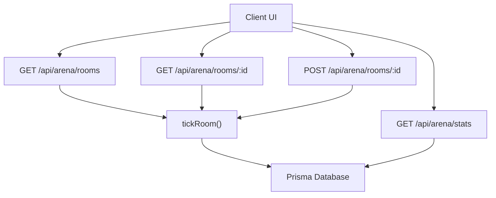
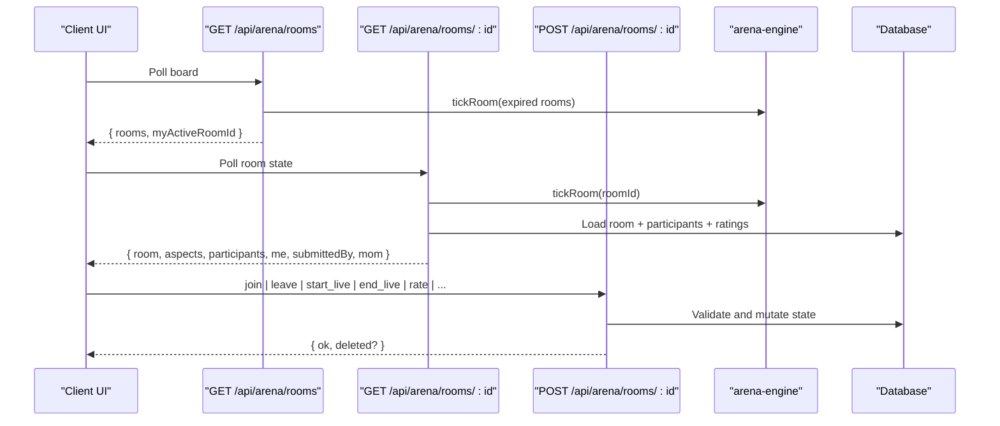
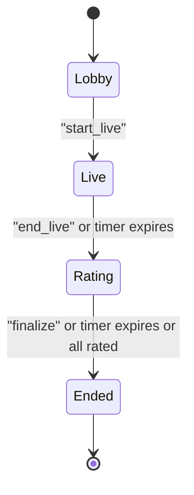
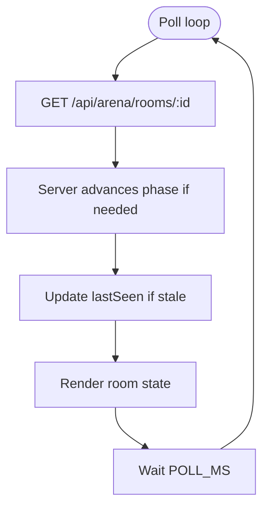
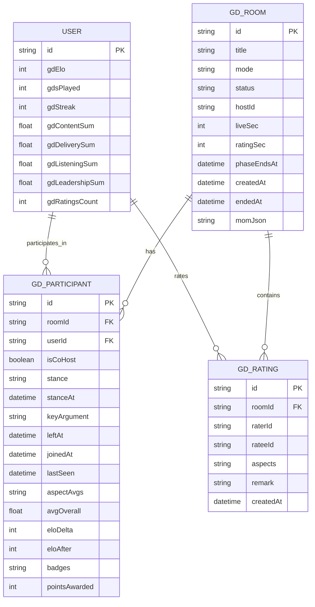
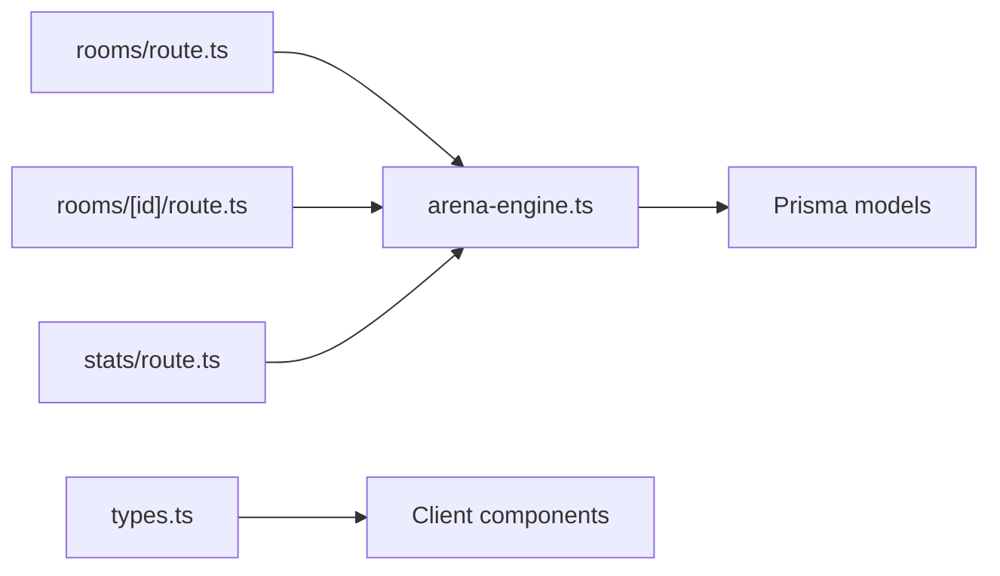

# Arena Battle System API

<cite>
**Referenced Files in This Document**
- [rooms/route.ts](file://src/app/api/arena/rooms/route.ts)
- [rooms/[id]/route.ts](file://src/app/api/arena/rooms/[id]/route.ts)
- [stats/route.ts](file://src/app/api/arena/stats/route.ts)
- [arena-engine.ts](file://src/lib/arena-engine.ts)
- [types.ts](file://src/components/welearn/arena/types.ts)
- [schema.prisma](file://prisma/schema.prisma)
</cite>

## Table of Contents
1. [Introduction](#introduction)
2. [Project Structure](#project-structure)
3. [Core Components](#core-components)
4. [Architecture Overview](#architecture-overview)
5. [Detailed Component Analysis](#detailed-component-analysis)
6. [Dependency Analysis](#dependency-analysis)
7. [Performance Considerations](#performance-considerations)
8. [Troubleshooting Guide](#troubleshooting-guide)
9. [Conclusion](#conclusion)

## Introduction
This document specifies the Arena battle system API used for real-time collaborative sessions across three game modes: Group Discussion (GD), Debate, and Pitching. It covers room creation and lifecycle management, participant state, peer rating, Elo integration, polling-based real-time updates, and error handling patterns. The system is server-authoritative: clients poll endpoints to receive authoritative state and phase transitions.

## Project Structure
The Arena feature is implemented as Next.js App Router API routes backed by a Prisma schema and an in-process engine module.

**Diagram sources**
- [rooms/route.ts:7-79](file://src/app/api/arena/rooms/route.ts#L7-L79)
- [rooms/[id]/route.ts:8-124](file://src/app/api/arena/rooms/[id]/route.ts#L8-L124)
- [rooms/[id]/route.ts:126-290](file://src/app/api/arena/rooms/[id]/route.ts#L126-L290)
- [stats/route.ts:5-97](file://src/app/api/arena/stats/route.ts#L5-L97)
- [arena-engine.ts:102-132](file://src/lib/arena-engine.ts#L102-L132)

**Section sources**
- [rooms/route.ts:1-115](file://src/app/api/arena/rooms/route.ts#L1-L115)
- [rooms/[id]/route.ts:1-291](file://src/app/api/arena/rooms/[id]/route.ts#L1-L291)
- [stats/route.ts:1-98](file://src/app/api/arena/stats/route.ts#L1-L98)
- [arena-engine.ts:1-415](file://src/lib/arena-engine.ts#L1-L415)
- [schema.prisma:283-342](file://prisma/schema.prisma#L283-L342)

## Core Components
- Room listing and creation endpoint
- Room detail and action endpoint
- Stats and profile endpoint
- Arena engine with lifecycle tick, finalization, Elo, badges, and coaching suggestions
- Shared TypeScript types mirroring API payloads

Key responsibilities:
- Room listing drives both board display and background lifecycle ticks for rooms without active viewers.
- Room detail acts as a heartbeat: it advances phases, records presence, and returns full state including ratings and MoM.
- Actions are consolidated into one endpoint with explicit authorization checks per action.
- Finalization aggregates peer ratings, awards badges, computes Elo deltas, updates user radar axes, and writes activity logs.

**Section sources**
- [rooms/route.ts:7-115](file://src/app/api/arena/rooms/route.ts#L7-L115)
- [rooms/[id]/route.ts:8-290](file://src/app/api/arena/rooms/[id]/route.ts#L8-L290)
- [stats/route.ts:5-97](file://src/app/api/arena/stats/route.ts#L5-L97)
- [arena-engine.ts:17-66](file://src/lib/arena-engine.ts#L17-L66)
- [arena-engine.ts:102-132](file://src/lib/arena-engine.ts#L102-L132)
- [arena-engine.ts:209-366](file://src/lib/arena-engine.ts#L209-L366)
- [types.ts:1-165](file://src/components/welearn/arena/types.ts#L1-L165)

## Architecture Overview
The Arena uses a polling-based real-time model rather than WebSockets. Clients repeatedly poll the room detail endpoint; each poll triggers server-side phase advancement and presence tracking.

**Diagram sources**
- [rooms/route.ts:7-79](file://src/app/api/arena/rooms/route.ts#L7-L79)
- [rooms/[id]/route.ts:8-124](file://src/app/api/arena/rooms/[id]/route.ts#L8-L124)
- [rooms/[id]/route.ts:126-290](file://src/app/api/arena/rooms/[id]/route.ts#L126-L290)
- [arena-engine.ts:102-132](file://src/lib/arena-engine.ts#L102-L132)

## Detailed Component Analysis

### API Endpoints

#### GET /api/arena/rooms
Returns a board of active and recently completed rooms. Also performs lifecycle ticks for expired rooms that have no active viewer.

- Query parameters
  - userId: string — optional; used to mark membership and return myActiveRoomId
- Response fields
  - rooms: array of BoardRoom objects
  - myActiveRoomId: string or null
  - serverNow: number — client clock reference

Behavior highlights:
- Filters out ended rooms older than 12 hours.
- Includes only participants who have not left.
- Computes MVP from finalized Minutes-of-Meeting JSON when available.
- Performs tickRoom on any expired live or rating-phase rooms before returning updated data.

Error handling:
- Returns a generic 500 error payload on unexpected failures.

**Section sources**
- [rooms/route.ts:7-79](file://src/app/api/arena/rooms/route.ts#L7-L79)

#### POST /api/arena/rooms
Creates a new arena room. The creator becomes host automatically.

- Request body
  - userId: string — required
  - title: string — trimmed, minimum 3 characters
  - mode: "gd" | "debate" | "pitch" — defaults to "gd" if invalid
  - topic: string — optional, trimmed up to 300 chars
  - liveSec: number — optional, clamped to [0, 2700]
  - ratingSec: number — optional, clamped to [0, 1800]
- Response
  - room: { id, title }

Validation:
- Validates user existence.
- Enforces title length.
- Normalizes and clamps timer values.

Error handling:
- 404 for unknown user.
- Generic 500 for other errors.

**Section sources**
- [rooms/route.ts:81-115](file://src/app/api/arena/rooms/route.ts#L81-L115)

#### GET /api/arena/rooms/:id
Retrieves live room state and serves as the heartbeat.

- Query parameters
  - userId: string — optional; presence heartbeat recorded if present
- Response structure
  - serverNow: number
  - room: room metadata
  - aspects: mode-specific rating aspects
  - participants: enriched participant list with ratings and results
  - me: current user context (permissions, rated peers, key argument)
  - submittedBy: users who submitted ratings
  - mom: Minutes-of-Meeting payload when room is ended

Lifecycle behavior:
- Calls tickRoom to advance phases based on wall-clock time.
- Updates lastSeen for the caller if stale (>5s).
- Loads all ratings for the room and maps per-participant star grids and remarks.

Error handling:
- 404 if room does not exist.
- Generic 500 otherwise.

**Section sources**
- [rooms/[id]/route.ts:8-124](file://src/app/api/arena/rooms/[id]/route.ts#L8-L124)

#### POST /api/arena/rooms/:id
Consolidated action endpoint for all room operations.

Supported actions:
- join: Join a room; prevents joining during rating or ended states.
- leave: Leave a room; if host leaves, room is deleted.
- delete_room: Delete room; host can do so directly; others must provide team PIN.
- cohost: Delegate co-host privileges; lobby-only; host-only.
- set_topic: Update topic; host/co-host only; min 3 chars.
- start_live: Start session; sets status to live and phaseEndsAt if timed.
- end_live: End live phase; opens rating phase with optional timer.
- finalize: Force finalize rating phase; host/co-host only.
- stance: Set stance ("for", "against", "moderator"); lobby/live only.
- key_argument: Save participant's key point; allowed until ended.
- rate: Submit multi-peer star ratings; rating phase only; validates aspect keys and 1–5 stars.

Authorization:
- Host/co-host checks where applicable.
- Team PIN check for non-host deletion.

Rating validation:
- Only present peers can be rated.
- Aspects validated against MODE_ASPECTS for the room’s mode.
- Remarks trimmed and capped at 400 chars.

Error handling:
- Specific messages for invalid state transitions and permissions.
- Generic 500 fallback.

**Section sources**
- [rooms/[id]/route.ts:126-290](file://src/app/api/arena/rooms/[id]/route.ts#L126-L290)

#### GET /api/arena/stats
Returns the Arena profile for a user: Elo, tier, radar, history, leaderboard rank, remarks, and coaching suggestions.

- Query parameters
  - userId: string — required
- Response fields
  - gdElo, tier, gdsPlayed, gdStreak
  - eloRange: { min, max }
  - radar: { content, delivery, listening, leadership }
  - rank, totalRanked, top10
  - history: recent finalized participations
  - badgeCounts, remarks, avgStars, winRate, suggestions

Notes:
- Radar averages are computed from canonical axis mapping of mode-specific aspects.
- Suggestions are rule-based and depend on weakest axes and win rate.

Error handling:
- 404 for missing user.
- Generic 500 otherwise.

**Section sources**
- [stats/route.ts:5-97](file://src/app/api/arena/stats/route.ts#L5-L97)

### Game Modes and Rating Aspects

| Mode | Label | Aspects | Notes |
|---|---|---|---|
| gd | Group Discussion | content, clarity, listening, leadership | Collaborative discussion; leadership includes steering group |
| debate | Debate | argument, rebuttal, delivery, respect | Stances: for, against, moderator |
| pitch | Pitching | problem, solution, market, delivery | Founder-style pitches |

Mode metadata and labels are defined centrally and reused by both server and client.

**Section sources**
- [arena-engine.ts:28-53](file://src/lib/arena-engine.ts#L28-L53)
- [types.ts:121-146](file://src/components/welearn/arena/types.ts#L121-L146)

### Room Lifecycle and State Machine

- Lobby: Host sets topic, stances, and starts session.
- Live: Participants discuss; optional timer auto-transitions to rating.
- Rating: Peer rating grid opens; optional timer or fast path (all present and all rated) finalizes.
- Ended: Results, badges, Elo, and MoM are computed.

**Diagram sources**
- [arena-engine.ts:102-132](file://src/lib/arena-engine.ts#L102-L132)
- [rooms/[id]/route.ts:198-228](file://src/app/api/arena/rooms/[id]/route.ts#L198-L228)

### Participant State Management
- Presence: lastSeen updated on every room detail poll if stale.
- Joined/left: join sets lastSeen; leave removes participant (or deletes room if host).
- Permissions: isHost derived from hostId; isCoHost stored per participant; canHost = host or co-host.
- Stance: debate-mode role selection; locked after live ends.
- Key argument: free-text summary saved per participant until room ends.

**Section sources**
- [rooms/[id]/route.ts:26-33](file://src/app/api/arena/rooms/[id]/route.ts#L26-L33)
- [rooms/[id]/route.ts:148-166](file://src/app/api/arena/rooms/[id]/route.ts#L148-L166)
- [rooms/[id]/route.ts:231-249](file://src/app/api/arena/rooms/[id]/route.ts#L231-L249)

### Real-Time Update Patterns
- Polling interval: ~1.5 seconds in the UI.
- Clock sync: serverNow allows clients to compute phaseEndsAt locally.
- Heartbeat: presence lastSeen updated on polls to support fast-path finalization.
- Optimistic UI: clients may show local changes but rely on server responses for authority.

**Diagram sources**
- [rooms/[id]/route.ts:8-33](file://src/app/api/arena/rooms/[id]/route.ts#L8-L33)
- [arena-engine.ts:102-132](file://src/lib/arena-engine.ts#L102-L132)

**Section sources**
- [types.ts:45-73](file://src/components/welearn/arena/types.ts#L45-L73)

### Elo Rating System Integration
- Scale: 1000–3000; starting value 1200.
- Delta computation:
  - Based on average overall star score.
  - MVP bonus and host bonus included.
  - Clamped to [-80, 120].
- After finalization:
  - User.gdElo updated.
  - gdsPlayed incremented.
  - gdStreak maintained using IST day key.
  - Radar sums updated via canonical axis mapping.
  - Activity log created with points and details.

Tier mapping:
- Novice Negotiator, Rising Orator, Deck Debater, Boardroom Gladiator, E-Summit Elite, Grand Orator.

**Section sources**
- [arena-engine.ts:55-66](file://src/lib/arena-engine.ts#L55-L66)
- [arena-engine.ts:293-364](file://src/lib/arena-engine.ts#L293-L364)
- [schema.prisma:38-48](file://prisma/schema.prisma#L38-L48)

### Scoring Calculations and Badges
- Points awarded:
  - Base participation points.
  - Performance points proportional to average overall stars.
  - MVP bonus.
- Badges:
  - MVP: highest overall average.
  - Aspect Stars: best performer per aspect if threshold met.
- MoM:
  - Aggregates key arguments, remarks, and optionally AI-generated narrative.

**Section sources**
- [arena-engine.ts:261-366](file://src/lib/arena-engine.ts#L261-L366)

### Data Models

**Diagram sources**
- [schema.prisma:283-342](file://prisma/schema.prisma#L283-L342)
- [schema.prisma:11-48](file://prisma/schema.prisma#L11-L48)

## Dependency Analysis

- Coupling:
  - Routes depend on the engine for lifecycle and finalization logic.
  - Stats route depends on engine utilities for tier and suggestions.
  - Types mirror API payloads for type safety on the client.
- Cohesion:
  - Engine encapsulates all domain rules (phases, Elo, badges, radar mapping).
  - Routes focus on HTTP concerns, validation, and persistence.

**Diagram sources**
- [rooms/route.ts:1-115](file://src/app/api/arena/rooms/route.ts#L1-L115)
- [rooms/[id]/route.ts:1-291](file://src/app/api/arena/rooms/[id]/route.ts#L1-L291)
- [stats/route.ts:1-98](file://src/app/api/arena/stats/route.ts#L1-L98)
- [arena-engine.ts:1-415](file://src/lib/arena-engine.ts#L1-L415)
- [types.ts:1-165](file://src/components/welearn/arena/types.ts#L1-L165)

**Section sources**
- [rooms/route.ts:1-115](file://src/app/api/arena/rooms/route.ts#L1-L115)
- [rooms/[id]/route.ts:1-291](file://src/app/api/arena/rooms/[id]/route.ts#L1-L291)
- [stats/route.ts:1-98](file://src/app/api/arena/stats/route.ts#L1-L98)
- [arena-engine.ts:1-415](file://src/lib/arena-engine.ts#L1-L415)
- [types.ts:1-165](file://src/components/welearn/arena/types.ts#L1-L165)

## Performance Considerations
- Polling frequency: UI polls every ~1.5 seconds; ensure backend can handle concurrent requests.
- Phase transitions: Atomic claims prevent race conditions during state changes.
- Fast-path finalization: When all present participants submit ratings within a short window, the rating phase finalizes immediately without waiting for the timer.
- Database queries: Room detail loads participants and ratings; consider indexing strategies for high-traffic rooms.
- Optional timers: Untimed rooms reduce server pressure by deferring transitions to host control.

[No sources needed since this section provides general guidance]

## Troubleshooting Guide
Common issues and resolutions:
- Unknown action: Ensure action names match supported actions exactly.
- Invalid state transition: Verify current room status matches the action’s precondition.
- Permission denied: Confirm host/co-host roles or provide team PIN for deletion.
- Invalid rating aspects: Check that aspect keys match the mode’s aspects and values are between 1 and 5.
- Room not found: Verify room ID and that the room has not been deleted.
- Server errors: Inspect generic error payloads returned by jsonError helpers.

Operational tips:
- Use serverNow to align client clocks with server deadlines.
- Monitor lastSeen staleness to diagnose connectivity issues.
- Review MoM and remarks for post-session analysis.

**Section sources**
- [rooms/[id]/route.ts:284-289](file://src/app/api/arena/rooms/[id]/route.ts#L284-L289)
- [rooms/route.ts:76-78](file://src/app/api/arena/rooms/route.ts#L76-L78)
- [stats/route.ts:94-97](file://src/app/api/arena/stats/route.ts#L94-L97)

## Conclusion
The Arena battle system provides a robust, server-authoritative platform for collaborative practice across GD, Debate, and Pitching modes. Its design emphasizes clear lifecycle management, peer-driven scoring, and continuous Elo progression. The polling-based real-time model ensures consistency while keeping infrastructure simple. With comprehensive error handling and rich analytics, teams can run effective practice sessions and track improvement over time.