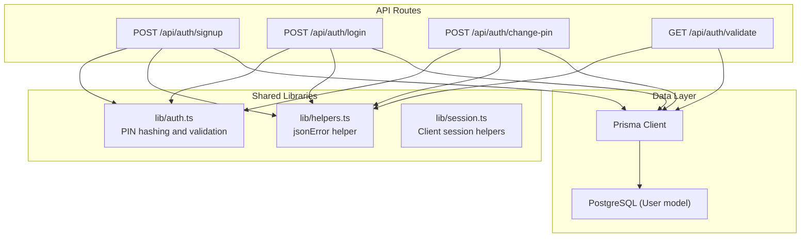
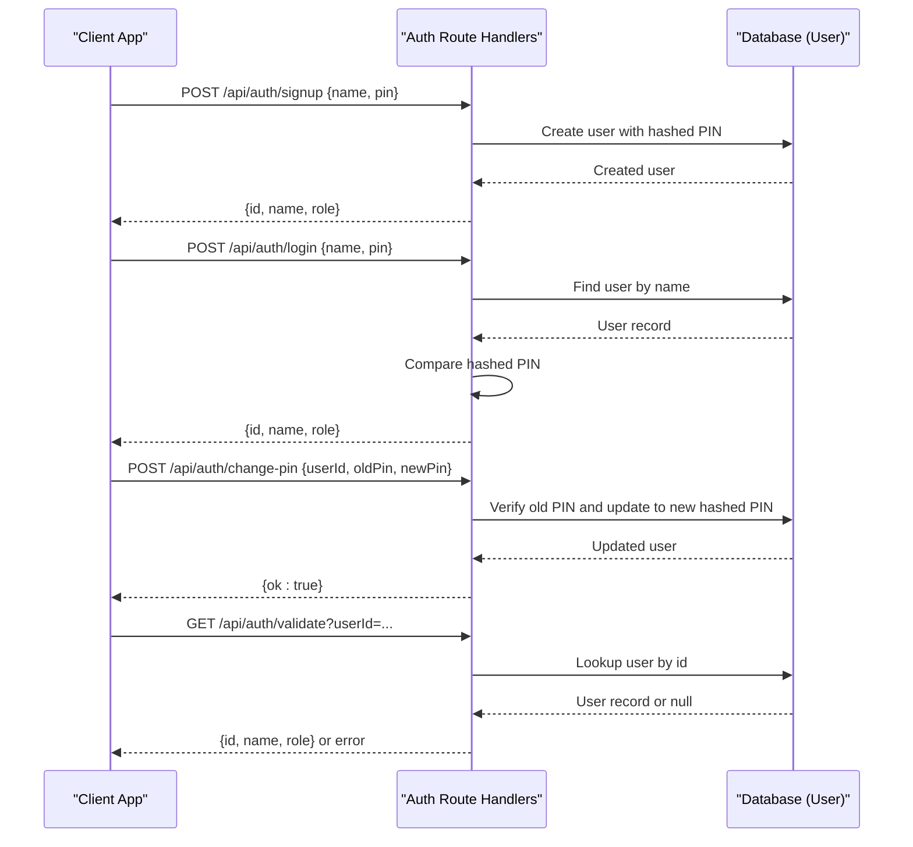
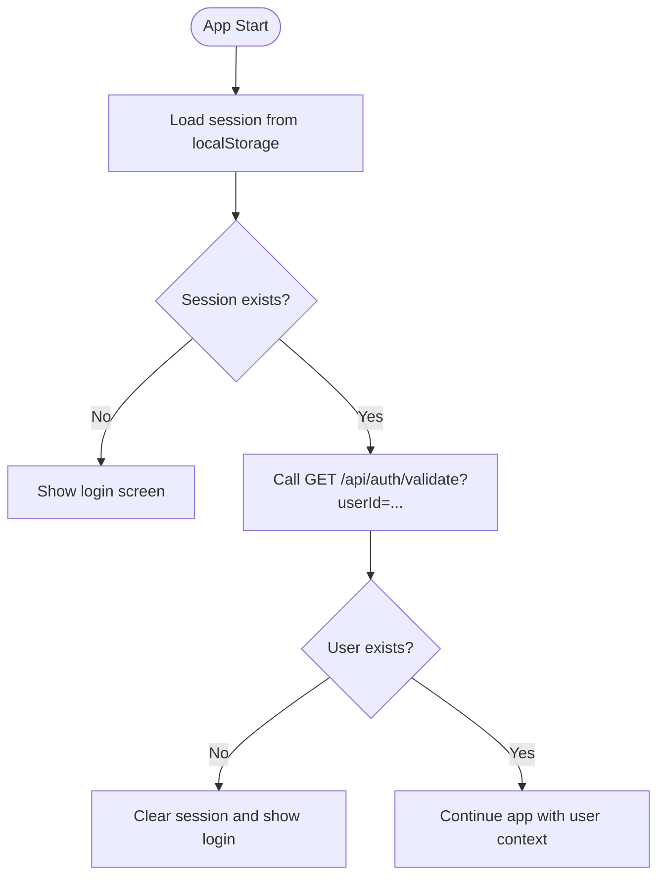
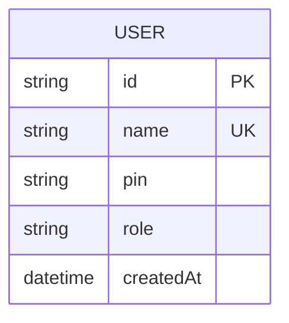
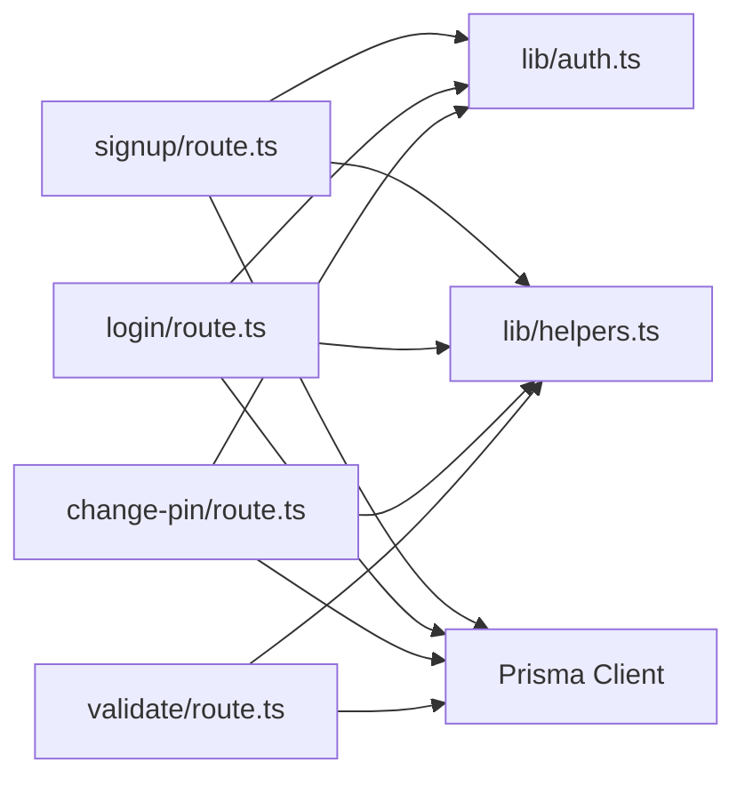

# Authentication API

<cite>
**Referenced Files in This Document**
- [route.ts](file://src/app/api/auth/login/route.ts)
- [route.ts](file://src/app/api/auth/signup/route.ts)
- [route.ts](file://src/app/api/auth/change-pin/route.ts)
- [route.ts](file://src/app/api/auth/validate/route.ts)
- [auth.ts](file://src/lib/auth.ts)
- [session.ts](file://src/lib/session.ts)
- [helpers.ts](file://src/lib/helpers.ts)
- [schema.prisma](file://prisma/schema.prisma)
</cite>

## Table of Contents
1. [Introduction](#introduction)
2. [Project Structure](#project-structure)
3. [Core Components](#core-components)
4. [Architecture Overview](#architecture-overview)
5. [Detailed Component Analysis](#detailed-component-analysis)
6. [Dependency Analysis](#dependency-analysis)
7. [Performance Considerations](#performance-considerations)
8. [Troubleshooting Guide](#troubleshooting-guide)
9. [Conclusion](#conclusion)

## Introduction
This document describes the PIN-based authentication system for WeLearn. It covers four endpoints: signup, login, change-pin, and validate. The system uses a 4-digit PIN per user, stored as a salted SHA-256 hash. After successful authentication, the client stores a lightweight session object in localStorage and can periodically validate it against the server.

Key characteristics:
- No passwords; identity is established by name plus a 4-digit PIN.
- User roles are member or admin.
- Sessions are client-side only; there is no server-side token store.
- Validation checks whether the user still exists in the database.

## Project Structure
The authentication feature is implemented as Next.js App Router route handlers under `src/app/api/auth`. Shared logic lives in `src/lib`, including PIN hashing/validation helpers and client-side session utilities.

**Diagram sources**
- [route.ts:6-20](file://src/app/api/auth/signup/route.ts#L6-L20)
- [route.ts:6-20](file://src/app/api/auth/login/route.ts#L6-L20)
- [route.ts:5-19](file://src/app/api/auth/change-pin/route.ts#L5-L19)
- [route.ts:5-12](file://src/app/api/auth/validate/route.ts#L5-L12)
- [auth.ts:9-20](file://src/lib/auth.ts#L9-L20)
- [helpers.ts:39-41](file://src/lib/helpers.ts#L39-L41)
- [session.ts:11-42](file://src/lib/session.ts#L11-L42)
- [schema.prisma:11-16](file://prisma/schema.prisma#L11-L16)

**Section sources**
- [route.ts:6-30](file://src/app/api/auth/signup/route.ts#L6-L30)
- [route.ts:6-24](file://src/app/api/auth/login/route.ts#L6-L24)
- [route.ts:5-22](file://src/app/api/auth/change-pin/route.ts#L5-L22)
- [route.ts:5-15](file://src/app/api/auth/validate/route.ts#L5-L15)
- [auth.ts:9-20](file://src/lib/auth.ts#L9-L20)
- [helpers.ts:39-41](file://src/lib/helpers.ts#L39-L41)
- [session.ts:11-42](file://src/lib/session.ts#L11-L42)
- [schema.prisma:11-16](file://prisma/schema.prisma#L11-L16)

## Core Components
- PIN hashing and validation:
  - PINs are hashed with a salted SHA-256 before storage.
  - PIN format must be exactly 4 digits.
  - Name validation enforces length and disallows certain characters.
- Session management:
  - Client-side session object contains id, name, and role.
  - Stored in localStorage under a stable key.
  - Includes a small fetch wrapper that throws on non-OK responses.
- Error handling:
  - Server returns JSON errors via a shared helper with an error message and HTTP status.

**Section sources**
- [auth.ts:9-20](file://src/lib/auth.ts#L9-L20)
- [session.ts:3-42](file://src/lib/session.ts#L3-L42)
- [helpers.ts:39-41](file://src/lib/helpers.ts#L39-L41)

## Architecture Overview
The authentication flow is simple and stateless from the server’s perspective:
- Signup validates inputs, creates a user with a hashed PIN, and returns basic profile data.
- Login verifies name and PIN, then returns profile data.
- Change-pin verifies the old PIN and updates to a new hashed PIN.
- Validate checks if the user still exists and returns current profile data.

**Diagram sources**
- [route.ts:6-30](file://src/app/api/auth/signup/route.ts#L6-L30)
- [route.ts:6-24](file://src/app/api/auth/login/route.ts#L6-L24)
- [route.ts:5-22](file://src/app/api/auth/change-pin/route.ts#L5-L22)
- [route.ts:5-15](file://src/app/api/auth/validate/route.ts#L5-L15)
- [schema.prisma:11-16](file://prisma/schema.prisma#L11-L16)

## Detailed Component Analysis

### Endpoint: POST /api/auth/signup
Purpose: Register a new user with a unique name and a 4-digit PIN.

Request schema:
- Body: JSON object
  - name: string (required, trimmed)
  - pin: string (required, exactly 4 digits)

Response schema:
- Success (200):
  - id: string
  - name: string
  - role: string ("member")
- Error (varies):
  - { error: string }

Validation and behavior:
- Validates name length and forbidden characters.
- Validates PIN is exactly 4 digits.
- Ensures the name is not already taken (case-insensitive).
- Hashes the PIN before storing.
- Creates an activity log entry upon successful signup.

Common error responses:
- Invalid name or PIN format.
- Duplicate name.
- Database or unexpected errors.

Security considerations:
- PIN is never stored in plaintext; it is hashed with a salt.
- No password policy beyond PIN format.

Rate limiting:
- Not implemented at the endpoint level.

**Section sources**
- [route.ts:6-30](file://src/app/api/auth/signup/route.ts#L6-L30)
- [auth.ts:13-20](file://src/lib/auth.ts#L13-L20)
- [schema.prisma:11-16](file://prisma/schema.prisma#L11-L16)

### Endpoint: POST /api/auth/login
Purpose: Authenticate a user by name and PIN.

Request schema:
- Body: JSON object
  - name: string (required, trimmed)
  - pin: string (required)

Response schema:
- Success (200):
  - id: string
  - name: string
  - role: string ("member" or "admin")
- Error (varies):
  - { error: string }

Validation and behavior:
- Looks up users and matches by name (case-insensitive).
- Compares the provided PIN against the stored hashed PIN.
- Returns user profile data on success.

Common error responses:
- User not found.
- Wrong PIN.
- Unexpected server error.

Security considerations:
- Uses hashed PIN comparison.
- No brute-force protection or lockout mechanism.

Rate limiting:
- Not implemented at the endpoint level.

**Section sources**
- [route.ts:6-24](file://src/app/api/auth/login/route.ts#L6-L24)
- [auth.ts:9-15](file://src/lib/auth.ts#L9-L15)

### Endpoint: POST /api/auth/change-pin
Purpose: Update a user’s PIN after verifying the current one.

Request schema:
- Body: JSON object
  - userId: string (required)
  - oldPin: string (required)
  - newPin: string (required, exactly 4 digits)

Response schema:
- Success (200):
  - ok: boolean
- Error (varies):
  - { error: string }

Validation and behavior:
- Validates new PIN format.
- Verifies the old PIN against the stored hash.
- Updates the user’s PIN to a new hash.

Common error responses:
- New PIN invalid format.
- User not found.
- Incorrect current PIN.
- Internal server error.

Security considerations:
- Requires proof of ownership via old PIN.
- No additional authorization check beyond PIN verification.

Rate limiting:
- Not implemented at the endpoint level.

**Section sources**
- [route.ts:5-22](file://src/app/api/auth/change-pin/route.ts#L5-L22)
- [auth.ts:13-15](file://src/lib/auth.ts#L13-L15)

### Endpoint: GET /api/auth/validate
Purpose: Check whether a session ID corresponds to an existing user.

Request schema:
- Query parameters:
  - userId: string (required)

Response schema:
- Success (200):
  - id: string
  - name: string
  - role: string
- Error (varies):
  - { error: string }

Validation and behavior:
- Requires userId query parameter.
- Looks up user by id and returns minimal profile data.
- Returns unauthorized if the user does not exist.

Common error responses:
- Missing userId.
- Session expired (user not found).
- Internal server error.

Security considerations:
- Exposes user existence and basic profile fields when userId is known.
- Does not require any secret token; rely on secrecy of userId.

Rate limiting:
- Not implemented at the endpoint level.

**Section sources**
- [route.ts:5-15](file://src/app/api/auth/validate/route.ts#L5-L15)

### Session Management
The client maintains a session object in localStorage after successful authentication.

Session object structure:
- id: string
- name: string
- role: "member" | "admin"

Operations:
- Load session from localStorage.
- Save session to localStorage.
- Clear session from localStorage.
- Lightweight fetch wrapper that throws on non-OK responses.

Usage pattern:
- After login or signup, save the returned user object as the session.
- On app start, load the session to restore user context.
- Periodically call validate with the stored userId to ensure the session is still valid.

**Diagram sources**
- [session.ts:11-42](file://src/lib/session.ts#L11-L42)
- [route.ts:5-15](file://src/app/api/auth/validate/route.ts#L5-L15)

**Section sources**
- [session.ts:3-42](file://src/lib/session.ts#L3-L42)

### Data Model
The User model defines the core authentication fields.

**Diagram sources**
- [schema.prisma:11-16](file://prisma/schema.prisma#L11-L16)

**Section sources**
- [schema.prisma:11-16](file://prisma/schema.prisma#L11-L16)

## Dependency Analysis
Authentication routes depend on:
- Prisma Client for database operations.
- Shared auth helpers for PIN hashing and validation.
- Helpers for consistent error responses.
- Auto-migration utility to ensure the database is ready.

**Diagram sources**
- [route.ts:6-30](file://src/app/api/auth/signup/route.ts#L6-L30)
- [route.ts:6-24](file://src/app/api/auth/login/route.ts#L6-L24)
- [route.ts:5-22](file://src/app/api/auth/change-pin/route.ts#L5-L22)
- [route.ts:5-15](file://src/app/api/auth/validate/route.ts#L5-L15)
- [auth.ts:9-20](file://src/lib/auth.ts#L9-L20)
- [helpers.ts:39-41](file://src/lib/helpers.ts#L39-L41)

**Section sources**
- [route.ts:6-30](file://src/app/api/auth/signup/route.ts#L6-L30)
- [route.ts:6-24](file://src/app/api/auth/login/route.ts#L6-L24)
- [route.ts:5-22](file://src/app/api/auth/change-pin/route.ts#L5-L22)
- [route.ts:5-15](file://src/app/api/auth/validate/route.ts#L5-L15)
- [auth.ts:9-20](file://src/lib/auth.ts#L9-L20)
- [helpers.ts:39-41](file://src/lib/helpers.ts#L39-L41)

## Performance Considerations
- All endpoints perform database reads/writes on each request.
- Login scans all users to match names case-insensitively; consider indexing or normalized lookups for large user sets.
- PIN hashing is lightweight but executed per request; caching is not applicable due to security requirements.
- No response caching is applied; clients should avoid excessive polling of validate.

[No sources needed since this section provides general guidance]

## Troubleshooting Guide
Common issues and resolutions:
- Invalid name or PIN format:
  - Ensure name is between 2 and 40 characters and does not contain forbidden characters.
  - Ensure PIN is exactly 4 digits.
- Duplicate name during signup:
  - Use a different name or attempt login if the account already exists.
- Wrong PIN during login or change-pin:
  - Re-enter the correct PIN; verify that the stored PIN was set correctly during signup.
- Session expired during validate:
  - The user may have been deleted or the userId is incorrect; re-authenticate and refresh the session.
- Unexpected server errors:
  - Check logs for database connectivity or migration issues.

Error response format:
- All errors return a JSON body with an error message and an appropriate HTTP status code.

**Section sources**
- [helpers.ts:39-41](file://src/lib/helpers.ts#L39-L41)
- [route.ts:6-30](file://src/app/api/auth/signup/route.ts#L6-L30)
- [route.ts:6-24](file://src/app/api/auth/login/route.ts#L6-L24)
- [route.ts:5-22](file://src/app/api/auth/change-pin/route.ts#L5-L22)
- [route.ts:5-15](file://src/app/api/auth/validate/route.ts#L5-L15)

## Conclusion
The WeLearn authentication system is a straightforward PIN-based scheme designed for simplicity and speed. It relies on client-side sessions and periodic server validation rather than server-side tokens. While easy to implement, it lacks several production-grade features such as rate limiting, brute-force protection, secure transport enforcement, and robust permission checks. For team-wide sensitive actions, a separate shared team PIN mechanism exists elsewhere in the codebase.

[No sources needed since this section summarizes without analyzing specific files]