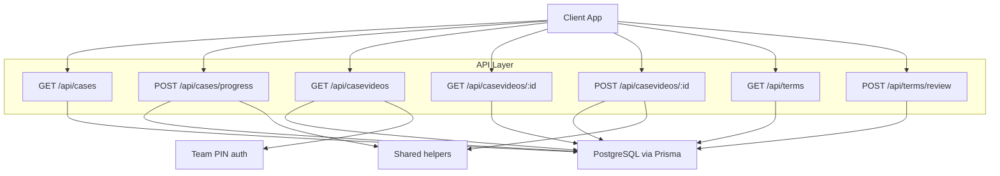
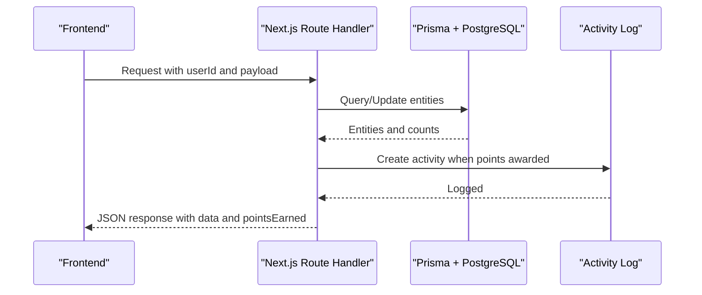
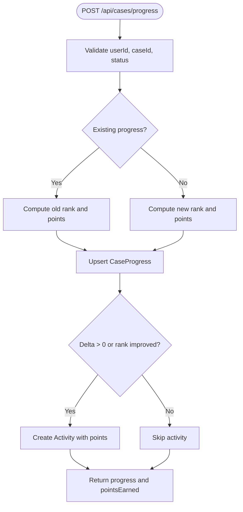
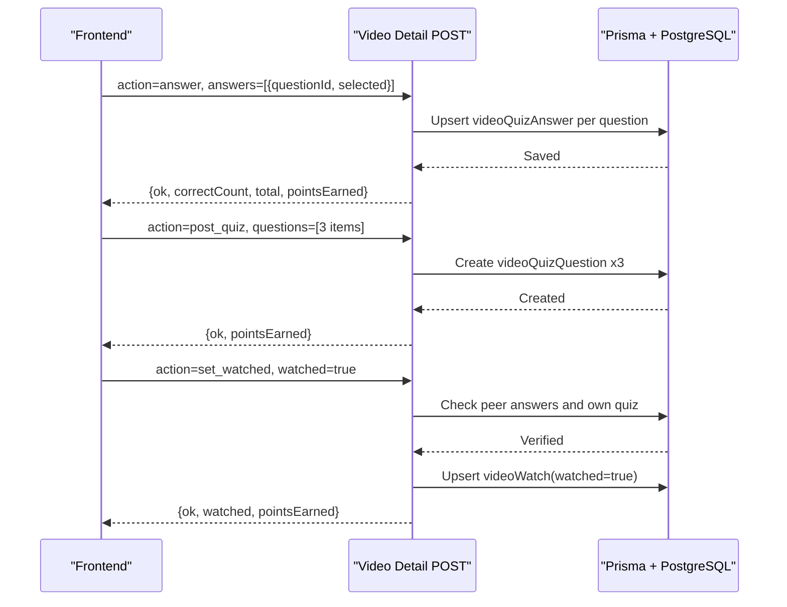
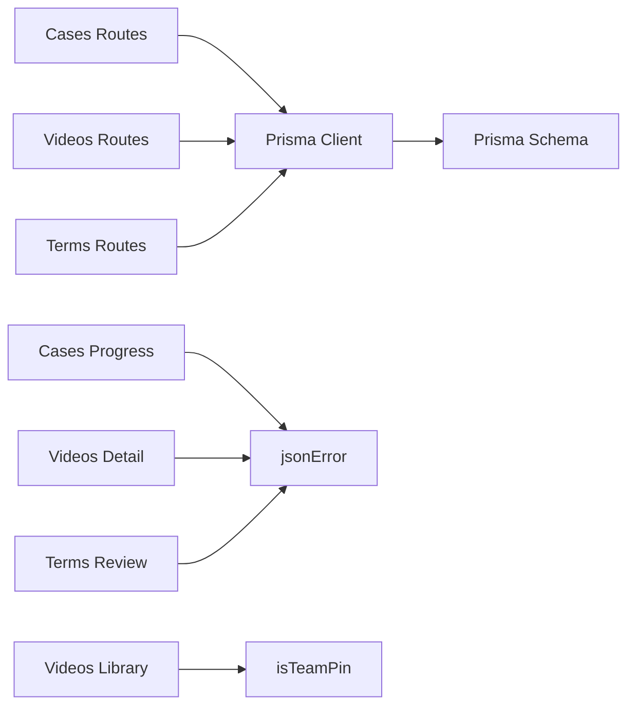

# Content Management API

<cite>
**Referenced Files in This Document**
- [route.ts](file://src/app/api/cases/route.ts)
- [route.ts](file://src/app/api/cases/progress/route.ts)
- [route.ts](file://src/app/api/casevideos/route.ts)
- [route.ts](file://src/app/api/casevideos/[id]/route.ts)
- [route.ts](file://src/app/api/terms/route.ts)
- [route.ts](file://src/app/api/terms/review/route.ts)
- [schema.prisma](file://prisma/schema.prisma)
- [db.ts](file://src/lib/db.ts)
- [helpers.ts](file://src/lib/helpers.ts)
- [auth.ts](file://src/lib/auth.ts)
</cite>

## Table of Contents
1. [Introduction](#introduction)
2. [Project Structure](#project-structure)
3. [Core Components](#core-components)
4. [Architecture Overview](#architecture-overview)
5. [Detailed Component Analysis](#detailed-component-analysis)
6. [Dependency Analysis](#dependency-analysis)
7. [Performance Considerations](#performance-considerations)
8. [Troubleshooting Guide](#troubleshooting-guide)
9. [Conclusion](#conclusion)

## Introduction
This document provides detailed API documentation for the content management endpoints that power case studies, video content integration, progress tracking, and term review workflows. It explains how clients interact with:
- Case study listing and per-user progress
- Shared YouTube video library with peer quiz flow and watch state
- Term catalog with user review status
- Gamification activity logging for points and engagement

The APIs are implemented as Next.js App Router route handlers backed by Prisma and a PostgreSQL database. They expose REST-style JSON endpoints used by the frontend to manage learning content and track user progress.

## Project Structure
The relevant API routes live under `src/app/api`:
- `/api/cases` — list case studies and merge per-user progress
- `/api/cases/progress` — upsert case study progress and award points
- `/api/casevideos` — shared video library CRUD (PIN-gated write operations)
- `/api/casevideos/[id]` — per-video watch flow, peer quiz answers, and completion gating
- `/api/terms` — list terms with per-user review map
- `/api/terms/review` — mark terms known or still learning

**Diagram sources**
- [route.ts:1-37](file://src/app/api/cases/route.ts#L1-L37)
- [route.ts:1-54](file://src/app/api/cases/progress/route.ts#L1-L54)
- [route.ts:1-122](file://src/app/api/casevideos/route.ts#L1-L122)
- [route.ts:1-207](file://src/app/api/casevideos/[id]/route.ts#L1-L207)
- [route.ts:1-32](file://src/app/api/terms/route.ts#L1-L32)
- [route.ts:1-36](file://src/app/api/terms/review/route.ts#L1-L36)

**Section sources**
- [route.ts:1-37](file://src/app/api/cases/route.ts#L1-L37)
- [route.ts:1-54](file://src/app/api/cases/progress/route.ts#L1-L54)
- [route.ts:1-122](file://src/app/api/casevideos/route.ts#L1-L122)
- [route.ts:1-207](file://src/app/api/casevideos/[id]/route.ts#L1-L207)
- [route.ts:1-32](file://src/app/api/terms/route.ts#L1-L32)
- [route.ts:1-36](file://src/app/api/terms/review/route.ts#L1-L36)

## Core Components
- Case Studies
  - List cases with optional per-user progress merged into each item.
  - Upsert per-user progress with status transitions and point deltas.
- Video Library
  - Shared YouTube video catalog with watch state and question counts.
  - Per-video watch flow: answer peer questions, post own quiz, then tick watched.
  - Team PIN-gated add/delete operations.
- Terms
  - Catalog of business/startup terms with per-user review status.
  - Mark terms known or learning; first-time known marks award points.

Common patterns:
- All endpoints accept a `userId` query parameter where applicable to scope data to the current user.
- Write endpoints validate inputs and return structured error responses using a shared helper.
- Progress and engagement are recorded as activities for gamification.

**Section sources**
- [route.ts:1-37](file://src/app/api/cases/route.ts#L1-L37)
- [route.ts:1-54](file://src/app/api/cases/progress/route.ts#L1-L54)
- [route.ts:1-122](file://src/app/api/casevideos/route.ts#L1-L122)
- [route.ts:1-207](file://src/app/api/casevideos/[id]/route.ts#L1-L207)
- [route.ts:1-32](file://src/app/api/terms/route.ts#L1-L32)
- [route.ts:1-36](file://src/app/api/terms/review/route.ts#L1-L36)

## Architecture Overview
The system follows a simple layered architecture:
- HTTP layer: Next.js route handlers parse requests, validate inputs, and return JSON.
- Data layer: Prisma client queries/mutations against PostgreSQL.
- Shared utilities: Error formatting, team PIN validation, and time helpers.

**Diagram sources**
- [route.ts:1-54](file://src/app/api/cases/progress/route.ts#L1-L54)
- [route.ts:1-207](file://src/app/api/casevideos/[id]/route.ts#L1-L207)
- [route.ts:1-36](file://src/app/api/terms/review/route.ts#L1-L36)

## Detailed Component Analysis

### Case Studies API
Endpoints:
- GET `/api/cases?userId=...`
- POST `/api/cases/progress`

Behavior:
- GET returns all case studies and merges per-user progress if `userId` is provided. Each case includes an optional `progress` object with `status` and `notes`.
- POST upserts a user’s progress for a case. Valid statuses include watching, analysed, deck_ready. Points are awarded based on status progression. An activity record is created when points are earned.

Request schemas:
- GET
  - Query parameters:
    - `userId` (string, optional): user identifier to merge progress.
- POST
  - Body fields:
    - `userId` (string, required)
    - `caseId` (string, required)
    - `status` (string, one of: watching, analysed, deck_ready)
    - `notes` (string, optional, max length enforced server-side)

Response schemas:
- GET
  - `cases` (array): each item contains:
    - `id`, `slug`, `startup`, `tagline`, `sector`, `youtubeId`, `description`, `keyMetrics`, `discussion`, `source`, `progress`
    - `progress` (object or null): `status`, `notes`
- POST
  - `progress` (object): `status`, `notes`
  - `pointsEarned` (number): delta points for progressing

Error handling:
- Missing user or case ID returns a structured error.
- Invalid status returns a structured error.
- Server errors return a generic error message.

Data model relationships:
- CaseStudy has many CaseProgress records.
- CaseProgress belongs to User and CaseStudy.

**Diagram sources**
- [route.ts:1-54](file://src/app/api/cases/progress/route.ts#L1-L54)

**Section sources**
- [route.ts:1-37](file://src/app/api/cases/route.ts#L1-L37)
- [route.ts:1-54](file://src/app/api/cases/progress/route.ts#L1-L54)
- [schema.prisma:85-113](file://prisma/schema.prisma#L85-L113)

### Video Library API
Endpoints:
- GET `/api/casevideos?userId=...`
- POST `/api/casevideos`
- DELETE `/api/casevideos`
- GET `/api/casevideos/[id]?userId=...`
- POST `/api/casevideos/[id]`

Behavior:
- GET lists videos with watch counts, question counts, and per-user watched state.
- POST adds a new video to the shared library; requires a valid team PIN and validates YouTube URL parsing.
- DELETE removes a video; requires a valid team PIN.
- GET per video returns full watch-flow state: video metadata, my watch record, peer questions I must answer, and my posted questions.
- POST per video supports actions:
  - `answer`: submit answers to mandatory peer questions; server grades and awards points per correct answer.
  - `post_quiz`: post three multiple-choice questions with four options and a correct index.
  - `set_watched`: mark video watched only after answering all peer questions and posting your own quiz.

Request schemas:
- GET
  - Query parameters:
    - `userId` (string, optional)
- POST (library)
  - Body fields:
    - `userId` (string, required)
    - `pin` (string, required; must match team PIN)
    - `title` (string, min length enforced)
    - `description` (string, optional, max length enforced)
    - `youtubeUrl` or `youtubeId` (string; URL parsed to extract id)
- DELETE (library)
  - Body fields:
    - `videoId` (string, required)
    - `pin` (string, required)
- GET per video
  - Query parameters:
    - `userId` (string, optional)
- POST per video
  - Body fields:
    - `action` (string, one of: answer, post_quiz, set_watched)
    - `userId` (string, required)
    - For `answer`:
      - `answers` (array of objects): each with `questionId`, `selected`
    - For `post_quiz`:
      - `questions` (array of exactly 3 objects): each with `text`, `options` (array of 4 strings), `answer` (integer 0–3)
    - For `set_watched`:
      - `watched` (boolean)

Response schemas:
- GET (library)
  - `videos` (array): each item contains:
    - `id`, `title`, `youtubeId`, `description`, `addedBy`, `source`, `createdAt`, `watchedByMe`, `watchedCount`, `questionCount`, `myQuestionCount`
- POST (library)
  - `video` (object): `id`
  - `pointsEarned` (number)
- DELETE (library)
  - `ok` (boolean)
- GET per video
  - `video` (object): `id`, `title`, `youtubeId`, `description`, `source`
  - `me` (object): `watched`, `answeredAll`, `unansweredCount`, `postedMyQuiz`, `myQuestionCount`
  - `peerQuestions` (array): each with `id`, `creatorName`, `text`, `options`, `answered`, `mySelected`, `myCorrect`
  - `myQuestions` (array): each with `id`, `text`, `options`, `answer`
  - `watchedCount` (number)
- POST per video
  - For `answer`:
    - `ok` (boolean)
    - `correctCount` (number)
    - `total` (number)
    - `pointsEarned` (number)
  - For `post_quiz`:
    - `ok` (boolean)
    - `pointsEarned` (number)
  - For `set_watched`:
    - `ok` (boolean)
    - `watched` (boolean)
    - `pointsEarned` (number)

Error handling:
- Missing user, invalid PIN, duplicate video, missing answers, invalid quiz structure, or unmet prerequisites return structured errors.
- Server errors return generic messages.

Watch flow sequence:

**Diagram sources**
- [route.ts:1-207](file://src/app/api/casevideos/[id]/route.ts#L1-L207)

**Section sources**
- [route.ts:1-122](file://src/app/api/casevideos/route.ts#L1-L122)
- [route.ts:1-207](file://src/app/api/casevideos/[id]/route.ts#L1-L207)
- [schema.prisma:349-407](file://prisma/schema.prisma#L349-L407)
- [auth.ts:1-26](file://src/lib/auth.ts#L1-L26)

### Terms API
Endpoints:
- GET `/api/terms?userId=...`
- POST `/api/terms/review`

Behavior:
- GET returns all terms with per-user review status (`known`).
- POST updates a user’s review for a term. If marking known for the first time, it awards points and logs an activity.

Request schemas:
- GET
  - Query parameters:
    - `userId` (string, optional)
- POST
  - Body fields:
    - `userId` (string, required)
    - `termId` (string, required)
    - `known` (boolean)

Response schemas:
- GET
  - `terms` (array): each item contains:
    - `id`, `abbr`, `full`, `category`, `meaning`, `usage`, `ecellDefinition`, `startupContext`, `keyWarning`, `source`, `known`
- POST
  - `ok` (boolean)
  - `pointsEarned` (number)

Error handling:
- Missing user or term ID returns a structured error.
- Server errors return generic messages.

**Section sources**
- [route.ts:1-32](file://src/app/api/terms/route.ts#L1-L32)
- [route.ts:1-36](file://src/app/api/terms/review/route.ts#L1-L36)
- [schema.prisma:115-130](file://prisma/schema.prisma#L115-L130)
- [schema.prisma:234-245](file://prisma/schema.prisma#L234-L245)

## Dependency Analysis
Key dependencies:
- Database access via Prisma client configured in `db.ts`.
- Shared helpers for error responses and time utilities.
- Authentication helper for team PIN validation.

**Diagram sources**
- [db.ts:1-50](file://src/lib/db.ts#L1-L50)
- [helpers.ts:1-42](file://src/lib/helpers.ts#L1-L42)
- [auth.ts:1-26](file://src/lib/auth.ts#L1-L26)
- [schema.prisma:1-641](file://prisma/schema.prisma#L1-L641)

**Section sources**
- [db.ts:1-50](file://src/lib/db.ts#L1-L50)
- [helpers.ts:1-42](file://src/lib/helpers.ts#L1-L42)
- [auth.ts:1-26](file://src/lib/auth.ts#L1-L26)
- [schema.prisma:1-641](file://prisma/schema.prisma#L1-L641)

## Performance Considerations
- Use `userId` to scope queries efficiently; avoid fetching unrelated data.
- Prefer including only necessary fields in responses to reduce payload size.
- Batch operations where possible (e.g., upserting multiple quiz answers).
- Avoid heavy JSON parsing on the client; let the server normalize structures.
- Leverage indexes defined in the schema for frequent filters (e.g., `userId`, `createdAt`).

[No sources needed since this section provides general guidance]

## Troubleshooting Guide
Common issues and resolutions:
- Missing user or entity IDs: Ensure `userId` and resource IDs are present in request payloads.
- Invalid status values: Only use allowed statuses for case progress.
- Wrong team PIN: Verify the team PIN configuration and client input.
- Duplicate video entries: The library prevents adding the same YouTube ID twice.
- Unmet prerequisites for marking watched: Answer all peer questions and post your own quiz before ticking.
- Server errors: Generic error responses indicate internal failures; check server logs and environment variables.

**Section sources**
- [helpers.ts:39-42](file://src/lib/helpers.ts#L39-L42)
- [auth.ts:22-25](file://src/lib/auth.ts#L22-L25)
- [route.ts:1-54](file://src/app/api/cases/progress/route.ts#L1-L54)
- [route.ts:1-122](file://src/app/api/casevideos/route.ts#L1-L122)
- [route.ts:1-207](file://src/app/api/casevideos/[id]/route.ts#L1-L207)
- [route.ts:1-36](file://src/app/api/terms/review/route.ts#L1-L36)

## Conclusion
The Content Management API provides cohesive endpoints for managing case studies, integrating YouTube-based video content with a peer quiz workflow, and reviewing startup/business terms. It enforces consistent validation, tracks user progress, and rewards engagement through activity logging. Clients should follow the documented request/response schemas and respect prerequisite flows, especially for video completion.

[No sources needed since this section summarizes without analyzing specific files]