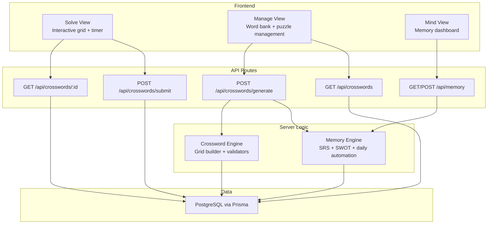
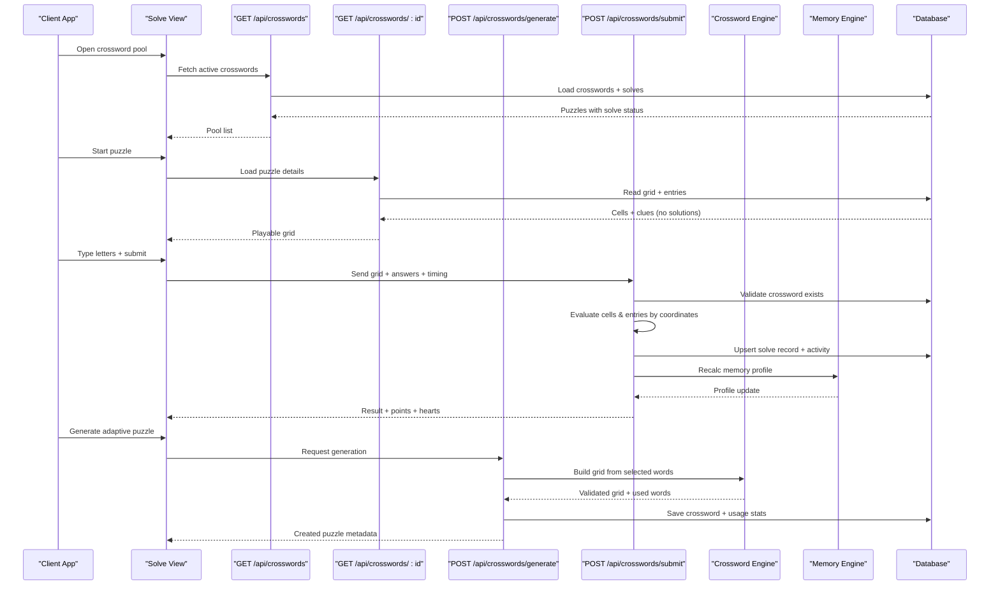
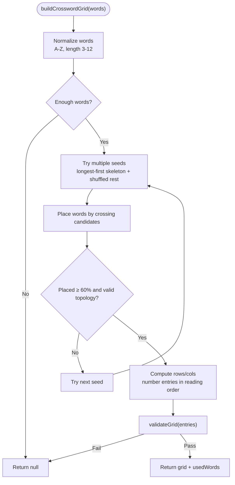
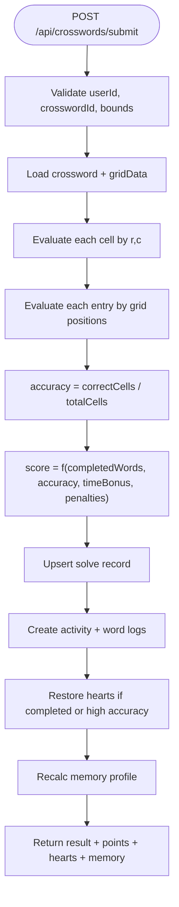
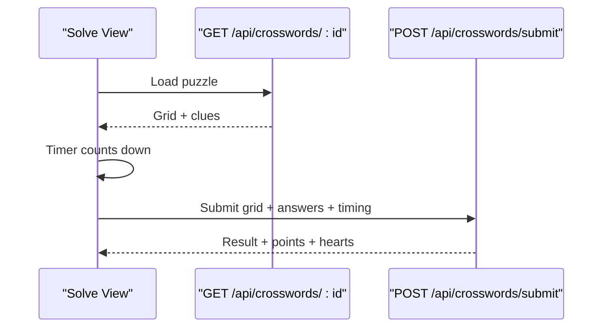
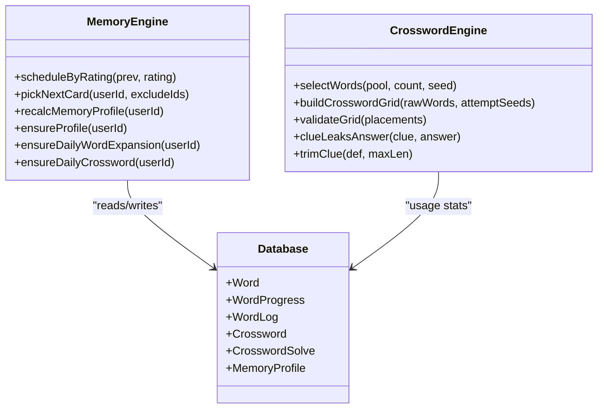
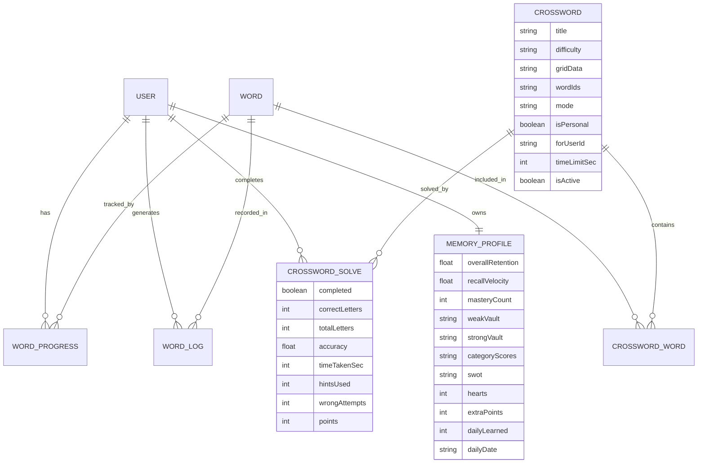

# Crossword Engine API

<cite>
**Referenced Files in This Document**   
- [crossword-engine.ts](file://src/lib/crossword-engine.ts)
- [route.ts (crosswords list)](file://src/app/api/crosswords/route.ts)
- [generate route.ts](file://src/app/api/crosswords/generate/route.ts)
- [submit route.ts](file://src/app/api/crosswords/submit/route.ts)
- [id route.ts](file://src/app/api/crosswords/[id]/route.ts)
- [solve-view.tsx](file://src/components/welearn/crosswords/solve-view.tsx)
- [mind-view.tsx](file://src/components/welearn/crosswords/mind-view.tsx)
- [manage-view.tsx](file://src/components/welearn/crosswords/manage-view.tsx)
- [forge.ts](file://src/lib/forge.ts)
- [memory route.ts](file://src/app/api/memory/route.ts)
- [schema.prisma](file://prisma/schema.prisma)
</cite>

## Table of Contents
1. [Introduction](#introduction)
2. [Project Structure](#project-structure)
3. [Core Components](#core-components)
4. [Architecture Overview](#architecture-overview)
5. [Detailed Component Analysis](#detailed-component-analysis)
6. [Dependency Analysis](#dependency-analysis)
7. [Performance Considerations](#performance-considerations)
8. [Troubleshooting Guide](#troubleshooting-guide)
9. [Conclusion](#conclusion)

## Introduction
This document describes the crossword puzzle generation and solving system. It covers:
- Puzzle creation through manual input, pasted grids, and AI-assisted generation.
- Dynamic grid building using a deterministic backtracking algorithm.
- Answer validation with strict grid-coordinate evaluation.
- Progress tracking, scoring, heart-based learning mechanics, and spaced repetition integration.
- Clue generation rules, safety checks, and difficulty scaling.
- The memory engine’s role in adaptive word selection, daily challenges, and cognitive profiling.

The system is designed so that solution letters are never sent to the browser; scoring happens server-side after submission.

## Project Structure
The crossword feature spans server routes, a reusable grid engine, UI components, and a memory engine.

**Diagram sources**
- [solve-view.tsx:118-218](file://src/components/welearn/crosswords/solve-view.tsx#L118-L218)
- [manage-view.tsx:256-292](file://src/components/welearn/crosswords/manage-view.tsx#L256-L292)
- [mind-view.tsx:74-92](file://src/components/welearn/crosswords/mind-view.tsx#L74-L92)
- [route.ts (crosswords list):7-65](file://src/app/api/crosswords/route.ts#L7-L65)
- [id route.ts:8-40](file://src/app/api/crosswords/[id]/route.ts#L8-L40)
- [generate route.ts:12-116](file://src/app/api/crosswords/generate/route.ts#L12-L116)
- [submit route.ts:21-216](file://src/app/api/crosswords/submit/route.ts#L21-L216)
- [memory route.ts:6-91](file://src/app/api/memory/route.ts#L6-L91)
- [crossword-engine.ts:57-344](file://src/lib/crossword-engine.ts#L57-L344)
- [forge.ts:39-368](file://src/lib/forge.ts#L39-L368)

**Section sources**
- [solve-view.tsx:1-570](file://src/components/welearn/crosswords/solve-view.tsx#L1-L570)
- [manage-view.tsx:1-757](file://src/components/welearn/crosswords/manage-view.tsx#L1-L757)
- [mind-view.tsx:1-413](file://src/components/welearn/crosswords/mind-view.tsx#L1-L413)
- [route.ts (crosswords list):1-197](file://src/app/api/crosswords/route.ts#L1-L197)
- [generate route.ts:1-117](file://src/app/api/crosswords/generate/route.ts#L1-L117)
- [submit route.ts:1-217](file://src/app/api/crosswords/submit/route.ts#L1-L217)
- [id route.ts:1-41](file://src/app/api/crosswords/[id]/route.ts#L1-L41)
- [memory route.ts:1-92](file://src/app/api/memory/route.ts#L1-L92)
- [crossword-engine.ts:1-362](file://src/lib/crossword-engine.ts#L1-L362)
- [forge.ts:1-634](file://src/lib/forge.ts#L1-L634)
- [schema.prisma:506-641](file://prisma/schema.prisma#L506-L641)

## Core Components
- Crossword Engine: Builds grids from words, validates topology, normalizes entries, and provides clue-safety helpers.
- Crossword API Routes: List puzzles, fetch one puzzle for solving, generate new puzzles, and submit solved answers.
- Memory Engine: Schedules spaced repetition, profiles user cognition, manages daily expansion and daily crosswords, and tracks hearts.
- Frontend Views: Solve view for interactive gameplay, manage view for content creation, mind view for memory analytics.

Key responsibilities:
- Grid construction is deterministic and code-only; clues may be generated by an LLM but are validated before storage.
- Submission evaluates every cell and every entry strictly by grid coordinates.
- Scoring combines completed words, accuracy, time bonus, hints, and wrong attempts.
- Solving can restore hearts and update the memory profile.

**Section sources**
- [crossword-engine.ts:5-344](file://src/lib/crossword-engine.ts#L5-L344)
- [route.ts (crosswords list):7-182](file://src/app/api/crosswords/route.ts#L7-L182)
- [generate route.ts:12-116](file://src/app/api/crosswords/generate/route.ts#L12-L116)
- [submit route.ts:21-216](file://src/app/api/crosswords/submit/route.ts#L21-L216)
- [forge.ts:39-368](file://src/lib/forge.ts#L39-L368)

## Architecture Overview
The crossword workflow connects frontend interactions to server-side algorithms and persistent data.

**Diagram sources**
- [solve-view.tsx:118-218](file://src/components/welearn/crosswords/solve-view.tsx#L118-L218)
- [route.ts (crosswords list):7-65](file://src/app/api/crosswords/route.ts#L7-L65)
- [id route.ts:8-40](file://src/app/api/crosswords/[id]/route.ts#L8-L40)
- [generate route.ts:12-116](file://src/app/api/crosswords/generate/route.ts#L12-L116)
- [submit route.ts:21-216](file://src/app/api/crosswords/submit/route.ts#L21-L216)
- [crossword-engine.ts:257-344](file://src/lib/crossword-engine.ts#L257-L344)
- [forge.ts:192-368](file://src/lib/forge.ts#L192-L368)

## Detailed Component Analysis

### Crossword Engine
The engine builds compact, connected crossword grids from a list of words. It uses:
- Word selection with preference for unused terms and length variety.
- Backtracking placement with crossing constraints and boundary rules.
- Validation ensuring each word crosses at least one other and the graph is connected.
- Normalization into a compact grid with numbered entries.
- Clue safety utilities to prevent answer leakage.

**Diagram sources**
- [crossword-engine.ts:57-80](file://src/lib/crossword-engine.ts#L57-L80)
- [crossword-engine.ts:93-170](file://src/lib/crossword-engine.ts#L93-L170)
- [crossword-engine.ts:172-205](file://src/lib/crossword-engine.ts#L172-L205)
- [crossword-engine.ts:207-255](file://src/lib/crossword-engine.ts#L207-L255)
- [crossword-engine.ts:257-344](file://src/lib/crossword-engine.ts#L257-L344)

Key functions and contracts:
- `selectWords(pool, count, seed)` returns a curated subset of words prioritizing unused terms and mixing lengths.
- `buildCrosswordGrid(rawWords, attemptSeeds)` returns a normalized grid or null if no valid layout is found.
- `validateGrid(placements)` ensures connectivity and crossing requirements.
- `clueLeaksAnswer(clue, answer)` prevents leaking the answer or its stem.
- `trimClue(text, maxLen)` safely truncates clues.

Complexity notes:
- Word selection is linear in pool size with optional sorting by last-used timestamp.
- Grid building tries multiple seeds; each attempt performs candidate generation and placement checks proportional to placed words and crossings.
- Validation is O(P^2) where P is the number of placements due to pairwise crossing checks.

**Section sources**
- [crossword-engine.ts:5-344](file://src/lib/crossword-engine.ts#L5-L344)

### Crossword Generation API
`POST /api/crosswords/generate`
- Purpose: Create a new crossword from the vault, optionally biased toward a user’s weak terms.
- Inputs:
  - `userId`: Optional user context.
  - `count`: Number of words (clamped between 3 and 12).
  - `difficulty`: One of easy, medium, hard.
  - `mode`: One of daily, practice, scratch, personal.
  - `forUserId`: Optional target user for personal mode.
  - `useWeakVault`: If true and userId provided, prefer weak-vault terms.
- Processing:
  - Loads all words and selects a subset using the engine.
  - Builds a grid deterministically.
  - Generates AI clues with safe fallbacks to definitions.
  - Re-validates the grid before saving.
  - Persists the crossword and updates word usage statistics.
- Outputs:
  - Success: `{ ok: true, crossword: { id, title, timeLimitSec, words } }`.
  - Failure: JSON error with descriptive message.

Error handling:
- Requires at least 3 words in the vault.
- Returns 422 when grid cannot be built or fails validation.

Difficulty scaling:
- Difficulty is stored and displayed; time limits scale with word count unless overridden.

**Section sources**
- [generate route.ts:12-116](file://src/app/api/crosswords/generate/route.ts#L12-L116)
- [crossword-engine.ts:57-344](file://src/lib/crossword-engine.ts#L57-L344)

### Crossword List API
`GET /api/crosswords?userId=...&mine=all|active`
- Purpose: Return the active crossword pool plus per-user solve status.
- Behavior:
  - Ensures today’s daily crossword exists before listing.
  - Loads up to 60 active crosswords with associated words.
  - Loads solve records for the given user or anonymous session marker.
  - Marks today’s daily based on title patterns and creation date.
  - Returns metadata including difficulty, mode, time limit, word count, and solve state.

Response fields include:
- `id`, `title`, `difficulty`, `mode`, `isPersonal`, `isTodayDaily`, `forUserId`, `timeLimitSec`, `wordCount`, `words`, `createdAt`, `solved`, `completed`, `accuracy`, `points`, `timeTakenSec`.

**Section sources**
- [route.ts (crosswords list):7-65](file://src/app/api/crosswords/route.ts#L7-L65)
- [forge.ts:520-633](file://src/lib/forge.ts#L520-L633)

### Single Crossword API
`GET /api/crosswords/:id`
- Purpose: Load one playable crossword without exposing solution letters.
- Response includes:
  - Grid dimensions, cells with numbers, and entries with clues and directions.
  - Word count and metadata like difficulty and time limit.

Security note:
- Solution letters are not included in the response; they remain server-side.

**Section sources**
- [id route.ts:8-40](file://src/app/api/crosswords/[id]/route.ts#L8-L40)

### Submission API
`POST /api/crosswords/submit`
- Purpose: Evaluate a submitted grid and record results.
- Inputs:
  - `userId`, `crosswordId`.
  - `grid`: Map of `"r,c"` to typed letter.
  - `answers`: Optional map of entry index to full word string.
  - `timeTakenSec`, `hintsUsed`, `wrongAttempts`.
- Evaluation:
  - Checks every cell coordinate against expected solution.
  - Validates each entry strictly by grid positions.
  - Computes accuracy and completion status.
- Scoring:
  - Points derived from completed words, accuracy, time bonus, minus penalties for hints and wrong attempts.
  - Minimum point floor applied.
- Persistence:
  - Upserts solve record per user per crossword.
  - Creates activity log entries.
  - Logs per-word events for solved and missed words.
- Memory integration:
  - Restores hearts on completion or high partial accuracy.
  - Recalculates memory profile and returns updated metrics.

Response fields include:
- `ok`, `completed`, `accuracy`, `correctLetters`, `totalLetters`, `completedWords`, `missedWords`, `entryStatus`, `cellStatus`, `points`, `hearts`, `heartRestored`, `bonusPoints`, `memory`.

**Diagram sources**
- [submit route.ts:21-216](file://src/app/api/crosswords/submit/route.ts#L21-L216)

**Section sources**
- [submit route.ts:21-216](file://src/app/api/crosswords/submit/route.ts#L21-L216)

### Manual Creation API
`POST /api/crosswords`
- Supports two modes:
  - Paste a prebuilt grid JSON (`gridJson`) with cells and entries.
  - Provide text lines in format `TERM | clue`; the engine builds the grid automatically.
- Protection:
  - Requires a confirmation PIN.
- Validation:
  - For grid JSON, validates required structure and grid topology.
  - For text lines, parses terms and optional clues, enforces term length and uniqueness, and requires at least three terms.
- Clue resolution:
  - Prefers manual clues if safe; otherwise falls back to key definition, general definition, or a safe placeholder.
- Persistence:
  - Creates crossword, links words, and updates usage stats.

**Section sources**
- [route.ts (crosswords list):74-182](file://src/app/api/crosswords/route.ts#L74-L182)
- [crossword-engine.ts:172-344](file://src/lib/crossword-engine.ts#L172-L344)

### Delete Crossword API
`DELETE /api/crosswords`
- Purpose: Remove a crossword from the pool while preserving word records.
- Protection:
  - Requires confirmation PIN.
- Behavior:
  - Deletes crossword by ID.

**Section sources**
- [route.ts (crosswords list):184-197](file://src/app/api/crosswords/route.ts#L184-L197)

### Frontend Solve Flow
The solve view:
- Loads the crossword pool and highlights today’s challenge.
- Opens a puzzle, starts a countdown timer, and renders the grid.
- Tracks typed letters by grid coordinates and maps them to active entries.
- Submits both the full grid and per-entry answers for strict positional evaluation.
- Displays results including correct/missed words, accuracy, points, and heart restoration.

**Diagram sources**
- [solve-view.tsx:118-218](file://src/components/welearn/crosswords/solve-view.tsx#L118-L218)
- [id route.ts:8-40](file://src/app/api/crosswords/[id]/route.ts#L8-L40)
- [submit route.ts:21-216](file://src/app/api/crosswords/submit/route.ts#L21-L216)

**Section sources**
- [solve-view.tsx:73-218](file://src/components/welearn/crosswords/solve-view.tsx#L73-L218)

### Memory Engine Integration
The memory engine provides:
- Spaced repetition scheduling with ratings: practice, easy, done.
- Retention decay modeling per word.
- Card selection logic for reels mode, including rush detection and quiz triggers.
- Cognitive profiling with SWOT synthesis, category radar scores, and weak/strong vaults.
- Daily mechanisms:
  - Daily 5-word expansion guarded by IST day markers.
  - Daily crossword challenge auto-generation.
- Heart management:
  - Max hearts, daily reset, and restoration via crossword solving.

Integration points:
- Crossword generation can use weak-vault terms for personal puzzles.
- Submission recalculates the memory profile and updates hearts.
- Memory API exposes retention, velocity, mastery, categories, SWOT, and weak terms.

**Diagram sources**
- [forge.ts:39-368](file://src/lib/forge.ts#L39-L368)
- [forge.ts:405-633](file://src/lib/forge.ts#L405-L633)
- [crossword-engine.ts:57-344](file://src/lib/crossword-engine.ts#L57-L344)
- [schema.prisma:506-641](file://prisma/schema.prisma#L506-L641)

**Section sources**
- [forge.ts:39-368](file://src/lib/forge.ts#L39-L368)
- [forge.ts:405-633](file://src/lib/forge.ts#L405-L633)
- [memory route.ts:6-91](file://src/app/api/memory/route.ts#L6-L91)

### Data Models
Relevant database models:
- `Word`: Term, definition, keyDefinition, category, source, usage counters.
- `WordProgress`: Per-user spaced repetition state.
- `WordLog`: Event log for flips, quizzes, crosswords, hints.
- `Crossword`: Stored grid JSON, word IDs, mode, difficulty, time limit, activation flag.
- `CrosswordWord`: Link table between crosswords and words.
- `CrosswordSolve`: Per-user solve record with accuracy, timing, points.
- `MemoryProfile`: Cognitive metrics, vaults, SWOT, hearts, daily counters.

**Diagram sources**
- [schema.prisma:506-641](file://prisma/schema.prisma#L506-L641)

## Dependency Analysis
Coupling and cohesion:
- Crossword Engine is cohesive around grid construction and validation; it does not depend on UI or external services except for deterministic randomness.
- API routes orchestrate requests, delegate to the engine and memory engine, and persist data.
- Memory Engine depends on database models and helper utilities; it also integrates with AI for daily expansion and clue generation.
- Frontend views call APIs and render results; they do not implement core algorithms.

External dependencies:
- AI service for clue generation and daily vocabulary expansion.
- PostgreSQL via Prisma client.

Potential circular dependencies:
- None observed; engine modules are imported by routes and UI components.

Integration points:
- `ensureDailyCrossword` is invoked during crossword listing to guarantee a daily challenge.
- `recalcMemoryProfile` is called after submission to update cognitive metrics.

**Section sources**
- [route.ts (crosswords list):1-197](file://src/app/api/crosswords/route.ts#L1-L197)
- [generate route.ts:1-117](file://src/app/api/crosswords/generate/route.ts#L1-L117)
- [submit route.ts:1-217](file://src/app/api/crosswords/submit/route.ts#L1-L217)
- [forge.ts:1-634](file://src/lib/forge.ts#L1-L634)
- [crossword-engine.ts:1-362](file://src/lib/crossword-engine.ts#L1-L362)

## Performance Considerations
- Grid building tries multiple seeds; limit attempts to balance quality and latency.
- Word selection filters and sorts; keep pools manageable and avoid unnecessary large scans.
- Submission evaluates all cells and entries; ensure grid sizes stay reasonable.
- Memory profile recalculation aggregates recent logs; consider pagination or caching for large histories.
- AI calls for clues and daily expansion should be rate-limited and cached where possible.

[No sources needed since this section provides general guidance]

## Troubleshooting Guide
Common issues and resolutions:
- “Could not build a connected grid”:
  - Ensure enough valid single-letter words (A–Z, length 3–12).
  - Try different word sets or increase the vault size.
- “Generated grid failed validation”:
  - The engine re-validates before saving; regenerate or adjust words.
- “Wrong confirmation PIN”:
  - Use the configured team PIN for destructive operations.
- “Not enough valid single-word terms”:
  - Import more words or remove invalid characters/spaces.
- “Crossword not found”:
  - Verify the crossword ID and that it is active.
- Submission errors:
  - Confirm userId and crosswordId are present.
  - Check that grid coordinates match the puzzle’s cell set.

Operational tips:
- Use the manage view to verify word bank health and trigger daily expansion.
- Monitor memory dashboard for retention and weak terms.
- Use the solve view’s feedback to improve accuracy and reduce wrong attempts.

**Section sources**
- [generate route.ts:22-46](file://src/app/api/crosswords/generate/route.ts#L22-L46)
- [generate route.ts:74-77](file://src/app/api/crosswords/generate/route.ts#L74-L77)
- [route.ts (crosswords list):77-78](file://src/app/api/crosswords/route.ts#L77-L78)
- [route.ts (crosswords list):120-135](file://src/app/api/crosswords/route.ts#L120-L135)
- [id route.ts:11-12](file://src/app/api/crosswords/[id]/route.ts#L11-L12)
- [submit route.ts:24-32](file://src/app/api/crosswords/submit/route.ts#L24-L32)

## Conclusion
The crossword engine delivers a robust, secure, and adaptive learning loop:
- Deterministic grid construction with strict validation.
- Safe clue generation with fallbacks.
- Server-side evaluation ensuring fairness and integrity.
- Integrated spaced repetition and cognitive profiling.
- Daily automation for vocabulary growth and puzzle availability.

For best results:
- Maintain a healthy word vault with clear definitions and key definitions.
- Encourage accurate, timely solving to maximize points and heart restoration.
- Leverage the memory dashboard to focus on weak areas and track progress.

[No sources needed since this section summarizes without analyzing specific files]