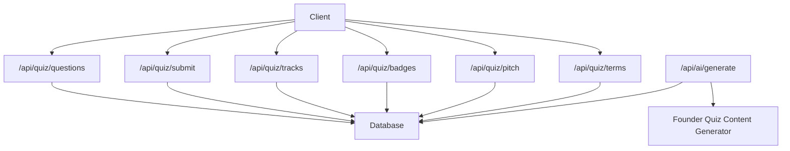
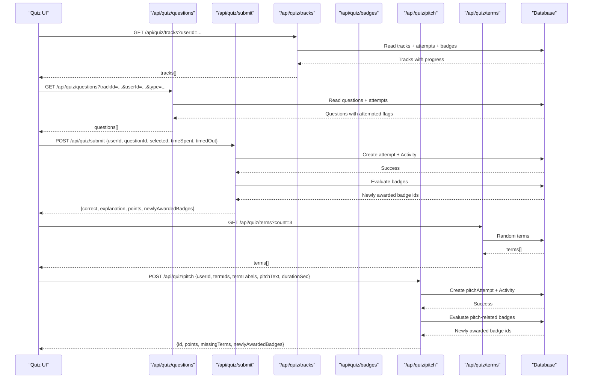
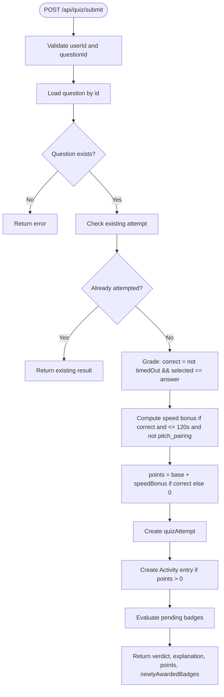
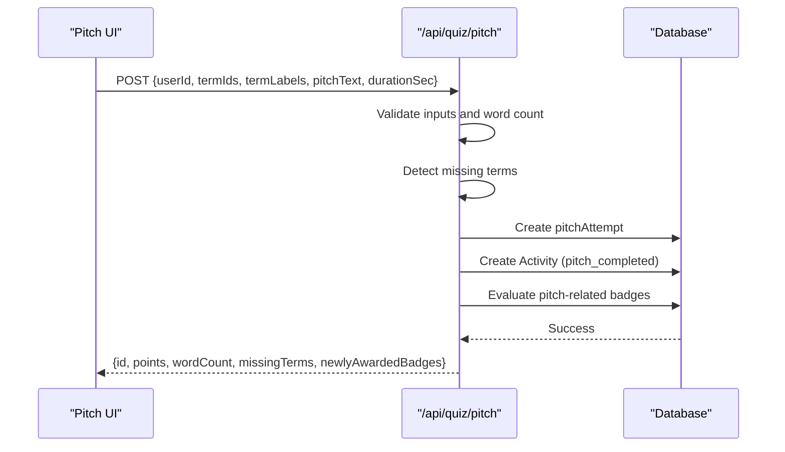
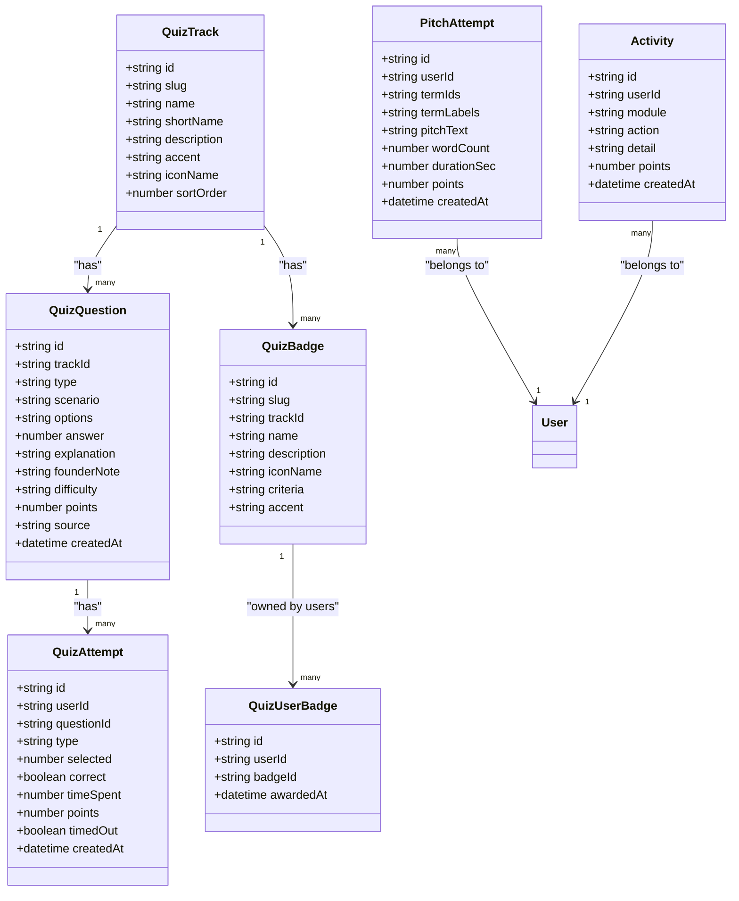

# Founder Quiz API

<cite>
**Referenced Files in This Document**   
- [README.md](file://README.md)
- [schema.prisma](file://prisma/schema.prisma)
- [questions route.ts](file://src/app/api/quiz/questions/route.ts)
- [submit route.ts](file://src/app/api/quiz/submit/route.ts)
- [badges route.ts](file://src/app/api/quiz/badges/route.ts)
- [pitch route.ts](file://src/app/api/quiz/pitch/route.ts)
- [terms route.ts](file://src/app/api/quiz/terms/route.ts)
- [tracks route.ts](file://src/app/api/quiz/tracks/route.ts)
- [AI generate route.ts](file://src/app/api/ai/generate/route.ts)
</cite>

## Table of Contents
1. [Introduction](#introduction)
2. [Project Structure](#project-structure)
3. [Core Components](#core-components)
4. [Architecture Overview](#architecture-overview)
5. [Detailed Component Analysis](#detailed-component-analysis)
6. [Dependency Analysis](#dependency-analysis)
7. [Performance Considerations](#performance-considerations)
8. [Troubleshooting Guide](#troubleshooting-guide)
9. [Conclusion](#conclusion)

## Introduction
The Founder Quiz module is a gamified entrepreneurship-prep feature for an E-Cell platform. It provides five founder-mode tracks, multiple question types, pitch-pairing drills, badge achievements, and track progression tracking. The system intentionally performs server-side grading, records attempts as activity points, and evaluates badges automatically after submissions or pitch completions.

High-level capabilities:
- Retrieve questions per track with user attempt state.
- Submit answers with server-side grading, speed bonuses, and activity logging.
- Track progress across five founder tracks.
- Earn and view badges based on correct answers, pitch completions, and cross-track milestones.
- Run pitch pairing drills using randomized startup terms.
- Generate AI-backed founder quiz content for scenario, red-flag, and micro-math question types.

**Section sources**
- [README.md:96-101](file://README.md#L96-L101)

## Project Structure
The Founder Quiz API lives under the Next.js App Router at `/api/quiz`. Each subdirectory exposes REST endpoints for a specific concern:

**Diagram sources**
- [questions route.ts:4-8](file://src/app/api/quiz/questions/route.ts#L4-L8)
- [submit route.ts:75-81](file://src/app/api/quiz/submit/route.ts#L75-L81)
- [tracks route.ts:3-5](file://src/app/api/quiz/tracks/route.ts#L3-L5)
- [badges route.ts:3-6](file://src/app/api/quiz/badges/route.ts#L3-L6)
- [pitch route.ts:4-10](file://src/app/api/quiz/pitch/route.ts#L4-L10)
- [terms route.ts:4-7](file://src/app/api/quiz/terms/route.ts#L4-L7)
- [AI generate route.ts:44-44](file://src/app/api/ai/generate/route.ts#L44-L44)

**Section sources**
- [questions route.ts:1-60](file://src/app/api/quiz/questions/route.ts#L1-L60)
- [submit route.ts:1-156](file://src/app/api/quiz/submit/route.ts#L1-L156)
- [tracks route.ts:1-68](file://src/app/api/quiz/tracks/route.ts#L1-L68)
- [badges route.ts:1-93](file://src/app/api/quiz/badges/route.ts#L1-L93)
- [pitch route.ts:1-133](file://src/app/api/quiz/pitch/route.ts#L1-L133)
- [terms route.ts:1-47](file://src/app/api/quiz/terms/route.ts#L1-L47)
- [AI generate route.ts:178-193](file://src/app/api/ai/generate/route.ts#L178-L193)

## Core Components
This section summarizes the main API surfaces and their responsibilities.

| Endpoint | Method | Purpose | Key Inputs | Key Outputs |
|---|---|---|---|---|
| `/api/quiz/questions` | GET | Load questions for a track, optionally filtered by type; include user attempt state | `trackId`, optional `userId`, optional `type` | `questions[]` with metadata and attempted flags |
| `/api/quiz/submit` | POST | Grade answer, record attempt, award points, evaluate badges | `userId`, `questionId`, `selected`, `timeSpent`, `timedOut` | Verdict, explanation, points, newly awarded badges |
| `/api/quiz/tracks` | GET | List founder tracks with per-user progress and badge status | optional `userId` | `tracks[]` with counts, percentages, and badge flags |
| `/api/quiz/badges` | GET | List all badges with current progress toward each | optional `userId` | `badges[]` with criteria, current count, earned flag |
| `/api/quiz/pitch` | GET | Fetch user’s past pitch attempts | `userId` | `pitches[]` with term labels, word count, duration |
| `/api/quiz/pitch` | POST | Save a pitch drill attempt, log activity, evaluate badges | `userId`, `termIds[]`, `termLabels[]`, `pitchText`, `durationSec` | Saved pitch id, points, missing terms, newly awarded badges |
| `/api/quiz/terms` | GET | Get random startup terms for pitch pairing | optional `count` (default 3) | `terms[]` with hints |
| `/api/ai/generate` | POST | Generate founder quiz questions via AI | `kind`, `trackSlug`, `type` | Generated question payload |

**Section sources**
- [questions route.ts:4-8](file://src/app/api/quiz/questions/route.ts#L4-L8)
- [submit route.ts:75-81](file://src/app/api/quiz/submit/route.ts#L75-L81)
- [tracks route.ts:3-5](file://src/app/api/quiz/tracks/route.ts#L3-L5)
- [badges route.ts:3-6](file://src/app/api/quiz/badges/route.ts#L3-L6)
- [pitch route.ts:4-10](file://src/app/api/quiz/pitch/route.ts#L4-L10)
- [terms route.ts:4-7](file://src/app/api/quiz/terms/route.ts#L4-L7)
- [AI generate route.ts:44-44](file://src/app/api/ai/generate/route.ts#L44-L44)

## Architecture Overview
The Founder Quiz API follows a straightforward request-response pattern backed by Prisma models. Client flows typically start by loading tracks, then questions, then submitting answers. Pitch pairing uses terms to compose a short elevator pitch, which is saved and evaluated against badge criteria. Badges are re-evaluated after both quiz submissions and pitch completions.

**Diagram sources**
- [tracks route.ts:6-67](file://src/app/api/quiz/tracks/route.ts#L6-L67)
- [questions route.ts:9-59](file://src/app/api/quiz/questions/route.ts#L9-L59)
- [submit route.ts:82-155](file://src/app/api/quiz/submit/route.ts#L82-L155)
- [terms route.ts:8-46](file://src/app/api/quiz/terms/route.ts#L8-L46)
- [pitch route.ts:11-132](file://src/app/api/quiz/pitch/route.ts#L11-L132)

## Detailed Component Analysis

### Question Management: `/api/quiz/questions`
Responsibilities:
- Return questions for a given track.
- Optionally filter by question type: `scenario`, `red_flag`, `micro_math`, `pitch_pairing`.
- Include user attempt state (`attempted`, `lastCorrect`, `lastPoints`).
- Strip the correct answer index from the response; grading happens on submit.

Request parameters:
- `trackId`: required.
- `userId`: optional. Used to enrich responses with attempt state.
- `type`: optional. One of `scenario`, `red_flag`, `micro_math`, `pitch_pairing`.

Response schema:
- `questions`: array of objects with fields including:
  - `id`: question identifier.
  - `type`: one of the supported types.
  - `scenario`: prompt text.
  - `options`: JSON string array of options.
  - `difficulty`: difficulty level.
  - `points`: base points for correctness.
  - `source`: source tag.
  - `attempted`: boolean indicating prior attempt.
  - `lastCorrect`: previous correctness if attempted.
  - `lastPoints`: previous points if attempted.

Notes:
- For `pitch_pairing`, the question acts as a prompt that unlocks the pitch composer after submission.

**Section sources**
- [questions route.ts:4-8](file://src/app/api/quiz/questions/route.ts#L4-L8)
- [questions route.ts:9-59](file://src/app/api/quiz/questions/route.ts#L9-L59)

### Submission Handling and Scoring: `/api/quiz/submit`
Responsibilities:
- Perform server-side grading.
- Record one graded attempt per question per user.
- Award points including a speed bonus for fast correct answers.
- Log activity entries for quiz actions.
- Re-evaluate badges and return newly awarded badge identifiers.

Request schema:
- `userId`: string.
- `questionId`: string.
- `selected`: integer option index.
- `timeSpent`: integer seconds, clamped between 0 and 3600.
- `timedOut`: boolean.

Scoring algorithm:
- Correctness: not timed out and selected matches the stored answer index.
- Speed bonus: if correct, time spent is less than or equal to 120 seconds, and the question is not `pitch_pairing`, add 3 points.
- Points: base question points plus speed bonus when correct; zero when incorrect.

Response schema:
- `correct`: boolean.
- `selected`: submitted option index.
- `answer`: correct option index.
- `explanation`: explanation text.
- `founderNote`: optional founder takeaway.
- `points`: total points awarded.
- `speedBonus`: additional points from speed.
- `newlyAwardedBadges`: array of badge ids just earned.

Idempotency:
- If the user already has a graded attempt for the same question, the endpoint returns existing results without creating another attempt.

Badge evaluation:
- After successful submission, the endpoint evaluates pending badges based on:
  - Total correct answers.
  - Per-track correct counts.
  - Pitch completion counts.
  - Cross-track badge combinations.

**Diagram sources**
- [submit route.ts:82-155](file://src/app/api/quiz/submit/route.ts#L82-L155)

**Section sources**
- [submit route.ts:75-81](file://src/app/api/quiz/submit/route.ts#L75-L81)
- [submit route.ts:82-155](file://src/app/api/quiz/submit/route.ts#L82-L155)

### Badge Achievements: `/api/quiz/badges`
Responsibilities:
- Return all available badges with associated track information.
- Compute current progress toward each badge.
- Indicate whether a badge is earned and when it was awarded.

Supported badge criteria kinds:
- `any_correct`: threshold based on total correct answers across all tracks.
- `track_correct`: threshold based on correct answers within a specific track.
- `pitch_completed`: threshold based on number of completed pitch attempts.
- `all_track_badges`: threshold based on how many distinct track-correct badges the user has already earned.

Response schema:
- `badges`: array of objects with fields including:
  - `id`, `slug`, `name`, `description`, `iconName`, `accent`.
  - `trackName`, `trackSlug`.
  - `criteria`: parsed criteria object with `kind` and `threshold`.
  - `current`: current progress value.
  - `earned`: boolean.
  - `awardedAt`: timestamp if earned.

Progress computation:
- Aggregates user attempts to compute total correct and per-track correct counts.
- Counts pitch attempts for pitch-related badges.
- Counts previously earned track-correct badges for cross-track milestone badges.

**Section sources**
- [badges route.ts:3-6](file://src/app/api/quiz/badges/route.ts#L3-L6)
- [badges route.ts:7-92](file://src/app/api/quiz/badges/route.ts#L7-L92)

### Pitch Scenarios: `/api/quiz/pitch`
Responsibilities:
- GET: retrieve recent pitch attempts for a user.
- POST: save a pitch attempt, validate inputs, compute word count, detect missing terms, log activity, and evaluate pitch-related badges.

GET request parameters:
- `userId`: required.

GET response schema:
- `pitches`: array of objects with fields including:
  - `id`, `termIds`, `termLabels`, `pitchText`, `wordCount`, `durationSec`, `points`, `createdAt`.

POST request schema:
- `userId`: string.
- `termIds`: array of strings, up to 5.
- `termLabels`: array of `{abbr, full}` objects, up to 5.
- `pitchText`: string, trimmed.
- `durationSec`: integer, clamped between 0 and 300.

Validation rules:
- At least 3 terms required.
- Pitch length must be between 20 and 4000 characters.
- Word count must be at least 15 words.
- Missing terms are detected case-insensitively by matching either abbreviation or first word of the full form.

Scoring and rewards:
- Fixed 15 points per completed pitch.
- Activity logged with action `pitch_completed`.
- Badge evaluation runs for `pitch_completed` criteria.

Response schema:
- `id`: saved pitch attempt id.
- `points`: always 15.
- `wordCount`: computed word count.
- `missingTerms`: array of abbreviations for terms not found in the pitch.
- `newlyAwardedBadges`: array of badge ids just earned.

**Diagram sources**
- [pitch route.ts:40-132](file://src/app/api/quiz/pitch/route.ts#L40-L132)

**Section sources**
- [pitch route.ts:4-10](file://src/app/api/quiz/pitch/route.ts#L4-L10)
- [pitch route.ts:11-38](file://src/app/api/quiz/pitch/route.ts#L11-L38)
- [pitch route.ts:40-132](file://src/app/api/quiz/pitch/route.ts#L40-L132)

### Terms Management: `/api/quiz/terms`
Responsibilities:
- Provide N random startup terms used by the pitch pairing drill.
- Prefer terms with founder-context upgrades (`ecellDefinition`).
- Fall back to plain terms if upgraded terms are insufficient.

Request parameters:
- `count`: integer, default 3, clamped between 3 and 5.

Response schema:
- `terms`: array of objects with fields including:
  - `id`, `abbr`, `full`, `category`, `hint`.

Behavior:
- If no terms are available, returns a 404-style error instructing seeding.

**Section sources**
- [terms route.ts:4-7](file://src/app/api/quiz/terms/route.ts#L4-L7)
- [terms route.ts:8-46](file://src/app/api/quiz/terms/route.ts#L8-L46)

### Track Progression: `/api/quiz/tracks`
Responsibilities:
- Return the five founder tracks with metadata and icons.
- Compute per-user progress: attempted count, correct count, total questions, percentage.
- Indicate whether the track-specific badge has been earned.

Request parameters:
- `userId`: optional. Used to compute progress and badge status.

Response schema:
- `tracks`: array of objects with fields including:
  - `id`, `slug`, `name`, `shortName`, `description`, `accent`, `iconName`, `sortOrder`.
  - `totalQuestions`: count of questions in the track.
  - `attempted`: number of attempts for this track.
  - `correct`: number of correct answers for this track.
  - `progressPct`: percentage of attempted questions.
  - `badgeEarned`: boolean indicating whether the track-correct badge is earned.

**Section sources**
- [tracks route.ts:3-5](file://src/app/api/quiz/tracks/route.ts#L3-L5)
- [tracks route.ts:6-67](file://src/app/api/quiz/tracks/route.ts#L6-L67)

### AI Generation for Founder Quiz: `/api/ai/generate`
Responsibilities:
- Generate founder quiz questions through AI prompts.
- Support three question kinds: `scenario`, `red_flag`, `micro_math`.
- Validate track slugs and question types before generation.

Supported inputs:
- `kind`: must be `founder_quiz`.
- `trackSlug`: one of `investment`, `growth`, `ops_legal`, `product_tech`, `strategy`.
- `type`: one of `scenario`, `red_flag`, `micro_math`.

Behavior:
- Validates track slug and question type.
- Loads the corresponding track.
- Uses tailored prompts for each question kind to produce structured outputs suitable for quiz storage.

**Section sources**
- [AI generate route.ts:44-44](file://src/app/api/ai/generate/route.ts#L44-L44)
- [AI generate route.ts:178-193](file://src/app/api/ai/generate/route.ts#L178-L193)

## Dependency Analysis
The Founder Quiz API depends on several database models defined in the Prisma schema. These models capture questions, attempts, badges, user-badge assignments, pitch attempts, and activity logs.

**Diagram sources**
- [schema.prisma:137-149](file://prisma/schema.prisma#L137-L149)
- [schema.prisma:151-170](file://prisma/schema.prisma#L151-L170)
- [schema.prisma:172-188](file://prisma/schema.prisma#L172-L188)
- [schema.prisma:190-204](file://prisma/schema.prisma#L190-L204)
- [schema.prisma:206-216](file://prisma/schema.prisma#L206-L216)
- [schema.prisma:220-232](file://prisma/schema.prisma#L220-L232)
- [schema.prisma:262-275](file://prisma/schema.prisma#L262-L275)

**Section sources**
- [schema.prisma:137-149](file://prisma/schema.prisma#L137-L149)
- [schema.prisma:151-170](file://prisma/schema.prisma#L151-L170)
- [schema.prisma:172-188](file://prisma/schema.prisma#L172-L188)
- [schema.prisma:190-204](file://prisma/schema.prisma#L190-L204)
- [schema.prisma:206-216](file://prisma/schema.prisma#L206-L216)
- [schema.prisma:220-232](file://prisma/schema.prisma#L220-L232)
- [schema.prisma:262-275](file://prisma/schema.prisma#L262-L275)

## Performance Considerations
- Server-side grading prevents client manipulation and ensures consistent scoring.
- Attempts are indexed by user and question to support idempotent submission checks.
- Badge evaluation aggregates attempts once per endpoint call to avoid repeated queries.
- Pitch validation is lightweight and avoids expensive operations; missing-term detection uses simple substring checks.
- Activity logging occurs only when points are awarded, reducing unnecessary writes.

[No sources needed since this section provides general guidance]

## Troubleshooting Guide
Common issues and resolutions:

- Missing `trackId` when loading questions:
  - Ensure the query includes a valid `trackId`.
  - Verify the track exists in the database.

- Missing `userId` when submitting or fetching pitches:
  - Always pass the authenticated user’s id.
  - Confirm session handling supplies the id to API calls.

- No terms available:
  - Seed the database with terms, especially those with founder-context definitions.
  - Use the terms endpoint with the default count to verify availability.

- Duplicate submissions:
  - The submit endpoint is idempotent; repeated submissions return the original result.
  - Do not retry submissions expecting additional points.

- Badge not awarded immediately:
  - Badge evaluation runs after submissions and pitch completions.
  - Refresh the badges endpoint after completing relevant actions.

**Section sources**
- [questions route.ts:16-16](file://src/app/api/quiz/questions/route.ts#L16-L16)
- [pitch route.ts:51-57](file://src/app/api/quiz/pitch/route.ts#L51-L57)
- [terms route.ts:30-32](file://src/app/api/quiz/terms/route.ts#L30-L32)
- [submit route.ts:96-109](file://src/app/api/quiz/submit/route.ts#L96-L109)

## Conclusion
The Founder Quiz API provides a complete foundation for founder-mode learning: track-based questions, server-side grading, speed bonuses, activity logging, pitch pairing drills, and gamified badge progression. Clients should treat the server as authoritative for correctness and points, rely on progress endpoints for UI state, and use badge endpoints to reflect gamification outcomes.

[No sources needed since this section summarizes without analyzing specific files]