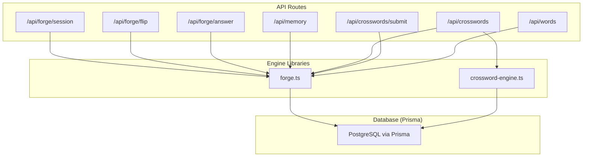
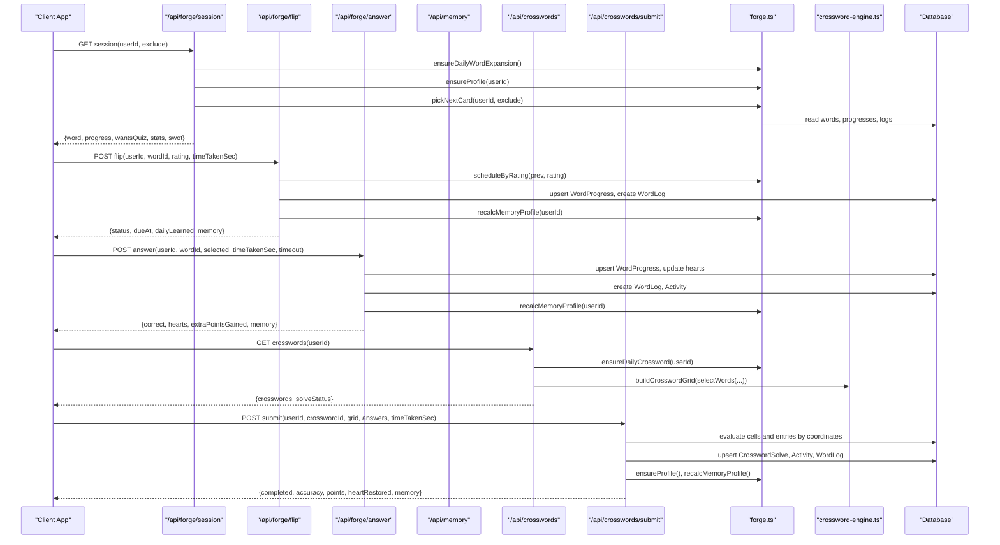
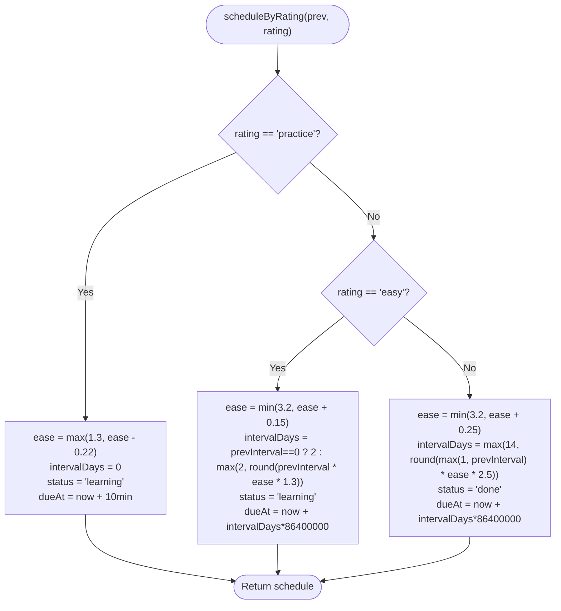
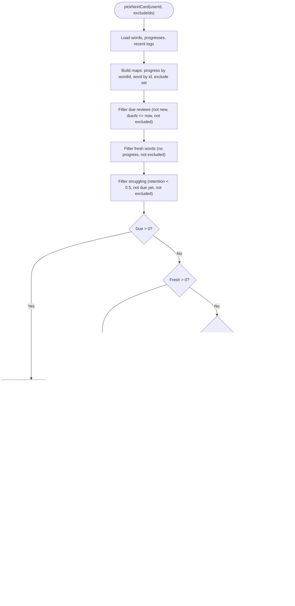
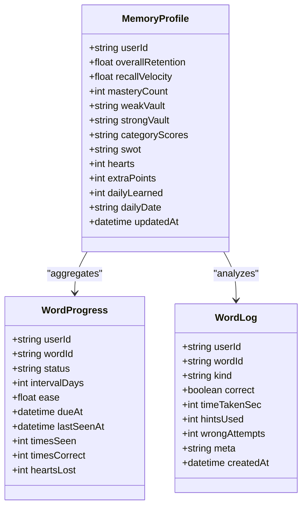
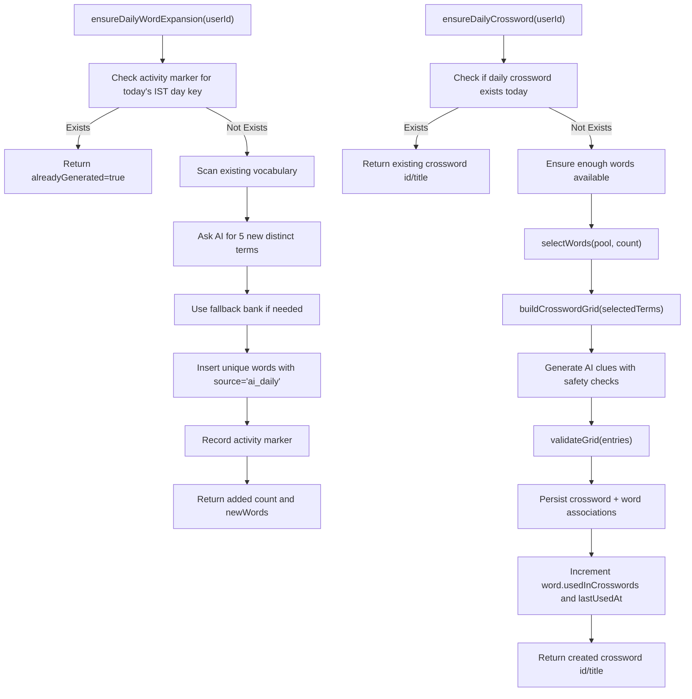
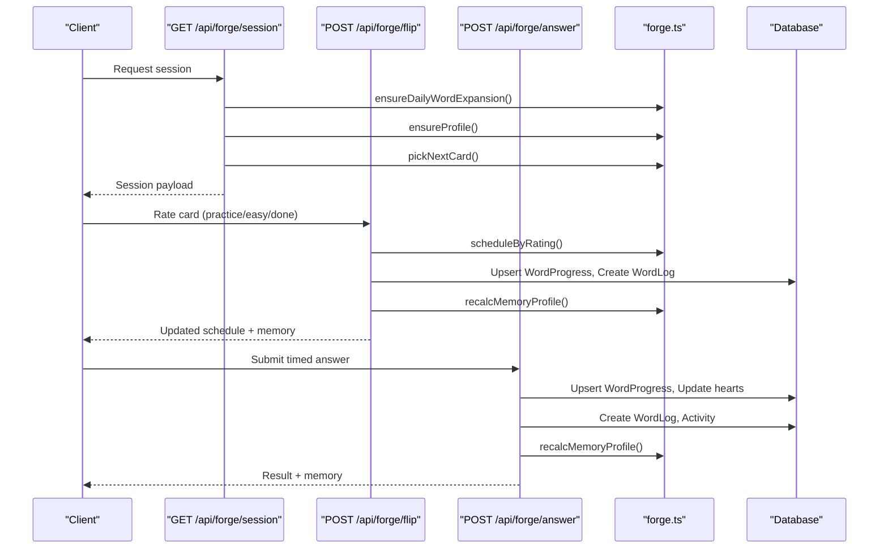
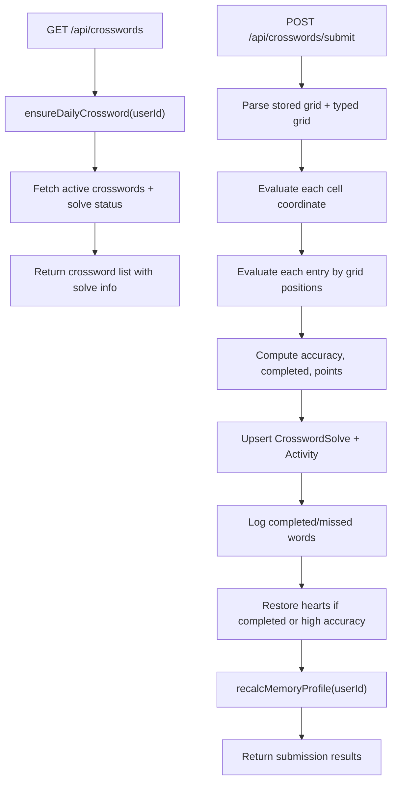
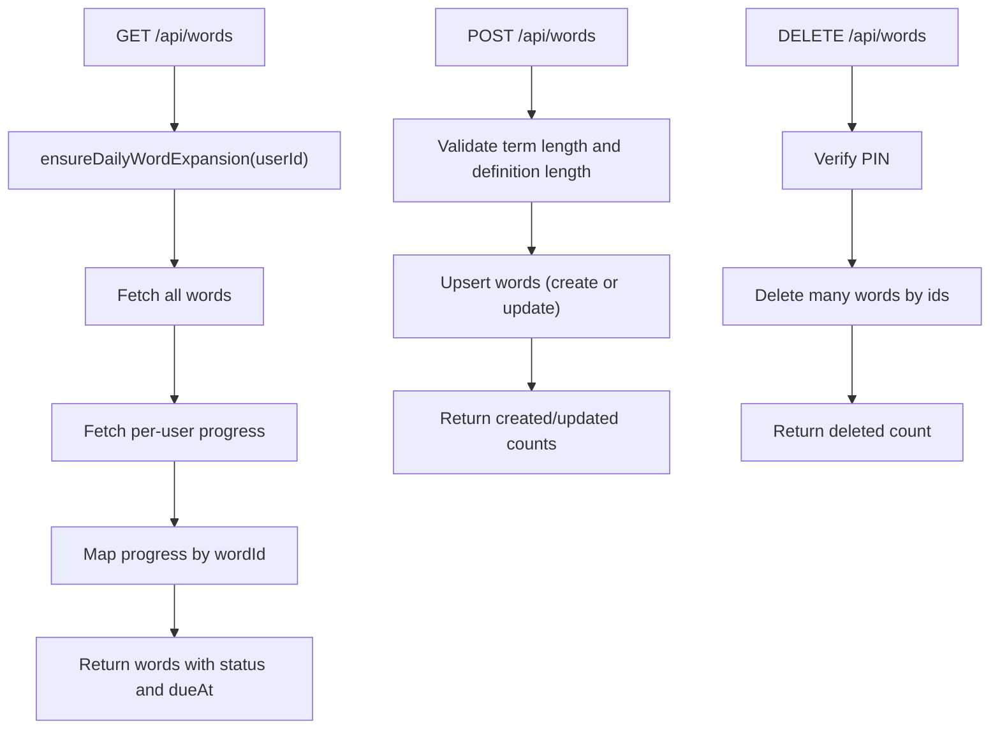
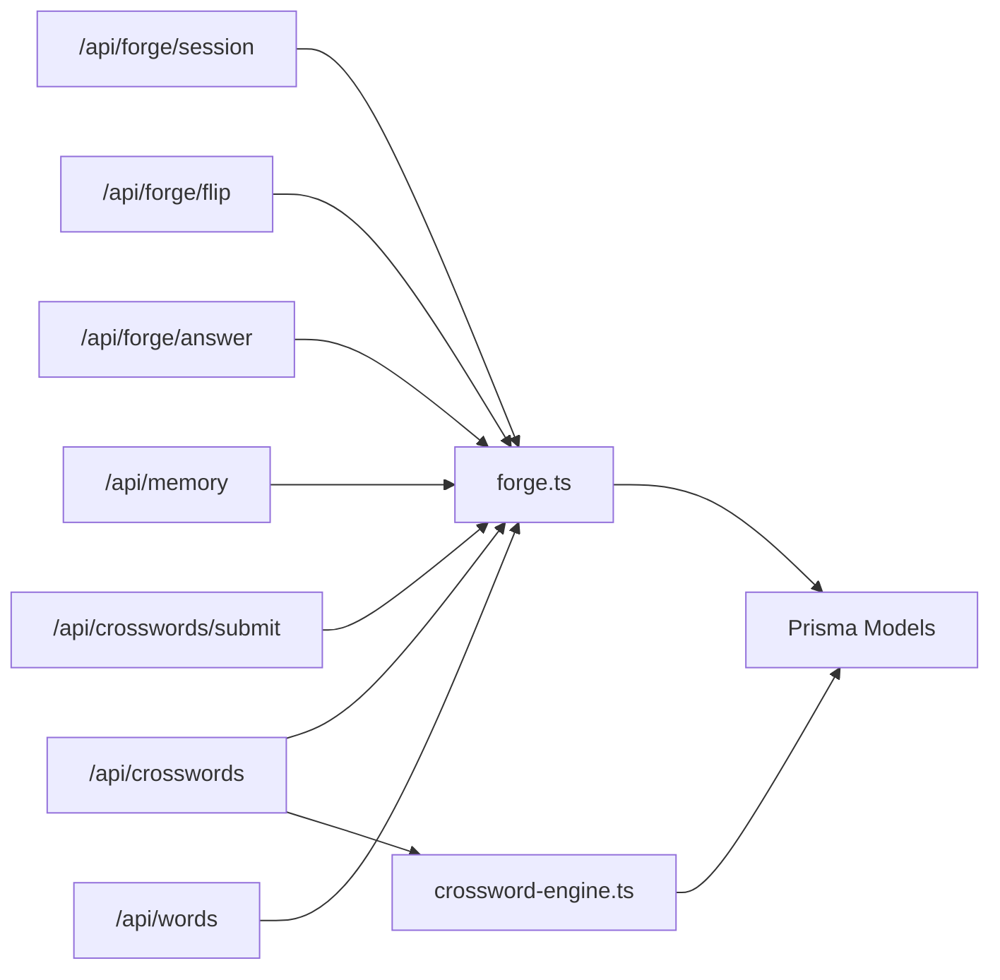

# Memory Forge API

<cite>
**Referenced Files in This Document**
- [forge.ts](file://src/lib/forge.ts)
- [crossword-engine.ts](file://src/lib/crossword-engine.ts)
- [schema.prisma](file://prisma/schema.prisma)
- [session route](file://src/app/api/forge/session/route.ts)
- [flip route](file://src/app/api/forge/flip/route.ts)
- [answer route](file://src/app/api/forge/answer/route.ts)
- [memory route](file://src/app/api/memory/route.ts)
- [crosswords route](file://src/app/api/crosswords/route.ts)
- [crosswords submit route](file://src/app/api/crosswords/submit/route.ts)
- [words route](file://src/app/api/words/route.ts)
</cite>

## Table of Contents
1. [Introduction](#introduction)
2. [Project Structure](#project-structure)
3. [Core Components](#core-components)
4. [Architecture Overview](#architecture-overview)
5. [Detailed Component Analysis](#detailed-component-analysis)
6. [Dependency Analysis](#dependency-analysis)
7. [Performance Considerations](#performance-considerations)
8. [Troubleshooting Guide](#troubleshooting-guide)
9. [Conclusion](#conclusion)
10. [Appendices](#appendices)

## Introduction
The Memory Forge system is a server-side spaced repetition and vocabulary learning engine integrated with an infinite crossword generator. It provides:
- Spaced repetition scheduling for flashcards using a SM-2/FSRS-derived algorithm.
- Flashcard management through a reels-style session flow with dynamic quiz triggers.
- SWOT analysis profiling that synthesizes strengths, weaknesses, opportunities, and threats from user behavior.
- Learning analytics including retention decay, recall velocity, mastery counts, category scores, and activity sparklines.
- Integration with the word vocabulary store and crossword puzzle system to create daily challenges and reinforce memory through gameplay.

This document explains the API surface, data models, algorithms, workflows, and integration points so both developers and product users can understand how memory sessions, quizzes, crosswords, and analytics work together.

## Project Structure
Memory Forge lives primarily under:
- Server logic and scheduling: `src/lib/forge.ts`
- Crossword grid generation and validation: `src/lib/crossword-engine.ts`
- Next.js API routes for sessions, flips, answers, memory dashboard, crosswords, and words: `src/app/api/*`
- Database schema defining Word, WordProgress, WordLog, Crossword, CrosswordSolve, MemoryProfile, Activity, and related entities: `prisma/schema.prisma`

**Diagram sources**
- [session route:1-87](file://src/app/api/forge/session/route.ts#L1-L87)
- [flip route:1-119](file://src/app/api/forge/flip/route.ts#L1-L119)
- [answer route:1-101](file://src/app/api/forge/answer/route.ts#L1-L101)
- [memory route:1-92](file://src/app/api/memory/route.ts#L1-L92)
- [crosswords route:1-197](file://src/app/api/crosswords/route.ts#L1-L197)
- [crosswords submit route:1-217](file://src/app/api/crosswords/submit/route.ts#L1-L217)
- [words route:1-92](file://src/app/api/words/route.ts#L1-L92)
- [forge.ts:1-634](file://src/lib/forge.ts#L1-L634)
- [crossword-engine.ts:1-362](file://src/lib/crossword-engine.ts#L1-L362)

**Section sources**
- [forge.ts:1-634](file://src/lib/forge.ts#L1-L634)
- [crossword-engine.ts:1-362](file://src/lib/crossword-engine.ts#L1-L362)
- [schema.prisma:506-641](file://prisma/schema.prisma#L506-L641)

## Core Components
- Spaced Repetition Scheduler: Computes next due date, interval, ease factor, and status based on ratings.
- Reels Session Picker: Chooses the next card considering due reviews, fresh words, struggling terms, and pacing signals.
- Memory Profile Profiler: Aggregates logs and progress into retention, velocity, vaults, category scores, and SWOT text.
- Daily Expansion Engine: Auto-generates five new vocabulary words per IST day and ensures a daily crossword challenge exists.
- Crossword Engine: Builds valid grids from selected words, validates connectivity and crossing rules, and generates safe clues.

Key constants:
- Daily word target: used to unlock crossword access.
- Maximum hearts: quiz lives; zero blocks learning until crosswords refill them.
- Quiz timeout seconds: default timer for timed quizzes.

**Section sources**
- [forge.ts:10-12](file://src/lib/forge.ts#L10-L12)
- [forge.ts:37-84](file://src/lib/forge.ts#L37-L84)
- [forge.ts:96-188](file://src/lib/forge.ts#L96-L188)
- [forge.ts:190-368](file://src/lib/forge.ts#L190-L368)
- [forge.ts:405-518](file://src/lib/forge.ts#L405-L518)
- [forge.ts:520-633](file://src/lib/forge.ts#L520-L633)
- [crossword-engine.ts:56-80](file://src/lib/crossword-engine.ts#L56-L80)
- [crossword-engine.ts:257-344](file://src/lib/crossword-engine.ts#L257-L344)

## Architecture Overview
The Memory Forge architecture connects client UI flows to server APIs, which orchestrate scheduling, logging, profile recalculation, and crossword generation.

**Diagram sources**
- [session route:1-87](file://src/app/api/forge/session/route.ts#L1-L87)
- [flip route:1-119](file://src/app/api/forge/flip/route.ts#L1-L119)
- [answer route:1-101](file://src/app/api/forge/answer/route.ts#L1-L101)
- [memory route:1-92](file://src/app/api/memory/route.ts#L1-L92)
- [crosswords route:1-197](file://src/app/api/crosswords/route.ts#L1-L197)
- [crosswords submit route:1-217](file://src/app/api/crosswords/submit/route.ts#L1-L217)
- [forge.ts:96-188](file://src/lib/forge.ts#L96-L188)
- [forge.ts:190-368](file://src/lib/forge.ts#L190-L368)
- [forge.ts:405-518](file://src/lib/forge.ts#L405-L518)
- [forge.ts:520-633](file://src/lib/forge.ts#L520-L633)
- [crossword-engine.ts:56-80](file://src/lib/crossword-engine.ts#L56-L80)
- [crossword-engine.ts:257-344](file://src/lib/crossword-engine.ts#L257-L344)

## Detailed Component Analysis

### Spaced Repetition Scheduling Algorithm
The scheduler supports three ratings:
- Practice: resets interval, slightly reduces ease, marks status as learning, schedules retry soon.
- Easy: increases ease moderately, spaces out intervals, keeps status as learning.
- Done: significantly increases ease and interval, marks status as done.

A legacy quality-based wrapper maps numeric quality to these ratings for backward compatibility.

Retention decay uses exponential decay based on days since last seen or due date and stability derived from interval and ease.

**Diagram sources**
- [forge.ts:37-84](file://src/lib/forge.ts#L37-L84)

**Section sources**
- [forge.ts:37-84](file://src/lib/forge.ts#L37-L84)
- [forge.ts:86-94](file://src/lib/forge.ts#L86-L94)

### Reels Session Picker and Dynamic Quizzes
The session picker selects the next card using priority:
1. Due review cards sorted by due date.
2. Fresh unseen words seeded deterministically.
3. Struggling words with low retention but not yet due.
4. Fallback to least recently seen if nothing else matches.

Pacing detection:
- If recent flip actions are very fast (<2.5s average), the user is flagged as rushing.
- Quiz triggers immediately when rushing, on review cards, or every third card in a session.
- Question count varies between one and two depending on rushing or struggling patterns.

**Diagram sources**
- [forge.ts:96-188](file://src/lib/forge.ts#L96-L188)

**Section sources**
- [forge.ts:96-188](file://src/lib/forge.ts#L96-L188)

### Memory Profile and SWOT Analytics
The profiler aggregates:
- Logs: flip types, quiz pass/fail, crossword solved/missed, hint usage.
- Progress: status, interval, ease, due dates, times seen/correct, hearts lost.
- Words: categories and metadata.

It computes:
- Overall retention: average exponential decay across active words.
- Recall velocity: average time taken for recall events within bounds.
- Mastery count: number of words marked done.
- Category scores: normalized accuracy per category.
- Weak and strong vaults: sets of word IDs categorized by performance and retention thresholds.
- SWOT synthesis: strengths, weaknesses, opportunities, threats derived from aggregated metrics.

**Diagram sources**
- [schema.prisma:524-546](file://prisma/schema.prisma#L524-L546)
- [schema.prisma:549-567](file://prisma/schema.prisma#L549-L567)
- [schema.prisma:624-641](file://prisma/schema.prisma#L624-L641)

**Section sources**
- [forge.ts:190-368](file://src/lib/forge.ts#L190-L368)
- [memory route:1-92](file://src/app/api/memory/route.ts#L1-L92)

### Daily Word Expansion and Daily Crossword Challenge
Daily mechanisms:
- Auto AI expansion: checks backend marker for today’s IST day key; scans existing vocabulary; asks AI to generate exactly five new startup/business terms; falls back to curated reserve list; inserts unique words; records activity marker.
- Daily crossword challenge: checks if today’s daily crossword exists; if not, selects words, builds grid, generates AI clues with safety checks, validates grid, persists crossword and word associations, updates word usage counters.

**Diagram sources**
- [forge.ts:405-518](file://src/lib/forge.ts#L405-L518)
- [forge.ts:520-633](file://src/lib/forge.ts#L520-L633)
- [crossword-engine.ts:56-80](file://src/lib/crossword-engine.ts#L56-L80)
- [crossword-engine.ts:257-344](file://src/lib/crossword-engine.ts#L257-L344)

**Section sources**
- [forge.ts:405-518](file://src/lib/forge.ts#L405-L518)
- [forge.ts:520-633](file://src/lib/forge.ts#L520-L633)

### Flashcard Management and Study Sessions
Study sessions are driven by:
- GET /api/forge/session: returns next card, progress, quiz flags, hearts, daily progress, unlocked state, retention, recall velocity, category scores, SWOT, and stats.
- POST /api/forge/flip: records rating, updates SRS schedule, increments daily learned counter, logs interaction, recalculates memory profile.
- POST /api/forge/answer: evaluates timed quiz answer, adjusts hearts and extra points, logs result, recalculates memory profile.

**Diagram sources**
- [session route:1-87](file://src/app/api/forge/session/route.ts#L1-L87)
- [flip route:1-119](file://src/app/api/forge/flip/route.ts#L1-L119)
- [answer route:1-101](file://src/app/api/forge/answer/route.ts#L1-L101)
- [forge.ts:37-84](file://src/lib/forge.ts#L37-L84)
- [forge.ts:96-188](file://src/lib/forge.ts#L96-L188)
- [forge.ts:190-368](file://src/lib/forge.ts#L190-L368)

**Section sources**
- [session route:1-87](file://src/app/api/forge/session/route.ts#L1-L87)
- [flip route:1-119](file://src/app/api/forge/flip/route.ts#L1-L119)
- [answer route:1-101](file://src/app/api/forge/answer/route.ts#L1-L101)

### Crossword Integration
Crossword integration includes:
- Listing crosswords and marking today’s daily.
- Manual creation via text lines or pasted grid JSON with validation.
- Submission evaluation by exact grid coordinates and entry positions.
- Heart restoration and bonus points tied to completion and accuracy.

**Diagram sources**
- [crosswords route:1-197](file://src/app/api/crosswords/route.ts#L1-L197)
- [crosswords submit route:1-217](file://src/app/api/crosswords/submit/route.ts#L1-L217)
- [forge.ts:520-633](file://src/lib/forge.ts#L520-L633)

**Section sources**
- [crosswords route:1-197](file://src/app/api/crosswords/route.ts#L1-L197)
- [crosswords submit route:1-217](file://src/app/api/crosswords/submit/route.ts#L1-L217)

### Vocabulary Management
Vocabulary endpoints provide:
- GET /api/words: returns word bank with per-user progress map and triggers daily expansion.
- POST /api/words: bulk create/update words with validation.
- DELETE /api/words: delete multiple words with PIN protection.

**Diagram sources**
- [words route:1-92](file://src/app/api/words/route.ts#L1-L92)
- [forge.ts:405-518](file://src/lib/forge.ts#L405-L518)

**Section sources**
- [words route:1-92](file://src/app/api/words/route.ts#L1-L92)

## Dependency Analysis
Memory Forge components depend on:
- Database models: Word, WordProgress, WordLog, Crossword, CrosswordSolve, MemoryProfile, Activity.
- Engine libraries: forge.ts for scheduling, selection, profiling, daily mechanisms; crossword-engine.ts for grid building and validation.
- API routes: session, flip, answer, memory, crosswords, crosswords submit, words.

**Diagram sources**
- [session route:1-87](file://src/app/api/forge/session/route.ts#L1-L87)
- [flip route:1-119](file://src/app/api/forge/flip/route.ts#L1-L119)
- [answer route:1-101](file://src/app/api/forge/answer/route.ts#L1-L101)
- [memory route:1-92](file://src/app/api/memory/route.ts#L1-L92)
- [crosswords route:1-197](file://src/app/api/crosswords/route.ts#L1-L197)
- [crosswords submit route:1-217](file://src/app/api/crosswords/submit/route.ts#L1-L217)
- [words route:1-92](file://src/app/api/words/route.ts#L1-L92)
- [forge.ts:1-634](file://src/lib/forge.ts#L1-L634)
- [crossword-engine.ts:1-362](file://src/lib/crossword-engine.ts#L1-L362)
- [schema.prisma:506-641](file://prisma/schema.prisma#L506-L641)

**Section sources**
- [schema.prisma:506-641](file://prisma/schema.prisma#L506-L641)

## Performance Considerations
- Batch queries: The session picker loads words, progresses, and logs concurrently to reduce latency.
- Deterministic seeding: Fresh word selection uses deterministic seeds to avoid randomness spikes.
- Grid validation: Crossword builders try multiple seeds and select the most compact grid, balancing quality and performance.
- Decay calculations: Retention uses simple exponential decay to keep computations lightweight.
- Logging granularity: WordLog captures essential timing and correctness without excessive overhead.

[No sources needed since this section provides general guidance]

## Troubleshooting Guide
Common issues and resolutions:
- Hearts depleted: Learning is blocked when hearts reach zero; solve crosswords to restore hearts.
- Unknown word errors: Ensure wordId exists before flipping or answering.
- Invalid grid submissions: Crossword submissions require exact grid-coordinate matching; verify typed letters match solution cells.
- Daily expansion not running: Check backend activity markers for today’s IST day key; ensure AI calls succeed or fallback bank is used.
- Profile recalc failures: Force recalculation via POST /api/memory to rebuild SWOT and metrics.

**Section sources**
- [flip route:29-34](file://src/app/api/forge/flip/route.ts#L29-L34)
- [answer route:21-24](file://src/app/api/forge/answer/route.ts#L21-L24)
- [crosswords submit route:38-75](file://src/app/api/crosswords/submit/route.ts#L38-L75)
- [forge.ts:417-428](file://src/lib/forge.ts#L417-L428)
- [memory route:80-92](file://src/app/api/memory/route.ts#L80-L92)

## Conclusion
The Memory Forge API delivers a robust spaced repetition system integrated with dynamic quizzes and crossword puzzles. Its scheduling algorithm, pacing-aware session picker, and comprehensive memory profiler enable personalized learning paths. Daily mechanisms keep vocabulary fresh and crosswords engaging, while analytics provide actionable insights through SWOT synthesis and retention metrics. The design balances performance, usability, and extensibility, making it suitable for continuous learning workflows.

[No sources needed since this section summarizes without analyzing specific files]

## Appendices

### API Specifications

#### GET /api/forge/session
- Purpose: Power the reels feed with next card, hearts, daily progress, unlock state, dynamic quizzes, and analytics.
- Query parameters:
  - userId: required
  - exclude: optional comma-separated word IDs to skip
- Response fields:
  - word: current card object or null
  - isReview: boolean indicating review vs new
  - progress: current progress snapshot or null
  - wantsQuiz: boolean indicating quiz trigger
  - quizQuestionsCount: number of questions to present
  - isRushing: boolean indicating rapid pacing
  - quizTimeoutSec: default timeout seconds
  - hearts: current hearts
  - maxHearts: maximum hearts
  - heartsDepleted: boolean when hearts are zero
  - dailyLearned: learned count today
  - dailyTarget: target threshold
  - crosswordUnlocked: boolean unlock flag
  - unlockedByWords: boolean unlock by daily target
  - unlockedByHearts: boolean unlock by hearts depletion
  - stats: totalWords, seenWords, mastered, dueCount
  - retention: overall retention
  - recallVelocity: average recall speed
  - categoryScores: category accuracy map
  - swot: SWOT synthesis object
  - extraPoints: overflow points
  - updatedAt: profile update timestamp
  - today: IST day key

**Section sources**
- [session route:14-82](file://src/app/api/forge/session/route.ts#L14-L82)

#### POST /api/forge/flip
- Purpose: Record flashcard rating, update SRS schedule, log interaction, increment daily learned, and recalculate memory profile.
- Body fields:
  - userId: required
  - wordId: required
  - rating: "practice" | "easy" | "done"
  - known: boolean fallback for backwards compatibility
  - timeTakenSec: seconds spent reviewing
- Response fields:
  - ok: boolean
  - rating: applied rating
  - status: updated status
  - intervalDays: new interval
  - dueAt: new due date
  - dailyLearned: updated daily count
  - dailyTarget: threshold
  - dailyTargetReached: boolean
  - crosswordUnlocked: boolean unlock flag
  - memory: recalculated profile metrics

**Section sources**
- [flip route:12-114](file://src/app/api/forge/flip/route.ts#L12-L114)

#### POST /api/forge/answer
- Purpose: Evaluate timed quiz answer, adjust hearts and extra points, log result, and recalculate memory profile.
- Body fields:
  - userId: required
  - wordId: required
  - selected: term string or null
  - timeTakenSec: seconds spent answering
  - timeout: boolean indicating timeout
- Response fields:
  - ok: boolean
  - correct: boolean
  - answer: correct term
  - hearts: updated hearts
  - maxHearts: maximum hearts
  - heartLost: boolean if heart was lost
  - crosswordUnlocked: boolean unlock flag
  - extraPointsGained: points gained for speed
  - memory: recalculated profile metrics

**Section sources**
- [answer route:5-96](file://src/app/api/forge/answer/route.ts#L5-L96)

#### GET /api/memory
- Purpose: Retrieve cognitive dashboard payload including retention, radar, SWOT, vaults, hearts, daily progress, weak terms, due today, total/seen words, recent solves, and activity sparkline.
- Query parameters:
  - userId: required
- Response fields:
  - overallRetention: float
  - recallVelocity: float
  - masteryCount: int
  - categoryScores: map
  - swot: SWOT object
  - hearts: int
  - maxHearts: int
  - extraPoints: int
  - dailyLearned: int
  - dailyTarget: int
  - weakTerms: array of weak word objects
  - strongCount: int
  - weakCount: int
  - dueToday: int
  - totalWords: int
  - seenWords: int
  - recentSolves: array of crossword solve summaries
  - activityByDay: array of day/count pairs

**Section sources**
- [memory route:5-74](file://src/app/api/memory/route.ts#L5-L74)

#### POST /api/memory
- Purpose: Force memory profile recalculation.
- Body fields:
  - userId: required
- Response fields:
  - ok: boolean
  - memory: recalculated profile metrics

**Section sources**
- [memory route:80-92](file://src/app/api/memory/route.ts#L80-L92)

#### GET /api/crosswords
- Purpose: List active crosswords with per-user solve status and mark today’s daily.
- Query parameters:
  - userId: optional
  - mine: optional filter ("all" | "active")
- Response fields:
  - crosswords: array of crossword objects with solve status, words, difficulty, mode, timeLimitSec, etc.

**Section sources**
- [crosswords route:6-61](file://src/app/api/crosswords/route.ts#L6-L61)

#### POST /api/crosswords
- Purpose: Manually add a crossword via text lines or pasted grid JSON. Requires PIN.
- Body options:
  - text: lines of "TERM | clue"
  - gridJson: validated grid object
- Response fields:
  - ok: boolean
  - id: crossword id
  - words: number of words included

**Section sources**
- [crosswords route:67-182](file://src/app/api/crosswords/route.ts#L67-L182)

#### DELETE /api/crosswords
- Purpose: Delete a crossword by id with PIN protection.
- Body fields:
  - id: required
  - pin: required
- Response fields:
  - ok: boolean

**Section sources**
- [crosswords route:184-197](file://src/app/api/crosswords/route.ts#L184-L197)

#### POST /api/crosswords/submit
- Purpose: Submit crossword solution with strict grid-coordinate evaluation. Restores hearts upon completion or high accuracy.
- Body fields:
  - userId: required
  - crosswordId: required
  - grid: record mapping "r,c" to typed letter
  - answers: optional record mapping "entryIndex" to string
  - timeTakenSec: seconds spent solving
  - hintsUsed: number of hints used
  - wrongAttempts: number of wrong attempts
- Response fields:
  - ok: boolean
  - completed: boolean
  - accuracy: float
  - correctLetters: int
  - totalLetters: int
  - completedWords: array of completed terms
  - missedWords: array of missed terms
  - entryStatus: array of entry evaluations
  - cellStatus: map of cell correctness
  - points: score earned
  - hearts: updated hearts
  - heartRestored: boolean
  - bonusPoints: int
  - memory: recalculated profile metrics

**Section sources**
- [crosswords submit route:12-212](file://src/app/api/crosswords/submit/route.ts#L12-L212)

#### GET /api/words
- Purpose: Retrieve word bank with per-user progress map and trigger daily expansion.
- Query parameters:
  - userId: optional
- Response fields:
  - words: array of word objects with status, dueAt, timesSeen, timesCorrect, etc.

**Section sources**
- [words route:5-39](file://src/app/api/words/route.ts#L5-L39)

#### POST /api/words
- Purpose: Create or update words in bulk or single item.
- Body fields:
  - words: array of word objects or single object
- Response fields:
  - ok: boolean
  - created: int
  - updated: int
  - total: int

**Section sources**
- [words route:42-77](file://src/app/api/words/route.ts#L42-L77)

#### DELETE /api/words
- Purpose: Delete multiple words with PIN protection.
- Body fields:
  - ids: array of word ids
  - pin: required
- Response fields:
  - ok: boolean
  - deleted: int

**Section sources**
- [words route:79-92](file://src/app/api/words/route.ts#L79-L92)