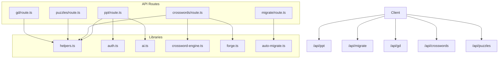
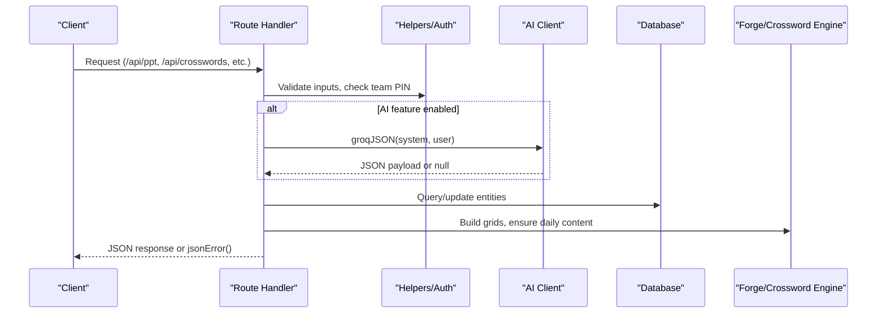
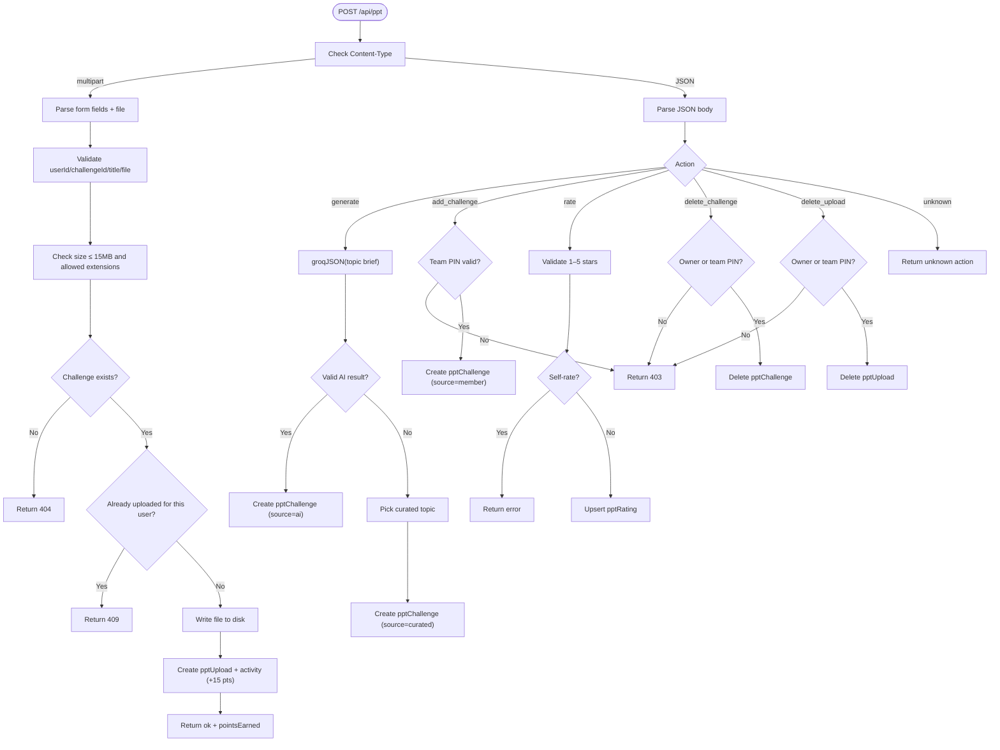
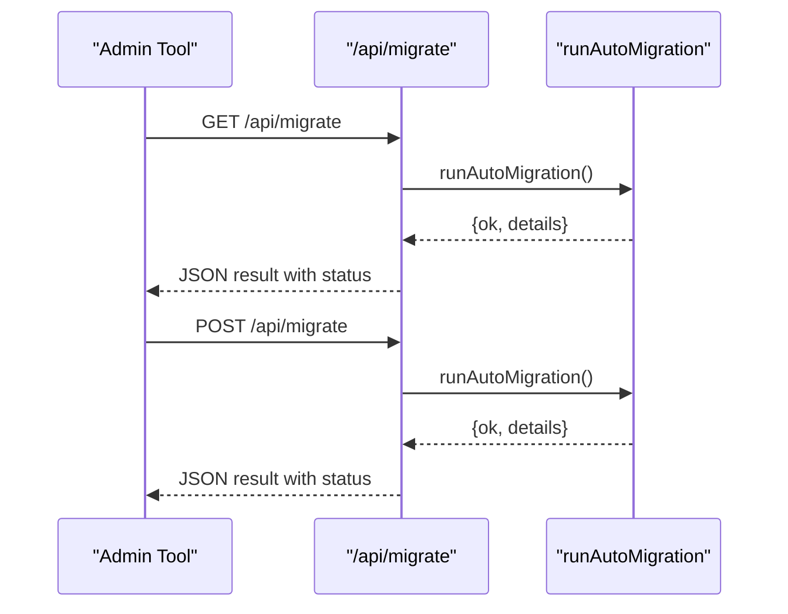
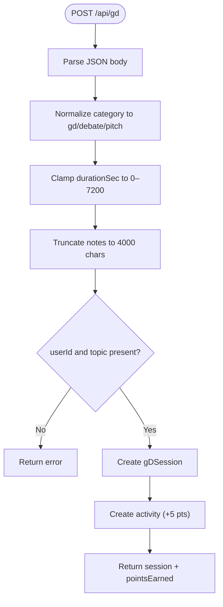
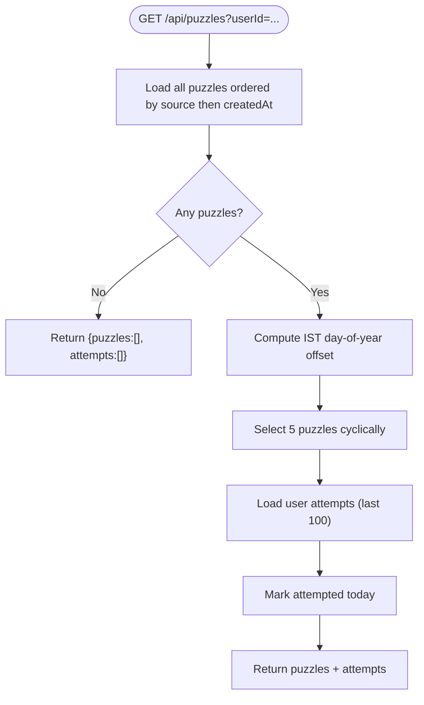
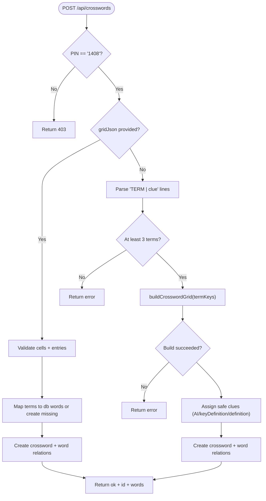
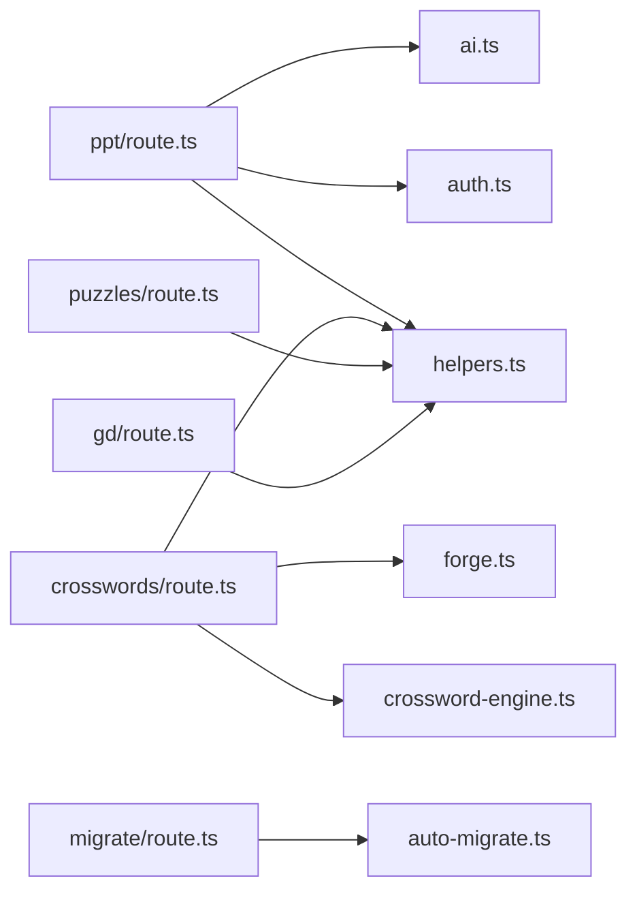

# Utility & System APIs

<cite>
**Referenced Files in This Document**
- [ppt/route.ts](file://src/app/api/ppt/route.ts)
- [migrate/route.ts](file://src/app/api/migrate/route.ts)
- [gd/route.ts](file://src/app/api/gd/route.ts)
- [crosswords/route.ts](file://src/app/api/crosswords/route.ts)
- [puzzles/route.ts](file://src/app/api/puzzles/route.ts)
- [helpers.ts](file://src/lib/helpers.ts)
- [auth.ts](file://src/lib/auth.ts)
- [ai.ts](file://src/lib/ai.ts)
- [crossword-engine.ts](file://src/lib/crossword-engine.ts)
- [forge.ts](file://src/lib/forge.ts)
- [auto-migrate.ts](file://src/lib/auto-migrate.ts)
</cite>

## Table of Contents
1. [Introduction](#introduction)
2. [Project Structure](#project-structure)
3. [Core Components](#core-components)
4. [Architecture Overview](#architecture-overview)
5. [Detailed Component Analysis](#detailed-component-analysis)
6. [Dependency Analysis](#dependency-analysis)
7. [Performance Considerations](#performance-considerations)
8. [Troubleshooting Guide](#troubleshooting-guide)
9. [Conclusion](#conclusion)

## Introduction
This document provides detailed API documentation for utility and system endpoints in the project. It covers:
- Presentation file handling through the PPT challenge endpoint.
- Database migration utilities exposed via a maintenance endpoint.
- Group discussion tools for recording practice sessions.
- Puzzle generation services, including daily puzzles and crossword creation.
It also documents error handling patterns, helper functions, security checks, and integration points with AI and database layers.

## Project Structure
The relevant server-side routes live under `src/app/api`. The key files analyzed here are:
- `src/app/api/ppt/route.ts` — presentation challenges and uploads.
- `src/app/api/migrate/route.ts` — auto-migration entry point.
- `src/app/api/gd/route.ts` — group discussion session logging.
- `src/app/api/crosswords/route.ts` — crossword pool, manual creation, deletion.
- `src/app/api/puzzles/route.ts` — daily puzzle selection.

Supporting libraries:
- `src/lib/helpers.ts` — IST date helpers and shared JSON error helper.
- `src/lib/auth.ts` — team PIN validation and pin hashing utilities.
- `src/lib/ai.ts` — Groq AI client wrapper.
- `src/lib/crossword-engine.ts` — grid builder and validation.
- `src/lib/forge.ts` — daily mechanisms, word expansion, crossword automation.
- `src/lib/auto-migrate.ts` — auto-migration logic invoked by the migrate endpoint.

**Diagram sources**
- [ppt/route.ts:1-195](file://src/app/api/ppt/route.ts#L1-L195)
- [migrate/route.ts:1-15](file://src/app/api/migrate/route.ts#L1-L15)
- [gd/route.ts:1-51](file://src/app/api/gd/route.ts#L1-L51)
- [crosswords/route.ts:1-197](file://src/app/api/crosswords/route.ts#L1-L197)
- [puzzles/route.ts:1-54](file://src/app/api/puzzles/route.ts#L1-L54)
- [helpers.ts:1-42](file://src/lib/helpers.ts#L1-L42)
- [auth.ts:1-26](file://src/lib/auth.ts#L1-L26)
- [ai.ts:1-68](file://src/lib/ai.ts#L1-L68)
- [crossword-engine.ts:1-362](file://src/lib/crossword-engine.ts#L1-L362)
- [forge.ts:1-634](file://src/lib/forge.ts#L1-L634)
- [auto-migrate.ts:461-501](file://src/lib/auto-migrate.ts#L461-L501)

**Section sources**
- [ppt/route.ts:1-195](file://src/app/api/ppt/route.ts#L1-L195)
- [migrate/route.ts:1-15](file://src/app/api/migrate/route.ts#L1-L15)
- [gd/route.ts:1-51](file://src/app/api/gd/route.ts#L1-L51)
- [crosswords/route.ts:1-197](file://src/app/api/crosswords/route.ts#L1-L197)
- [puzzles/route.ts:1-54](file://src/app/api/puzzles/route.ts#L1-L54)
- [helpers.ts:1-42](file://src/lib/helpers.ts#L1-L42)
- [auth.ts:1-26](file://src/lib/auth.ts#L1-L26)
- [ai.ts:1-68](file://src/lib/ai.ts#L1-L68)
- [crossword-engine.ts:1-362](file://src/lib/crossword-engine.ts#L1-L362)
- [forge.ts:1-634](file://src/lib/forge.ts#L1-L634)
- [auto-migrate.ts:461-501](file://src/lib/auto-migrate.ts#L461-L501)

## Core Components
- Presentation File Handling (`/api/ppt`)
  - GET: Lists recent challenges with uploads, ratings, and per-user rating state.
  - POST multipart: Uploads a deck to disk and records an activity point.
  - POST JSON actions: generate (AI or curated topic), add_challenge (PIN-gated), rate, delete_challenge, delete_upload.
- Database Migration Utilities (`/api/migrate`)
  - GET/POST: Triggers auto-migration routine and returns structured result.
- Group Discussion Tools (`/api/gd`)
  - GET: Fetches user’s GD/debate/pitch sessions.
  - POST: Saves a completed practice session and awards points.
- Puzzle Generation Services
  - `/api/puzzles`: Selects today’s five puzzles based on IST day-of-year offset; returns attempts.
  - `/api/crosswords`: Lists active crosswords, ensures daily crossword exists, supports manual creation and deletion.

**Section sources**
- [ppt/route.ts:22-195](file://src/app/api/ppt/route.ts#L22-L195)
- [migrate/route.ts:5-13](file://src/app/api/migrate/route.ts#L5-L13)
- [gd/route.ts:5-50](file://src/app/api/gd/route.ts#L5-L50)
- [puzzles/route.ts:7-53](file://src/app/api/puzzles/route.ts#L7-L53)
- [crosswords/route.ts:7-197](file://src/app/api/crosswords/route.ts#L7-L197)

## Architecture Overview
The system uses Next.js App Router route handlers that delegate to domain-specific libraries:
- Input validation and error responses are centralized via helpers.
- Security-sensitive operations require a shared team PIN.
- AI-powered features fall back gracefully when configuration is missing.
- Daily content generation is time-aware using IST-based keys.

**Diagram sources**
- [ppt/route.ts:1-195](file://src/app/api/ppt/route.ts#L1-L195)
- [crosswords/route.ts:1-197](file://src/app/api/crosswords/route.ts#L1-L197)
- [helpers.ts:1-42](file://src/lib/helpers.ts#L1-L42)
- [auth.ts:1-26](file://src/lib/auth.ts#L1-L26)
- [ai.ts:1-68](file://src/lib/ai.ts#L1-L68)
- [forge.ts:1-634](file://src/lib/forge.ts#L1-L634)
- [crossword-engine.ts:1-362](file://src/lib/crossword-engine.ts#L1-L362)

## Detailed Component Analysis

### Presentation File Handling (`/api/ppt`)
Responsibilities:
- List challenges and associated uploads with ratings.
- Accept multipart uploads (.pptx/.ppt/.pdf/.key, up to 15 MB).
- Generate new topics via AI or curated list.
- Manage challenges and uploads with owner/PIN authorization.
- Award points for uploads.

Key behaviors:
- GET returns challenges with nested uploads, average stars, and per-user rating state.
- POST multipart validates fields, extension, size, challenge existence, and duplicate upload constraints; writes file to disk and creates DB record plus activity.
- POST JSON actions:
  - generate: calls AI; if unavailable or invalid, picks from curated topics.
  - add_challenge: requires team PIN; stores topic/brief.
  - rate: enforces 1–5 stars, prevents self-rating, upserts rating.
  - delete_challenge/delete_upload: owner or team PIN required.

Security and validation:
- Team PIN enforced for administrative actions.
- File extension allowlist and size cap.
- Duplicate upload prevention per challenge/user.

Error handling:
- Centralized `jsonError` for malformed input and business rule violations.
- 404 for missing resources; 403 for unauthorized access; 409 for conflicts.

Example usage patterns:
- Upload a deck: multipart form with userId, challengeId, title, file.
- Rate an upload: JSON action with uploadId and stars.
- Delete a challenge/upload: JSON action with id and optional team PIN.

**Diagram sources**
- [ppt/route.ts:73-195](file://src/app/api/ppt/route.ts#L73-L195)
- [auth.ts:22-25](file://src/lib/auth.ts#L22-L25)
- [ai.ts:24-67](file://src/lib/ai.ts#L24-L67)

**Section sources**
- [ppt/route.ts:22-195](file://src/app/api/ppt/route.ts#L22-L195)
- [auth.ts:22-25](file://src/lib/auth.ts#L22-L25)
- [ai.ts:24-67](file://src/lib/ai.ts#L24-L67)

### Database Migration Utilities (`/api/migrate`)
Responsibilities:
- Provide a simple HTTP interface to run auto-migration routines.
- Return structured results indicating success or failure.

Behavior:
- GET and POST both invoke the same auto-migration function.
- Response status reflects the operation outcome.

Integration:
- Delegates to `runAutoMigration` in `auto-migrate.ts`, which performs schema/data migrations and seeding.

Example usage:
- Admin tooling can call GET/POST to trigger migrations during deployment or maintenance windows.

**Diagram sources**
- [migrate/route.ts:5-13](file://src/app/api/migrate/route.ts#L5-L13)
- [auto-migrate.ts:461-501](file://src/lib/auto-migrate.ts#L461-L501)

**Section sources**
- [migrate/route.ts:5-13](file://src/app/api/migrate/route.ts#L5-L13)
- [auto-migrate.ts:461-501](file://src/lib/auto-migrate.ts#L461-L501)

### Group Discussion Tools (`/api/gd`)
Responsibilities:
- Retrieve a user’s past GD/debate/pitch sessions.
- Record a completed practice session and award points.

Input/output:
- GET accepts `userId`; returns sessions array.
- POST accepts `userId`, `topic`, `category` (gd/debate/pitch), optional `stance`, `durationSec`, `notes`; returns saved session and points.

Validation and safety:
- Category is normalized to one of gd/debate/pitch.
- Duration clamped to 0–7200 seconds.
- Notes truncated to 4000 characters.
- Topic length capped at 300 characters.

Points:
- Saving a session awards 5 points via activity tracking.

**Diagram sources**
- [gd/route.ts:18-50](file://src/app/api/gd/route.ts#L18-L50)

**Section sources**
- [gd/route.ts:5-50](file://src/app/api/gd/route.ts#L5-L50)

### Puzzle Generation Services

#### Daily Puzzles (`/api/puzzles`)
Responsibilities:
- Select today’s five puzzles deterministically using IST day-of-year offset.
- Return attempts history for the current user.

Behavior:
- If no puzzles exist, returns empty arrays.
- Attempts are filtered to today’s date for “attempted” flags.

Example usage:
- Frontend fetches today’s puzzles and marks attempted ones.

**Diagram sources**
- [puzzles/route.ts:7-53](file://src/app/api/puzzles/route.ts#L7-L53)
- [helpers.ts:8-12](file://src/lib/helpers.ts#L8-L12)

**Section sources**
- [puzzles/route.ts:7-53](file://src/app/api/puzzles/route.ts#L7-L53)
- [helpers.ts:8-12](file://src/lib/helpers.ts#L8-L12)

#### Crosswords (`/api/crosswords`)
Responsibilities:
- List active crosswords with per-user solve status.
- Ensure a daily crossword exists for today.
- Support manual creation via text lines or pasted grid JSON.
- Delete crosswords with confirmation PIN.

Key behaviors:
- GET ensures daily crossword via `ensureDailyCrossword`, then returns crosswords with words and solve metrics.
- POST supports two modes:
  - Text mode: lines like "TERM | clue", builds grid via engine, assigns clues safely.
  - Grid JSON mode: validates entries and cells, creates crossword and links words.
- DELETE requires confirmation PIN and removes only the crossword record.

Security and validation:
- Confirmation PIN required for write/delete operations.
- Grid validation enforces crossing, connectivity, and boundary rules.
- Clue safety prevents leaking answers.

**Diagram sources**
- [crosswords/route.ts:74-182](file://src/app/api/crosswords/route.ts#L74-L182)
- [crossword-engine.ts:257-344](file://src/lib/crossword-engine.ts#L257-L344)
- [forge.ts:523-633](file://src/lib/forge.ts#L523-L633)

**Section sources**
- [crosswords/route.ts:7-197](file://src/app/api/crosswords/route.ts#L7-L197)
- [crossword-engine.ts:257-344](file://src/lib/crossword-engine.ts#L257-L344)
- [forge.ts:523-633](file://src/lib/forge.ts#L523-L633)

## Dependency Analysis
Component relationships and coupling:
- Routes depend on helpers for IST dates and error formatting.
- Authentication utilities enforce team PIN for sensitive operations.
- AI client is used optionally; graceful fallbacks are implemented.
- Crossword engine provides deterministic grid building and validation.
- Forge orchestrates daily mechanisms and integrates AI and engine.

**Diagram sources**
- [ppt/route.ts:1-195](file://src/app/api/ppt/route.ts#L1-L195)
- [crosswords/route.ts:1-197](file://src/app/api/crosswords/route.ts#L1-L197)
- [puzzles/route.ts:1-54](file://src/app/api/puzzles/route.ts#L1-L54)
- [gd/route.ts:1-51](file://src/app/api/gd/route.ts#L1-L51)
- [migrate/route.ts:1-15](file://src/app/api/migrate/route.ts#L1-L15)
- [helpers.ts:1-42](file://src/lib/helpers.ts#L1-L42)
- [auth.ts:1-26](file://src/lib/auth.ts#L1-L26)
- [ai.ts:1-68](file://src/lib/ai.ts#L1-L68)
- [crossword-engine.ts:1-362](file://src/lib/crossword-engine.ts#L1-L362)
- [forge.ts:1-634](file://src/lib/forge.ts#L1-L634)
- [auto-migrate.ts:461-501](file://src/lib/auto-migrate.ts#L461-L501)

**Section sources**
- [ppt/route.ts:1-195](file://src/app/api/ppt/route.ts#L1-L195)
- [crosswords/route.ts:1-197](file://src/app/api/crosswords/route.ts#L1-L197)
- [puzzles/route.ts:1-54](file://src/app/api/puzzles/route.ts#L1-L54)
- [gd/route.ts:1-51](file://src/app/api/gd/route.ts#L1-L51)
- [migrate/route.ts:1-15](file://src/app/api/migrate/route.ts#L1-L15)
- [helpers.ts:1-42](file://src/lib/helpers.ts#L1-L42)
- [auth.ts:1-26](file://src/lib/auth.ts#L1-L26)
- [ai.ts:1-68](file://src/lib/ai.ts#L1-L68)
- [crossword-engine.ts:1-362](file://src/lib/crossword-engine.ts#L1-L362)
- [forge.ts:1-634](file://src/lib/forge.ts#L1-L634)
- [auto-migrate.ts:461-501](file://src/lib/auto-migrate.ts#L461-L501)

## Performance Considerations
- File uploads: Enforce size limits and extension allowlists to reduce storage overhead and mitigate abuse.
- AI calls: Timeouts and model fallback chains prevent long waits; graceful degradation avoids blocking requests.
- Crossword grid building: Deterministic algorithms with multiple seeds aim for compact grids while validating topology.
- Daily selection: IST-based offsets provide deterministic distribution without heavy computation.
- Activity logging: Lightweight point updates keep analytics lean.

[No sources needed since this section provides general guidance]

## Troubleshooting Guide
Common errors and resolutions:
- Missing or invalid parameters:
  - PPT: Missing userId/challengeId/title/file → ensure multipart fields are present and valid.
  - GD: Missing userId/topic → include required fields.
  - Crosswords: Invalid grid JSON or insufficient terms → provide valid cells/entries or at least three terms.
- Authorization failures:
  - Team PIN required for admin actions (add_challenge, delete_challenge, delete_upload, crossword creation/deletion).
- Resource not found:
  - Challenge or upload IDs must exist before rating or deletion.
- Conflict conditions:
  - Duplicate deck upload per challenge/user → delete existing upload first.
- AI fallback behavior:
  - If GROQ_API_KEY is not set or AI response is invalid, curated content is used automatically.

Error response pattern:
- Centralized `jsonError` returns `{ error: message }` with appropriate HTTP status codes.

**Section sources**
- [ppt/route.ts:73-195](file://src/app/api/ppt/route.ts#L73-L195)
- [gd/route.ts:18-50](file://src/app/api/gd/route.ts#L18-L50)
- [crosswords/route.ts:74-197](file://src/app/api/crosswords/route.ts#L74-L197)
- [helpers.ts:39-41](file://src/lib/helpers.ts#L39-L41)
- [auth.ts:22-25](file://src/lib/auth.ts#L22-L25)

## Conclusion
The utility and system APIs provide robust support for presentation management, database maintenance, group discussion tracking, and puzzle generation. They emphasize secure operations via team PINs, resilient AI integration with fallbacks, and deterministic daily content generation. Error handling is consistent and centralized, making these endpoints reliable for both user-facing features and administrative tasks.

[No sources needed since this section summarizes without analyzing specific files]