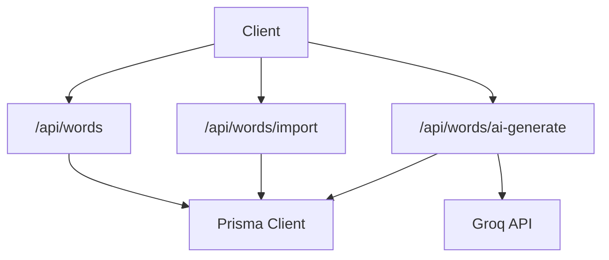
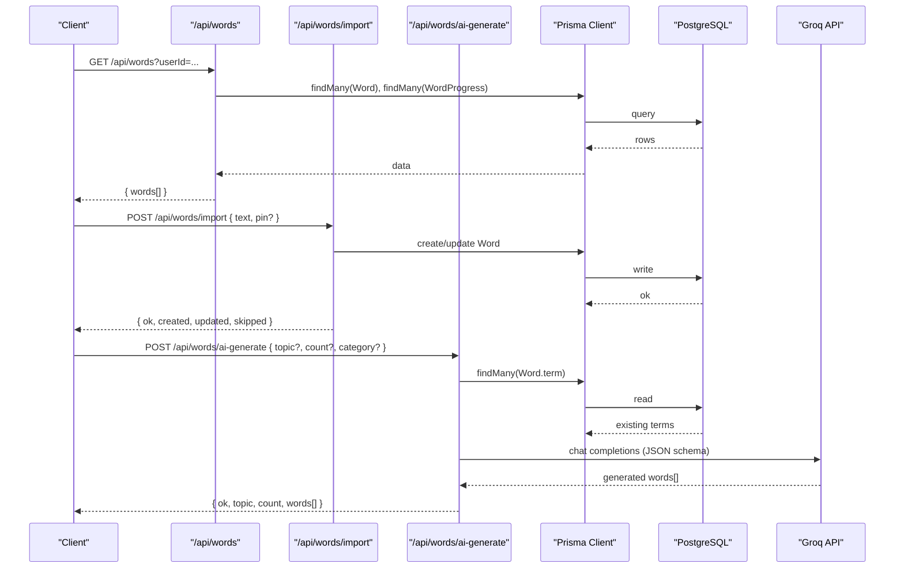
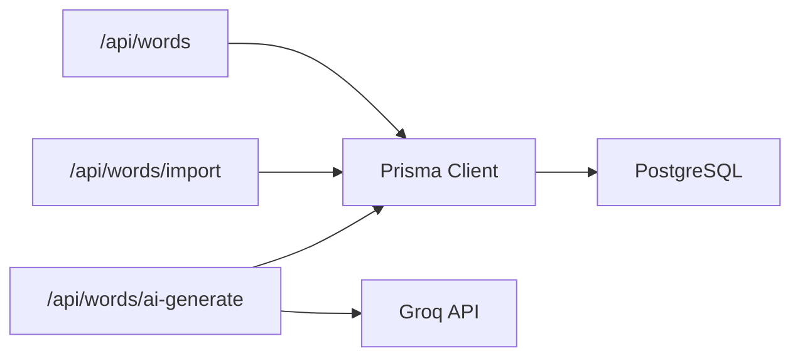

# Word Management API

<cite>
**Referenced Files in This Document**
- [route.ts](file://src/app/api/words/route.ts)
- [import route.ts](file://src/app/api/words/import/route.ts)
- [ai-generate route.ts](file://src/app/api/words/ai-generate/route.ts)
- [schema.prisma](file://prisma/schema.prisma)
- [db.ts](file://src/lib/db.ts)
- [ai.ts](file://src/lib/ai.ts)
</cite>

## Table of Contents
1. [Introduction](#introduction)
2. [Project Structure](#project-structure)
3. [Core Components](#core-components)
4. [Architecture Overview](#architecture-overview)
5. [Detailed Component Analysis](#detailed-component-analysis)
6. [Dependency Analysis](#dependency-analysis)
7. [Performance Considerations](#performance-considerations)
8. [Troubleshooting Guide](#troubleshooting-guide)
9. [Conclusion](#conclusion)

## Introduction
This document describes the Word Management API for WeLearn’s vocabulary system. It covers:
- CRUD operations for words
- Bulk import functionality
- AI-powered word generation using Groq
- Integration with the memory engine and spaced repetition system (SRS)
- Request/response schemas, validation rules, and example workflows

The API is implemented as Next.js App Router endpoints under `/api/words`. Data is persisted via Prisma against a PostgreSQL database.

## Project Structure
The relevant API routes are organized by feature:
- `/api/words` — list, create/update, delete words
- `/api/words/import` — bulk import from JSON or line-based formats
- `/api/words/ai-generate` — generate curated startup/business vocabulary via Groq

**Diagram sources**
- [route.ts:1-92](file://src/app/api/words/route.ts#L1-L92)
- [import route.ts:1-104](file://src/app/api/words/import/route.ts#L1-L104)
- [ai-generate route.ts:1-125](file://src/app/api/words/ai-generate/route.ts#L1-L125)
- [db.ts:1-50](file://src/lib/db.ts#L1-L50)
- [ai.ts:1-68](file://src/lib/ai.ts#L1-L68)

**Section sources**
- [route.ts:1-92](file://src/app/api/words/route.ts#L1-L92)
- [import route.ts:1-104](file://src/app/api/words/import/route.ts#L1-L104)
- [ai-generate route.ts:1-125](file://src/app/api/words/ai-generate/route.ts#L1-L125)
- [db.ts:1-50](file://src/lib/db.ts#L1-L50)

## Core Components
- Word model: stores canonical terms, definitions, categories, and metadata.
- WordProgress model: per-user SRS state (status, interval, dueAt, counters).
- WordLog model: event log for flips, quiz results, crossword usage, hints.
- MemoryProfile model: cognitive metrics, weak/strong vaults, hearts, daily stats.

These models power the API responses and the spaced repetition workflow.

**Section sources**
- [schema.prisma:506-567](file://prisma/schema.prisma#L506-L567)
- [schema.prisma:525-546](file://prisma/schema.prisma#L525-L546)
- [schema.prisma:549-567](file://prisma/schema.prisma#L549-L567)
- [schema.prisma:624-640](file://prisma/schema.prisma#L624-L640)

## Architecture Overview
The Word Management API integrates three layers:
- API layer: Next.js route handlers for words, import, and AI generation.
- Data layer: Prisma client backed by PostgreSQL.
- AI layer: Optional Groq integration for generating vocabulary aligned to topics and categories.

**Diagram sources**
- [route.ts:6-40](file://src/app/api/words/route.ts#L6-L40)
- [import route.ts:12-99](file://src/app/api/words/import/route.ts#L12-L99)
- [ai-generate route.ts:48-119](file://src/app/api/words/ai-generate/route.ts#L48-L119)
- [db.ts:42-47](file://src/lib/db.ts#L42-L47)
- [ai.ts:24-67](file://src/lib/ai.ts#L24-L67)

## Detailed Component Analysis

### List Words: GET /api/words
- Purpose: Return all words plus per-user progress when userId is provided. Also triggers a background daily expansion routine.
- Query parameters:
  - userId: optional string; if omitted, returns default progress map.
- Response body:
  - words: array of word objects including term, definition, keyDefinition, category, source, usedInCrosswords, status, dueAt, timesSeen, timesCorrect.
- Behavior:
  - Background call to ensure daily word expansion runs asynchronously.
  - Progress map merges per-word SRS fields into each word object.

Request examples:
- GET /api/words
- GET /api/words?userId=user_abc

Response schema:
- { words: WordView[] }
- WordView fields: id, term, definition, keyDefinition, category, source, usedInCrosswords, status, dueAt, timesSeen, timesCorrect

Error handling:
- Returns a generic error response on failure.

**Section sources**
- [route.ts:6-40](file://src/app/api/words/route.ts#L6-L40)

### Create or Update Words: POST /api/words
- Purpose: Create one or many words; update existing terms by matching term.
- Request body:
  - Single object: { term, definition, category?, keyDefinition? }
  - Batch object: { words: [{ term, definition, category?, keyDefinition? }] }
- Validation:
  - term must be at least 2 characters after trimming.
  - definition must be at least 4 characters after trimming.
  - category defaults to "general" and is normalized to lowercase.
  - keyDefinition is optional and trimmed.
- Behavior:
  - If a term already exists, it updates that record.
  - Otherwise, creates a new word with source set to "member".
- Response:
  - { ok: true, created, updated, total }

Request examples:
- POST /api/words
  - Body: { term: "LEVERAGE", definition: "Use something to maximum advantage.", category: "finance" }
- POST /api/words
  - Body: { words: [{ term: "BOOTSTRAP", definition: "Start without external funding." }, { term: "RUNWAY", definition: "Time before funds run out." }] }

Response schema:
- { ok: boolean, created: number, updated: number, total: number }

Error handling:
- Returns an error if no valid items remain after filtering.

**Section sources**
- [route.ts:42-77](file://src/app/api/words/route.ts#L42-L77)

### Delete Words: DELETE /api/words
- Purpose: Bulk delete words by IDs.
- Request body:
  - ids: string[]
  - pin: string (confirmation PIN required)
- Validation:
  - pin must equal the configured value.
  - ids must be non-empty.
- Behavior:
  - Deletes multiple words by ID list.
- Response:
  - { ok: true, deleted: number }

Request example:
- DELETE /api/words
  - Body: { ids: ["id1","id2"], pin: "1408" }

Response schema:
- { ok: boolean, deleted: number }

Error handling:
- Returns 403 if PIN is incorrect.
- Returns an error if no IDs are provided.

**Section sources**
- [route.ts:79-91](file://src/app/api/words/route.ts#L79-L91)

### Bulk Import: POST /api/words/import
- Purpose: Parse and import words from a single text payload supporting multiple formats.
- Supported input formats:
  - JSON array: [{"term":"...","definition":"..."}, ...]
    - Accepts alternate keys: word, meaning, clue for definition; category; keyDefinition.
  - Line-based formats:
    - "term | definition"
    - "term - definition"
    - CSV: "term,definition"
- Request body:
  - text: string (required)
  - pin: string (optional; enables overwrite of duplicates)
- Validation:
  - Each parsed item must have a term and definition.
  - Term safety: must match pattern starting with letter, followed by letters/spaces, length 2–24.
  - Duplicate behavior:
    - Without pin: skip duplicate terms.
    - With correct pin: update existing term’s definition/category/keyDefinition.
- Response:
  - { ok: true, created, updated, skipped, parsed }

Request examples:
- JSON array:
  - Body: { text: '[{"term":"ACQUIHIRE","definition":"Acquisition combined with hiring talent."}]' }
- Line format:
  - Body: { text: "BOOTSTRAP | Start without external funding.\nRUNWAY - Time before funds run out." }
- CSV:
  - Body: { text: "LEVERAGE,Use something to maximum advantage." }

Response schema:
- { ok: boolean, created: number, updated: number, skipped: number, parsed: number }

Error handling:
- Returns an error if parsing yields zero items.

**Section sources**
- [import route.ts:12-99](file://src/app/api/words/import/route.ts#L12-L99)

### AI-Powered Word Generation: POST /api/words/ai-generate
- Purpose: Generate startup/business vocabulary tailored to a topic or prompt using Groq.
- Request body:
  - topic?: string
  - prompt?: string (alias for topic)
  - count?: number (default 5, clamped between 3 and 10)
  - category?: string (one of finance, marketing, ops, strategy, legal, general)
- Behavior:
  - Reads existing terms to avoid duplicates.
  - Builds system and user prompts for Groq with strict JSON schema constraints.
  - Normalizes generated terms to uppercase A-Z only, enforces length 3–12.
  - Filters invalid categories to "general".
  - Falls back to curated topic banks if AI output is insufficient or unavailable.
- Response:
  - { ok: true, topic, count, words[] }
  - words[]: { term, definition, keyDefinition, category }

Request example:
- POST /api/words/ai-generate
  - Body: { topic: "fintech", count: 5, category: "finance" }

Response schema:
- { ok: boolean, topic: string, count: number, words: GeneratedWord[] }
- GeneratedWord fields: term, definition, keyDefinition, category

Error handling:
- Returns an error if generation fails.

**Section sources**
- [ai-generate route.ts:48-119](file://src/app/api/words/ai-generate/route.ts#L48-L119)
- [ai.ts:24-67](file://src/lib/ai.ts#L24-L67)

## Dependency Analysis
- Database access:
  - All routes use Prisma Client exported from db.ts.
  - The client resolves DATABASE_URL across multiple environment variables for compatibility.
- AI integration:
  - ai-generate uses groqJSON to call Groq’s OpenAI-compatible endpoint.
  - If GROQ_API_KEY is missing, generation falls back gracefully to curated content.

**Diagram sources**
- [db.ts:42-47](file://src/lib/db.ts#L42-L47)
- [ai.ts:24-67](file://src/lib/ai.ts#L24-L67)
- [route.ts:1-92](file://src/app/api/words/route.ts#L1-L92)
- [import route.ts:1-104](file://src/app/api/words/import/route.ts#L1-L104)
- [ai-generate route.ts:1-125](file://src/app/api/words/ai-generate/route.ts#L1-L125)

**Section sources**
- [db.ts:1-50](file://src/lib/db.ts#L1-L50)
- [ai.ts:1-68](file://src/lib/ai.ts#L1-L68)

## Performance Considerations
- Batch operations:
  - POST /api/words supports creating/updating multiple words in one request.
  - POST /api/words/import parses and writes in a loop; consider chunking large imports to reduce latency.
- Read performance:
  - GET /api/words loads all words and optionally all user progress; pagination could improve scalability for large catalogs.
- AI calls:
  - Groq requests include timeouts and model fallbacks; keep count small to minimize token usage.
- Background tasks:
  - Daily word expansion is triggered asynchronously; monitor error suppression to avoid blocking requests.

[No sources needed since this section provides general guidance]

## Troubleshooting Guide
Common issues and resolutions:
- Wrong confirmation PIN:
  - DELETE /api/words requires pin equal to the configured value. Ensure you pass the correct PIN.
- Invalid input lengths:
  - POST /api/words requires term >= 2 chars and definition >= 4 chars. Trim and validate inputs.
- Import parsing failures:
  - POST /api/words/import expects either a JSON array or line-based formats. Verify delimiters and quoting.
- Duplicate terms:
  - Without pin, duplicate terms are skipped during import. Provide pin to enable overwriting.
- AI generation not returning enough words:
  - If Groq is unavailable or returns fewer than requested, the endpoint supplements from curated topic banks. Check network connectivity and GROQ_API_KEY configuration.

**Section sources**
- [route.ts:79-91](file://src/app/api/words/route.ts#L79-L91)
- [route.ts:50-59](file://src/app/api/words/route.ts#L50-L59)
- [import route.ts:56-57](file://src/app/api/words/import/route.ts#L56-L57)
- [import route.ts:71-84](file://src/app/api/words/import/route.ts#L71-L84)
- [ai-generate route.ts:94-110](file://src/app/api/words/ai-generate/route.ts#L94-L110)

## Conclusion
The Word Management API provides robust tools for managing vocabulary:
- Simple CRUD endpoints for quick word management.
- Flexible bulk import supporting JSON and line-based formats.
- AI-powered generation integrated with Groq, with safe fallbacks.
- Tight integration with the memory engine and spaced repetition system through shared data models.

Adopt batch operations for efficiency, validate inputs early, and configure Groq securely for optimal AI-assisted content creation.

[No sources needed since this section summarizes without analyzing specific files]