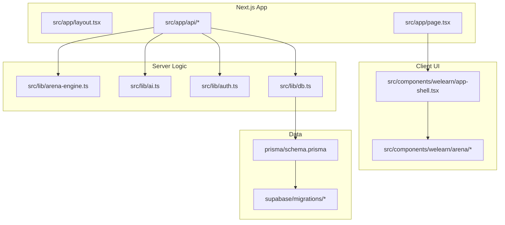
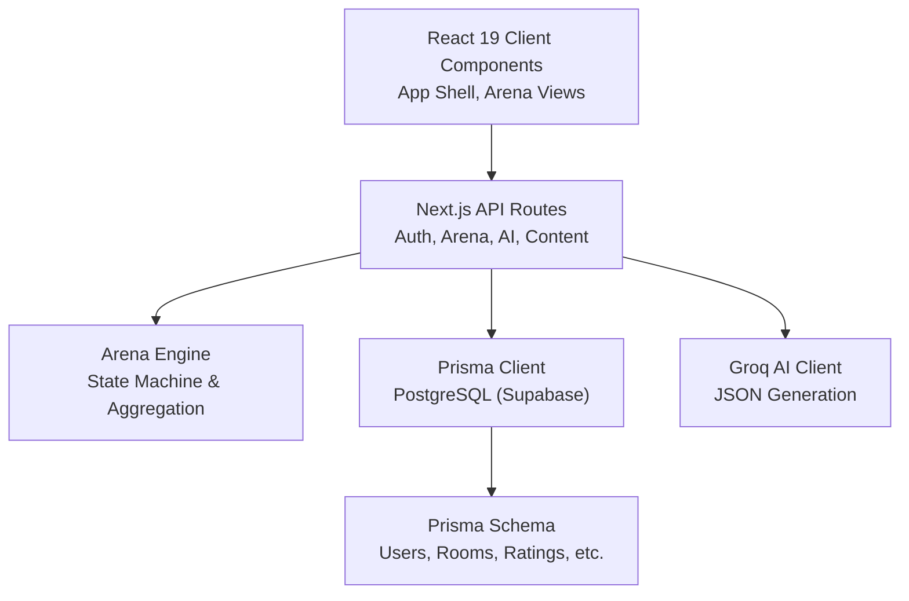
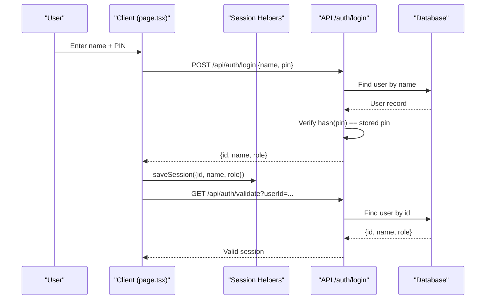
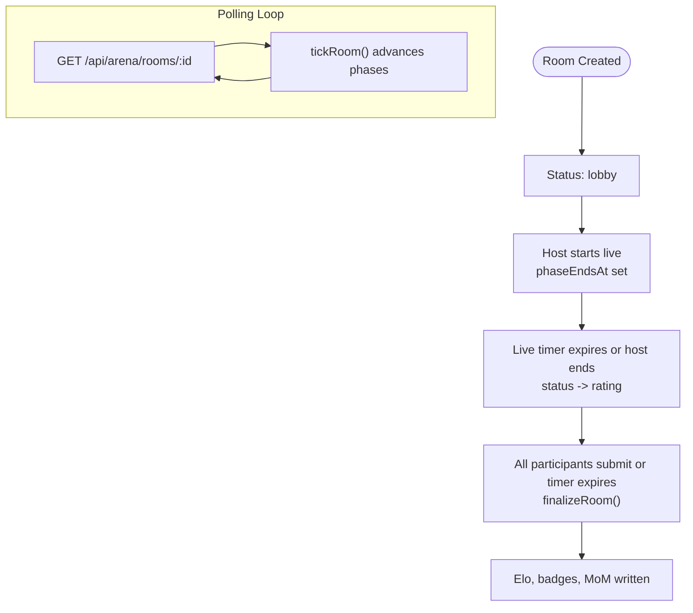
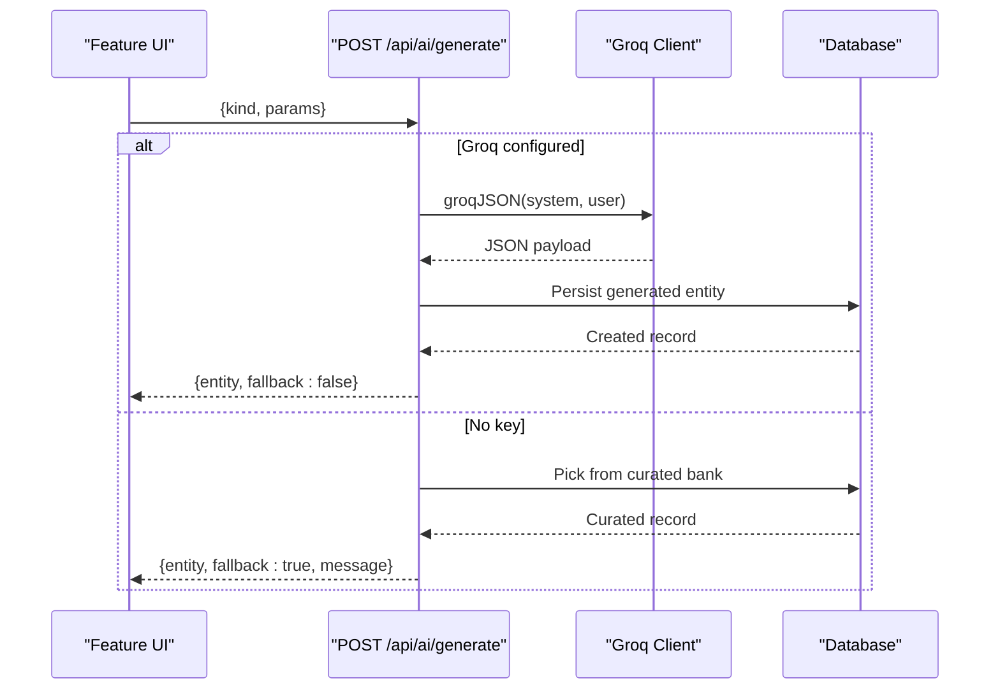
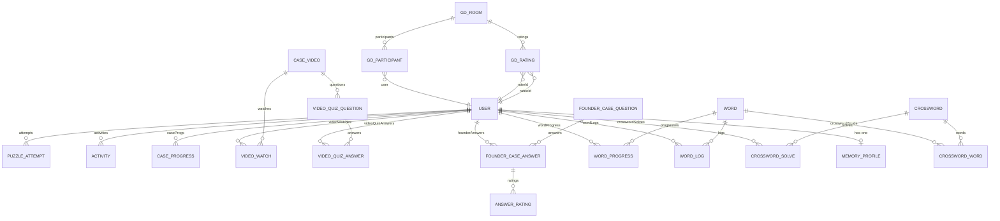
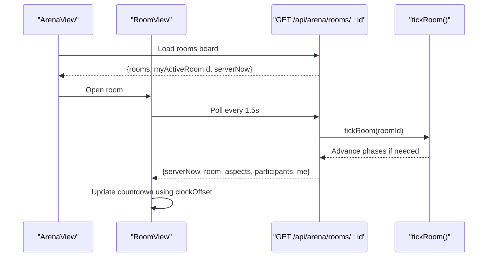
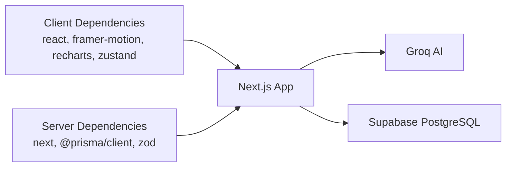

# Architecture Overview

<cite>
**Referenced Files in This Document**
- [README.md](file://README.md)
- [package.json](file://package.json)
- [next.config.ts](file://next.config.ts)
- [src/app/layout.tsx](file://src/app/layout.tsx)
- [src/app/page.tsx](file://src/app/page.tsx)
- [src/components/welearn/app-shell.tsx](file://src/components/welearn/app-shell.tsx)
- [src/lib/session.ts](file://src/lib/session.ts)
- [src/lib/db.ts](file://src/lib/db.ts)
- [src/lib/auth.ts](file://src/lib/auth.ts)
- [prisma/schema.prisma](file://prisma/schema.prisma)
- [src/app/api/auth/login/route.ts](file://src/app/api/auth/login/route.ts)
- [src/app/api/auth/signup/route.ts](file://src/app/api/auth/signup/route.ts)
- [src/app/api/auth/validate/route.ts](file://src/app/api/auth/validate/route.ts)
- [src/app/api/arena/rooms/route.ts](file://src/app/api/arena/rooms/route.ts)
- [src/app/api/arena/rooms/[id]/route.ts](file://src/app/api/arena/rooms/[id]/route.ts)
- [src/lib/arena-engine.ts](file://src/lib/arena-engine.ts)
- [src/app/api/ai/generate/route.ts](file://src/app/api/ai/generate/route.ts)
- [src/lib/ai.ts](file://src/lib/ai.ts)
- [src/components/welearn/arena/arena-view.tsx](file://src/components/welearn/arena/arena-view.tsx)
- [src/components/welearn/arena/room-view.tsx](file://src/components/welearn/arena/room-view.tsx)
</cite>

## Table of Contents
1. Introduction
2. Project Structure
3. Core Components
4. Architecture Overview
5. Detailed Component Analysis
6. Dependency Analysis
7. Performance Considerations
8. Troubleshooting Guide
9. Conclusion

## Introduction
WeLearn is a Next.js App Router application for E-Cell preparation. It combines timed puzzles, case studies, founder quizzes, crosswords, and live Arena battle rooms with peer star ratings, Elo scoring, and AI-generated content. The system uses React 19 on the client, Prisma ORM over PostgreSQL (Supabase), session-based authentication, and Groq AI for optional content generation. Real-time collaboration in Arena rooms is implemented through short-interval polling with server-authoritative timers and phase transitions.

Key technology decisions:
- Next.js App Router with server routes and client components.
- Feature-sliced layout under src/app, src/components/welearn, and src/lib.
- React 19 UI with shadcn/ui primitives and Tailwind CSS.
- Prisma schema-driven database abstraction over Supabase Postgres.
- Session-based auth via name + PIN stored in localStorage and validated against the database.
- Groq AI integration with curated fallbacks when API keys are missing.

**Section sources**
- [README.md:1-104](file://README.md#L1-L104)
- [package.json:16-82](file://package.json#L16-L82)

## Project Structure
The repository follows a feature-oriented structure within the Next.js App Router:
- src/app: Page entry points, global layout, and API routes grouped by feature.
- src/components/welearn: Feature-specific UI views and shared UI primitives.
- src/lib: Server and client utilities including database access, authentication helpers, arena engine, and AI client.
- prisma/schema.prisma: Single source of truth for data models across modules.
- supabase/migrations: Database migrations and seed data for PostgreSQL.

**Diagram sources**
- [src/app/layout.tsx:1-71](file://src/app/layout.tsx#L1-L71)
- [src/app/page.tsx:1-105](file://src/app/page.tsx#L1-L105)
- [src/components/welearn/app-shell.tsx:1-325](file://src/components/welearn/app-shell.tsx#L1-L325)
- [src/lib/arena-engine.ts:1-415](file://src/lib/arena-engine.ts#L1-L415)
- [src/lib/ai.ts:1-68](file://src/lib/ai.ts#L1-L68)
- [src/lib/auth.ts:1-26](file://src/lib/auth.ts#L1-L26)
- [src/lib/db.ts:1-50](file://src/lib/db.ts#L1-L50)
- [prisma/schema.prisma:1-641](file://prisma/schema.prisma#L1-L641)

**Section sources**
- [src/app/layout.tsx:1-71](file://src/app/layout.tsx#L1-L71)
- [src/app/page.tsx:1-105](file://src/app/page.tsx#L1-L105)
- [src/components/welearn/app-shell.tsx:1-325](file://src/components/welearn/app-shell.tsx#L1-L325)
- [prisma/schema.prisma:1-641](file://prisma/schema.prisma#L1-L641)

## Core Components
- Root layout and fonts: Provides metadata, viewport, theme bootstrap script, and font variables for display, body, and monospace numbers.
- Application shell: Client-side navigation, sidebar, header, user menu, streak display, and view routing between feature pages.
- Session management: Client-side helpers to load/save/clear session from localStorage and a typed fetch wrapper for API calls.
- Database client: Prisma client initialization with environment-aware URL resolution for Vercel/Supabase.
- Authentication helpers: PIN hashing, validation, team PIN checks, and name validation.
- Arena engine: Server-only state machine for room lifecycle, rating aggregation, Elo updates, badges, and MoM generation.
- AI client: Groq JSON generation with model fallback chain and curated fallbacks.

**Section sources**
- [src/app/layout.tsx:1-71](file://src/app/layout.tsx#L1-L71)
- [src/components/welearn/app-shell.tsx:1-325](file://src/components/welearn/app-shell.tsx#L1-L325)
- [src/lib/session.ts:1-43](file://src/lib/session.ts#L1-L43)
- [src/lib/db.ts:1-50](file://src/lib/db.ts#L1-L50)
- [src/lib/auth.ts:1-26](file://src/lib/auth.ts#L1-L26)
- [src/lib/arena-engine.ts:1-415](file://src/lib/arena-engine.ts#L1-L415)
- [src/lib/ai.ts:1-68](file://src/lib/ai.ts#L1-L68)

## Architecture Overview
The system separates concerns into:
- Client components: React 19 UI rendered in the browser, managing local state, polling, and user interactions.
- Server routes: Next.js API endpoints handling authentication, business logic, and database operations.
- Data layer: Prisma ORM abstracting PostgreSQL; schema defines entities for users, puzzles, cases, videos, arena rooms, crosswords, and more.
- External services: Groq AI for content generation; YouTube links consumed as part of the Video Zone.

**Diagram sources**
- [src/app/page.tsx:1-105](file://src/app/page.tsx#L1-L105)
- [src/components/welearn/arena/arena-view.tsx:1-506](file://src/components/welearn/arena/arena-view.tsx#L1-L506)
- [src/app/api/arena/rooms/route.ts:1-115](file://src/app/api/arena/rooms/route.ts#L1-L115)
- [src/app/api/arena/rooms/[id]/route.ts:1-291](file://src/app/api/arena/rooms/[id]/route.ts#L1-L291)
- [src/lib/arena-engine.ts:1-415](file://src/lib/arena-engine.ts#L1-L415)
- [src/lib/db.ts:1-50](file://src/lib/db.ts#L1-L50)
- [src/app/api/ai/generate/route.ts:1-270](file://src/app/api/ai/generate/route.ts#L1-L270)
- [src/lib/ai.ts:1-68](file://src/lib/ai.ts#L1-L68)
- [prisma/schema.prisma:1-641](file://prisma/schema.prisma#L1-L641)

## Detailed Component Analysis

### Authentication Flow
Authentication uses a simple name + PIN scheme:
- Client stores a lightweight session object in localStorage.
- On app start, the client validates the session ID against the database.
- Login route verifies name and hashed PIN, returning user identity.
- Signup route validates inputs, hashes PIN, creates user, and logs an activity event.

**Diagram sources**
- [src/app/page.tsx:23-50](file://src/app/page.tsx#L23-L50)
- [src/lib/session.ts:11-43](file://src/lib/session.ts#L11-L43)
- [src/app/api/auth/login/route.ts:1-26](file://src/app/api/auth/login/route.ts#L1-L26)
- [src/app/api/auth/validate/route.ts:1-18](file://src/app/api/auth/validate/route.ts#L1-L18)

**Section sources**
- [src/app/page.tsx:1-105](file://src/app/page.tsx#L1-L105)
- [src/lib/session.ts:1-43](file://src/lib/session.ts#L1-L43)
- [src/app/api/auth/login/route.ts:1-26](file://src/app/api/auth/login/route.ts#L1-L26)
- [src/app/api/auth/signup/route.ts:1-36](file://src/app/api/auth/signup/route.ts#L1-L36)
- [src/app/api/auth/validate/route.ts:1-18](file://src/app/api/auth/validate/route.ts#L1-L18)
- [src/lib/auth.ts:1-26](file://src/lib/auth.ts#L1-L26)

### Arena Real-Time Polling and State Machine
Arena rooms follow a strict lifecycle: lobby → live → rating → ended. Timers are optional and server-authoritative. Clients poll every ~1.5 seconds to synchronize with server time and phase deadlines.

**Diagram sources**
- [src/app/api/arena/rooms/[id]/route.ts:10-124](file://src/app/api/arena/rooms/[id]/route.ts#L10-L124)
- [src/lib/arena-engine.ts:88-132](file://src/lib/arena-engine.ts#L88-L132)
- [src/components/welearn/arena/room-view.tsx:41-76](file://src/components/welearn/arena/room-view.tsx#L41-L76)

**Section sources**
- [src/app/api/arena/rooms/route.ts:1-115](file://src/app/api/arena/rooms/route.ts#L1-L115)
- [src/app/api/arena/rooms/[id]/route.ts:1-291](file://src/app/api/arena/rooms/[id]/route.ts#L1-L291)
- [src/lib/arena-engine.ts:1-415](file://src/lib/arena-engine.ts#L1-L415)
- [src/components/welearn/arena/arena-view.tsx:61-122](file://src/components/welearn/arena/arena-view.tsx#L61-L122)
- [src/components/welearn/arena/room-view.tsx:25-96](file://src/components/welearn/arena/room-view.tsx#L25-L96)

### AI Content Generation
AI generation supports multiple kinds: puzzles, GD/debate topics, flashcards, pitch prompts, case studies, and founder quiz questions. When GROQ_API_KEY is configured, requests go to Groq; otherwise, curated banks are used.

**Diagram sources**
- [src/app/api/ai/generate/route.ts:46-269](file://src/app/api/ai/generate/route.ts#L46-L269)
- [src/lib/ai.ts:24-67](file://src/lib/ai.ts#L24-L67)

**Section sources**
- [src/app/api/ai/generate/route.ts:1-270](file://src/app/api/ai/generate/route.ts#L1-L270)
- [src/lib/ai.ts:1-68](file://src/lib/ai.ts#L1-L68)

### Data Model Highlights
The Prisma schema centralizes domain entities:
- Users, attempts, activities, progress tracking.
- Arena: GdRoom, GdParticipant, GdRating with Elo and streak fields.
- Video Zone: CaseVideo, VideoWatch, VideoQuizQuestion, VideoQuizAnswer.
- Founder Cases: FounderCaseQuestion, FounderCaseAnswer, AnswerRating.
- Crossforge: Word, WordProgress, WordLog, Crossword, CrosswordWord, CrosswordSolve, MemoryProfile.

**Diagram sources**
- [prisma/schema.prisma:11-641](file://prisma/schema.prisma#L11-L641)

**Section sources**
- [prisma/schema.prisma:11-641](file://prisma/schema.prisma#L11-L641)

### Client-Side Arena UI
The Arena view manages board loading, room creation, deletion with team PIN, and switching between board and profile tabs. The RoomView component implements the polling loop, countdown synchronization using serverNow, and phase-specific UI states.

**Diagram sources**
- [src/components/welearn/arena/arena-view.tsx:61-122](file://src/components/welearn/arena/arena-view.tsx#L61-L122)
- [src/components/welearn/arena/room-view.tsx:41-76](file://src/components/welearn/arena/room-view.tsx#L41-L76)
- [src/app/api/arena/rooms/[id]/route.ts:10-124](file://src/app/api/arena/rooms/[id]/route.ts#L10-L124)
- [src/lib/arena-engine.ts:102-132](file://src/lib/arena-engine.ts#L102-L132)

**Section sources**
- [src/components/welearn/arena/arena-view.tsx:1-506](file://src/components/welearn/arena/arena-view.tsx#L1-L506)
- [src/components/welearn/arena/room-view.tsx:1-750](file://src/components/welearn/arena/room-view.tsx#L1-L750)

## Dependency Analysis
- Client dependencies: React 19, Framer Motion, Recharts, shadcn/ui primitives, Zustand, TanStack Query/Table, date-fns, lucide-react, sonner, zod.
- Server dependencies: Next.js App Router, Prisma client, Zod for validation, UUID for IDs.
- External integrations: Groq AI for JSON generation; YouTube links consumed in Video Zone.

**Diagram sources**
- [package.json:16-82](file://package.json#L16-L82)
- [src/lib/ai.ts:1-68](file://src/lib/ai.ts#L1-L68)
- [src/lib/db.ts:1-50](file://src/lib/db.ts#L1-L50)

**Section sources**
- [package.json:16-82](file://package.json#L16-L82)
- [src/lib/ai.ts:1-68](file://src/lib/ai.ts#L1-L68)
- [src/lib/db.ts:1-50](file://src/lib/db.ts#L1-L50)

## Performance Considerations
- Polling interval: Arena room polling at ~1.5s balances responsiveness with server load.
- Server-authoritative timers: Phase deadlines computed on the server reduce drift and simplify client logic.
- Atomic transitions: claimTransition ensures only one request performs a state change, preventing race conditions.
- Database indexing: Frequent queries use indexes on userId, createdAt, roomId, and status for performance.
- AI fallbacks: Curated banks avoid external latency when Groq is unavailable.
- Vercel deployment notes: Standalone output disabled for Vercel; ensure DATABASE_URL includes pgbouncer parameters and run prisma generate postinstall.

[No sources needed since this section provides general guidance]

## Troubleshooting Guide
Common issues and resolutions:
- Session expired: If /api/auth/validate returns 401, clear localStorage session and show the login screen.
- Team PIN required: Deleting rooms by non-hosts requires the correct TEAM_PIN; verify env configuration.
- AI not configured: When GROQ_API_KEY is missing, generation endpoints return fallback curated content with a message.
- Database connectivity: Ensure DATABASE_URL resolves correctly; the db module normalizes various environment variable names for Prisma.
- Vercel filesystem limitations: PPT uploads to public/uploads/ppts/ are read-only on Vercel; mount blob storage or run elsewhere.

**Section sources**
- [src/app/api/auth/validate/route.ts:1-18](file://src/app/api/auth/validate/route.ts#L1-L18)
- [src/lib/auth.ts:22-25](file://src/lib/auth.ts#L22-L25)
- [src/app/api/ai/generate/route.ts:265-269](file://src/app/api/ai/generate/route.ts#L265-L269)
- [src/lib/db.ts:7-47](file://src/lib/db.ts#L7-L47)
- [README.md:51-61](file://README.md#L51-L61)

## Conclusion
WeLearn’s architecture cleanly separates client UI, server routes, and data models while supporting real-time collaboration through polling and server-authoritative state machines. The feature-sliced structure under src/app and src/components/welearn keeps modules cohesive. Technology choices—React 19, Prisma, Supabase, and Groq—enable rapid iteration with robust fallbacks. For scalability, consider moving Arena polling to Supabase Realtime or WebSockets, caching leaderboards, and offloading AI generation to background jobs. Security patterns include hashed PINs, input validation, and team PIN controls for sensitive actions.

[No sources needed since this section summarizes without analyzing specific files]