# Arena Battle System

<cite>
**Referenced Files in This Document**
- [arena-engine.ts](file://src/lib/arena-engine.ts)
- [route.ts (room list)](file://src/app/api/arena/rooms/route.ts)
- [route.ts (room detail)](file://src/app/api/arena/rooms/[id]/route.ts)
- [route.ts (stats)](file://src/app/api/arena/stats/route.ts)
- [types.ts](file://src/components/welearn/arena/types.ts)
- [arena-view.tsx](file://src/components/welearn/arena/arena-view.tsx)
- [room-view.tsx](file://src/components/welearn/arena/room-view.tsx)
- [schema.prisma](file://prisma/schema.prisma)
</cite>

## Table of Contents
1. [Introduction](#introduction)
2. [Project Structure](#project-structure)
3. [Core Components](#core-components)
4. [Architecture Overview](#architecture-overview)
5. [Detailed Component Analysis](#detailed-component-analysis)
6. [Dependency Analysis](#dependency-analysis)
7. [Performance Considerations](#performance-considerations)
8. [Troubleshooting Guide](#troubleshooting-guide)
9. [Conclusion](#conclusion)

## Introduction
The Arena battle system is a real-time, multi-mode collaborative evaluation platform for Group Discussion, Debate, and Pitching sessions. It provides:
- Three game modes with mode-specific judging aspects.
- A deterministic room lifecycle: lobby → live → rating → ended.
- Server-authoritative timers synchronized to clients via server-clock offsets.
- Peer star ratings per aspect, optional remarks, MVP selection, and aspect-specific badges.
- An Elo-based ranking system with tier labels, streaks, radar axes, coaching suggestions, and activity logging.
- Minutes-of-Meeting generation using structured data and optional AI narrative.
- Host controls including co-host delegation, topic setting, timer configuration, session start/end, and room deletion.

This document explains the architecture, data flows, state management, scoring logic, UI interactions, and operational behavior.

## Project Structure
Arena is implemented as a Next.js feature with:
- API routes under `/api/arena` for rooms, stats, and lifecycle operations.
- A server-side engine module defining modes, aspects, Elo rules, and finalization logic.
- Client components for the board view, room lifecycle phases, and profile analytics.
- Prisma schema models for rooms, participants, ratings, and user gamification metrics.

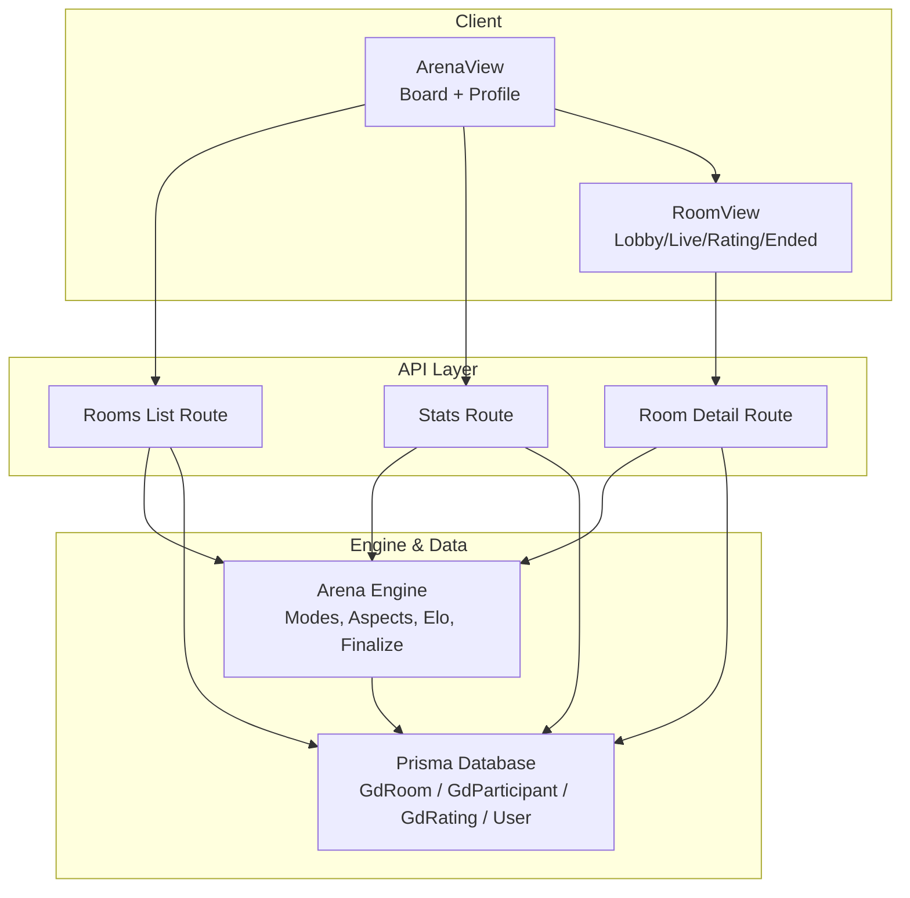

**Diagram sources**
- [arena-view.tsx:40-146](file://src/components/welearn/arena/arena-view.tsx#L40-L146)
- [room-view.tsx:27-218](file://src/components/welearn/arena/room-view.tsx#L27-L218)
- [route.ts (room list):8-79](file://src/app/api/arena/rooms/route.ts#L8-L79)
- [route.ts (room detail):10-124](file://src/app/api/arena/rooms/[id]/route.ts#L10-L124)
- [route.ts (stats):6-97](file://src/app/api/arena/stats/route.ts#L6-L97)
- [arena-engine.ts:28-66](file://src/lib/arena-engine.ts#L28-L66)

**Section sources**
- [arena-view.tsx:40-146](file://src/components/welearn/arena/arena-view.tsx#L40-L146)
- [room-view.tsx:27-218](file://src/components/welearn/arena/room-view.tsx#L27-L218)
- [route.ts (room list):8-79](file://src/app/api/arena/rooms/route.ts#L8-L79)
- [route.ts (room detail):10-124](file://src/app/api/arena/rooms/[id]/route.ts#L10-L124)
- [route.ts (stats):6-97](file://src/app/api/arena/stats/route.ts#L6-L97)
- [arena-engine.ts:28-66](file://src/lib/arena-engine.ts#L28-L66)

## Core Components
- Arena Engine: Defines mode metadata, aspect rubrics, Elo constants, phase transitions, finalization, badge assignment, MoM generation, and coaching suggestions.
- Room APIs: Provide room creation, listing, detailed state polling, and action dispatch (join/leave, host controls, stance/key argument, rating submission).
- Stats API: Aggregates user-level Elo, radar averages, history, top leaderboard, remarks, badge counts, win rate, and coaching suggestions.
- Client Views: Board view for creating/joining rooms; room view for phase-specific UI; profile view for Elo, radar, remarks, and suggestions.
- Data Models: Prisma models for rooms, participants, ratings, and user gamification fields.

Key responsibilities:
- Server enforces lifecycle transitions and timing.
- Clients poll for near-real-time synchronization (~1.5s).
- Ratings are peer-driven and mode-specific.
- Finalization computes aggregated scores, badges, Elo deltas, points, and MoM.

**Section sources**
- [arena-engine.ts:28-66](file://src/lib/arena-engine.ts#L28-L66)
- [route.ts (room list):8-115](file://src/app/api/arena/rooms/route.ts#L8-L115)
- [route.ts (room detail):10-291](file://src/app/api/arena/rooms/[id]/route.ts#L10-L291)
- [route.ts (stats):6-97](file://src/app/api/arena/stats/route.ts#L6-L97)
- [arena-view.tsx:40-146](file://src/components/welearn/arena/arena-view.tsx#L40-L146)
- [room-view.tsx:27-750](file://src/components/welearn/arena/room-view.tsx#L27-L750)
- [schema.prisma:283-342](file://prisma/schema.prisma#L283-L342)

## Architecture Overview
The Arena system uses a client-server polling model rather than WebSockets. The client polls the room detail endpoint every ~1.5 seconds. Each poll triggers server-side lifecycle advancement and presence heartbeat updates. Timers are stored as absolute deadlines (`phaseEndsAt`) on the server; clients compute remaining time using `serverNow - localNow`.

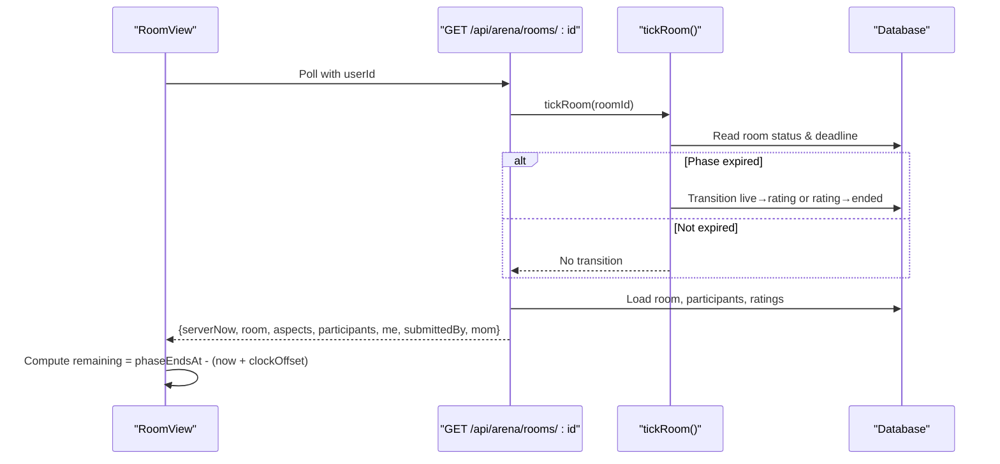

**Diagram sources**
- [room-view.tsx:41-76](file://src/components/welearn/arena/room-view.tsx#L41-L76)
- [route.ts (room detail):10-124](file://src/app/api/arena/rooms/[id]/route.ts#L10-L124)
- [arena-engine.ts:102-132](file://src/lib/arena-engine.ts#L102-L132)

## Detailed Component Analysis

### Game Modes and Judging Rubrics
Three modes define distinct aspect sets used for peer star ratings:
- Group Discussion (gd): Content & Knowledge, Communication & Clarity, Active Listening, Leadership & Team Play.
- Debate (debate): Argument & Evidence, Rebuttal & Logic, Delivery & Presence, Respect & Discipline.
- Pitching (pitch): Problem Clarity, Solution & Value, Market Awareness, Delivery & Confidence.

These aspects drive:
- Per-peer star ratings during the rating phase.
- Aspect averages and overall average per participant.
- Mode-to-canonical radar mapping (content, delivery, listening, leadership).
- Aspect-specific badges (“Star” per axis when winner’s average ≥ 3.5).

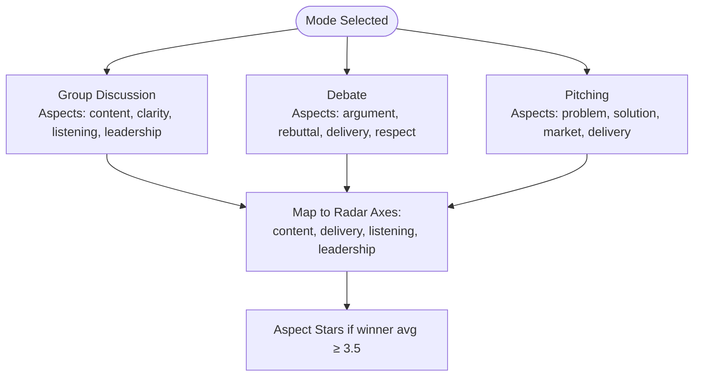

**Diagram sources**
- [arena-engine.ts:28-47](file://src/lib/arena-engine.ts#L28-L47)
- [arena-engine.ts:70-86](file://src/lib/arena-engine.ts#L70-L86)
- [arena-engine.ts:261-281](file://src/lib/arena-engine.ts#L261-L281)

**Section sources**
- [arena-engine.ts:28-47](file://src/lib/arena-engine.ts#L28-L47)
- [arena-engine.ts:70-86](file://src/lib/arena-engine.ts#L70-L86)
- [arena-engine.ts:261-281](file://src/lib/arena-engine.ts#L261-L281)

### Room Lifecycle
Lifecycle states: lobby → live → rating → ended.
- Lobby: Host sets topic, configures optional timers, delegates co-hosts, and starts the session.
- Live: Session runs; host can end early; optional timer auto-transitions to rating.
- Rating: Everyone rates everyone on mode-specific aspects; optional timer closes rating; fast path auto-finalizes when all present participants have submitted.
- Ended: Results, badges, Elo deltas, points, and MoM are computed and persisted.

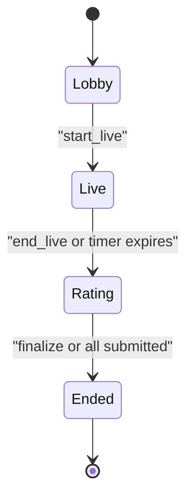

**Diagram sources**
- [route.ts (room detail):198-228](file://src/app/api/arena/rooms/[id]/route.ts#L198-L228)
- [arena-engine.ts:102-132](file://src/lib/arena-engine.ts#L102-L132)
- [schema.prisma:283-301](file://prisma/schema.prisma#L283-L301)

**Section sources**
- [route.ts (room detail):198-228](file://src/app/api/arena/rooms/[id]/route.ts#L198-L228)
- [arena-engine.ts:102-132](file://src/lib/arena-engine.ts#L102-L132)
- [schema.prisma:283-301](file://prisma/schema.prisma#L283-L301)

### Real-Time Collaboration Mechanics
- Polling interval: ~1.5 seconds per open room.
- Server-clock synchronization: Client stores `clockOffset = serverNow - Date.now()` and computes countdowns against `phaseEndsAt`.
- Participant state management: Presence updated via heartbeat on stale lastSeen; present vs left tracking; stance and key argument persistence.
- Fast-path finalize: If all present participants have submitted ratings, the rating phase auto-finalizes without host intervention.

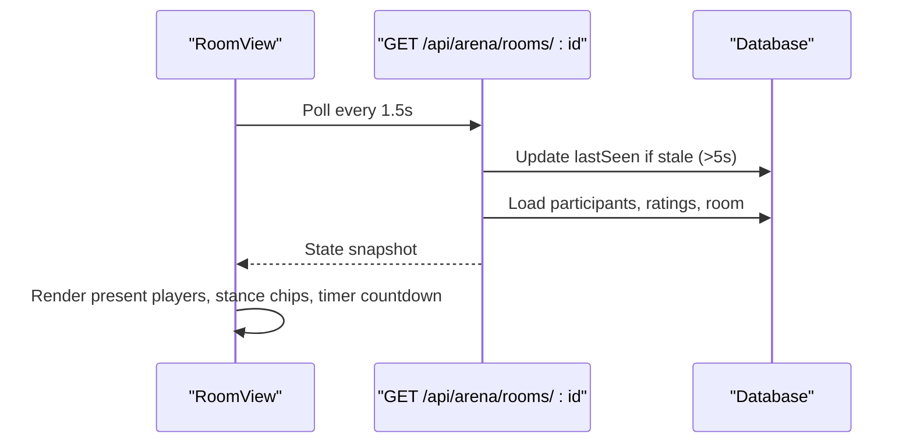

**Diagram sources**
- [room-view.tsx:41-76](file://src/components/welearn/arena/room-view.tsx#L41-L76)
- [route.ts (room detail):26-33](file://src/app/api/arena/rooms/[id]/route.ts#L26-L33)

**Section sources**
- [room-view.tsx:41-76](file://src/components/welearn/arena/room-view.tsx#L41-L76)
- [route.ts (room detail):26-33](file://src/app/api/arena/rooms/[id]/route.ts#L26-L33)

### Star-Rating Interface and Remarks
- Rating grid shows each peer with mode-specific aspects and 1–5 star pickers.
- Optional remark field per peer; remarks persist and appear on the ratee’s profile.
- Submission validates that every aspect has a value between 1 and 5.
- UI tracks which peers have been rated and displays submitted-by indicators.

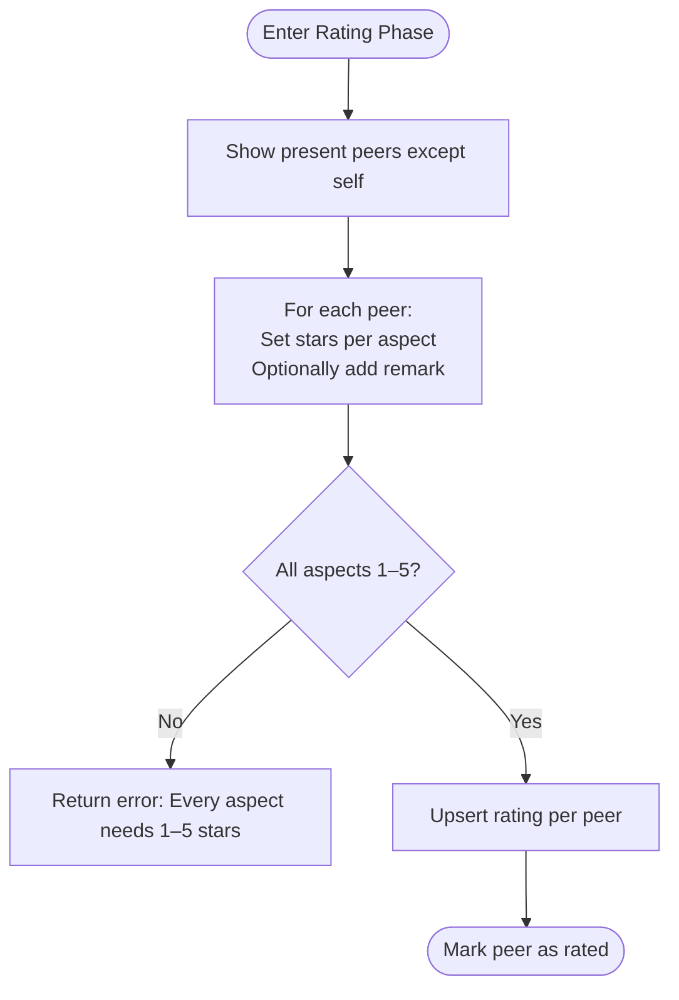

**Diagram sources**
- [room-view.tsx:468-618](file://src/components/welearn/arena/room-view.tsx#L468-L618)
- [route.ts (room detail):252-282](file://src/app/api/arena/rooms/[id]/route.ts#L252-L282)

**Section sources**
- [room-view.tsx:468-618](file://src/components/welearn/arena/room-view.tsx#L468-L618)
- [route.ts (room detail):252-282](file://src/app/api/arena/rooms/[id]/route.ts#L252-L282)

### Timer Functionality and Host Controls
- Optional timers: liveSec and ratingSec can be set at room creation or in lobby; 0 means untimed.
- Host controls:
  - Set topic.
  - Delegate co-hosts (creator only).
  - Start live session.
  - End live session (opens rating).
  - Finalize rating phase.
  - Delete room (host anytime; others require team PIN).
- Countdown display: Urgent visual styling when <60s remain; beep notification on live→rating transition.

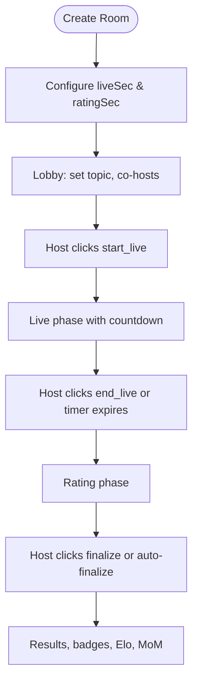

**Diagram sources**
- [route.ts (room list):83-115](file://src/app/api/arena/rooms/route.ts#L83-L115)
- [route.ts (room detail):190-228](file://src/app/api/arena/rooms/[id]/route.ts#L190-L228)
- [room-view.tsx:222-396](file://src/components/welearn/arena/room-view.tsx#L222-L396)
- [room-view.tsx:398-464](file://src/components/welearn/arena/room-view.tsx#L398-L464)

**Section sources**
- [route.ts (room list):83-115](file://src/app/api/arena/rooms/route.ts#L83-L115)
- [route.ts (room detail):190-228](file://src/app/api/arena/rooms/[id]/route.ts#L190-L228)
- [room-view.tsx:222-396](file://src/components/welearn/arena/room-view.tsx#L222-L396)
- [room-view.tsx:398-464](file://src/components/welearn/arena/room-view.tsx#L398-L464)

### Elo Rating Calculation, MVP Selection, and Badges
- Elo range: 1000–3000; starting Elo: 1200.
- Delta formula: Based on average star rating relative to baseline (3.2), plus MVP bonus (+25) and host bonus (+10); clamped to [-80, 120].
- Points: Participation base (+5), performance based on avgStars (round(avgStars × 2.5)), MVP bonus (+10).
- MVP: Highest overall average among scored participants.
- Badges: “MVP” plus one “Star” per aspect where the winner’s average ≥ 3.5.
- Radar mapping: Mode aspects map to canonical axes (content, delivery, listening, leadership).

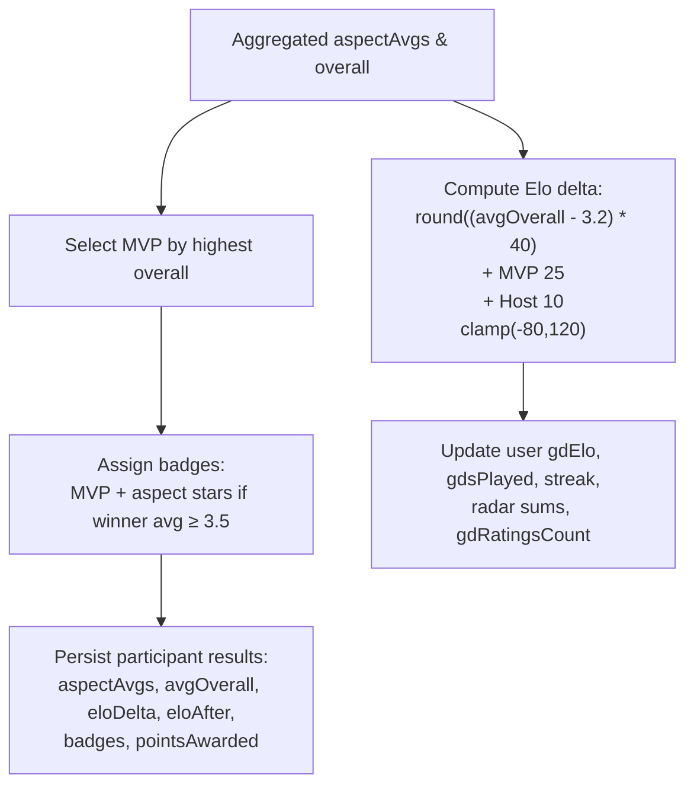

**Diagram sources**
- [arena-engine.ts:55-66](file://src/lib/arena-engine.ts#L55-L66)
- [arena-engine.ts:209-366](file://src/lib/arena-engine.ts#L209-L366)

**Section sources**
- [arena-engine.ts:55-66](file://src/lib/arena-engine.ts#L55-L66)
- [arena-engine.ts:209-366](file://src/lib/arena-engine.ts#L209-L366)

### Minutes of Meeting Generation
MoM includes:
- Room title, mode, topic.
- For/Against arguments (debate mode).
- Moderator name.
- MVP name.
- Key points from participants.
- Takeaways from peer remarks.
- Optional AI narrative (overview, verdict, takeaways) generated via Groq JSON prompt.

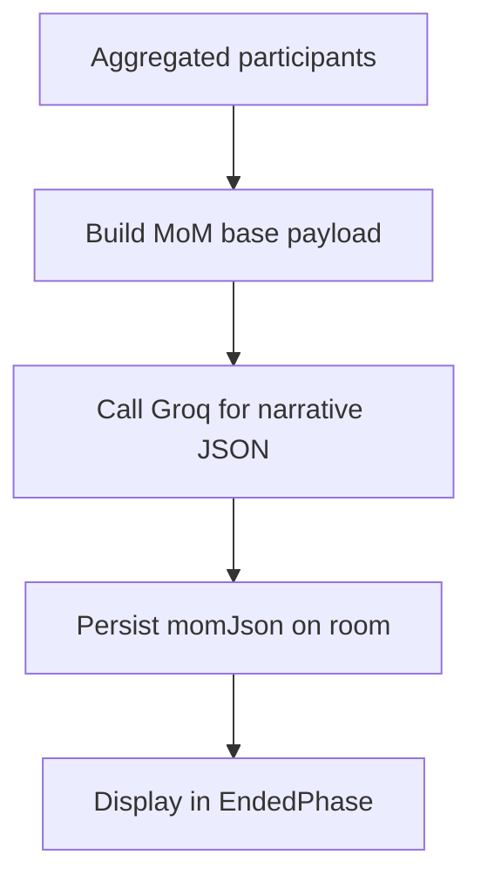

**Diagram sources**
- [arena-engine.ts:146-198](file://src/lib/arena-engine.ts#L146-L198)
- [room-view.tsx:620-749](file://src/components/welearn/arena/room-view.tsx#L620-L749)

**Section sources**
- [arena-engine.ts:146-198](file://src/lib/arena-engine.ts#L146-L198)
- [room-view.tsx:620-749](file://src/components/welearn/arena/room-view.tsx#L620-L749)

### Performance Analytics and Coaching
Stats endpoint aggregates:
- Elo, tier, sessions played, streak, rank, total ranked.
- Radar averages across canonical axes.
- History of finalized participations with stance, avgStars, Elo deltas, badges.
- Badge counts, received remarks, average stars, win rate.
- Coaching suggestions based on weakest axes and trends.

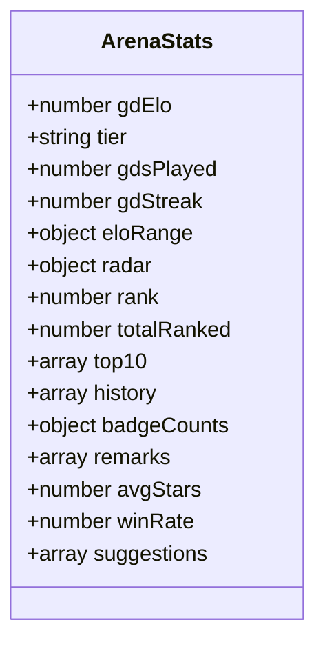

**Diagram sources**
- [route.ts (stats):6-97](file://src/app/api/arena/stats/route.ts#L6-L97)
- [arena-engine.ts:368-414](file://src/lib/arena-engine.ts#L368-L414)
- [types.ts:93-119](file://src/components/welearn/arena/types.ts#L93-L119)

**Section sources**
- [route.ts (stats):6-97](file://src/app/api/arena/stats/route.ts#L6-L97)
- [arena-engine.ts:368-414](file://src/lib/arena-engine.ts#L368-L414)
- [types.ts:93-119](file://src/components/welearn/arena/types.ts#L93-L119)

## Dependency Analysis
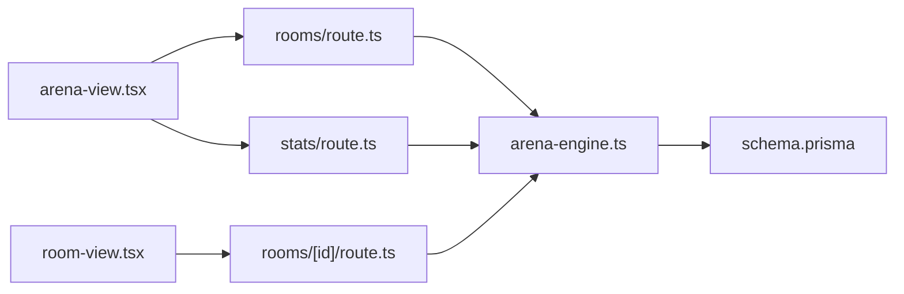

**Diagram sources**
- [arena-view.tsx:40-146](file://src/components/welearn/arena/arena-view.tsx#L40-L146)
- [room-view.tsx:27-218](file://src/components/welearn/arena/room-view.tsx#L27-L218)
- [route.ts (room list):8-115](file://src/app/api/arena/rooms/route.ts#L8-L115)
- [route.ts (room detail):10-291](file://src/app/api/arena/rooms/[id]/route.ts#L10-L291)
- [route.ts (stats):6-97](file://src/app/api/arena/stats/route.ts#L6-L97)
- [arena-engine.ts:1-415](file://src/lib/arena-engine.ts#L1-L415)
- [schema.prisma:283-342](file://prisma/schema.prisma#L283-L342)

**Section sources**
- [arena-view.tsx:40-146](file://src/components/welearn/arena/arena-view.tsx#L40-L146)
- [room-view.tsx:27-218](file://src/components/welearn/arena/room-view.tsx#L27-L218)
- [route.ts (room list):8-115](file://src/app/api/arena/rooms/route.ts#L8-L115)
- [route.ts (room detail):10-291](file://src/app/api/arena/rooms/[id]/route.ts#L10-L291)
- [route.ts (stats):6-97](file://src/app/api/arena/stats/route.ts#L6-L97)
- [arena-engine.ts:1-415](file://src/lib/arena-engine.ts#L1-L415)
- [schema.prisma:283-342](file://prisma/schema.prisma#L283-L342)

## Performance Considerations
- Polling frequency: 1.5s per room balances responsiveness with server load.
- Heartbeat optimization: Only update lastSeen if stale (>5s) to reduce writes.
- Atomic transitions: Use atomic updateMany to prevent race conditions during phase changes.
- Fast-path finalize: Avoid unnecessary AI calls and heavy aggregation when all participants have already submitted.
- Capped timers: liveSec max 45 minutes; ratingSec max 30 minutes; input validation prevents extreme values.
- Batch reads: Room list loads recent active/completed rooms and advances lifecycle for expired ones before responding.

[No sources needed since this section provides general guidance]

## Troubleshooting Guide
Common issues and resolutions:
- Room unavailable: Indicates GET failure; client exits room and shows toast. Check network and ensure room exists.
- Action failed: POST errors return generic messages; verify permissions (host/co-host), valid inputs (topic length, stance values), and correct phase context.
- Rating validation error: Ensure every aspect has a value between 1 and 5; remarks are optional but must be ≤400 characters.
- Timer not transitioning: Verify server clock offset and phaseEndsAt; check that tickRoom is invoked on each poll.
- Co-host delegation blocked: Only creator can delegate co-hosts and only in lobby.
- Delete permission denied: Non-host requires team PIN; confirm PIN validity.

**Section sources**
- [room-view.tsx:41-96](file://src/components/welearn/arena/room-view.tsx#L41-L96)
- [route.ts (room detail):127-291](file://src/app/api/arena/rooms/[id]/route.ts#L127-L291)

## Conclusion
The Arena battle system delivers a robust, server-authoritative environment for collaborative evaluation across three modes. Its design emphasizes:
- Clear lifecycle control with optional timers.
- Transparent peer-driven scoring with mode-specific rubrics.
- Consistent Elo progression and coaching insights.
- Rich post-session artifacts including MoM and analytics.
- Practical host controls and secure deletion workflows.

This architecture supports scalable, real-time collaboration while maintaining deterministic outcomes and actionable feedback for participants.

[No sources needed since this section summarizes without analyzing specific files]