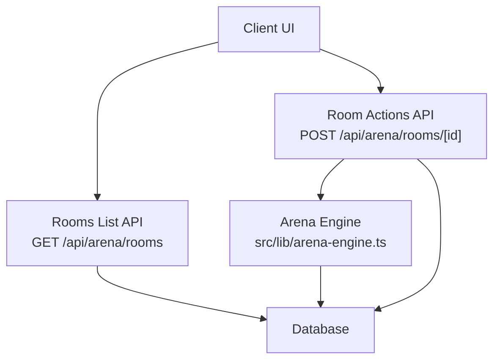
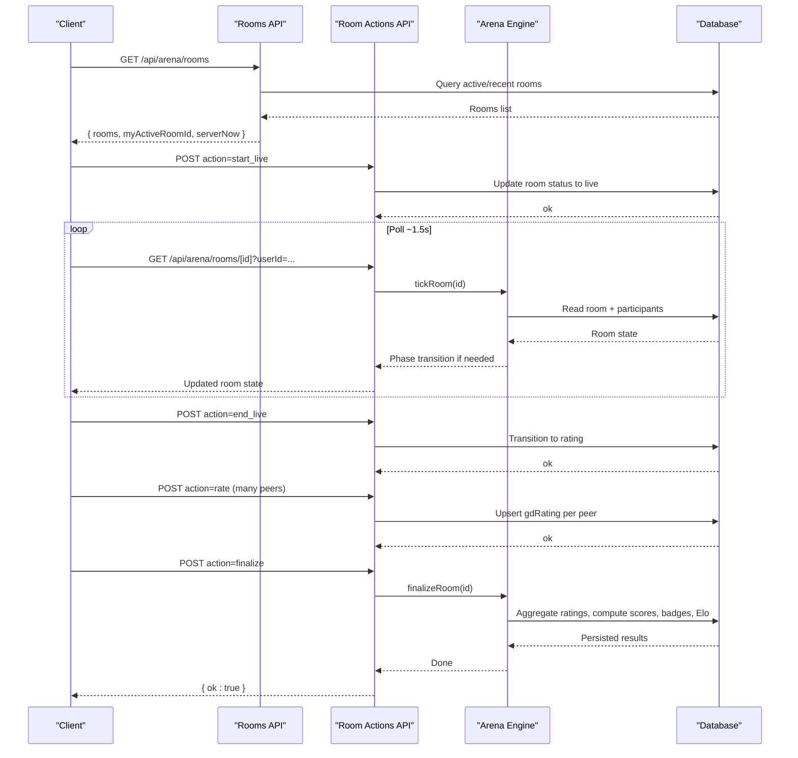
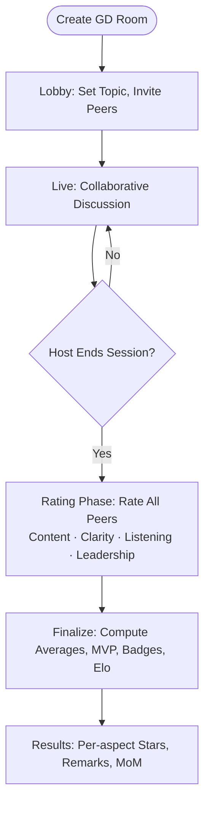
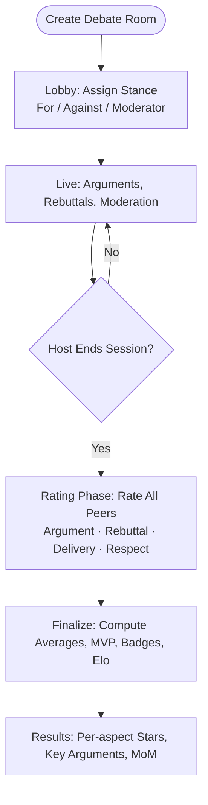
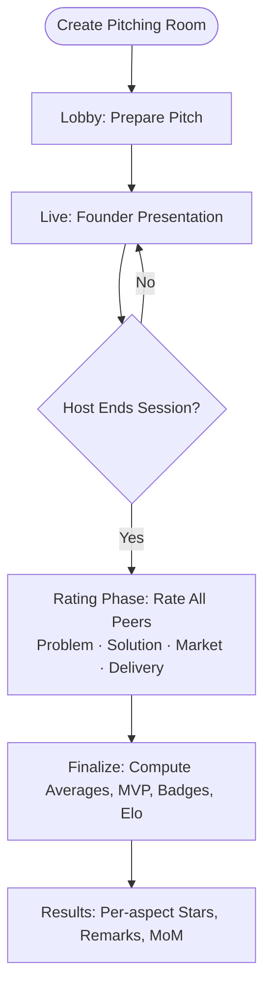
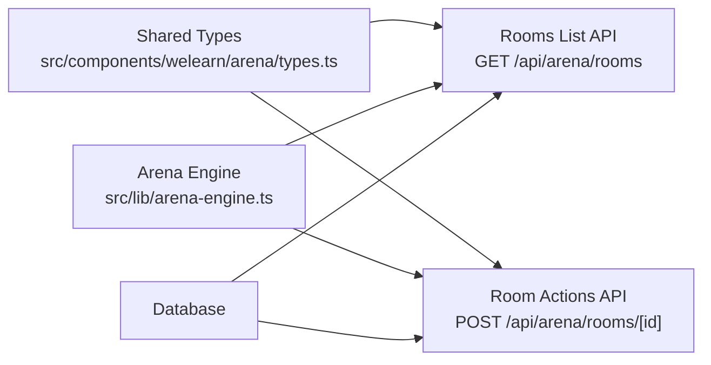

# Game Modes

<cite>
**Referenced Files in This Document**
- [README.md](file://README.md)
- [arena-engine.ts](file://src/lib/arena-engine.ts)
- [types.ts](file://src/components/welearn/arena/types.ts)
- [rooms route.ts](file://src/app/api/arena/rooms/route.ts)
- [room id route.ts](file://src/app/api/arena/rooms/[id]/route.ts)
</cite>

## Table of Contents
1. [Introduction](#introduction)
2. [Project Structure](#project-structure)
3. [Core Components](#core-components)
4. [Architecture Overview](#architecture-overview)
5. [Detailed Component Analysis](#detailed-component-analysis)
6. [Dependency Analysis](#dependency-analysis)
7. [Performance Considerations](#performance-considerations)
8. [Troubleshooting Guide](#troubleshooting-guide)
9. [Conclusion](#conclusion)

## Introduction
This document explains the three Arena game modes: Group Discussion (GD), Debate, and Pitching. It focuses on how each mode structures participant roles, timing phases, and star-rating judging rubrics. The Arena is a live battle-room system where participants collaborate or compete, then rate each other using mode-specific aspects. After ratings, the system computes averages, badges, points, Elo changes, and an AI-assisted Minutes of Meeting summary.

The documentation is grounded in the repository’s server engine, API routes, shared types, and project README.

**Section sources**
- [README.md:82-94](file://README.md#L82-L94)

## Project Structure
Arena-related logic is split across:
- A server-side engine that defines modes, rating aspects, lifecycle transitions, scoring, and coaching suggestions.
- API routes for listing rooms, creating rooms, polling room state, and performing actions such as starting, ending, rating, and finalizing.
- Shared frontend types describing room state, players, moments-of-meeting, and stats.

**Diagram sources**
- [rooms route.ts:8-79](file://src/app/api/arena/rooms/route.ts#L8-L79)
- [room id route.ts:10-124](file://src/app/api/arena/rooms/[id]/route.ts#L10-L124)
- [arena-engine.ts:17-53](file://src/lib/arena-engine.ts#L17-L53)

**Section sources**
- [rooms route.ts:1-115](file://src/app/api/arena/rooms/route.ts#L1-L115)
- [room id route.ts:1-291](file://src/app/api/arena/rooms/[id]/route.ts#L1-L291)
- [arena-engine.ts:1-53](file://src/lib/arena-engine.ts#L1-L53)
- [types.ts:1-165](file://src/components/welearn/arena/types.ts#L1-L165)

## Core Components
- **Modes**: GD, Debate, Pitching. Each mode has a label, emoji, blurb, and a set of star-rating aspects.
- **Rating Aspects**: Mode-specific criteria rated 1–5 stars by every peer.
- **Lifecycle Phases**: Lobby → Live → Rating → Ended. Timers are optional; the server controls phase transitions.
- **Scoring & Rewards**: Per-aspect averages, MVP selection, aspect “Star” badges, points, Elo deltas, streaks, and AI-generated Minutes of Meeting.
- **Roles**: Host, co-host, participants, and in Debate mode, stances For, Against, and Moderator.

Key definitions:
- `RoomMode`: `"gd" | "debate" | "pitch"`
- `Stance`: `"for" | "against" | "moderator"`
- `Aspect`: `{ key, label, hint }`

**Section sources**
- [arena-engine.ts:17-53](file://src/lib/arena-engine.ts#L17-L53)
- [types.ts:1-43](file://src/components/welearn/arena/types.ts#L1-L43)

## Architecture Overview
The Arena uses a simple poll-based architecture: clients repeatedly call the room endpoint to get updated state. The server advances phases based on wall-clock time and optional timers. Ratings are collected during the Rating phase, after which the host can finalize results.

**Diagram sources**
- [rooms route.ts:8-79](file://src/app/api/arena/rooms/route.ts#L8-L79)
- [room id route.ts:10-124](file://src/app/api/arena/rooms/[id]/route.ts#L10-L124)
- [room id route.ts:198-228](file://src/app/api/arena/rooms/[id]/route.ts#L198-L228)
- [room id route.ts:251-282](file://src/app/api/arena/rooms/[id]/route.ts#L251-L282)
- [arena-engine.ts:102-132](file://src/lib/arena-engine.ts#L102-L132)
- [arena-engine.ts:209-366](file://src/lib/arena-engine.ts#L209-L366)

## Detailed Component Analysis

### Group Discussion (GD)
GD emphasizes collaboration over competition. Participants discuss a topic together, and peers evaluate contributions using four aspects:
- Content & Knowledge
- Communication & Clarity
- Active Listening
- Leadership & Team Play

Roles and structure:
- Roles: Host, co-host, participants. No fixed stances.
- Timing: Optional live timer; optional rating window. If untimed, the host ends the session manually.
- Scoring: Every peer rates every other peer on the four aspects with 1–5 stars. The system computes per-aspect averages and an overall average. MVP and aspect “Star” badges are awarded. Points and Elo deltas are applied.

Example flow:
- Create a GD room with a title and optional topic.
- Start live; optionally set a live duration.
- During live, participants contribute ideas.
- End live to open the rating phase.
- Rate all peers on the four aspects.
- Finalize to compute results and badges.

**Diagram sources**
- [room id route.ts:198-228](file://src/app/api/arena/rooms/[id]/route.ts#L198-L228)
- [room id route.ts:251-282](file://src/app/api/arena/rooms/[id]/route.ts#L251-L282)
- [arena-engine.ts:209-366](file://src/lib/arena-engine.ts#L209-L366)

**Section sources**
- [arena-engine.ts:28-34](file://src/lib/arena-engine.ts#L28-L34)
- [arena-engine.ts:49-53](file://src/lib/arena-engine.ts#L49-L53)
- [room id route.ts:198-228](file://src/app/api/arena/rooms/[id]/route.ts#L198-L228)
- [room id route.ts:251-282](file://src/app/api/arena/rooms/[id]/route.ts#L251-L282)
- [arena-engine.ts:209-366](file://src/lib/arena-engine.ts#L209-L366)

### Debate
Debate is structured around opposing sides and a moderator. Participants choose a stance:
- For
- Against
- Moderator

Judging rubric aspects:
- Argument & Evidence
- Rebuttal & Logic
- Delivery & Presence
- Respect & Discipline

Roles and structure:
- Stances are set in Lobby or Live before the session closes.
- Participants may save a key argument for their side.
- Timing: Optional live timer; optional rating window.
- Scoring: Same peer-to-peer star-rating mechanism, but aspects reflect debate criteria.

Example flow:
- Create a Debate room.
- In Lobby/Live, assign stances (For/Against/Moderator).
- Optionally set a live duration.
- During live, present arguments and rebuttals.
- End live to open rating.
- Rate peers on the four debate aspects.
- Finalize to compute results.

**Diagram sources**
- [room id route.ts:230-249](file://src/app/api/arena/rooms/[id]/route.ts#L230-L249)
- [room id route.ts:251-282](file://src/app/api/arena/rooms/[id]/route.ts#L251-L282)
- [arena-engine.ts:35-40](file://src/lib/arena-engine.ts#L35-L40)
- [arena-engine.ts:209-366](file://src/lib/arena-engine.ts#L209-L366)

**Section sources**
- [arena-engine.ts:35-40](file://src/lib/arena-engine.ts#L35-L40)
- [arena-engine.ts:49-53](file://src/lib/arena-engine.ts#L49-L53)
- [room id route.ts:230-249](file://src/app/api/arena/rooms/[id]/route.ts#L230-L249)
- [room id route.ts:251-282](file://src/app/api/arena/rooms/[id]/route.ts#L251-L282)
- [arena-engine.ts:209-366](file://src/lib/arena-engine.ts#L209-L366)

### Pitching
Pitching evaluates founder-focused presentations. The rubric emphasizes clarity, value creation, market understanding, and delivery under pressure.

Judging rubric aspects:
- Problem Clarity
- Solution & Value
- Market Awareness
- Delivery & Confidence

Roles and structure:
- Roles: Host, co-host, participants acting as founders and evaluators.
- Timing: Optional live timer; optional rating window.
- Scoring: Peer-to-peer star ratings on the four pitch aspects. MVP and aspect “Star” badges are awarded.

Example flow:
- Create a Pitching room.
- Optionally set a live duration.
- During live, present the problem, solution, market context, and pitch confidently.
- End live to open rating.
- Rate peers on the four pitch aspects.
- Finalize to compute results.

**Diagram sources**
- [room id route.ts:198-228](file://src/app/api/arena/rooms/[id]/route.ts#L198-L228)
- [room id route.ts:251-282](file://src/app/api/arena/rooms/[id]/route.ts#L251-L282)
- [arena-engine.ts:41-46](file://src/lib/arena-engine.ts#L41-L46)
- [arena-engine.ts:209-366](file://src/lib/arena-engine.ts#L209-L366)

**Section sources**
- [arena-engine.ts:41-46](file://src/lib/arena-engine.ts#L41-L46)
- [arena-engine.ts:49-53](file://src/lib/arena-engine.ts#L49-L53)
- [room id route.ts:198-228](file://src/app/api/arena/rooms/[id]/route.ts#L198-L228)
- [room id route.ts:251-282](file://src/app/api/arena/rooms/[id]/route.ts#L251-L282)
- [arena-engine.ts:209-366](file://src/lib/arena-engine.ts#L209-L366)

## Dependency Analysis
The following diagram shows how the API routes depend on the arena engine and shared types.

**Diagram sources**
- [types.ts:1-165](file://src/components/welearn/arena/types.ts#L1-L165)
- [rooms route.ts:1-115](file://src/app/api/arena/rooms/route.ts#L1-L115)
- [room id route.ts:1-291](file://src/app/api/arena/rooms/[id]/route.ts#L1-L291)
- [arena-engine.ts:1-53](file://src/lib/arena-engine.ts#L1-L53)

**Section sources**
- [rooms route.ts:1-115](file://src/app/api/arena/rooms/route.ts#L1-L115)
- [room id route.ts:1-291](file://src/app/api/arena/rooms/[id]/route.ts#L1-L291)
- [arena-engine.ts:1-53](file://src/lib/arena-engine.ts#L1-L53)
- [types.ts:1-165](file://src/components/welearn/arena/types.ts#L1-L165)

## Performance Considerations
- Polling cadence: Clients poll the room endpoint approximately every 1.5 seconds. This keeps phase transitions and presence updates synchronized without requiring push infrastructure.
- Server-authoritative timers: Optional live and rating timers are enforced by the server. Clients render countdowns against a server clock offset, ensuring consistency even after refreshes.
- Fast-path finalization: When no explicit rating timer is set, the system detects when all present participants have submitted ratings and finalizes early.
- Lightweight aggregation: Finalization computes per-aspect averages, MVP, badges, Elo deltas, and writes activity logs. These operations run once per room upon finalization.

[No sources needed since this section provides general guidance]

## Troubleshooting Guide
Common issues and resolutions:
- Cannot rate during live: Ratings are only allowed in the Rating phase. Wait until the host ends the session or the live timer expires.
- Invalid star values: Each aspect must be rated between 1 and 5 stars. Adjust your input accordingly.
- Cannot change stance after session: Stances are locked once the session moves past Lobby/Live.
- Room not found: Verify the room ID and ensure it still exists.
- Unknown action: Ensure you send a supported action such as join, leave, start_live, end_live, finalize, stance, key_argument, or rate.

Operational notes:
- Deleting a room: The creator can delete anytime; others need the team PIN.
- Co-host delegation: Only the creator can delegate co-hosts, and only in Lobby.
- Topic editing: Requires host access and a minimum length.

**Section sources**
- [room id route.ts:147-286](file://src/app/api/arena/rooms/[id]/route.ts#L147-L286)

## Conclusion
The Arena supports three distinct game modes tailored to different skills:
- GD measures collaborative communication, knowledge depth, listening, and leadership.
- Debate measures argument quality, rebuttal logic, delivery presence, and respect/discipline.
- Pitching measures problem clarity, solution/value, market awareness, and delivery/confidence.

Across all modes, the system standardizes the lifecycle (Lobby → Live → Rating → Ended), enforces server-controlled timing, collects peer star ratings, and produces actionable feedback through averages, badges, points, Elo, and AI-assisted Minutes of Meeting.

[No sources needed since this section summarizes without analyzing specific files]