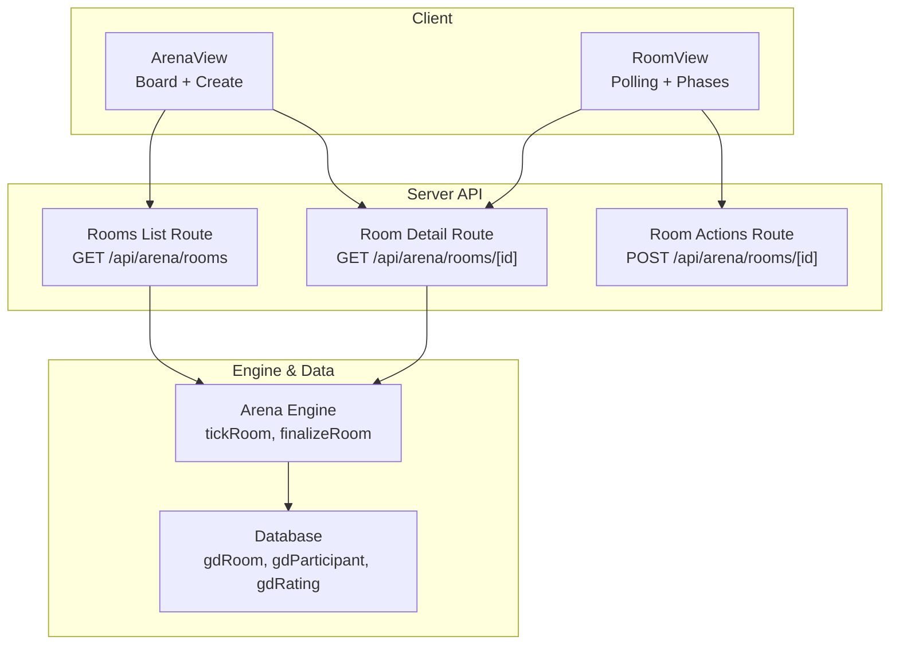
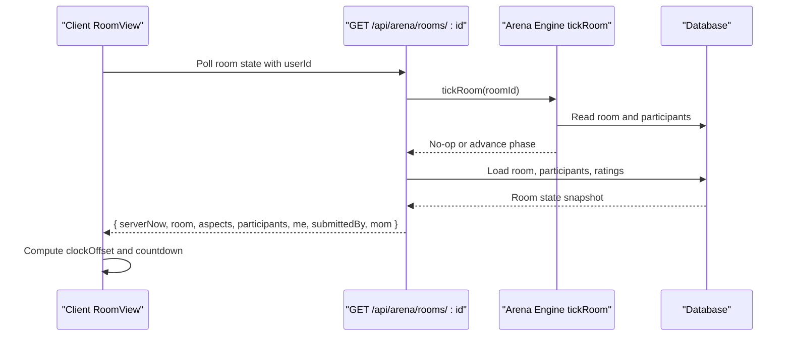
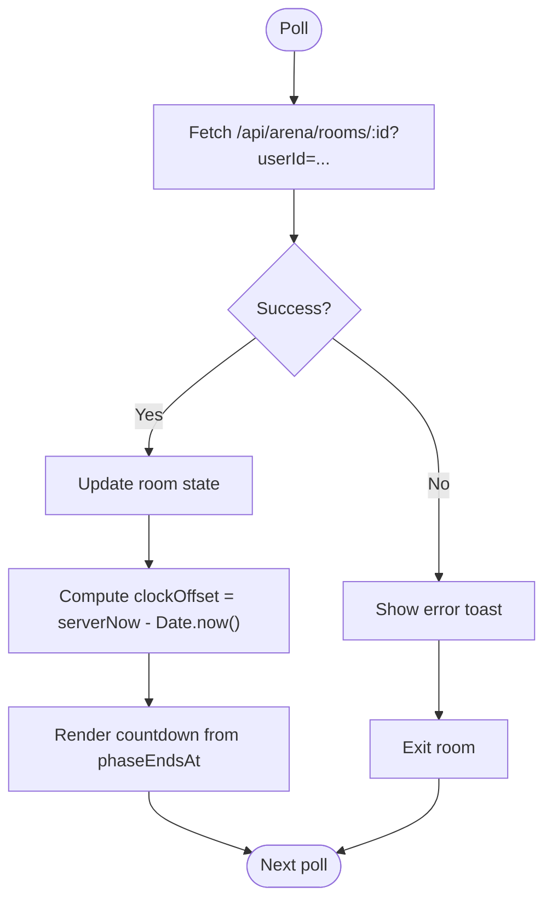
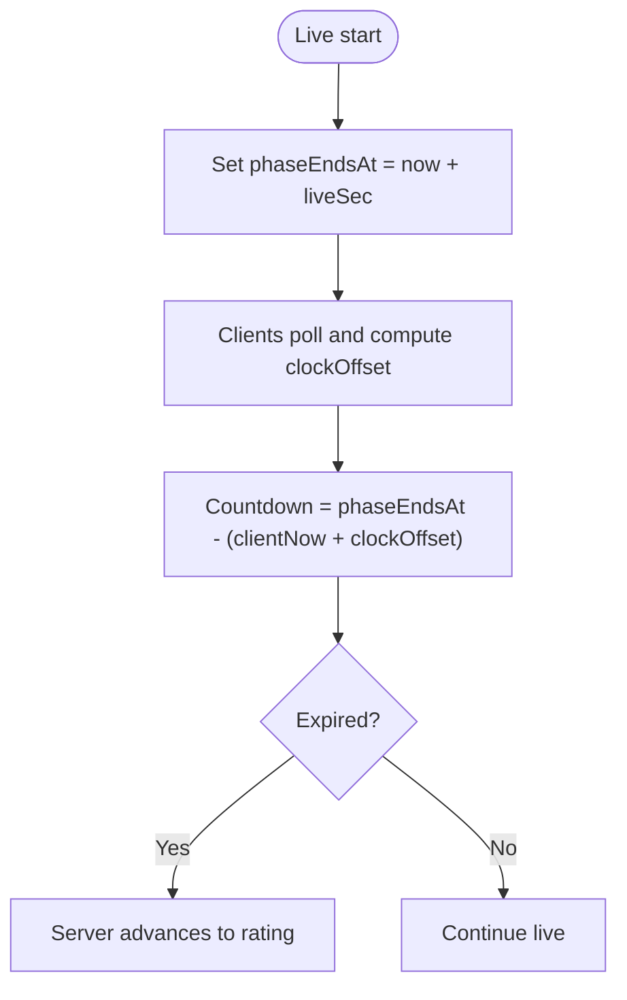
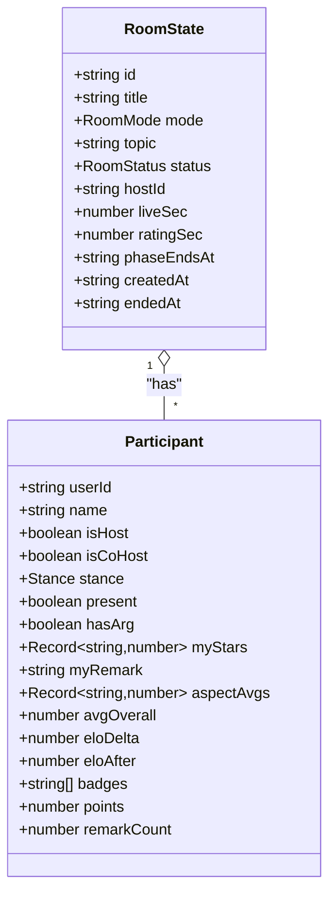
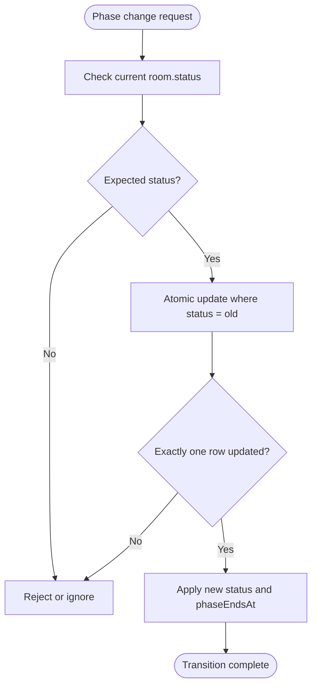
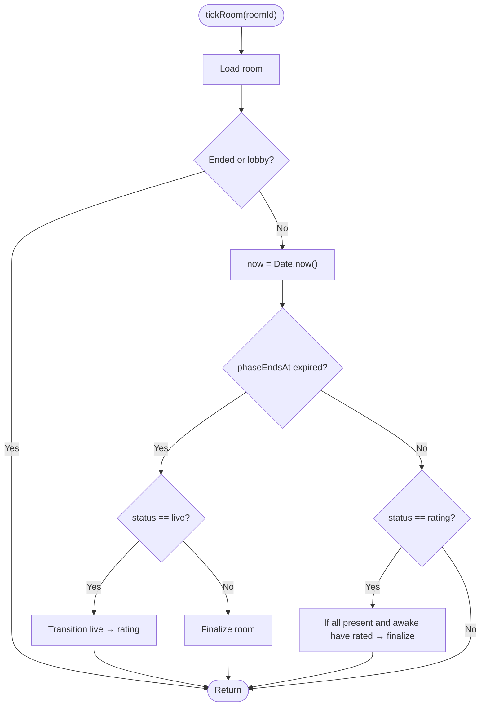
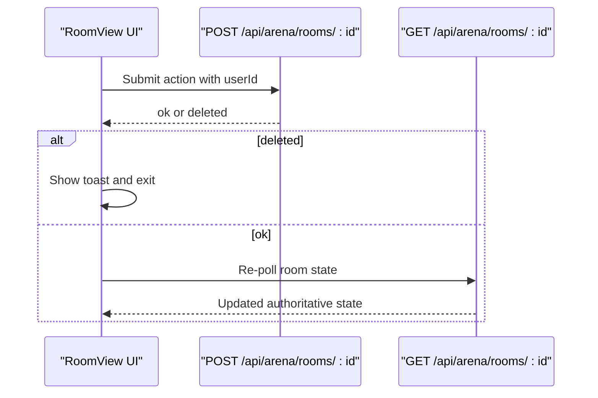
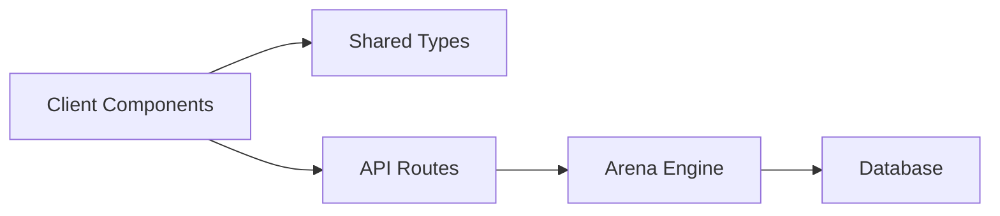

# Real-Time Mechanics

<cite>
**Referenced Files in This Document**   
- [room-view.tsx](file://src/components/welearn/arena/room-view.tsx)
- [arena-view.tsx](file://src/components/welearn/arena/arena-view.tsx)
- [types.ts](file://src/components/welearn/arena/types.ts)
- [route.ts (rooms list)](file://src/app/api/arena/rooms/route.ts)
- [route.ts (room detail and actions)](file://src/app/api/arena/rooms/[id]/route.ts)
- [arena-engine.ts](file://src/lib/arena-engine.ts)
</cite>

## Table of Contents
1. [Introduction](#introduction)
2. [Project Structure](#project-structure)
3. [Core Components](#core-components)
4. [Architecture Overview](#architecture-overview)
5. [Detailed Component Analysis](#detailed-component-analysis)
6. [Dependency Analysis](#dependency-analysis)
7. [Performance Considerations](#performance-considerations)
8. [Troubleshooting Guide](#troubleshooting-guide)
9. [Conclusion](#conclusion)

## Introduction
This document explains the real-time collaboration system used by Arena battles. The system is server-authoritative: clients do not own room state or timers. Instead, each client polls a REST endpoint approximately every 1.5 seconds to receive the authoritative room state, including a server timestamp. Clients compute their local countdowns using that server time so optional timers remain synchronized across all participants.

The core lifecycle is:
- Lobby: join, set topic, choose stance, configure co-hosts.
- Live: discussion, debate, or pitch runs until either the host ends it or an optional timer expires.
- Rating: peers rate each other on mode-specific aspects; optional rating timer can auto-close.
- Ended: results, badges, Elo changes, points, and minutes-of-meeting are finalized.

## Project Structure
Arena functionality is split between Next.js App Router API routes and React components:

- API layer:
  - Room listing and creation: `/api/arena/rooms`.
  - Per-room state and actions: `/api/arena/rooms/[id]`.
  - Lifecycle engine: `tickRoom`, `finalizeRoom`, atomic transition helpers.
- Client layer:
  - Board view for browsing rooms.
  - Room view for live polling, action submission, countdown rendering, and phase UI.
- Shared types:
  - Mode, status, participant, aspect, and payload models mirrored between client and server.

**Diagram sources**
- [arena-view.tsx:61-122](file://src/components/welearn/arena/arena-view.tsx#L61-L122)
- [room-view.tsx:41-96](file://src/components/welearn/arena/room-view.tsx#L41-L96)
- [route.ts (rooms list):8-79](file://src/app/api/arena/rooms/route.ts#L8-L79)
- [route.ts (room detail and actions):10-124](file://src/app/api/arena/rooms/[id]/route.ts#L10-L124)
- [arena-engine.ts:88-132](file://src/lib/arena-engine.ts#L88-L132)

**Section sources**
- [arena-view.tsx:40-146](file://src/components/welearn/arena/arena-view.tsx#L40-L146)
- [room-view.tsx:27-118](file://src/components/welearn/arena/room-view.tsx#L27-L118)
- [route.ts (rooms list):8-115](file://src/app/api/arena/rooms/route.ts#L8-L115)
- [route.ts (room detail and actions):10-291](file://src/app/api/arena/rooms/[id]/route.ts#L10-L291)
- [arena-engine.ts:1-132](file://src/lib/arena-engine.ts#L1-L132)

## Core Components
- Server-clock synchronization:
  - Each room state response includes `serverNow`.
  - The client computes `clockOffset = serverNow - Date.now()` and uses it to derive accurate remaining time from `phaseEndsAt`.
- Polling loop:
  - The room view polls `/api/arena/rooms/{roomId}` every 1500 milliseconds.
  - On success, it updates local state and clock offset.
  - On failure, it shows a destructive toast and exits the room.
- Action submission:
  - All user actions go through a single POST endpoint with an `action` field.
  - After successful mutation, the client re-polls to reconcile state.
- Presence tracking:
  - Join sets presence and lastSeen.
  - Leave removes the participant or deletes the room when the creator leaves.
  - GET room state refreshes `lastSeen` if stale.
- Atomic transitions:
  - Phase changes use an atomic update pattern that only succeeds when the room is in the expected previous state.
  - Finalization is guarded by an atomic claim from rating to ended.

**Section sources**
- [room-view.tsx:25-96](file://src/components/welearn/arena/room-view.tsx#L25-L96)
- [route.ts (room detail and actions):10-124](file://src/app/api/arena/rooms/[id]/route.ts#L10-L124)
- [route.ts (room detail and actions):147-286](file://src/app/api/arena/rooms/[id]/route.ts#L147-L286)
- [arena-engine.ts:88-132](file://src/lib/arena-engine.ts#L88-L132)

## Architecture Overview
The Arena system follows a simple request-driven model rather than WebSockets. Every ~1.5 seconds, the client requests the authoritative room state. The server advances phases based on wall-clock time and returns a normalized payload that includes both current state and timing metadata.

**Diagram sources**
- [room-view.tsx:41-62](file://src/components/welearn/arena/room-view.tsx#L41-L62)
- [route.ts (room detail and actions):10-124](file://src/app/api/arena/rooms/[id]/route.ts#L10-L124)
- [arena-engine.ts:102-132](file://src/lib/arena-engine.ts#L102-L132)

## Detailed Component Analysis

### Server-Authoritative State Synchronization
The client maintains a small amount of local state:
- Current room state snapshot.
- Clock offset derived from `serverNow`.
- Local “now” ticker for smooth countdown updates.
- Busy flags per action.

On each poll:
1. Fetch the latest room state.
2. Update local state.
3. Recalculate `clockOffset`.
4. Render countdowns using `phaseEndsAt` and the corrected clock.

**Diagram sources**
- [room-view.tsx:41-62](file://src/components/welearn/arena/room-view.tsx#L41-L62)
- [room-view.tsx:64-76](file://src/components/welearn/arena/room-view.tsx#L64-L76)

**Section sources**
- [room-view.tsx:25-76](file://src/components/welearn/arena/room-view.tsx#L25-L76)
- [types.ts:45-73](file://src/components/welearn/arena/types.ts#L45-L73)

### Server-Clock Synchronization Using `phaseEndsAt`
Optional timers are stored as absolute timestamps:
- When starting live, the server sets `phaseEndsAt` to `now + liveSec`.
- When transitioning to rating, the server sets `phaseEndsAt` to `now + ratingSec`.
- If no timer is configured, `phaseEndsAt` remains null and the host controls transitions.

Clients render countdowns by comparing the local corrected time with `phaseEndsAt`:
- Corrected time = `Date.now() + clockOffset`.
- Remaining = `phaseEndsAt - corrected time`.

This ensures all clients see the same deadline even if their clocks differ slightly.

**Diagram sources**
- [route.ts (room detail and actions):198-208](file://src/app/api/arena/rooms/[id]/route.ts#L198-L208)
- [route.ts (room detail and actions):211-220](file://src/app/api/arena/rooms/[id]/route.ts#L211-L220)
- [room-view.tsx:64-76](file://src/components/welearn/arena/room-view.tsx#L64-L76)

**Section sources**
- [route.ts (room detail and actions):198-220](file://src/app/api/arena/rooms/[id]/route.ts#L198-L220)
- [room-view.tsx:64-76](file://src/components/welearn/arena/room-view.tsx#L64-L76)
- [types.ts:45-73](file://src/components/welearn/arena/types.ts#L45-L73)

### Participant State Management
Presence and personal data are tracked per participant:
- `present` is derived from whether `leftAt` is null.
- `joinedAt` records initial entry.
- `leftAt` marks departure.
- `lastSeen` is refreshed on GET room state if the participant’s heartbeat is stale.
- Personal fields include stance, key argument, and post-session aggregated results.

**Diagram sources**
- [types.ts:13-30](file://src/components/welearn/arena/types.ts#L13-L30)
- [types.ts:45-73](file://src/components/welearn/arena/types.ts#L45-L73)

**Section sources**
- [route.ts (room detail and actions):147-156](file://src/app/api/arena/rooms/[id]/route.ts#L147-L156)
- [route.ts (room detail and actions):158-166](file://src/app/api/arena/rooms/[id]/route.ts#L158-L166)
- [route.ts (room detail and actions):26-33](file://src/app/api/arena/rooms/[id]/route.ts#L26-L33)
- [types.ts:13-30](file://src/components/welearn/arena/types.ts#L13-L30)

### Atomic Phase Transition System
To prevent concurrent state corruption:
- Transitions check the current status before updating.
- `claimTransition` performs an `updateMany` filtered by the expected status and checks that exactly one row changed.
- Starting live and ending live use direct conditional updates with count checks.
- Finalizing a room claims the rating-to-ended transition atomically.

**Diagram sources**
- [arena-engine.ts:88-95](file://src/lib/arena-engine.ts#L88-L95)
- [route.ts (room detail and actions):198-208](file://src/app/api/arena/rooms/[id]/route.ts#L198-L208)
- [route.ts (room detail and actions):211-220](file://src/app/api/arena/rooms/[id]/route.ts#L211-L220)
- [arena-engine.ts:209-214](file://src/lib/arena-engine.ts#L209-L214)

**Section sources**
- [arena-engine.ts:88-95](file://src/lib/arena-engine.ts#L88-L95)
- [route.ts (room detail and actions):198-220](file://src/app/api/arena/rooms/[id]/route.ts#L198-L220)
- [arena-engine.ts:209-214](file://src/lib/arena-engine.ts#L209-L214)

### Tick Function and Room Lifecycle
`tickRoom` is called on every GET room state and also on the board listing. It advances the room based on wall-clock time:

- If the room is live and `phaseEndsAt` has passed, transition to rating and optionally set a rating deadline.
- If the room is rating and `phaseEndsAt` has passed, finalize.
- For untimed rating, if all present participants have recently seen the room and all have submitted ratings, finalize early.

**Diagram sources**
- [arena-engine.ts:102-132](file://src/lib/arena-engine.ts#L102-L132)

**Section sources**
- [arena-engine.ts:102-132](file://src/lib/arena-engine.ts#L102-L132)

### Client-Server State Synchronization Patterns
Common patterns observed in the codebase:

- Initial load and periodic refresh:
  - Board loads rooms and active room ID.
  - Room view starts polling immediately and continues at a fixed interval.
- Action round-trip:
  - Submit action via POST.
  - On success, call poll again to get the authoritative state.
  - Handle deletion responses by exiting the room.
- Error handling:
  - Network failures show destructive toasts.
  - Invalid actions return explicit error messages.
  - Missing rooms return 404-like errors.

**Diagram sources**
- [room-view.tsx:78-96](file://src/components/welearn/arena/room-view.tsx#L78-L96)
- [route.ts (room detail and actions):147-286](file://src/app/api/arena/rooms/[id]/route.ts#L147-L286)

**Section sources**
- [room-view.tsx:78-96](file://src/components/welearn/arena/room-view.tsx#L78-L96)
- [arena-view.tsx:61-122](file://src/components/welearn/arena/arena-view.tsx#L61-L122)

### Error Handling for Network Interruptions
- GET room state catches fetch errors and displays a destructive toast titled “Room unavailable”.
- The component then calls its `onExit` callback, which closes the room view and refreshes the board.
- Action submissions catch errors and display a generic “Action failed” toast without changing the optimistic UI beyond clearing the busy flag.
- The board loader catches errors while loading the room list and shows a descriptive toast.

Recommended behavior for resilience:
- Keep polling running after transient errors; the next successful poll will restore consistent state.
- Avoid optimistic UI mutations for critical state changes such as leaving or deleting a room.
- Use the returned `deleted` flag to navigate away cleanly.

**Section sources**
- [room-view.tsx:41-57](file://src/components/welearn/arena/room-view.tsx#L41-L57)
- [room-view.tsx:78-96](file://src/components/welearn/arena/room-view.tsx#L78-L96)
- [arena-view.tsx:61-72](file://src/components/welearn/arena/arena-view.tsx#L61-L72)

## Dependency Analysis
The Arena module has clear boundaries:

- Client components depend on shared types and the session helper for authenticated API calls.
- API routes depend on the database and the arena engine.
- The arena engine depends on the database and AI utilities for minutes-of-meeting generation.
- There is no circular dependency between client and server modules.

**Diagram sources**
- [types.ts:1-165](file://src/components/welearn/arena/types.ts#L1-L165)
- [arena-view.tsx:1-506](file://src/components/welearn/arena/arena-view.tsx#L1-L506)
- [room-view.tsx:1-750](file://src/components/welearn/arena/room-view.tsx#L1-L750)
- [route.ts (rooms list):1-115](file://src/app/api/arena/rooms/route.ts#L1-L115)
- [route.ts (room detail and actions):1-291](file://src/app/api/arena/rooms/[id]/route.ts#L1-L291)
- [arena-engine.ts:1-415](file://src/lib/arena-engine.ts#L1-L415)

**Section sources**
- [types.ts:1-165](file://src/components/welearn/arena/types.ts#L1-L165)
- [arena-engine.ts:1-415](file://src/lib/arena-engine.ts#L1-L415)

## Performance Considerations
- Polling interval:
  - 1500 ms balances responsiveness with server load.
  - The board refreshes every 5 seconds when no room is open.
- Server-side ticking:
  - `tickRoom` is lightweight and avoids background workers by running on read paths.
  - Fast-path finalization avoids unnecessary database scans when all participants are present and have rated.
- Database access:
  - Presence heartbeat updates only occur when `lastSeen` is stale.
  - Ratings are upserted per rater-ratee pair to avoid duplicate writes.
- Rendering:
  - Local countdown ticks run at 250 ms for smooth UI updates without extra network traffic.

[No sources needed since this section provides general guidance]

## Troubleshooting Guide
Common issues and how the system handles them:

- Room unavailable:
  - Cause: Network failure or missing room.
  - Behavior: Destructive toast and automatic exit from the room view.
- Action failed:
  - Cause: Validation error, unauthorized action, or server error.
  - Behavior: Destructive toast; client retries by polling again.
- Room state changed during action:
  - Cause: Concurrent request or race condition.
  - Behavior: Server rejects non-atomic transitions; client should retry after the next poll.
- Stale presence:
  - Cause: Slow client or network lag.
  - Behavior: `lastSeen` is refreshed on GET if older than 5 seconds.
- Timer drift:
  - Cause: Client clock skew.
  - Behavior: Mitigated by computing `clockOffset` from `serverNow`.

Operational tips:
- If users report inconsistent timers, verify that `serverNow` is being sent and that clients compute `clockOffset`.
- If phases appear stuck, inspect whether `phaseEndsAt` is set correctly and whether `tickRoom` is invoked on every GET.
- If finalization does not trigger, check whether all present participants have submitted ratings and whether `lastSeen` indicates they are still alive.

**Section sources**
- [room-view.tsx:41-57](file://src/components/welearn/arena/room-view.tsx#L41-L57)
- [room-view.tsx:78-96](file://src/components/welearn/arena/room-view.tsx#L78-L96)
- [route.ts (room detail and actions):26-33](file://src/app/api/arena/rooms/[id]/route.ts#L26-L33)
- [arena-engine.ts:102-132](file://src/lib/arena-engine.ts#L102-L132)

## Conclusion
The Arena real-time system relies on a simple but robust design:
- Server-authoritative state with ~1.5 second polling.
- Server-clock synchronization using `phaseEndsAt` and `serverNow`.
- Clear participant presence tracking with `leftAt` and `lastSeen`.
- Atomic phase transitions that prevent concurrent state changes.
- A lightweight `tickRoom` function that advances rooms based on wall-clock time.

This approach avoids WebSocket complexity while keeping the experience responsive and consistent across clients. For future improvements, consider batching polls under low bandwidth, adding retry backoff, and surfacing more detailed error codes to guide recovery.

[No sources needed since this section summarizes without analyzing specific files]