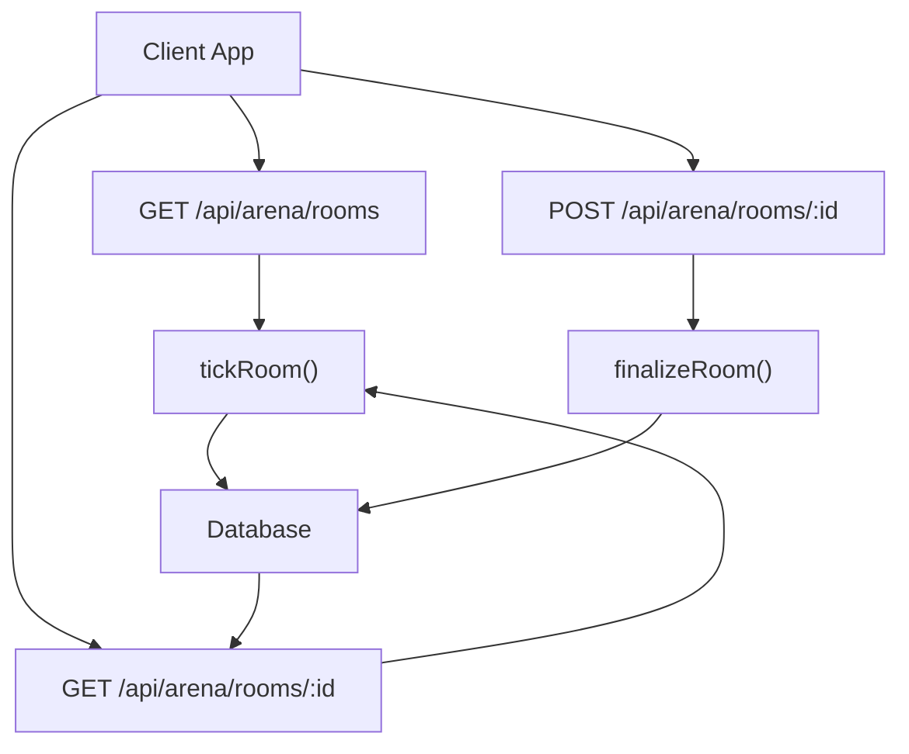
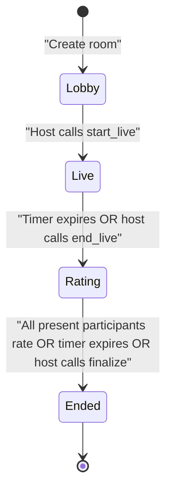
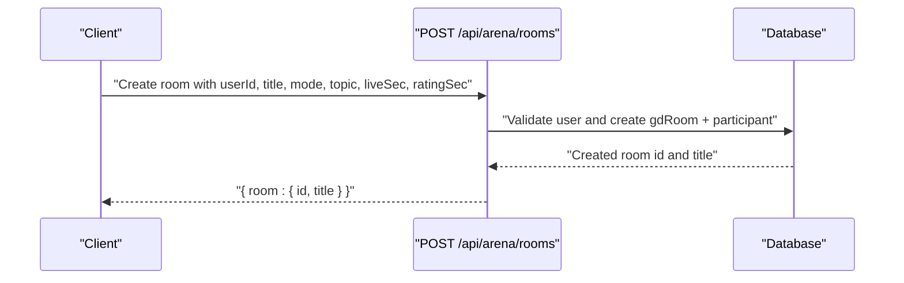
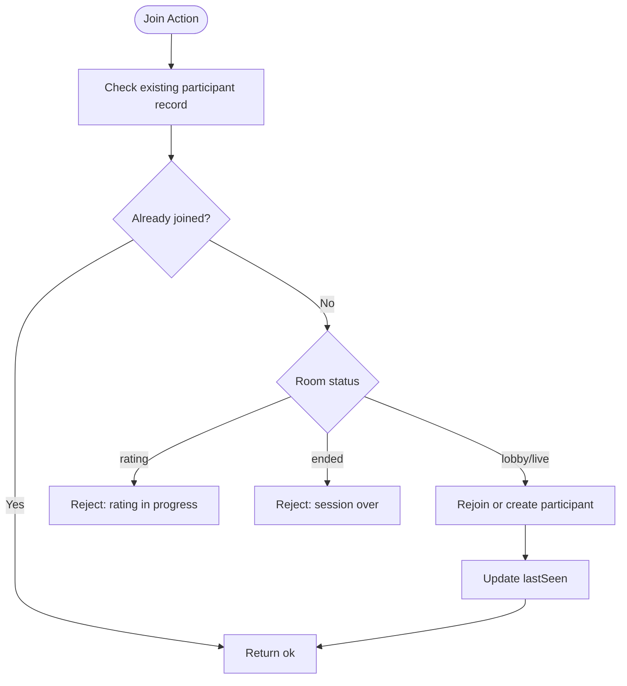
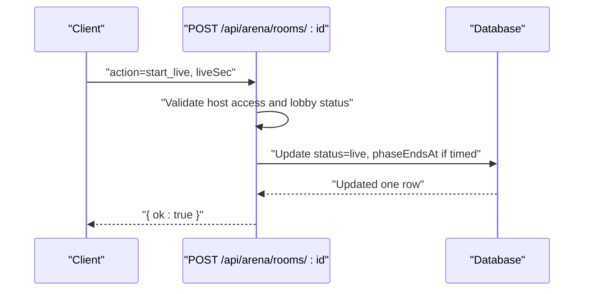
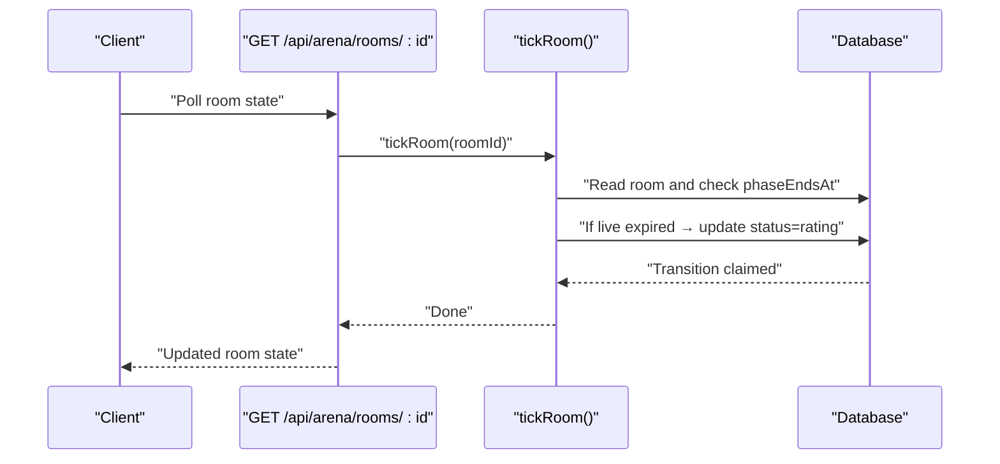
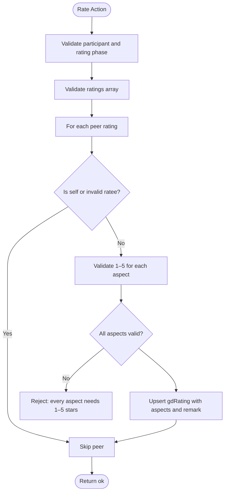
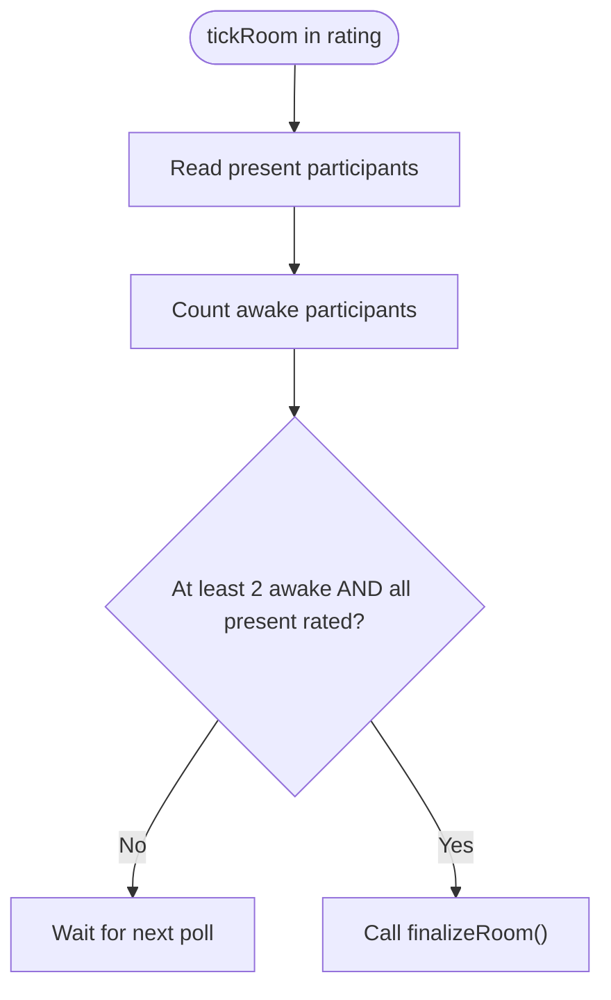
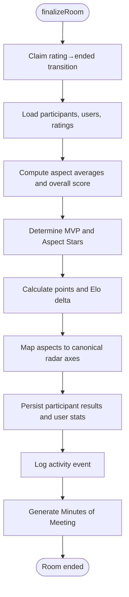
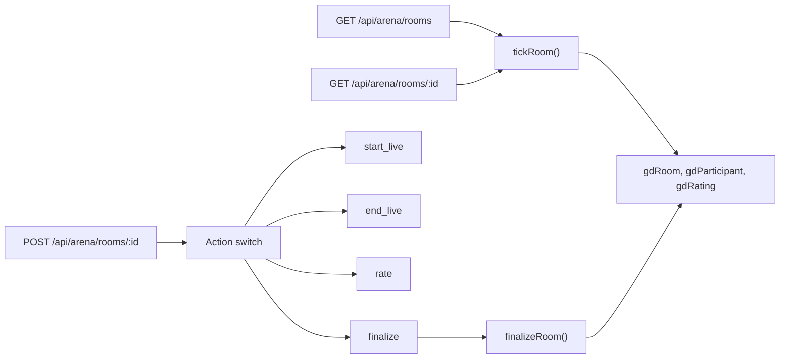

# Room Lifecycle Management

<cite>
**Referenced Files in This Document**   
- [arena-engine.ts](file://src/lib/arena-engine.ts)
- [types.ts](file://src/components/welearn/arena/types.ts)
- [rooms route.ts](file://src/app/api/arena/rooms/route.ts)
- [room detail route.ts](file://src/app/api/arena/rooms/[id]/route.ts)
- [arena smoke test](file://scripts/arena-smoke.mjs)
</cite>

## Table of Contents
1. [Introduction](#introduction)
2. [Project Structure](#project-structure)
3. [Core Components](#core-components)
4. [Architecture Overview](#architecture-overview)
5. [Detailed Component Analysis](#detailed-component-analysis)
6. [Dependency Analysis](#dependency-analysis)
7. [Performance Considerations](#performance-considerations)
8. [Troubleshooting Guide](#troubleshooting-guide)
9. [Conclusion](#conclusion)

## Introduction
This document explains the complete room lifecycle for the Arena module, from creation through finalization. A room represents a collaborative or competitive session such as Group Discussion, Debate, or Pitching practice. The system enforces four statuses:

- **Lobby**: Setup phase where the host assigns roles, sets topic and stances, and starts the live session.
- **Live**: Active discussion or presentation phase governed by an optional timer.
- **Rating**: Peer evaluation phase where every participant rates every other present participant using mode-specific star aspects.
- **Ended**: Finalized state where ratings are aggregated, scores and Elo deltas are computed, badges are awarded, and Minutes of Meeting are generated.

The engine is server-authoritative: clients render timers against a `phaseEndsAt` timestamp provided by the server, while the server advances phases either on host control or when a timer expires.

## Project Structure
The room lifecycle spans three main layers:

| Layer | Responsibility | Key Files |
|---|---|---|
| API layer | HTTP endpoints for listing rooms, creating rooms, joining/leaving, host controls, rating submission, and reading live state | `src/app/api/arena/rooms/route.ts`, `src/app/api/arena/rooms/[id]/route.ts` |
| Engine layer | Server-side lifecycle logic, atomic transitions, timer-driven progression, rating aggregation, badge/Elo/MoM generation | `src/lib/arena-engine.ts` |
| Client types | Shared TypeScript contracts mirroring API payloads, status metadata, and formatting helpers | `src/components/welearn/arena/types.ts` |

**Diagram sources**
- [rooms route.ts:8-79](file://src/app/api/arena/rooms/route.ts#L8-L79)
- [room detail route.ts:10-124](file://src/app/api/arena/rooms/[id]/route.ts#L10-L124)
- [room detail route.ts:127-291](file://src/app/api/arena/rooms/[id]/route.ts#L127-L291)
- [arena-engine.ts:102-132](file://src/lib/arena-engine.ts#L102-L132)
- [arena-engine.ts:209-366](file://src/lib/arena-engine.ts#L209-L366)

**Section sources**
- [rooms route.ts:1-115](file://src/app/api/arena/rooms/route.ts#L1-L115)
- [room detail route.ts:1-291](file://src/app/api/arena/rooms/[id]/route.ts#L1-L291)
- [arena-engine.ts:1-415](file://src/lib/arena-engine.ts#L1-L415)
- [types.ts:1-165](file://src/components/welearn/arena/types.ts#L1-L165)

## Core Components
The core components involved in room lifecycle management are:

| Component | Role | Important Behaviors |
|---|---|---|
| Room creation endpoint | Creates a new Arena room with a host and initial participant | Host is automatically assigned to the creator; default mode is Group Discussion; optional `liveSec` and `ratingSec` define timers |
| Room state endpoint | Reads current room state and acts as a heartbeat | Calls `tickRoom()` to advance phases; updates participant presence; returns participants, aspects, submitted raters, and MoM when available |
| Room action endpoint | Consolidates join, leave, delete, co-host assignment, topic setting, start/end/finalize, stance/key argument, and peer rating | Enforces role-based access; validates inputs; persists ratings; triggers finalization when appropriate |
| Arena engine | Implements lifecycle transitions, rating aggregation, scoring, badges, Elo, activity logging, and MoM generation | Uses atomic transitions; supports timed and untimed phases; fast-paths auto-finalization when all present participants submit ratings |
| Shared types | Defines client-facing contracts for room state, player data, modes, stances, and status metadata | Mirrors server payloads so UI can render status chips, aspect labels, and results consistently |

**Section sources**
- [rooms route.ts:81-114](file://src/app/api/arena/rooms/route.ts#L81-L114)
- [room detail route.ts:8-124](file://src/app/api/arena/rooms/[id]/route.ts#L8-L124)
- [room detail route.ts:127-291](file://src/app/api/arena/rooms/[id]/route.ts#L127-L291)
- [arena-engine.ts:17-47](file://src/lib/arena-engine.ts#L17-L47)
- [arena-engine.ts:88-132](file://src/lib/arena-engine.ts#L88-L132)
- [arena-engine.ts:209-366](file://src/lib/arena-engine.ts#L209-L366)
- [types.ts:3-73](file://src/components/welearn/arena/types.ts#L3-L73)
- [types.ts:121-153](file://src/components/welearn/arena/types.ts#L121-L153)

## Architecture Overview
The room lifecycle is driven by two mechanisms:

1. **Manual host control**: The host explicitly moves the room from lobby to live, ends the live session to open rating, or manually finalizes the room.
2. **Timer-driven progression**: When `phaseEndsAt` is set, polling the room state triggers automatic transitions.

**Diagram sources**
- [room detail route.ts:198-228](file://src/app/api/arena/rooms/[id]/route.ts#L198-L228)
- [arena-engine.ts:102-132](file://src/lib/arena-engine.ts#L102-L132)

### Status Definitions
| Status | Meaning | Entry Conditions | Exit Conditions |
|---|---|---|---|
| Lobby | Setup and configuration | Room created; host has not started the session | Host calls `start_live`; room remains here indefinitely if no timer is configured |
| Live | Active session | Host calls `start_live`; optional live timer may be set | Live timer expires; host calls `end_live` |
| Rating | Peer evaluation window | Live timer expires; host calls `end_live` | All present participants submit ratings; rating timer expires; host calls `finalize` |
| Ended | Finalized results | Room finalized | No further transitions; results, badges, Elo, and MoM are persisted |

**Section sources**
- [types.ts:3-5](file://src/components/welearn/arena/types.ts#L3-L5)
- [types.ts:148-153](file://src/components/welearn/arena/types.ts#L148-L153)
- [room detail route.ts:198-228](file://src/app/api/arena/rooms/[id]/route.ts#L198-L228)
- [arena-engine.ts:102-132](file://src/lib/arena-engine.ts#L102-L132)

## Detailed Component Analysis

### Room Creation and Host Assignment
When a user creates a room:

- The request body includes `userId`, `title`, optional `mode`, optional `topic`, and optional `liveSec` and `ratingSec`.
- If `mode` is missing or invalid, it defaults to Group Discussion.
- Timers are clamped: live duration up to 2700 seconds, rating duration up to 1800 seconds.
- The creator becomes the host and is added as the first participant.
- The room is initially created in the lobby; timers do not start until the host starts the live session.

**Diagram sources**
- [rooms route.ts:81-114](file://src/app/api/arena/rooms/route.ts#L81-L114)

**Section sources**
- [rooms route.ts:81-114](file://src/app/api/arena/rooms/route.ts#L81-L114)

### Participant Joining and Initial Configuration
Participants join a room through the consolidated action endpoint:

- Joining is allowed in lobby and live states.
- Joining is blocked during rating and ended states.
- Rejoining clears the `leftAt` flag and refreshes presence.
- Leaving removes the participant unless they are the creator; creator leaving deletes the room.
- Co-host delegation is restricted to the creator and only allowed in lobby.
- Topic changes require host access and minimum length validation.
- Stance selection is allowed in lobby and live states for debate mode.
- Key argument submission is allowed until the room ends.

**Diagram sources**
- [room detail route.ts:147-166](file://src/app/api/arena/rooms/[id]/route.ts#L147-L166)

**Section sources**
- [room detail route.ts:147-177](file://src/app/api/arena/rooms/[id]/route.ts#L147-L177)
- [room detail route.ts:179-196](file://src/app/api/arena/rooms/[id]/route.ts#L179-L196)
- [room detail route.ts:230-249](file://src/app/api/arena/rooms/[id]/route.ts#L230-L249)

### Phase Transitions: Lobby to Live
The host starts the live session by calling `start_live`:

- Only hosts or co-hosts can start.
- The room must currently be in lobby.
- The live duration is accepted from the request or falls back to the room’s configured value.
- The room status becomes live.
- If `liveSec > 0`, `phaseEndsAt` is set to the current time plus the live duration.
- If `liveSec <= 0`, the session remains live until the host manually ends it.

**Diagram sources**
- [room detail route.ts:198-208](file://src/app/api/arena/rooms/[id]/route.ts#L198-L208)

**Section sources**
- [room detail route.ts:198-208](file://src/app/api/arena/rooms/[id]/route.ts#L198-L208)

### Phase Transitions: Live to Rating
A room enters rating when:

- The live timer expires, detected by `tickRoom()` during state polling.
- The host calls `end_live`.

When transitioning to rating:

- The room status becomes rating.
- If `ratingSec > 0`, `phaseEndsAt` is set to the current time plus the rating duration.
- If `ratingSec <= 0`, the rating phase waits until all present participants submit ratings or the host manually finalizes.

**Diagram sources**
- [room detail route.ts:10-17](file://src/app/api/arena/rooms/[id]/route.ts#L10-L17)
- [arena-engine.ts:102-118](file://src/lib/arena-engine.ts#L102-L118)

**Section sources**
- [room detail route.ts:210-220](file://src/app/api/arena/rooms/[id]/route.ts#L210-L220)
- [arena-engine.ts:102-118](file://src/lib/arena-engine.ts#L102-L118)

### Rating Phase Mechanics
During rating:

- Every present participant can rate every other present participant.
- Ratings use mode-specific aspects:
  - Group Discussion: content, clarity, listening, leadership.
  - Debate: argument, rebuttal, delivery, respect.
  - Pitch: problem, solution, market, delivery.
- Each aspect is a star rating from 1 to 5.
- Optional remarks are stored per rater-ratee pair.
- Self-ratings and ratings for non-present participants are ignored.
- Submitted ratings are upserted so participants can revise their stars and remarks.

**Diagram sources**
- [room detail route.ts:251-282](file://src/app/api/arena/rooms/[id]/route.ts#L251-L282)

**Section sources**
- [arena-engine.ts:27-47](file://src/lib/arena-engine.ts#L27-L47)
- [room detail route.ts:251-282](file://src/app/api/arena/rooms/[id]/route.ts#L251-L282)

### Automatic Progression: All Participants Submit
The rating phase can finish before its timer expires:

- On each poll, if the room is in rating, the engine checks whether enough participants are present.
- Presence is determined by participants without `leftAt` and recent `lastSeen` timestamps.
- If at least two participants are awake and all present participants have submitted ratings, the room is finalized immediately.

**Diagram sources**
- [arena-engine.ts:120-132](file://src/lib/arena-engine.ts#L120-L132)

**Section sources**
- [arena-engine.ts:120-132](file://src/lib/arena-engine.ts#L120-L132)

### Finalization Process
Finalization aggregates peer ratings and produces persistent outcomes:

1. **Atomic transition**: The room moves from rating to ended with `endedAt` set and `phaseEndsAt` cleared.
2. **Aspect mapping**: Mode-specific aspects are resolved; unknown modes fall back to Group Discussion aspects.
3. **Participant resolution**: Present participants are identified and matched to user records.
4. **Rating aggregation**: Per-participant average aspect scores and overall score are computed from peer star ratings.
5. **Badges**:
   - MVP: highest overall score among scored participants.
   - Aspect Stars: one Star per aspect for the highest-scoring participant whose aspect average meets the threshold.
6. **Points and Elo**:
   - Points include participation points, performance points based on average stars, and extra MVP points.
   - Elo delta is derived from average stars, MVP bonus, and host bonus, then clamped.
7. **Profile radar axes**: Aspect keys are mapped to canonical axes: content, delivery, listening, leadership.
8. **User profile updates**: Elo, games played, streak, daily averages, rating count, and last arena date are updated.
9. **Activity logging**: An activity entry records the session, Elo change, and badges.
10. **Minutes of Meeting**: A structured MoM payload is generated, optionally enriched by AI narrative.

**Diagram sources**
- [arena-engine.ts:209-366](file://src/lib/arena-engine.ts#L209-L366)

**Section sources**
- [arena-engine.ts:209-366](file://src/lib/arena-engine.ts#L209-L366)

### Example Room State Transitions
The following examples illustrate typical flows:

| Scenario | Transition | Trigger |
|---|---|---|
| Host starts session | Lobby → Live | Host calls `start_live` |
| Live timer expires | Live → Rating | `tickRoom()` detects expired `phaseEndsAt` |
| Host ends early | Live → Rating | Host calls `end_live` |
| Everyone rates quickly | Rating → Ended | All present participants submit ratings |
| Rating timer expires | Rating → Ended | `tickRoom()` detects expired rating timer |
| Host forces completion | Rating → Ended | Host calls `finalize` |

These behaviors are validated by the smoke test, which:

- Starts a room.
- Ends live to enter rating.
- Submits peer ratings from multiple users.
- Waits briefly and expects the room to become ended due to all-rated auto-finalization.

**Section sources**
- [arena smoke test:96-117](file://scripts/arena-smoke.mjs#L96-L117)
- [room detail route.ts:198-228](file://src/app/api/arena/rooms/[id]/route.ts#L198-L228)
- [arena-engine.ts:102-132](file://src/lib/arena-engine.ts#L102-L132)

### Host Control Operations
Host-controlled operations include:

| Operation | Required Role | Allowed Status | Behavior |
|---|---|---|---|
| `cohost` | Creator | Lobby | Assign or remove co-host privileges for another participant |
| `set_topic` | Host or co-host | Any | Update room topic with validation |
| `start_live` | Host or co-host | Lobby | Begin active session and optionally set live timer |
| `end_live` | Host or co-host | Live | Open rating phase and optionally set rating timer |
| `finalize` | Host or co-host | Rating | Immediately aggregate results and close the room |
| `delete_room` | Creator or PIN holder | Any | Delete the room; creator can always delete |

**Section sources**
- [room detail route.ts:168-187](file://src/app/api/arena/rooms/[id]/route.ts#L168-L187)
- [room detail route.ts:190-228](file://src/app/api/arena/rooms/[id]/route.ts#L190-L228)

## Dependency Analysis
The room lifecycle depends on clear boundaries between API handlers and engine logic:

**Diagram sources**
- [rooms route.ts:8-79](file://src/app/api/arena/rooms/route.ts#L8-L79)
- [room detail route.ts:10-124](file://src/app/api/arena/rooms/[id]/route.ts#L10-L124)
- [room detail route.ts:127-291](file://src/app/api/arena/rooms/[id]/route.ts#L127-L291)
- [arena-engine.ts:102-132](file://src/lib/arena-engine.ts#L102-L132)
- [arena-engine.ts:209-366](file://src/lib/arena-engine.ts#L209-L366)

Key dependency relationships:

- The list endpoint drives lifecycle progression for rooms that are not actively polled by a client.
- The detail endpoint is the primary heartbeat for active rooms.
- The action endpoint centralizes mutations and delegates finalization to the engine.
- The engine encapsulates timing, atomicity, aggregation, and persistence side effects.
- Shared types ensure consistent client-server contracts for status, aspects, and results.

**Section sources**
- [rooms route.ts:8-79](file://src/app/api/arena/rooms/route.ts#L8-L79)
- [room detail route.ts:10-124](file://src/app/api/arena/rooms/[id]/route.ts#L10-L124)
- [room detail route.ts:127-291](file://src/app/api/arena/rooms/[id]/route.ts#L127-L291)
- [arena-engine.ts:102-132](file://src/lib/arena-engine.ts#L102-L132)
- [arena-engine.ts:209-366](file://src/lib/arena-engine.ts#L209-L366)
- [types.ts:45-73](file://src/components/welearn/arena/types.ts#L45-L73)

## Performance Considerations
- **Poll-driven lifecycle**: The engine avoids background workers by advancing phases on GET requests. This reduces infrastructure complexity but requires clients to poll regularly.
- **Atomic transitions**: `claimTransition` uses database-level conditional updates to prevent concurrent race conditions during phase changes.
- **Fast-path finalization**: The engine avoids unnecessary full finalization work until all present participants have submitted ratings.
- **Presence tracking**: `lastSeen` updates reduce false positives for the “all rated” fast path by requiring recent activity.
- **Optional timers**: Untimed sessions remain stable until host control, reducing unnecessary transitions.
- **Lazy imports**: Finalization imports the engine function only when needed, keeping hot paths lighter.

[No sources needed since this section provides general guidance]

## Troubleshooting Guide
Common issues and their likely causes:

| Symptom | Likely Cause | Resolution |
|---|---|---|
| Cannot start live session | Not host/co-host or room already started | Verify `canHost` and current status |
| Cannot join rating phase | Rating already in progress or session ended | Join before rating opens or wait for next room |
| Ratings rejected | Aspects outside 1–5 or invalid structure | Ensure each aspect key maps to a valid star rating |
| Room does not finalize after all ratings | Missing presence or stale `lastSeen` | Ensure participants poll the room and remain present |
| Auto-transition not happening | Room not being polled or `phaseEndsAt` null | Poll the room or configure timers |
| Finalization fails silently | Another request claimed the transition | Retry after state refresh |

**Section sources**
- [room detail route.ts:198-228](file://src/app/api/arena/rooms/[id]/route.ts#L198-L228)
- [room detail route.ts:251-282](file://src/app/api/arena/rooms/[id]/route.ts#L251-L282)
- [arena-engine.ts:88-95](file://src/lib/arena-engine.ts#L88-L95)
- [arena-engine.ts:102-132](file://src/lib/arena-engine.ts#L102-L132)

## Conclusion
The Arena room lifecycle is a server-authoritative workflow built around four statuses: lobby, live, rating, and ended. Hosts control the major transitions, while optional timers and automatic finalization provide predictable progression. The rating phase collects structured peer evaluations, and finalization converts those evaluations into scores, badges, Elo adjustments, activity logs, and Minutes of Meeting. The design balances simplicity and correctness by combining explicit host actions with safe, database-backed transitions and a lightweight polling model.

[No sources needed since this section summarizes without analyzing specific files]