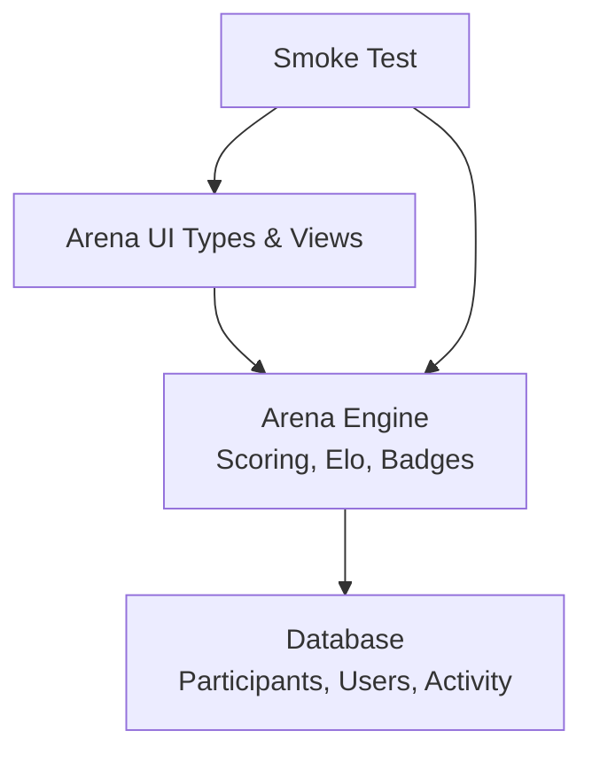
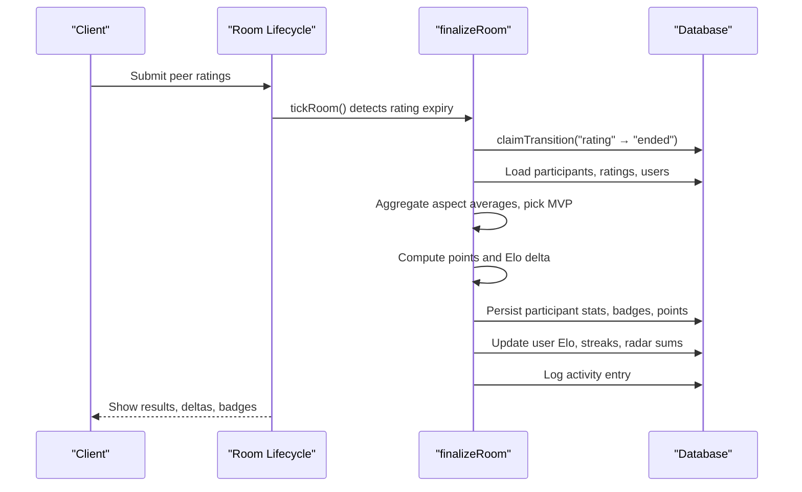
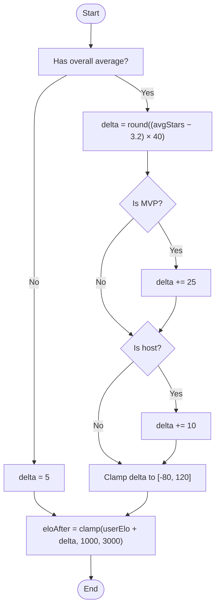
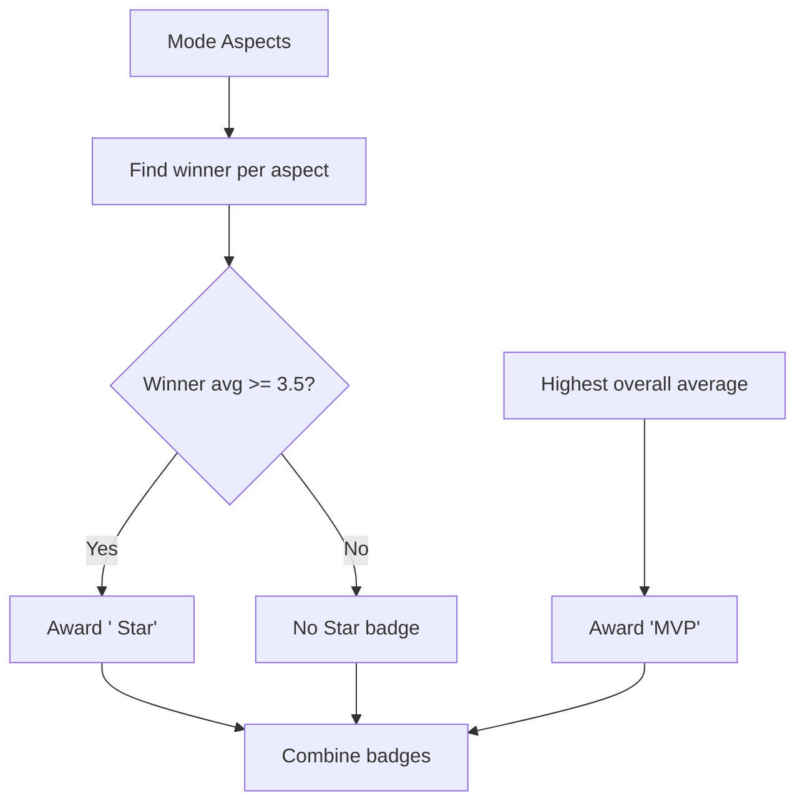
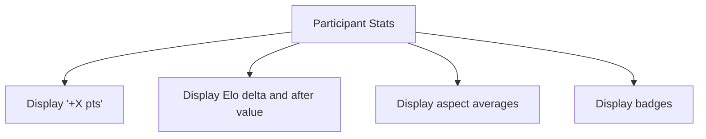
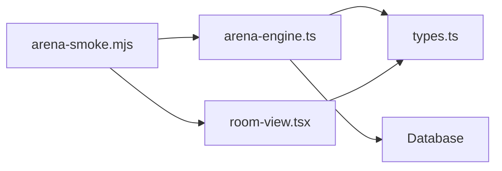

# Scoring & Rating System

<cite>
**Referenced Files in This Document**
- [arena-engine.ts](file://src/lib/arena-engine.ts)
- [types.ts](file://src/components/welearn/arena/types.ts)
- [room-view.tsx](file://src/components/welearn/arena/room-view.tsx)
- [arena-smoke.mjs](file://scripts/arena-smoke.mjs)
</cite>

## Table of Contents
1. [Introduction](#introduction)
2. [Project Structure](#project-structure)
3. [Core Components](#core-components)
4. [Architecture Overview](#architecture-overview)
5. [Detailed Component Analysis](#detailed-component-analysis)
6. [Dependency Analysis](#dependency-analysis)
7. [Performance Considerations](#performance-considerations)
8. [Troubleshooting Guide](#troubleshooting-guide)
9. [Conclusion](#conclusion)

## Introduction
This document explains the Arena scoring and rating system used for Group Discussion, Debate, and Pitching sessions. It covers:
- The Elo rating calculation with ELO_MIN (1000), ELO_MAX (3000), and ELO_START (1200).
- The delta formula: round((avgStars − 3.2) × 40) + MVP bonus (25) + host bonus (10), clamped to [−80, 120].
- The points system: +5 participation, +round(avgStars × 2.5) performance (range 3–13), +10 MVP.
- The aspect-specific badge system where participants earn “Star” badges for top performance per category.
- The MVP selection process and tier system from Novice Negotiator to Grand Orator.
- Worked examples of rating calculations and badge assignments.

## Project Structure
The Arena scoring logic lives in a server-side engine module that aggregates peer ratings, computes scores, awards badges, updates Elo, and persists results. The UI types mirror API payloads and render participant stats, deltas, and badges. A smoke test validates end-to-end behavior including MVP awarding, badge assignment, and profile updates.

**Diagram sources**
- [arena-engine.ts:200-366](file://src/lib/arena-engine.ts#L200-L366)
- [types.ts:13-119](file://src/components/welearn/arena/types.ts#L13-L119)
- [room-view.tsx:664-696](file://src/components/welearn/arena/room-view.tsx#L664-L696)
- [arena-smoke.mjs:119-139](file://scripts/arena-smoke.mjs#L119-L139)

**Section sources**
- [arena-engine.ts:1-57](file://src/lib/arena-engine.ts#L1-L57)
- [types.ts:1-119](file://src/components/welearn/arena/types.ts#L1-L119)

## Core Components
- Elo constants and tier mapping define the rating range and titles.
- finalizeRoom orchestrates aggregation, badge assignment, Elo delta computation, and persistence.
- Points and Elo are derived from peer star ratings per mode-specific aspects.
- Aspect mapping normalizes different modes into canonical radar axes.
- UI components display Elo deltas, points, and badges.

Key responsibilities:
- Compute per-participant averages across rated aspects.
- Select MVP as highest overall average among scored participants.
- Award one “Star” badge per aspect to the top scorer if at least 3.5 stars.
- Calculate points and Elo delta; clamp both delta and final Elo.
- Update user-level stats, streaks, and activity logs.

**Section sources**
- [arena-engine.ts:55-66](file://src/lib/arena-engine.ts#L55-L66)
- [arena-engine.ts:200-366](file://src/lib/arena-engine.ts#L200-L366)
- [room-view.tsx:664-696](file://src/components/welearn/arena/room-view.tsx#L664-L696)

## Architecture Overview
The room lifecycle transitions through lobby → live → rating → ended. When the rating phase ends, finalizeRoom runs once atomically. It aggregates peer ratings, determines MVP and aspect winners, computes points and Elo, and writes results to the database.

**Diagram sources**
- [arena-engine.ts:102-132](file://src/lib/arena-engine.ts#L102-L132)
- [arena-engine.ts:200-366](file://src/lib/arena-engine.ts#L200-L366)

## Detailed Component Analysis

### Elo Rating Parameters and Tier System
- ELO_MIN = 1000
- ELO_MAX = 3000
- ELO_START = 1200
- Tiers:
  - < 1200: Novice Negotiator
  - < 1500: Rising Orator
  - < 1800: Deck Debater
  - < 2200: Boardroom Gladiator
  - < 2600: E-Summit Elite
  - ≥ 2600: Grand Orator

These values and mappings are defined centrally and used when computing final Elo and displaying tiers.

**Section sources**
- [arena-engine.ts:55-66](file://src/lib/arena-engine.ts#L55-L66)

### Delta Calculation Formula
For each participant with an overall average:
- Base delta = round((avgStars − 3.2) × 40)
- Add MVP bonus = +25 if selected MVP
- Add host bonus = +10 if host
- Clamp delta to [−80, 120]

If no overall average is available, delta defaults to 5.

Final Elo = clamp(currentElo + delta, ELO_MIN, ELO_MAX)

**Diagram sources**
- [arena-engine.ts:293-302](file://src/lib/arena-engine.ts#L293-L302)

**Section sources**
- [arena-engine.ts:293-302](file://src/lib/arena-engine.ts#L293-L302)

### Points System
Points awarded per participant:
- Participation base: +5
- Performance: +round(avgStars × 2.5), effectively ranging from 3 to 13 given typical star ranges
- MVP bonus: +10 if selected MVP

Total points = 5 + performance + (isMvp ? 10 : 0)

**Section sources**
- [arena-engine.ts:294-294](file://src/lib/arena-engine.ts#L294-L294)

### Aspect-Specific Badge System
- For each mode-specific aspect, the participant with the highest average earns a “Star” badge for that aspect, provided their average is at least 3.5.
- MVP badge is awarded to the participant with the highest overall average among those with valid averages.
- Badges are stored per participant and displayed in the UI.

Aspect mapping normalizes mode-specific keys to canonical radar axes (content, delivery, listening, leadership), ensuring consistent profile visualization.

**Diagram sources**
- [arena-engine.ts:261-281](file://src/lib/arena-engine.ts#L261-L281)
- [arena-engine.ts:70-86](file://src/lib/arena-engine.ts#L70-L86)

**Section sources**
- [arena-engine.ts:261-281](file://src/lib/arena-engine.ts#L261-L281)
- [arena-engine.ts:70-86](file://src/lib/arena-engine.ts#L70-L86)

### MVP Selection Process
- Among participants with a valid overall average, select the one with the highest average as MVP.
- MVP receives:
  - “MVP” badge
  - +25 Elo delta bonus
  - +10 points bonus

**Section sources**
- [arena-engine.ts:261-281](file://src/lib/arena-engine.ts#L261-L281)
- [arena-engine.ts:294-298](file://src/lib/arena-engine.ts#L294-L298)

### Example Calculations

#### Example 1: Average Participant
- avgStars = 3.6
- Not MVP, not host
- Delta = round((3.6 − 3.2) × 40) = round(0.4 × 40) = 16
- Clamped delta = 16
- If current Elo = 1200, eloAfter = clamp(1200 + 16, 1000, 3000) = 1216
- Points = 5 + round(3.6 × 2.5) = 5 + 9 = 14

#### Example 2: MVP
- avgStars = 4.2
- Is MVP, not host
- Delta = round((4.2 − 3.2) × 40) + 25 = round(1.0 × 40) + 25 = 40 + 25 = 65
- Clamped delta = 65
- If current Elo = 1500, eloAfter = clamp(1500 + 65, 1000, 3000) = 1565
- Points = 5 + round(4.2 × 2.5) + 10 = 5 + 11 + 10 = 26

#### Example 3: Host with Below-Average Performance
- avgStars = 2.8
- Not MVP, is host
- Delta = round((2.8 − 3.2) × 40) + 10 = round(-0.4 × 40) + 10 = -16 + 10 = -6
- Clamped delta = -6
- If current Elo = 1800, eloAfter = clamp(1800 − 6, 1000, 3000) = 1794
- Points = 5 + round(2.8 × 2.5) = 5 + 7 = 12

#### Example 4: Strong Performance Near Cap
- avgStars = 4.8
- Is MVP, not host
- Delta = round((4.8 − 3.2) × 40) + 25 = round(1.6 × 40) + 25 = 64 + 25 = 89
- Clamped delta = 89
- If current Elo = 2900, eloAfter = clamp(2900 + 89, 1000, 3000) = 2989
- Points = 5 + round(4.8 × 2.5) + 10 = 5 + 12 + 10 = 27

**Section sources**
- [arena-engine.ts:293-302](file://src/lib/arena-engine.ts#L293-L302)

### UI Display of Results
The UI shows:
- Points earned
- Elo delta and resulting Elo
- Aspect averages
- Badges awarded

**Diagram sources**
- [room-view.tsx:664-696](file://src/components/welearn/arena/room-view.tsx#L664-L696)

**Section sources**
- [room-view.tsx:664-696](file://src/components/welearn/arena/room-view.tsx#L664-L696)

## Dependency Analysis
The scoring system depends on:
- Database access for participants, ratings, users, and activity logging.
- Mode-specific aspect definitions and metadata.
- UI types for rendering results and history.
- Smoke tests validating MVP awarding, badge assignment, and profile updates.

**Diagram sources**
- [arena-engine.ts:200-366](file://src/lib/arena-engine.ts#L200-L366)
- [types.ts:13-119](file://src/components/welearn/arena/types.ts#L13-L119)
- [room-view.tsx:664-696](file://src/components/welearn/arena/room-view.tsx#L664-L696)
- [arena-smoke.mjs:119-139](file://scripts/arena-smoke.mjs#L119-L139)

**Section sources**
- [arena-engine.ts:200-366](file://src/lib/arena-engine.ts#L200-L366)
- [types.ts:13-119](file://src/components/welearn/arena/types.ts#L13-L119)
- [room-view.tsx:664-696](file://src/components/welearn/arena/room-view.tsx#L664-L696)
- [arena-smoke.mjs:119-139](file://scripts/arena-smoke.mjs#L119-L139)

## Performance Considerations
- Aggregation is linear in the number of ratings and participants per room.
- Clamping operations are constant time.
- Badge assignment iterates over aspects and participants once.
- Database writes occur per participant; batching or background jobs could reduce contention for large rooms.
- Streak and radar sum updates are simple increments.

[No sources needed since this section provides general guidance]

## Troubleshooting Guide
Common issues and checks:
- MVP not awarded: Ensure at least one participant has a valid overall average; verify MVP selection logic and that ratings were submitted by all present peers.
- Badges missing: Confirm aspect averages meet the 3.5 threshold for the top scorer in each aspect.
- Unexpected Elo changes: Verify delta clamping and that host/MVP bonuses are applied correctly.
- UI not showing results: Check that the room status transitioned to “ended” and that the UI reads persisted participant stats.

Validation via smoke test:
- Confirms MVP awarding, badge assignment (“Top Initiator”), and profile updates including rank and radar values.

**Section sources**
- [arena-smoke.mjs:119-139](file://scripts/arena-smoke.mjs#L119-L139)

## Conclusion
The Arena scoring and rating system uses peer-driven star ratings to compute meaningful Elo deltas and points, while rewarding excellence through MVP and aspect-specific “Star” badges. The Elo range and tier structure provide clear progression from Novice Negotiator to Grand Orator. The implementation is deterministic, clamped for stability, and integrated with UI and testing to ensure reliability.

[No sources needed since this section summarizes without analyzing specific files]