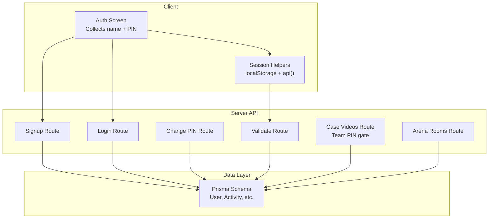
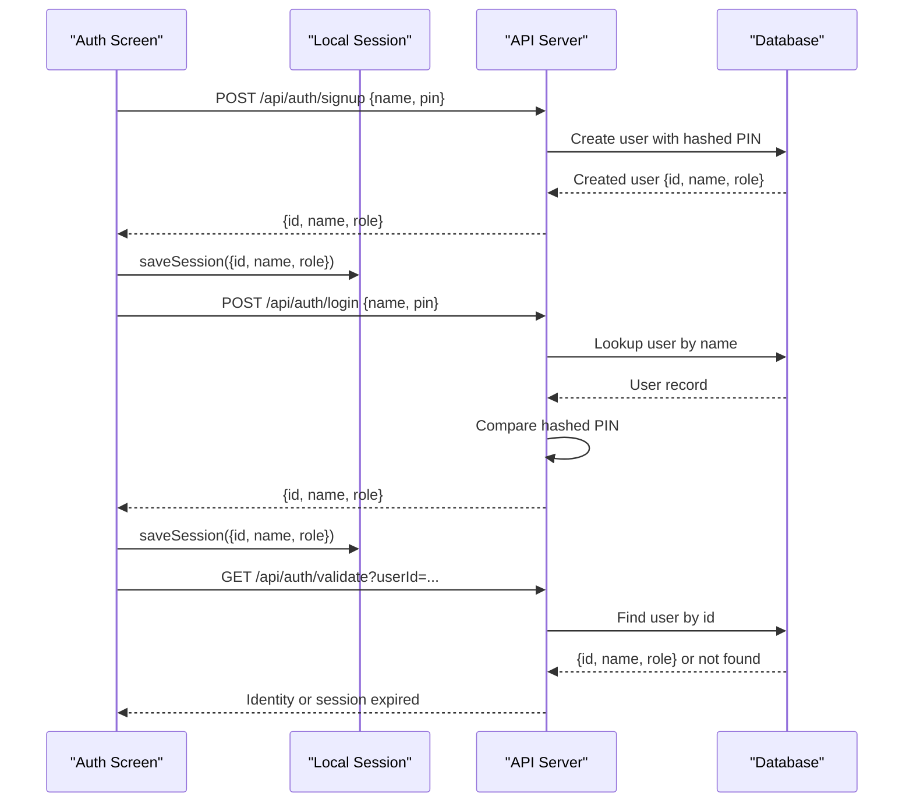
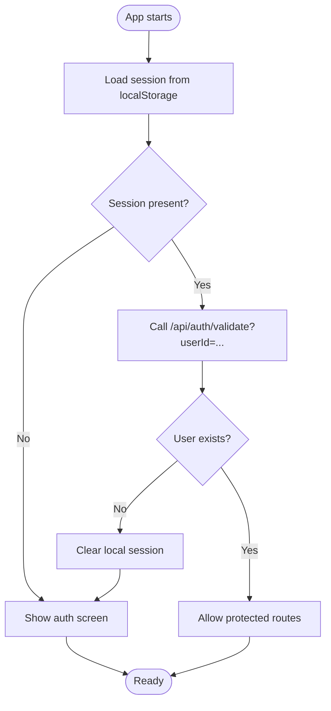
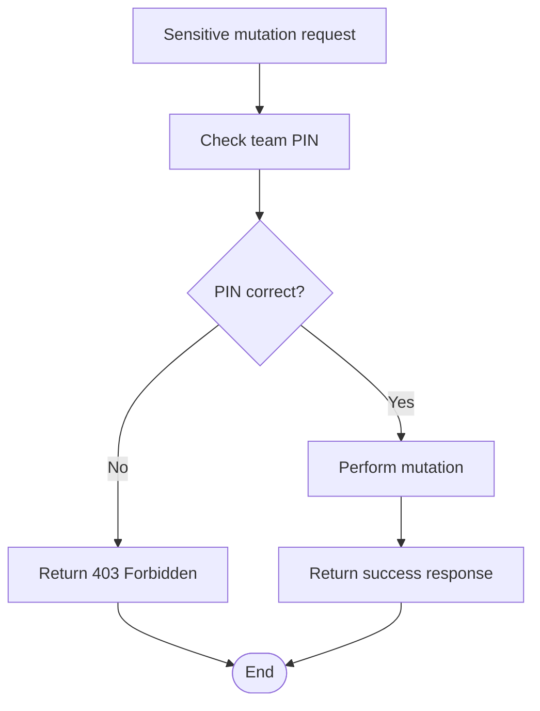
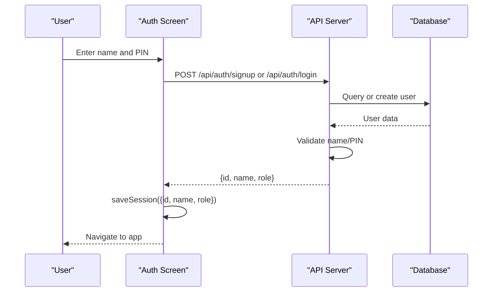
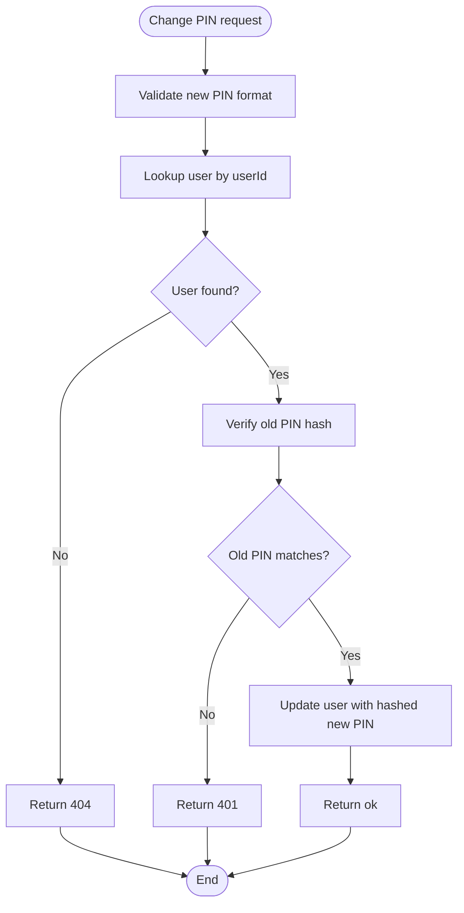
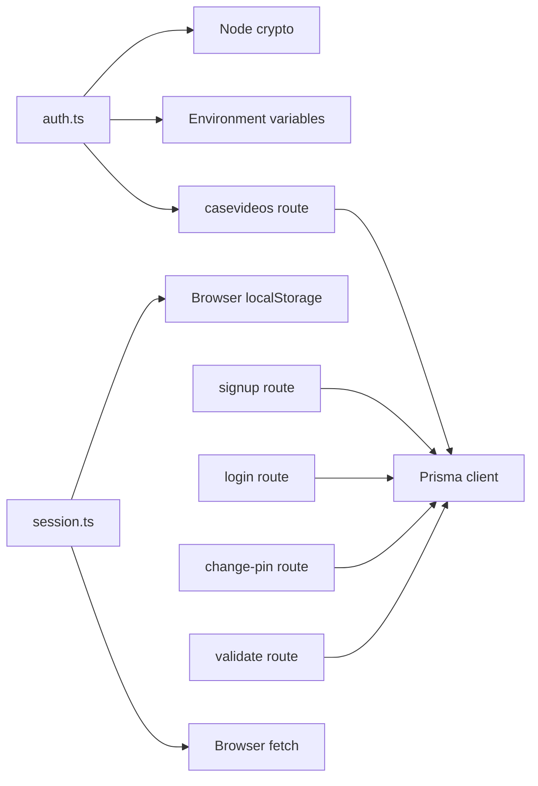

# Authentication & User Management

<cite>
**Referenced Files in This Document**
- [auth.ts](file://src/lib/auth.ts)
- [session.ts](file://src/lib/session.ts)
- [auth-screen.tsx](file://src/components/welearn/auth-screen.tsx)
- [login route](file://src/app/api/auth/login/route.ts)
- [signup route](file://src/app/api/auth/signup/route.ts)
- [change-pin route](file://src/app/api/auth/change-pin/route.ts)
- [validate route](file://src/app/api/auth/validate/route.ts)
- [casevideos route](file://src/app/api/casevideos/route.ts)
- [arena rooms route](file://src/app/api/arena/rooms/route.ts)
- [schema.prisma](file://prisma/schema.prisma)
</cite>

## Table of Contents
1. [Introduction](#introduction)
2. [Project Structure](#project-structure)
3. [Core Components](#core-components)
4. [Architecture Overview](#architecture-overview)
5. [Detailed Component Analysis](#detailed-component-analysis)
6. [Dependency Analysis](#dependency-analysis)
7. [Performance Considerations](#performance-considerations)
8. [Troubleshooting Guide](#troubleshooting-guide)
9. [Conclusion](#conclusion)

## Introduction
This document explains the authentication and user management system used by the application. It covers:
- The PIN-based team access model for individual users.
- Session creation, client-side persistence, and server-side validation.
- Role-based permissions with member and admin roles.
- The two-step confirmation process using a shared team PIN for sensitive operations.
- User profile management, including sign-up, login, and PIN changes.
- Security considerations and common operational scenarios such as onboarding, PIN rotation, and session expiration handling.

The system is intentionally simple: each user has a name and a hashed 4-digit PIN. A separate shared team PIN protects sensitive content mutations like adding or removing shared videos, questions, challenges, and room deletions.

## Project Structure
Authentication-related code is split between:
- Shared utilities for hashing, validation, and team PIN checks.
- Client-side session helpers that persist the authenticated user locally.
- API routes for sign-up, login, PIN change, and session validation.
- UI components that collect names and PINs and call the API.
- Data models defining users, roles, and related entities.

**Diagram sources**
- [auth-screen.tsx:27-71](file://src/components/welearn/auth-screen.tsx#L27-L71)
- [session.ts:1-43](file://src/lib/session.ts#L1-L43)
- [signup route:6-30](file://src/app/api/auth/signup/route.ts#L6-L30)
- [login route:6-20](file://src/app/api/auth/login/route.ts#L6-L20)
- [change-pin route:5-19](file://src/app/api/auth/change-pin/route.ts#L5-L19)
- [validate route:5-12](file://src/app/api/auth/validate/route.ts#L5-L12)
- [casevideos route:71-102](file://src/app/api/casevideos/route.ts#L71-L102)
- [schema.prisma:11-48](file://prisma/schema.prisma#L11-L48)

**Section sources**
- [auth-screen.tsx:27-71](file://src/components/welearn/auth-screen.tsx#L27-L71)
- [session.ts:1-43](file://src/lib/session.ts#L1-L43)
- [signup route:6-30](file://src/app/api/auth/signup/route.ts#L6-L30)
- [login route:6-20](file://src/app/api/auth/login/route.ts#L6-L20)
- [change-pin route:5-19](file://src/app/api/auth/change-pin/route.ts#L5-L19)
- [validate route:5-12](file://src/app/api/auth/validate/route.ts#L5-L12)
- [casevideos route:71-102](file://src/app/api/casevideos/route.ts#L71-L102)
- [schema.prisma:11-48](file://prisma/schema.prisma#L11-L48)

## Core Components
- Authentication utilities: hashing, input validation, and team PIN verification.
- Session utilities: loading, saving, clearing local sessions, and a typed fetch wrapper.
- Authentication routes: signup, login, PIN change, and session validation.
- Team PIN-gated endpoints: shared video library mutation and arena room deletion.
- Data model: User entity with id, name, hashed pin, role, timestamps, and relations.

Key responsibilities:
- `auth.ts` centralizes PIN hashing, PIN format validation, name validation, and team PIN comparison.
- `session.ts` defines the client-side session shape and provides safe localStorage access plus an error-aware API helper.
- Routes enforce business rules, validate inputs, interact with the database, and return consistent JSON responses.
- The schema defines the canonical data structure for users and related activity tracking.

**Section sources**
- [auth.ts:1-25](file://src/lib/auth.ts#L1-L25)
- [session.ts:1-43](file://src/lib/session.ts#L1-L43)
- [schema.prisma:11-48](file://prisma/schema.prisma#L11-L48)

## Architecture Overview
The authentication flow uses a PIN-based model rather than traditional passwords or OAuth. Users register with a name and a 4-digit PIN. On successful login, the server returns a minimal identity object containing the user id, name, and role. The client stores this in localStorage and reuses it for subsequent requests. Sensitive operations require a second factor: the shared team PIN.

**Diagram sources**
- [auth-screen.tsx:34-71](file://src/components/welearn/auth-screen.tsx#L34-L71)
- [session.ts:11-30](file://src/lib/session.ts#L11-L30)
- [signup route:6-30](file://src/app/api/auth/signup/route.ts#L6-L30)
- [login route:6-20](file://src/app/api/auth/login/route.ts#L6-L20)
- [validate route:5-12](file://src/app/api/auth/validate/route.ts#L5-L12)

## Detailed Component Analysis

### PIN-Based Team Access Model
Each user authenticates with a unique 4-digit PIN. PINs are never stored in plain text; they are hashed before being persisted. The same hashing function is used during login to compare the submitted PIN against the stored hash.

Important behaviors:
- PINs must be exactly four digits.
- Names are validated for length and forbidden characters.
- The shared team PIN is separate from user PINs and is used only for sensitive operations.

Security notes:
- Use a strong environment variable for the salt.
- Rotate the shared team PIN through configuration when needed.
- Treat the team PIN as a high-privilege secret.

**Section sources**
- [auth.ts:9-25](file://src/lib/auth.ts#L9-L25)
- [schema.prisma:11-16](file://prisma/schema.prisma#L11-L16)

### Session Management Implementation
After successful signup or login, the client persists a lightweight session object containing the user id, name, and role. This session survives page reloads until cleared.

Client-side behavior:
- Load session safely, returning null if missing or malformed.
- Save session after successful authentication.
- Clear session on logout or when invalidating the current user.
- Provide a typed fetch helper that throws on non-ok responses and parses JSON.

Server-side validation:
- A dedicated endpoint verifies whether the stored user id still exists in the database.
- If the user is missing, the client should treat the session as expired and prompt re-authentication.

**Diagram sources**
- [session.ts:11-30](file://src/lib/session.ts#L11-L30)
- [validate route:5-12](file://src/app/api/auth/validate/route.ts#L5-L12)

**Section sources**
- [session.ts:1-43](file://src/lib/session.ts#L1-L43)
- [validate route:5-12](file://src/app/api/auth/validate/route.ts#L5-L12)

### Two-Step Confirmation Using Team PIN
Sensitive operations require a second confirmation step using the shared team PIN. This applies to actions such as:
- Adding shared videos.
- Deleting shared videos.
- Deleting arena rooms by non-hosts.
- Mutating shared founder-case prompts and PPT topics where ownership does not grant permission.

Implementation pattern:
- The endpoint receives a `pin` field alongside the operation payload.
- The server compares the provided PIN with the configured team PIN.
- If the PIN is incorrect or missing, the request is rejected with a 403 response.

**Diagram sources**
- [auth.ts:22-25](file://src/lib/auth.ts#L22-L25)
- [casevideos route:71-102](file://src/app/api/casevideos/route.ts#L71-L102)
- [casevideos route:108-117](file://src/app/api/casevideos/route.ts#L108-L117)
- [arena rooms route:174-174](file://src/app/api/arena/rooms/[id]/route.ts#L174-L174)

**Section sources**
- [auth.ts:22-25](file://src/lib/auth.ts#L22-L25)
- [casevideos route:71-102](file://src/app/api/casevideos/route.ts#L71-L102)
- [casevideos route:108-117](file://src/app/api/casevideos/route.ts#L108-L117)
- [arena rooms route:174-174](file://src/app/api/arena/rooms/[id]/route.ts#L174-L174)

### Authentication Flow From PIN Entry to Session Creation
The UI collects the user’s name and PIN, then calls the appropriate API:
- Sign-up validates the name and PIN format, creates the user, logs initial activity, and returns the identity.
- Login finds the user by name, compares the hashed PIN, and returns the identity.
- The client saves the returned identity into localStorage and triggers the authenticated app state.

**Diagram sources**
- [auth-screen.tsx:34-71](file://src/components/welearn/auth-screen.tsx#L34-L71)
- [signup route:6-30](file://src/app/api/auth/signup/route.ts#L6-L30)
- [login route:6-20](file://src/app/api/auth/login/route.ts#L6-L20)
- [session.ts:24-30](file://src/lib/session.ts#L24-L30)

**Section sources**
- [auth-screen.tsx:34-71](file://src/components/welearn/auth-screen.tsx#L34-L71)
- [signup route:6-30](file://src/app/api/auth/signup/route.ts#L6-L30)
- [login route:6-20](file://src/app/api/auth/login/route.ts#L6-L20)
- [session.ts:24-30](file://src/lib/session.ts#L24-L30)

### Role-Based Permissions System
Users have a role field that can be either member or admin. The default role for new users is member. Admin privileges are represented in the data model and returned as part of the session identity.

Current usage patterns:
- Roles are included in the identity returned by signup and login.
- Roles are returned by the session validation endpoint.
- Additional role checks can be added to endpoints that restrict administrative actions.

Recommendations:
- Centralize role-checking logic in middleware or reusable guards.
- Avoid exposing admin-only fields unless the role is verified server-side.
- Audit role changes and provide an admin-only mechanism to promote or demote users.

**Section sources**
- [schema.prisma:11-16](file://prisma/schema.prisma#L11-L16)
- [signup route:22-30](file://src/app/api/auth/signup/route.ts#L22-L30)
- [login route:14-20](file://src/app/api/auth/login/route.ts#L14-L20)
- [validate route:10-12](file://src/app/api/auth/validate/route.ts#L10-L12)

### User Profile Management
Profile management currently focuses on:
- Creating a user with a validated name and PIN.
- Logging initial activity when a user signs up.
- Changing a user’s PIN by verifying the old PIN first.

Behavior highlights:
- Name validation enforces length and disallows dangerous characters.
- PIN validation ensures exactly four digits.
- PIN change requires the current PIN to match the stored hash.

**Diagram sources**
- [change-pin route:5-19](file://src/app/api/auth/change-pin/route.ts#L5-L19)
- [auth.ts:13-15](file://src/lib/auth.ts#L13-L15)

**Section sources**
- [signup route:6-30](file://src/app/api/auth/signup/route.ts#L6-L30)
- [change-pin route:5-19](file://src/app/api/auth/change-pin/route.ts#L5-L19)
- [auth.ts:13-15](file://src/lib/auth.ts#L13-L15)

### Protected Route Implementations
Protected routes generally follow one of these patterns:
- Require a valid session id by validating it against the database.
- Require a team PIN for sensitive mutations.
- Combine both approaches where appropriate.

Examples:
- Video library endpoints require the team PIN to add or delete shared videos.
- Arena room deletion by non-hosts requires the team PIN.
- Session validation endpoints confirm that the stored user id still exists.

Best practices:
- Always validate the caller’s identity before performing mutations.
- Return clear error messages indicating whether the failure was due to authentication or authorization.
- Log security-sensitive failures for monitoring without leaking secrets.

**Section sources**
- [casevideos route:71-102](file://src/app/api/casevideos/route.ts#L71-L102)
- [casevideos route:108-117](file://src/app/api/casevideos/route.ts#L108-L117)
- [arena rooms route:174-174](file://src/app/api/arena/rooms/[id]/route.ts#L174-L174)
- [validate route:5-12](file://src/app/api/auth/validate/route.ts#L5-L12)

### Common Authentication Scenarios

#### Team Member Onboarding
Steps:
1. User enters their real name and chooses a 4-digit PIN.
2. Client calls the signup endpoint.
3. Server validates inputs, creates the user, records initial activity, and returns the identity.
4. Client saves the session and navigates to the app.

Operational tips:
- Encourage users to choose a memorable but secure PIN.
- Inform users that the PIN is required every time they log in.
- Provide clear error feedback if the name is already taken.

**Section sources**
- [auth-screen.tsx:34-51](file://src/components/welearn/auth-screen.tsx#L34-L51)
- [signup route:6-30](file://src/app/api/auth/signup/route.ts#L6-L30)

#### PIN Changes
Steps:
1. User submits their user id, old PIN, and new PIN.
2. Server validates the new PIN format.
3. Server verifies the old PIN against the stored hash.
4. Server updates the user record with the new hashed PIN.

Operational tips:
- Prompt users to remember their new PIN immediately.
- Reject weak or previously used PINs at the application layer if desired.
- Log PIN changes for audit purposes without storing PIN values.

**Section sources**
- [change-pin route:5-19](file://src/app/api/auth/change-pin/route.ts#L5-L19)

#### Session Expiration Handling
Steps:
1. App loads the saved session from localStorage.
2. App calls the validation endpoint with the stored user id.
3. If the user is not found, the app clears the local session and shows the auth screen.
4. If the user exists, the app proceeds to protected routes.

Operational tips:
- Handle network errors gracefully and retry once before prompting re-authentication.
- Consider refreshing the session periodically for long-lived sessions.
- Provide a visible logout action that clears the local session.

**Section sources**
- [session.ts:11-30](file://src/lib/session.ts#L11-L30)
- [validate route:5-12](file://src/app/api/auth/validate/route.ts#L5-L12)

## Dependency Analysis
The authentication subsystem depends on:
- Cryptographic primitives for hashing PINs.
- Environment variables for the salt and team PIN.
- Database access via Prisma for user lookup, creation, and updates.
- Consistent error formatting helpers for API responses.

**Diagram sources**
- [auth.ts:1-25](file://src/lib/auth.ts#L1-L25)
- [session.ts:1-43](file://src/lib/session.ts#L1-L43)
- [signup route:1-30](file://src/app/api/auth/signup/route.ts#L1-L30)
- [login route:1-20](file://src/app/api/auth/login/route.ts#L1-L20)
- [change-pin route:1-19](file://src/app/api/auth/change-pin/route.ts#L1-L19)
- [validate route:1-12](file://src/app/api/auth/validate/route.ts#L1-L12)
- [casevideos route:1-102](file://src/app/api/casevideos/route.ts#L1-L102)

**Section sources**
- [auth.ts:1-25](file://src/lib/auth.ts#L1-L25)
- [session.ts:1-43](file://src/lib/session.ts#L1-L43)
- [signup route:1-30](file://src/app/api/auth/signup/route.ts#L1-L30)
- [login route:1-20](file://src/app/api/auth/login/route.ts#L1-L20)
- [change-pin route:1-19](file://src/app/api/auth/change-pin/route.ts#L1-L19)
- [validate route:1-12](file://src/app/api/auth/validate/route.ts#L1-L12)
- [casevideos route:1-102](file://src/app/api/casevideos/route.ts#L1-L102)

## Performance Considerations
- PIN hashing is lightweight and runs per request; ensure the environment salt is stable to avoid unnecessary recomputation across deployments.
- Session validation queries the database once per session check; consider caching validated identities in short-lived memory if the same user is frequently validated within a single request pipeline.
- Avoid repeated full-user scans for login; the current implementation scans all users by name, which is acceptable for small teams but may need indexing or normalization for larger datasets.
- Keep session payloads minimal to reduce localStorage size and network overhead.

[No sources needed since this section provides general guidance]

## Troubleshooting Guide
Common issues and resolutions:
- Wrong PIN during login: Ensure the entered PIN matches the one set during signup. The server compares hashes, so even a single digit mismatch will fail.
- Name already taken during signup: Choose a different name or use the login flow instead.
- Session expired: Call the validation endpoint; if the user no longer exists, clear the local session and show the auth screen.
- Team PIN denied: Confirm that the shared team PIN is correct and available in the environment. For development, verify the configured value.
- PIN change fails: Verify the old PIN is correct and the new PIN is exactly four digits.

Operational recommendations:
- Add structured logging for failed authentication attempts and team PIN denials.
- Monitor database connectivity and migration readiness before accepting authentication requests.
- Provide user-facing messages that do not reveal whether a user exists when checking names.

**Section sources**
- [login route:6-20](file://src/app/api/auth/login/route.ts#L6-L20)
- [signup route:6-30](file://src/app/api/auth/signup/route.ts#L6-L30)
- [change-pin route:5-19](file://src/app/api/auth/change-pin/route.ts#L5-L19)
- [validate route:5-12](file://src/app/api/auth/validate/route.ts#L5-L12)
- [casevideos route:71-102](file://src/app/api/casevideos/route.ts#L71-L102)

## Conclusion
The authentication system uses a simple, transparent PIN model suitable for small teams and learning environments. Individual users authenticate with a hashed 4-digit PIN, while sensitive operations require a shared team PIN. Sessions are persisted locally and validated server-side to handle expiration. Roles are modeled and returned as part of the identity, enabling future expansion of admin-only features. For production hardening, consider adding rate limiting, account lockout policies, stronger PIN entropy requirements, and centralized authorization guards.

[No sources needed since this section summarizes without analyzing specific files]