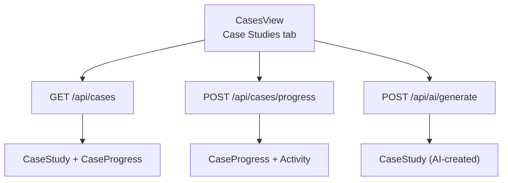
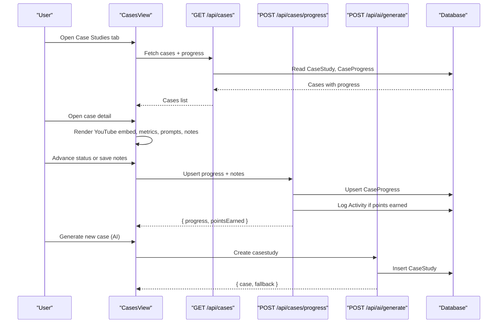
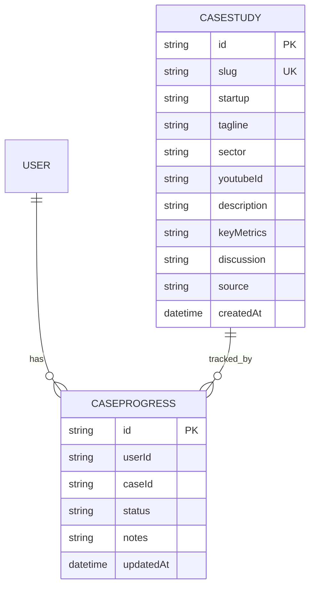
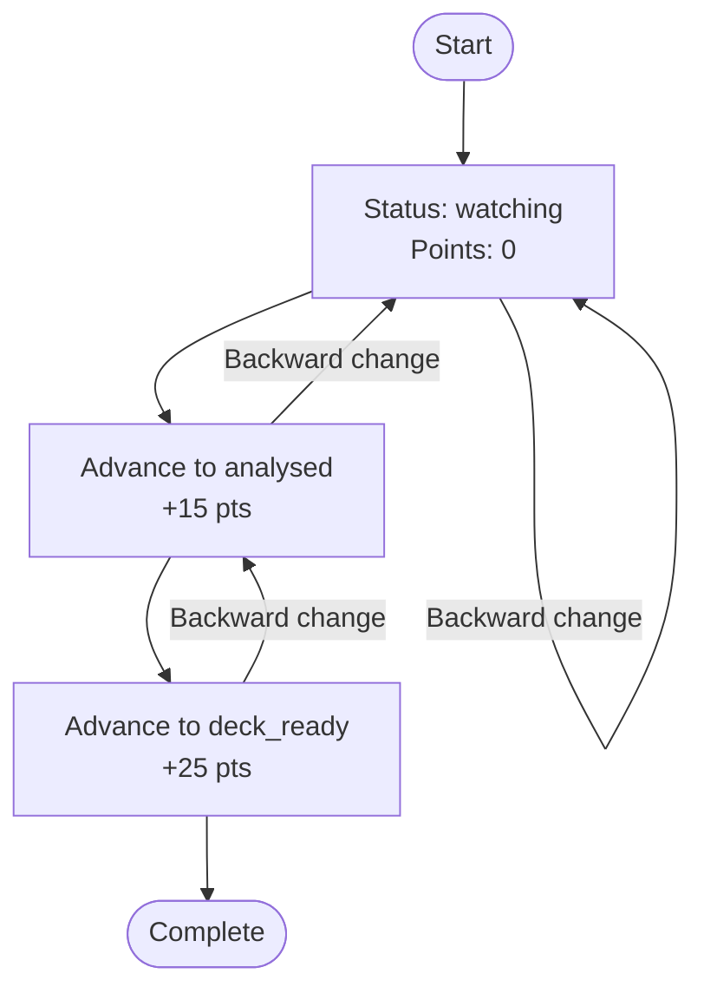
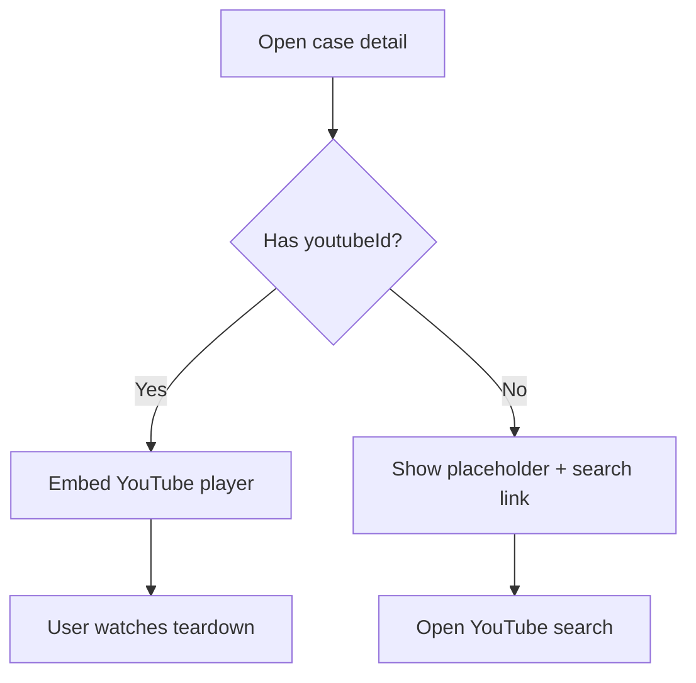
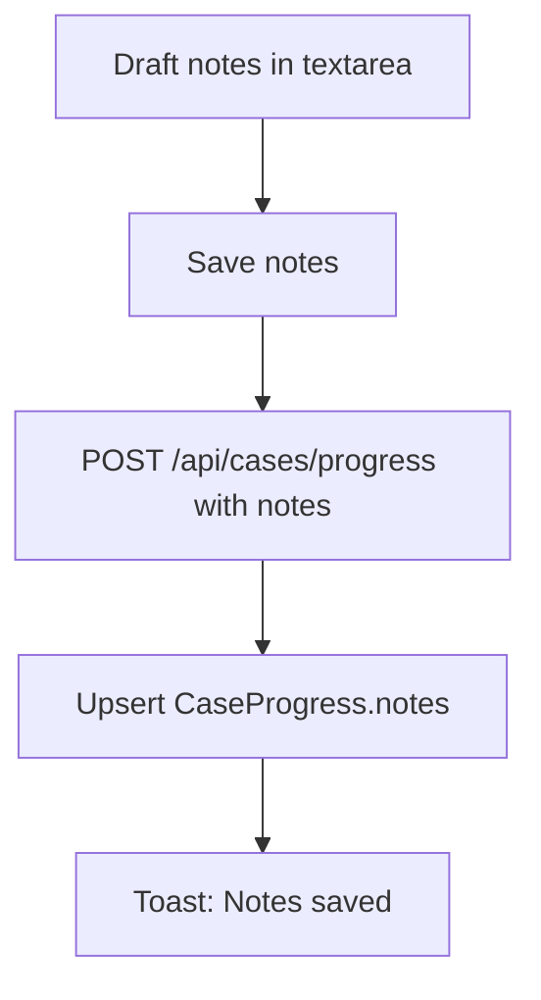
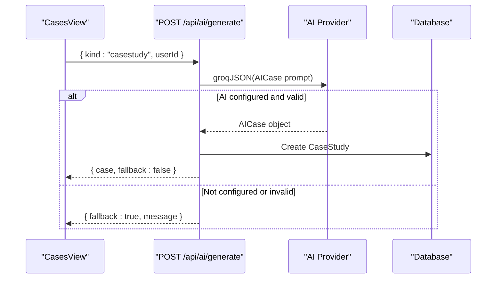
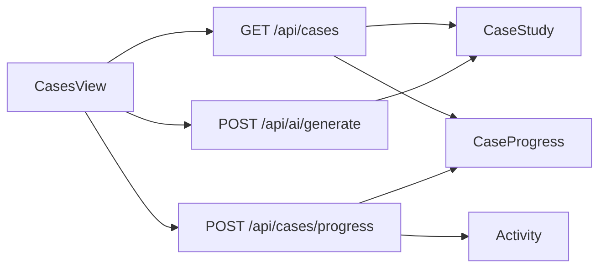

# Case Studies Tab

<cite>
**Referenced Files in This Document**
- [cases-view.tsx](file://src/components/welearn/cases-view.tsx)
- [route.ts (GET cases)](file://src/app/api/cases/route.ts)
- [route.ts (POST progress)](file://src/app/api/cases/progress/route.ts)
- [route.ts (AI generate)](file://src/app/api/ai/generate/route.ts)
- [schema.prisma](file://prisma/schema.prisma)
- [caseSeedData.ts](file://src/lib/caseSeedData.ts)
</cite>

## Table of Contents
1. [Introduction](#introduction)
2. [Project Structure](#project-structure)
3. [Core Components](#core-components)
4. [Architecture Overview](#architecture-overview)
5. [Detailed Component Analysis](#detailed-component-analysis)
6. [Dependency Analysis](#dependency-analysis)
7. [Performance Considerations](#performance-considerations)
8. [Troubleshooting Guide](#troubleshooting-guide)
9. [Conclusion](#conclusion)

## Introduction
The Case Studies tab is the learning workspace where users follow a structured startup teardown workflow: watch a video, analyse the business model, and prepare an E-Cell pitch deck. The feature combines curated case studies, optional AI-generated cases, YouTube video embedding, a three-step progress system with point rewards, discussion prompts, key metrics, and persistent notes. It also integrates with the broader Case Hub, which includes a shared Video Zone, Founder Cases, and PPT Challenges.

## Project Structure
The Case Studies functionality spans a client-side view and several server routes:

- Client UI: `src/components/welearn/cases-view.tsx`
- API endpoints:
  - Load cases and user progress: `src/app/api/cases/route.ts`
  - Update progress and award points: `src/app/api/cases/progress/route.ts`
  - Generate new AI case studies: `src/app/api/ai/generate/route.ts`
- Data model: `prisma/schema.prisma`
- Curated seed content for related tabs: `src/lib/caseSeedData.ts`

**Diagram sources**
- [cases-view.tsx:168-242](file://src/components/welearn/cases-view.tsx#L168-L242)
- [route.ts (GET cases):3-36](file://src/app/api/cases/route.ts#L3-L36)
- [route.ts (POST progress):12-53](file://src/app/api/cases/progress/route.ts#L12-L53)
- [route.ts (AI generate):151-175](file://src/app/api/ai/generate/route.ts#L151-L175)

**Section sources**
- [cases-view.tsx:168-242](file://src/components/welearn/cases-view.tsx#L168-L242)
- [route.ts (GET cases):3-36](file://src/app/api/cases/route.ts#L3-L36)
- [route.ts (POST progress):12-53](file://src/app/api/cases/progress/route.ts#L12-L53)
- [route.ts (AI generate):151-175](file://src/app/api/ai/generate/route.ts#L151-L175)
- [schema.prisma:85-113](file://prisma/schema.prisma#L85-L113)

## Core Components
- Case study object: Represents a startup teardown with metadata, a YouTube embed ID, description, key metrics, discussion prompts, source, and per-user progress.
- Progress tracking: A three-step state machine per case study with associated point deltas and activity logging.
- Notes persistence: Per-case notes saved alongside progress.
- AI generation: Optional creation of new case studies using an external AI provider, with fallback to curated behavior when not configured.

Key responsibilities:
- `CasesView` renders the Case Studies tab, loads cases, opens details, updates progress, saves notes, and triggers AI generation.
- `/api/cases` returns all case studies merged with the current user’s progress.
- `/api/cases/progress` upserts progress, calculates point deltas, and records activity.
- `/api/ai/generate` creates a new case study when requested with `kind: "casestudy"`.

**Section sources**
- [cases-view.tsx:29-41](file://src/components/welearn/cases-view.tsx#L29-L41)
- [route.ts (GET cases):16-31](file://src/app/api/cases/route.ts#L16-L31)
- [route.ts (POST progress):4-10](file://src/app/api/cases/progress/route.ts#L4-L10)
- [route.ts (AI generate):35-42](file://src/app/api/ai/generate/route.ts#L35-L42)

## Architecture Overview
The Case Studies tab follows a simple client-server flow:

1. The UI calls `GET /api/cases?userId=...` to load all cases and the user’s progress.
2. The user opens a case, watches the embedded YouTube video, reviews key metrics and discussion prompts, and writes notes.
3. The user advances progress through Watching → Analysed → Deck Ready; each forward step awards points.
4. Notes are saved independently but share the same progress endpoint.
5. When requested, the UI calls `POST /api/ai/generate` with `kind: "casestudy"` to create a new case study.

**Diagram sources**
- [cases-view.tsx:176-242](file://src/components/welearn/cases-view.tsx#L176-L242)
- [route.ts (GET cases):3-36](file://src/app/api/cases/route.ts#L3-L36)
- [route.ts (POST progress):12-53](file://src/app/api/cases/progress/route.ts#L12-L53)
- [route.ts (AI generate):151-175](file://src/app/api/ai/generate/route.ts#L151-L175)

## Detailed Component Analysis

### Case Study Data Model
A case study contains:
- Identification: `id`, `slug`
- Startup identity: `startup`, `tagline`, `sector`
- Media: `youtubeId`
- Content: `description`, `keyMetrics`, `discussion`
- Provenance: `source` (`curated` or `ai`)
- Timestamp: `createdAt`

Per-user progress tracks:
- `userId`, `caseId`
- `status`: `watching`, `analysed`, `deck_ready`
- `notes`: free-form analysis text
- `updatedAt`

**Diagram sources**
- [schema.prisma:85-113](file://prisma/schema.prisma#L85-L113)

**Section sources**
- [schema.prisma:85-113](file://prisma/schema.prisma#L85-L113)

### Three-Step Progress System and Point Rewards
The progress system enforces a linear progression:
- Watching: baseline state, no points awarded.
- Analysed: +15 points.
- Deck Ready: +25 points.

Points are awarded only when moving forward; backward changes do not reduce points. Each successful forward transition logs an activity entry with the corresponding delta.

**Diagram sources**
- [route.ts (POST progress):4-10](file://src/app/api/cases/progress/route.ts#L4-L10)
- [route.ts (POST progress):24-47](file://src/app/api/cases/progress/route.ts#L24-L47)

**Section sources**
- [route.ts (POST progress):4-10](file://src/app/api/cases/progress/route.ts#L4-L10)
- [route.ts (POST progress):24-47](file://src/app/api/cases/progress/route.ts#L24-L47)

### YouTube Video Integration
Each case study can include a YouTube video ID. The UI embeds the video via an iframe when available. If no video is attached, the UI shows a placeholder and provides a link to search YouTube for a relevant startup story. Thumbnails are loaded from YouTube image URLs.

**Diagram sources**
- [cases-view.tsx:255-275](file://src/components/welearn/cases-view.tsx#L255-L275)
- [cases-view.tsx:396-402](file://src/components/welearn/cases-view.tsx#L396-L402)

**Section sources**
- [cases-view.tsx:255-275](file://src/components/welearn/cases-view.tsx#L255-L275)
- [cases-view.tsx:396-402](file://src/components/welearn/cases-view.tsx#L396-L402)

### Case Study Object Example
An example case study object structure includes:
- `id`, `slug`, `startup`, `tagline`, `sector`
- `youtubeId`
- `description`
- `keyMetrics`: array of `{ label, value }`
- `discussion`: array of prompts including analysis questions and E-Cell pitch deck tasks
- `source`: `curated` or `ai`
- `progress`: per-user `{ status, notes }` or `null`

This shape is returned by the GET cases endpoint and consumed by the UI.

**Section sources**
- [route.ts (GET cases):16-31](file://src/app/api/cases/route.ts#L16-L31)
- [cases-view.tsx:29-41](file://src/components/welearn/cases-view.tsx#L29-L41)

### Discussion Prompts and E-Cell Pitch Deck Tasks
The `discussion` field contains multiple prompts. In the UI, these are presented under “Your E-Cell PPT tasks” and guide users to:
- Analyse the startup’s business model and unit economics.
- Identify opportunities for E-Cell support.
- Outline a pitch deck structure.
- Evaluate value-chain or teardown aspects.

These prompts are part of the case study data and are rendered directly in the case detail view.

**Section sources**
- [cases-view.tsx:297-309](file://src/components/welearn/cases-view.tsx#L297-L309)

### Notes Functionality
Users can write and save notes for each case study. Notes are persisted alongside progress and are loaded when opening a case. The UI provides a textarea and save button, with loading states and toast feedback.

**Diagram sources**
- [cases-view.tsx:210-225](file://src/components/welearn/cases-view.tsx#L210-L225)
- [route.ts (POST progress):29-33](file://src/app/api/cases/progress/route.ts#L29-L33)

**Section sources**
- [cases-view.tsx:210-225](file://src/components/welearn/cases-view.tsx#L210-L225)
- [route.ts (POST progress):29-33](file://src/app/api/cases/progress/route.ts#L29-L33)

### AI-Generated Case Studies
When the user clicks “Generate new case (AI)”, the UI calls `POST /api/ai/generate` with `kind: "casestudy"`. The backend attempts to use an external AI provider to create a fresh case study. If the AI is not configured, it returns a fallback response indicating that the library is curated.

The generated case study includes:
- `startup`, `tagline`, `sector`
- `description`
- `keyMetrics` (validated and truncated)
- `discussion` (validated and truncated)
- `source: "ai"`
- Empty `youtubeId` until a video is attached manually

**Diagram sources**
- [route.ts (AI generate):151-175](file://src/app/api/ai/generate/route.ts#L151-L175)
- [cases-view.tsx:227-242](file://src/components/welearn/cases-view.tsx#L227-L242)

**Section sources**
- [route.ts (AI generate):151-175](file://src/app/api/ai/generate/route.ts#L151-L175)
- [cases-view.tsx:227-242](file://src/components/welearn/cases-view.tsx#L227-L242)

### Manual Curation Capabilities
Curated case studies are pre-seeded and served by the GET cases endpoint. While the repository does not expose a dedicated manual curation endpoint in the analyzed files, the presence of `source: "curated"` indicates that curated content exists separately from AI-generated content. Related curated seed data for other tabs is defined in `caseSeedData.ts`.

**Section sources**
- [route.ts (GET cases):9-12](file://src/app/api/cases/route.ts#L9-L12)
- [caseSeedData.ts:1-24](file://src/lib/caseSeedData.ts#L1-L24)

### API Endpoints Summary

#### Load Cases
- Method: `GET`
- Path: `/api/cases`
- Query parameters:
  - `userId`: optional; used to merge per-user progress
- Response:
  - `cases`: array of case study objects with embedded progress
- Error handling:
  - Returns error JSON on failure

**Section sources**
- [route.ts (GET cases):3-36](file://src/app/api/cases/route.ts#L3-L36)

#### Update Progress
- Method: `POST`
- Path: `/api/cases/progress`
- Request body:
  - `userId`: required
  - `caseId`: required
  - `status`: one of `watching`, `analysed`, `deck_ready`
  - `notes`: optional string, truncated to 4000 characters
- Response:
  - `progress`: `{ status, notes }`
  - `pointsEarned`: delta points awarded for forward progress
- Validation:
  - Rejects missing user or case
  - Rejects invalid status
- Side effects:
  - Upserts `CaseProgress`
  - Logs `Activity` when points are earned or rank increases

**Section sources**
- [route.ts (POST progress):12-53](file://src/app/api/cases/progress/route.ts#L12-L53)

#### Generate New AI Case
- Method: `POST`
- Path: `/api/ai/generate`
- Request body:
  - `kind`: `"casestudy"`
  - `userId`: included by UI
- Response:
  - On success: `{ case, fallback: false }`
  - On fallback: `{ fallback: true, message }`
- Behavior:
  - Attempts AI generation via external provider
  - Validates and truncates fields
  - Creates `CaseStudy` with `source: "ai"`

**Section sources**
- [route.ts (AI generate):151-175](file://src/app/api/ai/generate/route.ts#L151-L175)
- [cases-view.tsx:227-242](file://src/components/welearn/cases-view.tsx#L227-L242)

## Dependency Analysis
The Case Studies tab depends on:
- Database models: `CaseStudy`, `CaseProgress`
- Activity logging: `Activity` table (via progress endpoint)
- External AI provider: optional, controlled by configuration
- YouTube: for video embedding and thumbnails

**Diagram sources**
- [cases-view.tsx:176-242](file://src/components/welearn/cases-view.tsx#L176-L242)
- [route.ts (GET cases):3-36](file://src/app/api/cases/route.ts#L3-L36)
- [route.ts (POST progress):12-53](file://src/app/api/cases/progress/route.ts#L12-L53)
- [route.ts (AI generate):151-175](file://src/app/api/ai/generate/route.ts#L151-L175)
- [schema.prisma:85-113](file://prisma/schema.prisma#L85-L113)

**Section sources**
- [cases-view.tsx:176-242](file://src/components/welearn/cases-view.tsx#L176-L242)
- [route.ts (GET cases):3-36](file://src/app/api/cases/route.ts#L3-L36)
- [route.ts (POST progress):12-53](file://src/app/api/cases/progress/route.ts#L12-L53)
- [route.ts (AI generate):151-175](file://src/app/api/ai/generate/route.ts#L151-L175)
- [schema.prisma:85-113](file://prisma/schema.prisma#L85-L113)

## Performance Considerations
- Loading cases merges database results into a map for efficient per-case progress lookup.
- Notes are capped at 4000 characters to limit payload size.
- AI generation validates and truncates fields before persisting.
- YouTube thumbnails are loaded via standard image URLs; consider lazy loading if performance becomes an issue.
- Activity logging occurs only when points are earned or rank increases, reducing unnecessary writes.

[No sources needed since this section provides general guidance]

## Troubleshooting Guide
Common issues and resolutions:
- Could not load case studies: Check network connectivity and ensure the GET cases endpoint responds successfully.
- Could not save progress: Verify that `userId`, `caseId`, and `status` are provided and valid.
- Notes not saving: Ensure the notes payload is within the allowed length and the progress endpoint is reachable.
- AI generation fails: If the AI provider is not configured, expect a fallback response indicating curated-only mode.

**Section sources**
- [route.ts (GET cases):33-35](file://src/app/api/cases/route.ts#L33-L35)
- [route.ts (POST progress):21-22](file://src/app/api/cases/progress/route.ts#L21-L22)
- [route.ts (POST progress):50-52](file://src/app/api/cases/progress/route.ts#L50-L52)
- [route.ts (AI generate):175-175](file://src/app/api/ai/generate/route.ts#L175-L175)

## Conclusion
The Case Studies tab provides a structured, gamified learning path for startup teardowns. Users watch videos, analyze business models, complete E-Cell pitch deck tasks, and track progress through a clear three-step system with point rewards. The feature supports both curated and AI-generated cases, integrates YouTube for video content, and persists notes and progress. The API surface is minimal and focused: load cases, update progress, and optionally generate new AI cases.

[No sources needed since this section summarizes without analyzing specific files]