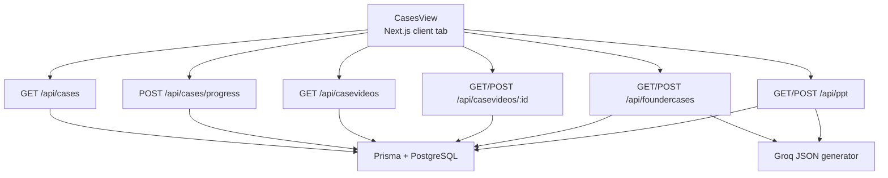
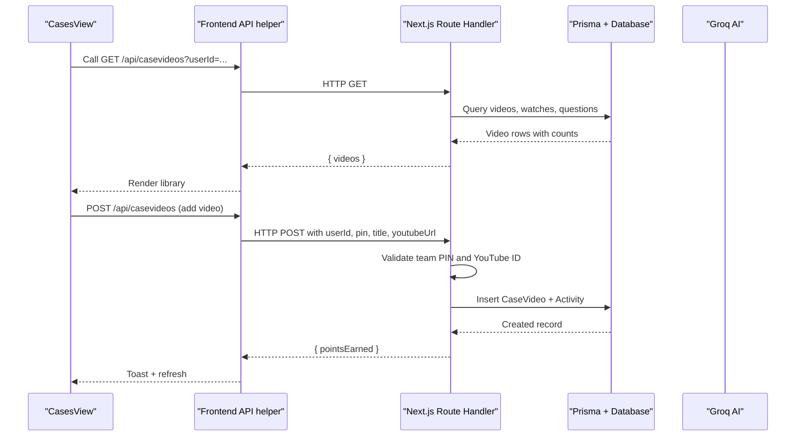
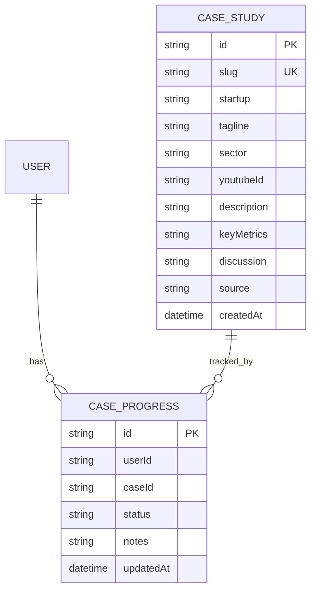
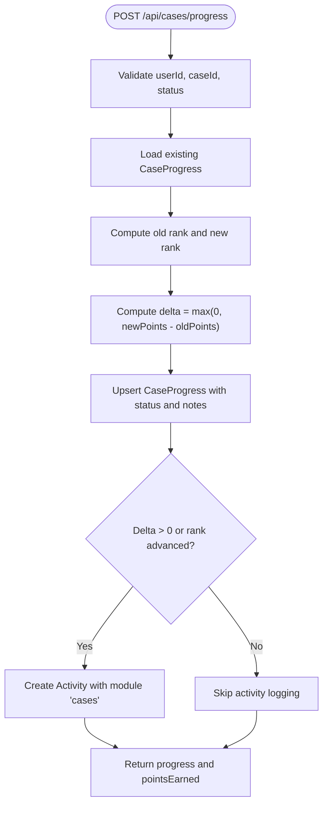
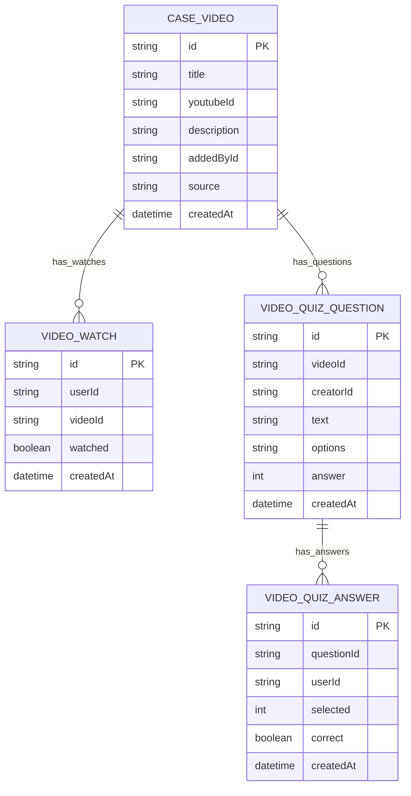
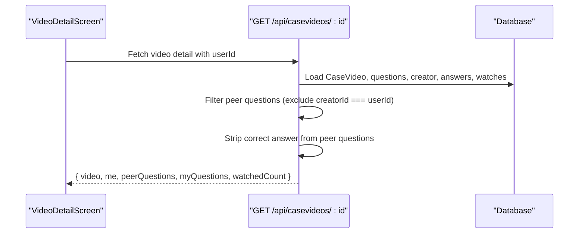
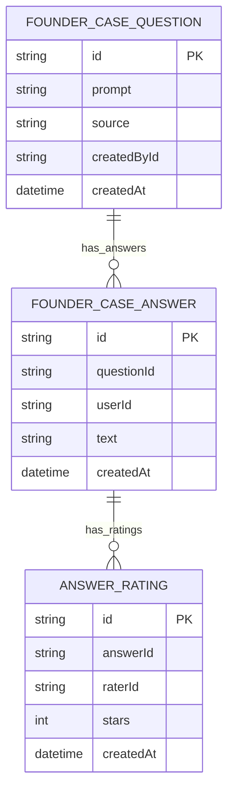
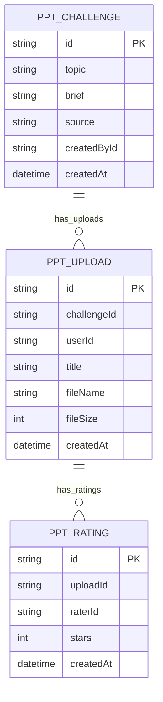
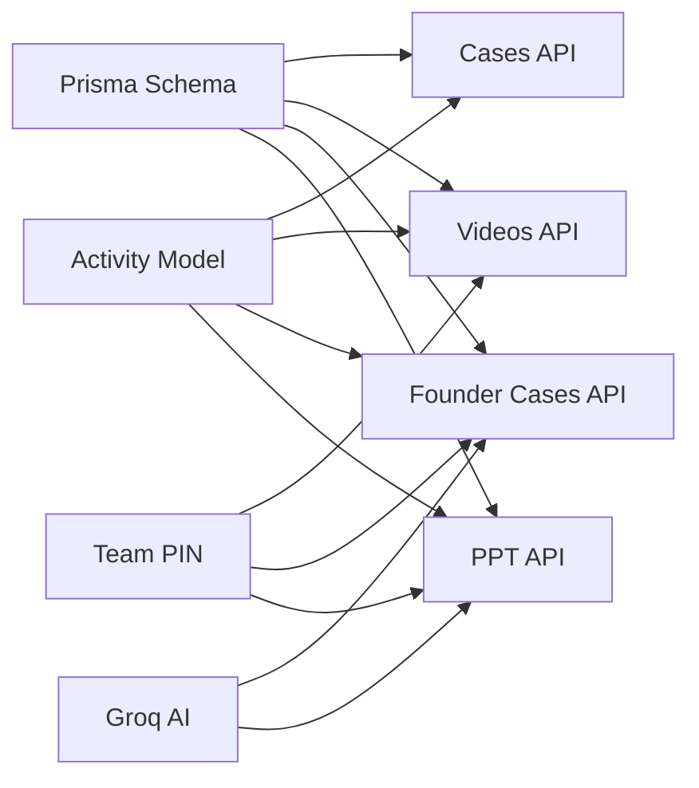

# Case Study Library

<cite>
**Referenced Files in This Document**
- [README.md](file://README.md)
- [schema.prisma](file://prisma/schema.prisma)
- [cases-view.tsx](file://src/components/welearn/cases-view.tsx)
- [cases route](file://src/app/api/cases/route.ts)
- [case progress route](file://src/app/api/cases/progress/route.ts)
- [case videos list route](file://src/app/api/casevideos/route.ts)
- [case video detail route](file://src/app/api/casevideos/[id]/route.ts)
- [founder cases route](file://src/app/api/foundercases/route.ts)
- [ppt challenges route](file://src/app/api/ppt/route.ts)
- [ai client](file://src/lib/ai.ts)
- [case seed data](file://src/lib/caseSeedData.ts)
</cite>

## Table of Contents
1. [Introduction](#introduction)
2. [Project Structure](#project-structure)
3. [Core Components](#core-components)
4. [Architecture Overview](#architecture-overview)
5. [Detailed Component Analysis](#detailed-component-analysis)
6. [Dependency Analysis](#dependency-analysis)
7. [Performance Considerations](#performance-considerations)
8. [Troubleshooting Guide](#troubleshooting-guide)
9. [Conclusion](#conclusion)

## Introduction
The Case Study Library is the Case Hub module of the WeLearn E-Cell preparation platform. It provides four sub-tabs:

- **Case Studies**: curated or AI-generated startup teardowns with embedded YouTube videos, key metrics, discussion prompts for pitch-deck preparation, and per-user progress tracking.
- **Video Zone**: a shared YouTube library where members add links, watch in-app, answer peer-created multiple-choice quizzes, post their own three-question quiz, and earn a watched tick.
- **Founder Cases**: scenario-based “if you were the founder” prompts that can be generated by AI, posted by members, or seeded from a curated bank; users submit short answers and peers rate them 1–5 stars.
- **PPT Challenges**: AI or member-generated pitch-deck topics; members upload `.pptx`, `.ppt`, `.pdf`, or `.key` files and peers rate submissions 1–5 stars.

The system combines server-side API routes, Prisma-backed database models, a Next.js client view, optional Groq AI generation, and manual curation tools gated by a team PIN.

**Section sources**
- [README.md:63-80](file://README.md#L63-L80)

## Project Structure
The Case Study Library spans one main UI component and several API routes backed by Prisma models:

**Diagram sources**
- [cases-view.tsx:127-159](file://src/components/welearn/cases-view.tsx#L127-L159)
- [cases route:3-36](file://src/app/api/cases/route.ts#L3-L36)
- [case progress route:12-53](file://src/app/api/cases/progress/route.ts#L12-L53)
- [case videos list route:30-68](file://src/app/api/casevideos/route.ts#L30-L68)
- [case video detail route:6-79](file://src/app/api/casevideos/[id]/route.ts#L6-L79)
- [founder cases route:18-66](file://src/app/api/foundercases/route.ts#L18-L66)
- [ppt challenges route:22-71](file://src/app/api/ppt/route.ts#L22-L71)
- [ai client:23-67](file://src/lib/ai.ts#L23-L67)

**Section sources**
- [cases-view.tsx:127-159](file://src/components/welearn/cases-view.tsx#L127-L159)
- [schema.prisma:85-113](file://prisma/schema.prisma#L85-L113)
- [schema.prisma:349-407](file://prisma/schema.prisma#L349-L407)
- [schema.prisma:414-452](file://prisma/schema.prisma#L414-L452)
- [schema.prisma:458-498](file://prisma/schema.prisma#L458-L498)

## Core Components
The Case Hub is implemented as a single client component with four tabs. Each tab owns its state, calls the corresponding API, and renders the relevant workflow.

| Sub-tab | Main responsibilities | Key user actions | Points model |
|---|---|---|---|
| Case Studies | Load curated/AI case studies, embed YouTube teardowns, show key metrics and discussion prompts, save notes and progress | Open case, watch video, update status, save notes, generate new case via AI | `analysed`: +15, `deck_ready`: +25, delta awarded when advancing |
| Video Zone | Shared YouTube library, peer quiz answering, posting three questions, marking watched | Add link (PIN), remove link (PIN), answer peer questions, post quiz, mark watched | +2 per correct peer answer, +8 for posting quiz, +5 for completion |
| Founder Cases | Scenario prompts, short answers, peer star ratings | Generate prompt, post prompt (PIN), answer, rate peer answer, delete prompt | +5 per answer |
| PPT Challenges | Topics, deck uploads, peer star ratings | Generate topic, add topic (PIN), upload deck, rate upload, delete challenge/upload | +15 per upload |

**Section sources**
- [cases-view.tsx:127-159](file://src/components/welearn/cases-view.tsx#L127-L159)
- [cases-view.tsx:168-429](file://src/components/welearn/cases-view.tsx#L168-L429)
- [cases-view.tsx:435-599](file://src/components/welearn/cases-view.tsx#L435-L599)
- [cases-view.tsx:863-1087](file://src/components/welearn/cases-view.tsx#L863-L1087)
- [cases-view.tsx:1093-1357](file://src/components/welearn/cases-view.tsx#L1093-L1357)

## Architecture Overview
The Case Study Library follows a layered architecture:

- **Client layer**: `CasesView` renders the four tabs and manages local state such as open cards, drafts, and loading flags.
- **API layer**: Next.js Route Handlers expose REST endpoints for each feature. They validate inputs, enforce permissions, perform business logic, and persist data.
- **Persistence layer**: Prisma maps to a PostgreSQL database with tables for case studies, video library, founder cases, PPT challenges, user progress, activities, and ratings.
- **AI layer**: Optional Groq integration generates founder-case prompts, PPT topics, and case-study content; it falls back to curated banks when unavailable.
- **Security layer**: Team PIN validation protects shared-content mutations such as adding/removing videos, posting founder cases, and deleting challenges.

**Diagram sources**
- [case videos list route:30-68](file://src/app/api/casevideos/route.ts#L30-L68)
- [case videos list route:71-106](file://src/app/api/casevideos/route.ts#L71-L106)
- [cases-view.tsx:446-480](file://src/components/welearn/cases-view.tsx#L446-L480)

**Section sources**
- [cases-view.tsx:127-159](file://src/components/welearn/cases-view.tsx#L127-L159)
- [schema.prisma:262-275](file://prisma/schema.prisma#L262-L275)
- [ai client:19-21](file://src/lib/ai.ts#L19-L21)

## Detailed Component Analysis

### Case Studies Tab
The Case Studies tab shows curated or AI-generated startup teardowns. Each case includes:

- A YouTube embed or thumbnail.
- Startup name, tagline, sector, description, and key metrics.
- Discussion prompts guiding E-Cell pitch-deck preparation.
- Per-user progress with three steps: watching, analysed, deck ready.
- Notes storage for analysis.

#### Data Model

**Diagram sources**
- [schema.prisma:85-113](file://prisma/schema.prisma#L85-L113)

#### Progress Algorithm
Progress is not just a boolean; it is a ranked state machine. The server computes point deltas only when the user advances forward.

**Diagram sources**
- [case progress route:4-10](file://src/app/api/cases/progress/route.ts#L4-L10)
- [case progress route:13-53](file://src/app/api/cases/progress/route.ts#L13-L53)

#### Client Workflow
The client loads cases, opens a case card, embeds the YouTube video, displays discussion tasks, allows note editing, and updates progress through the progress endpoint.

**Section sources**
- [cases route:3-36](file://src/app/api/cases/route.ts#L3-L36)
- [case progress route:12-53](file://src/app/api/cases/progress/route.ts#L12-L53)
- [cases-view.tsx:168-429](file://src/components/welearn/cases-view.tsx#L168-L429)

### Video Zone Tab
The Video Zone is a shared YouTube library with a structured learning loop:

1. Watch the embedded video.
2. Answer all peer questions created by earlier watchers.
3. Post your own three-question multiple-choice quiz.
4. Mark the video as watched to earn completion points.

#### Data Model

**Diagram sources**
- [schema.prisma:349-407](file://prisma/schema.prisma#L349-L407)

#### Video Detail Flow
The detail endpoint returns the video, the user’s watch state, peer questions without exposing the correct answer, and the user’s own posted questions.

**Diagram sources**
- [case video detail route:6-79](file://src/app/api/casevideos/[id]/route.ts#L6-L79)

#### Peer Quiz Grading and Points
Grading happens server-side. The client sends selected option indices; the server compares them with stored correct answers and awards +2 per correct answer.

**Section sources**
- [case videos list route:30-68](file://src/app/api/casevideos/route.ts#L30-L68)
- [case video detail route:6-79](file://src/app/api/casevideos/[id]/route.ts#L6-L79)
- [case video detail route:81-207](file://src/app/api/casevideos/[id]/route.ts#L81-L207)
- [cases-view.tsx:605-857](file://src/components/welearn/cases-view.tsx#L605-L857)

### Founder Cases Tab
Founder Cases provide scenario-based decision training. Prompts can come from:

- AI generation via Groq.
- Curated fallback bank.
- Member posts gated by team PIN.

Users submit concise answers and peers rate them.

#### Data Model

**Diagram sources**
- [schema.prisma:414-452](file://prisma/schema.prisma#L414-L452)

#### Rating Computation
For each answer, the server computes:

- Average stars across all ratings.
- Number of ratings.
- Whether the current user has already rated.
- Whether the answer belongs to the current user.

This avoids client-side manipulation of averages.

**Section sources**
- [founder cases route:18-66](file://src/app/api/foundercases/route.ts#L18-L66)
- [founder cases route:68-155](file://src/app/api/foundercases/route.ts#L68-L155)
- [cases-view.tsx:863-1087](file://src/components/welearn/cases-view.tsx#L863-L1087)

### PPT Challenges Tab
PPT Challenges let members build pitch decks around AI or member-generated topics and share them for peer review.

#### Data Model

**Diagram sources**
- [schema.prisma:458-498](file://prisma/schema.prisma#L458-L498)

#### Upload Validation and Storage
Uploads are validated on the server:

- File size limit: 15 MB.
- Allowed extensions: `.pptx`, `.ppt`, `.pdf`, `.key`.
- One upload per user per challenge.
- Files written to `public/uploads/ppts/`.

**Section sources**
- [ppt challenges route:22-71](file://src/app/api/ppt/route.ts#L22-L71)
- [ppt challenges route:73-118](file://src/app/api/ppt/route.ts#L73-L118)
- [ppt challenges route:157-188](file://src/app/api/ppt/route.ts#L157-L188)
- [cases-view.tsx:1093-1357](file://src/components/welearn/cases-view.tsx#L1093-L1357)

## Dependency Analysis
The Case Study Library depends on several cross-cutting concerns:

| Dependency | Role | Impact |
|---|---|---|
| Prisma schema | Defines entities for case studies, videos, founder cases, PPT challenges, progress, and ratings | Centralizes data contracts and relationships |
| Activity model | Records points earned for actions | Powers leaderboard and analytics |
| Team PIN | Protects shared-content mutations | Prevents unauthorized additions/deletions |
| Groq AI | Generates founder-case prompts, PPT topics, and case-study content | Adds dynamic content with curated fallback |
| YouTube embeds | Displays video content | Drives engagement and learning flow |

**Diagram sources**
- [schema.prisma:85-113](file://prisma/schema.prisma#L85-L113)
- [schema.prisma:262-275](file://prisma/schema.prisma#L262-L275)
- [schema.prisma:349-407](file://prisma/schema.prisma#L349-L407)
- [schema.prisma:414-452](file://prisma/schema.prisma#L414-L452)
- [schema.prisma:458-498](file://prisma/schema.prisma#L458-L498)
- [ai client:19-21](file://src/lib/ai.ts#L19-L21)

**Section sources**
- [schema.prisma:85-113](file://prisma/schema.prisma#L85-L113)
- [schema.prisma:262-275](file://prisma/schema.prisma#L262-L275)
- [schema.prisma:349-407](file://prisma/schema.prisma#L349-L407)
- [schema.prisma:414-452](file://prisma/schema.prisma#L414-L452)
- [schema.prisma:458-498](file://prisma/schema.prisma#L458-L498)
- [ai client:19-21](file://src/lib/ai.ts#L19-L21)

## Performance Considerations
- **Lazy embedding**: Case study thumbnails use YouTube image URLs instead of loading players until opened.
- **Server-side grading**: Video quiz correctness is computed on the server to avoid leaking answers and reduce client complexity.
- **Delta-based points**: Case progress awards only the difference between previous and new status, preventing double-counting.
- **Pagination-like limits**: Founder cases and PPT challenges load recent items with `take: 20`, reducing payload size.
- **File upload limits**: PPT uploads cap at 15 MB and restrict allowed extensions to prevent abuse.
- **AI fallback chain**: Groq requests try multiple models and fall back to curated content if the API fails or is disabled.

[No sources needed since this section provides general guidance]

## Troubleshooting Guide

### Common Errors and Resolutions
| Symptom | Likely Cause | Resolution |
|---|---|---|
| Cannot add a YouTube video | Wrong team PIN or invalid URL | Verify team PIN and paste a full YouTube URL |
| Cannot mark a video as watched | Peer quizzes unanswered or personal quiz not posted | Answer all peer questions and post three questions |
| Founder case answer rejected | Too short or too long | Keep answers between 10 and 150 characters |
| PPT upload rejected | Invalid file type, too large, or duplicate upload | Use `.pptx`, `.ppt`, `.pdf`, or `.key`; stay under 15 MB; ensure no prior upload for the challenge |
| AI generation fails | Missing or invalid Groq key | Set `GROQ_API_KEY` and optionally `GROQ_MODEL`; system falls back to curated content |
| Progress points not awarded | Status did not advance | Move from `watching` to `analysed` or `deck_ready`; points are delta-based |

**Section sources**
- [case videos list route:71-106](file://src/app/api/casevideos/route.ts#L71-L106)
- [case video detail route:164-200](file://src/app/api/casevideos/[id]/route.ts#L164-L200)
- [founder cases route:110-139](file://src/app/api/foundercases/route.ts#L110-L139)
- [ppt challenges route:80-118](file://src/app/api/ppt/route.ts#L80-L118)
- [ai client:23-67](file://src/lib/ai.ts#L23-L67)
- [case progress route:12-53](file://src/app/api/cases/progress/route.ts#L12-L53)

## Conclusion
The Case Study Library is a cohesive learning module that blends video consumption, peer-driven quizzes, founder-instinct drills, and pitch-deck creation. Its strength lies in clear workflows, server-enforced rules, gamified progress, and optional AI augmentation. For teams, the most important operational practices are:

- Seed initial case studies and PPT topics.
- Encourage members to add high-quality YouTube links and thoughtful quizzes.
- Use founder cases to practice crisp decision-making.
- Treat PPT uploads as real pitch artifacts and rate them constructively.
- Monitor activity and points to understand engagement across the four sub-tabs.

[No sources needed since this section summarizes without analyzing specific files]