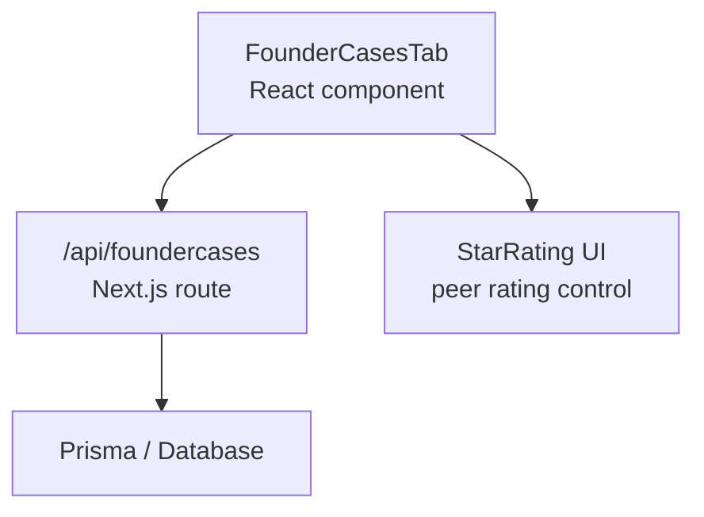
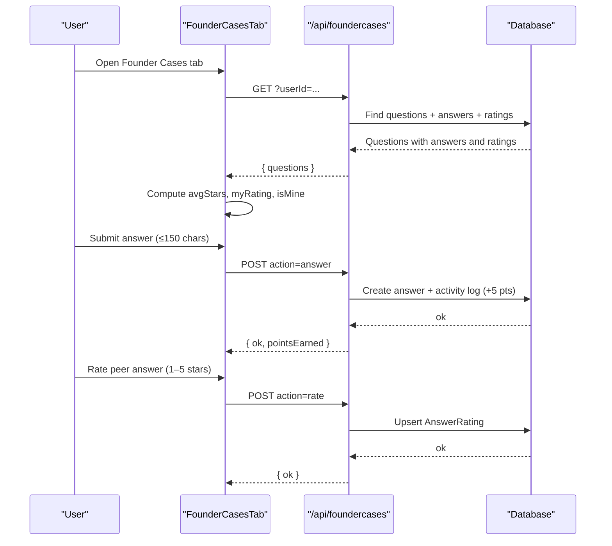
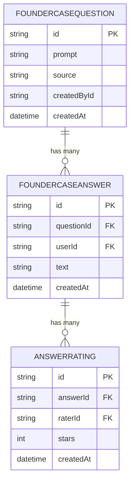
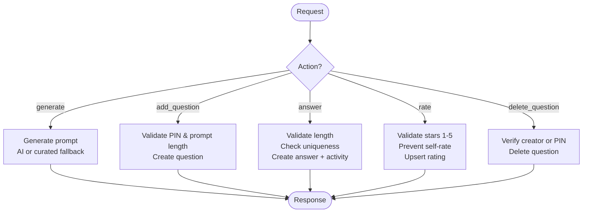
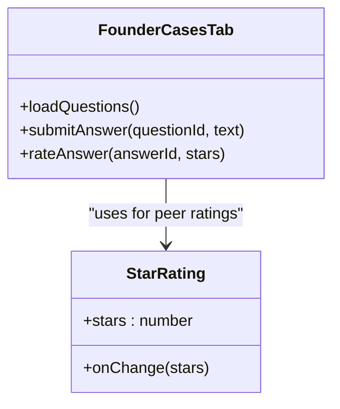
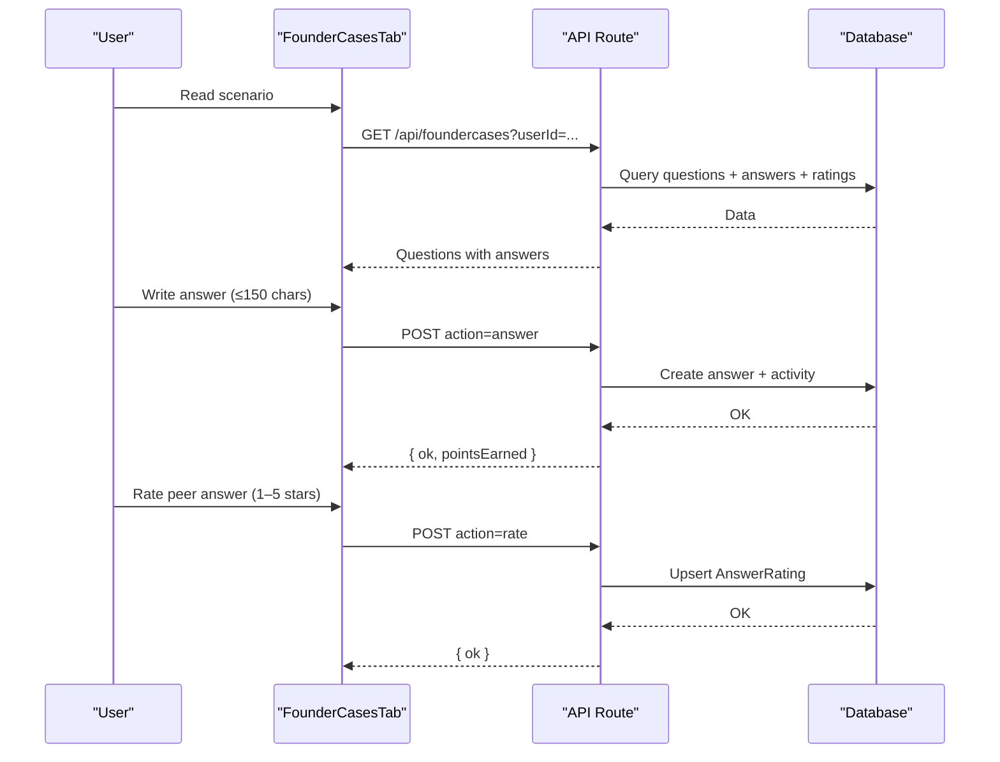
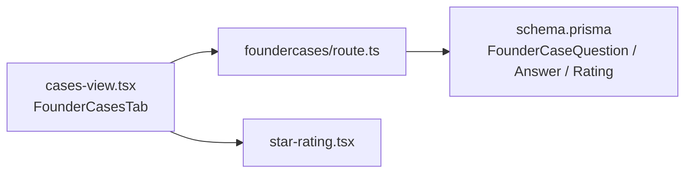

# Founder Cases Tab

<cite>
**Referenced Files in This Document**
- [schema.prisma](file://prisma/schema.prisma)
- [route.ts](file://src/app/api/foundercases/route.ts)
- [cases-view.tsx](file://src/components/welearn/cases-view.tsx)
- [star-rating.tsx](file://src/components/welearn/star-rating.tsx)
</cite>

## Table of Contents
1. [Introduction](#introduction)
2. [Project Structure](#project-structure)
3. [Core Components](#core-components)
4. [Architecture Overview](#architecture-overview)
5. [Detailed Component Analysis](#detailed-component-analysis)
6. [Dependency Analysis](#dependency-analysis)
7. [Performance Considerations](#performance-considerations)
8. [Troubleshooting Guide](#troubleshooting-guide)
9. [Conclusion](#conclusion)

## Introduction
The Founder Cases tab is a scenario-based learning module where users read “if you were the founder” prompts and write concise, opinionated answers. Teammates then rate those answers with star ratings. The system supports:
- AI-generated or member-contributed questions
- One answer per user per question
- Peer star ratings (1–5 stars) on answers
- Community-driven content creation and moderation
- Points for participation to encourage thoughtful responses

This documentation explains how the UI, API, and data models work together to deliver this workflow.

## Project Structure
The Founder Cases feature spans three main layers:
- Data model layer: Prisma schema defines the entities for questions, answers, and ratings.
- Server API layer: A Next.js route handles fetching questions/answers and performing actions like answering, rating, generating, and deleting questions.
- Client UI layer: A React component renders the tab, lets users submit answers, view peer answers, and rate others’ responses.

**Diagram sources**
- [cases-view.tsx:863-908](file://src/components/welearn/cases-view.tsx#L863-L908)
- [route.ts:18-155](file://src/app/api/foundercases/route.ts#L18-L155)

**Section sources**
- [schema.prisma:414-452](file://prisma/schema.prisma#L414-L452)
- [route.ts:18-155](file://src/app/api/foundercases/route.ts#L18-L155)
- [cases-view.tsx:75-93](file://src/components/welearn/cases-view.tsx#L75-L93)

## Core Components
- Data model:
  - FounderCaseQuestion: stores the prompt, source, creator, and timestamp.
  - FounderCaseAnswer: stores one answer per user per question, with text and timestamps.
  - AnswerRating: stores peer star ratings (1–5), with unique constraints per rater per answer.
- API endpoints:
  - GET /api/foundercases?userId=... returns recent questions with answers, average stars, rating counts, and the current user’s state.
  - POST /api/foundercases supports actions: generate, add_question, answer, rate, delete_question.
- UI components:
  - FounderCasesTab renders the list of questions, allows writing an answer, shows peer answers with average stars, and provides a star rating widget.
  - StarRating provides the interactive 1–5 star input used by peers to evaluate answers.

Key responsibilities:
- The API enforces business rules: length limits, uniqueness of answers, self-rating prevention, PIN-gated content creation/deletion, and points logging.
- The UI computes and displays average stars and whether the current user has already rated or answered.

**Section sources**
- [schema.prisma:414-452](file://prisma/schema.prisma#L414-L452)
- [route.ts:18-155](file://src/app/api/foundercases/route.ts#L18-L155)
- [cases-view.tsx:75-93](file://src/components/welearn/cases-view.tsx#L75-L93)
- [star-rating.tsx](file://src/components/welearn/star-rating.tsx)

## Architecture Overview
The Founder Cases flow connects the client, server, and database as follows:

**Diagram sources**
- [route.ts:18-155](file://src/app/api/foundercases/route.ts#L18-L155)
- [cases-view.tsx:863-908](file://src/components/welearn/cases-view.tsx#L863-L908)

## Detailed Component Analysis

### Data Model: Founder Cases Entities
The core entities are:
- FounderCaseQuestion
  - Fields: id, prompt, source, createdById, createdAt
  - Purpose: holds the scenario prompt and its origin (ai, member, curated).
- FounderCaseAnswer
  - Fields: id, questionId, userId, text, createdAt
  - Constraints: unique per (questionId, userId) so each user can answer once per question.
- AnswerRating
  - Fields: id, answerId, raterId, stars, createdAt
  - Constraints: unique per (answerId, raterId) so each peer rates an answer at most once; stars range 1–5.

**Diagram sources**
- [schema.prisma:414-452](file://prisma/schema.prisma#L414-L452)

**Section sources**
- [schema.prisma:414-452](file://prisma/schema.prisma#L414-L452)

### API Layer: Actions and Validation
The API exposes two primary operations:
- GET /api/foundercases?userId=...
  - Returns the latest 20 questions with nested answers, including:
    - Average stars computed from all ratings
    - Rating count
    - Current user’s own rating (if any)
    - Whether the answer belongs to the current user
- POST /api/foundercases
  - generate: creates a new question via AI or curated fallback
  - add_question: member posts a prompt (requires team PIN)
  - answer: submits ≤150-character answer (+5 points logged)
  - rate: upserts a 1–5 star rating for another user’s answer
  - delete_question: deletes a question if creator or team PIN provided

Validation highlights:
- Answer length: minimum 10 characters, maximum 150 characters
- One answer per user per question enforced by unique constraint
- Self-rating prevented
- PIN checks for sensitive operations
- Activity logging for participation

**Diagram sources**
- [route.ts:68-155](file://src/app/api/foundercases/route.ts#L68-L155)

**Section sources**
- [route.ts:18-155](file://src/app/api/foundercases/route.ts#L18-L155)

### UI Layer: FounderCasesTab and Star Ratings
The UI component:
- Loads questions and answers via GET /api/foundercases
- Displays each question with peer answers, average stars, and rating counts
- Allows the current user to:
  - Write and submit an answer (enforced ≤150 characters)
  - Rate other users’ answers using the StarRating component
- Highlights the user’s own answer and indicates whether they have already rated

The StarRating component provides the interactive 1–5 star selection that sends a POST request with action=rate.

**Diagram sources**
- [cases-view.tsx:863-908](file://src/components/welearn/cases-view.tsx#L863-L908)
- [star-rating.tsx](file://src/components/welearn/star-rating.tsx)

**Section sources**
- [cases-view.tsx:75-93](file://src/components/welearn/cases-view.tsx#L75-L93)
- [cases-view.tsx:863-908](file://src/components/welearn/cases-view.tsx#L863-L908)
- [star-rating.tsx](file://src/components/welearn/star-rating.tsx)

### Question-Answer Workflow
End-to-end sequence:
1. User opens the Founder Cases tab.
2. UI fetches questions and answers, computing average stars and personal state.
3. User writes a concise answer and submits it.
4. API validates and persists the answer, logs activity, and awards points.
5. Peers view the answer and rate it using the star rating widget.
6. API upserts the rating and recalculates average stars on subsequent loads.

**Diagram sources**
- [route.ts:18-155](file://src/app/api/foundercases/route.ts#L18-L155)
- [cases-view.tsx:863-908](file://src/components/welearn/cases-view.tsx#L863-L908)

### Community-Driven Content Model
- Anyone can contribute:
  - AI generation: free for everyone; falls back to curated prompts when needed.
  - Member contribution: requires team PIN to prevent spam.
- Moderation:
  - Only the creator or team PIN holder can delete a question.
- Quality signals:
  - Average star ratings surface higher-quality answers.
  - Participation points incentivize thoughtful engagement.

**Section sources**
- [route.ts:68-155](file://src/app/api/foundercases/route.ts#L68-L155)

## Dependency Analysis
The following diagram maps dependencies between the UI, API, and data model:

**Diagram sources**
- [cases-view.tsx:863-908](file://src/components/welearn/cases-view.tsx#L863-L908)
- [route.ts:18-155](file://src/app/api/foundercases/route.ts#L18-L155)
- [schema.prisma:414-452](file://prisma/schema.prisma#L414-L452)
- [star-rating.tsx](file://src/components/welearn/star-rating.tsx)

**Section sources**
- [cases-view.tsx:863-908](file://src/components/welearn/cases-view.tsx#L863-L908)
- [route.ts:18-155](file://src/app/api/foundercases/route.ts#L18-L155)
- [schema.prisma:414-452](file://prisma/schema.prisma#L414-L452)

## Performance Considerations
- Pagination and scope:
  - The API returns the latest 20 questions to limit payload size.
- Computation on the server:
  - Average stars are calculated server-side during query projection, reducing client computation.
- Indexing:
  - Unique constraints ensure fast lookups for answer uniqueness and rating uniqueness.
- Caching opportunities:
  - Consider caching GET results per userId for short periods to reduce repeated queries.

[No sources needed since this section provides general guidance]

## Troubleshooting Guide
Common issues and resolutions:
- Cannot submit answer:
  - Ensure the answer is between 10 and 150 characters.
  - You cannot answer the same question twice; check for existing answer.
- Cannot rate an answer:
  - Stars must be between 1 and 5.
  - You cannot rate your own answer.
- Cannot add or delete a question:
  - Adding requires a valid team PIN.
  - Deleting requires being the creator or providing a valid team PIN.
- Unexpected average stars:
  - Verify that multiple peers have submitted ratings; average is computed across all ratings.

**Section sources**
- [route.ts:110-148](file://src/app/api/foundercases/route.ts#L110-L148)

## Conclusion
The Founder Cases tab delivers a focused, community-driven learning loop:
- Users engage with realistic founder scenarios and practice crisp decision-making.
- Peer star ratings create social feedback that rewards thoughtful, high-quality answers.
- The system balances open contribution with governance through PIN-gated controls and clear validation rules.
- Points and visible quality signals reinforce positive participation and continuous improvement.

[No sources needed since this section summarizes without analyzing specific files]