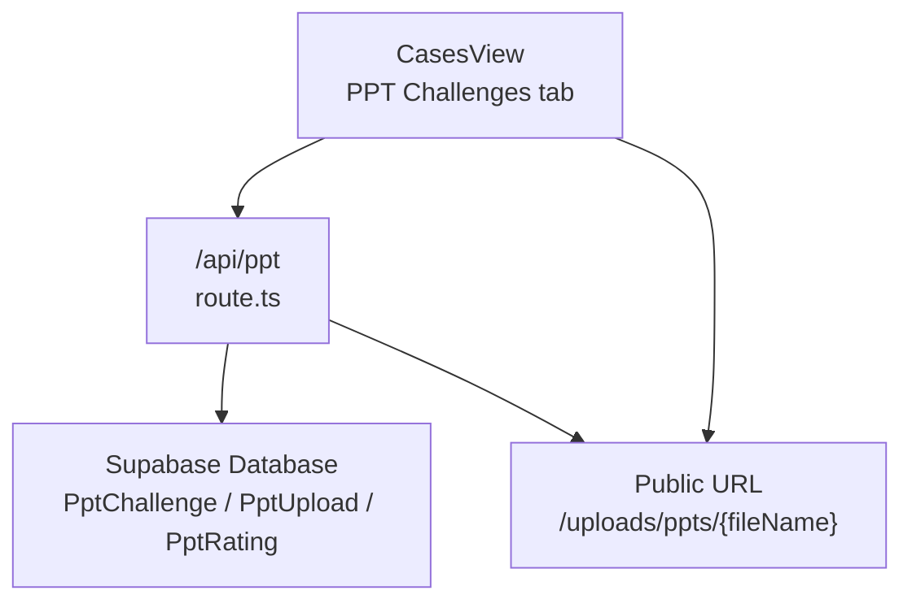
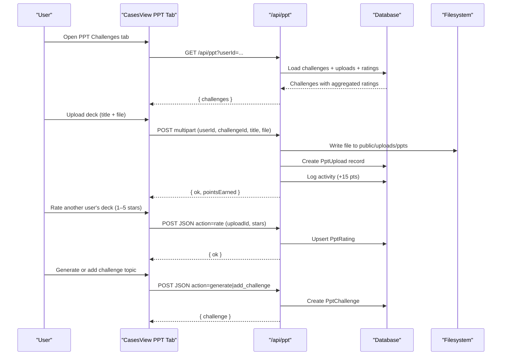
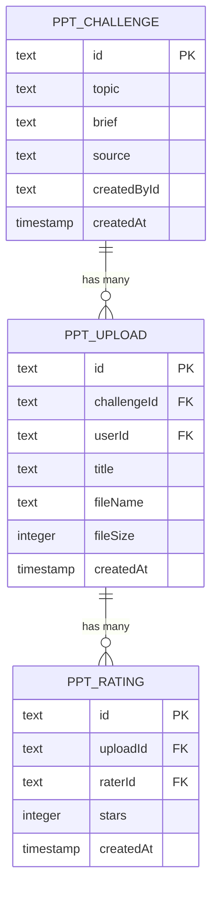
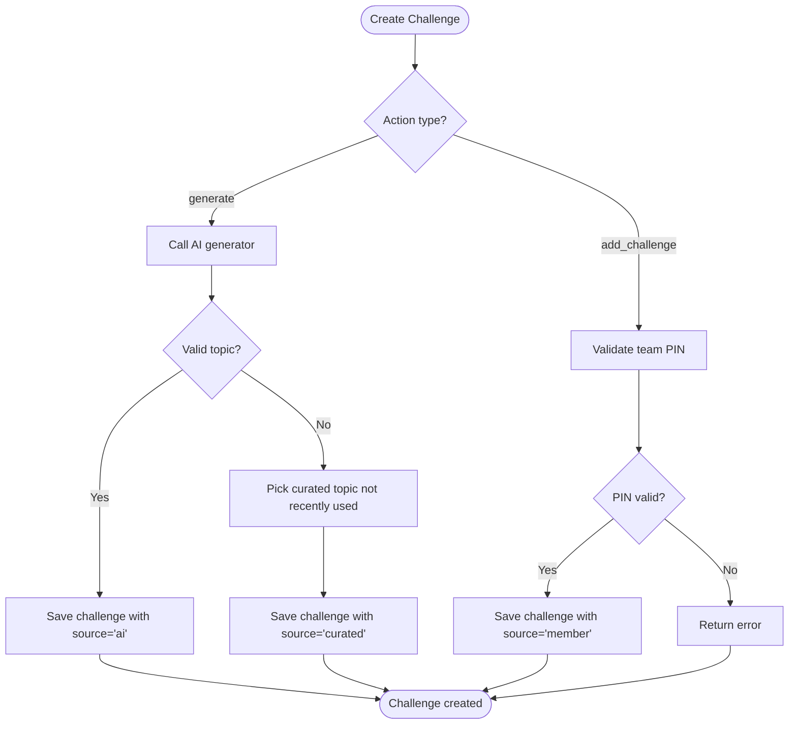
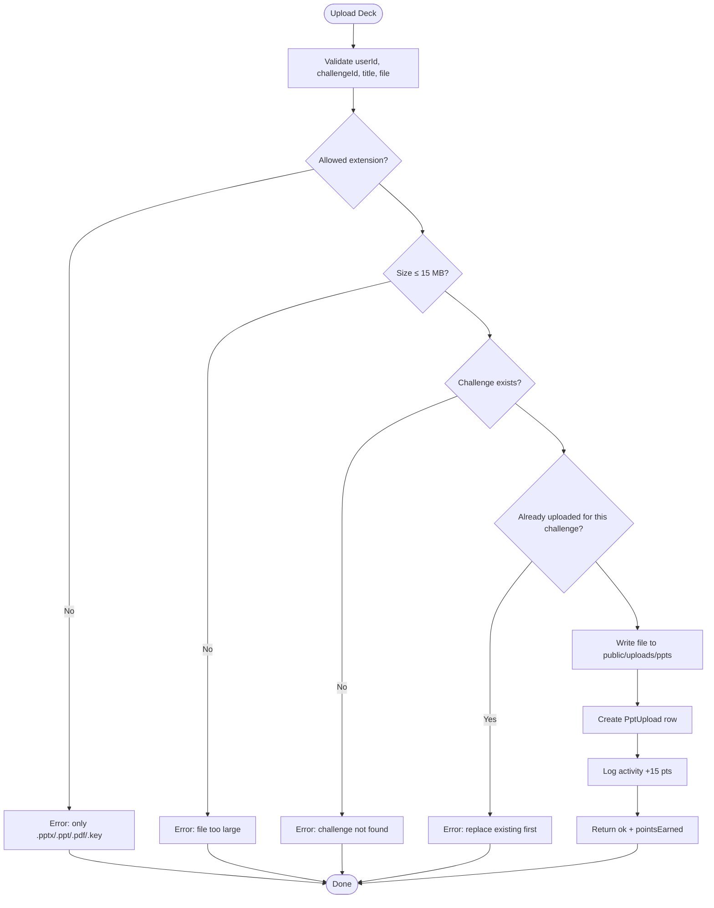
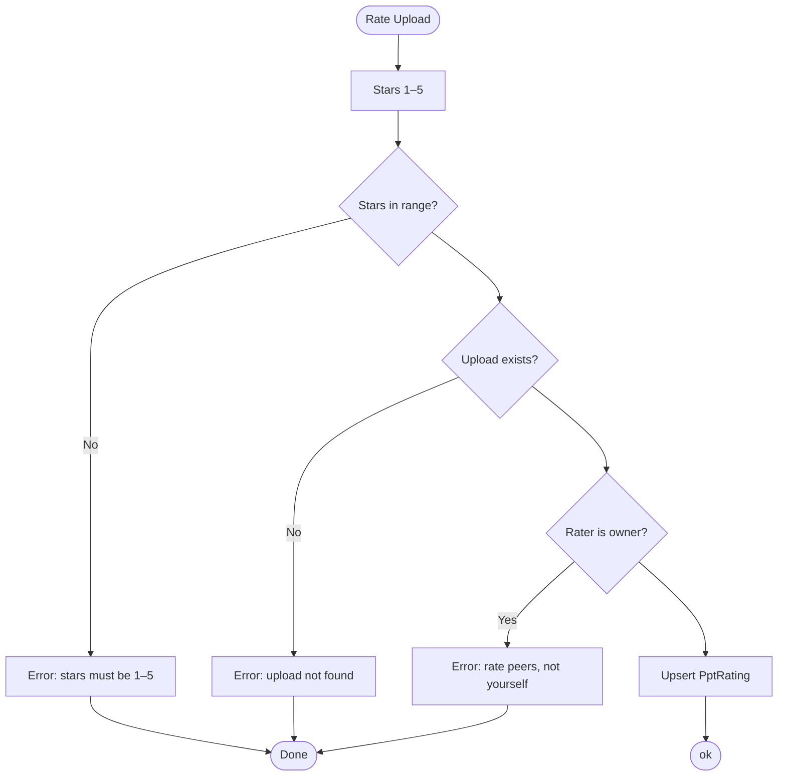
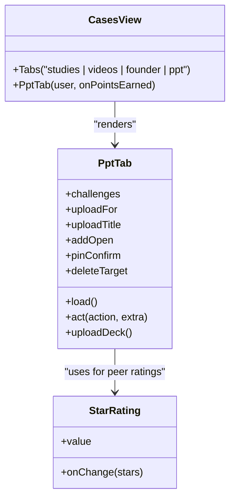
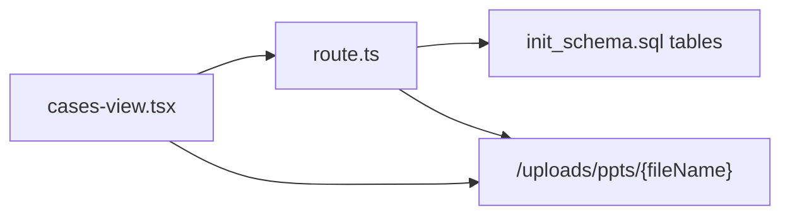

# PPT Challenges Tab

<cite>
**Referenced Files in This Document**
- [route.ts](file://src/app/api/ppt/route.ts)
- [cases-view.tsx](file://src/components/welearn/cases-view.tsx)
- [init_schema.sql](file://supabase/migrations/20261107044233_init_schema.sql)
- [data_seed.sql](file://supabase/migrations/20261107_data_seed.sql)
- [auto-migrate.ts](file://src/lib/auto-migrate.ts)
</cite>

## Table of Contents
1. [Introduction](#introduction)
2. [Project Structure](#project-structure)
3. [Core Components](#core-components)
4. [Architecture Overview](#architecture-overview)
5. [Detailed Component Analysis](#detailed-component-analysis)
6. [Dependency Analysis](#dependency-analysis)
7. [Performance Considerations](#performance-considerations)
8. [Troubleshooting Guide](#troubleshooting-guide)
9. [Conclusion](#conclusion)

## Introduction
The PPT Challenges tab is the pitch-deck learning space inside the Case Hub. Users receive a challenge topic and brief, build a short presentation, upload it as a PowerPoint, PDF, or Keynote file, and then rate peers’ decks using a star system. The system supports:
- AI-generated topics
- Curated topics
- Community-created topics protected by a team PIN
- One deck per user per challenge
- Peer rating with 1–5 stars
- Points for uploading and completing related activities
- Publicly served uploaded files from a static uploads directory

This document explains how challenges are created, how presentations are uploaded and served, how peer ratings work, and how the data model connects challenges, uploads, and ratings.

## Project Structure
The PPT Challenges feature spans three main layers:
- Frontend UI: the Cases view renders the PPT Challenges tab, handles topic creation, deck upload, and rating interactions.
- API layer: a single Next.js route handles listing challenges, generating topics, adding community topics, uploading files, rating uploads, and deleting items.
- Data layer: Supabase migrations define the database schema for challenges, uploads, and ratings; seed data provides curated examples.

**Diagram sources**
- [cases-view.tsx:139-158](file://src/components/welearn/cases-view.tsx#L139-L158)
- [route.ts:22-70](file://src/app/api/ppt/route.ts#L22-L70)
- [route.ts:73-118](file://src/app/api/ppt/route.ts#L73-L118)
- [init_schema.sql:365-398](file://supabase/migrations/20261107044233_init_schema.sql#L365-L398)

**Section sources**
- [cases-view.tsx:139-158](file://src/components/welearn/cases-view.tsx#L139-L158)
- [route.ts:22-70](file://src/app/api/ppt/route.ts#L22-L70)
- [init_schema.sql:365-398](file://supabase/migrations/20261107044233_init_schema.sql#L365-L398)

## Core Components
- Challenge lifecycle:
  - Topic assignment through AI generation, curated fallback, or member submission with PIN.
  - Challenge listing with recent uploads and aggregated ratings.
- File upload system:
  - Multipart form submission to the API.
  - Allowed formats: .pptx, .ppt, .pdf, .key.
  - Maximum size: 15 MB.
  - One upload per user per challenge.
  - Files written to `public/uploads/ppts` and served via `/uploads/ppts/{fileName}`.
- Rating system:
  - Star rating from 1 to 5.
  - Each user can rate each upload once; upsert behavior updates existing ratings.
  - Self-rating is blocked.
  - Average stars and rating count are computed on the server and returned with each upload.
- Community-driven challenge creation:
  - Team members can add a new challenge topic and optional brief.
  - Requires a valid team PIN.
  - Creator tracking is stored for ownership and deletion permissions.

**Section sources**
- [route.ts:13-20](file://src/app/api/ppt/route.ts#L13-L20)
- [route.ts:73-118](file://src/app/api/ppt/route.ts#L73-L118)
- [route.ts:125-155](file://src/app/api/ppt/route.ts#L125-L155)
- [route.ts:157-170](file://src/app/api/ppt/route.ts#L157-L170)
- [cases-view.tsx:1152-1180](file://src/components/welearn/cases-view.tsx#L1152-L1180)
- [cases-view.tsx:1228-1249](file://src/components/welearn/cases-view.tsx#L1228-L1249)

## Architecture Overview
The PPT Challenges workflow connects the frontend, API, filesystem, and database.

**Diagram sources**
- [cases-view.tsx:1152-1180](file://src/components/welearn/cases-view.tsx#L1152-L1180)
- [route.ts:22-70](file://src/app/api/ppt/route.ts#L22-L70)
- [route.ts:73-118](file://src/app/api/ppt/route.ts#L73-L118)
- [route.ts:125-155](file://src/app/api/ppt/route.ts#L125-L155)
- [route.ts:157-170](file://src/app/api/ppt/route.ts#L157-L170)

## Detailed Component Analysis

### Challenge Data Model
The database defines three core tables for this feature:
- PptChallenge: stores topic, brief, source, creator, and timestamp.
- PptUpload: links a user’s deck to a challenge, storing title, filename, size, and timestamp.
- PptRating: records peer ratings per upload with stars and rater identity.

**Diagram sources**
- [init_schema.sql:365-398](file://supabase/migrations/20261107044233_init_schema.sql#L365-L398)

**Section sources**
- [init_schema.sql:365-398](file://supabase/migrations/20261107044233_init_schema.sql#L365-L398)
- [auto-migrate.ts:302-318](file://src/lib/auto-migrate.ts#L302-L318)

### Challenge Creation Flow
Challenges can be created in three ways:
- AI generation: calls an AI helper to produce a topic and brief; if invalid, falls back to curated topics.
- Curated topics: predefined topics used when AI fails or as a baseline library.
- Member submission: requires a team PIN and validates minimum topic length.

**Diagram sources**
- [route.ts:125-155](file://src/app/api/ppt/route.ts#L125-L155)

**Section sources**
- [route.ts:125-155](file://src/app/api/ppt/route.ts#L125-L155)
- [data_seed.sql:441-455](file://supabase/migrations/20261107_data_seed.sql#L441-L455)

### File Upload Workflow
Users upload a deck through a dialog that collects a title and file. The frontend sends a multipart form to the API. The API validates inputs, checks allowed extensions and size, ensures one upload per user per challenge, writes the file to disk, creates a database record, logs activity, and returns points earned.

**Diagram sources**
- [route.ts:73-118](file://src/app/api/ppt/route.ts#L73-L118)
- [cases-view.tsx:1152-1180](file://src/components/welearn/cases-view.tsx#L1152-L1180)

**Section sources**
- [route.ts:73-118](file://src/app/api/ppt/route.ts#L73-L118)
- [cases-view.tsx:1152-1180](file://src/components/welearn/cases-view.tsx#L1152-L1180)

### Rating System
Peer ratings use a simple 1–5 star scale. The frontend shows a star rating control next to other users’ decks. The backend enforces:
- Stars must be between 1 and 5.
- You cannot rate your own upload.
- Each user can have at most one rating per upload; updating replaces the previous rating.
- The server computes average stars and rating count for display.

**Diagram sources**
- [route.ts:157-170](file://src/app/api/ppt/route.ts#L157-L170)
- [cases-view.tsx:1228-1249](file://src/components/welearn/cases-view.tsx#L1228-L1249)

**Section sources**
- [route.ts:157-170](file://src/app/api/ppt/route.ts#L157-L170)
- [cases-view.tsx:1228-1249](file://src/components/welearn/cases-view.tsx#L1228-L1249)

### Frontend Presentation Layer
The PPT Challenges tab is part of the Cases view. It:
- Lists challenges with badges indicating source (AI, member, curated).
- Shows each challenge’s brief when available.
- Displays uploaded decks with author name, file link, file size, average stars, and delete controls.
- Allows non-owners to rate decks using the StarRating component.
- Provides dialogs for uploading decks and adding new challenge topics.
- Uses PIN confirmation for sensitive operations like adding or deleting challenges.

**Diagram sources**
- [cases-view.tsx:139-158](file://src/components/welearn/cases-view.tsx#L139-L158)
- [cases-view.tsx:1089-1180](file://src/components/welearn/cases-view.tsx#L1089-L1180)
- [cases-view.tsx:1228-1249](file://src/components/welearn/cases-view.tsx#L1228-L1249)

**Section sources**
- [cases-view.tsx:139-158](file://src/components/welearn/cases-view.tsx#L139-L158)
- [cases-view.tsx:1089-1180](file://src/components/welearn/cases-view.tsx#L1089-L1180)
- [cases-view.tsx:1228-1249](file://src/components/welearn/cases-view.tsx#L1228-L1249)

## Dependency Analysis
Key dependencies and relationships:
- Frontend depends on the `/api/ppt` endpoint for all challenge and upload operations.
- API depends on the database for persistence and on the filesystem for file storage.
- Uploaded files are served statically under `/uploads/ppts`, so clients open them directly from the browser.
- Ratings are tied to uploads and raters, ensuring one rating per user per upload.
- Activities log points for actions such as uploading a deck.

**Diagram sources**
- [cases-view.tsx:1152-1180](file://src/components/welearn/cases-view.tsx#L1152-L1180)
- [route.ts:73-118](file://src/app/api/ppt/route.ts#L73-L118)
- [init_schema.sql:365-398](file://supabase/migrations/20261107044233_init_schema.sql#L365-L398)

**Section sources**
- [route.ts:1-11](file://src/app/api/ppt/route.ts#L1-L11)
- [init_schema.sql:617-623](file://supabase/migrations/20261107044233_init_schema.sql#L617-L623)

## Performance Considerations
- File size limit: 15 MB prevents large uploads from slowing down storage and serving.
- One upload per user per challenge reduces duplicate submissions and simplifies state.
- Server-side aggregation of ratings avoids repeated client calculations.
- Static file serving under `public/uploads/ppts` leverages efficient static asset delivery.
- Recent-challenge filtering during AI fallback reduces repetition and keeps topics fresh.

[No sources needed since this section provides general guidance]

## Troubleshooting Guide
Common issues and resolutions:
- Missing user or challenge: ensure both userId and challengeId are present in the upload form.
- Invalid file type: only .pptx, .ppt, .pdf, and .key are accepted.
- File too large: keep uploads under 15 MB.
- Already uploaded: delete your existing deck before replacing it.
- Challenge not found: verify the selected challenge ID.
- Rating errors: ensure stars are between 1 and 5 and you are rating someone else’s deck.
- Delete permissions: owners can delete their own items without a PIN; otherwise, a team PIN is required.

**Section sources**
- [route.ts:88-98](file://src/app/api/ppt/route.ts#L88-L98)
- [route.ts:157-170](file://src/app/api/ppt/route.ts#L157-L170)
- [route.ts:172-188](file://src/app/api/ppt/route.ts#L172-L188)

## Conclusion
The PPT Challenges tab provides a complete end-to-end experience for building, sharing, and evaluating pitch decks. It combines AI-assisted topic generation, curated content, and community contributions behind a PIN gate. The upload pipeline is secure and constrained, while the star-based rating system encourages peer feedback and helps surface high-quality presentations. Together, these components create a collaborative environment where students practice startup pitching, receive constructive feedback, and earn recognition through measurable outcomes.

[No sources needed since this section summarizes without analyzing specific files]