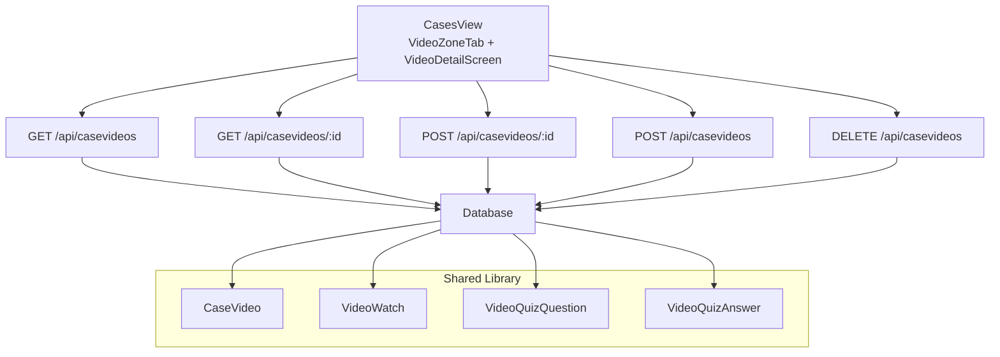
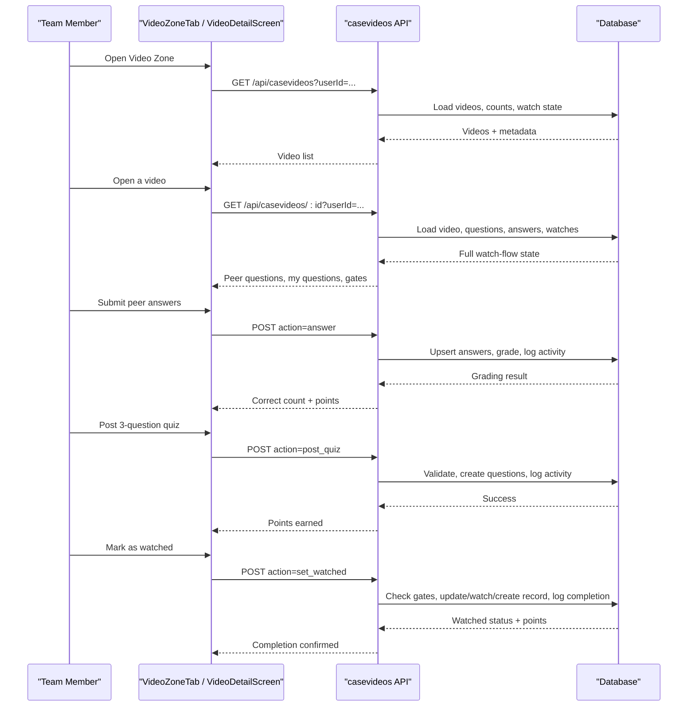
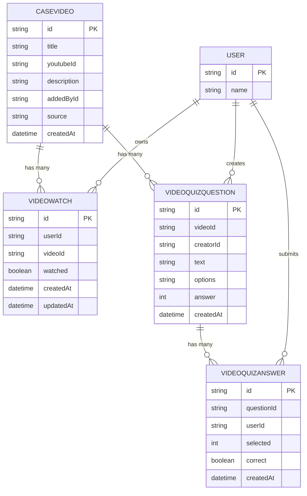
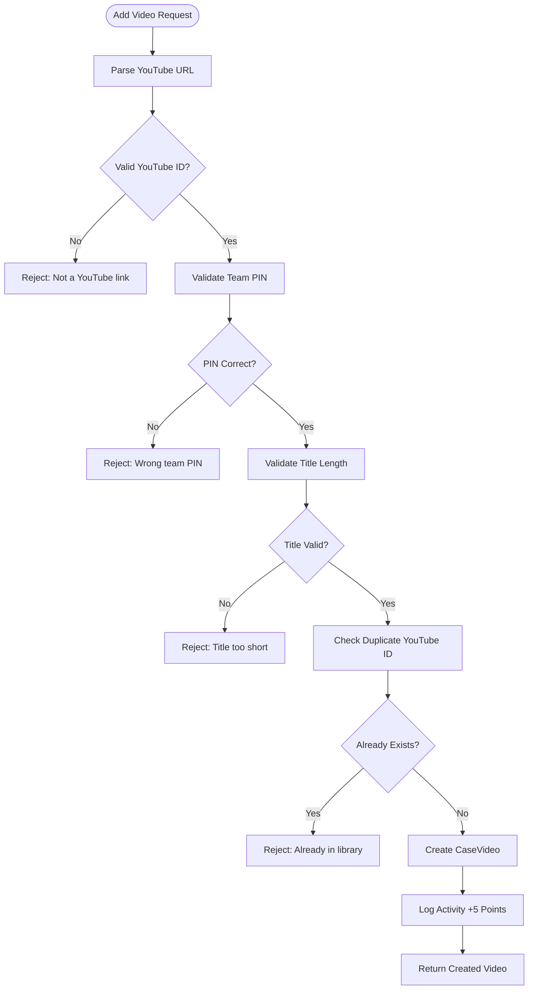
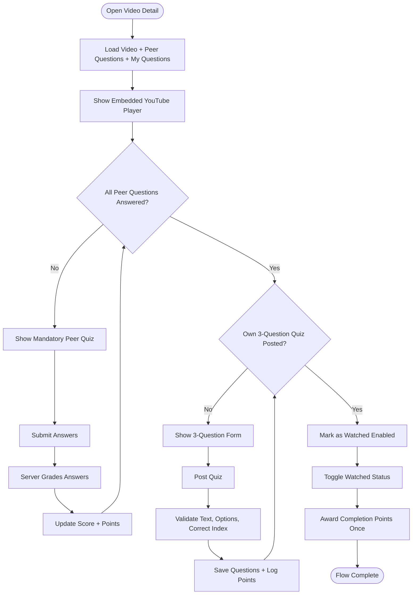
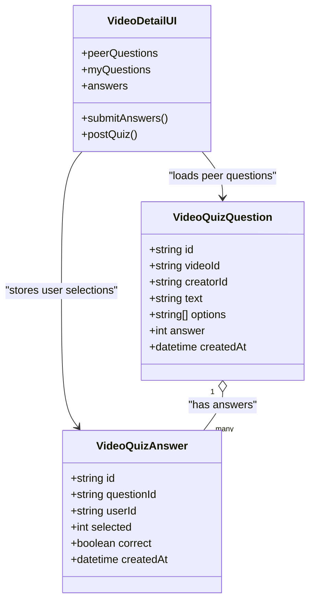
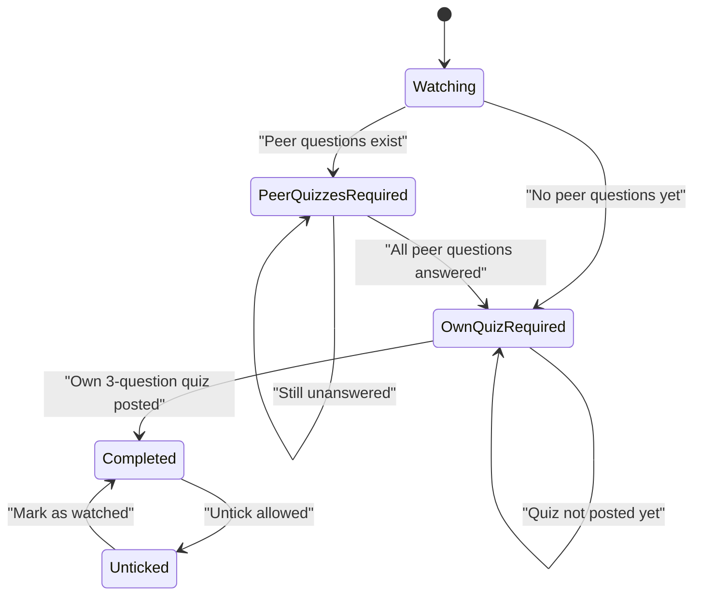
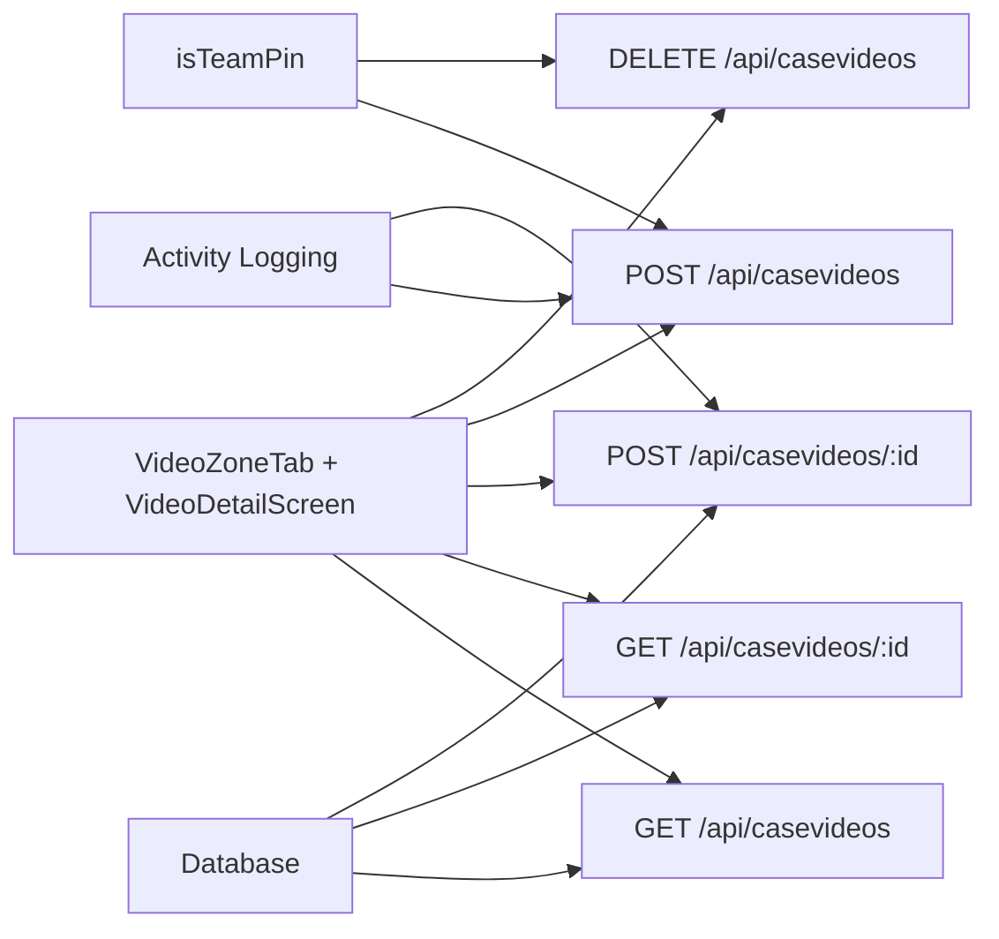

# Video Zone Tab

<cite>
**Referenced Files in This Document**
- [cases-view.tsx](file://src/components/welearn/cases-view.tsx)
- [casevideos route (list)](file://src/app/api/casevideos/route.ts)
- [casevideos route (detail)](file://src/app/api/casevideos/[id]/route.ts)
- [Prisma schema](file://prisma/schema.prisma)
- [PostgreSQL migration](file://supabase/migrations/20261107_init_postgresql.sql)
- [End-to-end test script](file://scripts/e2e-restructure.mjs)
</cite>

## Table of Contents
1. [Introduction](#introduction)
2. [Project Structure](#project-structure)
3. [Core Components](#core-components)
4. [Architecture Overview](#architecture-overview)
5. [Detailed Component Analysis](#detailed-component-analysis)
6. [Dependency Analysis](#dependency-analysis)
7. [Performance Considerations](#performance-considerations)
8. [Troubleshooting Guide](#troubleshooting-guide)
9. [Conclusion](#conclusion)

## Introduction
The Video Zone tab is the collaborative learning surface for a team’s shared YouTube library. Team members add curated or member-submitted videos, watch them in-app, and participate in a peer-quiz loop. The system enforces a two-step engagement flow:

1. Answer every peer question posted by people who watched before you.
2. Post your own three-question multiple-choice quiz.

Only after both steps are complete can a user mark a video as watched. Adding and removing videos requires a team PIN. Scoring rewards correct answers, posting quizzes, adding videos, and completing the full watch flow.

This document explains the UI, API, data model, validation rules, progression gating, and end-to-end behavior that make this feature work.

## Project Structure
The Video Zone spans three main layers:

- **Frontend UI**: A tab inside the Case Hub with a video list, an “Add YouTube link” dialog, a PIN confirmation dialog, and a detail screen for watching, answering peer questions, creating a quiz, and marking completion.
- **API routes**: REST endpoints for listing videos, adding/removing videos, loading per-video state, submitting answers, posting quizzes, and toggling the watched status.
- **Data layer**: Prisma models and PostgreSQL tables for videos, watches, quiz questions, and quiz answers, plus activity logging for points.

**Diagram sources**
- [cases-view.tsx:435-599](file://src/components/welearn/cases-view.tsx#L435-L599)
- [cases-view.tsx:605-800](file://src/components/welearn/cases-view.tsx#L605-L800)
- [casevideos route (list):30-122](file://src/app/api/casevideos/route.ts#L30-L122)
- [casevideos route (detail):6-207](file://src/app/api/casevideos/[id]/route.ts#L6-L207)
- [Prisma schema:349-407](file://prisma/schema.prisma#L349-L407)

**Section sources**
- [cases-view.tsx:127-162](file://src/components/welearn/cases-view.tsx#L127-L162)
- [casevideos route (list):30-69](file://src/app/api/casevideos/route.ts#L30-L69)
- [casevideos route (detail):6-79](file://src/app/api/casevideos/[id]/route.ts#L6-L79)
- [Prisma schema:349-407](file://prisma/schema.prisma#L349-L407)

## Core Components
The Video Zone has four core responsibilities:

| Area | Responsibility | Key Behavior |
|---|---|---|
| Shared library | List, add, and remove YouTube videos | Adds require a team PIN; duplicates are rejected; removal also requires a PIN. |
| Watch tracking | Track whether a user completed the full flow | One record per user per video with a `watched` flag. |
| Peer quiz system | Create, answer, validate, and score multiple-choice questions | Each quiz has exactly four options and one correct index. |
| Progression gating | Enforce quality contributions | Users must answer all peer questions and post their own three-question quiz before ticking. |

**Section sources**
- [casevideos route (list):30-122](file://src/app/api/casevideos/route.ts#L30-L122)
- [casevideos route (detail):81-207](file://src/app/api/casevideos/[id]/route.ts#L81-L207)
- [Prisma schema:349-407](file://prisma/schema.prisma#L349-L407)

## Architecture Overview
The Video Zone follows a client-server architecture with explicit progression gates enforced on the server.

**Diagram sources**
- [cases-view.tsx:435-599](file://src/components/welearn/cases-view.tsx#L435-L599)
- [cases-view.tsx:605-800](file://src/components/welearn/cases-view.tsx#L605-L800)
- [casevideos route (list):30-122](file://src/app/api/casevideos/route.ts#L30-L122)
- [casevideos route (detail):6-207](file://src/app/api/casevideos/[id]/route.ts#L6-L207)

## Detailed Component Analysis

### Video Data Model
The database models define the shared library, watch records, quiz questions, and quiz answers.

**Diagram sources**
- [Prisma schema:349-407](file://prisma/schema.prisma#L349-L407)
- [PostgreSQL migration:310-349](file://supabase/migrations/20261107_init_postgresql.sql#L310-L349)

Key properties:

| Entity | Important Fields | Meaning |
|---|---|---|
| `CaseVideo` | `title`, `youtubeId`, `description`, `addedById`, `source`, `createdAt` | Represents a shared YouTube resource. `source` distinguishes curated library entries from member-added videos. |
| `VideoWatch` | `userId`, `videoId`, `watched` | Tracks whether a user completed the required flow for a video. Unique per user-video pair. |
| `VideoQuizQuestion` | `videoId`, `creatorId`, `text`, `options`, `answer` | Stores a multiple-choice question. `options` is stored as JSON with four choices; `answer` is the zero-based index of the correct option. |
| `VideoQuizAnswer` | `questionId`, `userId`, `selected`, `correct` | Records a user’s selection and whether it was correct. Unique per question-user pair. |

**Section sources**
- [Prisma schema:349-407](file://prisma/schema.prisma#L349-L407)
- [PostgreSQL migration:310-349](file://supabase/migrations/20261107_init_postgresql.sql#L310-L349)

### Shared Library Management
The library supports:

- Listing all videos with per-user watch state, question counts, and completion counts.
- Adding a YouTube link with a team PIN.
- Removing a video with a team PIN.
- Parsing multiple YouTube URL formats.

#### Adding a Video
Adding a video validates:

- A valid user ID.
- A correct team PIN.
- A title of at least three characters.
- A parseable YouTube identifier.
- No duplicate YouTube ID already in the library.

On success, the video is created as a member-added entry and five points are logged.

#### Removing a Video
Removing a video validates:

- A correct team PIN.
- That the video exists.

It deletes the video record. The cascade relationships ensure related questions, answers, and watch records are removed.

#### YouTube Link Parsing
The parser accepts:

- Bare eleven-character YouTube IDs.
- Standard `youtube.com/watch?v=` URLs.
- `youtu.be/` short links.
- `shorts`, `embed`, `live`, and `v` path segments.

If parsing fails, the request is rejected.

**Diagram sources**
- [casevideos route (list):5-28](file://src/app/api/casevideos/route.ts#L5-L28)
- [casevideos route (list):71-106](file://src/app/api/casevideos/route.ts#L71-L106)

**Section sources**
- [casevideos route (list):30-122](file://src/app/api/casevideos/route.ts#L30-L122)

### Video Detail Screen and Engagement Flow
When a user opens a video, the frontend loads:

- The video metadata.
- Whether the user has already marked it watched.
- Peer questions they still need to answer.
- Their own posted questions.
- Total watchers and total quiz questions.

The UI shows:

- An embedded YouTube player.
- A “Mark as watched” button disabled until both gates pass.
- A mandatory peer quiz section for unanswered questions.
- A review section for previously answered questions.
- A form to post exactly three questions with four options each.

#### Two-Step Engagement Flow
The progression gating is enforced as follows:

1. **Peer quiz gate**: All peer questions posted by other users must be answered.
2. **Own quiz gate**: The user must have posted their own three-question quiz.
3. **Tick gate**: Only then can the user mark the video as watched.

**Diagram sources**
- [cases-view.tsx:605-800](file://src/components/welearn/cases-view.tsx#L605-L800)
- [casevideos route (detail):81-207](file://src/app/api/casevideos/[id]/route.ts#L81-L207)

**Section sources**
- [cases-view.tsx:435-599](file://src/components/welearn/cases-view.tsx#L435-L599)
- [cases-view.tsx:605-800](file://src/components/welearn/cases-view.tsx#L605-L800)
- [casevideos route (detail):6-207](file://src/app/api/casevideos/[id]/route.ts#L6-L207)

### Peer Quiz System
Each quiz question has:

- A question text.
- Exactly four non-empty options.
- One correct option index from zero to three.
- A creator user.
- Zero or more answers from other users.

#### Question Creation Validation
Before saving a quiz:

- At least three questions must be submitted.
- Each question text must be at least eight characters.
- Each question must have exactly four options.
- Each option must be non-empty.
- The correct answer must be an integer between zero and three.
- A user may only post one quiz per video.

#### Answer Submission and Grading
When a user submits answers:

- Only questions not created by the current user are graded.
- Each answer is upserted so repeated submissions update the selection and correctness.
- Each correct answer awards two points.
- The number of correct answers and total answers are returned to the UI.

#### Review State
Previously answered questions show:

- The original question text.
- The creator’s display name.
- The user’s selected option.
- Whether the answer was correct.

**Diagram sources**
- [Prisma schema:378-407](file://prisma/schema.prisma#L378-L407)
- [cases-view.tsx:57-73](file://src/components/welearn/cases-view.tsx#L57-L73)
- [cases-view.tsx:605-800](file://src/components/welearn/cases-view.tsx#L605-L800)
- [casevideos route (detail):95-161](file://src/app/api/casevideos/[id]/route.ts#L95-L161)

**Section sources**
- [casevideos route (detail):95-161](file://src/app/api/casevideos/[id]/route.ts#L95-L161)
- [cases-view.tsx:725-800](file://src/components/welearn/cases-view.tsx#L725-L800)

### Progression Gating and Scoring
The system uses explicit gates rather than relying only on UI state.

| Action | Gate | Result |
|---|---|---|
| Answer peer questions | Must submit answers for all peer questions | Server grades answers and awards two points per correct answer. |
| Post own quiz | Must post exactly three validated questions | Awards eight points and makes the quiz available to future watchers. |
| Mark as watched | Both previous gates must pass | Awards five points once when transitioning from false to true. |
| Add video | Team PIN required | Awards five points. |
| Remove video | Team PIN required | Deletes video and related data. |

**Diagram sources**
- [casevideos route (detail):164-199](file://src/app/api/casevideos/[id]/route.ts#L164-L199)
- [cases-view.tsx:682-723](file://src/components/welearn/cases-view.tsx#L682-L723)

**Section sources**
- [casevideos route (detail):164-199](file://src/app/api/casevideos/[id]/route.ts#L164-L199)
- [cases-view.tsx:682-723](file://src/components/welearn/cases-view.tsx#L682-L723)

### End-to-End Behavior
The end-to-end test confirms the intended sequence:

1. The first completer sees no peer questions.
2. They post a three-question quiz.
3. They tick the video.
4. A second user sees mandatory peer questions.
5. Ticking is blocked until peer questions are answered.
6. After answering, ticking is still blocked until the second user posts their own quiz.
7. After posting, the second user can tick the video.

This validates both the UI gating and the server-side enforcement.

**Section sources**
- [End-to-end test script:119-160](file://scripts/e2e-restructure.mjs#L119-L160)

## Dependency Analysis
The Video Zone depends on several cross-cutting concerns:

- **Authentication and PIN validation**: Adding and removing videos require a team PIN.
- **Activity logging**: Points are recorded for adding videos, answering quizzes, posting quizzes, and completing videos.
- **User resolution**: Display names are resolved for video adders and quiz creators.
- **YouTube embedding**: The frontend embeds videos using the stored YouTube ID.

**Diagram sources**
- [casevideos route (list):1-122](file://src/app/api/casevideos/route.ts#L1-L122)
- [casevideos route (detail):1-207](file://src/app/api/casevideos/[id]/route.ts#L1-L207)
- [cases-view.tsx:435-800](file://src/components/welearn/cases-view.tsx#L435-L800)

**Section sources**
- [casevideos route (list):1-122](file://src/app/api/casevideos/route.ts#L1-L122)
- [casevideos route (detail):1-207](file://src/app/api/casevideos/[id]/route.ts#L1-L207)

## Performance Considerations
- **Query shape**: The list endpoint includes question metadata and watch counts, while the detail endpoint includes full question objects, creator names, and answers for the requesting user. This avoids unnecessary payload size on the list view.
- **Indexes**: The schema indexes creation timestamps and foreign keys used for filtering and ordering.
- **Upsert behavior**: Quiz answers use upsert logic, preventing duplicate answer rows and reducing write conflicts.
- **Client-side state**: The UI maintains local answer selections and quiz forms to reduce round trips, only sending final submissions.
- **Embedding**: Videos are embedded via iframe using the YouTube ID, avoiding server-side video processing.

[No sources needed since this section provides general guidance]

## Troubleshooting Guide

### Common Errors and Causes
| Symptom | Likely Cause | Resolution |
|---|---|---|
| Cannot add a video | Wrong team PIN | Confirm the team PIN with the core team. |
| Cannot add a video | Invalid YouTube URL | Paste a full YouTube URL or a valid eleven-character ID. |
| Cannot add a video | Duplicate video | The same YouTube ID already exists in the library. |
| Cannot mark as watched | Peer questions unanswered | Answer all peer questions posted by other users. |
| Cannot mark as watched | Own quiz not posted | Post exactly three questions with four options each. |
| Cannot post quiz | Missing or invalid fields | Provide three questions, four non-empty options, and a correct index. |
| Cannot post quiz | Already posted | You can only post one quiz per video. |
| Cannot remove a video | Wrong team PIN | Use the correct team PIN. |

### Debugging Tips
- Check the list endpoint response to verify whether your video appears and whether your watch state is reflected.
- Inspect the detail endpoint response to see how many peer questions remain and whether your own quiz is present.
- Use the end-to-end test pattern to validate the full flow: peer answers, own quiz, then tick.
- If scoring seems incorrect, confirm that answers were submitted for peer questions and not your own questions.

**Section sources**
- [casevideos route (list):71-122](file://src/app/api/casevideos/route.ts#L71-L122)
- [casevideos route (detail):95-207](file://src/app/api/casevideos/[id]/route.ts#L95-L207)
- [End-to-end test script:119-160](file://scripts/e2e-restructure.mjs#L119-L160)

## Conclusion
The Video Zone tab implements a structured collaborative learning loop around a shared YouTube library. It combines simple media consumption with meaningful contribution requirements: peers must answer questions before being able to claim completion, and contributors must post three validated multiple-choice questions. The system protects library integrity through PIN-gated add/remove actions and enforces quality through server-side validation and progression gating. The result is a team-wide learning workflow where watching alone is insufficient—engagement and contribution are required to earn completion.

[No sources needed since this section summarizes without analyzing specific files]