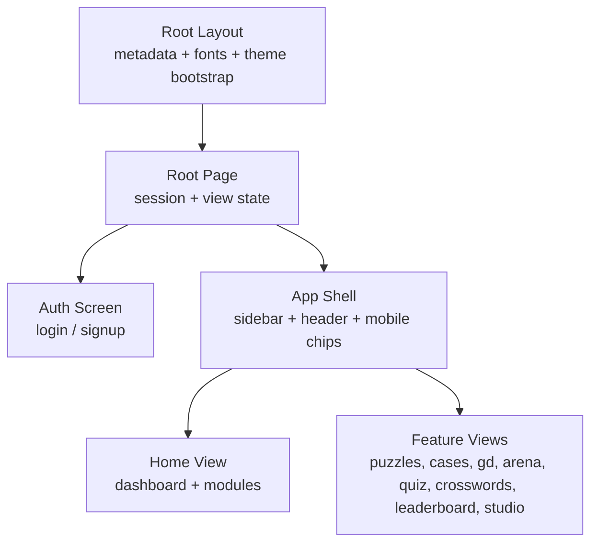
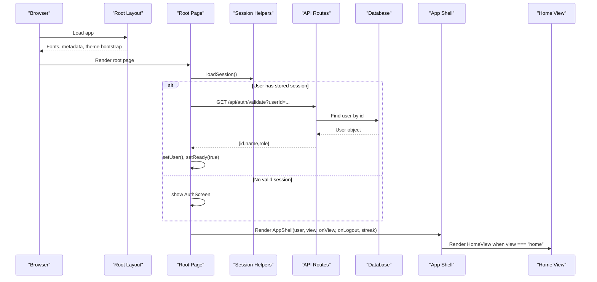
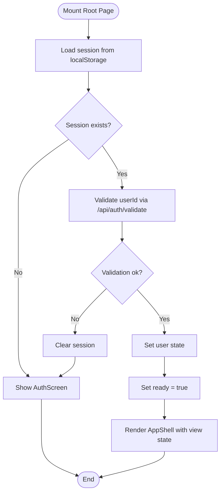
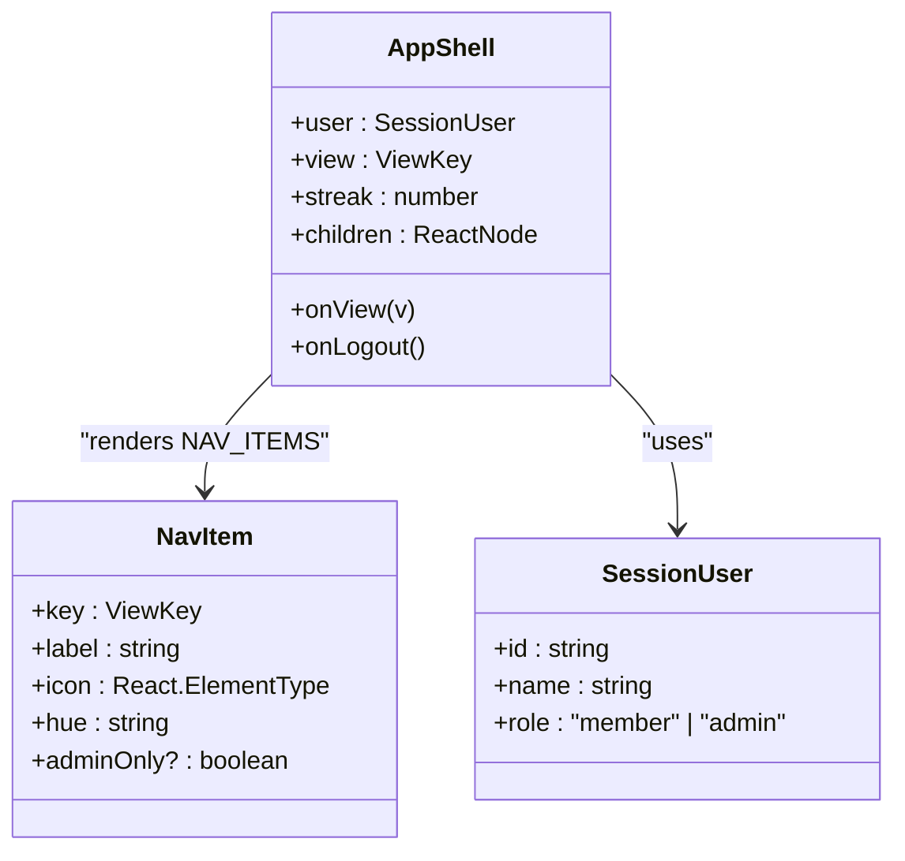
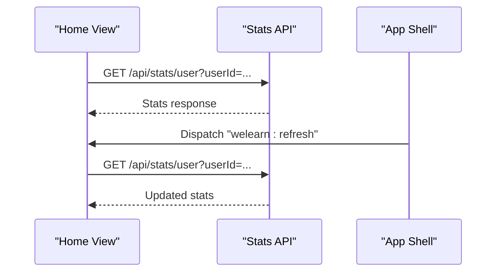
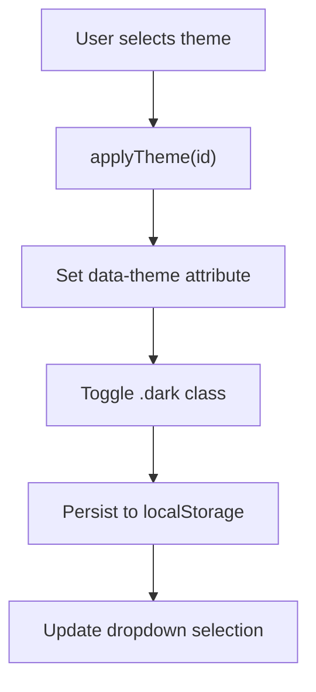
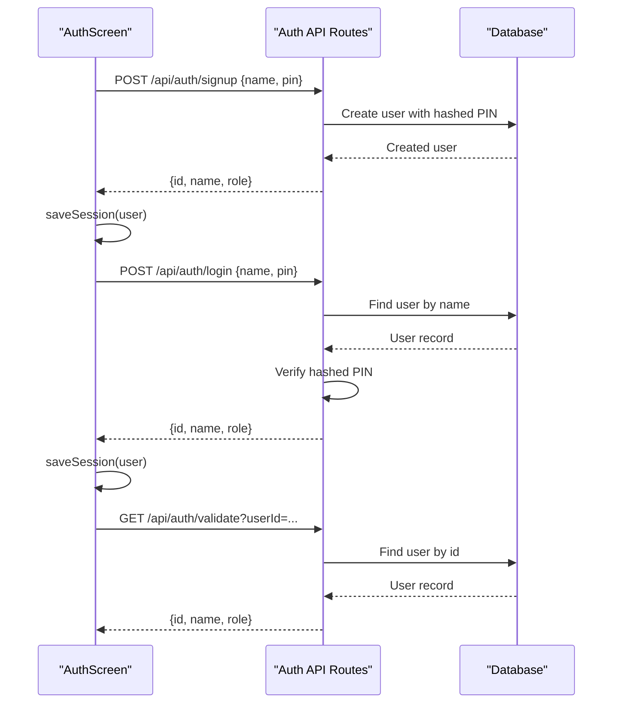
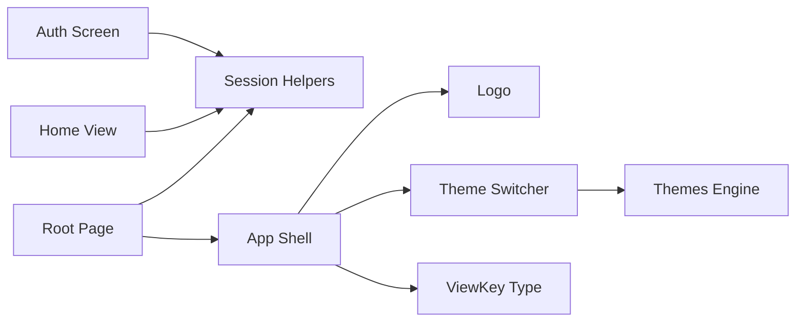

# App Shell & Navigation

<cite>
**Referenced Files in This Document**
- [layout.tsx](file://src/app/layout.tsx)
- [page.tsx](file://src/app/page.tsx)
- [app-shell.tsx](file://src/components/welearn/app-shell.tsx)
- [home-view.tsx](file://src/components/welearn/home-view.tsx)
- [logo.tsx](file://src/components/welearn/logo.tsx)
- [theme-switcher.tsx](file://src/components/welearn/theme-switcher.tsx)
- [themes.ts](file://src/lib/themes.ts)
- [session.ts](file://src/lib/session.ts)
- [auth-screen.tsx](file://src/components/welearn/auth-screen.tsx)
- [route.ts (login)](file://src/app/api/auth/login/route.ts)
- [route.ts (signup)](file://src/app/api/auth/signup/route.ts)
- [route.ts (validate)](file://src/app/api/auth/validate/route.ts)
- [auth.ts](file://src/lib/auth.ts)
</cite>

## Table of Contents
1. [Introduction](#introduction)
2. [Project Structure](#project-structure)
3. [Core Components](#core-components)
4. [Architecture Overview](#architecture-overview)
5. [Detailed Component Analysis](#detailed-component-analysis)
6. [Dependency Analysis](#dependency-analysis)
7. [Performance Considerations](#performance-considerations)
8. [Troubleshooting Guide](#troubleshooting-guide)
9. [Conclusion](#conclusion)

## Introduction
This document explains the WeLearn application shell and navigation system built on Next.js. It covers how the app manages global state, user authentication context, theme switching, responsive navigation, role-based access control, and how feature views are rendered inside the shell. The goal is to help developers understand the entry points, data flows, and integration patterns with the Next.js App Router while keeping explanations accessible for non-experts.

## Project Structure
WeLearn uses a client-side routing model driven by React state rather than URL-based routes. The root layout sets up fonts, metadata, theme bootstrap, and global UI providers. The root page component owns the authenticated user session, current view key, and renders either an authentication screen or the main application shell with feature views.

**Diagram sources**
- [layout.tsx:28-67](file://src/app/layout.tsx#L28-L67)
- [page.tsx:17-104](file://src/app/page.tsx#L17-L104)
- [app-shell.tsx:54-324](file://src/components/welearn/app-shell.tsx#L54-L324)
- [home-view.tsx:55-197](file://src/components/welearn/home-view.tsx#L55-L197)

**Section sources**
- [layout.tsx:1-71](file://src/app/layout.tsx#L1-L71)
- [page.tsx:1-105](file://src/app/page.tsx#L1-L105)

## Core Components
- Root layout: configures fonts, metadata, viewport, theme bootstrap script, ambient background, and global toast container.
- Root page: manages user session restoration, validation, streak refresh, and conditional rendering of auth vs app shell.
- App shell: provides sidebar navigation, header actions, mobile chip navigation, user menu, logout, and theme switcher.
- Home view: dashboard showing greeting, daily checklist, quick stats, and module cards.
- Logo: brand wordmark with configurable size and optional tagline.
- Theme switcher: dropdown to select from VS Code-grade themes persisted in localStorage.
- Session helpers: load/save/clear session and typed API wrapper.
- Auth utilities: PIN hashing, validation helpers, and team pin check.

**Section sources**
- [layout.tsx:28-67](file://src/app/layout.tsx#L28-L67)
- [page.tsx:17-104](file://src/app/page.tsx#L17-L104)
- [app-shell.tsx:29-52](file://src/components/welearn/app-shell.tsx#L29-L52)
- [home-view.tsx:37-46](file://src/components/welearn/home-view.tsx#L37-L46)
- [logo.tsx:5-26](file://src/components/welearn/logo.tsx#L5-L26)
- [theme-switcher.tsx:22-54](file://src/components/welearn/theme-switcher.tsx#L22-L54)
- [session.ts:3-42](file://src/lib/session.ts#L3-L42)
- [auth.ts:9-25](file://src/lib/auth.ts#L9-L25)

## Architecture Overview
The app follows a simple but robust architecture:
- Global UI and theming live in the root layout.
- Authentication state lives in the root page component.
- The app shell wraps all authenticated features and exposes navigation via a view key.
- Feature components receive the current user and a callback to change the active view.
- Data fetching happens through a typed API helper that calls Next.js API routes.

**Diagram sources**
- [layout.tsx:43-67](file://src/app/layout.tsx#L43-L67)
- [page.tsx:23-89](file://src/app/page.tsx#L23-L89)
- [route.ts (validate):5-12](file://src/app/api/auth/validate/route.ts#L5-L12)

## Detailed Component Analysis

### Root Layout
Responsibilities:
- Define display, body, and monospace fonts.
- Set site metadata and viewport theme color.
- Inject a small inline script to apply the saved theme before hydration.
- Wrap children with ambient background and toast container.

Key behaviors:
- Uses `data-theme` and `.dark` class toggling for theme engine compatibility.
- Prevents theme flash by applying theme synchronously in `<head>`.

**Section sources**
- [layout.tsx:8-26](file://src/app/layout.tsx#L8-L26)
- [layout.tsx:28-41](file://src/app/layout.tsx#L28-L41)
- [layout.tsx:43-67](file://src/app/layout.tsx#L43-L67)

### Root Page
Responsibilities:
- Restore session from localStorage.
- Validate session against the database.
- Fetch user streak and refresh it after earning points.
- Render authentication screen if no user, otherwise render the app shell with the selected view.

Navigation pattern:
- State-driven view selection using a string enum `ViewKey`.
- Conditional rendering of feature views based on `view`.

Session lifecycle:
- On mount, loads session, validates it, and sets ready flag.
- If validation fails, clears session and shows auth screen.
- After successful login, stores session and navigates to home.

**Diagram sources**
- [page.tsx:23-89](file://src/app/page.tsx#L23-L89)
- [route.ts (validate):5-12](file://src/app/api/auth/validate/route.ts#L5-L12)

**Section sources**
- [page.tsx:17-104](file://src/app/page.tsx#L17-L104)

### App Shell
Responsibilities:
- Provide persistent sidebar navigation with expand/collapse and pin behavior.
- Display header with live indicator, streak badge, refresh button, theme switcher, and user menu.
- Provide mobile chip navigation for smaller screens.
- Enforce role-based visibility for navigation items.
- Dispatch global refresh events and integrate haptic feedback.

Navigation model:
- Centralized `NAV_ITEMS` array defines available views, labels, icons, and accent colors.
- Admin-only items can be filtered out based on user role.

Responsive design:
- Desktop: collapsible sidebar rail with animated logo and label transitions.
- Mobile: horizontal chip nav under the sticky header.

Accessibility:
- Uses ARIA attributes like `aria-current`, `aria-label`, and semantic roles for navigation.

**Diagram sources**
- [app-shell.tsx:29-52](file://src/components/welearn/app-shell.tsx#L29-L52)
- [session.ts:3-7](file://src/lib/session.ts#L3-L7)

**Section sources**
- [app-shell.tsx:54-324](file://src/components/welearn/app-shell.tsx#L54-L324)

### Home View
Responsibilities:
- Show a personalized greeting and E-Summit countdown.
- Display today’s prep checklist with completion status.
- Show quick stats such as total points, puzzles solved, accuracy, and training time.
- Provide module cards that navigate to each feature view.

Data flow:
- Fetches user stats from `/api/stats/user`.
- Listens to global refresh event to update stats without full reload.

**Diagram sources**
- [home-view.tsx:59-84](file://src/components/welearn/home-view.tsx#L59-L84)

**Section sources**
- [home-view.tsx:55-197](file://src/components/welearn/home-view.tsx#L55-L197)

### Logo Component
Responsibilities:
- Render the WeLearn wordmark with a primary-colored icon box.
- Support multiple sizes and optional tagline.
- Maintain consistent branding across the app shell and auth screen.

Design notes:
- Uses Tailwind classes and lucide-react icon for the graduation cap.
- Keeps text hierarchy with two-tone coloring for “We” and “Learn”.

**Section sources**
- [logo.tsx:5-26](file://src/components/welearn/logo.tsx#L5-L26)

### Theme Switcher and Theme Engine
Responsibilities:
- Persist selected theme in localStorage.
- Apply theme by setting `data-theme` and toggling `.dark` class.
- Provide a dropdown UI with swatch previews and current selection indicator.

Theme engine:
- Defines multiple VS Code-grade themes with dark/light variants.
- Provides utility functions to apply and read stored theme.

**Diagram sources**
- [theme-switcher.tsx:8-19](file://src/components/welearn/theme-switcher.tsx#L8-L19)
- [themes.ts:29-46](file://src/lib/themes.ts#L29-L46)

**Section sources**
- [theme-switcher.tsx:22-54](file://src/components/welearn/theme-switcher.tsx#L22-L54)
- [themes.ts:6-46](file://src/lib/themes.ts#L6-L46)

### Authentication Flow
Responsibilities:
- Allow users to sign up with name and 4-digit PIN.
- Allow existing users to log in with name and PIN.
- Store session locally and validate sessions server-side.

Server endpoints:
- Signup: validates name and PIN, creates user with hashed PIN, records activity.
- Login: finds user by name, verifies hashed PIN, returns user info.
- Validate: checks if stored session ID still exists in DB.

Security considerations:
- PINs are hashed server-side using a shared salt.
- Name validation prevents invalid characters and enforces length constraints.
- Team PIN is used for sensitive operations outside this scope.

**Diagram sources**
- [auth-screen.tsx:34-71](file://src/components/welearn/auth-screen.tsx#L34-L71)
- [route.ts (signup):6-30](file://src/app/api/auth/signup/route.ts#L6-L30)
- [route.ts (login):6-20](file://src/app/api/auth/login/route.ts#L6-L20)
- [route.ts (validate):5-12](file://src/app/api/auth/validate/route.ts#L5-L12)
- [auth.ts:9-25](file://src/lib/auth.ts#L9-L25)

**Section sources**
- [auth-screen.tsx:27-71](file://src/components/welearn/auth-screen.tsx#L27-L71)
- [route.ts (signup):6-30](file://src/app/api/auth/signup/route.ts#L6-L30)
- [route.ts (login):6-20](file://src/app/api/auth/login/route.ts#L6-L20)
- [route.ts (validate):5-12](file://src/app/api/auth/validate/route.ts#L5-L12)
- [auth.ts:9-25](file://src/lib/auth.ts#L9-L25)

## Dependency Analysis
High-level dependencies:
- Root page depends on session helpers and feature views.
- App shell depends on UI primitives, icons, logo, theme switcher, and session types.
- Home view depends on session API and view type definitions.
- Theme switcher depends on theme engine utilities.
- Auth screen depends on session helpers and UI primitives.

**Diagram sources**
- [page.tsx:3-15](file://src/app/page.tsx#L3-L15)
- [app-shell.tsx:21-27](file://src/components/welearn/app-shell.tsx#L21-L27)
- [home-view.tsx:21-25](file://src/components/welearn/home-view.tsx#L21-L25)
- [theme-switcher.tsx:5-6](file://src/components/welearn/theme-switcher.tsx#L5-L6)

**Section sources**
- [page.tsx:3-15](file://src/app/page.tsx#L3-L15)
- [app-shell.tsx:21-27](file://src/components/welearn/app-shell.tsx#L21-L27)
- [home-view.tsx:21-25](file://src/components/welearn/home-view.tsx#L21-L25)
- [theme-switcher.tsx:5-6](file://src/components/welearn/theme-switcher.tsx#L5-L6)

## Performance Considerations
- Avoid unnecessary re-renders by keeping view state at the root page level and passing callbacks down.
- Use lightweight UI components and avoid heavy animations in frequently updated areas like headers.
- Defer non-critical data fetching; fetch streak and stats only when needed.
- Keep theme switching synchronous to prevent flash-of-wrong-theme.
- For large applications, consider lazy loading feature views using dynamic imports and Suspense boundaries around heavy modules.
- Prefer client-side navigation via state changes over route changes to reduce network overhead when not required.

[No sources needed since this section provides general guidance]

## Troubleshooting Guide
Common issues and resolutions:
- Session expired: If `/api/auth/validate` returns an error, clear local session and show auth screen.
- Invalid PIN: Ensure PIN is exactly four digits and matches the hashed value stored in the database.
- Name conflicts: Signup rejects duplicate names; guide users to login instead.
- Theme not applied: Check that `data-theme` and `.dark` class are set correctly and localStorage is enabled.
- Streak not updating: Verify that `/api/stats/user` returns correct totals and that the global refresh event triggers stats refresh.

Operational tips:
- Use toast notifications for user feedback during login/signup.
- Log server errors in API routes for debugging.
- Validate inputs on both client and server sides.

**Section sources**
- [page.tsx:30-43](file://src/app/page.tsx#L30-L43)
- [route.ts (validate):5-12](file://src/app/api/auth/validate/route.ts#L5-L12)
- [route.ts (login):14-18](file://src/app/api/auth/login/route.ts#L14-L18)
- [route.ts (signup):12-20](file://src/app/api/auth/signup/route.ts#L12-L20)
- [theme-switcher.tsx:8-19](file://src/components/welearn/theme-switcher.tsx#L8-L19)

## Conclusion
WeLearn’s app shell and navigation system provide a clean, responsive, and extensible foundation for learning modules. The root layout establishes global theming and UI context, while the root page manages authentication and view state. The app shell centralizes navigation, user controls, and responsive layouts. The home view serves as the main dashboard, guiding users through daily tasks and module access. With role-based navigation, session validation, and a flexible theme engine, the application balances usability, performance, and maintainability. Future enhancements should focus on lazy loading heavy features, improving error boundaries, and expanding analytics integration.

[No sources needed since this section summarizes without analyzing specific files]