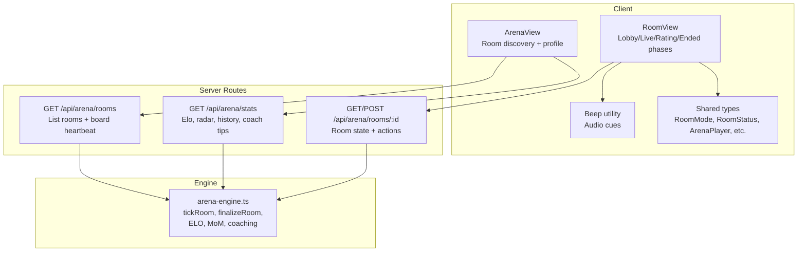
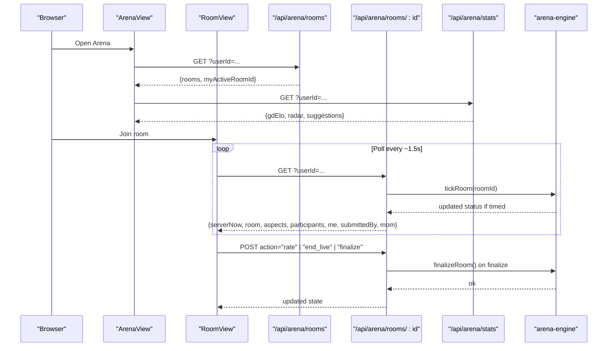
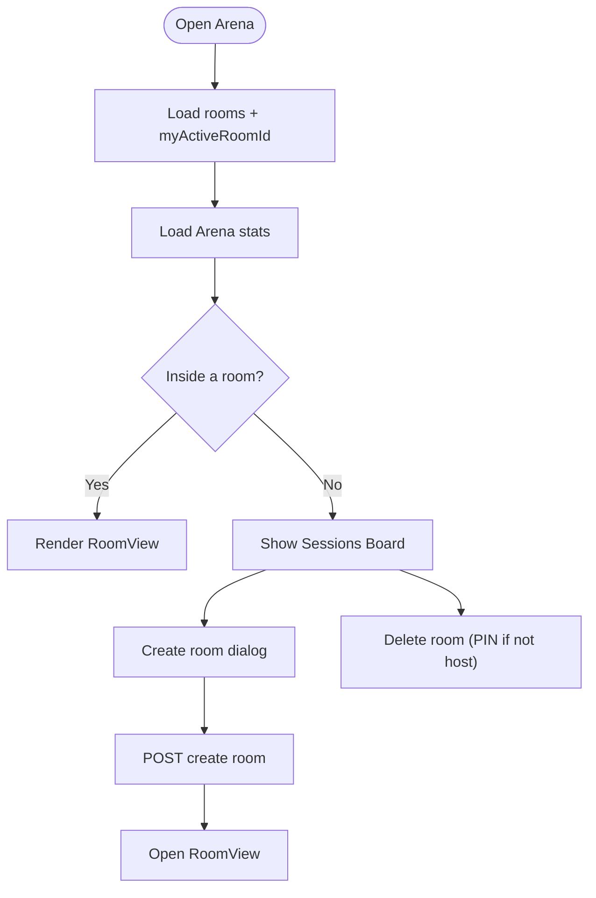
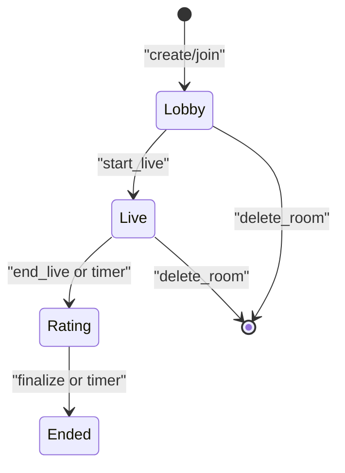
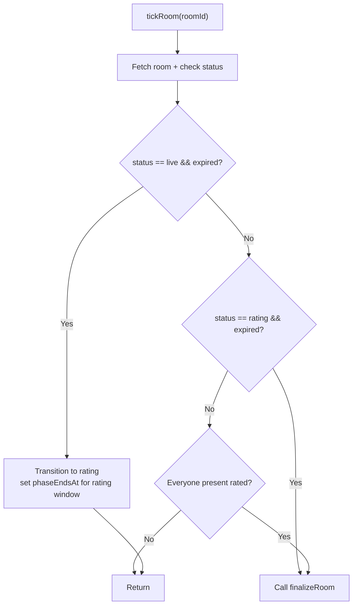
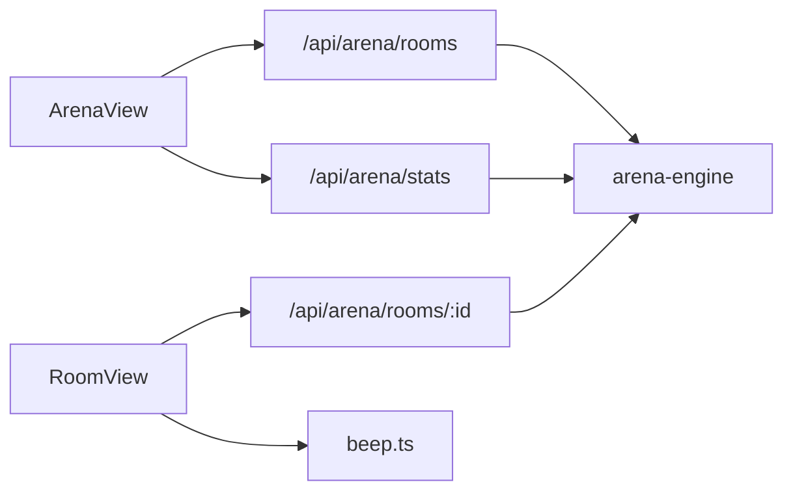

# Arena Battle Components

<cite>
**Referenced Files in This Document**
- [arena-view.tsx](file://src/components/welearn/arena/arena-view.tsx)
- [room-view.tsx](file://src/components/welearn/arena/room-view.tsx)
- [beep.ts](file://src/components/welearn/arena/beep.ts)
- [types.ts](file://src/components/welearn/arena/types.ts)
- [arena-engine.ts](file://src/lib/arena-engine.ts)
- [rooms route](file://src/app/api/arena/rooms/route.ts)
- [rooms/[id] route](file://src/app/api/arena/rooms/[id]/route.ts)
- [stats route](file://src/app/api/arena/stats/route.ts)
</cite>

## Table of Contents
1. [Introduction](#introduction)
2. [Project Structure](#project-structure)
3. [Core Components](#core-components)
4. [Architecture Overview](#architecture-overview)
5. [Detailed Component Analysis](#detailed-component-analysis)
6. [Dependency Analysis](#dependency-analysis)
7. [Performance Considerations](#performance-considerations)
8. [Troubleshooting Guide](#troubleshooting-guide)
9. [Conclusion](#conclusion)

## Introduction
This document explains the arena battle system that powers real-time collaborative learning experiences for Group Discussion, Debate, and Pitching sessions. It covers:
- The arena view component that orchestrates multiple game modes and room discovery.
- The room view component handling individual room states, participant management, and real-time updates.
- The beep utility used for audio feedback during phase transitions.
- Shared type definitions for game states, participant data, scoring, and profile statistics.
- Server-side lifecycle logic, Elo rating calculations, peer evaluation, Minutes of Meeting generation, and coaching suggestions.
- Real-time polling patterns over HTTP, state synchronization across clients, conflict resolution through atomic transitions, and performance considerations for concurrent users.

The system is designed so that clients poll a small set of REST endpoints every 1.5 seconds to stay synchronized with server-authoritative timers and room state. When a session ends, peer ratings are aggregated into badges, points, Elo deltas, and an AI-assisted summary.

## Project Structure
The arena feature spans client components, shared types, server routes, and a server-only engine:

**Diagram sources**
- [arena-view.tsx:40-146](file://src/components/welearn/arena/arena-view.tsx#L40-L146)
- [room-view.tsx:27-118](file://src/components/welearn/arena/room-view.tsx#L27-L118)
- [beep.ts:1-26](file://src/components/welearn/arena/beep.ts#L1-L26)
- [types.ts:1-165](file://src/components/welearn/arena/types.ts#L1-L165)
- [rooms route:8-115](file://src/app/api/arena/rooms/route.ts#L8-L115)
- [rooms/[id] route:10-291](file://src/app/api/arena/rooms/[id]/route.ts#L10-L291)
- [stats route:6-98](file://src/app/api/arena/stats/route.ts#L6-L98)
- [arena-engine.ts:1-415](file://src/lib/arena-engine.ts#L1-L415)

**Section sources**
- [arena-view.tsx:40-146](file://src/components/welearn/arena/arena-view.tsx#L40-L146)
- [room-view.tsx:27-118](file://src/components/welearn/arena/room-view.tsx#L27-L118)
- [types.ts:1-165](file://src/components/welearn/arena/types.ts#L1-L165)
- [arena-engine.ts:1-415](file://src/lib/arena-engine.ts#L1-L415)

## Core Components
- ArenaView: Displays the sessions board, allows creating rooms (Group Discussion, Debate, Pitch), shows the user’s active room, and renders the Arena profile with Elo, radar chart, remarks, and coaching suggestions. It polls the board endpoint every five seconds when not inside a room.
- RoomView: Manages one room’s lifecycle. It polls the room endpoint every 1.5 seconds, renders Lobby/Live/Rating/Ended phases, handles join/leave, stance selection, key arguments, host controls, peer rating submission, and finalization. It plays a beep when live time expires and transitions to rating.
- Beep: A tiny Web Audio API helper that emits short tones or sequences for phase transitions.
- Types: Shared TypeScript interfaces and metadata for modes, statuses, aspects, players, minutes-of-meeting, board rooms, and stats.
- Engine: Server-side orchestration of room lifecycle, rating aggregation, badge assignment, Elo delta computation, streaks, radar axis mapping, AI-generated Minutes of Meeting, and rule-based coaching suggestions.

**Section sources**
- [arena-view.tsx:40-146](file://src/components/welearn/arena/arena-view.tsx#L40-L146)
- [room-view.tsx:27-118](file://src/components/welearn/arena/room-view.tsx#L27-L118)
- [beep.ts:1-26](file://src/components/welearn/arena/beep.ts#L1-L26)
- [types.ts:1-165](file://src/components/welearn/arena/types.ts#L1-L165)
- [arena-engine.ts:1-415](file://src/lib/arena-engine.ts#L1-L415)

## Architecture Overview
The arena uses HTTP polling instead of WebSockets. Clients repeatedly call:
- GET /api/arena/rooms: returns all active/recently completed rooms plus the user’s active room ID.
- GET /api/arena/rooms/:id: returns full room state, participants, aspects, and per-user permissions; also advances the room clock via tickRoom.
- POST /api/arena/rooms/:id: consolidates all room actions (join, leave, cohost, set_topic, start_live, end_live, finalize, stance, key_argument, rate).
- GET /api/arena/stats: returns the user’s Elo, tier, radar, history, remarks, and coaching suggestions.

**Diagram sources**
- [arena-view.tsx:61-92](file://src/components/welearn/arena/arena-view.tsx#L61-L92)
- [room-view.tsx:41-76](file://src/components/welearn/arena/room-view.tsx#L41-L76)
- [rooms route:8-79](file://src/app/api/arena/rooms/route.ts#L8-L79)
- [rooms/[id] route:10-124](file://src/app/api/arena/rooms/[id]/route.ts#L10-L124)
- [rooms/[id] route:127-291](file://src/app/api/arena/rooms/[id]/route.ts#L127-L291)
- [stats route:6-98](file://src/app/api/arena/stats/route.ts#L6-L98)
- [arena-engine.ts:102-132](file://src/lib/arena-engine.ts#L102-L132)

## Detailed Component Analysis

### Arena View
Responsibilities:
- Load and display the sessions board.
- Create new rooms with mode, title, optional topic, and optional timers.
- Show the user’s active room and allow rejoining.
- Render the Arena profile with Elo, tier, radar chart, remarks, badges, and coaching suggestions.
- Poll the board every five seconds when not inside a room.

Key behaviors:
- Board loading calls GET /api/arena/rooms and stores rooms and myActiveRoomId.
- Stats loading calls GET /api/arena/stats and caches gdElo, radar, suggestions, and remarks.
- Creating a room sends POST /api/arena/rooms with userId, title, mode, topic, liveSec, and ratingSec.
- Deleting a room requires PIN unless the caller is the host.

**Diagram sources**
- [arena-view.tsx:61-146](file://src/components/welearn/arena/arena-view.tsx#L61-L146)
- [arena-view.tsx:94-131](file://src/components/welearn/arena/arena-view.tsx#L94-L131)

**Section sources**
- [arena-view.tsx:40-146](file://src/components/welearn/arena/arena-view.tsx#L40-L146)
- [arena-view.tsx:148-343](file://src/components/welearn/arena/arena-view.tsx#L148-L343)
- [arena-view.tsx:346-436](file://src/components/welearn/arena/arena-view.tsx#L346-L436)

### Room View
Responsibilities:
- Poll the room endpoint every 1.5 seconds.
- Compute local countdown using serverNow and phaseEndsAt.
- Play a beep when transitioning from live to rating.
- Manage Lobby, Live, Rating, and Ended phases.
- Handle join/leave, stance selection, key argument saving, host controls, peer rating submission, and finalization.

Real-time polling pattern:
- The component sets up an interval calling GET /api/arena/rooms/:id?userId=...
- On each poll, it updates the local state and computes clockOffset = serverNow - Date.now().
- If the room becomes unavailable, it shows a toast and exits back to the board.

Phase transitions:
- Lobby: Host sets topic, session length, delegates co-hosts, starts live. Participants can join or leave.
- Live: Session runs with optional timer. Host can end early. Participants can save key arguments.
- Rating: Everyone rates everyone on mode-specific aspects. Remarks are optional. Host can close ratings early.
- Ended: Results show ranked participants, MVP, badges, Elo deltas, and AI-generated Minutes of Meeting.

**Diagram sources**
- [room-view.tsx:181-215](file://src/components/welearn/arena/room-view.tsx#L181-L215)
- [rooms/[id] route:198-228](file://src/app/api/arena/rooms/[id]/route.ts#L198-L228)

**Section sources**
- [room-view.tsx:27-118](file://src/components/welearn/arena/room-view.tsx#L27-L118)
- [room-view.tsx:220-396](file://src/components/welearn/arena/room-view.tsx#L220-L396)
- [room-view.tsx:398-464](file://src/components/welearn/arena/room-view.tsx#L398-L464)
- [room-view.tsx:466-618](file://src/components/welearn/arena/room-view.tsx#L466-L618)
- [room-view.tsx:620-749](file://src/components/welearn/arena/room-view.tsx#L620-L749)

### Beep Utility
Purpose:
- Provide subtle audio cues when phase transitions occur, especially when live time expires and rating opens.

Implementation:
- Uses Web Audio API to create a sine oscillator with configurable frequency, duration, and volume.
- Gracefully catches errors if audio context is unavailable.
- Provides a chimeSequence helper for multi-tone cues.

Usage:
- RoomView triggers beep when the room status changes from live to rating.

**Section sources**
- [beep.ts:1-26](file://src/components/welearn/arena/beep.ts#L1-L26)
- [room-view.tsx:68-76](file://src/components/welearn/arena/room-view.tsx#L68-L76)

### Types
Shared types define the contract between client and server:
- Stance: for, against, moderator.
- RoomStatus: lobby, live, rating, ended.
- RoomMode: gd, debate, pitch.
- Aspect: key, label, hint for star-rating dimensions.
- ArenaPlayer: per-participant data including presence, stance, stars, averages, Elo delta, badges, points.
- MoM: Minutes of Meeting structure including narrative and side-by-side arguments for debates.
- ArenaRoomState: server response shape for a single room.
- BoardRoom: compact representation for the sessions board.
- ArenaStats: user profile data including Elo, tier, radar, rank, history, remarks, and suggestions.
- Metadata constants: MODE_META, STANCE_META, STATUS_META, and formatting helpers fmtClock and fmtDur.

These types ensure consistent rendering and validation across UI and API layers.

**Section sources**
- [types.ts:1-165](file://src/components/welearn/arena/types.ts#L1-L165)

### Server Engine
Responsibilities:
- Define mode-specific rating aspects aligned with published rubrics.
- Advance room lifecycle based on wall-clock time via tickRoom.
- Finalize rooms by aggregating peer ratings, assigning badges, computing Elo deltas, updating streaks and radar axes, generating MoM, and logging activity.
- Provide coaching suggestions based on radar axes and win rate.

Lifecycle:
- tickRoom checks phaseEndsAt and transitions live→rating and rating→ended accordingly.
- Fast path: if everyone present has submitted ratings, finalize immediately.
- finalizeRoom aggregates aspect averages, selects MVP and aspect stars, computes points and Elo deltas, maps aspects to canonical radar axes, updates user stats, and writes MoM.

**Diagram sources**
- [arena-engine.ts:102-132](file://src/lib/arena-engine.ts#L102-L132)

Scoring and Elo:
- Points: base participation + performance bonus + MVP bonus.
- Elo delta: derived from average stars relative to a baseline, with MVP and host bonuses, clamped to a range.
- Radar mapping: mode-specific aspects map to canonical axes content, delivery, listening, leadership.
- Badges: MVP and per-aspect Star badges awarded when thresholds are met.

Coaching:
- Rule-based suggestions highlight weakest axes and encourage improvement.
- Win-rate insights and tier progression guidance are included.

**Section sources**
- [arena-engine.ts:28-66](file://src/lib/arena-engine.ts#L28-L66)
- [arena-engine.ts:88-132](file://src/lib/arena-engine.ts#L88-L132)
- [arena-engine.ts:146-198](file://src/lib/arena-engine.ts#L146-L198)
- [arena-engine.ts:200-366](file://src/lib/arena-engine.ts#L200-L366)
- [arena-engine.ts:368-415](file://src/lib/arena-engine.ts#L368-L415)

### API Routes

#### GET /api/arena/rooms
- Returns active and recently completed rooms with minimal participant info.
- Drives lifecycle for rooms without open clients by calling tickRoom.
- Computes MVP from stored MoM JSON for ended rooms.
- Includes isMember flag for the requesting user.

**Section sources**
- [rooms route:8-79](file://src/app/api/arena/rooms/route.ts#L8-L79)
- [rooms route:81-115](file://src/app/api/arena/rooms/route.ts#L81-L115)

#### GET /api/arena/rooms/:id
- Calls tickRoom to advance phases.
- Updates lastSeen heartbeat for present participants.
- Builds rich participant objects including myStars, myRemark, finalized results, and permissions.
- Returns serverNow, room, aspects, participants, me, submittedBy, and mom.

**Section sources**
- [rooms/[id] route:10-124](file://src/app/api/arena/rooms/[id]/route.ts#L10-L124)

#### POST /api/arena/rooms/:id
- Consolidates all room actions:
  - join/leave: manage participation and deletion behavior.
  - delete_room: host or team PIN.
  - cohost: delegate host controls.
  - set_topic: update motion/topic.
  - start_live: transition lobby→live with optional timer.
  - end_live: transition live→rating with optional rating window.
  - finalize: trigger finalizeRoom.
  - stance: pick for/against/moderator in debate mode.
  - key_argument: save private key point.
  - rate: validate and upsert star ratings per aspect.

**Section sources**
- [rooms/[id] route:127-291](file://src/app/api/arena/rooms/[id]/route.ts#L127-L291)

#### GET /api/arena/stats
- Aggregates user stats: Elo, tier, played count, streak, radar averages, rank, top10 leaderboard slice, history, badge counts, remarks, average stars, win rate, and coaching suggestions.

**Section sources**
- [stats route:6-98](file://src/app/api/arena/stats/route.ts#L6-L98)

## Dependency Analysis
Component relationships:
- ArenaView depends on rooms and stats endpoints and renders RoomView when a room is open.
- RoomView depends on the room endpoint for state and actions, and uses beep for audio cues.
- Both views depend on shared types for consistent data shapes.
- Server routes depend on the engine for lifecycle and scoring logic.
- Engine depends on database models and AI utilities for MoM generation.

**Diagram sources**
- [arena-view.tsx:61-92](file://src/components/welearn/arena/arena-view.tsx#L61-L92)
- [room-view.tsx:41-76](file://src/components/welearn/arena/room-view.tsx#L41-L76)
- [rooms route:8-79](file://src/app/api/arena/rooms/route.ts#L8-L79)
- [rooms/[id] route:10-124](file://src/app/api/arena/rooms/[id]/route.ts#L10-L124)
- [stats route:6-98](file://src/app/api/arena/stats/route.ts#L6-L98)
- [arena-engine.ts:102-132](file://src/lib/arena-engine.ts#L102-L132)

**Section sources**
- [arena-view.tsx:61-92](file://src/components/welearn/arena/arena-view.tsx#L61-L92)
- [room-view.tsx:41-76](file://src/components/welearn/arena/room-view.tsx#L41-L76)
- [rooms route:8-79](file://src/app/api/arena/rooms/route.ts#L8-L79)
- [rooms/[id] route:10-124](file://src/app/api/arena/rooms/[id]/route.ts#L10-L124)
- [stats route:6-98](file://src/app/api/arena/stats/route.ts#L6-L98)
- [arena-engine.ts:102-132](file://src/lib/arena-engine.ts#L102-L132)

## Performance Considerations
- Polling cadence: RoomView polls every 1.5 seconds; ArenaView polls the board every 5 seconds when not inside a room. This balances responsiveness with server load.
- Server-authoritative timers: Clients render countdowns using serverNow and phaseEndsAt, avoiding drift and ensuring consistent transitions across clients.
- Atomic transitions: claimTransition uses updateMany with a where clause matching the current status, preventing race conditions when multiple requests attempt the same phase change.
- Presence heartbeats: lastSeen is updated on polls to support fast-path finalization when all present participants have rated.
- Efficient queries: The rooms list endpoint limits results and includes only necessary participant fields; stats endpoint slices history and top10.
- Optional timers: Untimed sessions avoid unnecessary timer computations and rely on host control.
- Lightweight audio: beep uses a simple oscillator and gracefully degrades if audio is unavailable.

[No sources needed since this section provides general guidance]

## Troubleshooting Guide
Common issues and resolutions:
- Room unavailable: If GET /api/arena/rooms/:id fails, RoomView shows a destructive toast and exits to the board. Verify the room exists and the user has permission.
- Action failed: POST actions return descriptive errors; check permissions (host/co-host), room status constraints, and input validation (e.g., topic length, valid stances, rating values 1–5).
- Timer not advancing: Ensure tickRoom is called on both GET endpoints and that phaseEndsAt is set correctly for live and rating windows.
- Ratings not finalizing: Confirm all present participants have submitted ratings or that the rating timer has expired. Check lastSeen heartbeats and fast-path logic.
- Audio not playing: beep may fail if the browser blocks audio context; visual cues remain functional.
- Profile stats missing: Ensure finalizeRoom ran and user stats were updated; verify gdRatingsCount > 0 before radar averages appear.

**Section sources**
- [room-view.tsx:41-57](file://src/components/welearn/arena/room-view.tsx#L41-L57)
- [rooms/[id] route:127-291](file://src/app/api/arena/rooms/[id]/route.ts#L127-L291)
- [arena-engine.ts:102-132](file://src/lib/arena-engine.ts#L102-L132)
- [beep.ts:1-26](file://src/components/welearn/arena/beep.ts#L1-L26)

## Conclusion
The arena battle system provides a robust, real-time collaborative learning environment for Group Discussion, Debate, and Pitching. Its design emphasizes:
- Clear separation of concerns between UI components, shared types, server routes, and engine logic.
- Reliable synchronization through HTTP polling with server-authoritative timers.
- Fair and transparent scoring via peer evaluations, badges, points, and Elo ratings.
- Actionable feedback through Minutes of Meeting and coaching suggestions.
- Scalable patterns such as atomic transitions, presence heartbeats, and efficient queries.

This architecture supports concurrent users while maintaining consistency and providing a rich, gamified learning experience.

[No sources needed since this section summarizes without analyzing specific files]