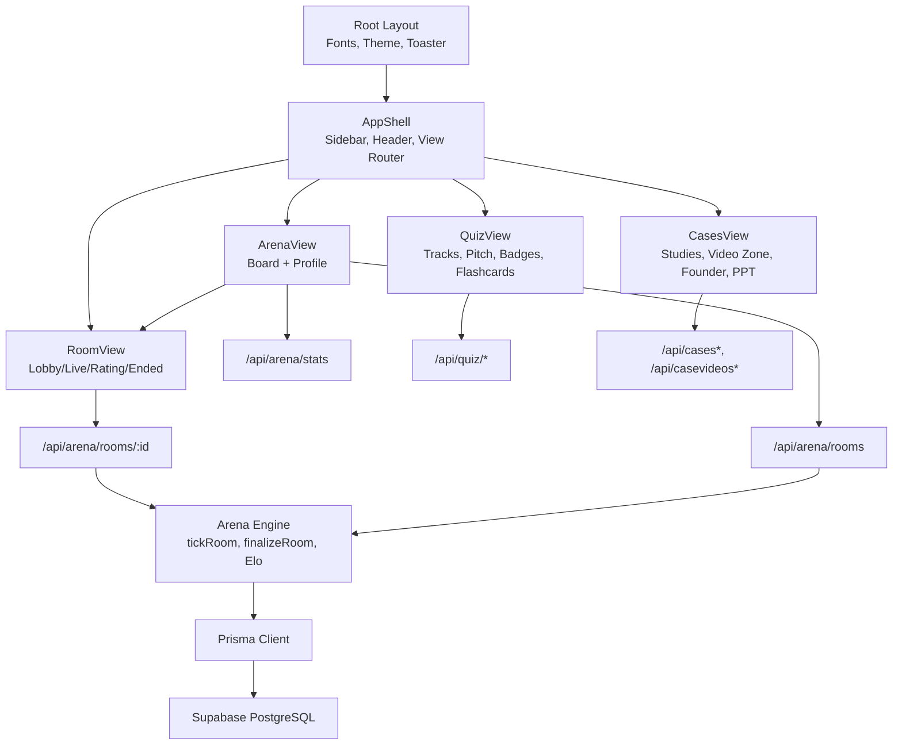
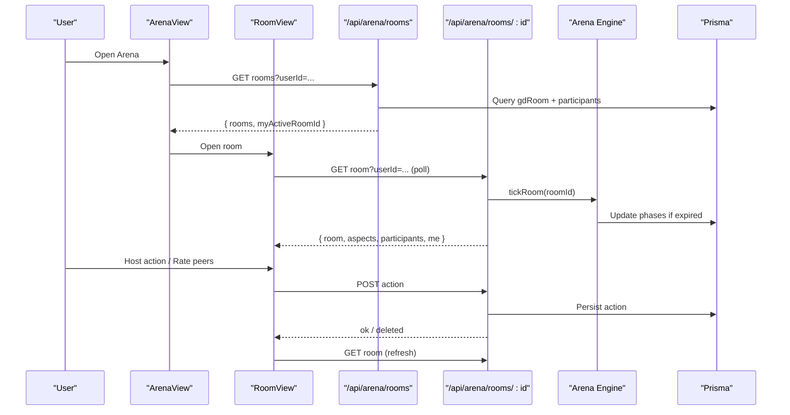
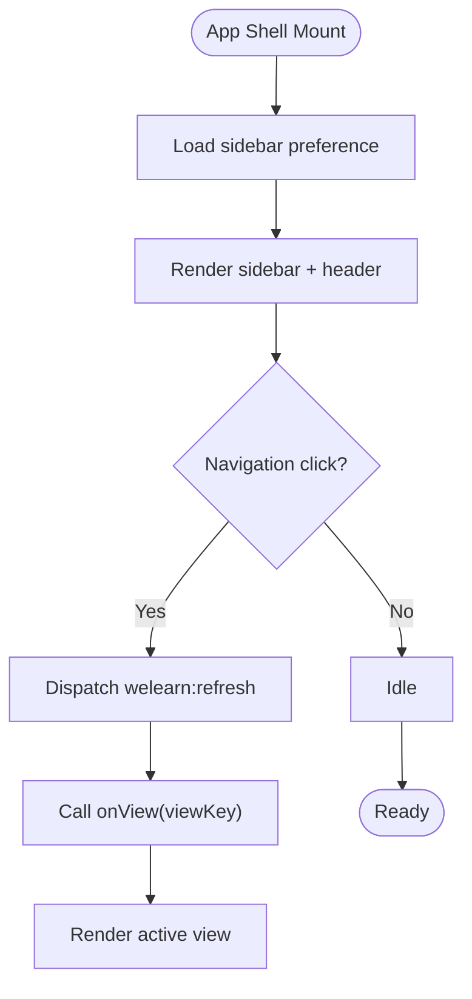
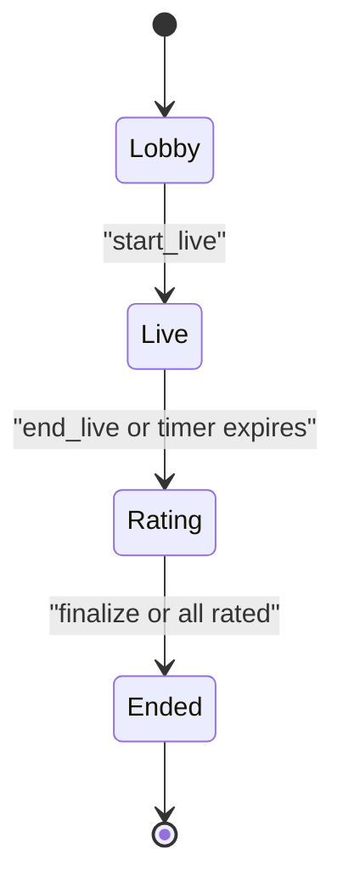
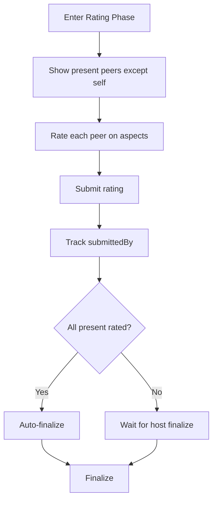
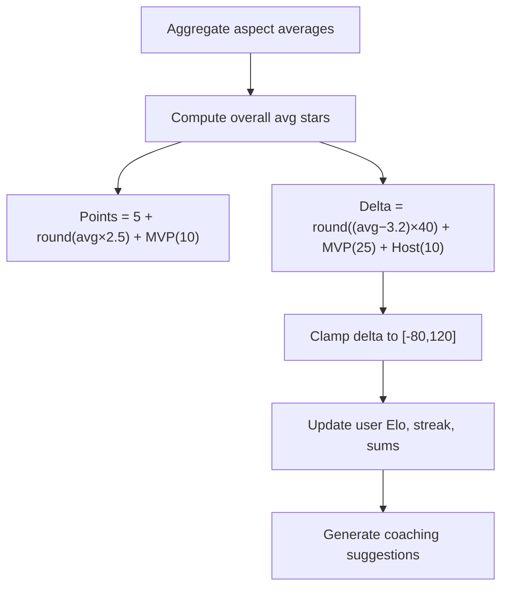
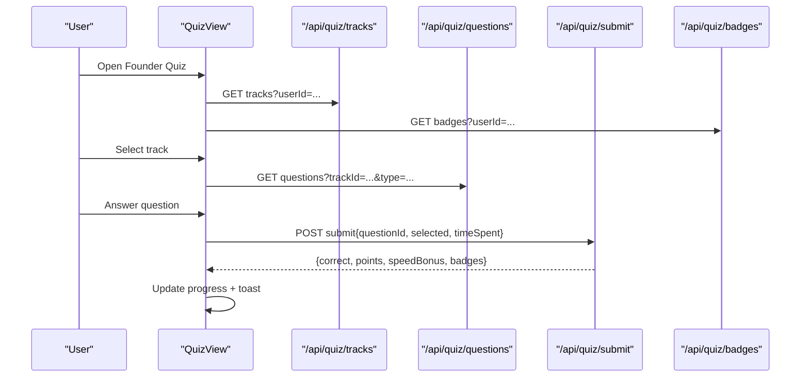
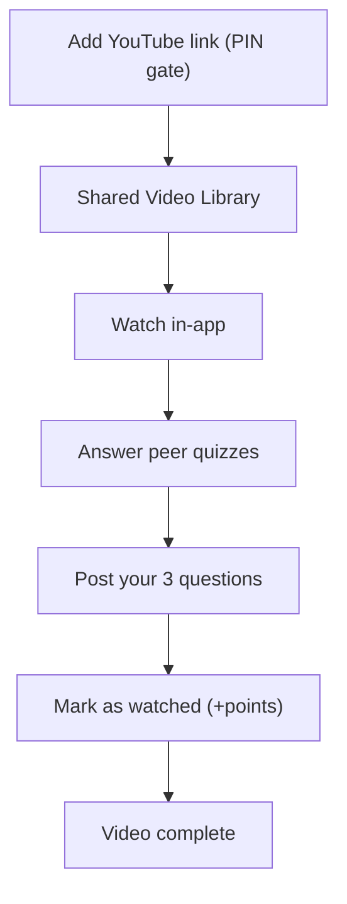
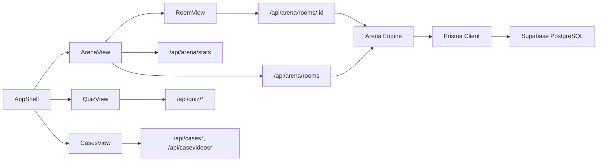

# Business Components

<cite>
**Referenced Files in This Document**   
- [README.md](file://README.md)
- [layout.tsx](file://src/app/layout.tsx)
- [app-shell.tsx](file://src/components/welearn/app-shell.tsx)
- [arena-view.tsx](file://src/components/welearn/arena/arena-view.tsx)
- [room-view.tsx](file://src/components/welearn/arena/room-view.tsx)
- [types.ts](file://src/components/welearn/arena/types.ts)
- [arena-engine.ts](file://src/lib/arena-engine.ts)
- [rooms route.ts](file://src/app/api/arena/rooms/route.ts)
- [room id route.ts](file://src/app/api/arena/rooms/[id]/route.ts)
- [arena stats route.ts](file://src/app/api/arena/stats/route.ts)
- [db.ts](file://src/lib/db.ts)
- [session.ts](file://src/lib/session.ts)
- [quiz-view.tsx](file://src/components/welearn/quiz-view.tsx)
- [cases-view.tsx](file://src/components/welearn/cases-view.tsx)
</cite>

## Table of Contents
1. [Introduction](#introduction)
2. [Project Structure](#project-structure)
3. [Core Components](#core-components)
4. [Architecture Overview](#architecture-overview)
5. [Detailed Component Analysis](#detailed-component-analysis)
6. [Dependency Analysis](#dependency-analysis)
7. [Performance Considerations](#performance-considerations)
8. [Troubleshooting Guide](#troubleshooting-guide)
9. [Conclusion](#conclusion)

## Introduction
WeLearn is an E-Cell preparation platform that combines live arena battles, founder-mode quizzes, case-study teardowns, a shared video zone, crosswords, and analytics. The business components documented here implement the app shell, navigation, arena battle system, quiz interface, and case study library. They share a consistent pattern: client components manage local UI state, poll or call Next.js API routes, and persist user progress through Prisma-backed data.

The arena module is the most complex interactive feature: it supports three modes (Group Discussion, Debate, Pitching), server-authoritative timers, star-based peer ratings, Elo scoring, badges, streaks, coaching suggestions, and AI-generated session summaries. The quiz module provides scenario-based learning, red-flag audits, micro-math drills, pitch pairing, flashcards, and per-track badges. The case study module integrates YouTube playback, peer quizzes, founder prompts, and PPT challenges with progress tracking.

**Section sources**
- [README.md:1-104](file://README.md#L1-L104)

## Project Structure
At a high level, the application follows a Next.js App Router layout with:
- A root layout that sets fonts, metadata, theme bootstrap, and global toasts.
- An `AppShell` component that owns navigation, sidebar, header, mobile chip nav, and view routing.
- Feature views under `src/components/welearn`, including Arena, Quiz, Cases, Crosswords, GD, Studio, and Leaderboard.
- Server-side API routes under `src/app/api`, backed by Prisma and optional AI generation.
- Shared libraries for database access, session handling, helpers, and domain engines such as the arena engine.

**Diagram sources**
- [layout.tsx:1-71](file://src/app/layout.tsx#L1-L71)
- [app-shell.tsx:1-325](file://src/components/welearn/app-shell.tsx#L1-L325)
- [arena-view.tsx:1-506](file://src/components/welearn/arena/arena-view.tsx#L1-L506)
- [room-view.tsx:1-750](file://src/components/welearn/arena/room-view.tsx#L1-L750)
- [arena-engine.ts:1-415](file://src/lib/arena-engine.ts#L1-L415)
- [rooms route.ts:1-115](file://src/app/api/arena/rooms/route.ts#L1-L115)
- [room id route.ts:1-291](file://src/app/api/arena/rooms/[id]/route.ts#L1-L291)
- [arena stats route.ts:1-98](file://src/app/api/arena/stats/route.ts#L1-L98)
- [db.ts:1-50](file://src/lib/db.ts#L1-L50)

**Section sources**
- [layout.tsx:1-71](file://src/app/layout.tsx#L1-L71)
- [app-shell.tsx:1-325](file://src/components/welearn/app-shell.tsx#L1-L325)

## Core Components
This section summarizes the primary business components and their responsibilities.

- **App Shell**: Provides navigation between modules, manages sidebar pinning, user avatar menu, global refresh event, and mobile chip navigation. It renders the active view and passes user context and point callbacks to child views.
- **Arena View**: Displays the sessions board, room creation dialog, and profile tab with Elo, radar chart, remarks, and badges. It polls rooms and stats and delegates open rooms to `RoomView`.
- **Room View**: Implements the four-phase room lifecycle: Lobby, Live, Rating, Ended. It polls room state, handles host actions, participant stances, key arguments, star ratings, and displays results and AI-generated Minutes of Meeting.
- **Arena Engine**: Server-only logic for room lifecycle transitions, rating aggregation, badge assignment, Elo calculation, streak updates, activity logging, and coaching suggestions.
- **Quiz View**: Manages founder tracks, question submission, pitch pairing, badges, and flashcards. It loads tracks, questions, pitches, and badges from API endpoints and persists attempts and progress.
- **Cases View**: Integrates case studies with embedded YouTube videos, discussion tasks, notes, and progress steps; includes Video Zone with shared YouTube links, peer quizzes, and completion gating; supports founder cases and PPT challenges with peer ratings.

**Section sources**
- [app-shell.tsx:1-325](file://src/components/welearn/app-shell.tsx#L1-L325)
- [arena-view.tsx:1-506](file://src/components/welearn/arena/arena-view.tsx#L1-L506)
- [room-view.tsx:1-750](file://src/components/welearn/arena/room-view.tsx#L1-L750)
- [arena-engine.ts:1-415](file://src/lib/arena-engine.ts#L1-L415)
- [quiz-view.tsx:1-800](file://src/components/welearn/quiz-view.tsx#L1-L800)
- [cases-view.tsx:1-800](file://src/components/welearn/cases-view.tsx#L1-L800)

## Architecture Overview
The architecture separates concerns across client views, API routes, and server engines:

- **Client Views**: React components using hooks for local state, Framer Motion for animations, shadcn/ui primitives, and toast notifications. They call the centralized `api` helper for HTTP requests.
- **API Routes**: Next.js Route Handlers validate inputs, enforce permissions, update Prisma models, and return typed payloads. Some routes also trigger server-side engines like `tickRoom` and `finalizeRoom`.
- **Server Engines**: Domain logic encapsulated in `arena-engine.ts`, including mode-specific aspects, Elo tiering, atomic phase transitions, rating aggregation, badge computation, and coaching rules.
- **Data Layer**: Prisma client configured to support multiple environment variables for PostgreSQL URLs, enabling SQLite development and Supabase production.

**Diagram sources**
- [arena-view.tsx:40-146](file://src/components/welearn/arena/arena-view.tsx#L40-L146)
- [room-view.tsx:27-118](file://src/components/welearn/arena/room-view.tsx#L27-L118)
- [rooms route.ts:8-79](file://src/app/api/arena/rooms/route.ts#L8-L79)
- [room id route.ts:10-124](file://src/app/api/arena/rooms/[id]/route.ts#L10-L124)
- [arena-engine.ts:88-132](file://src/lib/arena-engine.ts#L88-L132)

## Detailed Component Analysis

### App Shell Navigation and User Flow Management
The App Shell defines the main navigation items, filters admin-only entries based on user role, and manages sidebar pinning via localStorage. It exposes a global refresh event that child views can listen to for data synchronization. The header shows a live indicator, streak count, refresh button, theme switcher, and account dropdown. Mobile users see a horizontal chip nav.

Key behaviors:
- Sidebar expand/collapse with hover and pinned state persistence.
- Haptic feedback on navigation interactions.
- Global refresh event dispatch for coordinated data reloads.
- User avatar menu with quick navigation to Studio and Crosswords, plus logout.

**Diagram sources**
- [app-shell.tsx:54-92](file://src/components/welearn/app-shell.tsx#L54-L92)
- [app-shell.tsx:153-193](file://src/components/welearn/app-shell.tsx#L153-L193)
- [app-shell.tsx:232-315](file://src/components/welearn/app-shell.tsx#L232-L315)

**Section sources**
- [app-shell.tsx:1-325](file://src/components/welearn/app-shell.tsx#L1-L325)

### Arena Battle System: Real-Time Collaboration, State Management, and Elo Ratings
The Arena module implements a multi-mode battle system with real-time collaboration through polling and server-authoritative state.

#### Room Lifecycle and Polling
- `ArenaView` polls `/api/arena/rooms` every five seconds unless a room is open.
- `RoomView` polls `/api/arena/rooms/:id` every 1.5 seconds, computing clock offset against `serverNow` for synchronized countdowns.
- When the live timer expires, the room transitions to rating; when the rating timer expires or everyone submits, the room finalizes.

**Diagram sources**
- [room-view.tsx:181-216](file://src/components/welearn/arena/room-view.tsx#L181-L216)
- [room id route.ts:198-228](file://src/app/api/arena/rooms/[id]/route.ts#L198-L228)
- [arena-engine.ts:102-132](file://src/lib/arena-engine.ts#L102-L132)

#### Star Ratings and Aspects
- Each mode has specific rating aspects defined in `MODE_ASPECTS`.
- Participants rate each other on these aspects during the rating phase.
- Remarks are optional and appear on the ratee’s profile.

**Diagram sources**
- [room-view.tsx:468-617](file://src/components/welearn/arena/room-view.tsx#L468-L617)
- [room id route.ts:251-282](file://src/app/api/arena/rooms/[id]/route.ts#L251-L282)

#### Elo Calculation and Coaching
- Elo deltas are computed from average star ratings, MVP bonus, and host bonus, clamped within bounds.
- Tiers map Elo ranges to titles.
- Coaching suggestions analyze radar axes and win rate to provide actionable tips.

**Diagram sources**
- [arena-engine.ts:209-366](file://src/lib/arena-engine.ts#L209-L366)
- [arena-engine.ts:368-415](file://src/lib/arena-engine.ts#L368-L415)

**Section sources**
- [arena-view.tsx:40-146](file://src/components/welearn/arena/arena-view.tsx#L40-L146)
- [room-view.tsx:27-218](file://src/components/welearn/arena/room-view.tsx#L27-L218)
- [room-view.tsx:468-749](file://src/components/welearn/arena/room-view.tsx#L468-L749)
- [arena-engine.ts:21-66](file://src/lib/arena-engine.ts#L21-L66)
- [arena-engine.ts:88-132](file://src/lib/arena-engine.ts#L88-L132)
- [arena-engine.ts:209-415](file://src/lib/arena-engine.ts#L209-L415)
- [rooms route.ts:8-115](file://src/app/api/arena/rooms/route.ts#L8-L115)
- [room id route.ts:10-291](file://src/app/api/arena/rooms/[id]/route.ts#L10-L291)
- [arena stats route.ts:1-98](file://src/app/api/arena/stats/route.ts#L1-L98)
- [types.ts:1-165](file://src/components/welearn/arena/types.ts#L1-L165)

### Quiz Interface: Scenario-Based Learning, Badges, and Progress Tracking
The Quiz View organizes founder-mode training into tracks, pitch pairing, badges, and flashcards.

- **Tracks**: Users select a track and answer scenario, red-flag, or micro-math questions. Each question submission calls `/api/quiz/submit`, returning correctness, explanation, points, speed bonus, and newly awarded badges.
- **Pitch Pairing**: Users generate three random terms and deliver a 60-second elevator pitch; missing-term detection is handled server-side.
- **Badges**: Per-track badges are earned by meeting criteria; the Badges tab displays progress and awards.
- **Flashcards**: Startup-context flip cards with definitions, real startup stories, and warnings; users mark known/learning and earn points.

**Diagram sources**
- [quiz-view.tsx:156-262](file://src/components/welearn/quiz-view.tsx#L156-L262)
- [quiz-view.tsx:505-735](file://src/components/welearn/quiz-view.tsx#L505-L735)

**Section sources**
- [quiz-view.tsx:1-800](file://src/components/welearn/quiz-view.tsx#L1-L800)

### Case Study Library: Video Integration, Discussion Prompts, and Content Management
The Cases View provides four sub-tabs: Case Studies, Video Zone, Founder Cases, and PPT Challenges.

- **Case Studies**: Embedded YouTube videos, teardown descriptions, key metrics, discussion tasks, and progress steps (Watching → Analysed → Deck Ready). Notes are saved per case.
- **Video Zone**: Shared YouTube library where users add links (with team PIN), watch videos, answer peer quizzes, post their own three questions, and mark videos as watched only after completing both steps.
- **Founder Cases**: Prompt-driven responses rated by peers with star ratings.
- **PPT Challenges**: AI/member topics with .pptx/.pdf uploads rated by peers.

**Diagram sources**
- [cases-view.tsx:435-599](file://src/components/welearn/cases-view.tsx#L435-L599)
- [cases-view.tsx:605-800](file://src/components/welearn/cases-view.tsx#L605-L800)

**Section sources**
- [cases-view.tsx:1-800](file://src/components/welearn/cases-view.tsx#L1-L800)

## Dependency Analysis
The following diagram maps dependencies between core components and services:

**Diagram sources**
- [app-shell.tsx:1-325](file://src/components/welearn/app-shell.tsx#L1-L325)
- [arena-view.tsx:1-506](file://src/components/welearn/arena/arena-view.tsx#L1-L506)
- [room-view.tsx:1-750](file://src/components/welearn/arena/room-view.tsx#L1-L750)
- [arena-engine.ts:1-415](file://src/lib/arena-engine.ts#L1-L415)
- [rooms route.ts:1-115](file://src/app/api/arena/rooms/route.ts#L1-L115)
- [room id route.ts:1-291](file://src/app/api/arena/rooms/[id]/route.ts#L1-L291)
- [arena stats route.ts:1-98](file://src/app/api/arena/stats/route.ts#L1-L98)
- [db.ts:1-50](file://src/lib/db.ts#L1-L50)

**Section sources**
- [db.ts:1-50](file://src/lib/db.ts#L1-L50)
- [session.ts:1-43](file://src/lib/session.ts#L1-L43)

## Performance Considerations
- **Polling Intervals**: Arena room polling uses a 1.5-second interval; board polling uses 5 seconds. These intervals balance responsiveness with server load.
- **Clock Synchronization**: Clients compute `clockOffset` from `serverNow` to ensure accurate countdowns even with network latency.
- **Fast Path Finalization**: The engine checks presence and rating submission status to auto-finalize rooms early when all participants have rated.
- **Efficient Data Loading**: Quiz view loads tracks, badges, and pitches concurrently using `Promise.all`.
- **UI Optimizations**: Skeleton loaders prevent layout shifts; animations use Framer Motion for smooth transitions without blocking rendering.
- **Database Queries**: API routes include only necessary fields and limit result sets (e.g., top 10 leaderboard, recent history).

[No sources needed since this section provides general guidance]

## Troubleshooting Guide
Common issues and resolutions:

- **Room Unavailable**: If polling fails, `RoomView` shows a destructive toast and exits the room. Check network connectivity and room existence.
- **Action Failed**: Room actions return error messages via `jsonError`; verify user permissions (host/co-host) and valid parameters.
- **Timer Not Syncing**: Ensure `serverNow` is received and `clockOffset` is applied; check for stale connections.
- **Rating Validation Errors**: Aspects must be 1–5 stars; remarks are trimmed and limited to 400 characters.
- **Quiz Submission Errors**: Verify selected option exists and question ID is valid; check network and API availability.
- **Video Zone Gating**: Marking a video as watched requires answering all peer quizzes and posting three questions; incomplete steps disable the button.

**Section sources**
- [room-view.tsx:42-57](file://src/components/welearn/arena/room-view.tsx#L42-L57)
- [room id route.ts:127-291](file://src/app/api/arena/rooms/[id]/route.ts#L127-L291)
- [quiz-view.tsx:565-600](file://src/components/welearn/quiz-view.tsx#L565-L600)
- [cases-view.tsx:626-648](file://src/components/welearn/cases-view.tsx#L626-L648)

## Conclusion
WeLearn’s business components implement a cohesive, interactive learning platform centered around live arena battles, founder-mode quizzes, and case study engagement. The architecture cleanly separates client UI, API routing, and server-side domain logic, enabling robust state synchronization, scalable performance, and extensible features like AI generation and coaching. The arena system stands out with its rigorous rating rubrics, Elo progression, and collaborative features, while the quiz and case modules reinforce practical entrepreneurship skills through scenario-based learning and peer interaction.

[No sources needed since this section summarizes without analyzing specific files]