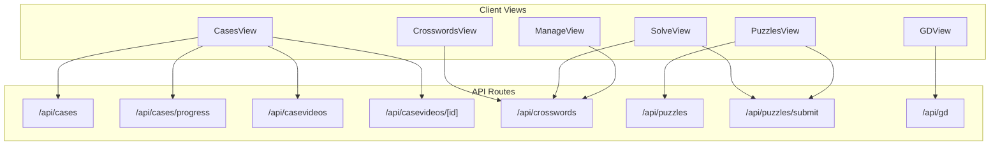
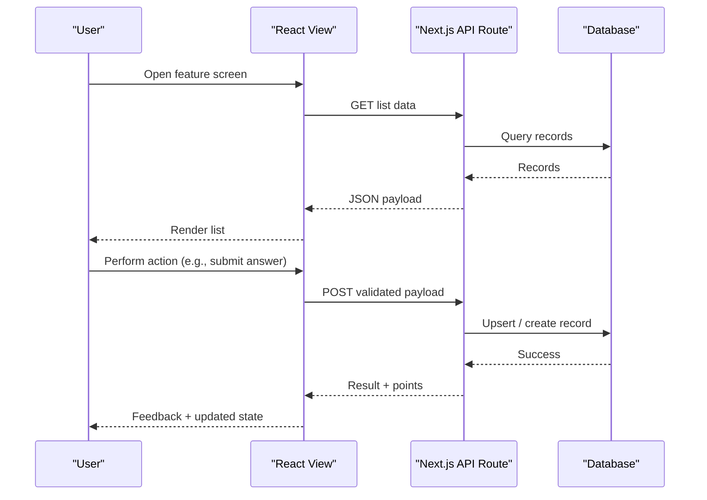
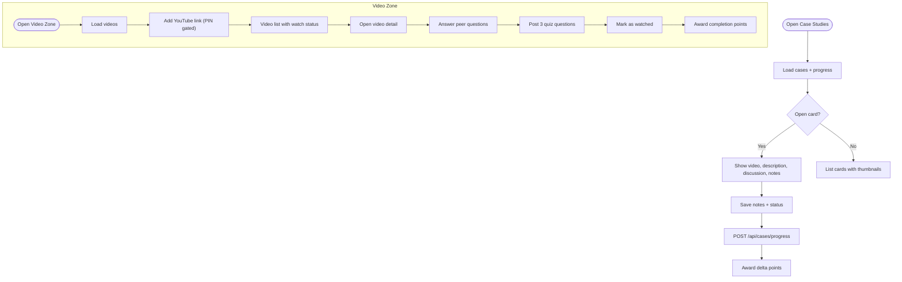
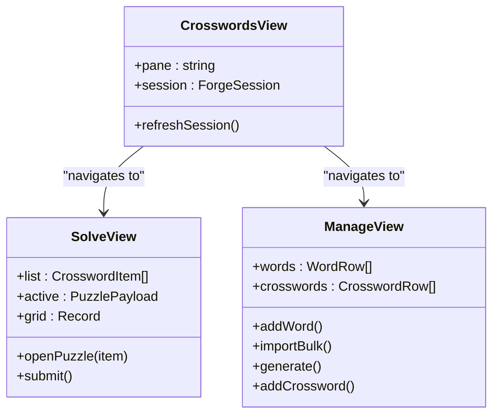
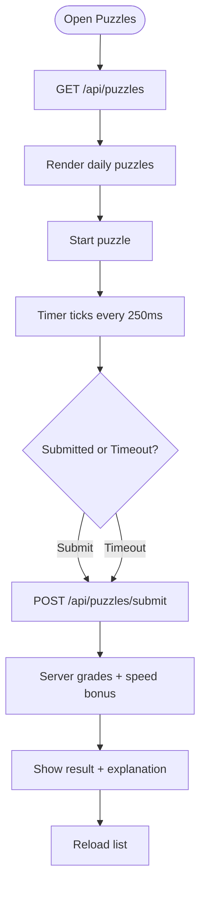
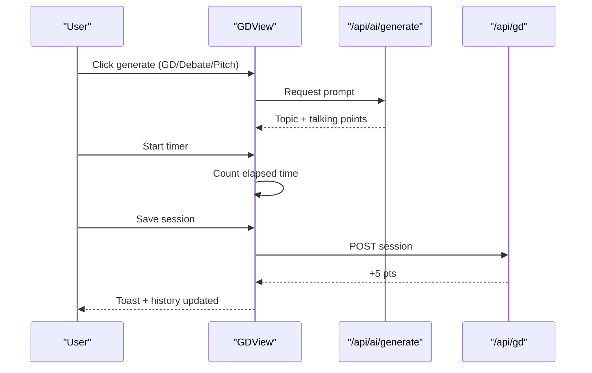
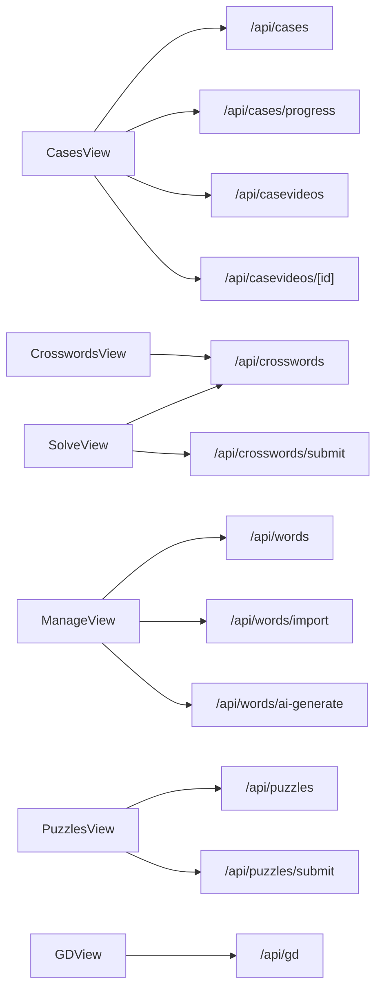

# Content Management Components

<cite>
**Referenced Files in This Document**   
- [cases-view.tsx](file://src/components/welearn/cases-view.tsx)
- [crosswords-view.tsx](file://src/components/welearn/crosswords-view.tsx)
- [solve-view.tsx](file://src/components/welearn/crosswords/solve-view.tsx)
- [manage-view.tsx](file://src/components/welearn/crosswords/manage-view.tsx)
- [puzzles-view.tsx](file://src/components/welearn/puzzles-view.tsx)
- [gd-view.tsx](file://src/components/welearn/gd-view.tsx)
- [api-cases-route.ts](file://src/app/api/cases/route.ts)
- [api-cases-progress-route.ts](file://src/app/api/cases/progress/route.ts)
- [api-casevideos-route.ts](file://src/app/api/casevideos/route.ts)
- [api-casevideos-id-route.ts](file://src/app/api/casevideos/[id]/route.ts)
- [api-crosswords-route.ts](file://src/app/api/crosswords/route.ts)
- [api-puzzles-route.ts](file://src/app/api/puzzles/route.ts)
- [api-puzzles-submit-route.ts](file://src/app/api/puzzles/submit/route.ts)
- [api-gd-route.ts](file://src/app/api/gd/route.ts)
</cite>

## Table of Contents
1. [Introduction](#introduction)
2. [Project Structure](#project-structure)
3. [Core Components](#core-components)
4. [Architecture Overview](#architecture-overview)
5. [Detailed Component Analysis](#detailed-component-analysis)
6. [Dependency Analysis](#dependency-analysis)
7. [Performance Considerations](#performance-considerations)
8. [Troubleshooting Guide](#troubleshooting-guide)
9. [Conclusion](#conclusion)

## Introduction
This document explains the content management components that power learning materials and interactive exercises:
- Cases view for case study library management with video integration, discussion prompts, progress tracking, and AI-assisted generation.
- Crosswords view supporting vocabulary learning through flashcards, crossword puzzle generation, solving interfaces, and a cognitive dashboard.
- Puzzles view for timed general puzzle activities with strict attempt rules and speed bonuses.
- GD view for group discussion, debate, and pitch practice sessions with topic generation, speaker timing, and session logging.

It covers data loading strategies, media integration patterns, progress tracking, file upload handling, content validation, multimedia playback optimization, responsive design, and accessibility considerations.

## Project Structure
The relevant code is organized into React client components under `src/components/welearn` and Next.js API routes under `src/app/api`. Each major feature has:
- A top-level view component that manages UI state and user flows.
- One or more subcomponents (for example, crosswords has solve, manage, and learn panes).
- Server-side API routes that validate input, persist data, compute scores, and emit activity records.

**Diagram sources**
- [cases-view.tsx:127-160](file://src/components/welearn/cases-view.tsx#L127-L160)
- [crosswords-view.tsx:26-160](file://src/components/welearn/crosswords-view.tsx#L26-L160)
- [solve-view.tsx:73-131](file://src/components/welearn/crosswords/solve-view.tsx#L73-L131)
- [manage-view.tsx:66-125](file://src/components/welearn/crosswords/manage-view.tsx#L66-L125)
- [puzzles-view.tsx:88-114](file://src/components/welearn/puzzles-view.tsx#L88-L114)
- [gd-view.tsx:41-69](file://src/components/welearn/gd-view.tsx#L41-L69)
- [api-cases-route.ts:4-36](file://src/app/api/cases/route.ts#L4-L36)
- [api-cases-progress-route.ts:13-53](file://src/app/api/cases/progress/route.ts#L13-L53)
- [api-casevideos-route.ts:31-69](file://src/app/api/casevideos/route.ts#L31-L69)
- [api-casevideos-id-route.ts:9-79](file://src/app/api/casevideos/[id]/route.ts#L9-L79)
- [api-crosswords-route.ts:7-65](file://src/app/api/crosswords/route.ts#L7-L65)
- [api-puzzles-route.ts:7-53](file://src/app/api/puzzles/route.ts#L7-L53)
- [api-puzzles-submit-route.ts:5-55](file://src/app/api/puzzles/submit/route.ts#L5-L55)
- [api-gd-route.ts:5-50](file://src/app/api/gd/route.ts#L5-L50)

**Section sources**
- [cases-view.tsx:127-160](file://src/components/welearn/cases-view.tsx#L127-L160)
- [crosswords-view.tsx:26-160](file://src/components/welearn/crosswords-view.tsx#L26-L160)
- [puzzles-view.tsx:88-114](file://src/components/welearn/puzzles-view.tsx#L88-L114)
- [gd-view.tsx:41-69](file://src/components/welearn/gd-view.tsx#L41-L69)

## Core Components
- Cases view: Case study cards, embedded YouTube videos, discussion prompts, notes, progress steps, and an AI generator fallback. It also includes a shared Video Zone with peer quizzes, question posting, and watch gating.
- Crosswords view: Four panes — Learn (reels), Solve (interactive grid), Mind (dashboard), Manage (word bank, bulk import, daily expansion, crossword creation).
- Puzzles view: Daily puzzle list, strict 10-minute timer per puzzle, one-attempt rule, server grading, and speed bonus.
- GD view: Topic/prompt generator for GD, Debate, and Pitch modes; speaker timer; session logging with points.

Key responsibilities:
- Data fetching via a shared `api` helper.
- Client-side validation before submission.
- Server-side validation and scoring.
- Activity logging for points and leaderboard visibility.
- Responsive layouts using Tailwind utility classes.
- Accessibility attributes on interactive elements.

**Section sources**
- [cases-view.tsx:127-160](file://src/components/welearn/cases-view.tsx#L127-L160)
- [crosswords-view.tsx:26-160](file://src/components/welearn/crosswords-view.tsx#L26-L160)
- [puzzles-view.tsx:88-114](file://src/components/welearn/puzzles-view.tsx#L88-L114)
- [gd-view.tsx:41-69](file://src/components/welearn/gd-view.tsx#L41-L69)

## Architecture Overview
Each view follows a consistent pattern:
1. Load data from API endpoints.
2. Render lists and detail screens.
3. Validate inputs locally.
4. Submit to APIs with PINs where required.
5. Persist results and log activity.
6. Update local state and show feedback.

**Diagram sources**
- [cases-view.tsx:176-187](file://src/components/welearn/cases-view.tsx#L176-L187)
- [api-cases-route.ts:4-36](file://src/app/api/cases/route.ts#L4-L36)
- [puzzles-view.tsx:116-142](file://src/components/welearn/puzzles-view.tsx#L116-L142)
- [api-puzzles-submit-route.ts:5-55](file://src/app/api/puzzles/submit/route.ts#L5-L55)

## Detailed Component Analysis

### Cases View: Case Study Library with Video Integration and Discussion Prompts
Responsibilities:
- Display curated case studies with YouTube thumbnails and embedded player.
- Allow users to write analysis notes and update progress through Watching → Analysed → Deck Ready.
- Provide a shared Video Zone where users add YouTube links, post peer quizzes, answer others’ questions, and mark videos watched.

Data model highlights:
- CaseStudy includes metadata, key metrics, discussion prompts, source, and per-user progress.
- VideoRow includes watch counts, question counts, and per-user watch status.
- VideoDetail aggregates video info, my watch state, peer questions, and my posted questions.

Progress and points:
- Progress endpoint computes point deltas when advancing stages.
- Notes are saved alongside progress.

Video Zone flow:
- Add video requires team PIN.
- Peer quiz answering awards points per correct answer.
- Posting your own 3-question quiz unlocks marking a video as watched.
- Marking watched awards completion points only once.

**Diagram sources**
- [cases-view.tsx:168-429](file://src/components/welearn/cases-view.tsx#L168-L429)
- [cases-view.tsx:435-599](file://src/components/welearn/cases-view.tsx#L435-L599)
- [api-cases-route.ts:4-36](file://src/app/api/cases/route.ts#L4-L36)
- [api-cases-progress-route.ts:13-53](file://src/app/api/cases/progress/route.ts#L13-L53)
- [api-casevideos-route.ts:31-122](file://src/app/api/casevideos/route.ts#L31-L122)
- [api-casevideos-id-route.ts:9-207](file://src/app/api/casevideos/[id]/route.ts#L9-L207)

Content loading strategy:
- Fetch cases and merge per-user progress maps for efficient rendering.
- For videos, include question counts and per-user watch state.

Media integration:
- Thumbnails use YouTube image URLs.
- Embedded players use iframe embed URLs with appropriate permissions.

Validation and safety:
- YouTube URL parsing supports multiple formats.
- Duplicate detection prevents adding the same video twice.
- PIN checks protect destructive actions.

Accessibility:
- Iframe titles describe the video context.
- Buttons and badges provide visual status cues.

Responsive design:
- Grid layouts adapt across sm/md/lg breakpoints.
- Cards stack vertically on small screens.

**Section sources**
- [cases-view.tsx:168-429](file://src/components/welearn/cases-view.tsx#L168-L429)
- [cases-view.tsx:435-599](file://src/components/welearn/cases-view.tsx#L435-L599)
- [api-cases-route.ts:4-36](file://src/app/api/cases/route.ts#L4-L36)
- [api-cases-progress-route.ts:13-53](file://src/app/api/cases/progress/route.ts#L13-L53)
- [api-casevideos-route.ts:31-122](file://src/app/api/casevideos/route.ts#L31-L122)
- [api-casevideos-id-route.ts:9-207](file://src/app/api/casevideos/[id]/route.ts#L9-L207)

### Crosswords View: Vocabulary Learning, Puzzle Generation, and Solving Interface
Responsibilities:
- Learn pane: Flashcard reels and spaced repetition concepts.
- Solve pane: Interactive crossword grid with clues, timers, and position-aware evaluation.
- Mind pane: Cognitive dashboard showing mastery, due count, and total words.
- Manage pane: Word vault operations, AI word generation by topic, bulk import, daily expansion, and crossword creation/deletion.

Session management:
- The view fetches a session object containing stats and unlock states.
- Global refresh events trigger session reloads.

Solving flow:
- Open a crossword, type letters into grid cells, navigate entries, and submit.
- Submission sends both grid coordinates and entry answers for strict positional evaluation.
- Results show completed words, missed words, accuracy, points, and heart restoration.

Management features:
- Single-word addition, AI-generated terms by topic, bulk import from text/file, and deletion with PIN.
- Crossword generation from term-clue lines or pasted grid JSON.
- Daily 5-word expansion verification.

**Diagram sources**
- [crosswords-view.tsx:26-160](file://src/components/welearn/crosswords-view.tsx#L26-L160)
- [solve-view.tsx:73-131](file://src/components/welearn/crosswords/solve-view.tsx#L73-L131)
- [manage-view.tsx:66-125](file://src/components/welearn/crosswords/manage-view.tsx#L66-L125)

Data loading strategy:
- Crosswords list includes per-user solve status and today’s daily challenge flag.
- Session refresh excludes previously solved puzzles to avoid repeats.

Content validation:
- Crossword creation validates grid structure, connectivity, and clue leakage.
- Bulk imports parse multiple formats and skip invalid rows.

Multimedia and performance:
- No heavy media in crosswords; focus on lightweight grid rendering and haptic feedback.

Accessibility:
- Inputs have aria labels for grid cells.
- Buttons expose clear actions and states.

Responsive design:
- Grid layout adapts to available width; clues scroll on narrow screens.

**Section sources**
- [crosswords-view.tsx:26-160](file://src/components/welearn/crosswords-view.tsx#L26-L160)
- [solve-view.tsx:73-570](file://src/components/welearn/crosswords/solve-view.tsx#L73-L570)
- [manage-view.tsx:66-757](file://src/components/welearn/crosswords/manage-view.tsx#L66-L757)
- [api-crosswords-route.ts:7-197](file://src/app/api/crosswords/route.ts#L7-L197)

### Puzzles View: Timed General Puzzle Activities
Responsibilities:
- Show five daily puzzles selected deterministically based on day-of-year offset.
- Enforce a strict 10-minute timer per puzzle with background ticking.
- Prevent retries within the same day.
- Award base points plus speed bonus for fast correct answers.

Flow:
- Start a puzzle → select option → submit or timeout → server grades → display explanation → refresh list.

**Diagram sources**
- [puzzles-view.tsx:88-187](file://src/components/welearn/puzzles-view.tsx#L88-L187)
- [api-puzzles-route.ts:7-53](file://src/app/api/puzzles/route.ts#L7-L53)
- [api-puzzles-submit-route.ts:5-55](file://src/app/api/puzzles/submit/route.ts#L5-L55)

Validation and integrity:
- One graded attempt per puzzle per day per user.
- Time spent capped to prevent abuse.
- Timed-out submissions still recorded.

Accessibility:
- Options rendered as radio groups with aria-checked.
- Timer uses role="timer".

Responsive design:
- Option buttons scale across devices.
- Timer ring remains visible on small screens.

**Section sources**
- [puzzles-view.tsx:88-340](file://src/components/welearn/puzzles-view.tsx#L88-L340)
- [api-puzzles-route.ts:7-53](file://src/app/api/puzzles/route.ts#L7-L53)
- [api-puzzles-submit-route.ts:5-55](file://src/app/api/puzzles/submit/route.ts#L5-L55)

### GD View: Group Discussion, Debate, and Pitch Practice
Responsibilities:
- Generate topics or pitch drills via AI or curated fallback.
- Run a speaker timer with audible beep at the end.
- Log sessions with category, stance, duration, and notes.

Modes:
- GD: general discussion.
- Debate: for/against talking points.
- Pitch: structured 60-second pitch requirements.

**Diagram sources**
- [gd-view.tsx:71-103](file://src/components/welearn/gd-view.tsx#L71-L103)
- [gd-view.tsx:131-151](file://src/components/welearn/gd-view.tsx#L131-L151)
- [api-gd-route.ts:18-50](file://src/app/api/gd/route.ts#L18-L50)

Validation and safety:
- Category normalized to allowed values.
- Duration clamped to reasonable bounds.
- Notes truncated to safe length.

Accessibility:
- Select components expose options clearly.
- Timer provides visual urgency and audio cue.

Responsive design:
- Two-column layout collapses to single column on small screens.
- Controls wrap gracefully.

**Section sources**
- [gd-view.tsx:41-318](file://src/components/welearn/gd-view.tsx#L41-L318)
- [api-gd-route.ts:5-50](file://src/app/api/gd/route.ts#L5-L50)

## Dependency Analysis
Component-to-API relationships:
- CasesView depends on `/api/cases`, `/api/cases/progress`, `/api/casevideos`, and `/api/casevideos/[id]`.
- CrosswordsView and SolveView depend on `/api/crosswords` and `/api/crosswords/submit`.
- ManageView depends on `/api/words`, `/api/words/import`, `/api/words/ai-generate`, and `/api/crosswords`.
- PuzzlesView depends on `/api/puzzles` and `/api/puzzles/submit`.
- GDView depends on `/api/ai/generate` and `/api/gd`.

Coupling and cohesion:
- Each view encapsulates its domain logic and delegates persistence to focused API routes.
- API routes centralize validation, scoring, and activity logging, improving cohesion.

Potential circular dependencies:
- None observed between views and APIs; views call APIs without returning references.

External integrations:
- YouTube embeds and thumbnails.
- Optional AI generation endpoints for prompts and content.

Interface contracts:
- Consistent JSON payloads with error wrappers.
- PIN-based authorization for sensitive mutations.

**Diagram sources**
- [cases-view.tsx:176-187](file://src/components/welearn/cases-view.tsx#L176-L187)
- [crosswords-view.tsx:32-54](file://src/components/welearn/crosswords-view.tsx#L32-L54)
- [solve-view.tsx:91-131](file://src/components/welearn/crosswords/solve-view.tsx#L91-L131)
- [manage-view.tsx:110-125](file://src/components/welearn/crosswords/manage-view.tsx#L110-L125)
- [puzzles-view.tsx:100-114](file://src/components/welearn/puzzles-view.tsx#L100-L114)
- [gd-view.tsx:58-69](file://src/components/welearn/gd-view.tsx#L58-L69)

**Section sources**
- [cases-view.tsx:176-187](file://src/components/welearn/cases-view.tsx#L176-L187)
- [crosswords-view.tsx:32-54](file://src/components/welearn/crosswords-view.tsx#L32-L54)
- [solve-view.tsx:91-131](file://src/components/welearn/crosswords/solve-view.tsx#L91-L131)
- [manage-view.tsx:110-125](file://src/components/welearn/crosswords/manage-view.tsx#L110-L125)
- [puzzles-view.tsx:100-114](file://src/components/welearn/puzzles-view.tsx#L100-L114)
- [gd-view.tsx:58-69](file://src/components/welearn/gd-view.tsx#L58-L69)

## Performance Considerations
- Media optimization:
  - Use YouTube thumbnail images instead of embedding players in list views to reduce initial load.
  - Embed players only in detail screens where they are actively used.
- Rendering efficiency:
  - Avoid re-renders by memoizing derived data where possible.
  - Use skeletons during loading to improve perceived performance.
- Timer precision:
  - Puzzles tick every 250ms to balance responsiveness and CPU usage.
  - GD timer updates every second since it is less granular.
- Network requests:
  - Batch data loads on mount and refresh after mutations.
  - Avoid redundant calls by caching local state until explicit refresh.

[No sources needed since this section provides general guidance]

## Troubleshooting Guide
Common issues and resolutions:
- Could not load case studies:
  - Check network connectivity and userId parameter.
  - Verify database availability and query success.
- Wrong team PIN:
  - Ensure correct PIN is provided for protected actions like adding/removing videos or deleting crosswords.
- Invalid YouTube URL:
  - Paste full YouTube links; the parser supports watch, youtu.be, shorts, and embed formats.
- Duplicate video:
  - The system rejects duplicate youtubeId entries; check if the video already exists.
- Already attempted puzzle:
  - Only one graded attempt per puzzle per day per user; wait until next day or choose another puzzle.
- Session error in crosswords:
  - Refresh the session; if persistent, verify backend availability and session endpoint.

Error handling patterns:
- API routes return standardized error responses with messages.
- Views surface errors via toast notifications and disable controls while busy.

**Section sources**
- [api-cases-route.ts:33-36](file://src/app/api/cases/route.ts#L33-L36)
- [api-casevideos-route.ts:71-105](file://src/app/api/casevideos/route.ts#L71-L105)
- [api-puzzles-submit-route.ts:19-25](file://src/app/api/puzzles/submit/route.ts#L19-L25)
- [crosswords-view.tsx:132-145](file://src/components/welearn/crosswords-view.tsx#L132-L145)

## Conclusion
These content management components provide a cohesive learning experience:
- Cases view integrates video content, peer interaction, and structured progress tracking.
- Crosswords view combines vocabulary building, adaptive puzzle generation, and rigorous solving mechanics.
- Puzzles view enforces disciplined timed practice with fair scoring.
- GD view supports solo practice for speaking and argumentation with measurable outcomes.

Together, they implement robust data loading, media integration, validation, progress tracking, and responsive, accessible interfaces suitable for diverse learners.

[No sources needed since this section summarizes without analyzing specific files]