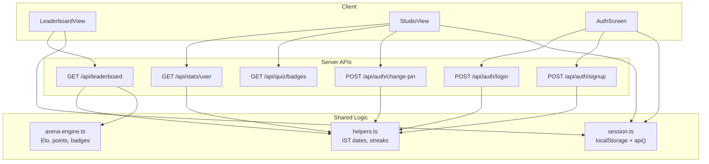
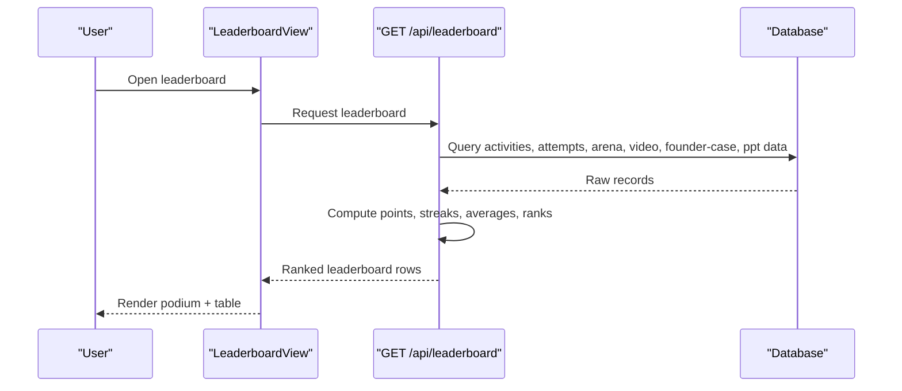
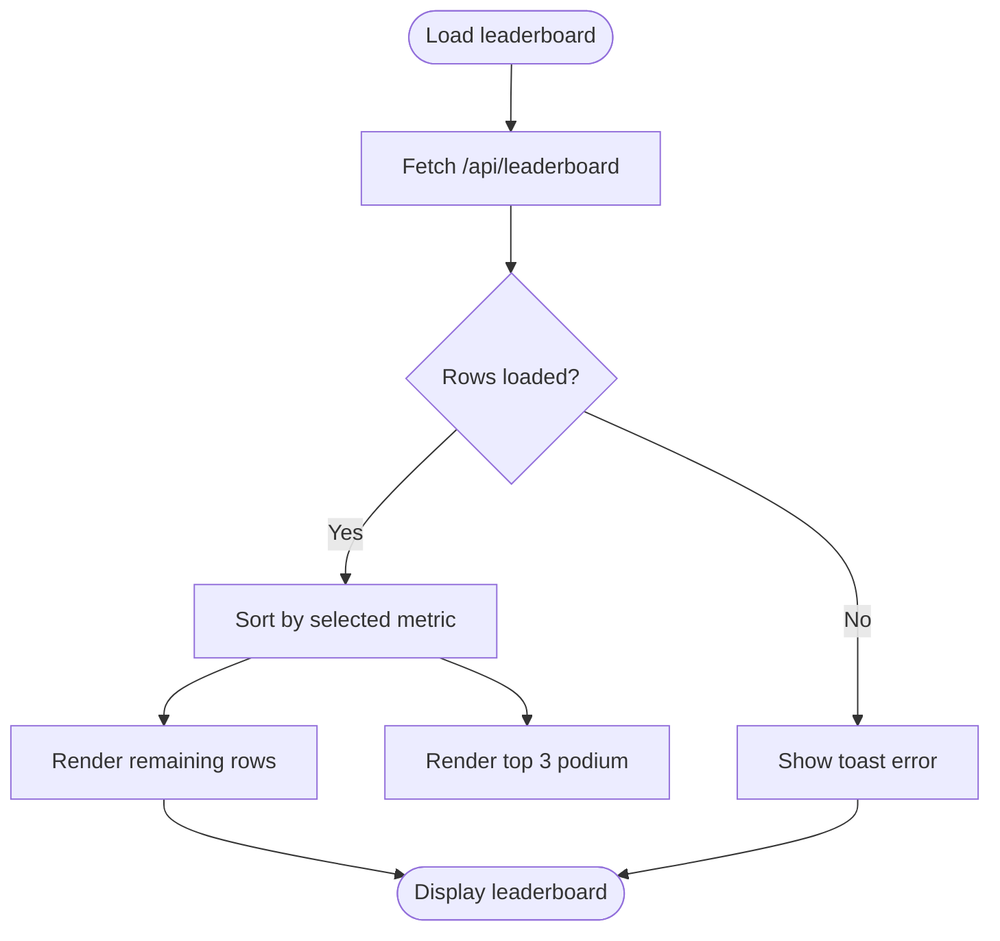
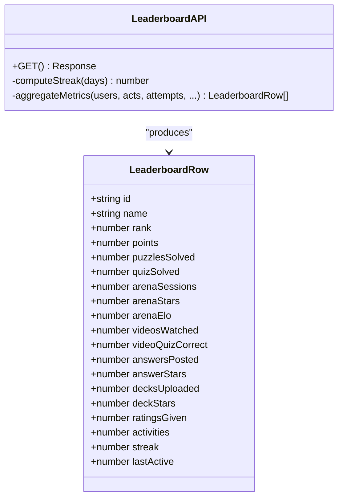
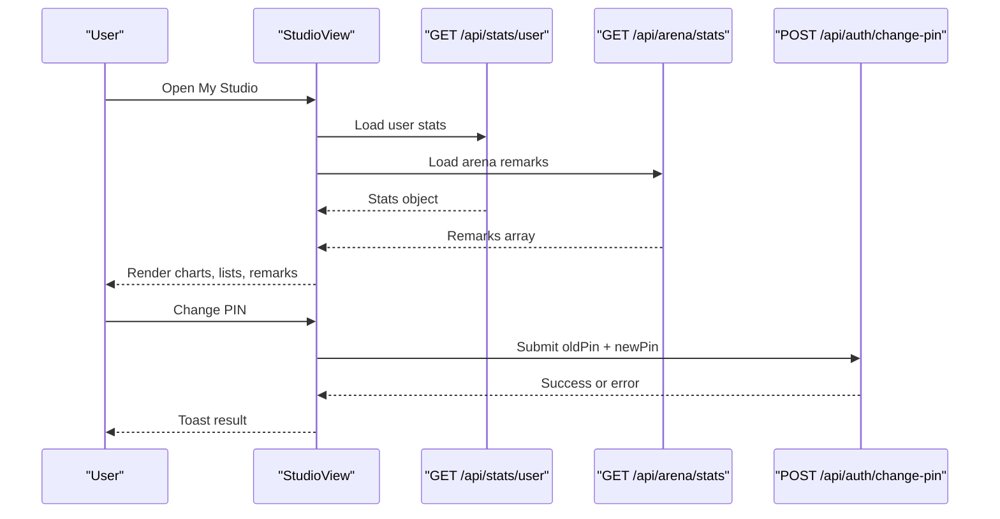
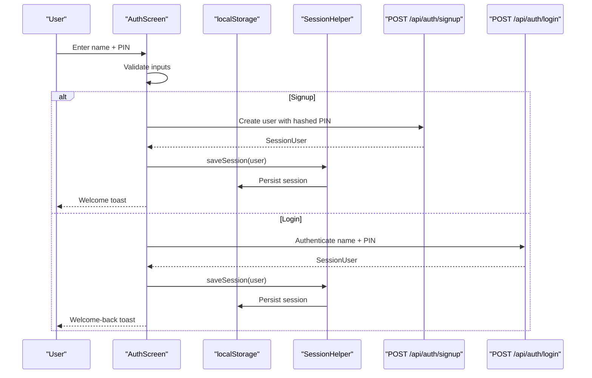
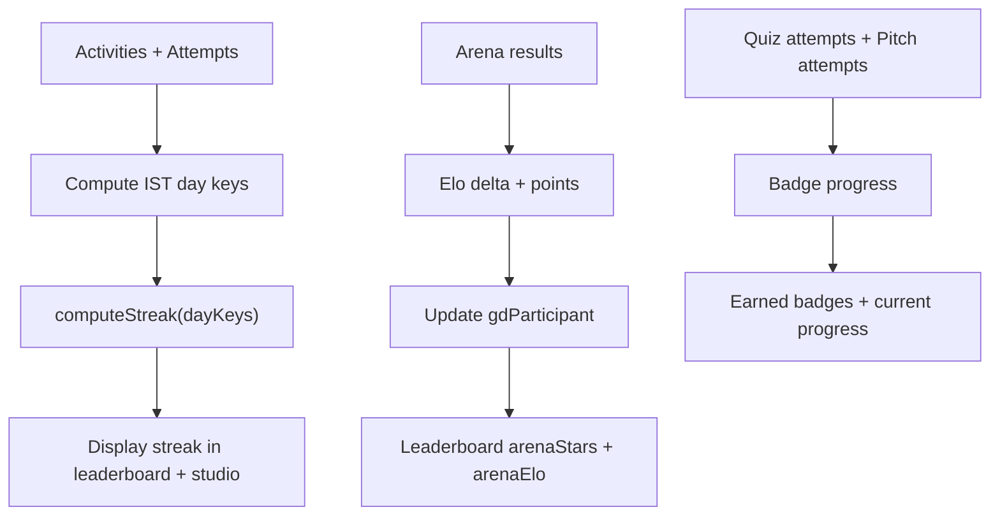
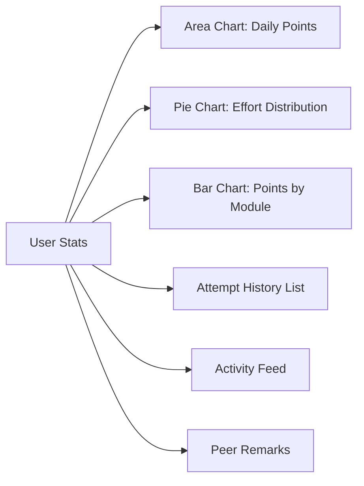
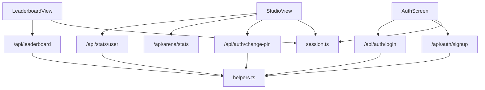

# Gamification & Analytics Components

<cite>
**Referenced Files in This Document**   
- [leaderboard-view.tsx](file://src/components/welearn/leaderboard-view.tsx)
- [studio-view.tsx](file://src/components/welearn/studio-view.tsx)
- [auth-screen.tsx](file://src/components/welearn/auth-screen.tsx)
- [route.ts](file://src/app/api/leaderboard/route.ts)
- [route.ts](file://src/app/api/stats/user/route.ts)
- [route.ts](file://src/app/api/quiz/badges/route.ts)
- [route.ts](file://src/app/api/auth/login/route.ts)
- [route.ts](file://src/app/api/auth/signup/route.ts)
- [route.ts](file://src/app/api/auth/change-pin/route.ts)
- [helpers.ts](file://src/lib/helpers.ts)
- [session.ts](file://src/lib/session.ts)
- [arena-engine.ts](file://src/lib/arena-engine.ts)
</cite>

## Table of Contents
1. [Introduction](#introduction)
2. [Project Structure](#project-structure)
3. [Core Components](#core-components)
4. [Architecture Overview](#architecture-overview)
5. [Detailed Component Analysis](#detailed-component-analysis)
6. [Dependency Analysis](#dependency-analysis)
7. [Performance Considerations](#performance-considerations)
8. [Troubleshooting Guide](#troubleshooting-guide)
9. [Conclusion](#conclusion)

## Introduction
This document explains the gamification and analytics layer that drives user engagement, learning progress tracking, and competitive motivation across the application. It focuses on three primary user-facing components:

- Leaderboard view: displays rankings, achievements, streaks, and cross-module performance metrics.
- Studio view: personal analytics dashboard with charts, activity feeds, attempt history, and PIN management.
- Auth screen: PIN-based login and signup flow used for secure, lightweight user onboarding.

It also covers backend endpoints that compute leaderboard rankings, personal analytics, badge progress, and PIN operations, as well as shared helpers for streak calculation and IST-based date handling.

## Project Structure
The gamification and analytics features are implemented through a small set of client components, Next.js API routes, and shared utilities:

- Client components live under `src/components/welearn`.
- Server-side data aggregation lives under `src/app/api`.
- Shared logic for dates, streaks, and session storage is under `src/lib`.

**Diagram sources**
- [leaderboard-view.tsx:50-59](file://src/components/welearn/leaderboard-view.tsx#L50-L59)
- [studio-view.tsx:97-113](file://src/components/welearn/studio-view.tsx#L97-L113)
- [auth-screen.tsx:34-71](file://src/components/welearn/auth-screen.tsx#L34-L71)
- [route.ts:5-66](file://src/app/api/leaderboard/route.ts#L5-L66)
- [route.ts:5-97](file://src/app/api/stats/user/route.ts#L5-L97)
- [route.ts:7-88](file://src/app/api/quiz/badges/route.ts#L7-L88)
- [route.ts:6-24](file://src/app/api/auth/login/route.ts#L6-L24)
- [route.ts:6-30](file://src/app/api/auth/signup/route.ts#L6-L30)
- [route.ts:5-19](file://src/app/api/auth/change-pin/route.ts#L5-L19)
- [helpers.ts:1-41](file://src/lib/helpers.ts#L1-L41)
- [session.ts:1-43](file://src/lib/session.ts#L1-L43)
- [arena-engine.ts:293-334](file://src/lib/arena-engine.ts#L293-L334)

**Section sources**
- [leaderboard-view.tsx:1-188](file://src/components/welearn/leaderboard-view.tsx#L1-L188)
- [studio-view.tsx:1-338](file://src/components/welearn/studio-view.tsx#L1-L338)
- [auth-screen.tsx:1-175](file://src/components/welearn/auth-screen.tsx#L1-L175)
- [route.ts:1-71](file://src/app/api/leaderboard/route.ts#L1-L71)
- [route.ts:1-102](file://src/app/api/stats/user/route.ts#L1-L102)
- [route.ts:1-93](file://src/app/api/quiz/badges/route.ts#L1-L93)
- [route.ts:1-26](file://src/app/api/auth/login/route.ts#L1-L26)
- [route.ts:1-36](file://src/app/api/auth/signup/route.ts#L1-L36)
- [route.ts:1-24](file://src/app/api/auth/change-pin/route.ts#L1-L24)
- [helpers.ts:1-42](file://src/lib/helpers.ts#L1-L42)
- [session.ts:1-43](file://src/lib/session.ts#L1-L43)
- [arena-engine.ts:293-334](file://src/lib/arena-engine.ts#L293-L334)

## Core Components
This section summarizes the responsibilities and behavior of each major component.

### Leaderboard View
- Displays a ranked table of members with multi-metric columns: total points, arena sessions and Elo, average peer stars, puzzles solved, quiz solved, videos watched, answers posted, decks uploaded, ratings given, streak, and last active time.
- Supports sorting by overall points, arena stars, quiz solved, answer stars, and deck stars.
- Shows a podium visualization for top three users.
- Fetches aggregated ranking data from `/api/leaderboard` and handles errors via toast notifications.

**Section sources**
- [leaderboard-view.tsx:15-37](file://src/components/welearn/leaderboard-view.tsx#L15-L37)
- [leaderboard-view.tsx:50-72](file://src/components/welearn/leaderboard-view.tsx#L50-L72)
- [leaderboard-view.tsx:74-187](file://src/components/welearn/leaderboard-view.tsx#L74-L187)

### Studio View
- Personal analytics dashboard showing totals (points, streak, accuracy, minutes trained), module breakdown, daily activity chart, pie/bar charts, recent puzzle attempts, activity feed, and peer remarks.
- Loads user stats from `/api/stats/user` and arena remarks from `/api/arena/stats`.
- Provides PIN change functionality for members via `/api/auth/change-pin`.

**Section sources**
- [studio-view.tsx:36-71](file://src/components/welearn/studio-view.tsx#L36-L71)
- [studio-view.tsx:89-113](file://src/components/welearn/studio-view.tsx#L89-L113)
- [studio-view.tsx:115-128](file://src/components/welearn/studio-view.tsx#L115-L128)
- [studio-view.tsx:140-337](file://src/components/welearn/studio-view.tsx#L140-L337)

### Auth Screen
- Handles two flows:
  - Signup: validates name and 4-digit PIN, calls `/api/auth/signup`, stores session, and notifies success.
  - Login: validates name and PIN, calls `/api/auth/login`, stores session, and notifies success.
- Uses a simple client session helper to persist user identity in localStorage.

**Section sources**
- [auth-screen.tsx:15-25](file://src/components/welearn/auth-screen.tsx#L15-L25)
- [auth-screen.tsx:27-71](file://src/components/welearn/auth-screen.tsx#L27-L71)
- [auth-screen.tsx:73-175](file://src/components/welearn/auth-screen.tsx#L73-L175)

## Architecture Overview
The system follows a straightforward client-server pattern:

- Client components call server endpoints using a typed `api()` helper.
- Server endpoints aggregate data from multiple tables, compute gamification metrics (streaks, Elo, points), and return structured JSON.
- UI renders real-time-feeling updates through local state and error feedback via toast notifications.

**Diagram sources**
- [leaderboard-view.tsx:55-59](file://src/components/welearn/leaderboard-view.tsx#L55-L59)
- [route.ts:5-66](file://src/app/api/leaderboard/route.ts#L5-L66)

## Detailed Component Analysis

### Leaderboard View Analysis
The leaderboard aggregates cross-module engagement into a single ranking. It supports:

- Multi-criteria sorting:
  - All-round points with streak tiebreakers.
  - Arena stars, quiz solved, answer stars, deck stars.
- Podium rendering for top three users.
- Highlighting the current user row.
- Time-ago formatting for last active timestamps.

**Diagram sources**
- [leaderboard-view.tsx:55-72](file://src/components/welearn/leaderboard-view.tsx#L55-L72)
- [leaderboard-view.tsx:102-187](file://src/components/welearn/leaderboard-view.tsx#L102-L187)

Backend computation details:

- Aggregates activities, quiz attempts, GD participation, video watches, video quiz answers, founder-case answers, answer ratings, PPT uploads, and PPT ratings.
- Computes per-user:
  - Total points and counts per action type.
  - Arena sessions, average stars, and ELO.
  - Video watch and correct-answer counts.
  - Founder-case answers and average rating stars.
  - PPT uploads and average rating stars.
  - Ratings given count.
  - Streak based on IST day keys.
  - Last active timestamp.
- Ranks users by points, then streak, then name.

**Diagram sources**
- [leaderboard-view.tsx:15-37](file://src/components/welearn/leaderboard-view.tsx#L15-L37)
- [route.ts:5-66](file://src/app/api/leaderboard/route.ts#L5-L66)

**Section sources**
- [leaderboard-view.tsx:50-187](file://src/components/welearn/leaderboard-view.tsx#L50-L187)
- [route.ts:5-66](file://src/app/api/leaderboard/route.ts#L5-L66)

### Studio View Analysis
The studio view provides a comprehensive analytics dashboard:

- Totals:
  - Points, streak, puzzles attempted/solved, accuracy, minutes trained, cases analyzed, decks ready, terms known, GD sessions, active days, quiz questions attempted/solved/accuracy, pitches completed.
- Charts:
  - Area chart for daily points over the last 30 days.
  - Pie chart for effort distribution across modules.
  - Bar chart for points per module.
- Lists:
  - Recent puzzle attempts with correctness, time spent, and points.
  - Activity feed with module, detail, and points.
- Peer remarks:
  - Feedback collected from arena sessions.
- PIN management:
  - Dialog to change PIN via `/api/auth/change-pin`.

**Diagram sources**
- [studio-view.tsx:97-113](file://src/components/welearn/studio-view.tsx#L97-L113)
- [studio-view.tsx:115-128](file://src/components/welearn/studio-view.tsx#L115-L128)
- [studio-view.tsx:140-337](file://src/components/welearn/studio-view.tsx#L140-L337)
- [route.ts:5-97](file://src/app/api/stats/user/route.ts#L5-L97)
- [route.ts:5-19](file://src/app/api/auth/change-pin/route.ts#L5-L19)

**Section sources**
- [studio-view.tsx:89-337](file://src/components/welearn/studio-view.tsx#L89-L337)
- [route.ts:5-97](file://src/app/api/stats/user/route.ts#L5-L97)
- [route.ts:5-19](file://src/app/api/auth/change-pin/route.ts#L5-L19)

### Auth Screen Analysis
The auth screen implements PIN-based authentication:

- Signup flow:
  - Validates name length and format.
  - Validates 4-digit PIN.
  - Calls `/api/auth/signup`.
  - Stores session and shows welcome toast.
- Login flow:
  - Validates name and 4-digit PIN.
  - Calls `/api/auth/login`.
  - Stores session and shows welcome-back toast.

**Diagram sources**
- [auth-screen.tsx:34-71](file://src/components/welearn/auth-screen.tsx#L34-L71)
- [route.ts:6-30](file://src/app/api/auth/signup/route.ts#L6-L30)
- [route.ts:6-24](file://src/app/api/auth/login/route.ts#L6-L24)
- [session.ts:24-26](file://src/lib/session.ts#L24-L26)

**Section sources**
- [auth-screen.tsx:27-175](file://src/components/welearn/auth-screen.tsx#L27-L175)
- [route.ts:6-30](file://src/app/api/auth/signup/route.ts#L6-L30)
- [route.ts:6-24](file://src/app/api/auth/login/route.ts#L6-L24)
- [session.ts:1-43](file://src/lib/session.ts#L1-L43)

### Gamification Elements
- Streak tracking:
  - Computed from IST day keys derived from activity timestamps.
  - Used in both leaderboard and personal analytics.
- Point systems:
  - Activities contribute points; arena sessions add Elo-driven deltas and MVP bonuses.
- Achievement badges:
  - Badge definitions include criteria such as any correct, track-specific correct counts, pitch completion, and completing all track badges.
  - Progress is computed by aggregating quiz attempts and pitch attempts.

**Diagram sources**
- [helpers.ts:14-26](file://src/lib/helpers.ts#L14-L26)
- [arena-engine.ts:293-334](file://src/lib/arena-engine.ts#L293-L334)
- [route.ts:7-88](file://src/app/api/quiz/badges/route.ts#L7-L88)

**Section sources**
- [helpers.ts:14-26](file://src/lib/helpers.ts#L14-L26)
- [arena-engine.ts:293-334](file://src/lib/arena-engine.ts#L293-L334)
- [route.ts:7-88](file://src/app/api/quiz/badges/route.ts#L7-L88)

### Analytics Visualization and Progress Reporting
- Daily activity area chart:
  - Shows points earned per day over the last 30 days.
- Module distribution:
  - Pie chart for effort distribution across modules.
  - Bar chart for points per module.
- Attempt history:
  - Recent puzzle attempts with correctness, difficulty, time spent, and points.
- Activity feed:
  - Chronological list of actions with module, detail, and points.
- Peer remarks:
  - Qualitative feedback from arena sessions.

**Diagram sources**
- [studio-view.tsx:168-223](file://src/components/welearn/studio-view.tsx#L168-L223)
- [studio-view.tsx:226-337](file://src/components/welearn/studio-view.tsx#L226-L337)
- [route.ts:33-49](file://src/app/api/stats/user/route.ts#L33-L49)

**Section sources**
- [studio-view.tsx:168-337](file://src/components/welearn/studio-view.tsx#L168-L337)
- [route.ts:33-97](file://src/app/api/stats/user/route.ts#L33-L97)

## Dependency Analysis
Key dependencies between components and services:

- LeaderboardView depends on:
  - `/api/leaderboard` for aggregated ranking data.
  - `session.ts` for authenticated user context.
- StudioView depends on:
  - `/api/stats/user` for personal analytics.
  - `/api/arena/stats` for peer remarks.
  - `/api/auth/change-pin` for PIN updates.
- AuthScreen depends on:
  - `/api/auth/signup` and `/api/auth/login`.
  - `session.ts` for persistence.

**Diagram sources**
- [leaderboard-view.tsx:55-59](file://src/components/welearn/leaderboard-view.tsx#L55-L59)
- [studio-view.tsx:97-113](file://src/components/welearn/studio-view.tsx#L97-L113)
- [auth-screen.tsx:34-71](file://src/components/welearn/auth-screen.tsx#L34-L71)
- [route.ts:5-66](file://src/app/api/leaderboard/route.ts#L5-L66)
- [route.ts:5-97](file://src/app/api/stats/user/route.ts#L5-L97)
- [route.ts:5-19](file://src/app/api/auth/change-pin/route.ts#L5-L19)
- [route.ts:6-24](file://src/app/api/auth/login/route.ts#L6-L24)
- [route.ts:6-30](file://src/app/api/auth/signup/route.ts#L6-L30)
- [helpers.ts:1-41](file://src/lib/helpers.ts#L1-L41)
- [session.ts:1-43](file://src/lib/session.ts#L1-L43)

**Section sources**
- [leaderboard-view.tsx:50-72](file://src/components/welearn/leaderboard-view.tsx#L50-L72)
- [studio-view.tsx:89-128](file://src/components/welearn/studio-view.tsx#L89-L128)
- [auth-screen.tsx:27-71](file://src/components/welearn/auth-screen.tsx#L27-L71)
- [route.ts:5-66](file://src/app/api/leaderboard/route.ts#L5-L66)
- [route.ts:5-97](file://src/app/api/stats/user/route.ts#L5-L97)
- [route.ts:5-19](file://src/app/api/auth/change-pin/route.ts#L5-L19)
- [route.ts:6-24](file://src/app/api/auth/login/route.ts#L6-L24)
- [route.ts:6-30](file://src/app/api/auth/signup/route.ts#L6-L30)
- [helpers.ts:1-41](file://src/lib/helpers.ts#L1-L41)
- [session.ts:1-43](file://src/lib/session.ts#L1-L43)

## Performance Considerations
- Batched queries:
  - The leaderboard endpoint uses parallel database queries to reduce round-trips.
- Local sorting:
  - Leaderboard sorting happens client-side after fetching aggregated rows, minimizing server load.
- Efficient streak computation:
  - Streaks are computed from a Set of IST day keys, avoiding repeated date parsing.
- Chart rendering:
  - Recharts components render responsive charts; keep datasets reasonable to avoid heavy re-renders.
- Session persistence:
  - Using localStorage avoids repeated authentication overhead during a session.

[No sources needed since this section provides general guidance]

## Troubleshooting Guide
Common issues and resolutions:

- Leaderboard fails to load:
  - Check network response from `/api/leaderboard`.
  - Verify database connectivity and that activities/attempts exist for members.
- Stats dashboard not loading:
  - Ensure `userId` is provided and valid.
  - Confirm user exists and has activity records.
- PIN change fails:
  - Validate old PIN matches stored hash.
  - Ensure new PIN is exactly four digits.
- Authentication errors:
  - For signup: verify name format and uniqueness.
  - For login: verify name and PIN match stored values.

**Section sources**
- [leaderboard-view.tsx:55-59](file://src/components/welearn/leaderboard-view.tsx#L55-L59)
- [studio-view.tsx:97-108](file://src/components/welearn/studio-view.tsx#L97-L108)
- [studio-view.tsx:115-128](file://src/components/welearn/studio-view.tsx#L115-L128)
- [route.ts:67-69](file://src/app/api/leaderboard/route.ts#L67-L69)
- [route.ts:98-100](file://src/app/api/stats/user/route.ts#L98-L100)
- [route.ts:12-21](file://src/app/api/auth/change-pin/route.ts#L12-L21)
- [route.ts:12-20](file://src/app/api/auth/signup/route.ts#L12-L20)
- [route.ts:16-18](file://src/app/api/auth/login/route.ts#L16-L18)

## Conclusion
The gamification and analytics components provide a cohesive experience for tracking learning progress, motivating engagement, and showcasing competitive performance. The leaderboard highlights multi-dimensional achievement, the studio view offers deep personal insights, and the auth screen ensures a simple, secure entry point. Together with robust backend aggregation and clear error handling, these components form a scalable foundation for ongoing engagement optimization and analytics expansion.

[No sources needed since this section summarizes without analyzing specific files]