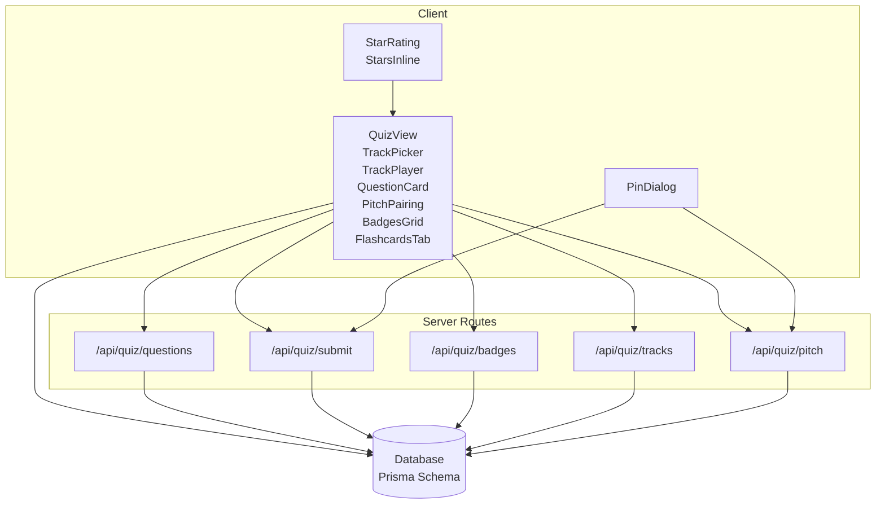
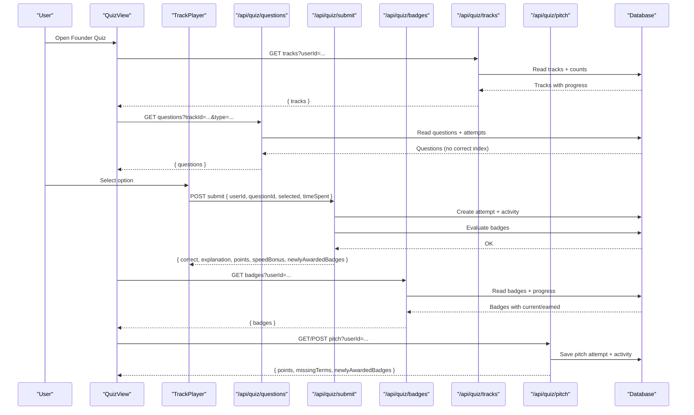
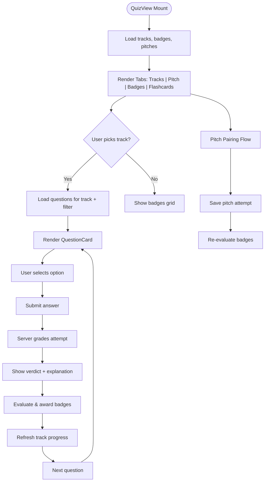
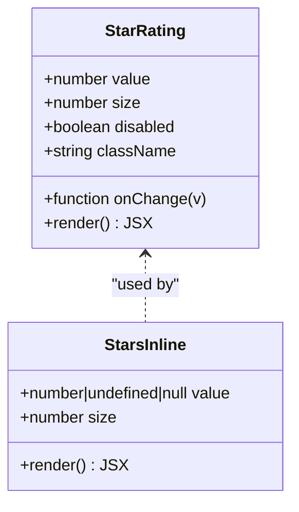
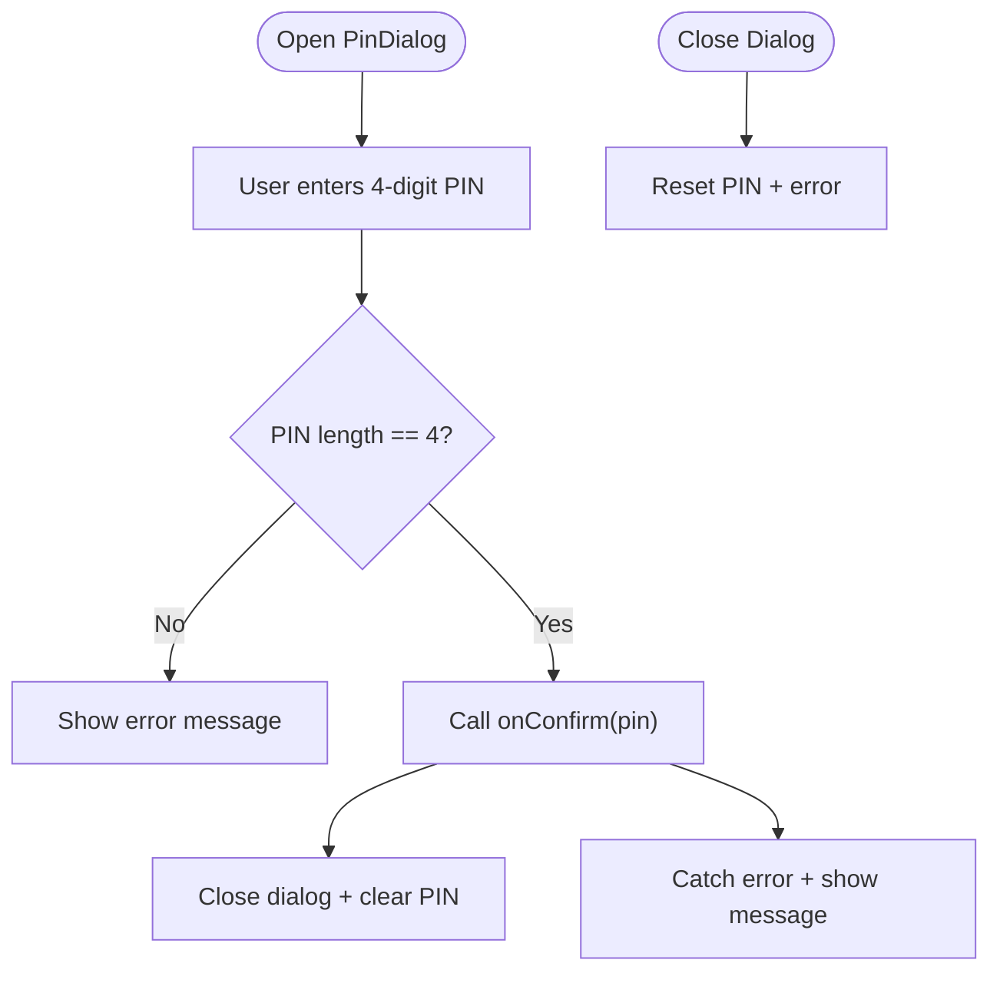
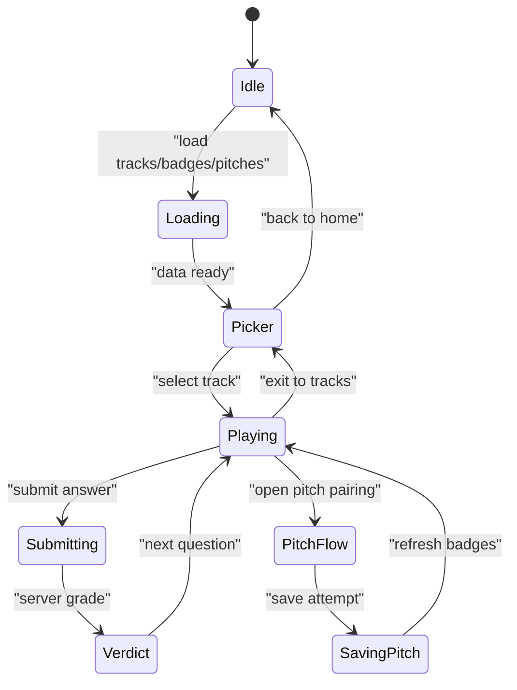
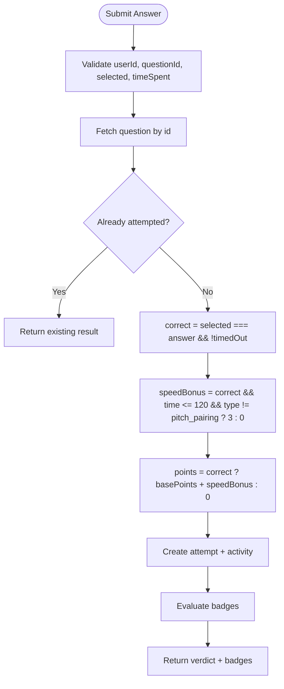
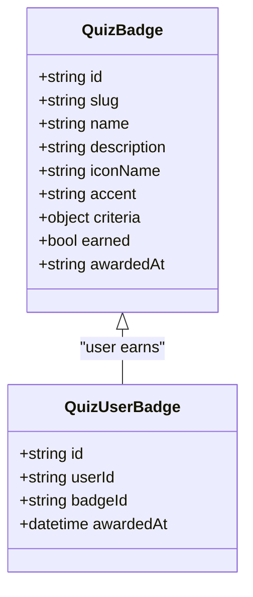
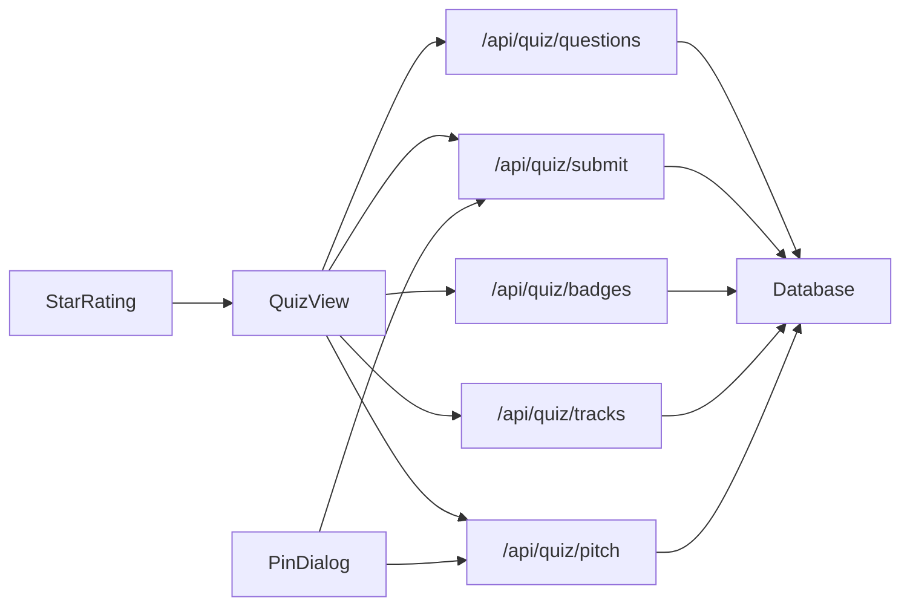

# Quiz Interface Components

<cite>
**Referenced Files in This Document**
- [quiz-view.tsx](file://src/components/welearn/quiz-view.tsx)
- [star-rating.tsx](file://src/components/welearn/star-rating.tsx)
- [pin-dialog.tsx](file://src/components/welearn/pin-dialog.tsx)
- [questions route](file://src/app/api/quiz/questions/route.ts)
- [submit route](file://src/app/api/quiz/submit/route.ts)
- [badges route](file://src/app/api/quiz/badges/route.ts)
- [tracks route](file://src/app/api/quiz/tracks/route.ts)
- [pitch route](file://src/app/api/quiz/pitch/route.ts)
- [Prisma schema](file://prisma/schema.prisma)
</cite>

## Table of Contents
1. [Introduction](#introduction)
2. [Project Structure](#project-structure)
3. [Core Components](#core-components)
4. [Architecture Overview](#architecture-overview)
5. [Detailed Component Analysis](#detailed-component-analysis)
6. [Dependency Analysis](#dependency-analysis)
7. [Performance Considerations](#performance-considerations)
8. [Troubleshooting Guide](#troubleshooting-guide)
9. [Conclusion](#conclusion)

## Introduction
This document explains the quiz interface components that power scenario-based learning and assessment in the application. It focuses on:

- The quiz view component for question rendering, answer validation, progress tracking, badge achievements, and pitch pairing drills.
- The star rating component used for peer evaluation and feedback collection.
- The PIN dialog component for secure team access and confirmation flows.
- Backend integration through Next.js API routes for questions, submissions, badges, tracks, and pitches.
- Data models, scoring algorithms, lifecycle management, accessibility, mobile responsiveness, analytics, and real-time synchronization considerations.

The goal is to help developers understand how these pieces fit together, how data flows between client and server, and how to extend or troubleshoot the system safely.

## Project Structure
The quiz feature spans UI components under `src/components/welearn` and backend routes under `src/app/api/quiz`. The database schema is defined with Prisma.

**Diagram sources**
- [quiz-view.tsx:156-260](file://src/components/welearn/quiz-view.tsx#L156-L260)
- [star-rating.tsx:1-65](file://src/components/welearn/star-rating.tsx#L1-L65)
- [pin-dialog.tsx:21-104](file://src/components/welearn/pin-dialog.tsx#L21-L104)
- [questions route:1-60](file://src/app/api/quiz/questions/route.ts#L1-L60)
- [submit route:1-156](file://src/app/api/quiz/submit/route.ts#L1-L156)
- [badges route:1-93](file://src/app/api/quiz/badges/route.ts#L1-L93)
- [tracks route:1-68](file://src/app/api/quiz/tracks/route.ts#L1-L68)
- [pitch route:1-133](file://src/app/api/quiz/pitch/route.ts#L1-L133)
- [Prisma schema:151-232](file://prisma/schema.prisma#L151-L232)

**Section sources**
- [quiz-view.tsx:156-260](file://src/components/welearn/quiz-view.tsx#L156-L260)
- [star-rating.tsx:1-65](file://src/components/welearn/star-rating.tsx#L1-L65)
- [pin-dialog.tsx:21-104](file://src/components/welearn/pin-dialog.tsx#L21-L104)
- [questions route:1-60](file://src/app/api/quiz/questions/route.ts#L1-L60)
- [submit route:1-156](file://src/app/api/quiz/submit/route.ts#L1-L156)
- [badges route:1-93](file://src/app/api/quiz/badges/route.ts#L1-L93)
- [tracks route:1-68](file://src/app/api/quiz/tracks/route.ts#L1-L68)
- [pitch route:1-133](file://src/app/api/quiz/pitch/route.ts#L1-L133)
- [Prisma schema:151-232](file://prisma/schema.prisma#L151-L232)

## Core Components
- QuizView orchestrates the Founder Quiz experience: track selection, question playback, pitch pairing, badges, and flashcards. It loads tracks, badges, and pitches from the backend and manages user interactions such as selecting answers, submitting attempts, and navigating between questions.
- StarRating provides an interactive 1–5 star picker and a compact read-only display for average ratings. It supports hover previews, keyboard-friendly buttons, and accessible labels.
- PinDialog enforces a 4-digit team PIN before allowing sensitive actions. It validates input length, shows errors, disables controls while processing, and resets state when closed.

Key responsibilities:
- Question rendering and filtering by type.
- Answer selection and submission with server-side grading.
- Progress tracking per track and overall points updates.
- Badge evaluation and awarding based on criteria.
- Pitch pairing drill flow with term inclusion checks.
- Secure confirmation via PIN dialog.

**Section sources**
- [quiz-view.tsx:156-260](file://src/components/welearn/quiz-view.tsx#L156-L260)
- [star-rating.tsx:1-65](file://src/components/welearn/star-rating.tsx#L1-L65)
- [pin-dialog.tsx:21-104](file://src/components/welearn/pin-dialog.tsx#L21-L104)

## Architecture Overview
The quiz architecture follows a client-server pattern where the React components call Next.js API routes. The server performs authoritative grading, records attempts, awards badges, and returns verdicts and explanations.

**Diagram sources**
- [quiz-view.tsx:156-260](file://src/components/welearn/quiz-view.tsx#L156-L260)
- [questions route:1-60](file://src/app/api/quiz/questions/route.ts#L1-L60)
- [submit route:1-156](file://src/app/api/quiz/submit/route.ts#L1-L156)
- [badges route:1-93](file://src/app/api/quiz/badges/route.ts#L1-L93)
- [tracks route:1-68](file://src/app/api/quiz/tracks/route.ts#L1-L68)
- [pitch route:1-133](file://src/app/api/quiz/pitch/route.ts#L1-L133)

## Detailed Component Analysis

### Quiz View Component
The quiz view is the central hub for the Founder Quiz. It manages:
- Loading tracks, badges, and pitches.
- Rendering tabs for tracks, pitch pairing, badges, and flashcards.
- Navigating into a selected track and filtering questions by type.
- Handling question submission, scoring, and badge notifications.
- Triggering progress refreshes and points updates.

**Diagram sources**
- [quiz-view.tsx:156-260](file://src/components/welearn/quiz-view.tsx#L156-L260)
- [quiz-view.tsx:505-735](file://src/components/welearn/quiz-view.tsx#L505-L735)
- [quiz-view.tsx:741-800](file://src/components/welearn/quiz-view.tsx#L741-L800)
- [submit route:75-156](file://src/app/api/quiz/submit/route.ts#L75-L156)

Key behaviors:
- Question loading filters by track and optional type; correct answer index is intentionally omitted.
- Submission calculates speed bonus and records attempts idempotently.
- Badges are evaluated after each successful submission.
- Pitch pairing saves attempts and triggers badge re-evaluation.

Accessibility and UX:
- Cards and buttons use roles and keyboard handlers for navigation.
- Feedback uses toast notifications for points and badge unlocks.
- Skeleton loaders provide visual cues during data fetching.

Mobile responsiveness:
- Grid layouts adapt across screen sizes using responsive classes.
- Filter pills and headers wrap gracefully.

**Section sources**
- [quiz-view.tsx:156-260](file://src/components/welearn/quiz-view.tsx#L156-L260)
- [quiz-view.tsx:505-735](file://src/components/welearn/quiz-view.tsx#L505-L735)
- [quiz-view.tsx:741-800](file://src/components/welearn/quiz-view.tsx#L741-L800)
- [questions route:1-60](file://src/app/api/quiz/questions/route.ts#L1-L60)
- [submit route:75-156](file://src/app/api/quiz/submit/route.ts#L75-L156)

### Star Rating Component
The star rating component supports both interactive selection and read-only display:
- Interactive mode allows clicking stars to set values and hovering to preview.
- Read-only mode displays current value without interaction.
- Accessible attributes include role group and aria-labels per star.
- Compact inline display shows numeric average alongside stars.

**Diagram sources**
- [star-rating.tsx:1-65](file://src/components/welearn/star-rating.tsx#L1-L65)

Usage patterns:
- Peer evaluation: users click stars to rate content; onChange persists the rating.
- Display averages: StarsInline renders a rounded star count plus formatted decimal.

Accessibility:
- Buttons have descriptive aria-labels.
- Disabled state prevents interaction when not editable.

**Section sources**
- [star-rating.tsx:1-65](file://src/components/welearn/star-rating.tsx#L1-L65)

### PIN Dialog Component
The PIN dialog enforces a 4-digit team PIN before confirming sensitive operations:
- Validates PIN length and shows error messages.
- Disables inputs and confirm button while processing.
- Resets state when the dialog closes.
- Integrates with custom onConfirm callbacks for secure actions.

**Diagram sources**
- [pin-dialog.tsx:21-104](file://src/components/welearn/pin-dialog.tsx#L21-L104)

Security considerations:
- Client-side validation ensures minimum requirements.
- Server-side verification should be implemented within onConfirm to prevent bypass.

**Section sources**
- [pin-dialog.tsx:21-104](file://src/components/welearn/pin-dialog.tsx#L21-L104)

### Quiz Lifecycle Management
Lifecycle stages:
- Initialization: load tracks, badges, pitches.
- Track selection: enter track player and load filtered questions.
- Question flow: select answer, submit, receive verdict, navigate next.
- Badge evaluation: compute and award badges based on criteria.
- Pitch pairing: save attempts, validate terms, update badges.
- Progress refresh: update track metrics and UI state.

**Diagram sources**
- [quiz-view.tsx:156-260](file://src/components/welearn/quiz-view.tsx#L156-L260)
- [quiz-view.tsx:505-735](file://src/components/welearn/quiz-view.tsx#L505-L735)
- [pitch route:40-133](file://src/app/api/quiz/pitch/route.ts#L40-L133)

**Section sources**
- [quiz-view.tsx:156-260](file://src/components/welearn/quiz-view.tsx#L156-L260)
- [quiz-view.tsx:505-735](file://src/components/welearn/quiz-view.tsx#L505-L735)
- [pitch route:40-133](file://src/app/api/quiz/pitch/route.ts#L40-L133)

### Question Type Variations
Supported types:
- Scenario: founder-mode prompts requiring decision-making.
- Red Flag: spotting risky startup practices.
- Micro-Math Drill: quick calculations relevant to startups.
- Pitch Pairing: composing elevator pitches with required terms.

Metadata includes difficulty, points, source (curated or AI), and attempted status.

**Section sources**
- [quiz-view.tsx:76-87](file://src/components/welearn/quiz-view.tsx#L76-L87)
- [questions route:1-60](file://src/app/api/quiz/questions/route.ts#L1-L60)

### Scoring Algorithms
Scoring logic:
- Correct answers earn base points plus potential speed bonus if answered quickly.
- Speed bonus applies only to non-pitch questions and within a time threshold.
- Attempts are idempotent: one graded attempt per question per user.
- Activity entries record module, action, detail, and points.

**Diagram sources**
- [submit route:75-156](file://src/app/api/quiz/submit/route.ts#L75-L156)

**Section sources**
- [submit route:75-156](file://src/app/api/quiz/submit/route.ts#L75-L156)

### Badge Achievement Systems
Badge evaluation:
- Criteria include any_correct, track_correct, pitch_completed, all_track_badges.
- Progress is computed per user based on attempts and pitch history.
- Newly awarded badges are returned to the client for notification.

**Diagram sources**
- [badges route:1-93](file://src/app/api/quiz/badges/route.ts#L1-L93)
- [submit route:1-74](file://src/app/api/quiz/submit/route.ts#L1-L74)
- [Prisma schema:190-216](file://prisma/schema.prisma#L190-L216)

**Section sources**
- [badges route:1-93](file://src/app/api/quiz/badges/route.ts#L1-L93)
- [submit route:1-74](file://src/app/api/quiz/submit/route.ts#L1-L74)
- [Prisma schema:190-216](file://prisma/schema.prisma#L190-L216)

### User Interaction Patterns
- Track selection cards are clickable and keyboard navigable.
- Question options render with visual feedback for selection and correctness.
- Toast notifications inform users of points and badge unlocks.
- PIN dialog requires explicit confirmation for sensitive actions.

**Section sources**
- [quiz-view.tsx:431-499](file://src/components/welearn/quiz-view.tsx#L431-L499)
- [quiz-view.tsx:741-800](file://src/components/welearn/quiz-view.tsx#L741-L800)
- [pin-dialog.tsx:21-104](file://src/components/welearn/pin-dialog.tsx#L21-L104)

### Accessibility Considerations
- Interactive elements use semantic roles and aria-labels.
- Keyboard events support Enter and Space for activation.
- Disabled states prevent unintended interactions.
- Color contrast and focus indicators rely on design tokens.

**Section sources**
- [star-rating.tsx:1-65](file://src/components/welearn/star-rating.tsx#L1-L65)
- [pin-dialog.tsx:21-104](file://src/components/welearn/pin-dialog.tsx#L21-L104)
- [quiz-view.tsx:431-499](file://src/components/welearn/quiz-view.tsx#L431-L499)

### Mobile-Responsive Design
- Grid layouts adapt to small, medium, and large screens.
- Filter pills and headers wrap to avoid overflow.
- Touch-friendly button sizes and spacing improve usability.

**Section sources**
- [quiz-view.tsx:431-499](file://src/components/welearn/quiz-view.tsx#L431-L499)
- [quiz-view.tsx:647-735](file://src/components/welearn/quiz-view.tsx#L647-L735)

### Integration with Backend Quiz APIs
- Questions endpoint returns questions without exposing correct answers.
- Submit endpoint performs server-side grading and records attempts.
- Badges endpoint computes progress and earned status.
- Tracks endpoint aggregates per-user progress and badge ownership.
- Pitch endpoint saves attempts, validates terms, and evaluates badges.

**Section sources**
- [questions route:1-60](file://src/app/api/quiz/questions/route.ts#L1-L60)
- [submit route:75-156](file://src/app/api/quiz/submit/route.ts#L75-L156)
- [badges route:1-93](file://src/app/api/quiz/badges/route.ts#L1-L93)
- [tracks route:1-68](file://src/app/api/quiz/tracks/route.ts#L1-L68)
- [pitch route:1-133](file://src/app/api/quiz/pitch/route.ts#L1-L133)

### Real-Time Progress Synchronization
- After each submission, the client calls onProgress to refresh track metrics.
- Badges are re-evaluated on successful submissions and pitch completions.
- UI updates reflect new points, badges, and progress percentages.

**Section sources**
- [quiz-view.tsx:565-609](file://src/components/welearn/quiz-view.tsx#L565-L609)
- [submit route:128-156](file://src/app/api/quiz/submit/route.ts#L128-L156)
- [pitch route:93-133](file://src/app/api/quiz/pitch/route.ts#L93-L133)

### Analytics Tracking for Learning Outcomes
- Activity entries are created for quiz solved/attempted and pitch completed.
- Metadata includes module, action, detail, and points for reporting.
- Enables dashboards and learning outcome analysis.

**Section sources**
- [submit route:128-138](file://src/app/api/quiz/submit/route.ts#L128-L138)
- [pitch route:83-91](file://src/app/api/quiz/pitch/route.ts#L83-L91)

## Dependency Analysis
The quiz components depend on backend routes for data and state changes. The database schema defines entities for tracks, questions, attempts, badges, and pitch attempts.

**Diagram sources**
- [quiz-view.tsx:156-260](file://src/components/welearn/quiz-view.tsx#L156-L260)
- [pin-dialog.tsx:21-104](file://src/components/welearn/pin-dialog.tsx#L21-L104)
- [star-rating.tsx:1-65](file://src/components/welearn/star-rating.tsx#L1-L65)
- [questions route:1-60](file://src/app/api/quiz/questions/route.ts#L1-L60)
- [submit route:1-156](file://src/app/api/quiz/submit/route.ts#L1-L156)
- [badges route:1-93](file://src/app/api/quiz/badges/route.ts#L1-L93)
- [tracks route:1-68](file://src/app/api/quiz/tracks/route.ts#L1-L68)
- [pitch route:1-133](file://src/app/api/quiz/pitch/route.ts#L1-L133)

**Section sources**
- [quiz-view.tsx:156-260](file://src/components/welearn/quiz-view.tsx#L156-L260)
- [pin-dialog.tsx:21-104](file://src/components/welearn/pin-dialog.tsx#L21-L104)
- [star-rating.tsx:1-65](file://src/components/welearn/star-rating.tsx#L1-L65)
- [questions route:1-60](file://src/app/api/quiz/questions/route.ts#L1-L60)
- [submit route:1-156](file://src/app/api/quiz/submit/route.ts#L1-L156)
- [badges route:1-93](file://src/app/api/quiz/badges/route.ts#L1-L93)
- [tracks route:1-68](file://src/app/api/quiz/tracks/route.ts#L1-L68)
- [pitch route:1-133](file://src/app/api/quiz/pitch/route.ts#L1-L133)

## Performance Considerations
- Batch loading of tracks, badges, and pitches reduces round trips.
- Server-side grading avoids client-side cheating and simplifies UI logic.
- Idempotent submissions prevent duplicate scoring and unnecessary writes.
- Skeleton loaders minimize perceived latency during data fetches.
- Efficient queries aggregate attempts and badges once per request.

Recommendations:
- Debounce rapid submissions to avoid redundant network calls.
- Cache static metadata like track definitions locally if appropriate.
- Use pagination for large question sets if needed.
- Monitor database query performance for high-volume users.

## Troubleshooting Guide
Common issues and resolutions:
- Could not load Founder Quiz: verify userId and network connectivity; check toast messages for detailed errors.
- Could not load questions: ensure trackId is provided; verify server availability.
- Could not submit attempt: confirm valid userId and questionId; check for already attempted responses.
- Wrong PIN: ensure 4-digit entry; retry with correct team PIN.
- Pitch too short/long: adjust word count and character limits per validation rules.

Debugging tips:
- Inspect toast notifications for error descriptions.
- Verify API responses in browser dev tools.
- Check database constraints and indexes for performance bottlenecks.

**Section sources**
- [quiz-view.tsx:167-184](file://src/components/welearn/quiz-view.tsx#L167-L184)
- [quiz-view.tsx:542-557](file://src/components/welearn/quiz-view.tsx#L542-L557)
- [quiz-view.tsx:565-600](file://src/components/welearn/quiz-view.tsx#L565-L600)
- [pin-dialog.tsx:46-62](file://src/components/welearn/pin-dialog.tsx#L46-L62)
- [pitch route:51-58](file://src/app/api/quiz/pitch/route.ts#L51-L58)

## Conclusion
The quiz interface components provide a robust, accessible, and mobile-responsive platform for scenario-based learning and assessment. The architecture separates concerns between UI and server logic, ensuring secure grading, accurate progress tracking, and meaningful gamification through badges. By following the documented patterns and guidelines, developers can extend functionality, integrate analytics, and maintain a consistent user experience across devices.