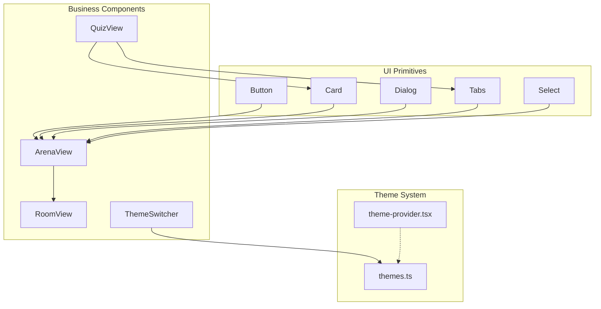
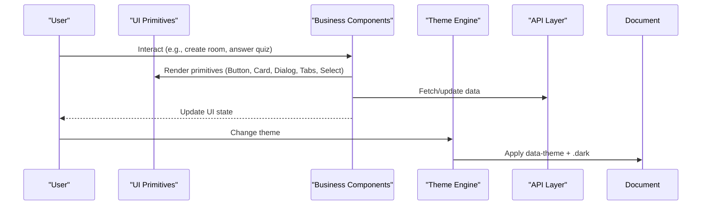
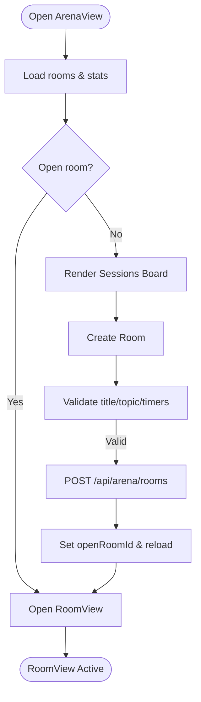
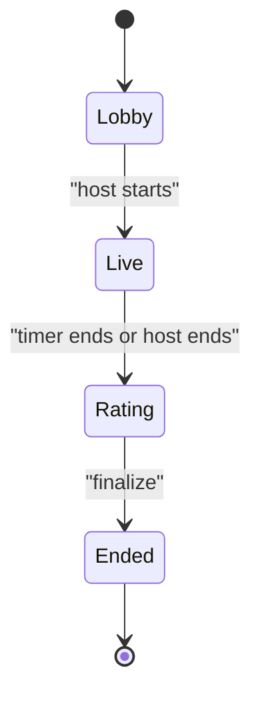
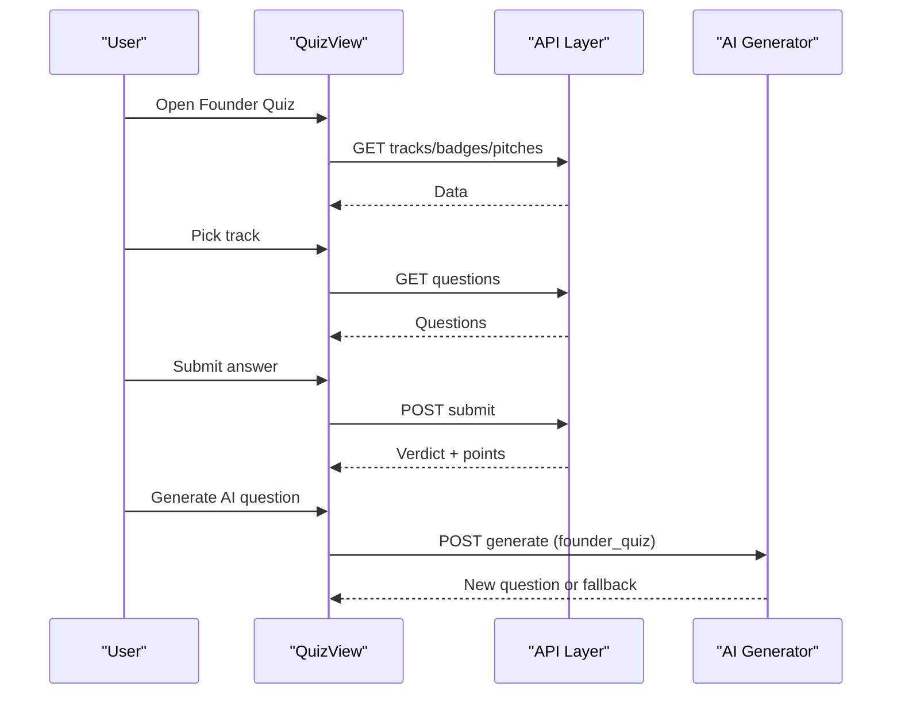
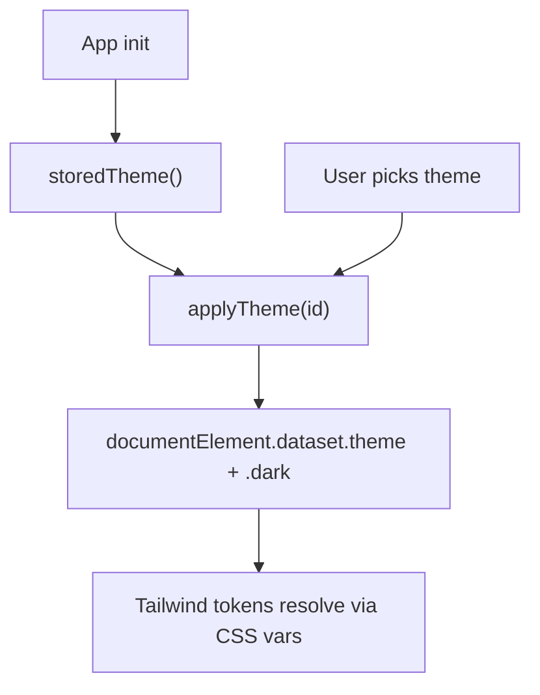
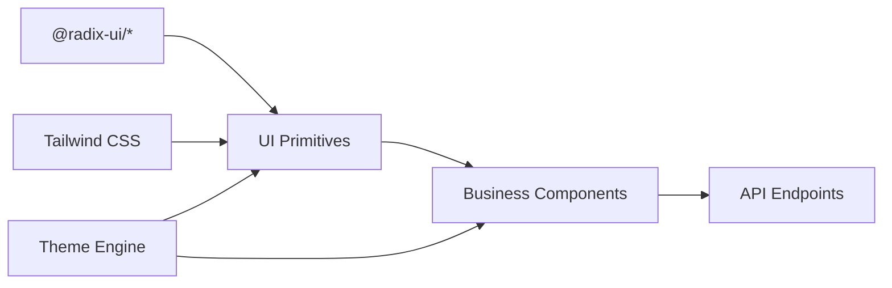

# Component Library

<cite>
**Referenced Files in This Document**
- [README.md](file://README.md)
- [package.json](file://package.json)
- [tailwind.config.ts](file://tailwind.config.ts)
- [theme-provider.tsx](file://src/components/theme-provider.tsx)
- [themes.ts](file://src/lib/themes.ts)
- [button.tsx](file://src/components/ui/button.tsx)
- [card.tsx](file://src/components/ui/card.tsx)
- [dialog.tsx](file://src/components/ui/dialog.tsx)
- [tabs.tsx](file://src/components/ui/tabs.tsx)
- [select.tsx](file://src/components/ui/select.tsx)
- [arena-view.tsx](file://src/components/welearn/arena/arena-view.tsx)
- [room-view.tsx](file://src/components/welearn/arena/room-view.tsx)
- [types.ts](file://src/components/welearn/arena/types.ts)
- [quiz-view.tsx](file://src/components/welearn/quiz-view.tsx)
- [theme-switcher.tsx](file://src/components/welearn/theme-switcher.tsx)
</cite>

## Table of Contents
1. [Introduction](#introduction)
2. [Project Structure](#project-structure)
3. [Core Components](#core-components)
4. [Architecture Overview](#architecture-overview)
5. [Detailed Component Analysis](#detailed-component-analysis)
6. [Dependency Analysis](#dependency-analysis)
7. [Performance Considerations](#performance-considerations)
8. [Troubleshooting Guide](#troubleshooting-guide)
9. [Conclusion](#conclusion)
10. [Appendices](#appendices)

## Introduction
This document describes the component library for the WeLearn application, covering:
- UI primitives built on Radix UI and styled with Tailwind CSS
- Business components including Arena views, Quiz interfaces, and navigation elements
- Theme system, color schemes, and responsive design patterns
- Accessibility, cross-browser compatibility, and performance optimization techniques
- Component composition patterns, state management approaches, and integration points with the overall application architecture

The project is a Next.js 16 + TypeScript app using shadcn/ui (Radix-based), Tailwind 4, Framer Motion, Prisma, and optional Groq AI. The UI is dark-first glassmorphism with a robust theme engine.

**Section sources**
- [README.md:1-10](file://README.md#L1-L10)

## Project Structure
The component library is organized under src/components:
- ui: Radix-based primitives (Button, Card, Dialog, Tabs, Select, etc.)
- welearn: business components (Arena, Quiz, Theme Switcher, etc.)
- lib: shared utilities and theme engine

**Diagram sources**
- [button.tsx:1-60](file://src/components/ui/button.tsx#L1-L60)
- [card.tsx:1-93](file://src/components/ui/card.tsx#L1-L93)
- [dialog.tsx:1-144](file://src/components/ui/dialog.tsx#L1-L144)
- [tabs.tsx:1-67](file://src/components/ui/tabs.tsx#L1-L67)
- [select.tsx:1-186](file://src/components/ui/select.tsx#L1-L186)
- [arena-view.tsx:1-506](file://src/components/welearn/arena/arena-view.tsx#L1-L506)
- [room-view.tsx:1-750](file://src/components/welearn/arena/room-view.tsx#L1-L750)
- [quiz-view.tsx:1-800](file://src/components/welearn/quiz-view.tsx#L1-L800)
- [theme-switcher.tsx:1-55](file://src/components/welearn/theme-switcher.tsx#L1-L55)
- [themes.ts:1-47](file://src/lib/themes.ts#L1-L47)
- [theme-provider.tsx:1-8](file://src/components/theme-provider.tsx#L1-L8)

**Section sources**
- [README.md:1-10](file://README.md#L1-L10)
- [package.json:16-83](file://package.json#L16-L83)

## Core Components
This section documents the primary UI primitives and their usage patterns.

### Button
- Purpose: Primary interactive element with variants and sizes
- Props: variant (default, destructive, outline, secondary, ghost, link), size (default, sm, lg, icon), asChild (boolean)
- Events: standard button events via React.ComponentProps<"button">
- Customization: class-variance-authority variants; accessible focus ring and invalid states
- Usage example path: [arena-view.tsx:163-168](file://src/components/welearn/arena/arena-view.tsx#L163-L168)

**Section sources**
- [button.tsx:7-59](file://src/components/ui/button.tsx#L7-L59)
- [arena-view.tsx:163-168](file://src/components/welearn/arena/arena-view.tsx#L163-L168)

### Card
- Purpose: Content container with header, content, footer, title, description, action
- Props: all div props; subcomponents accept div props
- Customization: consistent spacing, border, shadow; supports responsive grid layouts
- Usage example path: [arena-view.tsx:193-199](file://src/components/welearn/arena/arena-view.tsx#L193-L199)

**Section sources**
- [card.tsx:5-92](file://src/components/ui/card.tsx#L5-L92)
- [arena-view.tsx:193-199](file://src/components/welearn/arena/arena-view.tsx#L193-L199)

### Dialog
- Purpose: Accessible modal overlay with portal, close button, header/footer/title/description
- Props: Root/Trigger/Portal/Close/Overlay/Content/Header/Footer/Title/Description props from Radix
- Customization: animations, focus management, close button visibility toggle
- Usage example path: [arena-view.tsx:347-425](file://src/components/welearn/arena/arena-view.tsx#L347-L425)

**Section sources**
- [dialog.tsx:9-143](file://src/components/ui/dialog.tsx#L9-L143)
- [arena-view.tsx:347-425](file://src/components/welearn/arena/arena-view.tsx#L347-L425)

### Tabs
- Purpose: Tabbed interface for organizing content into sections
- Props: Root/List/Trigger/Content from Radix
- Customization: active state styling, focus rings, disabled states
- Usage example path: [arena-view.tsx:172-176](file://src/components/welearn/arena/arena-view.tsx#L172-L176)

**Section sources**
- [tabs.tsx:8-66](file://src/components/ui/tabs.tsx#L8-L66)
- [arena-view.tsx:172-176](file://src/components/welearn/arena/arena-view.tsx#L172-L176)

### Select
- Purpose: Accessible dropdown select with grouped items, labels, separators, scroll buttons
- Props: Root/Group/Value/Trigger/Content/Label/Item/Separator/ScrollUpButton/ScrollDownButton
- Customization: popper positioning, viewport sizing, icons
- Usage example path: [arena-view.tsx:356-370](file://src/components/welearn/arena/arena-view.tsx#L356-L370)

**Section sources**
- [select.tsx:9-185](file://src/components/ui/select.tsx#L9-L185)
- [arena-view.tsx:356-370](file://src/components/welearn/arena/arena-view.tsx#L356-L370)

## Architecture Overview
The component library integrates with the application through:
- Theme engine applying data-theme and .dark class
- UI primitives composed into business components
- State managed locally within components and persisted where needed
- API calls via a shared session helper

**Diagram sources**
- [arena-view.tsx:61-122](file://src/components/welearn/arena/arena-view.tsx#L61-L122)
- [quiz-view.tsx:167-184](file://src/components/welearn/quiz-view.tsx#L167-L184)
- [theme-switcher.tsx:8-20](file://src/components/welearn/theme-switcher.tsx#L8-L20)
- [themes.ts:29-46](file://src/lib/themes.ts#L29-L46)

## Detailed Component Analysis

### Arena Module
The Arena module provides live battle rooms for Group Discussion, Debate, and Pitching. It includes:
- ArenaView: board view, profile stats, create-room dialog
- RoomView: lobby/live/rating/ended phases with polling and timers
- Types: shared types mirroring API payloads

#### ArenaView
- Responsibilities:
  - Load rooms and stats
  - Create rooms with mode, topic, and optional timers
  - Navigate to RoomView when joining or rejoining
  - Show profile radar, badges, remarks, Elo, streak
- Key props/events:
  - user: SessionUser
  - onPointsEarned: callback to refresh points
- Data flow:
  - Polls /api/arena/rooms and /api/arena/stats
  - Creates rooms via POST /api/arena/rooms
- UI composition:
  - Uses Tabs, Dialog, Card, Button, Input, Slider, Label, Skeleton, Badge
- Example paths:
  - Board and profile tabs: [arena-view.tsx:172-343](file://src/components/welearn/arena/arena-view.tsx#L172-L343)
  - Create dialog: [arena-view.tsx:347-425](file://src/components/welearn/arena/arena-view.tsx#L347-L425)

**Diagram sources**
- [arena-view.tsx:61-122](file://src/components/welearn/arena/arena-view.tsx#L61-L122)
- [arena-view.tsx:172-425](file://src/components/welearn/arena/arena-view.tsx#L172-L425)

**Section sources**
- [arena-view.tsx:40-122](file://src/components/welearn/arena/arena-view.tsx#L40-L122)
- [arena-view.tsx:172-425](file://src/components/welearn/arena/arena-view.tsx#L172-L425)

#### RoomView
- Responsibilities:
  - Poll room state every ~1.5s
  - Manage phase transitions (lobby → live → rating → ended)
  - Host controls (start live, end live, co-host delegation, delete)
  - Participant actions (join/leave, stance selection, key argument, rate peers)
  - Timer countdown and beep on transition to rating
- Key props/events:
  - roomId: string
  - user: SessionUser
  - onExit: callback to return to board
- Data flow:
  - GET /api/arena/rooms/:roomId
  - POST /api/arena/rooms/:roomId with actions (join, leave, start_live, end_live, stance, key_argument, rate, finalize, delete_room)
- UI composition:
  - Uses Card, Badge, Button, Input, Textarea, Label, Skeleton, StarRating, PinDialog
- Example paths:
  - Polling loop and actions: [room-view.tsx:41-96](file://src/components/welearn/arena/room-view.tsx#L41-L96)
  - Lobby phase: [room-view.tsx:222-396](file://src/components/welearn/arena/room-view.tsx#L222-L396)
  - Live phase: [room-view.tsx:400-464](file://src/components/welearn/arena/room-view.tsx#L400-L464)
  - Rating phase: [room-view.tsx:468-618](file://src/components/welearn/arena/room-view.tsx#L468-L618)
  - Ended phase: [room-view.tsx:622-749](file://src/components/welearn/arena/room-view.tsx#L622-L749)

**Diagram sources**
- [room-view.tsx:41-96](file://src/components/welearn/arena/room-view.tsx#L41-L96)
- [room-view.tsx:181-215](file://src/components/welearn/arena/room-view.tsx#L181-L215)

**Section sources**
- [room-view.tsx:27-96](file://src/components/welearn/arena/room-view.tsx#L27-L96)
- [room-view.tsx:222-749](file://src/components/welearn/arena/room-view.tsx#L222-L749)

#### Arena Types
- Shared types mirroring API payloads:
  - Stance, RoomStatus, RoomMode
  - Aspect, ArenaPlayer, MoM, ArenaRoomState, BoardRoom, ArenaStats
  - Metadata constants: MODE_META, STANCE_META, STATUS_META
  - Utilities: fmtClock, fmtDur
- Usage:
  - Type safety across ArenaView and RoomView
  - Consistent rendering of modes, statuses, and formatting

**Section sources**
- [types.ts:1-165](file://src/components/welearn/arena/types.ts#L1-L165)

### Quiz Interface
QuizView provides founder-mode training with tracks, pitch pairing, badges, and flashcards.

- Responsibilities:
  - Load tracks, badges, pitches
  - Navigate between tabs (tracks, pitch, badges, flashcards)
  - Track player handles question lifecycle (load, submit, next, AI generation)
  - Flashcards tab supports flipping, review, category filter, and AI generation
- Key props/events:
  - user: SessionUser
  - onPointsEarned: callback to refresh points
- Data flow:
  - GET /api/quiz/tracks, /api/quiz/badges, /api/quiz/pitch
  - GET /api/quiz/questions?trackId&userId&type
  - POST /api/quiz/submit
  - POST /api/terms/review
  - POST /api/ai/generate (flashcards, founder_quiz)
- UI composition:
  - Uses Card, Badge, Button, Progress, Skeleton, Tabs, Textarea
- Example paths:
  - Main view and tabs: [quiz-view.tsx:156-262](file://src/components/welearn/quiz-view.tsx#L156-L262)
  - Track picker: [quiz-view.tsx:431-499](file://src/components/welearn/quiz-view.tsx#L431-L499)
  - Track player: [quiz-view.tsx:505-735](file://src/components/welearn/quiz-view.tsx#L505-L735)
  - Question card: [quiz-view.tsx:741-800](file://src/components/welearn/quiz-view.tsx#L741-L800)
  - Flashcards tab: [quiz-view.tsx:268-425](file://src/components/welearn/quiz-view.tsx#L268-L425)

**Diagram sources**
- [quiz-view.tsx:167-184](file://src/components/welearn/quiz-view.tsx#L167-L184)
- [quiz-view.tsx:542-600](file://src/components/welearn/quiz-view.tsx#L542-L600)
- [quiz-view.tsx:611-645](file://src/components/welearn/quiz-view.tsx#L611-L645)

**Section sources**
- [quiz-view.tsx:156-262](file://src/components/welearn/quiz-view.tsx#L156-L262)
- [quiz-view.tsx:431-735](file://src/components/welearn/quiz-view.tsx#L431-L735)
- [quiz-view.tsx:741-800](file://src/components/welearn/quiz-view.tsx#L741-L800)

### Theme System
The theme system provides VS Code-grade palettes persisted in localStorage and applied via data-theme and .dark class.

- Themes:
  - THEMES array defines id, name, dark flag, swatch colors
  - DEFAULT_THEME and storedTheme helpers
- Application:
  - applyTheme sets document.documentElement.dataset.theme and toggles .dark
  - ThemeSwitcher uses DropdownMenu to pick themes
  - ThemeProvider shim remains for legacy imports
- Integration:
  - Tailwind config maps semantic tokens (background, foreground, primary, etc.) to CSS variables
  - Components use semantic tokens for consistent theming

**Diagram sources**
- [themes.ts:13-46](file://src/lib/themes.ts#L13-L46)
- [theme-switcher.tsx:8-20](file://src/components/welearn/theme-switcher.tsx#L8-L20)
- [tailwind.config.ts:11-60](file://tailwind.config.ts#L11-L60)

**Section sources**
- [themes.ts:1-47](file://src/lib/themes.ts#L1-L47)
- [theme-switcher.tsx:1-55](file://src/components/welearn/theme-switcher.tsx#L1-L55)
- [theme-provider.tsx:1-8](file://src/components/theme-provider.tsx#L1-L8)
- [tailwind.config.ts:1-65](file://tailwind.config.ts#L1-L65)

## Dependency Analysis
Key dependencies and relationships:
- UI primitives depend on Radix UI and Tailwind CSS
- Business components compose UI primitives and call API endpoints
- Theme system is independent but consumed by UI primitives and business components

**Diagram sources**
- [package.json:23-49](file://package.json#L23-L49)
- [tailwind.config.ts:1-65](file://tailwind.config.ts#L1-L65)
- [arena-view.tsx:10-29](file://src/components/welearn/arena/arena-view.tsx#L10-L29)
- [quiz-view.tsx:30-39](file://src/components/welearn/quiz-view.tsx#L30-L39)

**Section sources**
- [package.json:16-83](file://package.json#L16-L83)
- [tailwind.config.ts:1-65](file://tailwind.config.ts#L1-L65)

## Performance Considerations
- Polling intervals:
  - Arena room polling at ~1.5s balances responsiveness and server load
  - Arena board polling at 5s for lightweight updates
- Animations:
  - Framer Motion used sparingly for transitions; ensure minimal layout thrash
- Rendering:
  - Use Skeleton placeholders during loading to improve perceived performance
- Theming:
  - CSS variable-driven theme avoids heavy reflows; prefer data-theme over class toggling where possible
- Network:
  - Batch requests where feasible; avoid redundant fetches on re-renders

[No sources needed since this section provides general guidance]

## Troubleshooting Guide
Common issues and resolutions:
- Room unavailable:
  - Error toast displayed; component exits back to board
  - Check network connectivity and endpoint availability
- Action failed:
  - Verify payload structure and authentication
  - Inspect server logs for validation errors
- Theme not applying:
  - Ensure applyTheme runs on mount and localStorage is available
  - Confirm Tailwind tokens are correctly mapped in CSS variables
- AI generation fallback:
  - If Groq key missing or service unavailable, curated content is shown
  - Toast informs user of fallback behavior

**Section sources**
- [room-view.tsx:41-51](file://src/components/welearn/arena/room-view.tsx#L41-L51)
- [room-view.tsx:78-96](file://src/components/welearn/arena/room-view.tsx#L78-L96)
- [quiz-view.tsx:611-645](file://src/components/welearn/quiz-view.tsx#L611-L645)
- [theme-switcher.tsx:8-20](file://src/components/welearn/theme-switcher.tsx#L8-L20)

## Conclusion
The component library provides a cohesive set of Radix-based UI primitives and business components tailored for the WeLearn platform. The theme system ensures consistent visual identity across dark and light modes, while responsive design patterns and accessibility features enhance usability. The Arena and Quiz modules demonstrate advanced state management, real-time interactions, and integration with backend services. By following the documented patterns and guidelines, developers can extend the library with new components that align with the application’s architecture and design principles.

[No sources needed since this section summarizes without analyzing specific files]

## Appendices

### Styling Guidelines
- Use semantic tokens (background, foreground, primary, etc.) defined in Tailwind config
- Prefer Tailwind utility classes for layout and spacing
- Maintain consistent border radius and shadow scales
- Ensure focus-visible states for keyboard navigation

**Section sources**
- [tailwind.config.ts:11-60](file://tailwind.config.ts#L11-L60)
- [button.tsx:7-36](file://src/components/ui/button.tsx#L7-L36)

### Accessibility Compliance
- Radix primitives provide ARIA attributes and keyboard navigation
- Dialog includes sr-only text for close button
- Interactive elements have appropriate roles and aria-labels

**Section sources**
- [dialog.tsx:69-77](file://src/components/ui/dialog.tsx#L69-L77)
- [theme-switcher.tsx:27-35](file://src/components/welearn/theme-switcher.tsx#L27-L35)

### Cross-Browser Compatibility
- Radix UI and Tailwind CSS ensure broad browser support
- CSS variables and modern features are widely supported in current browsers
- Test focus states and animations across devices

[No sources needed since this section provides general guidance]