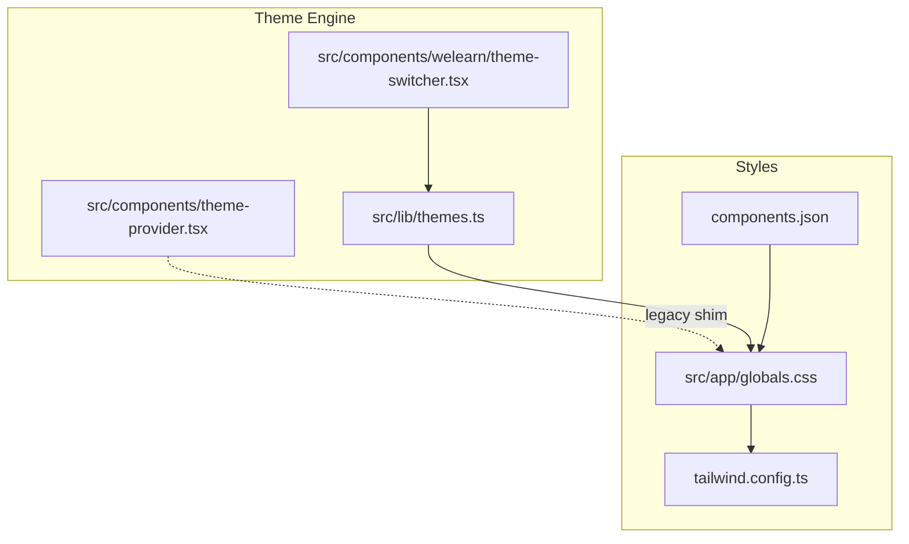
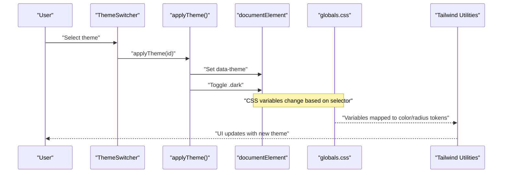
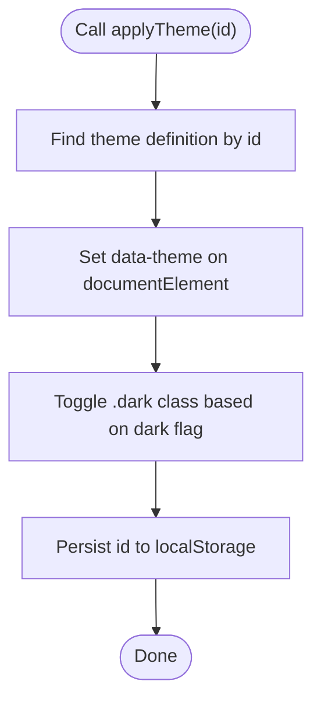
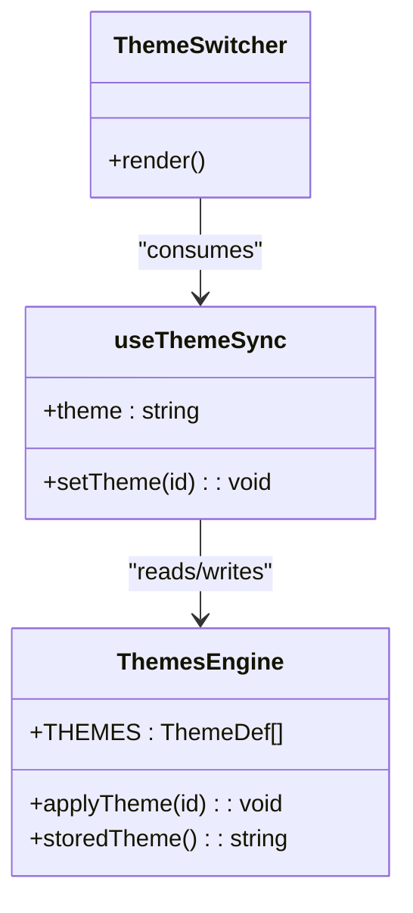
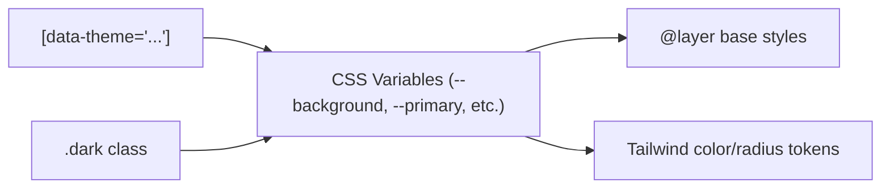
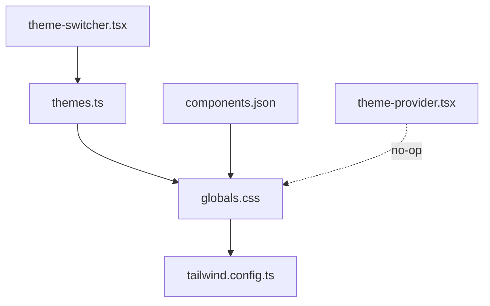

# Theme System

<cite>
**Referenced Files in This Document**
- [themes.ts](file://src/lib/themes.ts)
- [theme-provider.tsx](file://src/components/theme-provider.tsx)
- [theme-switcher.tsx](file://src/components/welearn/theme-switcher.tsx)
- [globals.css](file://src/app/globals.css)
- [tailwind.config.ts](file://tailwind.config.ts)
- [components.json](file://components.json)
</cite>

## Table of Contents
1. [Introduction](#introduction)
2. [Project Structure](#project-structure)
3. [Core Components](#core-components)
4. [Architecture Overview](#architecture-overview)
5. [Detailed Component Analysis](#detailed-component-analysis)
6. [Dependency Analysis](#dependency-analysis)
7. [Performance Considerations](#performance-considerations)
8. [Troubleshooting Guide](#troubleshooting-guide)
9. [Conclusion](#conclusion)
10. [Appendices](#appendices)

## Introduction
This document explains the WeLearn theming system, including color schemes, typography tokens, spacing and radius tokens, design token mapping, theme provider behavior, dark mode support, Tailwind CSS integration, custom component styling, responsive patterns, accessibility considerations, and cross-browser compatibility. It is intended for developers who need to extend themes, create custom palettes, and maintain visual consistency across the application.

## Project Structure
The theming system spans a small set of focused files:
- Theme engine and palette registry live in a client-side module.
- A legacy theme provider shim exists for backward compatibility.
- The UI theme switcher consumes the engine and persists user choices.
- Global CSS defines CSS variables per theme and maps them into Tailwind utilities.
- Tailwind configuration extends colors and border radius from CSS variables.
- Shadcn configuration points to the global stylesheet and enables CSS variables.

**Diagram sources**
- [themes.ts:1-47](file://src/lib/themes.ts#L1-L47)
- [theme-switcher.tsx:1-54](file://src/components/welearn/theme-switcher.tsx#L1-L54)
- [theme-provider.tsx:1-8](file://src/components/theme-provider.tsx#L1-L8)
- [globals.css:1-715](file://src/app/globals.css#L1-L715)
- [tailwind.config.ts:1-65](file://tailwind.config.ts#L1-L65)
- [components.json:1-21](file://components.json#L1-L21)

**Section sources**
- [themes.ts:1-47](file://src/lib/themes.ts#L1-L47)
- [theme-switcher.tsx:1-54](file://src/components/welearn/theme-switcher.tsx#L1-L54)
- [theme-provider.tsx:1-8](file://src/components/theme-provider.tsx#L1-L8)
- [globals.css:1-715](file://src/app/globals.css#L1-L715)
- [tailwind.config.ts:1-65](file://tailwind.config.ts#L1-L65)
- [components.json:1-21](file://components.json#L1-L21)

## Core Components
- Theme engine (palette registry and persistence):
  - Defines a typed palette list with identifiers, display names, dark/light flags, and preview swatches.
  - Applies the active theme by setting a data attribute on the document element and toggling a class for dark mode.
  - Persists the selected theme in localStorage with graceful fallback when storage is disabled.
- Legacy theme provider:
  - Exists as a no-op wrapper to avoid breaking imports; actual theming runs via the engine and CSS variables.
- Theme switcher:
  - Reads the stored theme, applies it on mount, and exposes a hook for components to reactively update their state.
  - Renders a dropdown listing all available themes with swatch previews and selection indicators.

Key responsibilities:
- Centralized palette definitions and switching logic.
- Consistent application of CSS variables through a single source of truth.
- User preference persistence and immediate UI feedback.

**Section sources**
- [themes.ts:6-47](file://src/lib/themes.ts#L6-L47)
- [theme-provider.tsx:1-8](file://src/components/theme-provider.tsx#L1-L8)
- [theme-switcher.tsx:1-54](file://src/components/welearn/theme-switcher.tsx#L1-L54)

## Architecture Overview
The theming architecture uses CSS custom properties scoped by theme selectors and Tailwind utility classes that reference those variables. The runtime engine updates DOM attributes and classes to switch themes instantly.

**Diagram sources**
- [theme-switcher.tsx:8-19](file://src/components/welearn/theme-switcher.tsx#L8-L19)
- [themes.ts:29-38](file://src/lib/themes.ts#L29-L38)
- [globals.css:6-44](file://src/app/globals.css#L6-L44)
- [tailwind.config.ts:11-60](file://tailwind.config.ts#L11-L60)

## Detailed Component Analysis

### Theme Engine: Palette Registry and Persistence
- Data model:
  - Each theme has an id, name, dark flag, and a three-color swatch used for UI previews.
- Runtime behavior:
  - applyTheme resolves the target definition, sets data-theme on the root element, toggles the .dark class, and persists the choice.
  - storedTheme returns the persisted value or a default if unavailable.
- Extensibility:
  - Add new palettes by appending entries to the registry.
  - Ensure each palette has corresponding CSS variable blocks in the global stylesheet.

**Diagram sources**
- [themes.ts:29-47](file://src/lib/themes.ts#L29-L47)

**Section sources**
- [themes.ts:6-47](file://src/lib/themes.ts#L6-L47)

### Theme Switcher UI and Hook
- useThemeSync:
  - Initializes state from stored preferences, applies the theme on mount, and provides a setter that updates both the engine and local state.
- ThemeSwitcher:
  - Renders a dropdown menu with theme items, swatch previews, and a checkmark for the active theme.
  - Uses shadcn dropdown primitives and Tailwind utility classes for consistent styling.

**Diagram sources**
- [theme-switcher.tsx:8-54](file://src/components/welearn/theme-switcher.tsx#L8-L54)
- [themes.ts:6-47](file://src/lib/themes.ts#L6-L47)

**Section sources**
- [theme-switcher.tsx:1-54](file://src/components/welearn/theme-switcher.tsx#L1-L54)

### Legacy Theme Provider
- Purpose:
  - Backward-compatible wrapper that renders children without side effects.
- Migration note:
  - New code should rely on the engine and CSS variables rather than this provider.

**Section sources**
- [theme-provider.tsx:1-8](file://src/components/theme-provider.tsx#L1-L8)

### Global Styles and Design Tokens
- CSS custom properties:
  - Each theme selector defines a comprehensive set of variables for backgrounds, foregrounds, surfaces, borders, inputs, rings, charts, and sidebar elements.
  - The base layer applies defaults for body text, fonts, and transitions.
- Typography tokens:
  - Font families are exposed via CSS variables and referenced in the Tailwind theme extension.
- Radius tokens:
  - Border radius values are derived from a base radius variable and exposed as semantic tokens.
- Dark mode:
  - The .dark class is toggled alongside data-theme to support Tailwind’s class-based dark mode strategy.
- Utility layers:
  - Ambient animations, glass panels, hover morphs, shimmer effects, and scrollbars are themed using CSS variables.

**Diagram sources**
- [globals.css:6-44](file://src/app/globals.css#L6-L44)
- [globals.css:46-413](file://src/app/globals.css#L46-L413)
- [globals.css:415-429](file://src/app/globals.css#L415-L429)
- [tailwind.config.ts:11-60](file://tailwind.config.ts#L11-L60)

**Section sources**
- [globals.css:1-715](file://src/app/globals.css#L1-L715)
- [tailwind.config.ts:1-65](file://tailwind.config.ts#L1-L65)

### Tailwind CSS Integration
- Dark mode strategy:
  - Class-based dark mode is enabled so the .dark class toggled by the engine controls dark variants.
- Color tokens:
  - Semantic color names (background, foreground, primary, secondary, muted, accent, destructive, border, input, ring, chart) map to CSS variables.
- Border radius:
  - Semantic radius tokens derive from a base radius variable.
- Plugins:
  - Animation plugin is included for motion utilities.

Best practices:
- Always use semantic color tokens instead of hard-coded colors.
- Use radius tokens for consistent corner radii.
- Keep dark-mode variants aligned with the .dark class toggle.

**Section sources**
- [tailwind.config.ts:1-65](file://tailwind.config.ts#L1-L65)

### Shadcn Configuration
- Points to the global stylesheet and enables CSS variables.
- Configures aliases for components, utils, ui, lib, and hooks.
- Sets the icon library and style preset.

Operational impact:
- Ensures generated shadcn components consume the same CSS variables and tokens defined in globals.css.

**Section sources**
- [components.json:1-21](file://components.json#L1-L21)

## Dependency Analysis
The following diagram shows how components and configuration depend on each other:

**Diagram sources**
- [theme-switcher.tsx:1-54](file://src/components/welearn/theme-switcher.tsx#L1-L54)
- [themes.ts:1-47](file://src/lib/themes.ts#L1-L47)
- [globals.css:1-715](file://src/app/globals.css#L1-L715)
- [tailwind.config.ts:1-65](file://tailwind.config.ts#L1-L65)
- [components.json:1-21](file://components.json#L1-L21)
- [theme-provider.tsx:1-8](file://src/components/theme-provider.tsx#L1-L8)

**Section sources**
- [theme-switcher.tsx:1-54](file://src/components/welearn/theme-switcher.tsx#L1-L54)
- [themes.ts:1-47](file://src/lib/themes.ts#L1-L47)
- [globals.css:1-715](file://src/app/globals.css#L1-L715)
- [tailwind.config.ts:1-65](file://tailwind.config.ts#L1-L65)
- [components.json:1-21](file://components.json#L1-L21)
- [theme-provider.tsx:1-8](file://src/components/theme-provider.tsx#L1-L8)

## Performance Considerations
- CSS variable switching is instantaneous and does not trigger layout recalculation beyond minimal repaints.
- Animations and ambient effects are GPU-accelerated where possible and respect reduced-motion preferences.
- Avoid heavy computations inside theme change handlers; keep applyTheme synchronous and lightweight.
- Prefer Tailwind utilities and semantic tokens to minimize custom CSS and reduce bundle size.

[No sources needed since this section provides general guidance]

## Troubleshooting Guide
Common issues and resolutions:
- Theme does not persist:
  - Verify localStorage availability; the engine gracefully falls back to session-only behavior when storage is disabled.
- Colors not updating:
  - Ensure the correct data-theme selector is present on the document element after applying a theme.
  - Confirm Tailwind is configured to use class-based dark mode and that .dark is toggled appropriately.
- Custom theme not applied:
  - Add a matching CSS variable block in the global stylesheet for the new theme id.
  - Include the theme entry in the registry with a unique id and correct dark flag.
- Accessibility concerns:
  - Check contrast ratios for foreground/background pairs in your custom palette.
  - Respect prefers-reduced-motion to disable non-essential animations.

**Section sources**
- [themes.ts:29-47](file://src/lib/themes.ts#L29-L47)
- [globals.css:709-714](file://src/app/globals.css#L709-L714)

## Conclusion
WeLearn’s theming system centers on a small, robust engine that manages palette selection and persistence while delegating visual rendering to CSS variables and Tailwind utilities. This separation keeps runtime logic simple and makes extending themes straightforward. By adhering to semantic tokens, maintaining accessible color contrasts, and leveraging responsive and motion-safe patterns, teams can deliver consistent, performant, and inclusive experiences across devices and browsers.

[No sources needed since this section summarizes without analyzing specific files]

## Appendices

### How to Extend Themes
- Add a new palette entry to the theme registry with a unique id, display name, dark flag, and swatch.
- Define a CSS variable block under a selector matching the new id in the global stylesheet.
- Reuse semantic tokens (colors, radius, fonts) in components to ensure consistency.

**Section sources**
- [themes.ts:6-27](file://src/lib/themes.ts#L6-L27)
- [globals.css:46-413](file://src/app/globals.css#L46-L413)

### Creating Custom Color Palettes
- Choose a background/foreground pair with sufficient contrast.
- Define primary, secondary, muted, accent, destructive, border, input, and ring colors.
- Provide chart colors and sidebar-specific tokens for consistent UI regions.
- Validate contrast ratios against accessibility guidelines.

**Section sources**
- [globals.css:46-413](file://src/app/globals.css#L46-L413)

### Implementing Dark Mode Support
- Use the .dark class toggle provided by the engine alongside data-theme.
- Map all colors through semantic tokens so dark variants are automatically supported.
- Test interactive states (hover, focus, active) in both light and dark modes.

**Section sources**
- [themes.ts:29-38](file://src/lib/themes.ts#L29-L38)
- [tailwind.config.ts:4-6](file://tailwind.config.ts#L4-L6)

### Tailwind CSS Integration Guidelines
- Use semantic color tokens (e.g., bg-background, text-primary) instead of raw colors.
- Apply radius tokens for consistent corner radii.
- Keep dark-mode variants aligned with the .dark class strategy.

**Section sources**
- [tailwind.config.ts:11-60](file://tailwind.config.ts#L11-L60)

### Custom Component Styling Best Practices
- Style components using semantic tokens and Tailwind utilities.
- Leverage existing utility classes for glass effects, hover morphs, and shimmer where appropriate.
- Avoid hard-coded colors; prefer CSS variables exposed by the theme engine.

**Section sources**
- [globals.css:431-715](file://src/app/globals.css#L431-L715)

### Responsive Design Patterns
- Use Tailwind’s responsive prefixes to adapt layouts across breakpoints.
- Ensure interactive elements remain accessible and legible at all sizes.
- Test scroll-snap and animation behaviors on mobile devices.

[No sources needed since this section provides general guidance]

### Accessibility Compliance
- Maintain minimum contrast ratios for text and interactive elements.
- Provide aria-labels for theme controls and ensure keyboard navigation works.
- Honor prefers-reduced-motion to disable animations for sensitive users.

**Section sources**
- [theme-switcher.tsx:27-35](file://src/components/welearn/theme-switcher.tsx#L27-L35)
- [globals.css:709-714](file://src/app/globals.css#L709-L714)

### Cross-Browser Compatibility
- Use standard CSS variables and Tailwind utilities for broad browser support.
- Include vendor prefixes where necessary for backdrop-filter and related features.
- Test scrollbar styling and animations across major browsers.

**Section sources**
- [globals.css:484-495](file://src/app/globals.css#L484-L495)
- [globals.css:679-694](file://src/app/globals.css#L679-L694)