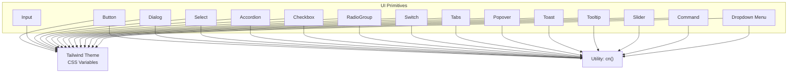
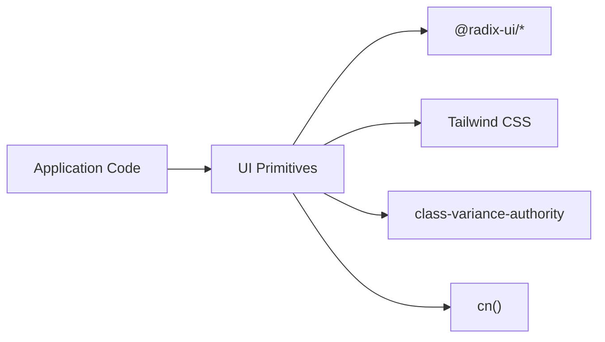
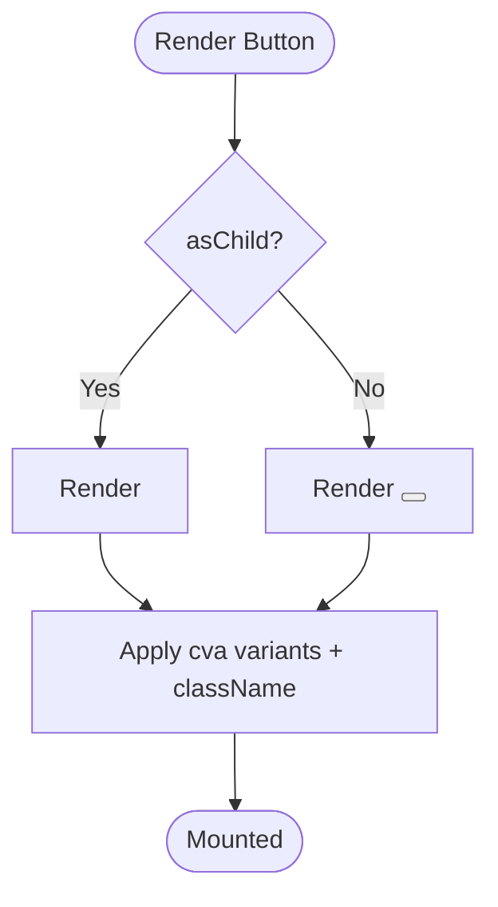
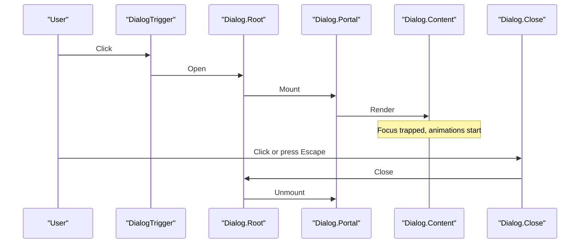
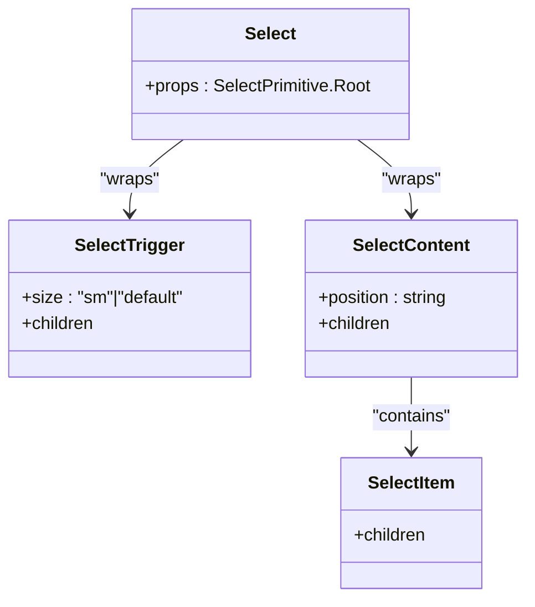
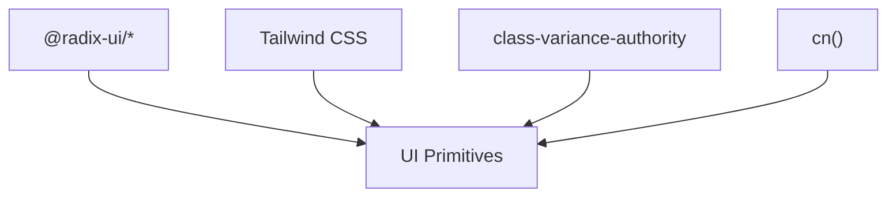

# UI Primitives

<cite>
**Referenced Files in This Document**
- [components.json](file://components.json)
- [tailwind.config.ts](file://tailwind.config.ts)
- [button.tsx](file://src/components/ui/button.tsx)
- [dialog.tsx](file://src/components/ui/dialog.tsx)
- [input.tsx](file://src/components/ui/input.tsx)
- [select.tsx](file://src/components/ui/select.tsx)
- [accordion.tsx](file://src/components/ui/accordion.tsx)
- [checkbox.tsx](file://src/components/ui/checkbox.tsx)
- [radio-group.tsx](file://src/components/ui/radio-group.tsx)
- [switch.tsx](file://src/components/ui/switch.tsx)
- [tabs.tsx](file://src/components/ui/tabs.tsx)
- [popover.tsx](file://src/components/ui/popover.tsx)
- [toast.tsx](file://src/components/ui/toast.tsx)
- [tooltip.tsx](file://src/components/ui/tooltip.tsx)
- [slider.tsx](file://src/components/ui/slider.tsx)
- [command.tsx](file://src/components/ui/command.tsx)
- [dropdown-menu.tsx](file://src/components/ui/dropdown-menu.tsx)
</cite>

## Table of Contents
1. [Introduction](#introduction)
2. [Project Structure](#project-structure)
3. [Core Components](#core-components)
4. [Architecture Overview](#architecture-overview)
5. [Detailed Component Analysis](#detailed-component-analysis)
6. [Dependency Analysis](#dependency-analysis)
7. [Performance Considerations](#performance-considerations)
8. [Troubleshooting Guide](#troubleshooting-guide)
9. [Conclusion](#conclusion)
10. [Appendices](#appendices)

## Introduction
This document provides comprehensive documentation for the UI primitive components built on Radix UI within the project. It covers each component’s props, events, styling options, and accessibility features. It also includes usage patterns, customization via Tailwind CSS, theme integration, responsive design considerations, composition strategies, state management approaches, performance optimization techniques, cross-browser compatibility, keyboard navigation, screen reader support, and guidelines for extending components while maintaining consistency across the application.

## Project Structure
The UI primitives live under src/components/ui and are styled with Tailwind CSS using CSS variables defined in the global stylesheet. The shadcn/ui configuration defines aliases and style settings that influence how components are composed and themed.

**Diagram sources**
- [tailwind.config.ts:11-60](file://tailwind.config.ts#L11-L60)
- [button.tsx:1-60](file://src/components/ui/button.tsx#L1-L60)
- [dialog.tsx:1-144](file://src/components/ui/dialog.tsx#L1-L144)
- [select.tsx:1-186](file://src/components/ui/select.tsx#L1-L186)

**Section sources**
- [components.json:1-21](file://components.json#L1-L21)
- [tailwind.config.ts:1-65](file://tailwind.config.ts#L1-L65)

## Core Components
This section summarizes the core primitives, their key props, events, styling hooks, and accessibility attributes. For exact prop types and event names, refer to the referenced files.

- Button
  - Props: variant, size, asChild, className, plus standard button props
  - Events: onClick, onKeyDown, onFocus, onBlur, disabled
  - Styling: Uses class-variance-authority variants; Tailwind classes for focus-visible, ring, destructive, ghost, link, sizes
  - Accessibility: Focus ring, keyboard activation, aria-invalid when used with form validation
  - Reference: [button.tsx:7-59](file://src/components/ui/button.tsx#L7-L59)

- Input
  - Props: type, className, plus all native input props
  - Events: onChange, onFocus, onBlur, onKeyDown, disabled
  - Styling: Base styles, focus-visible ring, invalid states, dark mode support
  - Accessibility: Native semantics, focus ring, aria-invalid
  - Reference: [input.tsx:5-21](file://src/components/ui/input.tsx#L5-L21)

- Dialog
  - Components: Dialog, DialogTrigger, DialogPortal, DialogClose, DialogOverlay, DialogContent, DialogHeader, DialogFooter, DialogTitle, DialogDescription
  - Props: showCloseButton (DialogContent), plus Radix dialog props
  - Events: onOpenChange, onClose, onKeyDown
  - Styling: Overlay fade/scale animations, centered content, responsive max-width
  - Accessibility: Focus trap, Escape to close, role/aria attributes managed by Radix
  - Reference: [dialog.tsx:9-143](file://src/components/ui/dialog.tsx#L9-L143)

- Select
  - Components: Select, SelectTrigger, SelectValue, SelectContent, SelectGroup, SelectLabel, SelectItem, SelectSeparator, Scroll buttons
  - Props: position ("popper" or other), size ("sm"|"default")
  - Events: onValueChange, onOpenChange, onKeyDown
  - Styling: Animated open/close, viewport sizing, icons, disabled states
  - Accessibility: ARIA roles, keyboard navigation, item indicators
  - Reference: [select.tsx:9-185](file://src/components/ui/select.tsx#L9-L185)

- Accordion
  - Components: Accordion, AccordionItem, AccordionTrigger, AccordionContent
  - Props: collapsible, defaultValue, value, onValueChange
  - Events: onValueChange, onKeyDown
  - Styling: Chevron rotation, expand/collapse animations
  - Accessibility: ARIA-expanded, keyboard navigation between items
  - Reference: [accordion.tsx:9-66](file://src/components/ui/accordion.tsx#L9-L66)

- Checkbox
  - Props: checked, defaultChecked, onCheckedChange, disabled
  - Events: onChange
  - Styling: Checked state colors, focus ring, invalid states
  - Accessibility: ARIA-checked, keyboard toggle
  - Reference: [checkbox.tsx:9-32](file://src/components/ui/checkbox.tsx#L9-L32)

- RadioGroup
  - Components: RadioGroup, RadioGroupItem
  - Props: value, onValueChange, disabled, orientation
  - Events: onChange
  - Styling: Grid layout, indicator circle, focus ring
  - Accessibility: ARIA radio group semantics, arrow keys navigation
  - Reference: [radio-group.tsx:9-45](file://src/components/ui/radio-group.tsx#L9-L45)

- Switch
  - Props: checked, defaultChecked, onCheckedChange, disabled
  - Events: onChange
  - Styling: Thumb translation, checked/unchecked colors
  - Accessibility: ARIA-switch semantics, keyboard toggle
  - Reference: [switch.tsx:8-31](file://src/components/ui/switch.tsx#L8-L31)

- Tabs
  - Components: Tabs, TabsList, TabsTrigger, TabsContent
  - Props: defaultValue, value, orientation, onValueChange
  - Events: onSelect, onKeyDown
  - Styling: Active tab background, focus rings, disabled states
  - Accessibility: Tab roles, arrow key navigation
  - Reference: [tabs.tsx:8-66](file://src/components/ui/tabs.tsx#L8-L66)

- Popover
  - Components: Popover, PopoverTrigger, PopoverContent, PopoverAnchor
  - Props: align, sideOffset, collisionPadding
  - Events: onOpenChange, onKeyDown
  - Styling: Slide/fade animations, positioning
  - Accessibility: Focus management, Escape to close
  - Reference: [popover.tsx:8-48](file://src/components/ui/popover.tsx#L8-L48)

- Toast
  - Components: ToastProvider, ToastViewport, Toast, ToastTitle, ToastDescription, ToastAction, ToastClose
  - Props: variant ("default"|"destructive"), duration, swipeGesture
  - Events: onDismiss, onClose
  - Styling: Swipe animations, destructive variant
  - Accessibility: Live region announcements, keyboard dismiss
  - Reference: [toast.tsx:10-128](file://src/components/ui/toast.tsx#L10-L128)

- Tooltip
  - Components: TooltipProvider, Tooltip, TooltipTrigger, TooltipContent
  - Props: delayDuration, sideOffset
  - Events: onOpenChange
  - Styling: Fade/scale animations, arrow
  - Accessibility: Tooltips announced by assistive tech when appropriate
  - Reference: [tooltip.tsx:8-61](file://src/components/ui/tooltip.tsx#L8-L61)

- Slider
  - Props: min, max, defaultValue, value, orientation, step
  - Events: onValueChange, onValueCommit
  - Styling: Track, range, thumb, vertical/horizontal orientations
  - Accessibility: ARIA slider semantics, keyboard increment/decrement
  - Reference: [slider.tsx:8-63](file://src/components/ui/slider.tsx#L8-L63)

- Command
  - Components: Command, CommandDialog, CommandInput, CommandList, CommandEmpty, CommandGroup, CommandSeparator, CommandItem, CommandShortcut
  - Props: filter, loop, placeholder
  - Events: onValueChange, onKeyDown
  - Styling: Group headings, selected item highlight
  - Accessibility: Searchable list with keyboard navigation
  - Reference: [command.tsx:16-184](file://src/components/ui/command.tsx#L16-L184)

- Dropdown Menu
  - Components: DropdownMenu, DropdownMenuTrigger, DropdownMenuContent, DropdownMenuGroup, DropdownMenuItem, DropdownMenuCheckboxItem, DropdownMenuRadioGroup, DropdownMenuRadioItem, DropdownMenuLabel, DropdownMenuSeparator, DropdownMenuShortcut, DropdownMenuSub, DropdownMenuSubTrigger, DropdownMenuSubContent
  - Props: sideOffset, collisionPadding
  - Events: onOpenChange, onSelect
  - Styling: Submenus, inset labels, destructive variants
  - Accessibility: ARIA menu roles, keyboard navigation
  - Reference: [dropdown-menu.tsx:9-257](file://src/components/ui/dropdown-menu.tsx#L9-L257)

**Section sources**
- [button.tsx:7-59](file://src/components/ui/button.tsx#L7-L59)
- [input.tsx:5-21](file://src/components/ui/input.tsx#L5-L21)
- [dialog.tsx:9-143](file://src/components/ui/dialog.tsx#L9-L143)
- [select.tsx:9-185](file://src/components/ui/select.tsx#L9-L185)
- [accordion.tsx:9-66](file://src/components/ui/accordion.tsx#L9-L66)
- [checkbox.tsx:9-32](file://src/components/ui/checkbox.tsx#L9-L32)
- [radio-group.tsx:9-45](file://src/components/ui/radio-group.tsx#L9-L45)
- [switch.tsx:8-31](file://src/components/ui/switch.tsx#L8-L31)
- [tabs.tsx:8-66](file://src/components/ui/tabs.tsx#L8-L66)
- [popover.tsx:8-48](file://src/components/ui/popover.tsx#L8-L48)
- [toast.tsx:10-128](file://src/components/ui/toast.tsx#L10-L128)
- [tooltip.tsx:8-61](file://src/components/ui/tooltip.tsx#L8-L61)
- [slider.tsx:8-63](file://src/components/ui/slider.tsx#L8-L63)
- [command.tsx:16-184](file://src/components/ui/command.tsx#L16-L184)
- [dropdown-menu.tsx:9-257](file://src/components/ui/dropdown-menu.tsx#L9-L257)

## Architecture Overview
The UI primitives follow a consistent architecture:
- Each component wraps a Radix UI primitive to provide robust behavior and accessibility.
- Styling is applied through Tailwind CSS utilities and CSS variables from the theme.
- Composition uses data-slot markers and utility functions like cn() to merge classes.
- Some components use class-variance-authority (cva) for variant-based styling.

**Diagram sources**
- [button.tsx:1-60](file://src/components/ui/button.tsx#L1-L60)
- [dialog.tsx:1-144](file://src/components/ui/dialog.tsx#L1-L144)
- [select.tsx:1-186](file://src/components/ui/select.tsx#L1-L186)

## Detailed Component Analysis

### Button
- Purpose: Primary interactive element with multiple visual variants and sizes.
- Props:
  - variant: default | destructive | outline | secondary | ghost | link
  - size: default | sm | lg | icon
  - asChild: boolean (renders as child component via Slot)
  - className: string
  - All standard button props (onClick, onKeyDown, disabled, etc.)
- Events:
  - onClick, onKeyDown, onFocus, onBlur
- Styling:
  - Variants define color schemes and hover states
  - Sizes adjust height and padding
  - Focus-visible ring and accessibility attributes
- Accessibility:
  - Keyboard activation, focus ring, disabled state handling
- Usage pattern:
  - Use asChild to compose with anchor or other elements
  - Combine with icons and text
- Reference: [button.tsx:7-59](file://src/components/ui/button.tsx#L7-L59)

**Diagram sources**
- [button.tsx:38-59](file://src/components/ui/button.tsx#L38-L59)

**Section sources**
- [button.tsx:7-59](file://src/components/ui/button.tsx#L7-L59)

### Dialog
- Purpose: Modal overlay with accessible focus management and keyboard interactions.
- Components:
  - Dialog, DialogTrigger, DialogPortal, DialogClose, DialogOverlay, DialogContent, DialogHeader, DialogFooter, DialogTitle, DialogDescription
- Props:
  - DialogContent.showCloseButton: boolean
  - All Radix dialog props (onOpenChange, modal, etc.)
- Events:
  - onOpenChange, onClose, onKeyDown
- Styling:
  - Overlay with backdrop blur and opacity
  - Content with animation and responsive width
- Accessibility:
  - Focus trap, Escape to close, ARIA roles
- Usage pattern:
  - Wrap content in DialogContent
  - Provide header/footer and description/title
- Reference: [dialog.tsx:9-143](file://src/components/ui/dialog.tsx#L9-L143)

**Diagram sources**
- [dialog.tsx:9-80](file://src/components/ui/dialog.tsx#L9-L80)

**Section sources**
- [dialog.tsx:9-143](file://src/components/ui/dialog.tsx#L9-L143)

### Select
- Purpose: Accessible select dropdown with animated content and keyboard navigation.
- Components:
  - Select, SelectTrigger, SelectValue, SelectContent, SelectGroup, SelectLabel, SelectItem, SelectSeparator, ScrollUpButton, ScrollDownButton
- Props:
  - SelectTrigger.size: "sm" | "default"
  - SelectContent.position: "popper" or other positions
  - All Radix select props (onValueChange, onOpenChange)
- Events:
  - onValueChange, onOpenChange, onKeyDown
- Styling:
  - Animated open/close transitions
  - Viewport sizing and scroll buttons
- Accessibility:
  - ARIA roles, keyboard navigation, item indicators
- Usage pattern:
  - Group items with SelectGroup and labels
  - Customize trigger appearance with size
- Reference: [select.tsx:9-185](file://src/components/ui/select.tsx#L9-L185)

**Diagram sources**
- [select.tsx:9-123](file://src/components/ui/select.tsx#L9-L123)

**Section sources**
- [select.tsx:9-185](file://src/components/ui/select.tsx#L9-L185)

### Accordion
- Purpose: Expandable sections with smooth animations and keyboard navigation.
- Components:
  - Accordion, AccordionItem, AccordionTrigger, AccordionContent
- Props:
  - Collapsible behavior, controlled/uncontrolled value
- Events:
  - onValueChange, onKeyDown
- Styling:
  - Chevron rotation and content animations
- Accessibility:
  - ARIA-expanded, focus management
- Usage pattern:
  - Wrap items in AccordionItem
  - Provide trigger and content
- Reference: [accordion.tsx:9-66](file://src/components/ui/accordion.tsx#L9-L66)

**Section sources**
- [accordion.tsx:9-66](file://src/components/ui/accordion.tsx#L9-L66)

### Checkbox
- Purpose: Binary selection control with accessible state.
- Props:
  - checked, defaultChecked, onCheckedChange, disabled
- Events:
  - onChange
- Styling:
  - Checked state colors, focus ring, invalid states
- Accessibility:
  - ARIA-checked, keyboard toggle
- Reference: [checkbox.tsx:9-32](file://src/components/ui/checkbox.tsx#L9-L32)

**Section sources**
- [checkbox.tsx:9-32](file://src/components/ui/checkbox.tsx#L9-L32)

### RadioGroup
- Purpose: Single-selection group with accessible keyboard navigation.
- Components:
  - RadioGroup, RadioGroupItem
- Props:
  - value, onValueChange, disabled, orientation
- Events:
  - onChange
- Styling:
  - Grid layout, indicator circle, focus ring
- Accessibility:
  - ARIA radio group semantics, arrow keys navigation
- Reference: [radio-group.tsx:9-45](file://src/components/ui/radio-group.tsx#L9-L45)

**Section sources**
- [radio-group.tsx:9-45](file://src/components/ui/radio-group.tsx#L9-L45)

### Switch
- Purpose: Toggle control with accessible state.
- Props:
  - checked, defaultChecked, onCheckedChange, disabled
- Events:
  - onChange
- Styling:
  - Thumb translation, checked/unchecked colors
- Accessibility:
  - ARIA-switch semantics, keyboard toggle
- Reference: [switch.tsx:8-31](file://src/components/ui/switch.tsx#L8-L31)

**Section sources**
- [switch.tsx:8-31](file://src/components/ui/switch.tsx#L8-L31)

### Tabs
- Purpose: Tabbed interface with accessible navigation.
- Components:
  - Tabs, TabsList, TabsTrigger, TabsContent
- Props:
  - defaultValue, value, orientation, onValueChange
- Events:
  - onSelect, onKeyDown
- Styling:
  - Active tab background, focus rings, disabled states
- Accessibility:
  - Tab roles, arrow key navigation
- Reference: [tabs.tsx:8-66](file://src/components/ui/tabs.tsx#L8-L66)

**Section sources**
- [tabs.tsx:8-66](file://src/components/ui/tabs.tsx#L8-L66)

### Popover
- Purpose: Floating content anchored to a trigger.
- Components:
  - Popover, PopoverTrigger, PopoverContent, PopoverAnchor
- Props:
  - align, sideOffset, collisionPadding
- Events:
  - onOpenChange, onKeyDown
- Styling:
  - Slide/fade animations, positioning
- Accessibility:
  - Focus management, Escape to close
- Reference: [popover.tsx:8-48](file://src/components/ui/popover.tsx#L8-L48)

**Section sources**
- [popover.tsx:8-48](file://src/components/ui/popover.tsx#L8-L48)

### Toast
- Purpose: Non-intrusive notifications with swipe gestures.
- Components:
  - ToastProvider, ToastViewport, Toast, ToastTitle, ToastDescription, ToastAction, ToastClose
- Props:
  - variant: "default" | "destructive", duration, swipeGesture
- Events:
  - onDismiss, onClose
- Styling:
  - Swipe animations, destructive variant
- Accessibility:
  - Live region announcements, keyboard dismiss
- Reference: [toast.tsx:10-128](file://src/components/ui/toast.tsx#L10-L128)

**Section sources**
- [toast.tsx:10-128](file://src/components/ui/toast.tsx#L10-L128)

### Tooltip
- Purpose: Contextual hints with delayed display.
- Components:
  - TooltipProvider, Tooltip, TooltipTrigger, TooltipContent
- Props:
  - delayDuration, sideOffset
- Events:
  - onOpenChange
- Styling:
  - Fade/scale animations, arrow
- Accessibility:
  - Tooltips announced by assistive tech when appropriate
- Reference: [tooltip.tsx:8-61](file://src/components/ui/tooltip.tsx#L8-L61)

**Section sources**
- [tooltip.tsx:8-61](file://src/components/ui/tooltip.tsx#L8-L61)

### Slider
- Purpose: Range selection with single or multiple thumbs.
- Props:
  - min, max, defaultValue, value, orientation, step
- Events:
  - onValueChange, onValueCommit
- Styling:
  - Track, range, thumb, vertical/horizontal orientations
- Accessibility:
  - ARIA slider semantics, keyboard increment/decrement
- Reference: [slider.tsx:8-63](file://src/components/ui/slider.tsx#L8-L63)

**Section sources**
- [slider.tsx:8-63](file://src/components/ui/slider.tsx#L8-L63)

### Command
- Purpose: Command palette with searchable actions.
- Components:
  - Command, CommandDialog, CommandInput, CommandList, CommandEmpty, CommandGroup, CommandSeparator, CommandItem, CommandShortcut
- Props:
  - filter, loop, placeholder
- Events:
  - onValueChange, onKeyDown
- Styling:
  - Group headings, selected item highlight
- Accessibility:
  - Searchable list with keyboard navigation
- Reference: [command.tsx:16-184](file://src/components/ui/command.tsx#L16-L184)

**Section sources**
- [command.tsx:16-184](file://src/components/ui/command.tsx#L16-L184)

### Dropdown Menu
- Purpose: Contextual menus with nested submenus.
- Components:
  - DropdownMenu, DropdownMenuTrigger, DropdownMenuContent, DropdownMenuGroup, DropdownMenuItem, DropdownMenuCheckboxItem, DropdownMenuRadioGroup, DropdownMenuRadioItem, DropdownMenuLabel, DropdownMenuSeparator, DropdownMenuShortcut, DropdownMenuSub, DropdownMenuSubTrigger, DropdownMenuSubContent
- Props:
  - sideOffset, collisionPadding
- Events:
  - onOpenChange, onSelect
- Styling:
  - Submenus, inset labels, destructive variants
- Accessibility:
  - ARIA menu roles, keyboard navigation
- Reference: [dropdown-menu.tsx:9-257](file://src/components/ui/dropdown-menu.tsx#L9-L257)

**Section sources**
- [dropdown-menu.tsx:9-257](file://src/components/ui/dropdown-menu.tsx#L9-L257)

## Dependency Analysis
- Radix UI primitives provide unstyled, accessible building blocks.
- Tailwind CSS applies consistent styling via utility classes and CSS variables.
- class-variance-authority enables variant-based styling for components like Button and Toast.
- Utility function cn() merges class names safely.

**Diagram sources**
- [button.tsx:1-60](file://src/components/ui/button.tsx#L1-L60)
- [toast.tsx:1-129](file://src/components/ui/toast.tsx#L1-L129)

**Section sources**
- [button.tsx:1-60](file://src/components/ui/button.tsx#L1-L60)
- [toast.tsx:1-129](file://src/components/ui/toast.tsx#L1-L129)

## Performance Considerations
- Prefer controlled components where state needs to be synchronized with parent logic.
- Avoid unnecessary re-renders by memoizing expensive computations and stable references.
- Use asChild sparingly; it changes the rendered element and may affect performance if overused.
- Leverage Radix’s portal components to avoid deep DOM nesting issues.
- Keep animations minimal and rely on CSS transforms for better performance.

[No sources needed since this section provides general guidance]

## Troubleshooting Guide
- Focus not visible: Ensure focus-visible styles are present and not overridden. Check focus-visible ring classes in components.
- Invalid state not showing: Verify aria-invalid is set correctly and that destructive ring/border classes are applied.
- Dialog not closing: Confirm DialogClose is used or Escape key is handled by Radix.
- Select not updating: Ensure onValueChange is provided and state is updated accordingly.
- Toast not appearing: Verify ToastProvider is mounted at the app root and ToastViewport is present.
- Tooltip not displaying: Ensure TooltipProvider is mounted and delayDuration is configured appropriately.

**Section sources**
- [button.tsx:7-59](file://src/components/ui/button.tsx#L7-L59)
- [input.tsx:5-21](file://src/components/ui/input.tsx#L5-L21)
- [dialog.tsx:9-143](file://src/components/ui/dialog.tsx#L9-L143)
- [select.tsx:9-185](file://src/components/ui/select.tsx#L9-L185)
- [toast.tsx:10-128](file://src/components/ui/toast.tsx#L10-L128)
- [tooltip.tsx:8-61](file://src/components/ui/tooltip.tsx#L8-L61)

## Conclusion
The UI primitives provide a robust, accessible, and customizable foundation built on Radix UI and styled with Tailwind CSS. By following the documented props, events, styling hooks, and accessibility attributes, developers can compose consistent and performant interfaces. Adhering to the extension and composition guidelines ensures maintainability and uniformity across the application.

[No sources needed since this section summarizes without analyzing specific files]

## Appendices

### Styling and Theme Integration
- Theme variables are defined in the Tailwind config and consumed via CSS variables.
- Dark mode is enabled via class strategy.
- Border radius tokens are extended for consistent spacing.

**Section sources**
- [tailwind.config.ts:11-60](file://tailwind.config.ts#L11-L60)

### Shadcn/UI Configuration
- Style preset: new-york
- RSC enabled, TSX enabled
- Aliases for components, utils, ui, lib, hooks
- Icon library: lucide

**Section sources**
- [components.json:1-21](file://components.json#L1-L21)

### Cross-Browser Compatibility
- Radix UI handles cross-browser concerns for focus management, portals, and ARIA attributes.
- Tailwind CSS utilities ensure consistent rendering across modern browsers.
- Animations use CSS transforms and opacity for broad compatibility.

[No sources needed since this section provides general guidance]

### Keyboard Navigation and Screen Reader Support
- All interactive components expose proper ARIA roles and states.
- Keyboard navigation follows WAI-ARIA authoring practices.
- Screen readers announce state changes via live regions (e.g., Toast).

**Section sources**
- [dialog.tsx:9-143](file://src/components/ui/dialog.tsx#L9-L143)
- [toast.tsx:10-128](file://src/components/ui/toast.tsx#L10-L128)
- [select.tsx:9-185](file://src/components/ui/select.tsx#L9-L185)

### Extending Components
- Add new variants using cva for components that support it (e.g., Button, Toast).
- Extend Tailwind theme variables for new colors and radii.
- Compose existing primitives to build higher-level components while preserving accessibility.

**Section sources**
- [button.tsx:7-59](file://src/components/ui/button.tsx#L7-L59)
- [toast.tsx:27-41](file://src/components/ui/toast.tsx#L27-L41)
- [tailwind.config.ts:11-60](file://tailwind.config.ts#L11-L60)