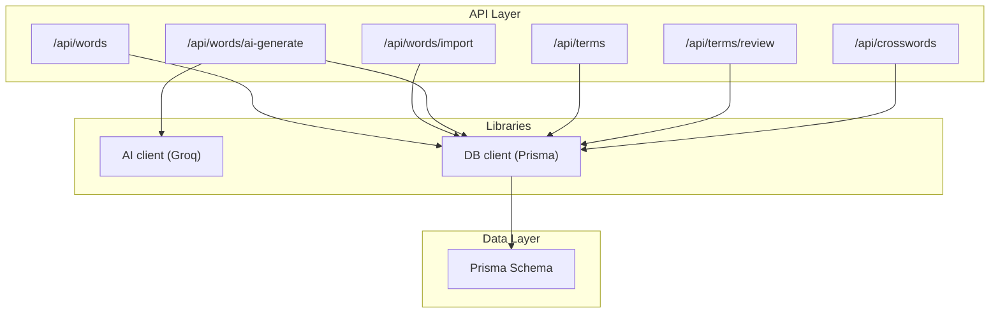
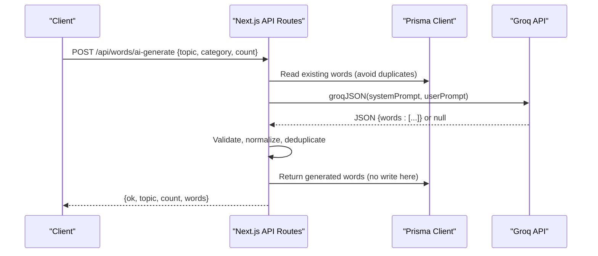
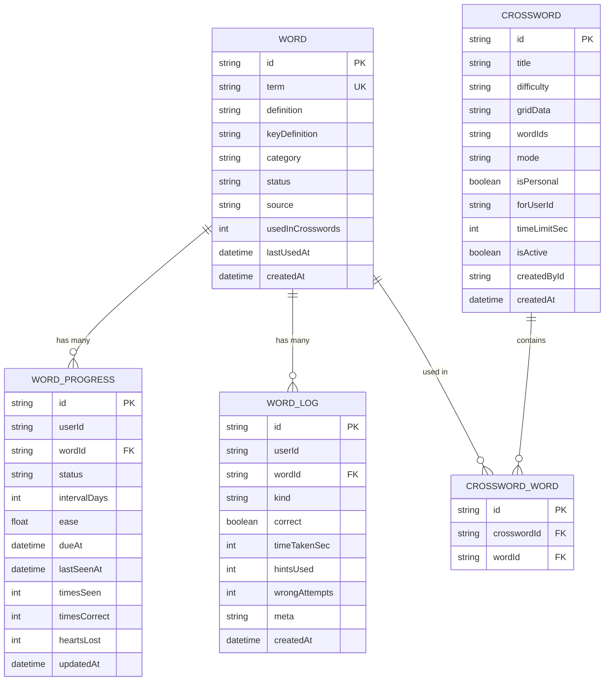
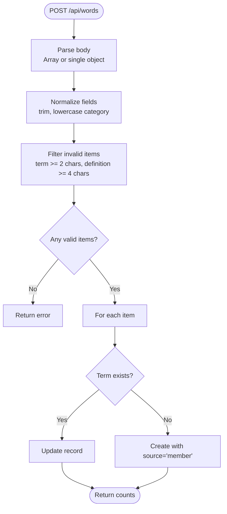
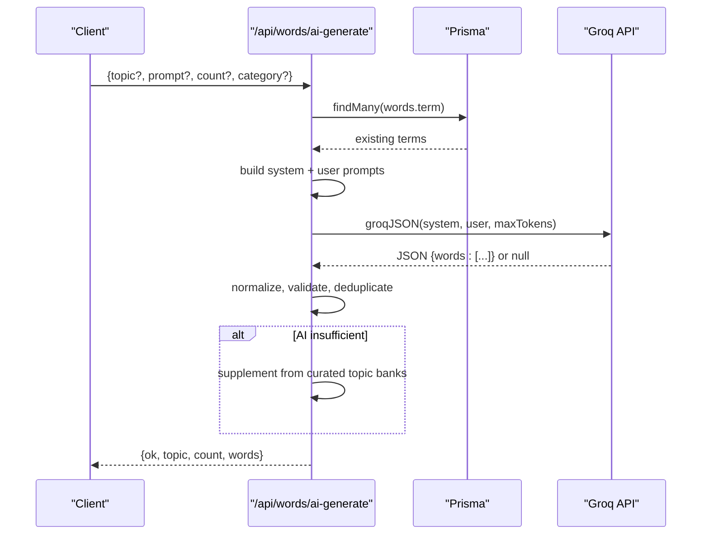
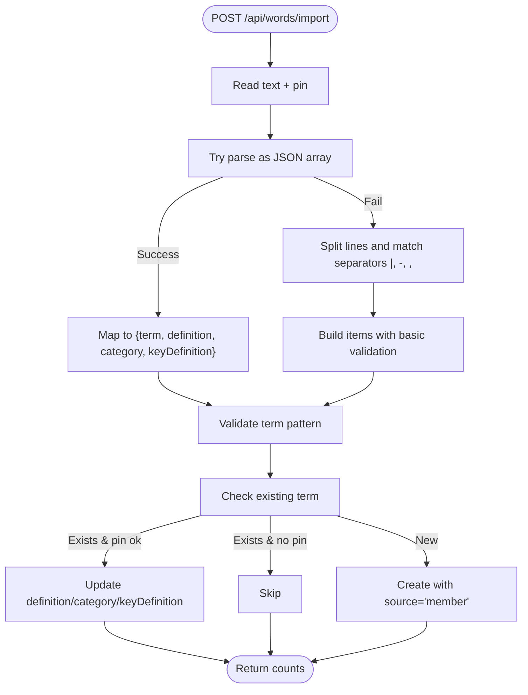
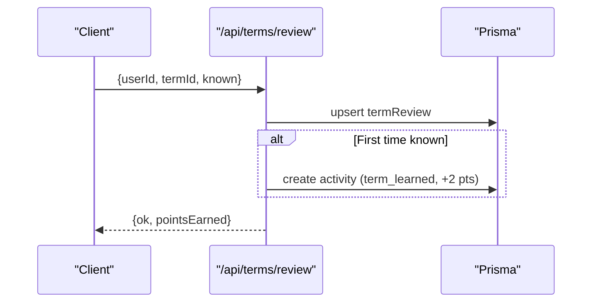
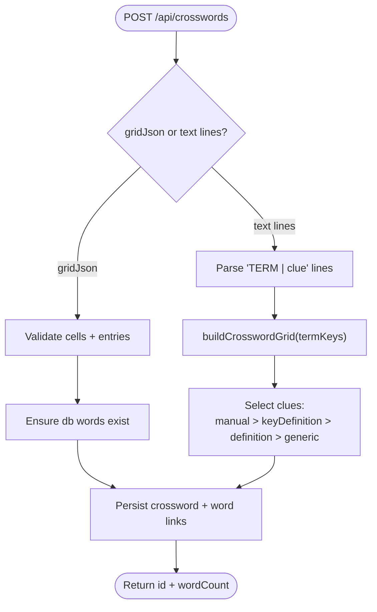
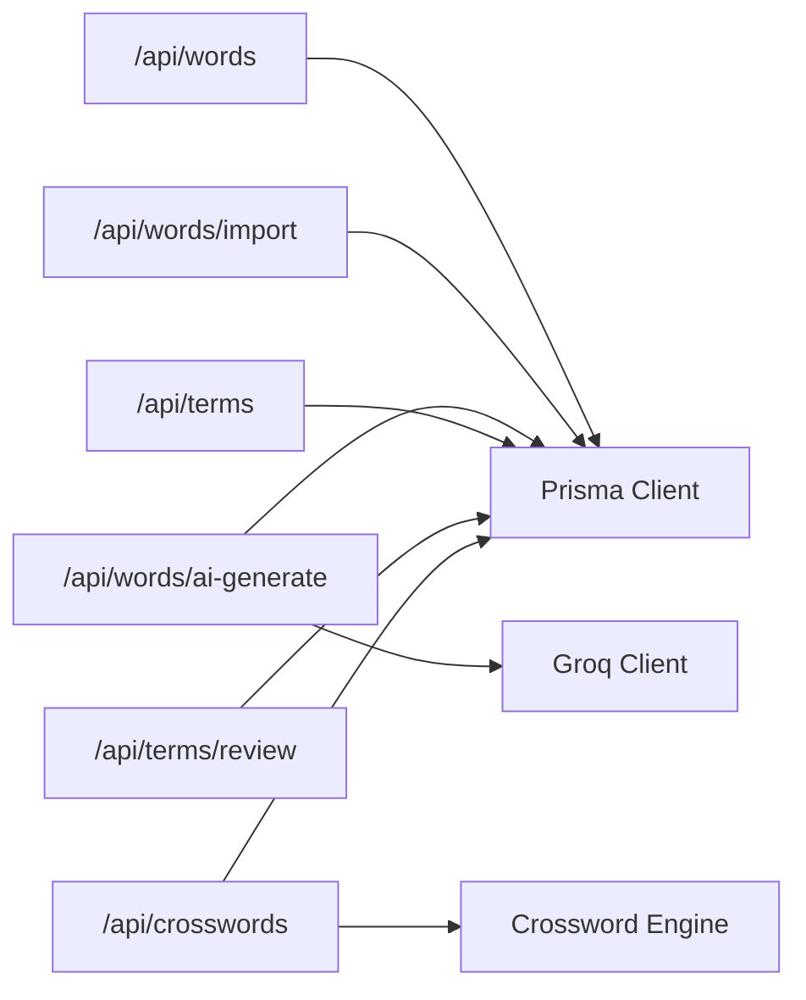

# Content Management

<cite>
**Referenced Files in This Document**
- [README.md](file://README.md)
- [schema.prisma](file://prisma/schema.prisma)
- [ai.ts](file://src/lib/ai.ts)
- [db.ts](file://src/lib/db.ts)
- [words route.ts](file://src/app/api/words/route.ts)
- [words ai-generate route.ts](file://src/app/api/words/ai-generate/route.ts)
- [words import route.ts](file://src/app/api/words/import/route.ts)
- [terms route.ts](file://src/app/api/terms/route.ts)
- [terms review route.ts](file://src/app/api/terms/review/route.ts)
- [crosswords route.ts](file://src/app/api/crosswords/route.ts)
</cite>

## Table of Contents
1. [Introduction](#introduction)
2. [Project Structure](#project-structure)
3. [Core Components](#core-components)
4. [Architecture Overview](#architecture-overview)
5. [Detailed Component Analysis](#detailed-component-analysis)
6. [Dependency Analysis](#dependency-analysis)
7. [Performance Considerations](#performance-considerations)
8. [Troubleshooting Guide](#troubleshooting-guide)
9. [Conclusion](#conclusion)

## Introduction
This document explains the content management system for vocabulary, terms, and crossword-based learning. It covers:
- The word vocabulary database structure
- AI-powered content generation using Groq API
- Manual curation tools and bulk import/export
- Term management and user review tracking
- Crossword generation and submission flows
- Validation, security (PIN protection), and quality assurance measures
- Versioning and approval workflow considerations

The system is built on Next.js with Prisma and supports both SQLite and PostgreSQL (Supabase). AI features are optional and fall back to curated data when no Groq key is configured.

**Section sources**
- [README.md:1-104](file://README.md#L1-L104)

## Project Structure
The content management surface is exposed through REST endpoints under src/app/api and persisted via Prisma models defined in prisma/schema.prisma. Key areas:
- Words: CRUD, AI generation, bulk import
- Terms: listing and per-user review state
- Crosswords: listing, manual creation, validation, and deletion

**Diagram sources**
- [words route.ts:1-92](file://src/app/api/words/route.ts#L1-L92)
- [words import route.ts:1-104](file://src/app/api/words/import/route.ts#L1-L104)
- [words ai-generate route.ts:1-125](file://src/app/api/words/ai-generate/route.ts#L1-L125)
- [terms route.ts:1-32](file://src/app/api/terms/route.ts#L1-L32)
- [terms review route.ts:1-36](file://src/app/api/terms/review/route.ts#L1-L36)
- [crosswords route.ts:1-197](file://src/app/api/crosswords/route.ts#L1-L197)
- [ai.ts:1-68](file://src/lib/ai.ts#L1-L68)
- [db.ts:1-50](file://src/lib/db.ts#L1-L50)
- [schema.prisma:506-641](file://prisma/schema.prisma#L506-L641)

**Section sources**
- [words route.ts:1-92](file://src/app/api/words/route.ts#L1-L92)
- [words import route.ts:1-104](file://src/app/api/words/import/route.ts#L1-L104)
- [words ai-generate route.ts:1-125](file://src/app/api/words/ai-generate/route.ts#L1-L125)
- [terms route.ts:1-32](file://src/app/api/terms/route.ts#L1-L32)
- [terms review route.ts:1-36](file://src/app/api/terms/review/route.ts#L1-L36)
- [crosswords route.ts:1-197](file://src/app/api/crosswords/route.ts#L1-L197)
- [ai.ts:1-68](file://src/lib/ai.ts#L1-L68)
- [db.ts:1-50](file://src/lib/db.ts#L1-L50)
- [schema.prisma:506-641](file://prisma/schema.prisma#L506-L641)

## Core Components
- Word vocabulary store: central repository of terms, definitions, categories, and crossword-safe hints.
- Per-user progress: spaced repetition state, due dates, and interaction logs.
- Term library: E-Cell-focused abbreviations with contextual definitions and warnings.
- Crossword engine integration: grid building, clue selection, validation, and solve tracking.
- AI integration: Groq JSON responses for generating vocabulary sets tailored by topic/category.
- Import pipeline: multi-format parser for JSON, CSV, and line-delimited text with safety checks.
- Review and gamification: term known/learning states, activity logging, and points.

**Section sources**
- [schema.prisma:115-130](file://prisma/schema.prisma#L115-L130)
- [schema.prisma:506-567](file://prisma/schema.prisma#L506-L567)
- [schema.prisma:570-641](file://prisma/schema.prisma#L570-L641)
- [words route.ts:1-92](file://src/app/api/words/route.ts#L1-L92)
- [words import route.ts:1-104](file://src/app/api/words/import/route.ts#L1-L104)
- [words ai-generate route.ts:1-125](file://src/app/api/words/ai-generate/route.ts#L1-L125)
- [terms route.ts:1-32](file://src/app/api/terms/route.ts#L1-L32)
- [terms review route.ts:1-36](file://src/app/api/terms/review/route.ts#L1-L36)
- [crosswords route.ts:1-197](file://src/app/api/crosswords/route.ts#L1-L197)

## Architecture Overview
The content management architecture combines a REST API layer, an optional AI provider, and a relational data layer.

**Diagram sources**
- [words ai-generate route.ts:48-123](file://src/app/api/words/ai-generate/route.ts#L48-L123)
- [ai.ts:24-67](file://src/lib/ai.ts#L24-L67)
- [db.ts:42-49](file://src/lib/db.ts#L42-L49)

## Detailed Component Analysis

### Word Vocabulary Database Model
The Word model is the single source of truth for vocabulary entries used across flashcards, crosswords, and analytics.

Key fields and relationships:
- term (unique), definition, keyDefinition (crossword-safe hint), category, status, source, usage counters, timestamps
- Relationships: per-user progress, logs, and crossword associations

**Diagram sources**
- [schema.prisma:506-523](file://prisma/schema.prisma#L506-L523)
- [schema.prisma:526-567](file://prisma/schema.prisma#L526-L567)
- [schema.prisma:570-599](file://prisma/schema.prisma#L570-L599)

**Section sources**
- [schema.prisma:506-523](file://prisma/schema.prisma#L506-L523)
- [schema.prisma:526-567](file://prisma/schema.prisma#L526-L567)
- [schema.prisma:570-599](file://prisma/schema.prisma#L570-L599)

### Word API Endpoints
- GET /api/words: returns all words plus per-user progress map; triggers daily expansion.
- POST /api/words: create/update multiple words with validation and normalization.
- DELETE /api/words: bulk delete with PIN confirmation.

Validation and processing:
- Normalizes term/definition/category/keyDefinition
- Filters invalid entries (term length, definition length)
- Upserts by unique term
- Requires team PIN for destructive operations

**Diagram sources**
- [words route.ts:42-77](file://src/app/api/words/route.ts#L42-L77)

**Section sources**
- [words route.ts:1-92](file://src/app/api/words/route.ts#L1-L92)

### AI-Powered Word Generation (Groq)
- POST /api/words/ai-generate: generates educational startup/business vocabulary based on topic/category.
- Uses Groq’s OpenAI-compatible endpoint with structured JSON output.
- Falls back to curated banks if AI fails or produces insufficient results.

Prompt engineering highlights:
- System prompt defines role and audience
- User prompt includes topic focus, preferred category, strict formatting rules, and exclusion list of existing terms
- Response format enforced via response_format: json_object

**Diagram sources**
- [words ai-generate route.ts:48-123](file://src/app/api/words/ai-generate/route.ts#L48-L123)
- [ai.ts:24-67](file://src/lib/ai.ts#L24-L67)

**Section sources**
- [words ai-generate route.ts:1-125](file://src/app/api/words/ai-generate/route.ts#L1-L125)
- [ai.ts:1-68](file://src/lib/ai.ts#L1-L68)

### Bulk Import Pipeline
- POST /api/words/import: accepts JSON arrays, CSV, or line-delimited formats.
- Safety checks:
  - Term must match allowed pattern (single alphabetic word with spaces, limited length)
  - Duplicate handling requires PIN to overwrite
- Returns counts for created, updated, skipped, and parsed items.

**Diagram sources**
- [words import route.ts:12-99](file://src/app/api/words/import/route.ts#L12-L99)

**Section sources**
- [words import route.ts:1-104](file://src/app/api/words/import/route.ts#L1-L104)

### Term Management and Reviews
- GET /api/terms: lists all terms with per-user review state.
- POST /api/terms/review: marks a term known/learning; awards points and logs activity on first-time known.

**Diagram sources**
- [terms review route.ts:5-31](file://src/app/api/terms/review/route.ts#L5-L31)

**Section sources**
- [terms route.ts:1-32](file://src/app/api/terms/route.ts#L1-L32)
- [terms review route.ts:1-36](file://src/app/api/terms/review/route.ts#L1-L36)

### Crossword Generation and Submission
- GET /api/crosswords: lists active crosswords with per-user solve status; ensures daily crossword exists.
- POST /api/crosswords: two modes:
  - Paste grid JSON (validated)
  - Provide “TERM | clue” lines; engine builds grid, selects clues, and persists
- DELETE /api/crosswords: removes crossword record (words survive) with PIN.

Clue selection logic:
- Prefer manual clue if it does not leak the answer
- Fallback to keyDefinition or definition from word bank
- Final fallback to generic business-term clue

**Diagram sources**
- [crosswords route.ts:74-178](file://src/app/api/crosswords/route.ts#L74-L178)

**Section sources**
- [crosswords route.ts:1-197](file://src/app/api/crosswords/route.ts#L1-L197)

### Data Models Summary
- Word: core vocabulary entity with metadata and usage counters
- WordProgress: per-user spaced repetition state
- WordLog: event log for interactions (flips, quizzes, crossword attempts)
- Crossword/CrosswordWord: dynamic grid storage and word placement mapping
- Term/TermReview: E-Cell abbreviation library and user review tracking

**Section sources**
- [schema.prisma:115-130](file://prisma/schema.prisma#L115-L130)
- [schema.prisma:506-567](file://prisma/schema.prisma#L506-L567)
- [schema.prisma:570-641](file://prisma/schema.prisma#L570-L641)

## Dependency Analysis
- API routes depend on Prisma client for persistence and on helpers for errors/time utilities.
- AI generation depends on Groq client with model fallback chain and JSON parsing.
- Crossword endpoints depend on the crossword engine for grid construction and validation.

**Diagram sources**
- [words route.ts:1-92](file://src/app/api/words/route.ts#L1-L92)
- [words import route.ts:1-104](file://src/app/api/words/import/route.ts#L1-L104)
- [words ai-generate route.ts:1-125](file://src/app/api/words/ai-generate/route.ts#L1-L125)
- [terms route.ts:1-32](file://src/app/api/terms/route.ts#L1-L32)
- [terms review route.ts:1-36](file://src/app/api/terms/review/route.ts#L1-L36)
- [crosswords route.ts:1-197](file://src/app/api/crosswords/route.ts#L1-L197)
- [ai.ts:1-68](file://src/lib/ai.ts#L1-L68)
- [db.ts:1-50](file://src/lib/db.ts#L1-L50)

**Section sources**
- [words route.ts:1-92](file://src/app/api/words/route.ts#L1-L92)
- [words import route.ts:1-104](file://src/app/api/words/import/route.ts#L1-L104)
- [words ai-generate route.ts:1-125](file://src/app/api/words/ai-generate/route.ts#L1-L125)
- [terms route.ts:1-32](file://src/app/api/terms/route.ts#L1-L32)
- [terms review route.ts:1-36](file://src/app/api/terms/review/route.ts#L1-L36)
- [crosswords route.ts:1-197](file://src/app/api/crosswords/route.ts#L1-L197)
- [ai.ts:1-68](file://src/lib/ai.ts#L1-L68)
- [db.ts:1-50](file://src/lib/db.ts#L1-L50)

## Performance Considerations
- Batch operations: bulk import and batch updates reduce round-trips.
- Deduplication: server-side checks prevent duplicate records and unnecessary writes.
- AI fallbacks: curated banks ensure availability even when Groq is slow or down.
- Indexes: Prisma schema includes indexes for frequent queries (e.g., userId, createdAt, category).
- Pagination limits: crossword listing caps results to avoid large payloads.

[No sources needed since this section provides general guidance]

## Troubleshooting Guide
Common issues and resolutions:
- Missing Groq key: AI generation returns null; use curated banks or configure GROQ_API_KEY.
- Wrong PIN: bulk delete/import/crossword operations require the team PIN; verify configuration.
- Invalid input: ensure terms meet length/pattern constraints; definitions meet minimum length.
- Grid validation failures: crossword grids must be connected and valid; adjust terms/clues.

Operational tips:
- Use GET /api/words to inspect current vocabulary and per-user progress.
- Use GET /api/terms to audit term library and review states.
- Monitor activity logs for term learned events and quiz interactions.

**Section sources**
- [ai.ts:19-21](file://src/lib/ai.ts#L19-L21)
- [words route.ts:79-91](file://src/app/api/words/route.ts#L79-L91)
- [words import route.ts:56-99](file://src/app/api/words/import/route.ts#L56-L99)
- [crosswords route.ts:74-91](file://src/app/api/crosswords/route.ts#L74-L91)

## Conclusion
The content management system provides a robust foundation for vocabulary-driven learning:
- Centralized word store with per-user progress and logs
- Flexible term library with review tracking
- AI-assisted generation with strong fallbacks
- Powerful crossword generation and validation
- Secure bulk operations with PIN protection
- Clear APIs for integration and extensibility

Future enhancements could include:
- Approval workflows and versioning for curated content
- Moderation tools for member-generated content
- Export endpoints for vocabulary and crossword datasets
- Enhanced analytics for content quality and engagement

[No sources needed since this section summarizes without analyzing specific files]