# Crossforge Memory Engine

<cite>
**Referenced Files in This Document**
- [README.md](file://README.md)
- [schema.prisma](file://prisma/schema.prisma)
- [forge.ts](file://src/lib/forge.ts)
- [crossword-engine.ts](file://src/lib/crossword-engine.ts)
- [memory route.ts](file://src/app/api/memory/route.ts)
- [forge session route.ts](file://src/app/api/forge/session/route.ts)
- [forge flip route.ts](file://src/app/api/forge/flip/route.ts)
- [forge answer route.ts](file://src/app/api/forge/answer/route.ts)
- [crosswords generate route.ts](file://src/app/api/crosswords/generate/route.ts)
- [crosswords submit route.ts](file://src/app/api/crosswords/submit/route.ts)
- [mind-view.tsx](file://src/components/welearn/crosswords/mind-view.tsx)
</cite>

## Table of Contents
1. [Introduction](#introduction)
2. [Project Structure](#project-structure)
3. [Core Components](#core-components)
4. [Architecture Overview](#architecture-overview)
5. [Detailed Component Analysis](#detailed-component-analysis)
6. [Dependency Analysis](#dependency-analysis)
7. [Performance Considerations](#performance-considerations)
8. [Troubleshooting Guide](#troubleshooting-guide)
9. [Conclusion](#conclusion)

## Introduction
Crossforge is the server-side memory engine behind WeLearn’s spaced-repetition flashcards and crossword puzzle system. It combines:
- A spaced-repetition scheduling layer that turns user ratings into future review intervals.
- A reels-style card selection engine that mixes due reviews, new cards, struggling terms, and fallbacks.
- A SWOT-based cognitive profiler that converts logs and progress data into strengths, weaknesses, opportunities, and threats.
- An in-code crossword grid generator with backtracking placement, connectivity validation, AI-assisted clue generation, and strict coordinate-based solving evaluation.
- A learning loop where flashcards and crosswords are complementary: flashcards build vocabulary and retention; crosswords reinforce recall, unlock hearts, and feed the memory profile.

The project README describes WeLearn as an entrepreneurship preparation platform with quizzes, arena rooms, leaderboards, analytics, and a founder-mode quiz with flashcards. Crossforge extends this by providing autonomous daily word expansion, daily crossword challenges, and a 24/7 memory matrix.

**Section sources**
- [README.md:1-104](file://README.md#L1-L104)

## Project Structure
Crossforge lives primarily under `src/lib` and `src/app/api`, with persistence defined in Prisma.

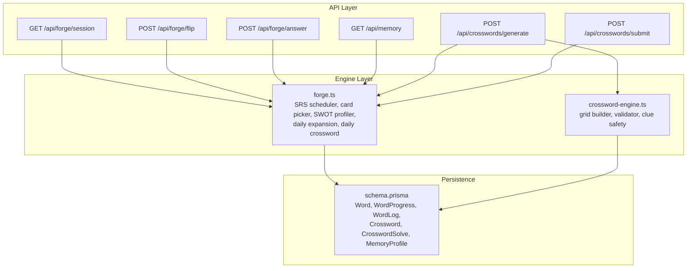

**Diagram sources**
- [forge.ts:1-12](file://src/lib/forge.ts#L1-L12)
- [crossword-engine.ts:1-27](file://src/lib/crossword-engine.ts#L1-L27)
- [memory route.ts:1-35](file://src/app/api/memory/route.ts#L1-L35)
- [forge session route.ts:1-87](file://src/app/api/forge/session/route.ts#L1-L87)
- [forge flip route.ts:1-119](file://src/app/api/forge/flip/route.ts#L1-L119)
- [forge answer route.ts:1-101](file://src/app/api/forge/answer/route.ts#L1-L101)
- [crosswords generate route.ts:1-117](file://src/app/api/crosswords/generate/route.ts#L1-L117)
- [crosswords submit route.ts:1-217](file://src/app/api/crosswords/submit/route.ts#L1-L217)
- [schema.prisma:506-640](file://prisma/schema.prisma#L506-L640)

**Section sources**
- [schema.prisma:506-640](file://prisma/schema.prisma#L506-L640)
- [forge.ts:1-12](file://src/lib/forge.ts#L1-L12)
- [crossword-engine.ts:1-27](file://src/lib/crossword-engine.ts#L1-L27)

## Core Components
Crossforge has five core responsibilities:

1. **Spaced repetition scheduling**
   - Converts three user ratings into status, interval, ease, and due date.
   - Supports legacy quality-based scheduling for compatibility.
   - Uses exponential decay to estimate per-word retention.

2. **Flashcard selection and pacing**
   - Picks due reviews first, then new words, then struggling low-retention words, then oldest seen.
   - Detects rushing behavior from recent flip timings.
   - Dynamically triggers timed quizzes based on pace, review state, and session count.

3. **SWOT cognitive profiling**
   - Aggregates logs and progress into category scores, weak/strong vaults, overall retention, recall velocity, and mastery counts.
   - Produces four-directional SWOT text summaries stored in `MemoryProfile`.

4. **Daily automation**
   - Ensures exactly five new startup/business terms are added each IST day via AI or curated fallback.
   - Ensures one active daily crossword exists using selected words, code-generated grid, and AI clues.

5. **Crossword generation and solving**
   - Selects words with length balance and usage fairness.
   - Builds a connected grid with backtracking, validates crossings and topology.
   - Generates safe clues through AI with definition fallbacks.
   - Evaluates submissions by exact grid coordinates and entry positions.

**Section sources**
- [forge.ts:37-94](file://src/lib/forge.ts#L37-L94)
- [forge.ts:96-188](file://src/lib/forge.ts#L96-L188)
- [forge.ts:190-368](file://src/lib/forge.ts#L190-L368)
- [forge.ts:405-518](file://src/lib/forge.ts#L405-L518)
- [forge.ts:520-633](file://src/lib/forge.ts#L520-L633)
- [crossword-engine.ts:56-80](file://src/lib/crossword-engine.ts#L56-L80)
- [crossword-engine.ts:82-255](file://src/lib/crossword-engine.ts#L82-L255)
- [crossword-engine.ts:257-344](file://src/lib/crossword-engine.ts#L257-L344)
- [crossword-engine.ts:346-361](file://src/lib/crossword-engine.ts#L346-L361)

## Architecture Overview
Crossforge follows a layered API-to-engine-to-database architecture. The API routes handle input validation, user context, and response shaping. The engine modules implement domain logic. The database schema stores vocabulary, per-user progress, activity logs, crossword grids, solves, and memory profiles.

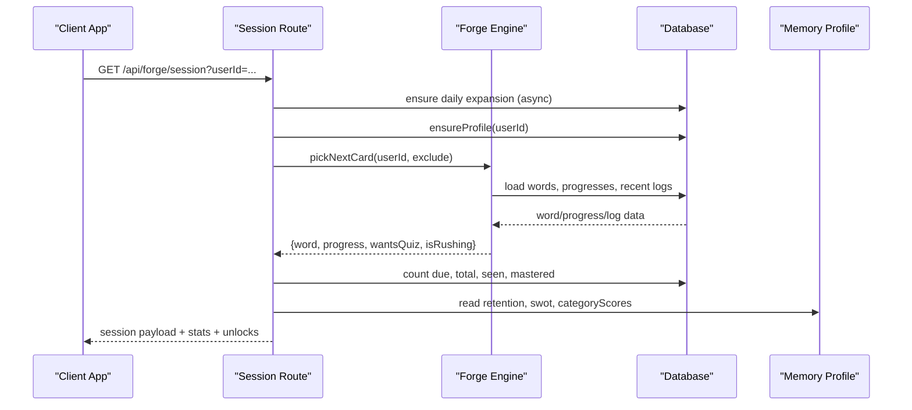

**Diagram sources**
- [forge session route.ts:18-82](file://src/app/api/forge/session/route.ts#L18-L82)
- [forge.ts:96-188](file://src/lib/forge.ts#L96-L188)
- [memory route.ts:6-35](file://src/app/api/memory/route.ts#L6-L35)

**Section sources**
- [forge session route.ts:18-82](file://src/app/api/forge/session/route.ts#L18-L82)
- [memory route.ts:6-35](file://src/app/api/memory/route.ts#L6-L35)

## Detailed Component Analysis

### Spaced Repetition Scheduling
The scheduler translates user feedback into long-term memory state:
- Practice resets interval and slightly reduces ease, marking the term as learning with a short retry window.
- Easy increases ease and spaces the next review based on current interval and stability.
- Done marks mastery, significantly increasing interval and moving the term out of active review.
- Retention uses exponential decay over days since last seen or due time, scaled by interval and ease.

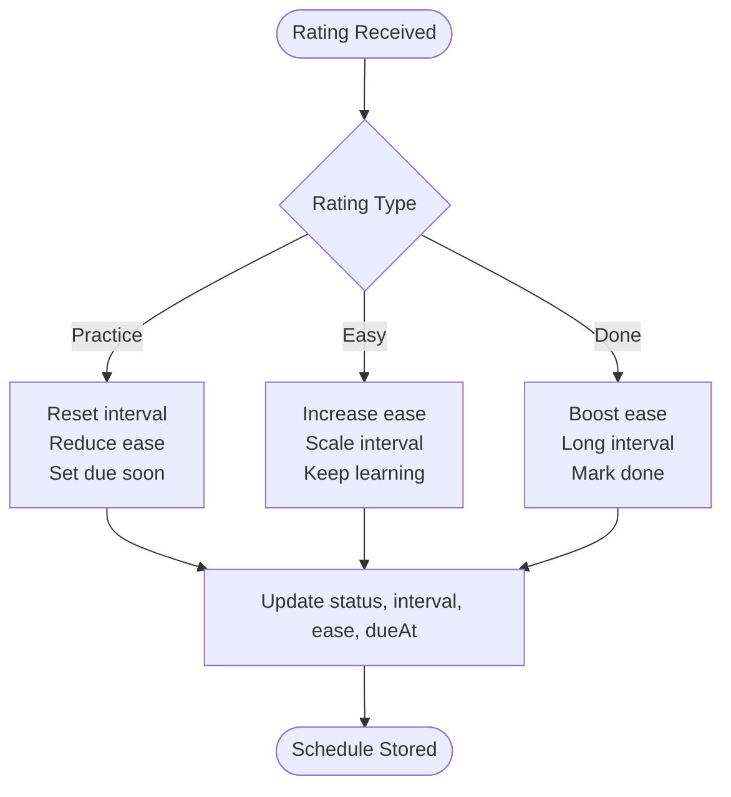

**Diagram sources**
- [forge.ts:37-72](file://src/lib/forge.ts#L37-L72)
- [forge.ts:86-94](file://src/lib/forge.ts#L86-L94)

**Section sources**
- [forge.ts:37-94](file://src/lib/forge.ts#L37-L94)

### Flashcard Selection and Dynamic Quizzes
The reel-mode selector balances four priorities:
1. Due reviews sorted by earliest due date.
2. New words not yet tracked for the user.
3. Struggling words with low retention but not yet due.
4. Fallback to the oldest seen word if nothing else matches.

It also detects rapid flipping and adjusts quiz frequency:
- Rushing triggers immediate quizzes.
- Review cards trigger quizzes.
- Otherwise, every third card in a session may trigger a quiz.
- Question count varies between one and two depending on urgency.

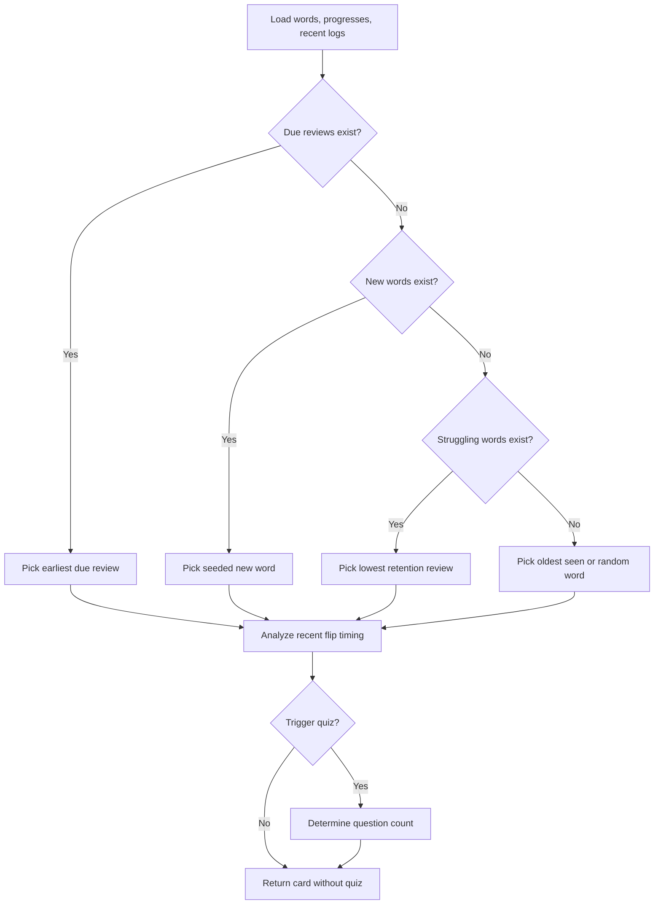

**Diagram sources**
- [forge.ts:96-188](file://src/lib/forge.ts#L96-L188)

**Section sources**
- [forge.ts:96-188](file://src/lib/forge.ts#L96-L188)

### SWOT Cognitive Profiling System
The profiler aggregates recent logs and all progress records to produce a cognitive dashboard:
- Logs contribute to category accuracy, weak/strong vault membership, practice/easy/done counts, quiz pass/fail, crossword solved/missed, and recall velocity.
- Progress records add decay-based weak vault entries and strong vault entries for mastered terms.
- Overall retention is computed from per-word retention values.
- SWOT synthesis produces readable strengths, weaknesses, opportunities, and threats.
- Results are persisted in `MemoryProfile` and parsed for UI consumption.

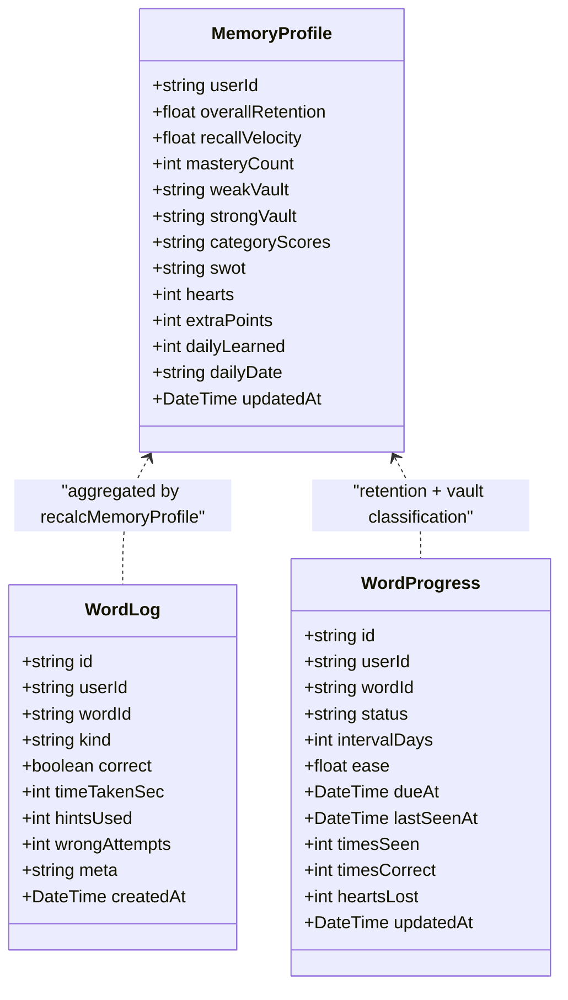

**Diagram sources**
- [schema.prisma:548-567](file://prisma/schema.prisma#L548-L567)
- [schema.prisma:525-546](file://prisma/schema.prisma#L525-L546)
- [schema.prisma:623-640](file://prisma/schema.prisma#L623-L640)
- [forge.ts:190-368](file://src/lib/forge.ts#L190-L368)

**Section sources**
- [forge.ts:190-368](file://src/lib/forge.ts#L190-L368)
- [schema.prisma:548-567](file://prisma/schema.prisma#L548-L567)
- [schema.prisma:623-640](file://prisma/schema.prisma#L623-L640)

### Daily Word Expansion and Daily Crossword Challenge
Crossforge automates content growth:
- Daily expansion checks an activity marker keyed by IST day. If absent, it queries existing vocabulary, asks AI for five new startup/business terms, applies strict normalization rules, falls back to a curated reserve bank, inserts unique words, and records the marker.
- Daily crossword ensures one active daily puzzle exists. It selects words, builds a grid, generates AI clues with definition fallbacks, validates the grid, persists the crossword, links words, and updates word usage statistics.

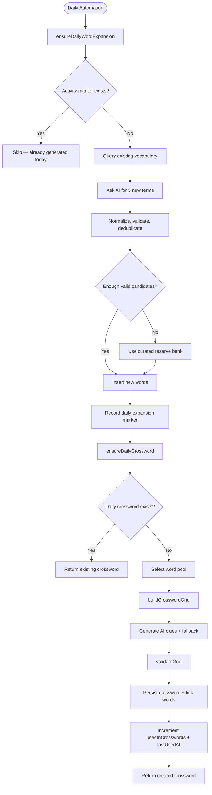

**Diagram sources**
- [forge.ts:405-518](file://src/lib/forge.ts#L405-L518)
- [forge.ts:520-633](file://src/lib/forge.ts#L520-L633)
- [crossword-engine.ts:56-80](file://src/lib/crossword-engine.ts#L56-L80)
- [crossword-engine.ts:257-344](file://src/lib/crossword-engine.ts#L257-L344)

**Section sources**
- [forge.ts:405-518](file://src/lib/forge.ts#L405-L518)
- [forge.ts:520-633](file://src/lib/forge.ts#L520-L633)

### Crossword Grid Generation Logic
The crossword engine performs layout entirely in code:
- Word selection prefers unused words, then least recently used, while balancing short and long terms.
- Backtracking placement starts with the longest words as a skeleton, then tries shuffled remaining words at crossing points.
- Placement rules enforce boundary emptiness, crossing letter equality, perpendicular neighbor emptiness, and connectivity.
- Validation ensures every word crosses at least one other and the placement graph forms a single connected component.
- The final grid is compacted, numbered in reading order, and revalidated before returning.

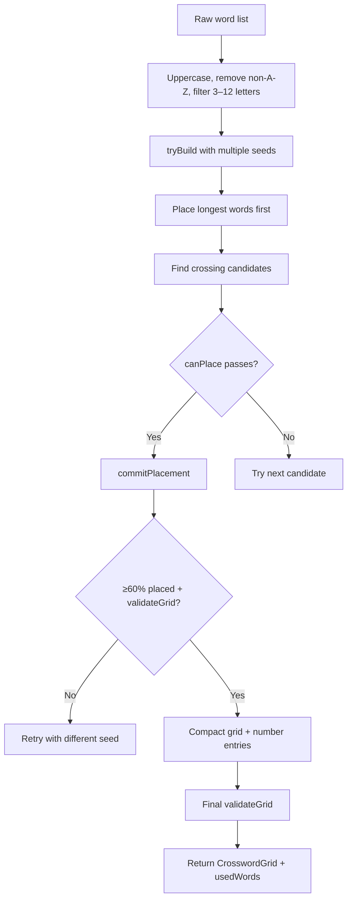

**Diagram sources**
- [crossword-engine.ts:56-80](file://src/lib/crossword-engine.ts#L56-L80)
- [crossword-engine.ts:82-255](file://src/lib/crossword-engine.ts#L82-L255)
- [crossword-engine.ts:257-344](file://src/lib/crossword-engine.ts#L257-L344)

**Section sources**
- [crossword-engine.ts:56-80](file://src/lib/crossword-engine.ts#L56-L80)
- [crossword-engine.ts:82-255](file://src/lib/crossword-engine.ts#L82-L255)
- [crossword-engine.ts:257-344](file://src/lib/crossword-engine.ts#L257-L344)

### Clue Generation and Safety
Clue generation prioritizes AI-generated clues but safely falls back to stored definitions:
- AI prompts request business/startup clues with constraints: length limit, no abbreviations, no answer inclusion, no quotes.
- Clue safety checks prevent leaking the answer or its stem.
- Trimmed clues fit display limits.
- If AI fails or leaks, keyDefinition or full definition is tried; finally, a safe placeholder clue is used.

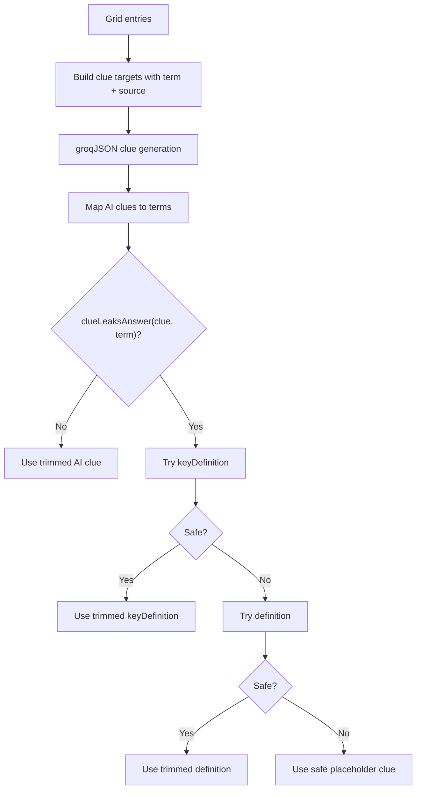

**Diagram sources**
- [crosswords generate route.ts:48-72](file://src/app/api/crosswords/generate/route.ts#L48-L72)
- [forge.ts:578-600](file://src/lib/forge.ts#L578-L600)
- [crossword-engine.ts:346-361](file://src/lib/crossword-engine.ts#L346-L361)

**Section sources**
- [crosswords generate route.ts:48-72](file://src/app/api/crosswords/generate/route.ts#L48-L72)
- [forge.ts:578-600](file://src/lib/forge.ts#L578-L600)
- [crossword-engine.ts:346-361](file://src/lib/crossword-engine.ts#L346-L361)

### Puzzle Solving Mechanics
Crossword submission evaluates answers strictly by grid coordinates:
- Each cell is compared against expected solution characters.
- Each entry is validated by walking its row/column positions and comparing typed or fallback answer letters to the target word.
- Accuracy is correct cells divided by total cells.
- Completion requires every entry to match.
- Scoring includes completed words, accuracy, time bonus, penalties for wrong attempts and hints.
- Activity and word logs record solved/missed terms.
- Hearts are restored based on completion or high partial accuracy.

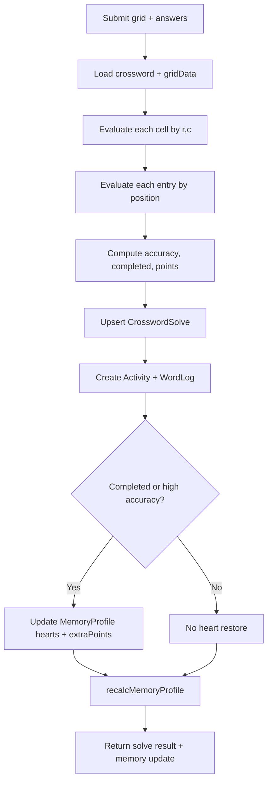

**Diagram sources**
- [crosswords submit route.ts:21-217](file://src/app/api/crosswords/submit/route.ts#L21-L217)

**Section sources**
- [crosswords submit route.ts:21-217](file://src/app/api/crosswords/submit/route.ts#L21-L217)

### Memory Scheduling System That Optimizes Review Intervals
The memory scheduling system optimizes review intervals through:
- Rating-driven interval scaling: practice shortens, easy scales moderately, done scales aggressively.
- Ease factor adjustments that reflect difficulty perception.
- Exponential retention decay that pushes weaker terms back sooner.
- Dynamic quiz triggering that reinforces recall when users rush or review.
- Heart economy that gates learning until crossword performance restores capacity.
- SWOT insights that guide personalized crossword generation and daily challenges.

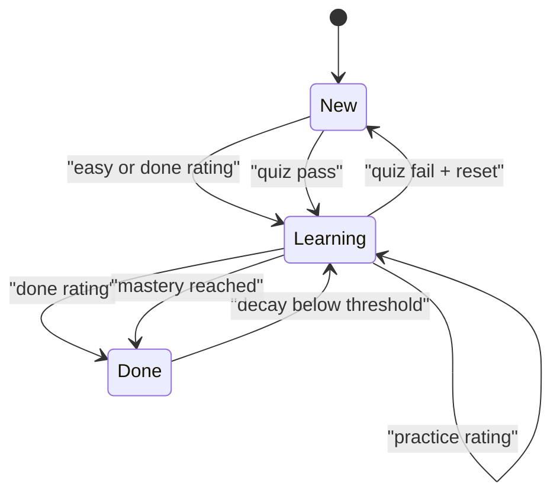

**Diagram sources**
- [forge.ts:37-72](file://src/lib/forge.ts#L37-L72)
- [forge.ts:86-94](file://src/lib/forge.ts#L86-L94)
- [forge.ts:96-188](file://src/lib/forge.ts#L96-L188)
- [forge.ts:190-368](file://src/lib/forge.ts#L190-L368)

**Section sources**
- [forge.ts:37-72](file://src/lib/forge.ts#L37-L72)
- [forge.ts:86-94](file://src/lib/forge.ts#L86-L94)
- [forge.ts:96-188](file://src/lib/forge.ts#L96-L188)
- [forge.ts:190-368](file://src/lib/forge.ts#L190-L368)

### Integration Between Flashcards and Crosswords
Flashcards and crosswords form a complementary loop:
- Flashcards introduce and schedule vocabulary through spaced repetition.
- Crosswords reinforce recall through grid-based problem solving.
- Correct flashcard answers earn speed bonuses that increase extra points in the memory profile.
- Incorrect flashcard answers reduce hearts, blocking further learning until crosswords restore capacity.
- Completed or high-accuracy crosswords restore hearts and award bonus points.
- Both activities log outcomes that feed the SWOT profiler.
- The memory dashboard surfaces due reviews, weak terms, retention, and SWOT insights to guide study strategy.

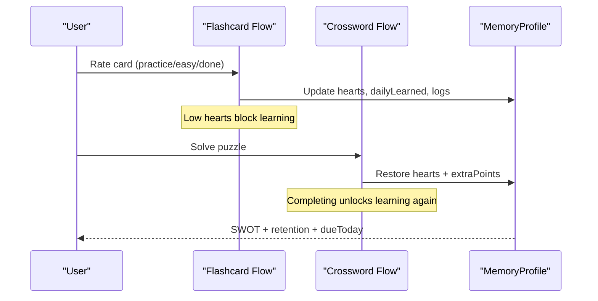

**Diagram sources**
- [forge flip route.ts:21-119](file://src/app/api/forge/flip/route.ts#L21-L119)
- [forge answer route.ts:11-101](file://src/app/api/forge/answer/route.ts#L11-L101)
- [crosswords submit route.ts:166-193](file://src/app/api/crosswords/submit/route.ts#L166-L193)
- [memory route.ts:6-35](file://src/app/api/memory/route.ts#L6-L35)

**Section sources**
- [forge flip route.ts:21-119](file://src/app/api/forge/flip/route.ts#L21-L119)
- [forge answer route.ts:11-101](file://src/app/api/forge/answer/route.ts#L11-L101)
- [crosswords submit route.ts:166-193](file://src/app/api/crosswords/submit/route.ts#L166-L193)
- [memory route.ts:6-35](file://src/app/api/memory/route.ts#L6-L35)

## Dependency Analysis
Crossforge dependencies are intentionally modular:
- API routes depend on engine functions and helpers.
- The forge engine depends on database access, helper utilities, AI generation, and the crossword engine.
- The crossword engine is self-contained except for exported types used by the forge engine and API routes.
- Persistence is modeled in Prisma with clear relationships between users, words, progress, logs, crosswords, solves, and memory profiles.

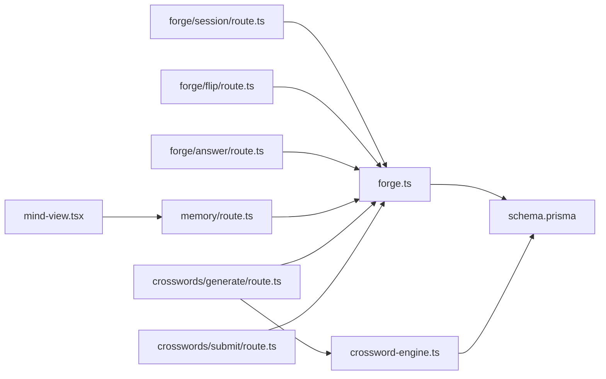

**Diagram sources**
- [forge session route.ts:1-12](file://src/app/api/forge/session/route.ts#L1-L12)
- [forge flip route.ts:1-10](file://src/app/api/forge/flip/route.ts#L1-L10)
- [forge answer route.ts:1-4](file://src/app/api/forge/answer/route.ts#L1-L4)
- [memory route.ts:1-3](file://src/app/api/memory/route.ts#L1-L3)
- [crosswords generate route.ts:1-4](file://src/app/api/crosswords/generate/route.ts#L1-L4)
- [crosswords submit route.ts:1-3](file://src/app/api/crosswords/submit/route.ts#L1-L3)
- [mind-view.tsx:47-92](file://src/components/welearn/crosswords/mind-view.tsx#L47-L92)
- [schema.prisma:506-640](file://prisma/schema.prisma#L506-L640)

**Section sources**
- [forge.ts:1-9](file://src/lib/forge.ts#L1-L9)
- [crossword-engine.ts:1-13](file://src/lib/crossword-engine.ts#L1-L13)
- [schema.prisma:506-640](file://prisma/schema.prisma#L506-L640)

## Performance Considerations
- Batched database reads: session and memory endpoints use parallel queries for logs, progress, words, and solves.
- Deterministic randomness: the crossword engine uses a seeded PRNG to stabilize grid attempts and avoid excessive recomputation.
- Grid validation guards: invalid grids are rejected early, preventing storage of unusable puzzles.
- Decay-based retention: exponential decay avoids heavy recalculations by relying on simple arithmetic over timestamps and intervals.
- Daily markers: activity markers prevent repeated AI calls and duplicate content generation within the same IST day.
- Heart gating: limiting learning when hearts are zero reduces unnecessary scheduling churn and encourages productive crossword practice.

[No sources needed since this section provides general guidance]

## Troubleshooting Guide
Common issues and their likely causes:

- Session returns no card
  - Possible cause: no words exist or all excluded.
  - Check word count and exclusion parameters.

- Flip blocked with out-of-hearts error
  - Cause: hearts reached zero.
  - Resolution: solve crosswords to restore hearts.

- Quiz always triggered
  - Cause: rushing detection or review card selection.
  - Check recent flip timings and review queue.

- Crossword generation fails
  - Cause: insufficient valid words or grid cannot be built.
  - Ensure at least three valid single-letter words and import more vocabulary.

- Generated grid fails validation
  - Cause: placement rules violated or connectivity broken.
  - Rebuild with different seed or adjust word pool.

- Submission does not mark words complete
  - Cause: letters do not match exact grid positions.
  - Verify typed grid coordinates and entry mapping.

**Section sources**
- [forge session route.ts:18-82](file://src/app/api/forge/session/route.ts#L18-L82)
- [forge flip route.ts:21-34](file://src/app/api/forge/flip/route.ts#L21-L34)
- [forge.ts:96-188](file://src/lib/forge.ts#L96-L188)
- [crosswords generate route.ts:12-46](file://src/app/api/crosswords/generate/route.ts#L12-L46)
- [crosswords submit route.ts:38-89](file://src/app/api/crosswords/submit/route.ts#L38-L89)

## Conclusion
Crossforge integrates spaced repetition, dynamic quiz pacing, SWOT-based cognitive profiling, and robust crossword generation into a cohesive learning system. Flashcards drive vocabulary acquisition and scheduling; crosswords reinforce recall, restore learning capacity, and provide performance feedback. The engine’s design emphasizes deterministic algorithms, safety checks, and measurable progress, making it suitable for sustained entrepreneurial vocabulary training and adaptive challenge generation.

[No sources needed since this section summarizes without analyzing specific files]