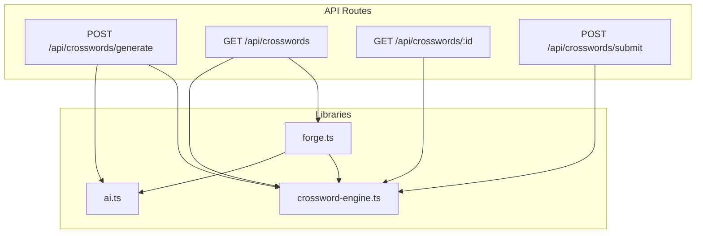
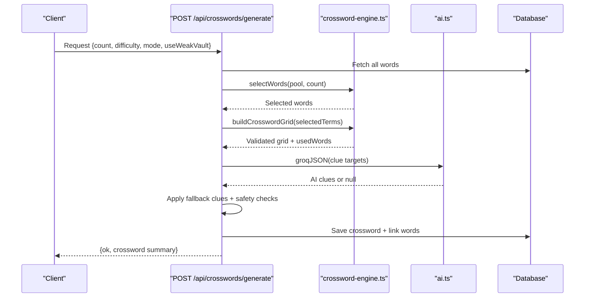
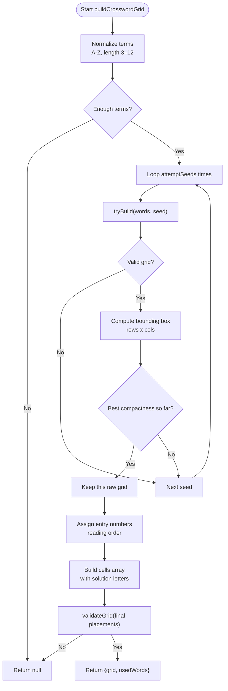
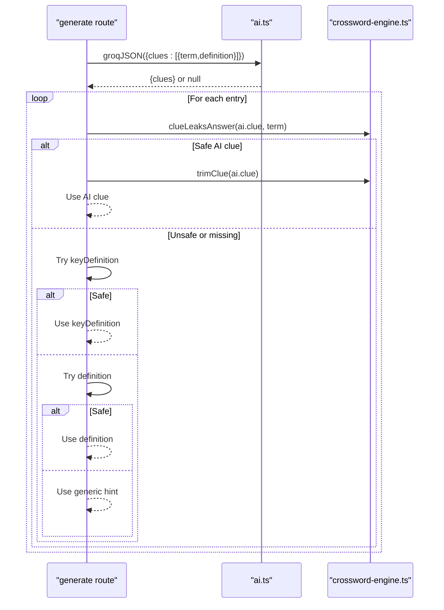
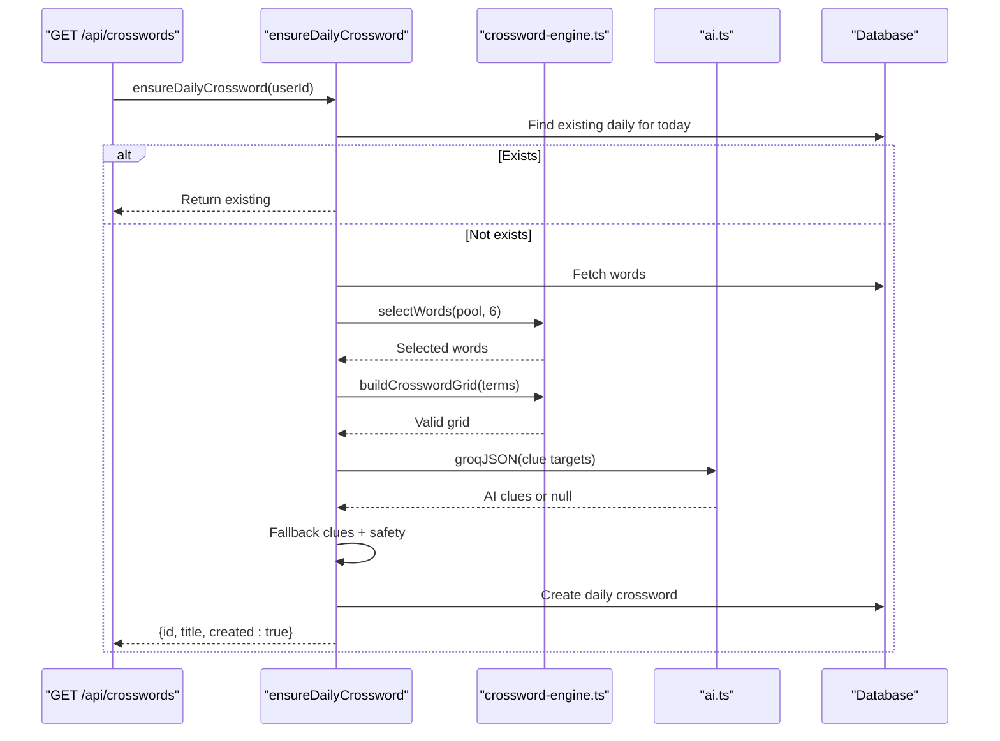
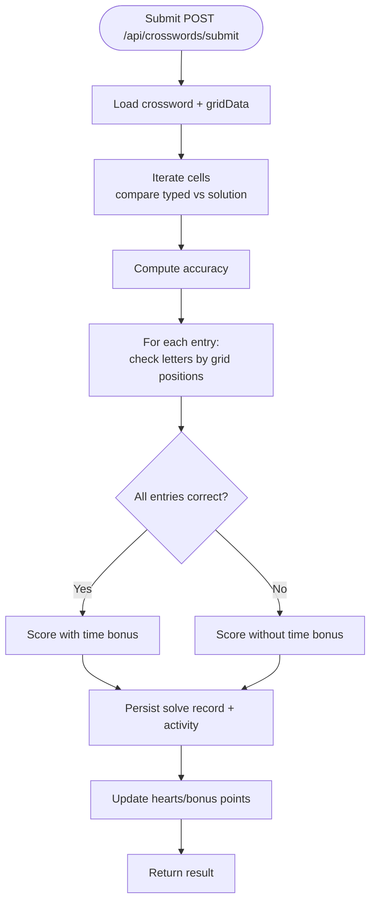
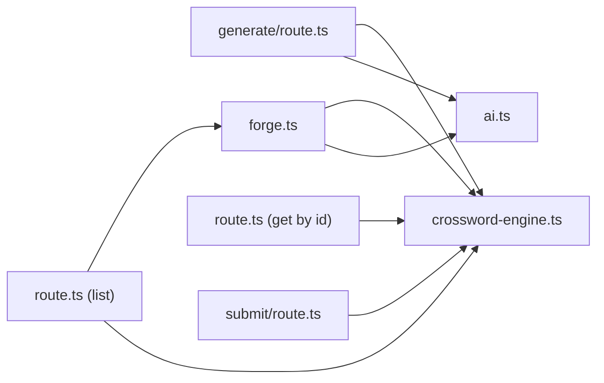

# Crossword Generation System

<cite>
**Referenced Files in This Document**
- [crossword-engine.ts](file://src/lib/crossword-engine.ts)
- [generate/route.ts](file://src/app/api/crosswords/generate/route.ts)
- [submit/route.ts](file://src/app/api/crosswords/submit/route.ts)
- [route.ts (list)](file://src/app/api/crosswords/route.ts)
- [route.ts (get by id)](file://src/app/api/crosswords/[id]/route.ts)
- [ai.ts](file://src/lib/ai.ts)
- [forge.ts](file://src/lib/forge.ts)
</cite>

## Table of Contents
1. [Introduction](#introduction)
2. [Project Structure](#project-structure)
3. [Core Components](#core-components)
4. [Architecture Overview](#architecture-overview)
5. [Detailed Component Analysis](#detailed-component-analysis)
6. [Dependency Analysis](#dependency-analysis)
7. [Performance Considerations](#performance-considerations)
8. [Troubleshooting Guide](#troubleshooting-guide)
9. [Conclusion](#conclusion)

## Introduction
This document explains the crossword generation system that builds intersecting word layouts from a vocabulary list, selects words for puzzle difficulty, generates clues via AI with safe fallbacks, and supports daily challenges and puzzle solving with strict validation. The grid layout is built deterministically in code using backtracking placement; the AI only writes clues. Every generated puzzle is re-validated before saving to ensure connectivity, crossing rules, and safety constraints.

## Project Structure
The crossword feature spans server-side API routes and a shared engine:
- Engine logic for grid building, word selection, and clue safety lives in a single library module.
- API routes handle listing crosswords, generating new ones, retrieving one by ID, and submitting solutions.
- Daily challenge automation is implemented in a separate utility module.
- AI integration uses a Groq client with model fallback and JSON parsing.

**Diagram sources**
- [generate/route.ts:1-117](file://src/app/api/crosswords/generate/route.ts#L1-L117)
- [route.ts (list):1-197](file://src/app/api/crosswords/route.ts#L1-L197)
- [route.ts (get by id):1-41](file://src/app/api/crosswords/[id]/route.ts#L1-L41)
- [submit/route.ts:1-217](file://src/app/api/crosswords/submit/route.ts#L1-L217)
- [crossword-engine.ts:1-362](file://src/lib/crossword-engine.ts#L1-L362)
- [ai.ts:1-68](file://src/lib/ai.ts#L1-L68)
- [forge.ts:520-634](file://src/lib/forge.ts#L520-L634)

**Section sources**
- [crossword-engine.ts:1-362](file://src/lib/crossword-engine.ts#L1-L362)
- [generate/route.ts:1-117](file://src/app/api/crosswords/generate/route.ts#L1-L117)
- [route.ts (list):1-197](file://src/app/api/crosswords/route.ts#L1-L197)
- [route.ts (get by id):1-41](file://src/app/api/crosswords/[id]/route.ts#L1-L41)
- [submit/route.ts:1-217](file://src/app/api/crosswords/submit/route.ts#L1-L217)
- [ai.ts:1-68](file://src/lib/ai.ts#L1-L68)
- [forge.ts:520-634](file://src/lib/forge.ts#L520-L634)

## Core Components
- Grid builder and validator: buildCrosswordGrid, validateGrid, selectWords, clueLeaksAnswer, trimClue.
- API endpoints: generate, list, get-by-id, submit.
- Daily automation: ensureDailyCrossword.
- AI client: groqJSON with model chain and JSON response parsing.

Key responsibilities:
- buildCrosswordGrid: normalize terms, attempt multiple seeds, place words with backtracking, compact grid, number entries, and return a validated grid structure.
- selectWords: choose a balanced set of words prioritizing unused terms and mixing lengths.
- Clue pipeline: request AI-generated clues, then fall back to stored definitions or a safe generic hint if needed.
- Submit evaluation: verify every cell and each entry strictly by grid coordinates, compute accuracy, points, and heart restoration.

**Section sources**
- [crossword-engine.ts:56-80](file://src/lib/crossword-engine.ts#L56-L80)
- [crossword-engine.ts:207-255](file://src/lib/crossword-engine.ts#L207-L255)
- [crossword-engine.ts:257-344](file://src/lib/crossword-engine.ts#L257-L344)
- [crossword-engine.ts:348-361](file://src/lib/crossword-engine.ts#L348-L361)
- [generate/route.ts:12-117](file://src/app/api/crosswords/generate/route.ts#L12-L117)
- [submit/route.ts:21-217](file://src/app/api/crosswords/submit/route.ts#L21-L217)
- [route.ts (list):7-65](file://src/app/api/crosswords/route.ts#L7-L65)
- [route.ts (get by id):8-41](file://src/app/api/crosswords/[id]/route.ts#L8-L41)
- [ai.ts:23-67](file://src/lib/ai.ts#L23-L67)
- [forge.ts:520-634](file://src/lib/forge.ts#L520-L634)

## Architecture Overview
The system separates concerns between deterministic grid construction and optional AI clue generation.

**Diagram sources**
- [generate/route.ts:12-117](file://src/app/api/crosswords/generate/route.ts#L12-L117)
- [crossword-engine.ts:56-80](file://src/lib/crossword-engine.ts#L56-L80)
- [crossword-engine.ts:257-344](file://src/lib/crossword-engine.ts#L257-L344)
- [ai.ts:23-67](file://src/lib/ai.ts#L23-L67)

## Detailed Component Analysis

### Grid Builder: buildCrosswordGrid
Purpose:
- Normalize input terms to uppercase alphabetic strings within length bounds.
- Attempt multiple seeds to find the most compact valid grid.
- Place words using backtracking with crossing constraints and boundary rules.
- Compact the grid to minimal rows/cols, assign numbers, and produce final cells and entries.
- Re-validate topology before returning.

Algorithm highlights:
- Skeleton-first strategy: longest words form a skeleton; remaining words are shuffled per seed.
- Candidate placement: for each placed word, generate perpendicular crossing candidates at matching letters.
- Placement validation:
  - Boundary check: no parallel words touching.
  - Crossing consistency: overlapping letters must match.
  - Connectivity: every word must cross at least one other; graph of crossings must be connected.
- Quality gates:
  - At least 60% of words placed (minimum 3).
  - Topology passes validateGrid.
- Numbering:
  - Assign numbers in reading order where an entry starts at a cell with no incoming letter from its direction.

Complexity considerations:
- Backtracking search over candidate placements per word; pruning via canPlace reduces invalid branches.
- Multiple seeds increase robustness but add overhead; best compactness selected.

**Diagram sources**
- [crossword-engine.ts:207-255](file://src/lib/crossword-engine.ts#L207-L255)
- [crossword-engine.ts:257-344](file://src/lib/crossword-engine.ts#L257-L344)

**Section sources**
- [crossword-engine.ts:207-255](file://src/lib/crossword-engine.ts#L207-L255)
- [crossword-engine.ts:257-344](file://src/lib/crossword-engine.ts#L257-L344)

### Word Selection: selectWords
Purpose:
- Choose a diverse set of words balancing short and long terms.
- Prefer unused words first, then least-recently-used words to spread usage across the vault.
- Filter out invalid terms (non-alphabetic or length outside 3–12).

Behavior:
- Uses a seeded PRNG for reproducibility per call.
- Mixes short (≤5) and long (>5) words to improve interlocking opportunities.
- Returns up to requested count while maintaining variety.

Use cases:
- Daily puzzles: fixed small pool size.
- Personal practice: optionally prioritize weak-vault terms.

**Section sources**
- [crossword-engine.ts:56-80](file://src/lib/crossword-engine.ts#L56-L80)

### Clue Generation Pipeline
Flow:
- Collect target terms and their definition sources (keyDefinition, definition, or a safe default).
- Call AI to generate concise clues with strict rules (no answer leakage, length limit).
- If AI fails or returns unsafe clues, fall back to stored definitions or a generic safe hint.
- Trim clues to max length and enforce non-leakage.

Safety:
- clueLeaksAnswer prevents including the answer or its stem in clues.
- trimClue enforces maximum length and truncation rules.

**Diagram sources**
- [generate/route.ts:51-72](file://src/app/api/crosswords/generate/route.ts#L51-L72)
- [crossword-engine.ts:348-361](file://src/lib/crossword-engine.ts#L348-L361)
- [ai.ts:23-67](file://src/lib/ai.ts#L23-L67)

**Section sources**
- [generate/route.ts:51-72](file://src/app/api/crosswords/generate/route.ts#L51-L72)
- [crossword-engine.ts:348-361](file://src/lib/crossword-engine.ts#L348-L361)
- [ai.ts:23-67](file://src/lib/ai.ts#L23-L67)

### Daily Crossword Challenge System
Mechanism:
- On listing crosswords, ensureDailyCrossword runs to create today’s daily puzzle if none exists.
- It selects a small set of words, builds a grid, generates AI clues with fallbacks, validates, and persists the daily puzzle.
- Title includes the display date; detection uses multiple heuristics to identify “today’s” daily.

**Diagram sources**
- [route.ts (list):7-65](file://src/app/api/crosswords/route.ts#L7-L65)
- [forge.ts:520-634](file://src/lib/forge.ts#L520-L634)
- [crossword-engine.ts:56-80](file://src/lib/crossword-engine.ts#L56-L80)
- [crossword-engine.ts:257-344](file://src/lib/crossword-engine.ts#L257-L344)
- [ai.ts:23-67](file://src/lib/ai.ts#L23-L67)

**Section sources**
- [route.ts (list):7-65](file://src/app/api/crosswords/route.ts#L7-L65)
- [forge.ts:520-634](file://src/lib/forge.ts#L520-L634)

### Puzzle Solving Mechanics and Validation
Evaluation steps:
- Load the stored grid data (cells and entries).
- Compare each typed cell against the expected solution by exact grid coordinates.
- For each entry, iterate through its cells and compare typed/fallback answers to the target word.
- Compute accuracy (correct cells / total cells), determine completion (all entries correct), and calculate points based on completed words, accuracy, time bonus, penalties for hints/wrong attempts.
- Persist solve results, activity logs, and update memory profile hearts/bonus points.

Strict coordinate-based validation ensures players cannot cheat by rearranging letters; every letter must occupy the correct cell.

**Diagram sources**
- [submit/route.ts:21-217](file://src/app/api/crosswords/submit/route.ts#L21-L217)

**Section sources**
- [submit/route.ts:21-217](file://src/app/api/crosswords/submit/route.ts#L21-L217)

### Example Scenarios

#### Grid Generation Example
- Input: ["BOOTSTRAP", "FUNDING", "VALUATION", "ACQUIRER", "MARGIN"]
- Process:
  - selectWords filters and balances lengths.
  - buildCrosswordGrid tries multiple seeds, places words with backtracking, and compacts the grid.
  - validateGrid ensures connectivity and crossing rules.
- Output: A compact grid with numbered entries and cells containing solution letters (not sent to clients).

#### Word Placement Algorithm
- Longest words anchor the grid.
- Remaining words are placed at crossing points where letters match.
- Perpendicular neighbors must remain empty to avoid parallel adjacency.
- First placement has zero crossings; subsequent placements require at least one crossing.

#### Validation Processes
- Grid-level:
  - Each word crosses at least one other.
  - Graph of crossing relationships is connected.
- Entry-level:
  - Numbers assigned where an entry starts without an incoming letter from its direction.
- Clue-level:
  - No answer or stem leakage.
  - Length trimming applied.

**Section sources**
- [crossword-engine.ts:93-121](file://src/lib/crossword-engine.ts#L93-L121)
- [crossword-engine.ts:172-205](file://src/lib/crossword-engine.ts#L172-L205)
- [crossword-engine.ts:207-255](file://src/lib/crossword-engine.ts#L207-L255)
- [crossword-engine.ts:257-344](file://src/lib/crossword-engine.ts#L257-L344)
- [crossword-engine.ts:348-361](file://src/lib/crossword-engine.ts#L348-L361)

## Dependency Analysis
High-level dependencies:
- API routes depend on the engine for grid building/validation and on AI for clue generation.
- Daily automation depends on both engine and AI.
- Engine is self-contained except for types and helpers used by routes.

**Diagram sources**
- [generate/route.ts:1-117](file://src/app/api/crosswords/generate/route.ts#L1-L117)
- [route.ts (list):1-197](file://src/app/api/crosswords/route.ts#L1-L197)
- [route.ts (get by id):1-41](file://src/app/api/crosswords/[id]/route.ts#L1-L41)
- [submit/route.ts:1-217](file://src/app/api/crosswords/submit/route.ts#L1-L217)
- [crossword-engine.ts:1-362](file://src/lib/crossword-engine.ts#L1-L362)
- [ai.ts:1-68](file://src/lib/ai.ts#L1-L68)
- [forge.ts:520-634](file://src/lib/forge.ts#L520-L634)

**Section sources**
- [generate/route.ts:1-117](file://src/app/api/crosswords/generate/route.ts#L1-L117)
- [route.ts (list):1-197](file://src/app/api/crosswords/route.ts#L1-L197)
- [route.ts (get by id):1-41](file://src/app/api/crosswords/[id]/route.ts#L1-L41)
- [submit/route.ts:1-217](file://src/app/api/crosswords/submit/route.ts#L1-L217)
- [crossword-engine.ts:1-362](file://src/lib/crossword-engine.ts#L1-L362)
- [ai.ts:1-68](file://src/lib/ai.ts#L1-L68)
- [forge.ts:520-634](file://src/lib/forge.ts#L520-L634)

## Performance Considerations
- Grid building attempts multiple seeds; tune attemptSeeds to balance quality and latency.
- Word selection mixes lengths to improve interlocking; keep pool sizes reasonable.
- AI calls have timeouts and model fallback; ensure GROQ_API_KEY is configured for live generation.
- Submission scoring is O(C + E*L) where C is cells, E entries, L average word length; efficient for typical grids.

[No sources needed since this section provides general guidance]

## Troubleshooting Guide
Common issues and resolutions:
- “Not enough valid single-word terms”: Ensure imported terms are alphabetic and length 3–12.
- “Could not build a connected grid”: Increase vocabulary diversity or adjust word lengths; try again to let different seeds succeed.
- “Generated grid failed validation”: Indicates a rare edge case; retry generation or adjust inputs.
- AI clue failures: Falls back to stored definitions or a safe generic hint; verify definition fields exist.
- Daily puzzle not appearing: ensureDailyCrossword requires at least four words; import more terms if needed.

Operational tips:
- Verify GROQ_API_KEY for AI-powered clues.
- Monitor word usage stats to improve future selections.
- Use personal mode with weak-vault prioritization for targeted learning.

**Section sources**
- [generate/route.ts:22-46](file://src/app/api/crosswords/generate/route.ts#L22-L46)
- [generate/route.ts:74-77](file://src/app/api/crosswords/generate/route.ts#L74-L77)
- [ai.ts:19-21](file://src/lib/ai.ts#L19-L21)
- [forge.ts:559-574](file://src/lib/forge.ts#L559-L574)

## Conclusion
The crossword generation system combines deterministic grid construction with optional AI clue generation to deliver engaging puzzles. It emphasizes correctness through rigorous validation, fairness via balanced word selection, and reliability through fallback mechanisms. The daily challenge system automates puzzle creation, while submission logic ensures strict coordinate-based validation and meaningful feedback. Together, these components provide a robust, scalable foundation for interactive vocabulary learning.