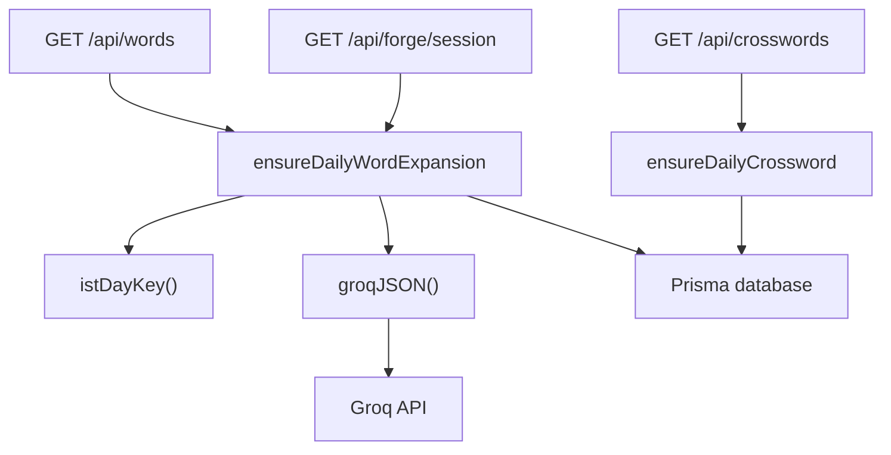
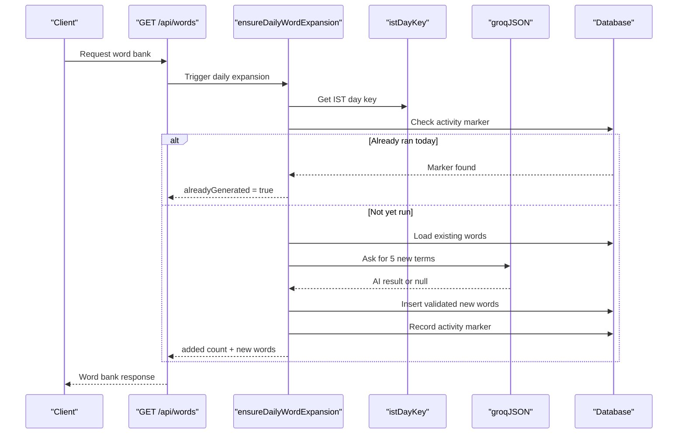
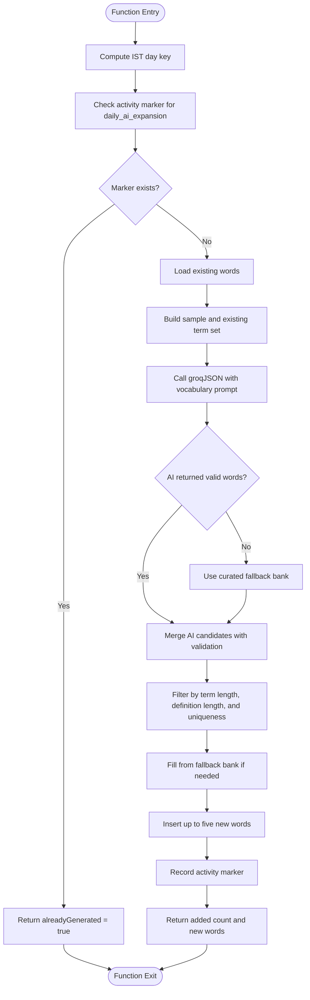
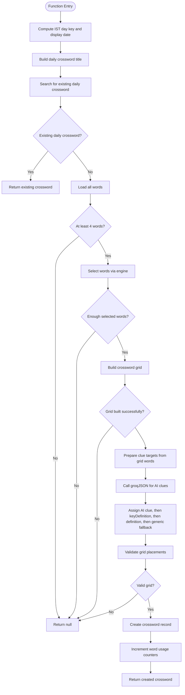
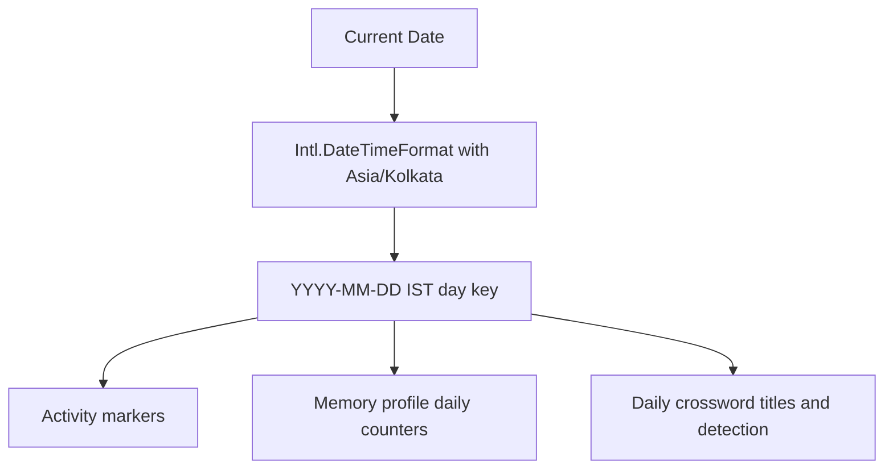
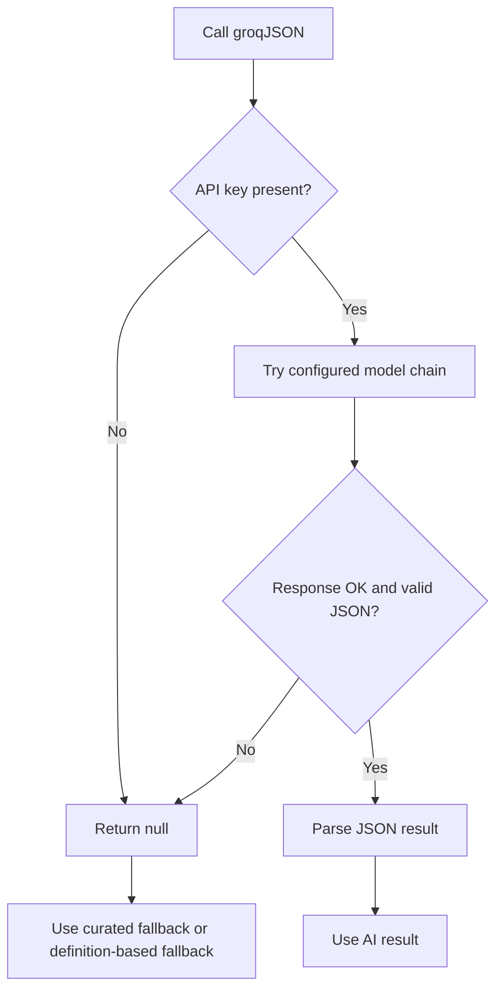
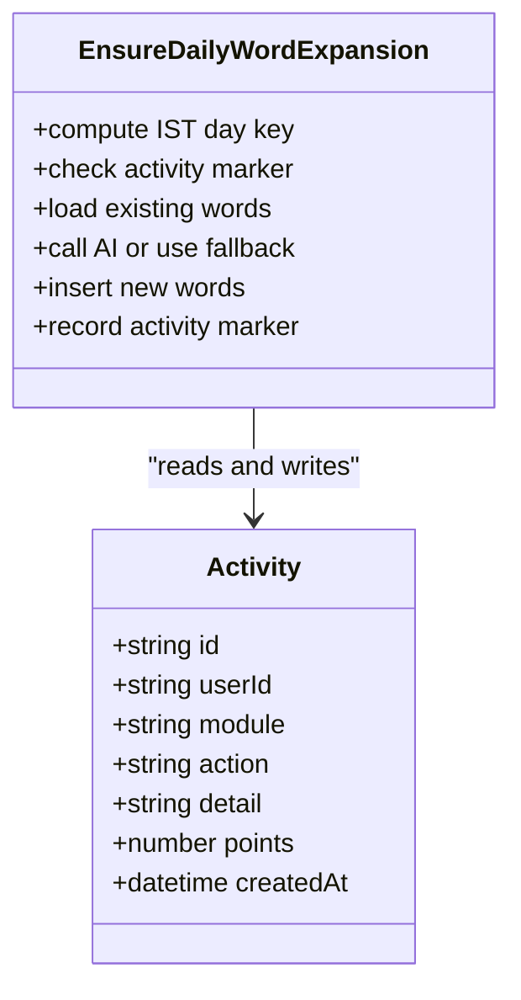
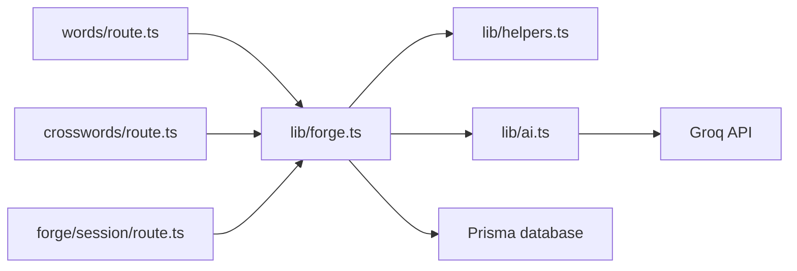

# Daily Mechanisms

<cite>
**Referenced Files in This Document**
- [forge.ts](file://src/lib/forge.ts)
- [helpers.ts](file://src/lib/helpers.ts)
- [ai.ts](file://src/lib/ai.ts)
- [words/route.ts](file://src/app/api/words/route.ts)
- [crosswords/route.ts](file://src/app/api/crosswords/route.ts)
- [forge/session/route.ts](file://src/app/api/forge/session/route.ts)
- [schema.prisma](file://prisma/schema.prisma)
</cite>

## Table of Contents
1. [Introduction](#introduction)
2. [Project Structure](#project-structure)
3. [Core Components](#core-components)
4. [Architecture Overview](#architecture-overview)
5. [Detailed Component Analysis](#detailed-component-analysis)
6. [Dependency Analysis](#dependency-analysis)
7. [Performance Considerations](#performance-considerations)
8. [Troubleshooting Guide](#troubleshooting-guide)
9. [Conclusion](#conclusion)

## Introduction
This document explains the daily automated mechanisms that keep the vocabulary and crossword systems fresh without manual intervention. The system:

- Generates five new startup/business vocabulary terms every day using AI, with a curated fallback when AI is unavailable.
- Creates a daily crossword challenge automatically, using AI-generated clues where possible and safe definition-based clues as fallbacks.
- Uses IST (Asia/Kolkata) for all daily resets so operations align with the team’s timezone.
- Prevents duplicate daily work through an activity tracking marker.
- Is triggered by normal API usage rather than a separate scheduler, making it resilient to deployment patterns.

The two main functions are `ensureDailyWordExpansion` and `ensureDailyCrossword`, both implemented in the server-side memory engine.

## Project Structure
The daily mechanisms live in the backend logic layer and are invoked by Next.js API routes:

- Core automation logic: `src/lib/forge.ts`
- IST date helpers: `src/lib/helpers.ts`
- AI client wrapper: `src/lib/ai.ts`
- Word bank API route: `src/app/api/words/route.ts`
- Crossword list API route: `src/app/api/crosswords/route.ts`
- Flashcard session API route: `src/app/api/forge/session/route.ts`
- Database schema: `prisma/schema.prisma`

**Diagram sources**
- [words/route.ts:6-13](file://src/app/api/words/route.ts#L6-L13)
- [forge/session/route.ts:18-28](file://src/app/api/forge/session/route.ts#L18-L28)
- [crosswords/route.ts:7-13](file://src/app/api/crosswords/route.ts#L7-L13)
- [forge.ts:409-518](file://src/lib/forge.ts#L409-L518)
- [forge.ts:523-633](file://src/lib/forge.ts#L523-L633)
- [helpers.ts:3-6](file://src/lib/helpers.ts#L3-L6)
- [ai.ts:24-67](file://src/lib/ai.ts#L24-L67)

**Section sources**
- [forge.ts:1-12](file://src/lib/forge.ts#L1-L12)
- [words/route.ts:1-13](file://src/app/api/words/route.ts#L1-L13)
- [crosswords/route.ts:1-13](file://src/app/api/crosswords/route.ts#L1-L13)
- [forge/session/route.ts:1-28](file://src/app/api/forge/session/route.ts#L1-L28)

## Core Components
- `ensureDailyWordExpansion`: Ensures exactly five new startup/business vocabulary terms are added once per IST day. It checks an activity marker, asks AI for complementary terms, validates them, inserts them into the word bank, and records the daily run.
- `ensureDailyCrossword`: Ensures a daily crossword exists for today. If one already exists, it returns it; otherwise it selects words, builds a grid, generates AI clues, falls back to definitions, validates the grid, and persists the puzzle.
- `istDayKey`: Produces an IST-based `YYYY-MM-DD` string used for daily reset logic.
- `groqJSON`: Calls the Groq AI service with model fallback and JSON parsing; returns `null` on failure so the rest of the system can use curated fallbacks.

**Section sources**
- [forge.ts:405-518](file://src/lib/forge.ts#L405-L518)
- [forge.ts:520-633](file://src/lib/forge.ts#L520-L633)
- [helpers.ts:1-6](file://src/lib/helpers.ts#L1-L6)
- [ai.ts:1-21](file://src/lib/ai.ts#L1-L21)
- [ai.ts:24-67](file://src/lib/ai.ts#L24-L67)

## Architecture Overview
The daily mechanisms are event-driven by normal API traffic rather than a cron job. This means:

- Every time the word bank is loaded, the system attempts the daily expansion.
- Every time the crossword list is loaded, the system ensures today’s crossword exists.
- Every flashcard session request also triggers the daily expansion check.

**Diagram sources**
- [words/route.ts:6-13](file://src/app/api/words/route.ts#L6-L13)
- [forge.ts:409-518](file://src/lib/forge.ts#L409-L518)
- [helpers.ts:3-6](file://src/lib/helpers.ts#L3-L6)
- [ai.ts:24-67](file://src/lib/ai.ts#L24-L67)

## Detailed Component Analysis

### `ensureDailyWordExpansion`
This function implements the daily vocabulary expansion mechanism.

#### Responsibilities
- Compute the current IST day key.
- Check whether the daily expansion has already run today using the activity table.
- Load existing vocabulary to avoid duplicates.
- Ask AI to generate five new startup/business terms.
- Apply validation rules for term length, definition quality, and category normalization.
- Use a curated fallback bank if AI is unavailable or produces insufficient results.
- Insert up to five new words.
- Record an activity marker to prevent duplicate runs today.

#### Processing Logic

**Diagram sources**
- [forge.ts:409-518](file://src/lib/forge.ts#L409-L518)

#### Key Implementation Details
- **IST day key**: Uses `istDayKey()` so the daily boundary follows Asia/Kolkata time.
- **Duplicate prevention**: Checks `activity` module `crosswords`, action `daily_ai_expansion`, detail equal to the IST day key.
- **AI prompt engineering**: Sends a system role describing a startup dictionary researcher and a user prompt containing existing vocabulary, strict formatting rules, and a JSON schema for the response.
- **Fallback bank**: Contains curated startup/business terms such as capitalization tables, down rounds, vesting cliffs, flywheel models, churn, prompts, cohorts, pivots, decacorns, and solvency.
- **Validation**: Normalizes terms to uppercase, removes non-A-Z characters, enforces 3–12 letter length, requires meaningful definitions, and rejects duplicates against the existing word set.
- **Activity recording**: Records the effective user ID, defaulting to the first user or `"system"` if no user context is available.

**Section sources**
- [forge.ts:405-518](file://src/lib/forge.ts#L405-L518)
- [helpers.ts:3-6](file://src/lib/helpers.ts#L3-L6)

### `ensureDailyCrossword`
This function ensures a daily crossword challenge exists for the current IST day.

#### Responsibilities
- Compute the IST day key and display date.
- Search for an existing daily crossword by title patterns and creation time.
- Require a minimum word pool before attempting generation.
- Select words using the crossword engine.
- Build a crossword grid.
- Generate AI clues with safe definition fallbacks.
- Validate the final grid.
- Persist the crossword and update word usage statistics.

#### Processing Logic

**Diagram sources**
- [forge.ts:523-633](file://src/lib/forge.ts#L523-L633)

#### Key Implementation Details
- **IST display date**: Uses `toLocaleDateString("en-IN", { timeZone: "Asia/Kolkata" })` so titles show the correct Indian date.
- **Existing crossword detection**: Looks for active daily crosswords whose title matches the display date, contains the IST day key, or was created after midnight IST.
- **Word selection**: Uses `selectWords` from the crossword engine to pick a balanced set.
- **Grid building**: Uses `buildCrosswordGrid` to create a connected crossword layout.
- **Clue generation**:
  - Primary source: AI-generated clues.
  - Secondary source: `keyDefinition`.
  - Tertiary source: full definition.
  - Final fallback: generic business-term clue including letter count.
- **Clue safety**: Avoids clues that leak the answer and trims overly long clues.
- **Persistence**: Stores grid data, associated word IDs, mode, difficulty, time limit, and links words to the crossword.
- **Usage tracking**: Increments `usedInCrosswords` and updates `lastUsedAt` for each word used.

**Section sources**
- [forge.ts:520-633](file://src/lib/forge.ts#L520-L633)

### IST Timezone Handling and Daily Reset Logic
All daily boundaries use IST (Asia/Kolkata). This is important because:

- The server may run in any timezone, but the product logic must reset at the same local day for users.
- Activity markers, profile daily counters, and crossword titles all rely on consistent day keys.

**Diagram sources**
- [helpers.ts:3-6](file://src/lib/helpers.ts#L3-L6)
- [forge.ts:415-416](file://src/lib/forge.ts#L415-L416)
- [forge.ts:528-536](file://src/lib/forge.ts#L528-L536)
- [forge.ts:370-384](file://src/lib/forge.ts#L370-L384)

**Section sources**
- [helpers.ts:1-6](file://src/lib/helpers.ts#L1-L6)
- [forge.ts:370-384](file://src/lib/forge.ts#L370-L384)
- [forge.ts:415-416](file://src/lib/forge.ts#L415-L416)
- [forge.ts:528-536](file://src/lib/forge.ts#L528-L536)

### AI Prompt Engineering Examples

#### Vocabulary Generation Prompt
The vocabulary prompt:

- Provides a sample of existing startup/business vocabulary.
- Requests exactly five new terms.
- Enforces single uppercase English words.
- Requires 3–12 letters, A-Z only.
- Rejects duplicates against existing terms.
- Requires a clear educational definition and a concise crossword clue.
- Returns structured JSON with term, definition, keyDefinition, and category.

This prompt is designed to produce consistent, machine-parseable output while encouraging domain-relevant startup terminology.

#### Crossword Clue Generation Prompt
The clue prompt:

- Sets the AI role as a crossword clue writer for business/startup terms.
- Requires JSON-only output.
- Limits clue length.
- Prohibits abbreviations of the answer.
- Prohibits including the answer or its stem.
- Prohibits quotes inside clues.

The system then applies additional safety checks to ensure clues do not leak answers.

**Section sources**
- [forge.ts:435-449](file://src/lib/forge.ts#L435-L449)
- [forge.ts:584-588](file://src/lib/forge.ts#L584-L588)

### Fallback Mechanisms When AI Services Are Unavailable
The system is designed to remain functional even when Groq is unavailable:

- If `GROQ_API_KEY` is missing, `groqJSON` returns `null`.
- For vocabulary expansion, the system uses a curated fallback bank of startup/business terms.
- For crossword clues, the system falls back to `keyDefinition`, then `definition`, then a generic clue.
- API routes catch errors from daily automation calls so normal responses still return.

**Diagram sources**
- [ai.ts:19-21](file://src/lib/ai.ts#L19-L21)
- [ai.ts:24-67](file://src/lib/ai.ts#L24-L67)
- [forge.ts:451-483](file://src/lib/forge.ts#L451-L483)
- [forge.ts:590-599](file://src/lib/forge.ts#L590-L599)
- [words/route.ts:12](file://src/app/api/words/route.ts#L12)
- [crosswords/route.ts:13](file://src/app/api/crosswords/route.ts#L13)

**Section sources**
- [ai.ts:1-21](file://src/lib/ai.ts#L1-L21)
- [ai.ts:24-67](file://src/lib/ai.ts#L24-L67)
- [forge.ts:451-483](file://src/lib/forge.ts#L451-L483)
- [forge.ts:590-599](file://src/lib/forge.ts#L590-L599)
- [words/route.ts:6-13](file://src/app/api/words/route.ts#L6-L13)
- [crosswords/route.ts:7-13](file://src/app/api/crosswords/route.ts#L7-L13)

### Activity Tracking System That Prevents Duplicate Daily Operations
The activity tracking system prevents infinite or repeated daily generation:

- The activity table stores module, action, detail, points, and optional userId.
- For daily word expansion, the system checks for an activity record with:
  - Module: `crosswords`
  - Action: `daily_ai_expansion`
  - Detail: IST day key
- If the marker exists, the function returns immediately without calling AI or inserting words.
- After successful insertion, the marker is recorded with the effective user ID.

**Diagram sources**
- [schema.prisma:11-48](file://prisma/schema.prisma#L11-L48)
- [forge.ts:417-428](file://src/lib/forge.ts#L417-L428)
- [forge.ts:505-518](file://src/lib/forge.ts#L505-L518)

**Section sources**
- [schema.prisma:11-48](file://prisma/schema.prisma#L11-L48)
- [forge.ts:417-428](file://src/lib/forge.ts#L417-L428)
- [forge.ts:505-518](file://src/lib/forge.ts#L505-L518)

## Dependency Analysis
The daily mechanisms depend on several layers:

- API routes trigger automation.
- The memory engine coordinates business logic.
- Helpers provide timezone-safe day keys.
- The AI client provides optional AI generation.
- Prisma interacts with the database.

**Diagram sources**
- [words/route.ts:1-13](file://src/app/api/words/route.ts#L1-L13)
- [crosswords/route.ts:1-13](file://src/app/api/crosswords/route.ts#L1-L13)
- [forge/session/route.ts:1-28](file://src/app/api/forge/session/route.ts#L1-L28)
- [forge.ts:1-8](file://src/lib/forge.ts#L1-L8)
- [helpers.ts:1-6](file://src/lib/helpers.ts#L1-L6)
- [ai.ts:1-21](file://src/lib/ai.ts#L1-L21)

**Section sources**
- [words/route.ts:1-13](file://src/app/api/words/route.ts#L1-L13)
- [crosswords/route.ts:1-13](file://src/app/api/crosswords/route.ts#L1-L13)
- [forge/session/route.ts:1-28](file://src/app/api/forge/session/route.ts#L1-L28)
- [forge.ts:1-8](file://src/lib/forge.ts#L1-L8)

## Performance Considerations
- Daily expansion is asynchronous and fire-and-forget in API routes, so it does not block normal responses.
- AI calls have a timeout and model fallback chain to reduce latency and failure impact.
- Existing word scanning is limited to a sample for prompting, reducing payload size.
- Crossword generation requires multiple steps: word selection, grid building, AI clue generation, and grid validation. If any step fails, the function returns `null` instead of creating an invalid puzzle.
- Activity markers prevent repeated AI calls on the same IST day.

[No sources needed since this section provides general guidance]

## Troubleshooting Guide

### No New Words Added Today
Possible causes:
- The daily expansion already ran earlier.
- AI returned no valid words and the fallback bank had no unused terms.
- All candidate terms were duplicates of existing vocabulary.
- Database constraints rejected inserted terms.

Checks:
- Verify the activity marker for `daily_ai_expansion` with the current IST day key.
- Confirm the word bank has enough variety for the fallback bank to contribute.
- Inspect recent word insertions and their source.

**Section sources**
- [forge.ts:417-428](file://src/lib/forge.ts#L417-L428)
- [forge.ts:451-503](file://src/lib/forge.ts#L451-L503)
- [forge.ts:505-518](file://src/lib/forge.ts#L505-L518)

### No Daily Crossword Available
Possible causes:
- No existing crossword matched today’s title or date patterns.
- The word bank had fewer than four words.
- Word selection produced fewer than three usable words.
- Grid building failed.
- Grid validation failed.
- AI clue generation failed and no safe definition-based clue could be used.

Checks:
- Confirm the word bank has sufficient terms.
- Check whether a daily crossword exists with a matching title pattern.
- Review grid construction and validation behavior.
- Verify that definitions or keyDefinitions exist for selected words.

**Section sources**
- [forge.ts:528-557](file://src/lib/forge.ts#L528-L557)
- [forge.ts:559-574](file://src/lib/forge.ts#L559-L574)
- [forge.ts:578-604](file://src/lib/forge.ts#L578-L604)

### AI Service Unavailable
Symptoms:
- Vocabulary expansion falls back to the curated bank.
- Crossword clues fall back to definitions or generic clues.
- No AI-related errors are thrown to the client.

Checks:
- Confirm `GROQ_API_KEY` is configured.
- Check whether `groqJSON` returns `null`.
- Verify that fallback logic is being used.

**Section sources**
- [ai.ts:19-21](file://src/lib/ai.ts#L19-L21)
- [ai.ts:24-67](file://src/lib/ai.ts#L24-L67)
- [forge.ts:451-483](file://src/lib/forge.ts#L451-L483)
- [forge.ts:590-599](file://src/lib/forge.ts#L590-L599)

### Duplicate Daily Runs Detected
If duplicate runs appear:
- Ensure the activity marker is written after successful word insertion.
- Ensure the detail field uses the IST day key.
- Ensure the module and action values match the expected constants.

**Section sources**
- [forge.ts:505-518](file://src/lib/forge.ts#L505-L518)

## Conclusion
The daily mechanisms provide resilient, timezone-aware automation for vocabulary growth and crossword challenges. They combine AI-powered generation with strong fallbacks, enforce IST-based daily boundaries, and prevent duplicate work through activity markers. The design prioritizes reliability: normal API responses continue even when AI is unavailable, and daily content is generated lazily on demand rather than requiring external scheduling infrastructure.

[No sources needed since this section summarizes without analyzing specific files]