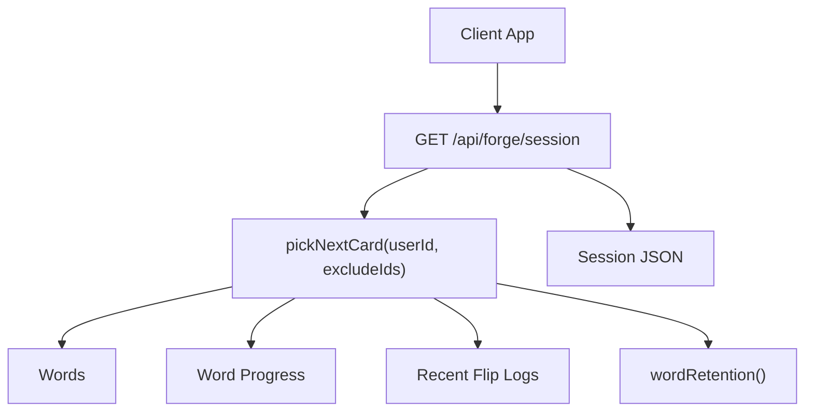
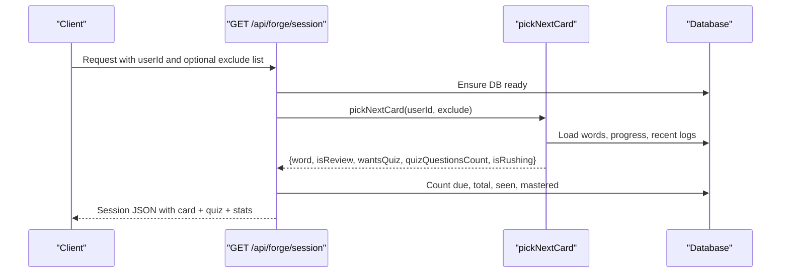
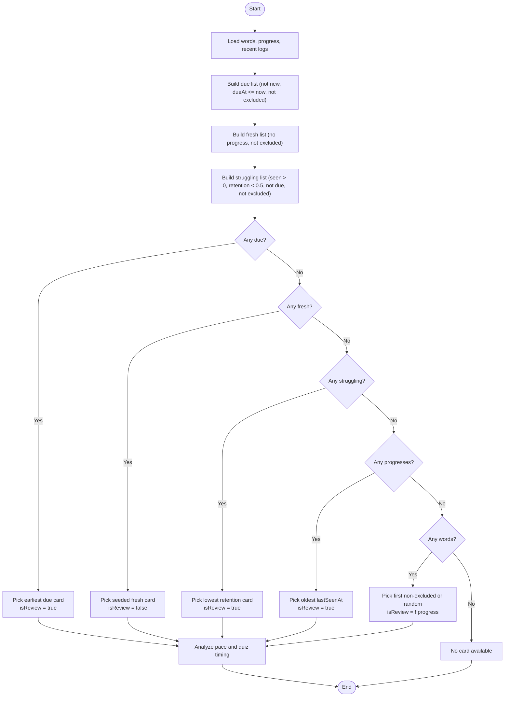
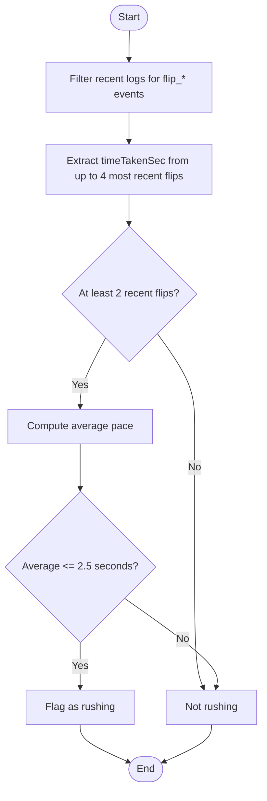
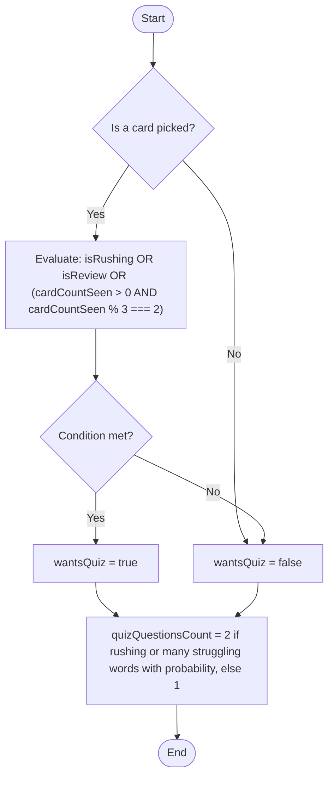
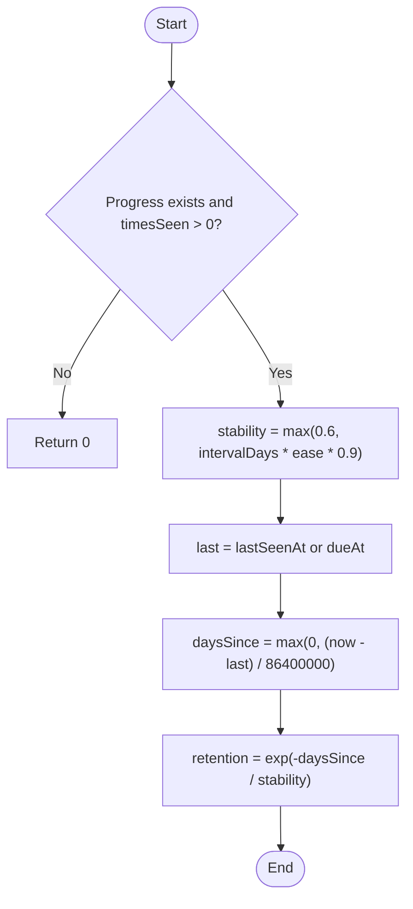
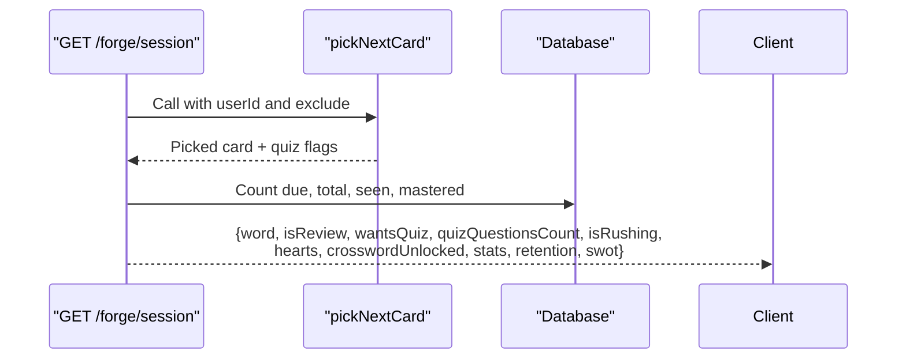
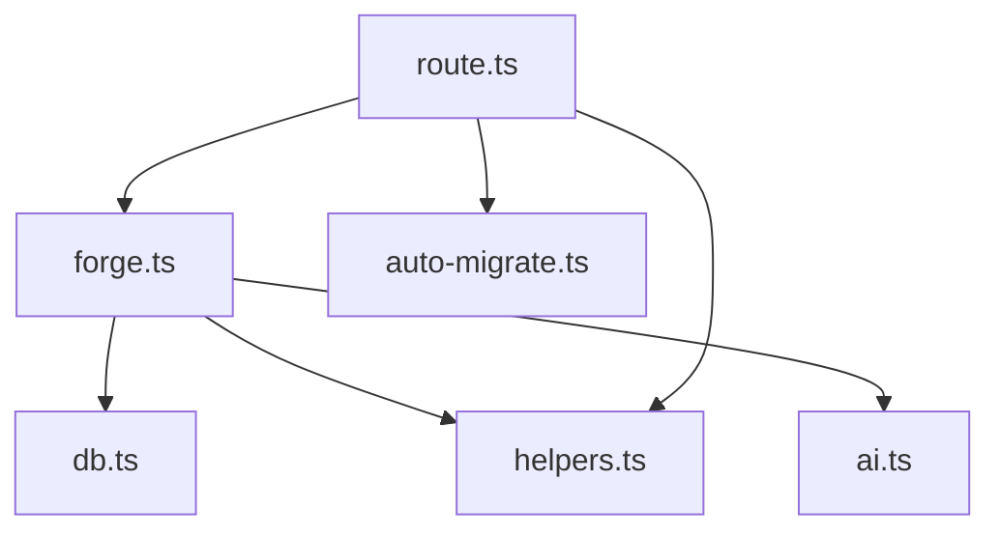

# Flashcard Selection Engine

<cite>
**Referenced Files in This Document**
- [forge.ts](file://src/lib/forge.ts)
- [route.ts](file://src/app/api/forge/session/route.ts)
</cite>

## Table of Contents
1. [Introduction](#introduction)
2. [Project Structure](#project-structure)
3. [Core Components](#core-components)
4. [Architecture Overview](#architecture-overview)
5. [Detailed Component Analysis](#detailed-component-analysis)
6. [Dependency Analysis](#dependency-analysis)
7. [Performance Considerations](#performance-considerations)
8. [Troubleshooting Guide](#troubleshooting-guide)
9. [Conclusion](#conclusion)

## Introduction
This document explains the flashcard selection engine that powers the reels-style learning flow. The core function `pickNextCard` selects the next card based on a clear priority system, detects when users are rushing through cards, and decides when to trigger verification quizzes. It also adapts to different learning speeds and performance levels by combining spaced-repetition signals with real-time behavior analysis.

The engine is implemented server-side and exposed via an API route that returns both the selected card and quiz-related metadata for the client to render the session correctly.

## Project Structure
The flashcard selection logic lives in a dedicated memory engine module, while the Next.js API route consumes it to build the session response.



**Diagram sources**
- [route.ts:18-82](file://src/app/api/forge/session/route.ts#L18-L82)
- [forge.ts:98-188](file://src/lib/forge.ts#L98-L188)
- [forge.ts:88-94](file://src/lib/forge.ts#L88-L94)

**Section sources**
- [route.ts:1-87](file://src/app/api/forge/session/route.ts#L1-L87)
- [forge.ts:1-10](file://src/lib/forge.ts#L1-L10)

## Core Components
- `pickNextCard`: Selects the next card, determines review status, rush detection, and quiz timing.
- `wordRetention`: Estimates retention decay per word using interval and ease.
- `scheduleByRating` and `scheduleNext`: Update scheduling after user ratings; indirectly influence future due dates and struggling classification.
- `recalcMemoryProfile` and related helpers: Provide broader analytics and SWOT insights used elsewhere in the app.

Key responsibilities:
- Priority-based card selection: due reviews first, fresh words second, struggling words third.
- Fallback mechanisms to ensure a card is always available if any words exist.
- Rushing detection based on recent flip timings.
- Quiz timing logic that triggers verification questions under specific conditions.

**Section sources**
- [forge.ts:39-84](file://src/lib/forge.ts#L39-L84)
- [forge.ts:88-94](file://src/lib/forge.ts#L88-L94)
- [forge.ts:98-188](file://src/lib/forge.ts#L98-L188)

## Architecture Overview
The API endpoint orchestrates the session request:
- Validates input and ensures database readiness.
- Triggers daily expansion asynchronously.
- Ensures the user’s memory profile exists and is current.
- Calls `pickNextCard` to compute the next card and quiz parameters.
- Aggregates stats and returns a rich session payload including hearts, unlock state, and adaptive quiz settings.



**Diagram sources**
- [route.ts:18-82](file://src/app/api/forge/session/route.ts#L18-L82)
- [forge.ts:98-188](file://src/lib/forge.ts#L98-L188)

## Detailed Component Analysis

### Priority System for Card Selection
The selection algorithm follows a strict order:
1. Due reviews: Words whose scheduled due time has passed and are not marked new.
2. Fresh words: Words without any progress record.
3. Struggling words: Words with some history but low estimated retention and not yet due.
4. Fallback: If none of the above apply, select the oldest seen progress or a random non-excluded word.



**Diagram sources**
- [forge.ts:116-156](file://src/lib/forge.ts#L116-L156)

**Section sources**
- [forge.ts:116-156](file://src/lib/forge.ts#L116-L156)

### Rushing Detection Algorithm
The engine monitors recent flip actions to detect rapid clicking patterns:
- It filters recent logs for flip events and extracts their durations.
- If at least two recent flips have an average duration less than or equal to 2.5 seconds, the user is flagged as rushing.
- Rushing increases the likelihood of immediate quiz triggers and may increase the number of quiz questions.



**Diagram sources**
- [forge.ts:158-163](file://src/lib/forge.ts#L158-L163)

**Section sources**
- [forge.ts:158-163](file://src/lib/forge.ts#L158-L163)

### Quiz Timing Logic
The quiz timing decision combines three factors:
- Rushing: Immediate quiz trigger when rushing is detected.
- Review cards: Always trigger a quiz on review cards.
- Session cadence: For non-review sessions, trigger every third card after at least one card has been seen.

Additionally, the number of quiz questions varies:
- Two questions when rushing or when there are multiple struggling words with a probabilistic component.
- One question otherwise.



**Diagram sources**
- [forge.ts:165-178](file://src/lib/forge.ts#L165-L178)

**Section sources**
- [forge.ts:165-178](file://src/lib/forge.ts#L165-L178)

### Retention Model and Struggling Classification
Retention is modeled as exponential decay based on stability derived from interval and ease:
- Stability is computed from interval days and ease factor.
- Days since last seen or due date determine decay.
- Words with retention below a threshold and some history are classified as struggling.



**Diagram sources**
- [forge.ts:88-94](file://src/lib/forge.ts#L88-L94)

**Section sources**
- [forge.ts:88-94](file://src/lib/forge.ts#L88-L94)

### Scheduling and Rating Impact
User ratings affect future scheduling:
- Practice: Resets interval, slightly reduces ease, marks as learning, schedules retry soon.
- Easy: Increases ease, spaces out intervals, keeps learning status.
- Done: Boosts ease significantly, extends intervals substantially, marks as done.

These scheduling changes influence which words become due or struggling in future selections.

```mermaid
classDiagram
class ScheduleByRating {
+rating : "practice" | "easy" | "done"
+prev : ProgressRow | null
+returns : {status, intervalDays, ease, dueAt}
}
class WordRetention {
+p : ProgressRow | null
+returns : number
}
class PickNextCard {
+userId : string
+excludeIds : string[]
+returns : {word, progress, isReview, wantsQuiz, quizQuestionsCount, isRushing}
}
PickNextCard --> WordRetention : "uses"
PickNextCard --> ScheduleByRating : "indirectly affects via progress updates"
```

**Diagram sources**
- [forge.ts:39-84](file://src/lib/forge.ts#L39-L84)
- [forge.ts:88-94](file://src/lib/forge.ts#L88-L94)
- [forge.ts:98-188](file://src/lib/forge.ts#L98-L188)

**Section sources**
- [forge.ts:39-84](file://src/lib/forge.ts#L39-L84)

### API Integration and Session Payload
The session endpoint composes the result from `pickNextCard` and adds:
- Hearts and depletion state.
- Daily learning target and unlock flags.
- Stats such as due count, total words, seen words, and mastered count.
- Retention metrics, recall velocity, category scores, and SWOT insights.



**Diagram sources**
- [route.ts:18-82](file://src/app/api/forge/session/route.ts#L18-L82)
- [forge.ts:98-188](file://src/lib/forge.ts#L98-L188)

**Section sources**
- [route.ts:18-82](file://src/app/api/forge/session/route.ts#L18-L82)

## Dependency Analysis
The selection engine depends on:
- Database tables for words, progress, and logs.
- Memory profile utilities for broader analytics.
- Helper functions for day keys and AI integration (used elsewhere).



**Diagram sources**
- [forge.ts:1-10](file://src/lib/forge.ts#L1-L10)
- [route.ts:1-12](file://src/app/api/forge/session/route.ts#L1-L12)

**Section sources**
- [forge.ts:1-10](file://src/lib/forge.ts#L1-L10)
- [route.ts:1-12](file://src/app/api/forge/session/route.ts#L1-L12)

## Performance Considerations
- Parallel data loading: The engine loads words, progress, and logs concurrently to minimize latency.
- Efficient filtering and sorting: Due, fresh, and struggling lists are built with targeted filters and minimal allocations.
- Bounded log analysis: Only the most recent logs are considered for rush detection to keep computation lightweight.
- Deterministic seeding: Fresh word selection uses a deterministic seed based on user ID and date to avoid randomness spikes.

[No sources needed since this section provides general guidance]

## Troubleshooting Guide
Common issues and resolutions:
- No card returned: Ensure at least one word exists in the database; the fallback mechanism requires words to be present.
- Excessive quiz triggers: Verify that rush detection thresholds align with expected user behavior; adjust thresholds if necessary.
- Stale retention values: Confirm that progress records update correctly after ratings; check scheduling functions and rating transitions.
- API errors: Validate userId parameter and database readiness; inspect error handling in the session route.

**Section sources**
- [forge.ts:148-156](file://src/lib/forge.ts#L148-L156)
- [forge.ts:158-178](file://src/lib/forge.ts#L158-L178)
- [route.ts:18-27](file://src/app/api/forge/session/route.ts#L18-L27)

## Conclusion
The flashcard selection engine implements a robust, adaptive learning flow:
- Prioritizes due reviews, then fresh words, then struggling words, with reliable fallbacks.
- Detects rushing behavior and responds with immediate verification quizzes.
- Adapts quiz frequency and intensity based on user pace and performance indicators.
- Integrates cleanly with the API layer to deliver a comprehensive session payload.

This design balances spaced repetition principles with real-time behavioral signals to optimize learning outcomes across varying user speeds and proficiency levels.

[No sources needed since this section summarizes without analyzing specific files]