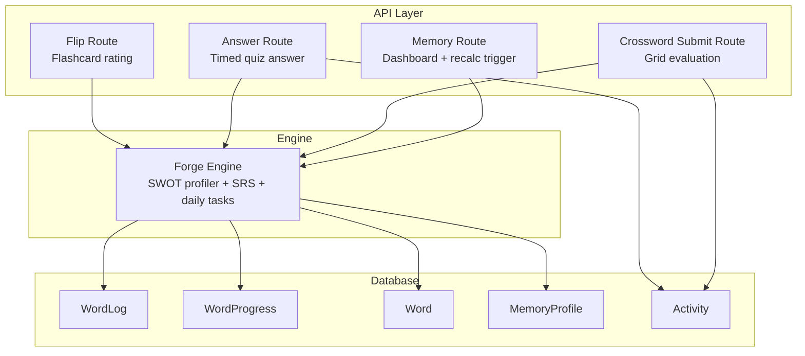
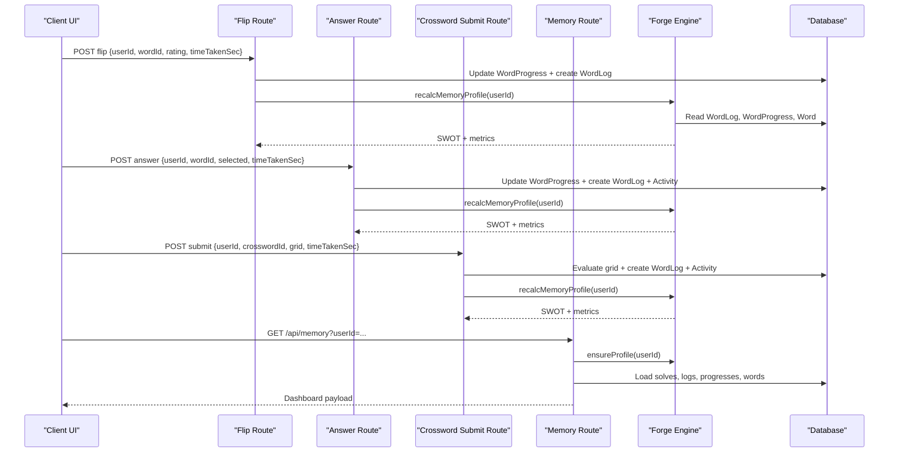
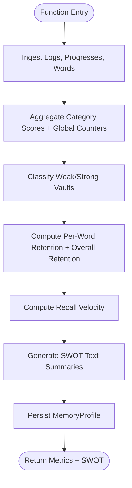
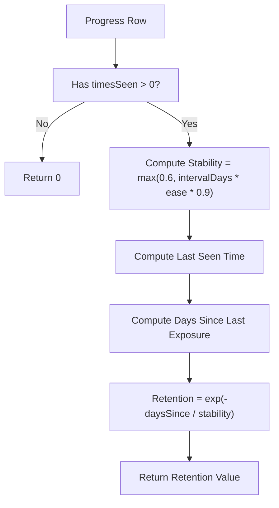
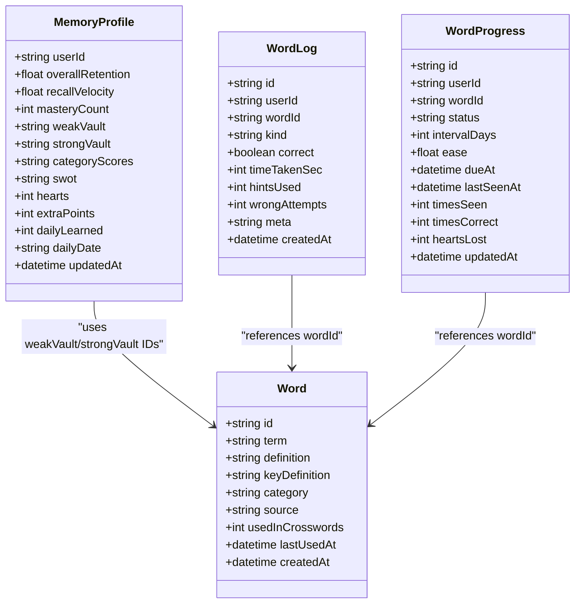
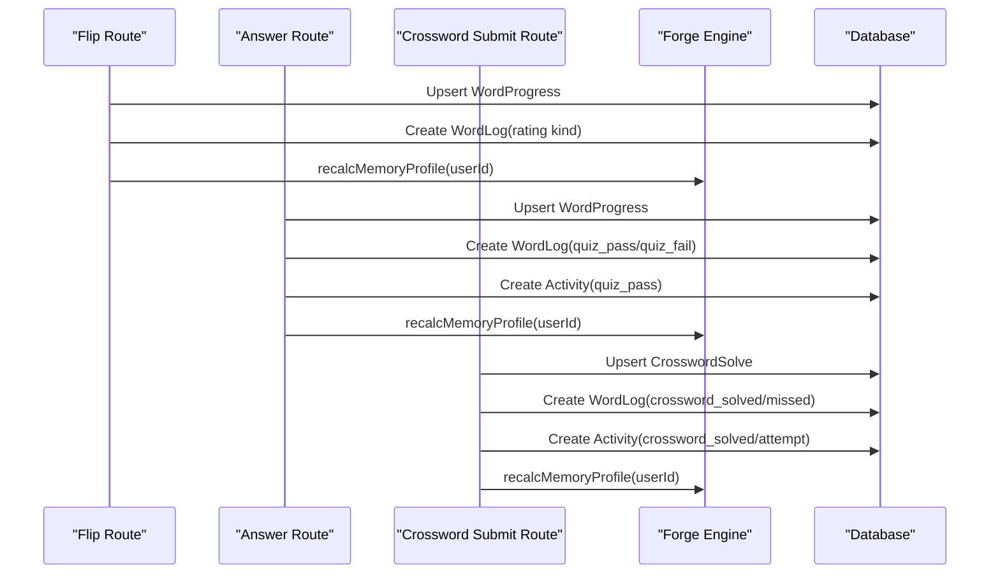
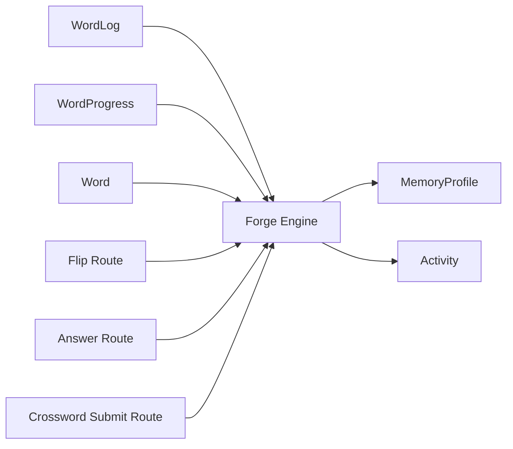

# SWOT Analysis Profiling

<cite>
**Referenced Files in This Document**
- [forge.ts](file://src/lib/forge.ts)
- [schema.prisma](file://prisma/schema.prisma)
- [memory route.ts](file://src/app/api/memory/route.ts)
- [flip route.ts](file://src/app/api/forge/flip/route.ts)
- [answer route.ts](file://src/app/api/forge/answer/route.ts)
- [crosswords submit route.ts](file://src/app/api/crosswords/submit/route.ts)
</cite>

## Table of Contents
1. [Introduction](#introduction)
2. [Project Structure](#project-structure)
3. [Core Components](#core-components)
4. [Architecture Overview](#architecture-overview)
5. [Detailed Component Analysis](#detailed-component-analysis)
6. [Dependency Analysis](#dependency-analysis)
7. [Performance Considerations](#performance-considerations)
8. [Troubleshooting Guide](#troubleshooting-guide)
9. [Conclusion](#conclusion)

## Introduction
This document explains the SWOT analysis profiling system used by WeLearn’s memory engine. It focuses on how `recalcMemoryProfile` analyzes user learning patterns to generate Strengths, Weaknesses, Opportunities, and Threats categories. It also documents the cognitive algorithms behind recall velocity, category performance, and memory retention curves, as well as the weak vault and strong vault concepts for categorizing terms by mastery level. Finally, it shows how activity logs and progress tracking data integrate into the profiler and how the system identifies learning bottlenecks and growth opportunities.

The profiler is part of the CrossForge module: a server-side memory engine that combines spaced repetition, flashcard selection, timed quizzes, crossword puzzles, and a 24/7 cognitive matrix that persists SWOT profiles per user.

## Project Structure
The SWOT profiling logic lives primarily in the backend memory engine and is consumed by API routes that handle flashcards, quizzes, and crosswords. The database schema defines the tables used by the profiler, including word progress, activity logs, and the memory profile itself.

**Diagram sources**
- [forge.ts:190-368](file://src/lib/forge.ts#L190-L368)
- [memory route.ts:1-92](file://src/app/api/memory/route.ts#L1-L92)
- [flip route.ts:1-119](file://src/app/api/forge/flip/route.ts#L1-L119)
- [answer route.ts:1-101](file://src/app/api/forge/answer/route.ts#L1-L101)
- [crosswords submit route.ts:1-217](file://src/app/api/crosswords/submit/route.ts#L1-L217)
- [schema.prisma:506-641](file://prisma/schema.prisma#L506-L641)

**Section sources**
- [forge.ts:1-12](file://src/lib/forge.ts#L1-L12)
- [schema.prisma:500-641](file://prisma/schema.prisma#L500-L641)

## Core Components
- **SWOT profiler**: `recalcMemoryProfile(userId)` computes overall retention, recall velocity, mastery count, category scores, weak/strong vaults, and four-directional SWOT text summaries.
- **Retention model**: `wordRetention(progress)` models exponential decay based on interval stability and time since last exposure.
- **SRS scheduler**: `scheduleByRating(prev, rating)` updates status, interval, ease, and due date for practice/easy/done ratings.
- **Card selector**: `pickNextCard(userId, excludeIds)` chooses review, new, or struggling cards and detects rushing behavior.
- **Profile persistence**: `ensureProfile(userId)` ensures a memory profile exists and resets daily counters at IST day boundaries.
- **SWOT parser**: `parseSwot(raw)` safely parses stored JSON SWOT strings.

Key responsibilities:
- Aggregate recent activity logs to compute category accuracy and behavioral signals.
- Classify terms into weak and strong vaults using both log-based signals and decay-based retention thresholds.
- Generate human-readable SWOT insights for dashboard display.
- Persist structured metrics and JSON payloads in `MemoryProfile`.

**Section sources**
- [forge.ts:39-94](file://src/lib/forge.ts#L39-L94)
- [forge.ts:98-188](file://src/lib/forge.ts#L98-L188)
- [forge.ts:190-368](file://src/lib/forge.ts#L190-L368)
- [forge.ts:370-403](file://src/lib/forge.ts#L370-L403)

## Architecture Overview
The SWOT profiling system integrates with three main interaction surfaces:
- Flashcard flips (practice/easy/done)
- Timed quiz answers
- Crossword submissions

Each surface writes activity logs and updates progress. The memory route exposes a dashboard payload and can force a profiler recalculation.

**Diagram sources**
- [flip route.ts:21-119](file://src/app/api/forge/flip/route.ts#L21-L119)
- [answer route.ts:11-101](file://src/app/api/forge/answer/route.ts#L11-L101)
- [crosswords submit route.ts:21-217](file://src/app/api/crosswords/submit/route.ts#L21-L217)
- [memory route.ts:6-92](file://src/app/api/memory/route.ts#L6-L92)
- [forge.ts:190-368](file://src/lib/forge.ts#L190-L368)

## Detailed Component Analysis

### Cognitive Profiling Algorithm: `recalcMemoryProfile`
`recalcMemoryProfile` is the core function that transforms raw learning events into a SWOT profile. It performs these steps:

1. **Data ingestion**
   - Reads up to 400 recent `WordLog` entries for the user.
   - Reads all `WordProgress` entries for the user.
   - Loads all `Word` records to map IDs to term metadata and categories.

2. **Aggregation**
   - Builds a category aggregation map with score, count, and counts for practice/easy/done.
   - Tracks global counters: recall sum/count, practice/easy/done counts, quiz pass/fail counts, and rapid-click counts.

3. **Category scoring**
   - For each log entry, maps the word to its category and assigns weighted scores:
     - Practice: low contribution to category score.
     - Easy/Done/Quiz Pass/Crossword Solved: higher contribution.
     - Quiz Fail/Crossword Missed: zero contribution.
   - Converts aggregated scores into percentage accuracy per category.

4. **Vault classification**
   - Weak vault: terms marked through practice requests, quiz failures, crossword misses, or decay-based retention below threshold.
   - Strong vault: terms marked easy/done, quiz passes, crossword solves, or already mastered (`status === "done"`).

5. **Retention and velocity metrics**
   - Computes per-word retention using an exponential decay formula based on stability and days since last seen.
   - Calculates overall retention as the average of non-zero retentions.
   - Calculates recall velocity as average time taken across valid log entries.

6. **SWOT synthesis**
   - Strengths: mastery count, graduation count, dominant category, easy terms, fast recall speed, strong vault size.
   - Weaknesses: practice requests, fading terms, low-accuracy category, quiz stumbles, high latency.
   - Opportunities: unseen words, active learning terms, advanced category challenges, daily crossword availability.
   - Threats: rapid skimming detection, overdue terms, accumulating weak terms, high practice-to-done ratio.

7. **Persistence and return values**
   - Persists `overallRetention`, `recallVelocity`, `masteryCount`, `weakVault`, `strongVault`, `categoryScores`, and `swot` JSON into `MemoryProfile`.
   - Returns structured metrics for API consumers.

**Diagram sources**
- [forge.ts:192-368](file://src/lib/forge.ts#L192-L368)

**Section sources**
- [forge.ts:192-368](file://src/lib/forge.ts#L192-L368)

### Memory Retention Curve: Exponential Decay Model
The retention model uses an exponential decay function:
- Stability is derived from interval days and ease factor.
- Days since last exposure are computed relative to current time.
- Retention decays exponentially as time increases beyond stability.

This model helps identify fading terms and contributes to weak vault classification and threat detection.

**Diagram sources**
- [forge.ts:88-94](file://src/lib/forge.ts#L88-L94)

**Section sources**
- [forge.ts:88-94](file://src/lib/forge.ts#L88-L94)

### Weak Vault and Strong Vault Concepts
- **Weak vault**: A set of term IDs representing terms that are fading, underperforming, or recently struggled with. Sources include:
  - Practice requests (`flip_practice`)
  - Quiz failures (`quiz_fail`)
  - Crossword misses (`crossword_missed`)
  - Decay-based retention below threshold for non-mastered terms
- **Strong vault**: A set of term IDs representing terms that are solid or mastered. Sources include:
  - Easy ratings (`flip_easy`)
  - Done ratings (`flip_done`)
  - Quiz passes (`quiz_pass`)
  - Crossword solves (`crossword_solved`)
  - Mastered status (`status === "done"`)

These vaults are persisted as JSON arrays in `MemoryProfile` and exposed to the dashboard for visualization and remediation.

**Diagram sources**
- [schema.prisma:506-641](file://prisma/schema.prisma#L506-L641)
- [forge.ts:192-368](file://src/lib/forge.ts#L192-L368)

**Section sources**
- [forge.ts:213-278](file://src/lib/forge.ts#L213-L278)
- [schema.prisma:526-567](file://prisma/schema.prisma#L526-L567)
- [schema.prisma:624-641](file://prisma/schema.prisma#L624-L641)

### SWOT Profile Generation Examples
The profiler generates concise, actionable SWOT statements. Examples include:

- **Strengths**
  - Mastery indicators: number of terms marked Done.
  - Graduation indicators: number of cards graduated to mastery.
  - Dominant category accuracy above threshold.
  - Effortless terms classified as Easy.
  - Fast recall speed within acceptable latency.
  - Rock-solid terms in long-term memory.

- **Weaknesses**
  - Requests for Needs Practice.
  - Fading terms in weak vault.
  - Low-accuracy category needing practice.
  - Quiz stumbles on speed checks.
  - High recall latency.

- **Opportunities**
  - Unseen words ready to unlock.
  - Active terms primed for graduation.
  - Advanced category crosswords for bonus points.
  - Daily crossword challenge availability.

- **Threats**
  - Rapid skimming detected with verification quizzes active.
  - Overdue terms risking memory decay.
  - Accumulating weak terms requiring rescue runs.
  - High practice-to-done ratio indicating absorption issues.

These examples are generated dynamically based on aggregated metrics and thresholds defined in the profiler.

**Section sources**
- [forge.ts:296-341](file://src/lib/forge.ts#L296-L341)

### Integration with Activity Logs and Progress Tracking
- **Flashcard flips**: The flip route updates `WordProgress` with schedule results, increments daily learned counters, creates `WordLog` entries with rating kinds, and triggers `recalcMemoryProfile`.
- **Timed quiz answers**: The answer route updates `WordProgress`, adjusts hearts and extra points, creates `WordLog` and `Activity` entries, and triggers `recalcMemoryProfile`.
- **Crossword submissions**: The submit route evaluates grid correctness, creates `WordLog` entries for solved/missed words, updates `Activity`, restores hearts when appropriate, and triggers `recalcMemoryProfile`.
- **Dashboard payload**: The memory route loads recent solves, logs, progresses, and words, parses vaults and category scores, and returns a comprehensive dashboard payload including SWOT.

**Diagram sources**
- [flip route.ts:49-101](file://src/app/api/forge/flip/route.ts#L49-L101)
- [answer route.ts:26-84](file://src/app/api/forge/answer/route.ts#L26-L84)
- [crosswords submit route.ts:102-195](file://src/app/api/crosswords/submit/route.ts#L102-L195)
- [forge.ts:192-368](file://src/lib/forge.ts#L192-L368)

**Section sources**
- [flip route.ts:21-119](file://src/app/api/forge/flip/route.ts#L21-L119)
- [answer route.ts:11-101](file://src/app/api/forge/answer/route.ts#L11-L101)
- [crosswords submit route.ts:21-217](file://src/app/api/crosswords/submit/route.ts#L21-L217)
- [memory route.ts:6-92](file://src/app/api/memory/route.ts#L6-L92)

## Dependency Analysis
The SWOT profiler depends on several database entities and API routes:

- **Dependencies**
  - `WordLog`: primary input for behavioral signals and timing.
  - `WordProgress`: primary input for retention modeling and mastery state.
  - `Word`: provides term metadata and category mapping.
  - `MemoryProfile`: output storage for SWOT metrics and vaults.
  - `Activity`: secondary integration point for quiz and crossword achievements.

- **Coupling**
  - The profiler is tightly coupled to the schema structure of `WordLog`, `WordProgress`, and `MemoryProfile`.
  - API routes depend on the profiler for real-time SWOT updates after interactions.

- **External integrations**
  - AI generation is used elsewhere in the engine for daily word expansion and crossword clues but is not directly part of SWOT calculation.
  - The profiler does not depend on external services; it operates purely on local database state.

**Diagram sources**
- [schema.prisma:506-641](file://prisma/schema.prisma#L506-L641)
- [forge.ts:190-368](file://src/lib/forge.ts#L190-L368)
- [flip route.ts:1-119](file://src/app/api/forge/flip/route.ts#L1-L119)
- [answer route.ts:1-101](file://src/app/api/forge/answer/route.ts#L1-L101)
- [crosswords submit route.ts:1-217](file://src/app/api/crosswords/submit/route.ts#L1-L217)

**Section sources**
- [schema.prisma:506-641](file://prisma/schema.prisma#L506-L641)
- [forge.ts:190-368](file://src/lib/forge.ts#L190-L368)

## Performance Considerations
- **Batch reads**: The profiler reads up to 400 recent logs, which balances freshness with performance.
- **Map-based lookups**: Category aggregation and word mapping use Maps for O(1) access during iteration.
- **JSON serialization**: Vaults and category scores are serialized as JSON strings for efficient storage and retrieval.
- **Thresholds**: SWOT thresholds (e.g., recall velocity limits, retention cutoffs) are tuned to avoid noisy alerts while highlighting meaningful trends.
- **Caching considerations**: The dashboard endpoint loads multiple datasets concurrently; consider client-side caching if frequent polling occurs.

[No sources needed since this section provides general guidance]

## Troubleshooting Guide
Common issues and resolutions:

- **Empty SWOT fields**
  - Cause: Insufficient activity logs or initial profile state.
  - Resolution: Ensure the user has completed flips, quizzes, or crosswords; call `POST /api/memory` to force recalculation.

- **Incorrect category scores**
  - Cause: Missing or incorrect word categories in `Word` table.
  - Resolution: Verify word metadata and re-run profiler.

- **Weak vault not updating**
  - Cause: Retention threshold not met or missing decay signals.
  - Resolution: Check `timesSeen` and `lastSeenAt`; ensure logs include timing data.

- **High recall velocity anomalies**
  - Cause: Very fast clicks or timeouts skew averages.
  - Resolution: Investigate rushing behavior and verify quiz timing inputs.

- **Dashboard payload errors**
  - Cause: Malformed JSON in `MemoryProfile` fields.
  - Resolution: Use `parseSwot` safely and validate JSON before parsing.

**Section sources**
- [forge.ts:386-403](file://src/lib/forge.ts#L386-L403)
- [memory route.ts:75-92](file://src/app/api/memory/route.ts#L75-L92)

## Conclusion
The SWOT analysis profiling system in WeLearn transforms user learning interactions into actionable cognitive insights. By aggregating activity logs, modeling retention decay, and classifying terms into weak and strong vaults, it generates Strengths, Weaknesses, Opportunities, and Threats that guide personalized learning paths. The system integrates seamlessly with flashcard flips, timed quizzes, and crossword submissions, ensuring that the profile remains current and reflective of the user’s evolving mastery. Through clear metrics and narrative SWOT outputs, learners and educators can identify bottlenecks, target growth areas, and maintain healthy retention curves.

[No sources needed since this section summarizes without analyzing specific files]