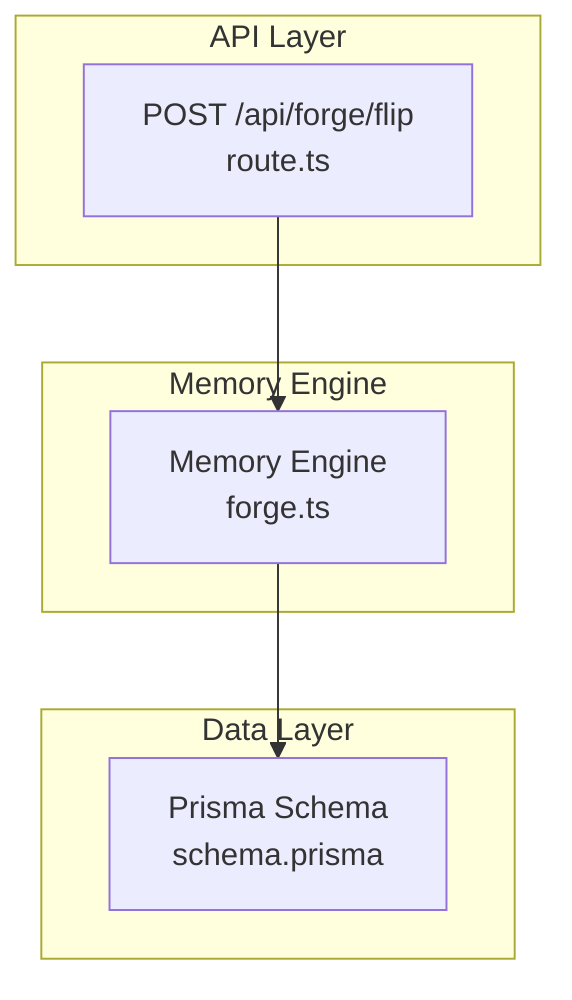
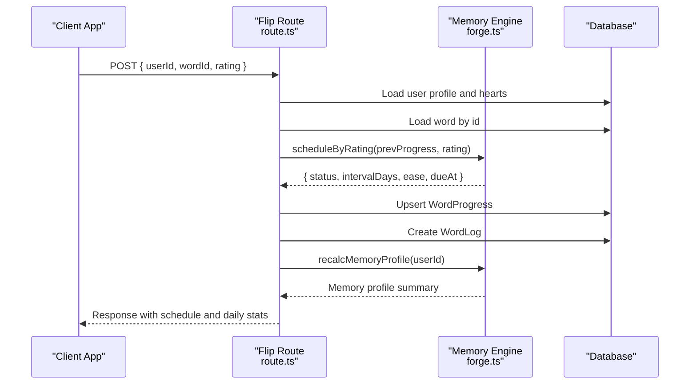
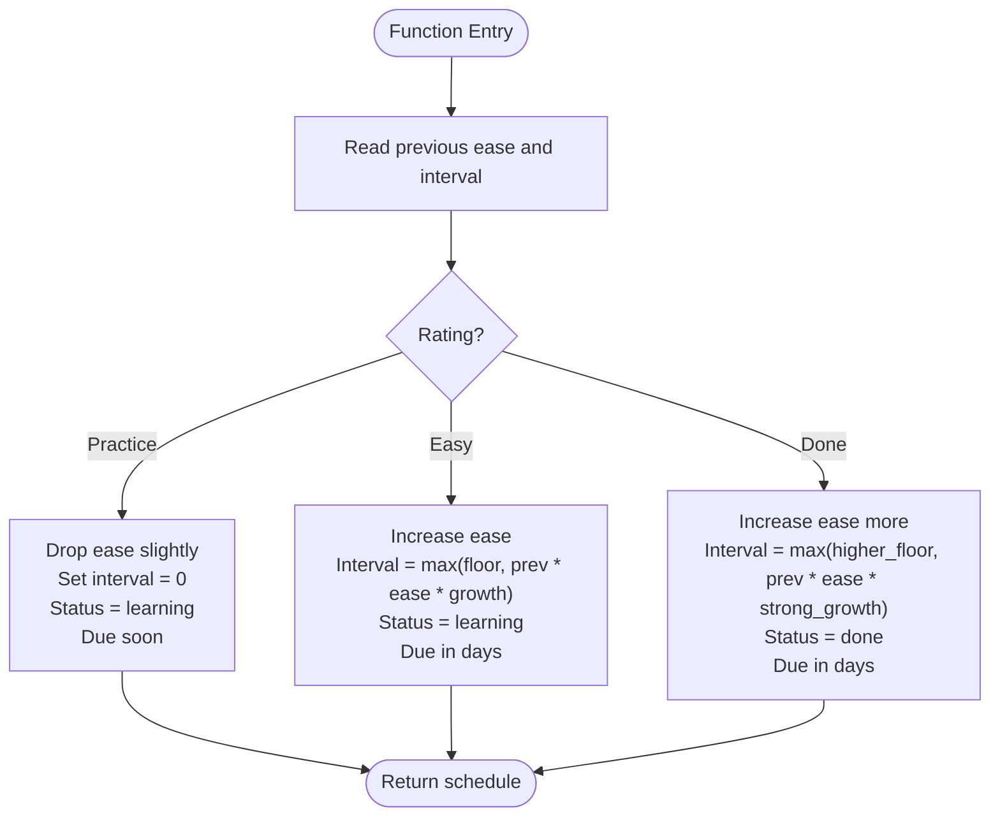
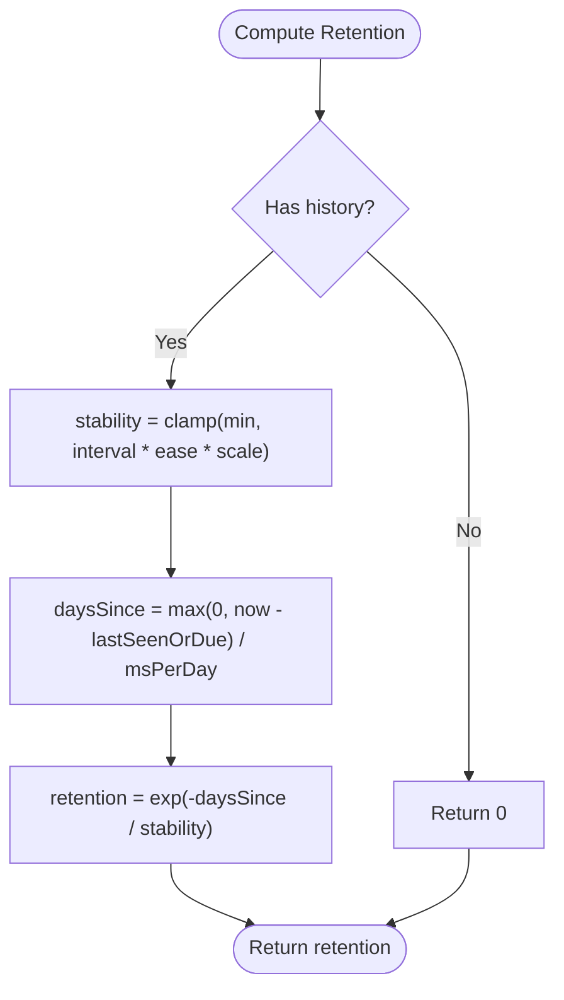
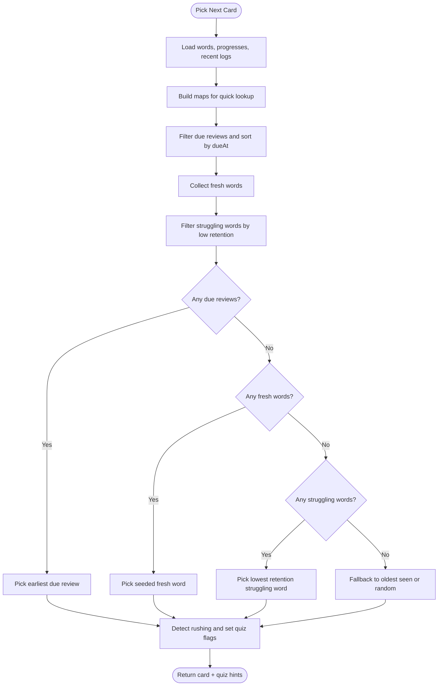
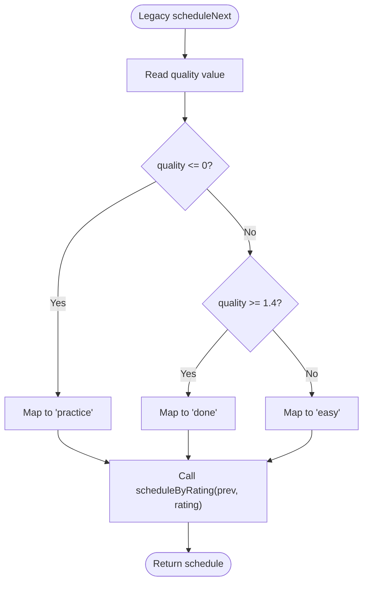
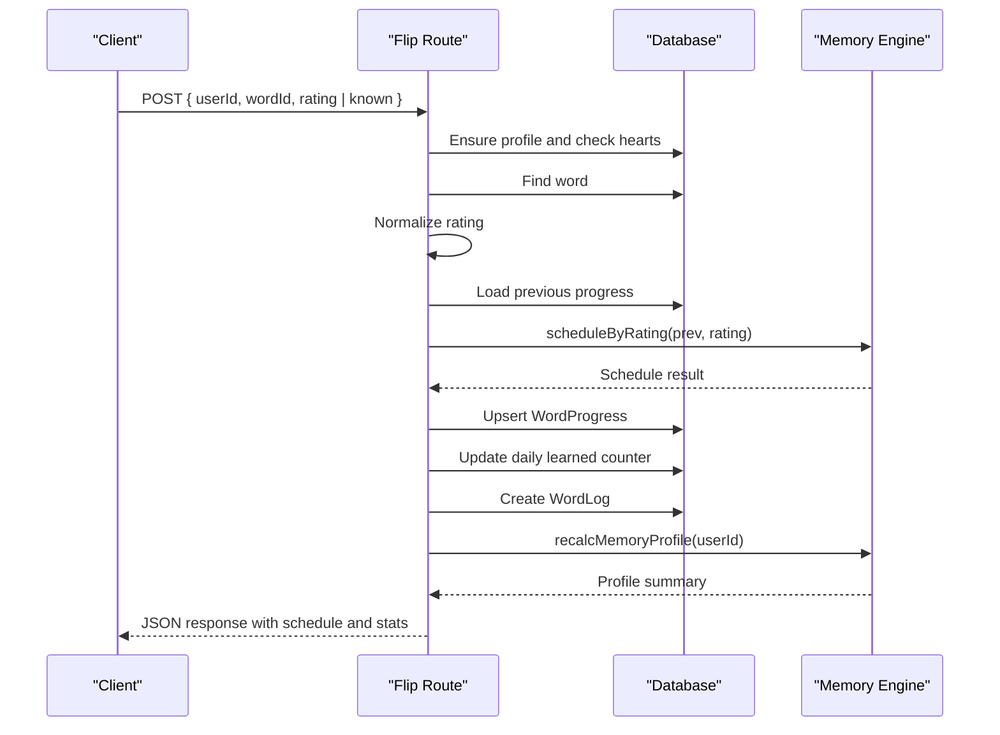
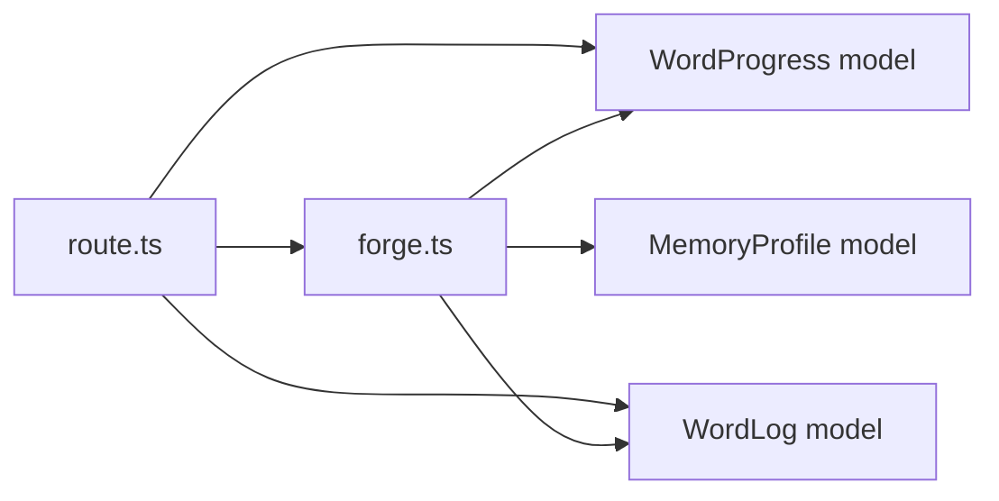

# Spaced Repetition Scheduling

<cite>
**Referenced Files in This Document**
- [forge.ts](file://src/lib/forge.ts)
- [route.ts](file://src/app/api/forge/flip/route.ts)
- [schema.prisma](file://prisma/schema.prisma)
</cite>

## Table of Contents
1. [Introduction](#introduction)
2. [Project Structure](#project-structure)
3. [Core Components](#core-components)
4. [Architecture Overview](#architecture-overview)
5. [Detailed Component Analysis](#detailed-component-analysis)
6. [Dependency Analysis](#dependency-analysis)
7. [Performance Considerations](#performance-considerations)
8. [Troubleshooting Guide](#troubleshooting-guide)
9. [Conclusion](#conclusion)

## Introduction
This document explains the spaced repetition scheduling system used by the application. It focuses on the SM-2/FSRS-derived algorithm implemented for card scheduling, including the `scheduleByRating` function that handles practice, easy, and done ratings. It also documents how intervals are calculated using ease factors and previous performance, the exponential decay retention model that influences review timing, example scheduling calculations for different user scenarios, and backwards compatibility with legacy quality-based scheduling.

The implementation is server-side only and integrates with a Next.js API route to persist schedule updates and analytics.

## Project Structure
The spaced repetition logic lives in a dedicated memory engine module and is consumed by an API endpoint that processes user interactions during flashcard sessions.

**Diagram sources**
- [route.ts:1-119](file://src/app/api/forge/flip/route.ts#L1-L119)
- [forge.ts:1-84](file://src/lib/forge.ts#L1-L84)
- [schema.prisma:526-546](file://prisma/schema.prisma#L526-L546)

**Section sources**
- [route.ts:1-119](file://src/app/api/forge/flip/route.ts#L1-L119)
- [forge.ts:1-84](file://src/lib/forge.ts#L1-L84)
- [schema.prisma:526-546](file://prisma/schema.prisma#L526-L546)

## Core Components
- Memory engine module provides:
  - The core scheduling function `scheduleByRating`.
  - A legacy compatibility wrapper `scheduleNext`.
  - An exponential decay retention model used for review prioritization and analytics.
- API route handles:
  - Input normalization (including legacy fields).
  - Schedule computation via `scheduleByRating`.
  - Persistence of progress and logging.
  - Daily counters and memory profile recalculation.

Key responsibilities:
- `scheduleByRating`: Computes next status, interval, ease, and due date based on rating.
- `wordRetention`: Estimates recall probability using exponential decay over time since last seen or due date.
- `pickNextCard`: Uses retention and due dates to select cards for review, new learning, or struggling items.
- `recalcMemoryProfile`: Aggregates logs and progress into SWOT insights and overall metrics.

**Section sources**
- [forge.ts:39-84](file://src/lib/forge.ts#L39-L84)
- [forge.ts:86-94](file://src/lib/forge.ts#L86-L94)
- [forge.ts:96-188](file://src/lib/forge.ts#L96-L188)
- [forge.ts:190-368](file://src/lib/forge.ts#L190-L368)
- [route.ts:21-118](file://src/app/api/forge/flip/route.ts#L21-L118)

## Architecture Overview
The scheduling flow begins at the API route when a user flips a card and selects a rating. The route normalizes input, computes the schedule, persists progress, logs the event, and recalculates the memory profile.

**Diagram sources**
- [route.ts:21-118](file://src/app/api/forge/flip/route.ts#L21-L118)
- [forge.ts:39-84](file://src/lib/forge.ts#L39-L84)
- [forge.ts:190-368](file://src/lib/forge.ts#L190-L368)

## Detailed Component Analysis

### Scheduling Algorithm: `scheduleByRating`
`scheduleByRating` implements an SM-2/FSRS-derived approach with three explicit ratings:
- Practice: Indicates struggle; resets interval and slightly reduces ease.
- Easy: Indicates confidence; increases ease and schedules a solid interval.
- Done: Indicates mastery; significantly increases ease and sets a long interval.

Inputs:
- Previous progress row containing current ease and interval.
- Rating string: "practice", "easy", or "done".

Outputs:
- New status ("new", "learning", or "done").
- Interval in days.
- Updated ease factor.
- Due date computed from current time plus interval.

Behavior highlights:
- Ease bounds:
  - Minimum ease floor enforced after reductions.
  - Maximum ease cap applied after increases.
- Interval progression:
  - For "easy": uses previous interval multiplied by ease and a growth multiplier, with a minimum floor.
  - For "done": uses a stronger growth multiplier and a higher minimum interval.
  - For "practice": resets interval to zero and schedules a short retry window.

**Diagram sources**
- [forge.ts:39-72](file://src/lib/forge.ts#L39-L72)

**Section sources**
- [forge.ts:39-72](file://src/lib/forge.ts#L39-L72)

### Exponential Decay Retention Model
The retention model estimates the probability of recalling a term based on elapsed time and stability. Stability is derived from the product of interval and ease, scaled by a constant. The model uses exponential decay:

- Stability formula concept: proportional to interval × ease × scaling factor.
- Days since last interaction: difference between current time and last seen or due date.
- Retention: exponential decay function of daysSince divided by stability.

This model is used to:
- Prioritize struggling cards in card selection.
- Compute overall retention metrics.
- Identify weak terms for targeted review.

**Diagram sources**
- [forge.ts:86-94](file://src/lib/forge.ts#L86-L94)

**Section sources**
- [forge.ts:86-94](file://src/lib/forge.ts#L86-L94)

### Card Selection and Review Timing
The card selection logic considers:
- Due reviews sorted by due date.
- Fresh new words.
- Struggling words where retention is below a threshold but not yet due.
- Fallbacks to ensure a card is always presented if any words exist.

It also detects rapid pacing and adjusts quiz frequency and question count accordingly.

**Diagram sources**
- [forge.ts:96-188](file://src/lib/forge.ts#L96-L188)

**Section sources**
- [forge.ts:96-188](file://src/lib/forge.ts#L96-L188)

### Legacy Quality-Based Scheduling Compatibility
For backwards compatibility, the legacy `scheduleNext` function maps numeric quality values to the new rating scheme:
- Low quality maps to "practice".
- High quality maps to "done".
- Mid-range quality maps to "easy".

This allows older clients or integrations that still send a quality score to work seamlessly with the new rating-based scheduler.

**Diagram sources**
- [forge.ts:74-84](file://src/lib/forge.ts#L74-L84)

**Section sources**
- [forge.ts:74-84](file://src/lib/forge.ts#L74-L84)

### API Integration and Data Persistence
The flip API route:
- Validates inputs and enforces heart limits for learning.
- Normalizes rating from either explicit rating or legacy known flag.
- Loads previous progress and computes schedule via `scheduleByRating`.
- Persists progress changes and increments counters.
- Logs the interaction with detailed metadata.
- Recalculates the memory profile and returns comprehensive response data.

**Diagram sources**
- [route.ts:21-118](file://src/app/api/forge/flip/route.ts#L21-L118)
- [forge.ts:39-84](file://src/lib/forge.ts#L39-L84)
- [forge.ts:190-368](file://src/lib/forge.ts#L190-L368)

**Section sources**
- [route.ts:21-118](file://src/app/api/forge/flip/route.ts#L21-L118)

## Dependency Analysis
The scheduling system depends on:
- Database models for progress, logs, and profiles.
- Helper utilities for day keys and AI integration (not directly part of scheduling).
- Crossword engine for unrelated features.

**Diagram sources**
- [forge.ts:1-84](file://src/lib/forge.ts#L1-L84)
- [route.ts:1-119](file://src/app/api/forge/flip/route.ts#L1-L119)
- [schema.prisma:526-546](file://prisma/schema.prisma#L526-L546)
- [schema.prisma:549-567](file://prisma/schema.prisma#L549-L567)
- [schema.prisma:624-641](file://prisma/schema.prisma#L624-L641)

**Section sources**
- [forge.ts:1-84](file://src/lib/forge.ts#L1-L84)
- [route.ts:1-119](file://src/app/api/forge/flip/route.ts#L1-L119)
- [schema.prisma:526-546](file://prisma/schema.prisma#L526-L546)
- [schema.prisma:549-567](file://prisma/schema.prisma#L549-L567)
- [schema.prisma:624-641](file://prisma/schema.prisma#L624-L641)

## Performance Considerations
- Interval growth multipliers and caps prevent excessively fast forgetting curves while avoiding overly aggressive spacing.
- Exponential decay retention ensures that cards with lower stability are reviewed sooner.
- Card selection prioritizes due reviews and struggling items to maintain balanced learning load.
- Logging and profile recalculation occur per interaction; consider batching or throttling if high-frequency usage is expected.

[No sources needed since this section provides general guidance]

## Troubleshooting Guide
Common issues and resolutions:
- Learning blocked due to zero hearts:
  - The API enforces a minimum heart requirement for learning. Users must solve crosswords to refill hearts before continuing to learn new cards.
- Unexpected scheduling behavior:
  - Verify the rating field is correctly normalized from legacy known flags.
  - Confirm previous progress exists and contains valid ease and interval values.
- Stagnant retention metrics:
  - Check whether struggling cards are being selected and reviewed frequently enough.
  - Validate that logs include correct rating kinds and timeTakenSec values.

**Section sources**
- [route.ts:29-34](file://src/app/api/forge/flip/route.ts#L29-L34)
- [route.ts:39-47](file://src/app/api/forge/flip/route.ts#L39-L47)
- [forge.ts:86-94](file://src/lib/forge.ts#L86-L94)

## Conclusion
The spaced repetition scheduling system combines an SM-2/FSRS-inspired algorithm with practical constraints tailored to the application’s learning flow. The `scheduleByRating` function manages three explicit ratings to adjust ease and intervals dynamically. The exponential decay retention model informs both card selection and analytics, ensuring timely reviews for fading knowledge. Backwards compatibility through `scheduleNext` maintains support for legacy quality-based inputs. Together, these components provide a robust, extensible foundation for adaptive learning and long-term retention.

[No sources needed since this section summarizes without analyzing specific files]