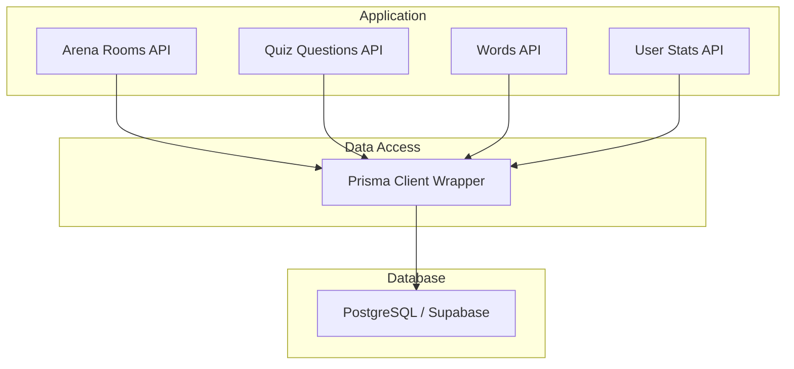
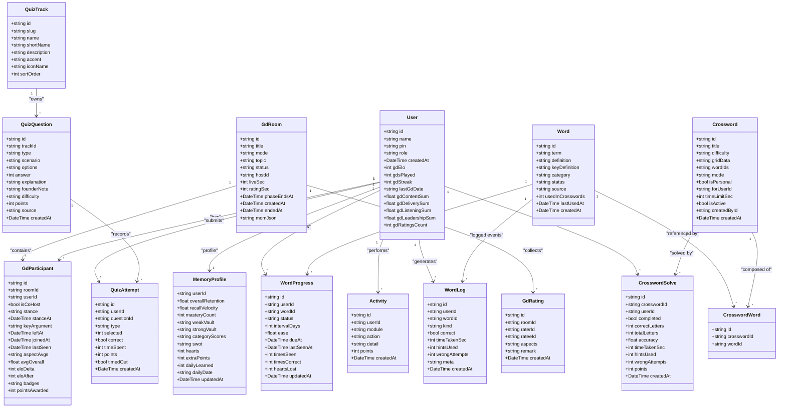
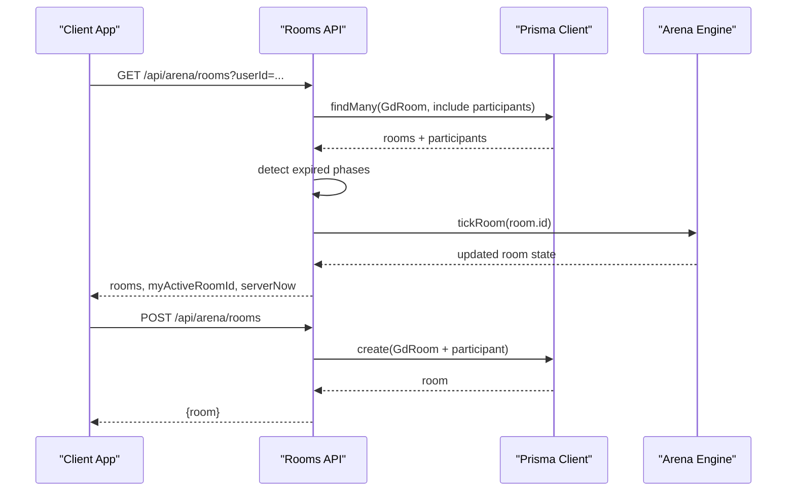
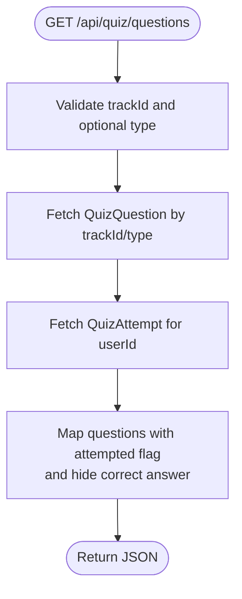
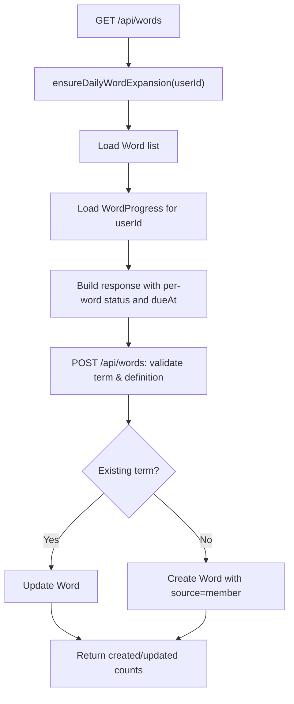
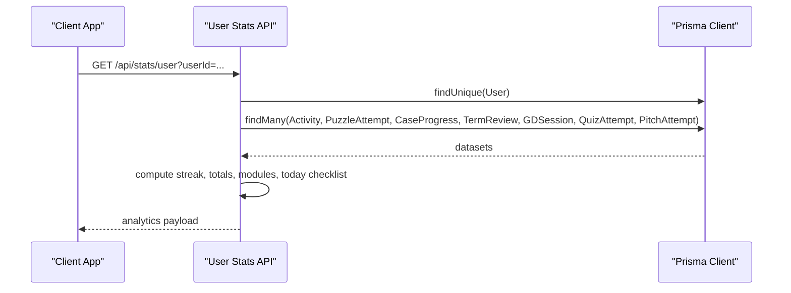
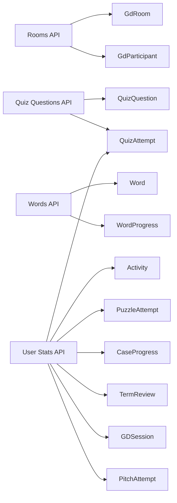
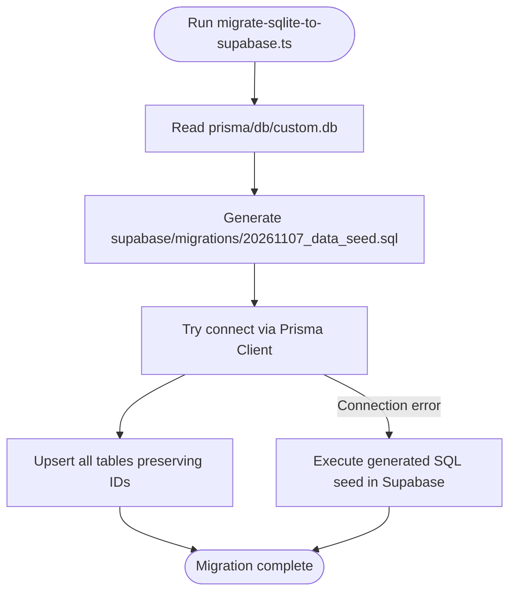

# Database Schema Design

<cite>
**Referenced Files in This Document**
- [schema.prisma](file://prisma/schema.prisma)
- [20261107_init_postgresql.sql](file://supabase/migrations/20261107_init_postgresql.sql)
- [migrate-sqlite-to-supabase.ts](file://scripts/migrate-sqlite-to-supabase.ts)
- [db.ts](file://src/lib/db.ts)
- [rooms/route.ts](file://src/app/api/arena/rooms/route.ts)
- [questions/route.ts](file://src/app/api/quiz/questions/route.ts)
- [words/route.ts](file://src/app/api/words/route.ts)
- [user/route.ts](file://src/app/api/stats/user/route.ts)
</cite>

## Table of Contents
1. [Introduction](#introduction)
2. [Project Structure](#project-structure)
3. [Core Components](#core-components)
4. [Architecture Overview](#architecture-overview)
5. [Detailed Component Analysis](#detailed-component-analysis)
6. [Dependency Analysis](#dependency-analysis)
7. [Performance Considerations](#performance-considerations)
8. [Troubleshooting Guide](#troubleshooting-guide)
9. [Conclusion](#conclusion)
10. [Appendices](#appendices)

## Introduction
This document describes WeLearn’s database schema and data model with a focus on users, arenas, quizzes, words, and activity logs. It explains entity relationships, field definitions, primary and foreign keys, constraints, indexing strategy, query patterns through Prisma, and the migration path from SQLite to PostgreSQL/Supabase. It also covers validation rules, referential integrity, lifecycle management, backup considerations, and performance guidance for large datasets.

## Project Structure
The database layer is defined centrally in Prisma and materialized as PostgreSQL migrations for Supabase. Application routes use a shared Prisma client instance to access the database.

**Diagram sources**
- [rooms/route.ts:1-115](file://src/app/api/arena/rooms/route.ts#L1-L115)
- [questions/route.ts:1-60](file://src/app/api/quiz/questions/route.ts#L1-L60)
- [words/route.ts:1-92](file://src/app/api/words/route.ts#L1-L92)
- [user/route.ts:1-102](file://src/app/api/stats/user/route.ts#L1-L102)
- [db.ts:1-50](file://src/lib/db.ts#L1-L50)

**Section sources**
- [schema.prisma:1-641](file://prisma/schema.prisma#L1-L641)
- [20261107_init_postgresql.sql:1-704](file://supabase/migrations/20261107_init_postgresql.sql#L1-L704)
- [db.ts:1-50](file://src/lib/db.ts#L1-L50)

## Core Components
WeLearn’s domain centers around five major areas:

- Users and identity
- Arena (GD/debate/pitch rooms, participants, ratings)
- Quizzes (tracks, questions, attempts, badges)
- Words and Crossword engine (SRS progress, logs, memory profile)
- Activity and analytics (activity log, stats aggregation)

Key entities and responsibilities:

- User: core identity, role, PIN hash, arena Elo counters, creation time.
- Puzzle and PuzzleAttempt: puzzle bank and per-user attempt history.
- CaseStudy and CaseProgress: case study catalog and per-user progress.
- Term and TermReview: business term glossary and user recognition state.
- QuizTrack, QuizQuestion, QuizAttempt, QuizBadge, QuizUserBadge: founder quiz system.
- PitchAttempt: pitch-pairing practice records.
- GDSession: asynchronous GD practice sessions.
- Activity: cross-module event log used for points and streaks.
- GdRoom, GdParticipant, GdRating: real-time arena session state and peer ratings.
- CaseVideo, VideoWatch, VideoQuizQuestion, VideoQuizAnswer: video learning loop.
- FounderCaseQuestion, FounderCaseAnswer, AnswerRating: founder Q&A with peer ratings.
- PptChallenge, PptUpload, PptRating: presentation challenge workflow.
- Word, WordProgress, WordLog, Crossword, CrosswordWord, CrosswordSolve, MemoryProfile: Crossforge SRS and crossword engine.

**Section sources**
- [schema.prisma:11-641](file://prisma/schema.prisma#L11-L641)

## Architecture Overview
The schema is authored in Prisma and mirrored by a PostgreSQL migration that ensures idempotent table creation, indexes, and safe foreign key constraints. The application uses a single Prisma client instance configured via environment variables, supporting both local development and Supabase production.

**Diagram sources**
- [schema.prisma:11-641](file://prisma/schema.prisma#L11-L641)

## Detailed Component Analysis

### Users and Identity
- Primary key: `id` (CUID string).
- Unique constraint: `name`.
- Role defaults to member; PIN stored as a SHA-256 hash string.
- Arena Elo fields track cumulative peer-rated content, delivery, listening, leadership metrics and counts.

Constraints and behavior:
- Cascade deletes propagate to related tables such as activities, attempts, and arena participation.
- Default timestamps ensure auditability.

**Section sources**
- [schema.prisma:11-48](file://prisma/schema.prisma#L11-L48)
- [20261107_init_postgresql.sql:8-40](file://supabase/migrations/20261107_init_postgresql.sql#L8-L40)

### Arena (GD Rooms, Participants, Ratings)
- GdRoom models a live or ended session with optional timers and server-authoritative deadlines.
- GdParticipant links a user to a room, tracks stance, join/left times, final averages, Elo deltas, and awarded badges.
- GdRating captures peer ratings per participant pair within a room.

Indexes:
- Room queries filter by status and creation time.
- Participant uniqueness prevents duplicate membership per room.
- Rating uniqueness prevents duplicate rater-ratee pairs per room.

API usage:
- GET lists active/recent rooms with participants and MVP info.
- POST creates a room and enqueues the creator as host/participant.

**Diagram sources**
- [rooms/route.ts:8-115](file://src/app/api/arena/rooms/route.ts#L8-L115)

**Section sources**
- [schema.prisma:247-342](file://prisma/schema.prisma#L247-L342)
- [20261107_init_postgresql.sql:255-308](file://supabase/migrations/20261107_init_postgresql.sql#L255-L308)
- [rooms/route.ts:8-115](file://src/app/api/arena/rooms/route.ts#L8-L115)

### Quizzes (Tracks, Questions, Attempts, Badges)
- QuizTrack organizes questions by domain.
- QuizQuestion stores scenarios, options, correct index, explanations, and metadata.
- QuizAttempt records per-user answers, correctness, timing, and points.
- QuizBadge defines achievement criteria; QuizUserBadge awards them to users.

Query pattern:
- Questions are returned without exposing the correct answer index.
- Attempt history is merged to show attempted status and last score.

**Diagram sources**
- [questions/route.ts:9-59](file://src/app/api/quiz/questions/route.ts#L9-L59)

**Section sources**
- [schema.prisma:137-216](file://prisma/schema.prisma#L137-L216)
- [20261107_init_postgresql.sql:125-199](file://supabase/migrations/20261107_init_postgresql.sql#L125-L199)
- [questions/route.ts:9-59](file://src/app/api/quiz/questions/route.ts#L9-L59)

### Words, Progress, Logs, and Crosswords
- Word is the canonical vocabulary store with category, source, and usage counters.
- WordProgress tracks per-user SRS state (status, interval, ease, due date, seen/correct counts).
- WordLog is an append-only event bus capturing flips, quiz outcomes, crossword interactions, and hints.
- Crossword stores generated grids and associated words; CrosswordSolve records per-user completion metrics.
- MemoryProfile aggregates retention, velocity, vaults, category scores, SWOT, hearts, and daily counters.

Validation and lifecycle:
- Word creation validates minimum lengths for term and definition.
- Daily expansion may add new words based on existing inventory.
- Progress and logs update after user interactions; solve records upsert per user per crossword.

**Diagram sources**
- [words/route.ts:6-92](file://src/app/api/words/route.ts#L6-L92)

**Section sources**
- [schema.prisma:506-641](file://prisma/schema.prisma#L506-L641)
- [20261107_init_postgresql.sql:431-548](file://supabase/migrations/20261107_init_postgresql.sql#L431-L548)
- [words/route.ts:6-92](file://src/app/api/words/route.ts#L6-L92)

### Activity Logs and User Analytics
- Activity records cross-module actions with points and timestamps.
- User stats aggregate activity, puzzle attempts, case progress, term reviews, GD sessions, quiz attempts, and pitch attempts.
- Streak computation and day-key normalization support YouTube-Studio-style dashboards.

**Diagram sources**
- [user/route.ts:5-102](file://src/app/api/stats/user/route.ts#L5-L102)

**Section sources**
- [schema.prisma:262-275](file://prisma/schema.prisma#L262-L275)
- [20261107_init_postgresql.sql:241-253](file://supabase/migrations/20261107_init_postgresql.sql#L241-L253)
- [user/route.ts:5-102](file://src/app/api/stats/user/route.ts#L5-L102)

## Dependency Analysis
The following diagram shows how API routes depend on Prisma models and how the database schema enforces relationships.

**Diagram sources**
- [rooms/route.ts:8-115](file://src/app/api/arena/rooms/route.ts#L8-L115)
- [questions/route.ts:9-59](file://src/app/api/quiz/questions/route.ts#L9-L59)
- [words/route.ts:6-92](file://src/app/api/words/route.ts#L6-L92)
- [user/route.ts:5-102](file://src/app/api/stats/user/route.ts#L5-L102)

**Section sources**
- [schema.prisma:11-641](file://prisma/schema.prisma#L11-L641)

## Performance Considerations
Indexing strategy:
- Composite indexes on frequently filtered columns:
  - PuzzleAttempt(userId, createdAt), PuzzleAttempt(puzzleId)
  - QuizQuestion(trackId, type), QuizQuestion(type)
  - QuizAttempt(userId, createdAt), QuizAttempt(questionId)
  - WordProgress(userId, dueAt), WordProgress(userId, status)
  - WordLog(userId, createdAt), WordLog(userId, kind), WordLog(wordId)
  - Crossword(isActive, createdAt)
  - CrosswordSolve(userId, createdAt)
  - Activity(userId, createdAt), Activity(createdAt)
  - GdRoom(status, createdAt)
  - GdParticipant(roomId, userId), GdParticipant(userId)
  - GdRating(roomId)
  - VideoQuizQuestion(videoId)
  - VideoWatch(userId, videoId)
  - VideoQuizAnswer(questionId, userId), VideoQuizAnswer(userId)
  - Word(category)
  - Word(term unique)

Query optimization patterns:
- Use selective includes and projections to reduce payload size.
- Prefer filtering by indexed columns (userId, createdAt, status, trackId, type).
- Avoid N+1 queries by batching where possible; current routes already batch reads using Prisma relations.
- For high-cardinality lookups (e.g., leaderboard, analytics), consider materialized views or pre-aggregated tables if read latency becomes critical.

Large dataset considerations:
- Partitioning by time (createdAt) for append-heavy tables like WordLog, Activity, and QuizAttempt can improve maintenance and query performance.
- Archive old solved crosswords and completed rooms periodically.
- Monitor index bloat and run periodic VACUUM/ANALYZE on PostgreSQL.

[No sources needed since this section provides general guidance]

## Troubleshooting Guide
Common issues and resolutions:

- Missing database connection:
  - Ensure DATABASE_URL or Supabase-provided URLs resolve to PostgreSQL.
  - The wrapper normalizes environment variables and sets DATABASE_URL for Prisma.

- Migration failures:
  - The PostgreSQL migration script is idempotent and adds missing columns and indexes safely.
  - Foreign keys are added with exception blocks to avoid duplicate-object errors.

- Data mismatch between SQLite and Supabase:
  - The migration script generates a standalone SQL seed file and optionally runs live upserts via Prisma.
  - If direct network access fails, execute the generated SQL seed file in the Supabase SQL Editor.

- Validation errors:
  - Words require minimum lengths for term and definition.
  - Arena room creation requires a valid userId and a title of at least three characters.

- Referential integrity:
  - All child tables define cascade delete on parent removal.
  - Unique constraints prevent duplicate memberships, ratings, and attempts.

**Section sources**
- [db.ts:7-40](file://src/lib/db.ts#L7-L40)
- [20261107_init_postgresql.sql:550-704](file://supabase/migrations/20261107_init_postgresql.sql#L550-L704)
- [migrate-sqlite-to-supabase.ts:36-563](file://scripts/migrate-sqlite-to-supabase.ts#L36-L563)
- [words/route.ts:42-92](file://src/app/api/words/route.ts#L42-L92)
- [rooms/route.ts:83-115](file://src/app/api/arena/rooms/route.ts#L83-L115)

## Conclusion
WeLearn’s database schema is designed for clarity, scalability, and operational safety. Prisma defines the canonical model, while a PostgreSQL migration ensures idempotent deployment on Supabase. The schema emphasizes strong referential integrity, thoughtful indexing, and clear separation of concerns across domains: arena sessions, quizzes, vocabulary/SRS, and activity analytics. The migration toolchain preserves IDs and relationships, supports resumable operations, and produces standalone SQL seeds for robust deployments. With careful indexing, batching, and periodic archival, the system can scale to large datasets while maintaining responsive APIs.

[No sources needed since this section summarizes without analyzing specific files]

## Appendices

### Migration Strategy: SQLite to PostgreSQL/Supabase
- The migration script reads from a local SQLite database and writes idempotent INSERT statements to a SQL seed file.
- It converts timestamps to ISO strings, coerces SQLite booleans to native Postgres booleans, and preserves original CUID IDs.
- It performs topological inserts (parents before children) and verifies record counts.
- It optionally connects to Supabase via Prisma and upserts all tables, falling back to the generated SQL seed if direct connection is unavailable.

**Diagram sources**
- [migrate-sqlite-to-supabase.ts:36-563](file://scripts/migrate-sqlite-to-supabase.ts#L36-L563)

**Section sources**
- [migrate-sqlite-to-supabase.ts:1-563](file://scripts/migrate-sqlite-to-supabase.ts#L1-L563)

### Data Validation Rules and Business Constraints
- User:
  - name must be unique.
  - role defaults to member.
  - PIN is a hashed string.
- Arena:
  - Room modes limited to gd, debate, pitch.
  - Timers are non-negative and bounded by API logic.
  - Participant uniqueness per room.
  - Rating uniqueness per rater-ratee-room triple.
- Quizzes:
  - Question types restricted to scenario, red_flag, micro_math, pitch_pairing.
  - Correct answer index is not exposed to clients; grading occurs server-side.
- Words:
  - term and definition have minimum length requirements.
  - Category defaults to general and is normalized to lowercase.
  - Source defaults vary by context (curated, ai, member).
- Activity:
  - Module values are constrained by UI/API expectations (puzzles, cases, gd, terms, quiz, etc.).

**Section sources**
- [schema.prisma:11-641](file://prisma/schema.prisma#L11-L641)
- [rooms/route.ts:83-115](file://src/app/api/arena/rooms/route.ts#L83-L115)
- [questions/route.ts:9-59](file://src/app/api/quiz/questions/route.ts#L9-L59)
- [words/route.ts:42-92](file://src/app/api/words/route.ts#L42-L92)

### Data Lifecycle Management and Backup Strategies
- Lifecycle:
  - Arena rooms transition through lobby → live → rating → ended, with server-enforced deadlines.
  - WordProgress evolves through SRS intervals; WordLog captures every interaction.
  - CrosswordSolve upserts per user per crossword to maintain one latest result.
- Backups:
  - Use Supabase-native backups and point-in-time recovery.
  - Export SQL dumps from the generated seed file for versioned snapshots.
  - Periodically archive historical logs (WordLog, Activity, QuizAttempt) to cold storage.

[No sources needed since this section provides general guidance]