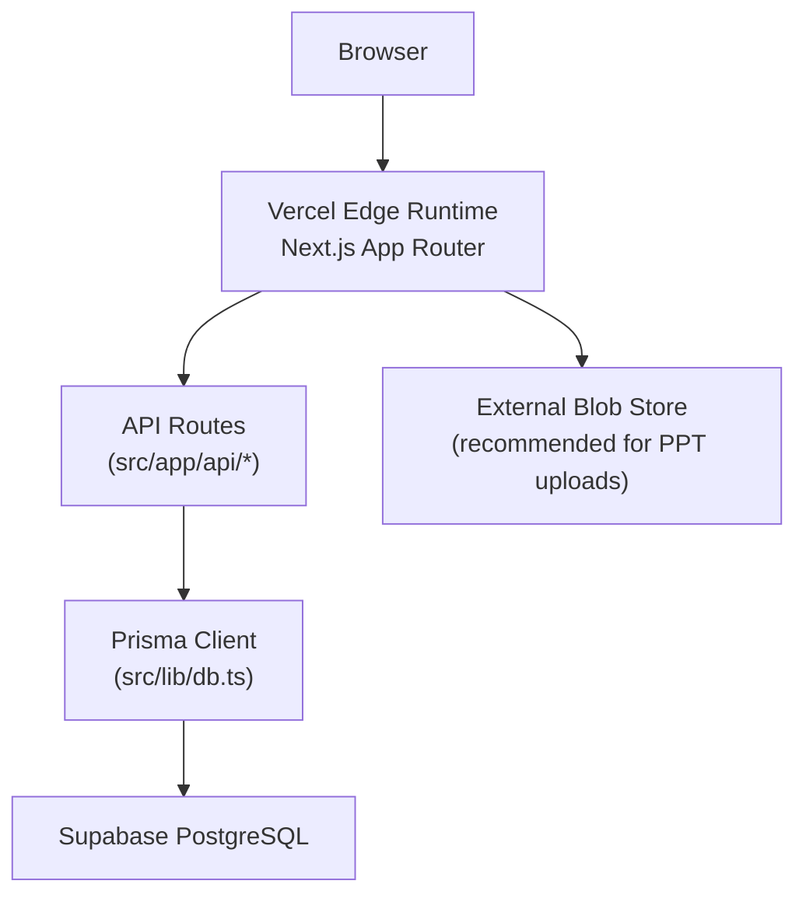
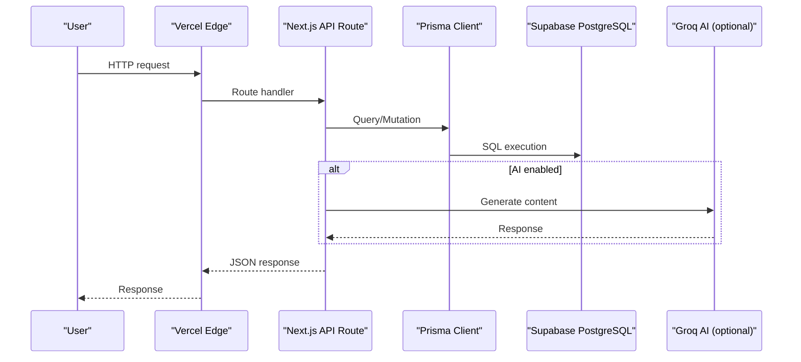
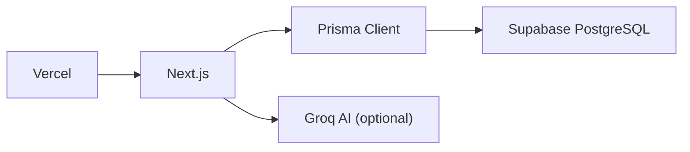

# Deployment & DevOps

<cite>
**Referenced Files in This Document**
- [README.md](file://README.md)
- [vercel.json](file://vercel.json)
- [next.config.ts](file://next.config.ts)
- [package.json](file://package.json)
- [.vercelignore](file:.vercelignore)
- [supabase/config.toml](file://supabase/config.toml)
- [prisma/schema.prisma](file://prisma/schema.prisma)
- [src/lib/db.ts](file://src/lib/db.ts)
- [scripts/migrate-sqlite-to-supabase.ts](file://scripts/migrate-sqlite-to-supabase.ts)
- [src/app/api/ai/generate/route.ts](file://src/app/api/ai/generate/route.ts)
- [src/lib/ai.ts](file://src/lib/ai.ts)
</cite>

## Table of Contents
1. [Introduction](#introduction)
2. [Project Structure](#project-structure)
3. [Core Components](#core-components)
4. [Architecture Overview](#architecture-overview)
5. [Detailed Component Analysis](#detailed-component-analysis)
6. [Dependency Analysis](#dependency-analysis)
7. [Performance Considerations](#performance-considerations)
8. [Troubleshooting Guide](#troubleshooting-guide)
9. [Conclusion](#conclusion)
10. [Appendices](#appendices)

## Introduction
This document provides deployment and DevOps guidance for WeLearn, a Next.js application that uses Prisma with PostgreSQL (Supabase). It covers Vercel deployment configuration, environment variables, build optimization, database setup and connection pooling, CI/CD and automation, monitoring/logging/error tracking, performance and caching strategies, scaling considerations, backup and disaster recovery, maintenance tasks, security best practices, environment isolation, and production hardening.

## Project Structure
WeLearn is a Next.js 16 app with TypeScript, Tailwind, shadcn/ui, Prisma, and Supabase as the managed Postgres provider. The repository includes:
- Application code under src/app (Next.js App Router API routes), src/components, src/lib
- Database schema and migrations under prisma and supabase
- Build and deployment configuration at vercel.json, next.config.ts, package.json
- Local Supabase tooling configuration under supabase/config.toml
- Data migration utilities under scripts

**Diagram sources**
- [vercel.json:1-6](file://vercel.json#L1-L6)
- [next.config.ts:1-14](file://next.config.ts#L1-L14)
- [src/lib/db.ts:1-50](file://src/lib/db.ts#L1-L50)
- [prisma/schema.prisma:5-9](file://prisma/schema.prisma#L5-L9)

**Section sources**
- [README.md:1-104](file://README.md#L1-L104)
- [vercel.json:1-6](file://vercel.json#L1-L6)
- [next.config.ts:1-14](file://next.config.ts#L1-L14)
- [package.json:1-96](file://package.json#L1-L96)

## Core Components
- Vercel deployment configuration: build command, framework, install command, region targeting
- Environment variables: DATABASE_URL, GROQ_API_KEY, TEAM_PIN
- Database layer: Prisma client initialization with URL resolution and logging
- Supabase local config: ports, pooler, auth, storage, realtime
- Migration utilities: SQLite to Supabase data migration script

Key responsibilities:
- Build pipeline ensures Prisma client generation before Next.js build
- Database URL resolution supports multiple env var names for robustness
- Supabase config exposes local development services and optional pooler
- Migration script generates idempotent SQL seed and can run live upserts

**Section sources**
- [vercel.json:1-6](file://vercel.json#L1-L6)
- [package.json:5-14](file://package.json#L5-L14)
- [src/lib/db.ts:1-50](file://src/lib/db.ts#L1-L50)
- [supabase/config.toml:32-56](file://supabase/config.toml#L32-L56)
- [scripts/migrate-sqlite-to-supabase.ts:1-563](file://scripts/migrate-sqlite-to-supabase.ts#L1-L563)

## Architecture Overview
The runtime architecture connects the browser to Next.js serverless functions on Vercel, which call Prisma against Supabase PostgreSQL. AI features optionally call Groq when configured.

**Diagram sources**
- [src/app/api/ai/generate/route.ts:45-175](file://src/app/api/ai/generate/route.ts#L45-L175)
- [src/lib/ai.ts:1-30](file://src/lib/ai.ts#L1-L30)
- [src/lib/db.ts:1-50](file://src/lib/db.ts#L1-L50)
- [prisma/schema.prisma:5-9](file://prisma/schema.prisma#L5-L9)

## Detailed Component Analysis

### Vercel Deployment Configuration
- Build command runs Prisma generate then Next build
- Framework set to Next.js
- Install command uses npm
- Region targeting set to bom1 (India)

Recommendations:
- Keep postinstall generating Prisma client
- Ensure .env variables are configured in Vercel project settings
- For file uploads, use external blob storage instead of writing to public/uploads/ppts

**Section sources**
- [vercel.json:1-6](file://vercel.json#L1-L6)
- [package.json:5-14](file://package.json#L5-L14)
- [README.md:51-61](file://README.md#L51-L61)

### Environment Variable Management
Required variables:
- DATABASE_URL: Supabase Postgres connection string; append pgbouncer query params for serverless
- GROQ_API_KEY: Optional key enabling AI generation; otherwise fallback to curated banks
- TEAM_PIN: Optional team PIN for shared content operations

Environment variable handling:
- Database URL resolution prioritizes DATABASE_URL, then POSTGRES_PRISMA_URL, POSTGRES_URL, POSTGRES_URL_NON_POOLING
- AI feature checks presence of GROQ_API_KEY and falls back gracefully

Best practices:
- Never commit secrets; configure in Vercel dashboard
- Use separate DATABASE_URL values per environment (preview vs production)
- Pin model versions or lock dependencies to avoid drift

**Section sources**
- [README.md:22-32](file://README.md#L22-L32)
- [README.md:51-61](file://README.md#L51-L61)
- [src/lib/db.ts:7-40](file://src/lib/db.ts#L7-L40)
- [src/lib/ai.ts:1-30](file://src/lib/ai.ts#L1-L30)
- [src/app/api/ai/generate/route.ts:45-175](file://src/app/api/ai/generate/route.ts#L45-L175)

### Build Optimization Settings
- Next.js build is invoked after Prisma generate
- TypeScript build errors ignored in config (useful for rapid iteration; consider tightening in production)
- React Strict Mode disabled in config

Optimization tips:
- Enable Next.js image optimization and static asset optimization
- Prefer edge-compatible libraries where possible
- Avoid heavy native modules in serverless functions
- Use incremental static regeneration for static pages if applicable

**Section sources**
- [vercel.json:1-6](file://vercel.json#L1-L6)
- [next.config.ts:1-14](file://next.config.ts#L1-L14)
- [package.json:5-14](file://package.json#L5-L14)

### Supabase Database Setup and Connection Pooling
- Schema defined in Prisma; provider set to PostgreSQL
- Local Supabase config defines ports, pooler, auth, storage, realtime
- For Vercel serverless + Supabase, append pgbouncer=true and connection_limit=1 to DATABASE_URL

Connection pooling:
- Local pooler is disabled by default; enable in local dev if needed
- Production should rely on Supabase-managed pooler via pgbouncer parameters

Migration strategy:
- Use prisma db push for schema changes
- Use provided migration script to move data from local SQLite to Supabase
- Generated idempotent SQL seed under supabase/migrations

**Section sources**
- [prisma/schema.prisma:5-9](file://prisma/schema.prisma#L5-L9)
- [supabase/config.toml:32-56](file://supabase/config.toml#L32-L56)
- [README.md:34-49](file://README.md#L34-L49)
- [README.md:58-61](file://README.md#L58-L61)
- [scripts/migrate-sqlite-to-supabase.ts:1-563](file://scripts/migrate-sqlite-to-supabase.ts#L1-L563)

### CI/CD Pipeline and Automation
Recommended pipeline stages:
- Install dependencies
- Lint and type-check
- Prisma generate
- Build Next.js
- Run unit/integration tests
- Deploy to Vercel

Automation hooks:
- postinstall runs prisma generate
- Scripts available for seeding and migrations

CI recommendations:
- Cache node_modules and Prisma engine binaries
- Run prisma migrate/status to validate schema drift
- Fail fast on lint/type/build errors
- Use preview deployments for pull requests

**Section sources**
- [package.json:5-14](file://package.json#L5-L14)
- [README.md:11-18](file://README.md#L11-L18)

### Automated Testing Strategies
- Add unit tests for API route handlers and business logic
- Add integration tests for Prisma queries against a test Postgres instance
- Add E2E tests for critical user flows (auth, arena rooms, quiz submission)
- Use test fixtures seeded via Prisma or generated SQL

Testing tips:
- Isolate test databases per branch
- Mock external services like Groq during tests
- Record and replay network calls for deterministic tests

[No sources needed since this section provides general guidance]

### Monitoring, Logging, and Error Tracking
- Prisma logs queries in non-production environments
- Centralize logs using a log aggregation service (e.g., Vercel Logs, Datadog, Sentry)
- Track error rates, latency percentiles, and database connection metrics
- Instrument API routes with structured logging and correlation IDs

Operational suggestions:
- Set up health check endpoints
- Alert on high error rates and slow queries
- Capture failed AI generation attempts and fallback behavior

**Section sources**
- [src/lib/db.ts:42-49](file://src/lib/db.ts#L42-L49)
- [src/app/api/ai/generate/route.ts:45-175](file://src/app/api/ai/generate/route.ts#L45-L175)

### Performance Optimization and Caching
- Use Supabase connection pooling via pgbouncer parameters in DATABASE_URL
- Cache read-heavy data at the edge or with CDN where appropriate
- Minimize serverless cold starts by keeping dependencies lean
- Avoid large payloads; paginate responses
- Offload file uploads to object storage (Supabase Storage or Vercel Blob)

Caching strategies:
- Static assets via Next.js and Vercel CDN
- API responses cached with cache-control headers where safe
- Database-level indexes already present for frequent queries

Scaling considerations:
- Scale horizontally with Vercel’s serverless platform
- Tune Supabase plan and connection limits based on concurrency
- Monitor CPU/memory usage and adjust regions or instances as needed

**Section sources**
- [README.md:58-61](file://README.md#L58-L61)
- [prisma/schema.prisma:506-641](file://prisma/schema.prisma#L506-L641)

### Backup Procedures, Disaster Recovery, and Maintenance
Backups:
- Enable automated backups in Supabase
- Export snapshots periodically and store securely
- Validate restore procedures regularly

Disaster recovery:
- Define RPO/RTO targets
- Maintain runbooks for common failures (DB connectivity, AI provider outages)
- Test failover and rollback processes

Maintenance tasks:
- Rotate secrets and tokens regularly
- Update dependencies and review vulnerabilities
- Review Prisma schema drift and apply migrations
- Clean up unused tables/indexes and archive old data

**Section sources**
- [supabase/config.toml:32-56](file://supabase/config.toml#L32-L56)
- [scripts/migrate-sqlite-to-supabase.ts:1-563](file://scripts/migrate-sqlite-to-supabase.ts#L1-L563)

### Security Best Practices, Environment Isolation, and Production Hardening
Security:
- Restrict DATABASE_URL access; never commit secrets
- Use least-privilege roles in Supabase
- Validate and sanitize all inputs in API routes
- Enforce HTTPS and secure cookies

Environment isolation:
- Separate projects for dev, staging, production
- Use different DATABASE_URL values per environment
- Limit exposed APIs and restrict origins

Production hardening:
- Tighten Next.js build error handling
- Disable debug logging in production
- Configure rate limiting and bot protection at the edge
- Audit third-party dependencies and remove unused ones

**Section sources**
- [README.md:51-61](file://README.md#L51-L61)
- [next.config.ts:1-14](file://next.config.ts#L1-L14)
- [src/lib/db.ts:1-50](file://src/lib/db.ts#L1-L50)

## Dependency Analysis
High-level dependency relationships:
- Vercel orchestrates builds and deploys Next.js
- Next.js API routes depend on Prisma client
- Prisma client depends on Supabase PostgreSQL
- AI features optionally depend on Groq

**Diagram sources**
- [vercel.json:1-6](file://vercel.json#L1-L6)
- [src/lib/db.ts:1-50](file://src/lib/db.ts#L1-L50)
- [src/app/api/ai/generate/route.ts:45-175](file://src/app/api/ai/generate/route.ts#L45-L175)

**Section sources**
- [vercel.json:1-6](file://vercel.json#L1-L6)
- [src/lib/db.ts:1-50](file://src/lib/db.ts#L1-L50)
- [src/app/api/ai/generate/route.ts:45-175](file://src/app/api/ai/generate/route.ts#L45-L175)

## Performance Considerations
- Prefer edge runtime for lightweight operations
- Use connection pooling via pgbouncer for serverless workloads
- Reduce payload sizes and leverage pagination
- Cache immutable assets and stable API responses
- Monitor database query performance and add indexes as needed

[No sources needed since this section provides general guidance]

## Troubleshooting Guide
Common issues and resolutions:
- Database connection failures: verify DATABASE_URL and pgbouncer parameters
- AI generation not working: ensure GROQ_API_KEY is set; fallback behavior returns curated content
- File upload errors on Vercel: write to external blob storage instead of public/uploads/ppts
- Build failures: confirm postinstall runs prisma generate and dependencies are installed

Diagnostic steps:
- Check Vercel build logs and environment variables
- Inspect Prisma query logs in non-production
- Validate Supabase connection and permissions
- Run migration script locally to generate idempotent SQL seed

**Section sources**
- [src/lib/db.ts:7-40](file://src/lib/db.ts#L7-L40)
- [src/app/api/ai/generate/route.ts:45-175](file://src/app/api/ai/generate/route.ts#L45-L175)
- [README.md:51-61](file://README.md#L51-L61)
- [scripts/migrate-sqlite-to-supabase.ts:1-563](file://scripts/migrate-sqlite-to-supabase.ts#L1-L563)

## Conclusion
WeLearn’s deployment stack centers on Vercel for hosting Next.js and Supabase for managed Postgres. Proper environment configuration, connection pooling, and migration practices ensure reliable operation. Adopting CI/CD, testing, monitoring, and security hardening will improve stability and scalability. Externalizing file storage and leveraging caching further optimizes performance for production.

[No sources needed since this section summarizes without analyzing specific files]

## Appendices

### Environment Variables Reference
- DATABASE_URL: Supabase Postgres connection string; include pgbouncer parameters for serverless
- GROQ_API_KEY: Enables AI generation; optional
- TEAM_PIN: Team PIN for shared content operations; optional

**Section sources**
- [README.md:22-32](file://README.md#L22-L32)
- [README.md:51-61](file://README.md#L51-L61)

### Build and Deployment Commands
- Install dependencies: npm install
- Generate Prisma client: prisma generate (via postinstall)
- Build: next build
- Start: next start

**Section sources**
- [package.json:5-14](file://package.json#L5-L14)
- [vercel.json:1-6](file://vercel.json#L1-L6)

### Supabase Local Development Ports
- API port: 54321
- Database port: 54322
- Studio port: 54323
- Realtime port: 54327
- Analytics port: 54327

**Section sources**
- [supabase/config.toml:7-13](file://supabase/config.toml#L7-L13)
- [supabase/config.toml:32-41](file://supabase/config.toml#L32-L41)
- [supabase/config.toml:95-102](file://supabase/config.toml#L95-L102)
- [supabase/config.toml:396-401](file://supabase/config.toml#L396-L401)