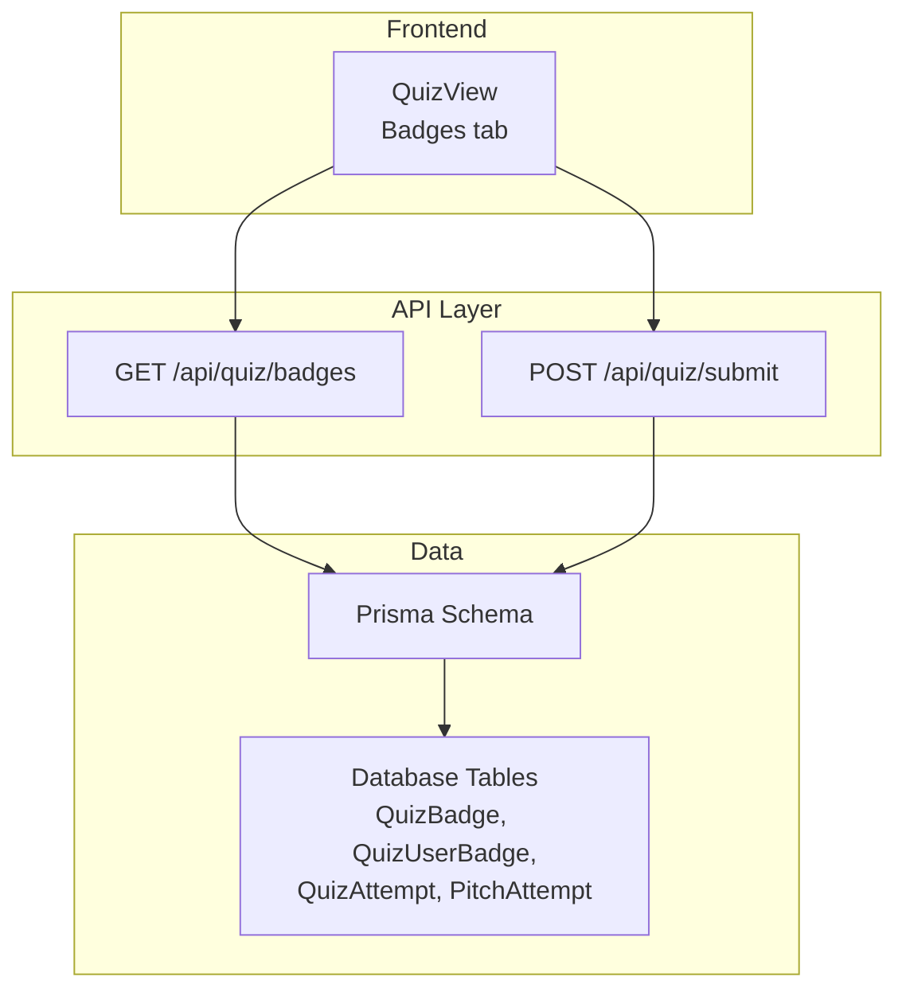
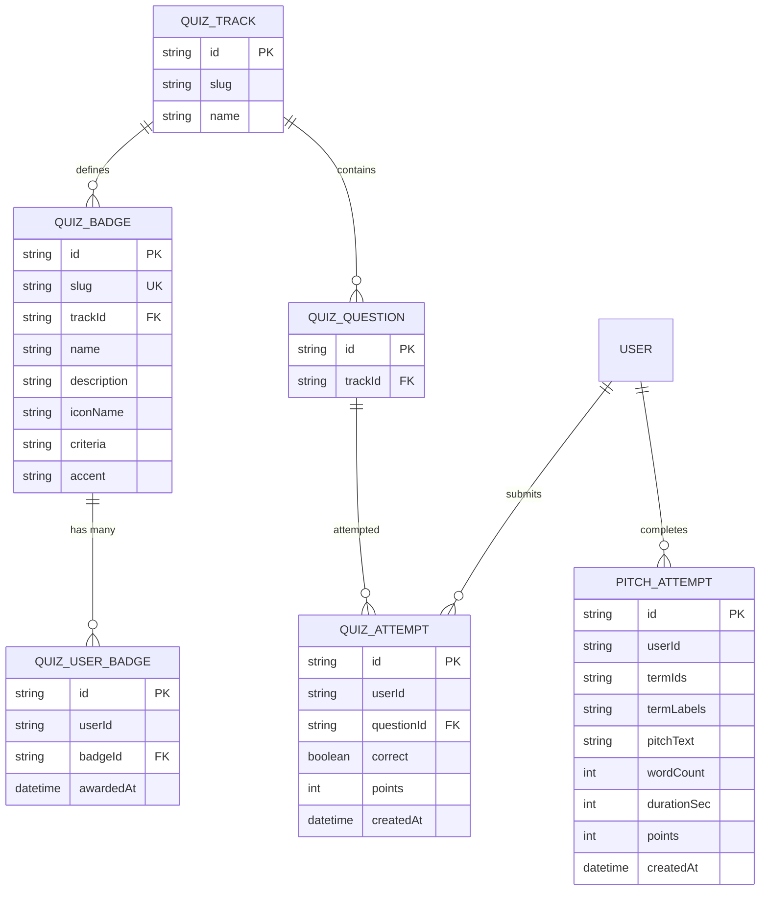
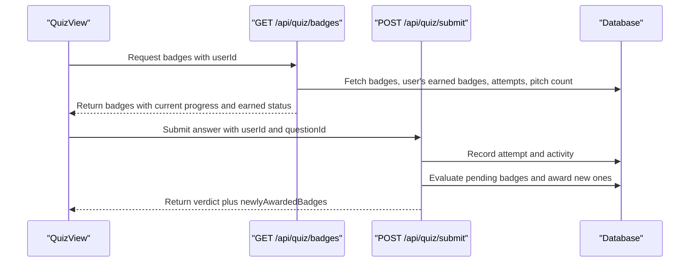
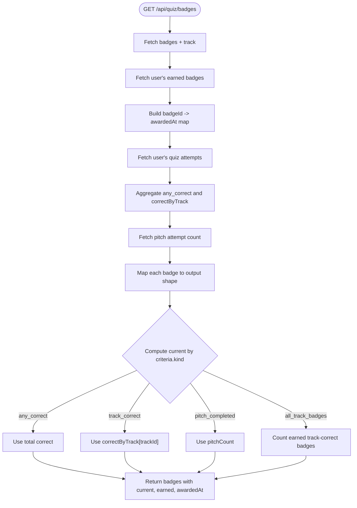
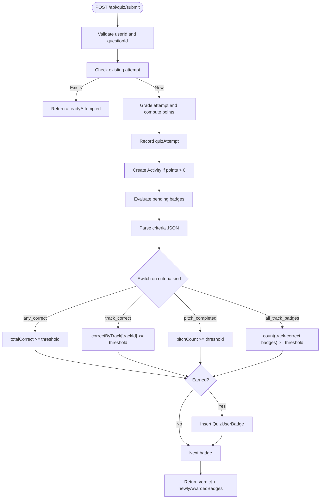
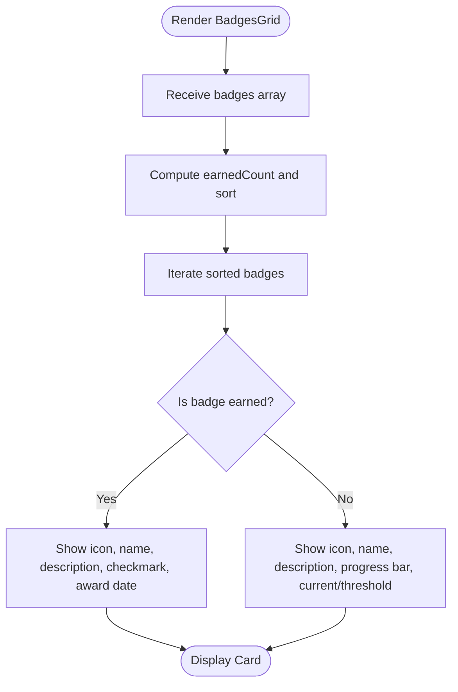
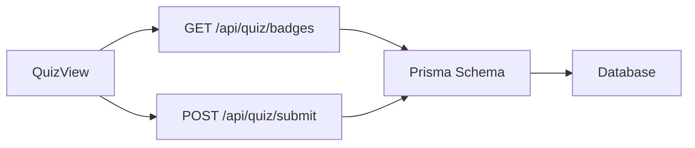

# Badge Achievement System

<cite>
**Referenced Files in This Document**
- [route.ts](file://src/app/api/quiz/badges/route.ts)
- [route.ts](file://src/app/api/quiz/submit/route.ts)
- [quiz-view.tsx](file://src/components/welearn/quiz-view.tsx)
- [quizSeedData.ts](file://src/lib/quizSeedData.ts)
- [schema.prisma](file://prisma/schema.prisma)
</cite>

## Table of Contents
1. [Introduction](#introduction)
2. [Project Structure](#project-structure)
3. [Core Components](#core-components)
4. [Architecture Overview](#architecture-overview)
5. [Detailed Component Analysis](#detailed-component-analysis)
6. [Dependency Analysis](#dependency-analysis)
7. [Performance Considerations](#performance-considerations)
8. [Troubleshooting Guide](#troubleshooting-guide)
9. [Conclusion](#conclusion)

## Introduction
The Badge Achievement System rewards users for completing quiz milestones across Founder-mode tracks, pitch drills, and cross-track mastery. It defines badge metadata, evaluates achievement criteria against user progress, persists earned badges, and presents them in a dedicated Badges tab with progress indicators and award timestamps.

Key goals:
- Define clear, trackable achievements such as answering correct questions, completing specific track milestones, finishing pitch drills, and unlocking a final “Founder Mode: ON” milestone.
- Provide real-time progress feedback to the user through the UI.
- Keep badge evaluation server-authoritative while allowing the client to display current progress and earned status.

## Project Structure
The badge system spans API routes, the frontend view, seed data, and database schema:

**Diagram sources**
- [quiz-view.tsx:156-260](file://src/components/welearn/quiz-view.tsx#L156-L260)
- [route.ts:7-92](file://src/app/api/quiz/badges/route.ts#L7-L92)
- [route.ts:82-156](file://src/app/api/quiz/submit/route.ts#L82-L156)
- [schema.prisma:190-216](file://prisma/schema.prisma#L190-L216)

**Section sources**
- [quiz-view.tsx:156-260](file://src/components/welearn/quiz-view.tsx#L156-L260)
- [route.ts:7-92](file://src/app/api/quiz/badges/route.ts#L7-L92)
- [route.ts:82-156](file://src/app/api/quiz/submit/route.ts#L82-L156)
- [schema.prisma:190-216](file://prisma/schema.prisma#L190-L216)

## Core Components
This section documents the core types, endpoints, and data models that power the badge system.

### QuizBadge Interface (Client Model)
The frontend uses a typed representation of a badge response. It includes:
- `id`: Unique badge identifier.
- `slug`: Human-readable slug used for identification.
- `name`: Display name of the badge.
- `description`: Explanation of what the badge represents.
- `iconName`: Name of the icon used to represent the badge visually.
- `accent`: Accent color applied to the badge card.
- `trackName` and `trackSlug`: Associated track information when applicable.
- `criteria`: The achievement rule, including `kind` and `threshold`.
- `current`: Current progress value toward the threshold.
- `earned`: Whether the badge has already been awarded.
- `awardedAt`: Timestamp when the badge was awarded, or null if not yet earned.

This interface is defined in the frontend component and consumed by the Badges grid.

**Section sources**
- [quiz-view.tsx:89-102](file://src/components/welearn/quiz-view.tsx#L89-L102)

### Database Models
The backend stores badge definitions and user awards using these tables:

- `QuizBadge`: Defines available badges, their metadata, associated track, criteria JSON, and accent color.
- `QuizUserBadge`: Records which user has earned which badge and when.
- Related entities include `QuizTrack`, `QuizQuestion`, `QuizAttempt`, and `PitchAttempt`, which provide the progress data needed to evaluate badge criteria.

**Diagram sources**
- [schema.prisma:190-216](file://prisma/schema.prisma#L190-L216)
- [schema.prisma:220-232](file://prisma/schema.prisma#L220-L232)

**Section sources**
- [schema.prisma:190-216](file://prisma/schema.prisma#L190-L216)
- [schema.prisma:220-232](file://prisma/schema.prisma#L220-L232)

### Badge Criteria
Badge criteria are stored as JSON with two fields:
- `kind`: One of the supported achievement types.
- `threshold`: The numeric target required to earn the badge.

Supported kinds:
- `any_correct`: Earn after a total number of correct answers across all tracks.
- `track_correct`: Earn after a number of correct answers within a specific track.
- `pitch_completed`: Earn after completing a number of pitch attempts.
- `all_track_badges`: Earn after collecting a specified number of track-correct badges.

These criteria are evaluated both for progress reporting and for automatic awarding.

**Section sources**
- [route.ts:43-69](file://src/app/api/quiz/badges/route.ts#L43-L69)
- [route.ts:44-64](file://src/app/api/quiz/submit/route.ts#L44-L64)

### Seed Badge Definitions
The system ships with predefined badges covering early milestones, per-track mastery, pitch completion, and full-spectrum founder training. Examples include:
- First Steps: Answer your first founder-mode question correctly.
- Investment Apprentice: Get 3 Investment-track questions right.
- Growth Hacker: Get 3 Growth & Marketing questions right.
- Legally Aware: Get 3 Operations & Legal questions right.
- Product Thinker: Get 3 Product & Tech questions right.
- Strategist: Get 3 Macro-Strategy questions right.
- Pitch Master: Complete your first 3-term elevator pitch drill.
- Founder Mode: ON: Earned all 5 track badges — full-spectrum founder training complete.

Each seed entry includes slug, optional track association, name, description, icon, accent color, and criteria.

**Section sources**
- [quizSeedData.ts:27-35](file://src/lib/quizSeedData.ts#L27-L35)
- [quizSeedData.ts:470-543](file://src/lib/quizSeedData.ts#L470-L543)

## Architecture Overview
The badge system integrates three main flows:
1. Badge listing and progress calculation via GET `/api/quiz/badges`.
2. Automatic badge awarding triggered by POST `/api/quiz/submit`.
3. Frontend rendering of badges in the Badges tab with progress bars and award dates.

**Diagram sources**
- [route.ts:7-92](file://src/app/api/quiz/badges/route.ts#L7-L92)
- [route.ts:82-156](file://src/app/api/quiz/submit/route.ts#L82-L156)

**Section sources**
- [route.ts:7-92](file://src/app/api/quiz/badges/route.ts#L7-L92)
- [route.ts:82-156](file://src/app/api/quiz/submit/route.ts#L82-L156)

## Detailed Component Analysis

### Badge Listing Endpoint: GET /api/quiz/badges
Responsibilities:
- Retrieve all badges, optionally including associated track data.
- Load the user’s earned badges and build a map from badge ID to award timestamp.
- Aggregate user attempts to compute:
  - Total correct answers (`any_correct`).
  - Correct answers per track (`track_correct`).
  - Pitch attempt count (`pitch_completed`).
  - Count of already earned track-correct badges (`all_track_badges`).
- Compute each badge’s `current` progress based on its criteria kind.
- Return a normalized payload containing badge metadata, criteria, current progress, earned status, and award timestamp.

Progress computation logic:
- For `any_correct`, current equals total correct answers.
- For `track_correct`, current equals correct answers for the badge’s track.
- For `pitch_completed`, current equals pitch attempt count.
- For `all_track_badges`, current equals the number of track-correct badges already earned.

Error handling:
- If badge criteria cannot be parsed, it defaults to a safe fallback.
- The endpoint returns a generic error response on failure.

**Diagram sources**
- [route.ts:7-92](file://src/app/api/quiz/badges/route.ts#L7-L92)

**Section sources**
- [route.ts:7-92](file://src/app/api/quiz/badges/route.ts#L7-L92)

### Badge Awarding Logic: POST /api/quiz/submit
Responsibilities:
- Validate request body and ensure required fields exist.
- Prevent duplicate graded attempts per question per user.
- Grade the attempt server-side and record it.
- Create an Activity record for tracking.
- Evaluate all pending badges and award those whose criteria are met.
- Return the result including a list of newly awarded badge IDs.

Awarding algorithm:
- Load user’s already earned badges.
- Load all badges and filter out earned ones.
- Aggregate user attempts to compute totals and per-track correctness.
- Count pitch attempts.
- For each pending badge:
  - Parse criteria JSON.
  - Evaluate based on kind:
    - `any_correct`: compare total correct to threshold.
    - `track_correct`: compare per-track correct to threshold.
    - `pitch_completed`: compare pitch count to threshold.
    - `all_track_badges`: count distinct track-correct badges already earned.
  - If criteria met, insert into `QuizUserBadge` (race-safe).
  - Collect newly awarded badge IDs.

**Diagram sources**
- [route.ts:82-156](file://src/app/api/quiz/submit/route.ts#L82-L156)

**Section sources**
- [route.ts:82-156](file://src/app/api/quiz/submit/route.ts#L82-L156)

### Badges Tab UI: BadgesGrid
Responsibilities:
- Display all badges in a responsive grid.
- Show earned vs unearned state with visual distinction.
- Render progress bars for unearned badges showing current vs threshold and percentage.
- Show award date for earned badges.
- Sort badges so earned ones appear first.

Visual presentation details:
- Each badge card uses the badge’s accent color for left border and icon background.
- Earned badges have a shadow and vibrant icon; unearned badges are desaturated and semi-transparent.
- Progress bar shows how close the user is to meeting the threshold.
- Awarded date is formatted using locale-aware formatting.

**Diagram sources**
- [quiz-view.tsx:1125-1207](file://src/components/welearn/quiz-view.tsx#L1125-L1207)

**Section sources**
- [quiz-view.tsx:1125-1207](file://src/components/welearn/quiz-view.tsx#L1125-L1207)

### Earning Workflows and Examples
Examples of badge earning workflows:
- First Steps: After the first correct answer, the system marks the badge as earned and displays the award date.
- Track Mastery: After achieving the required number of correct answers in a specific track, the corresponding track badge becomes earned.
- Pitch Master: After completing at least one pitch attempt, the Pitch Master badge is awarded.
- Founder Mode: ON: Once the user has earned all five track-correct badges, this final badge is unlocked.

These workflows are driven by the criteria evaluation in the submit endpoint and reflected in the badges endpoint’s progress calculations.

**Section sources**
- [quizSeedData.ts:470-543](file://src/lib/quizSeedData.ts#L470-L543)
- [route.ts:44-64](file://src/app/api/quiz/submit/route.ts#L44-L64)

## Dependency Analysis
The badge system depends on several components:

- Frontend QuizView consumes:
  - Badge listing API for progress and earned status.
  - Submit API for grading and triggering badge awards.
  - Icon registry for badge visuals.
- Backend APIs depend on:
  - Prisma schema for data access.
  - QuizAttempt and PitchAttempt tables for progress aggregation.
  - QuizBadge and QuizUserBadge tables for badge definitions and awards.

**Diagram sources**
- [quiz-view.tsx:156-260](file://src/components/welearn/quiz-view.tsx#L156-L260)
- [route.ts:7-92](file://src/app/api/quiz/badges/route.ts#L7-L92)
- [route.ts:82-156](file://src/app/api/quiz/submit/route.ts#L82-L156)
- [schema.prisma:190-216](file://prisma/schema.prisma#L190-L216)

**Section sources**
- [quiz-view.tsx:156-260](file://src/components/welearn/quiz-view.tsx#L156-L260)
- [route.ts:7-92](file://src/app/api/quiz/badges/route.ts#L7-L92)
- [route.ts:82-156](file://src/app/api/quiz/submit/route.ts#L82-L156)
- [schema.prisma:190-216](file://prisma/schema.prisma#L190-L216)

## Performance Considerations
- Aggregation queries: Both badges and submit endpoints aggregate user attempts and pitch counts. For large datasets, consider indexing frequently filtered fields such as `userId` and `questionId`.
- Race conditions: Badge awarding uses a unique constraint on `(userId, badgeId)` to prevent duplicates; errors are caught to remain race-safe.
- UI responsiveness: The Badges grid sorts and computes percentages client-side; keep badge payloads minimal to reduce render overhead.
- Caching: Badge listings could benefit from short-lived caching if badge changes are infrequent relative to reads.

[No sources needed since this section provides general guidance]

## Troubleshooting Guide
Common issues and resolutions:
- Badges not updating after submission:
  - Ensure the submit endpoint is called and returns `newlyAwardedBadges`.
  - Refresh the badges list to reflect updated progress and earned status.
- Incorrect progress values:
  - Verify that attempts are recorded with correct `correct` flags and associated `trackId`.
  - Confirm criteria parsing succeeds; malformed criteria may fall back to default behavior.
- Missing award timestamps:
  - Check that `QuizUserBadge.awardedAt` is populated when inserting earned badges.
- Visual inconsistencies:
  - Ensure badge icons and accents are present in seed data and mapped correctly in the UI.

**Section sources**
- [route.ts:82-156](file://src/app/api/quiz/submit/route.ts#L82-L156)
- [route.ts:43-69](file://src/app/api/quiz/badges/route.ts#L43-L69)
- [quiz-view.tsx:1125-1207](file://src/components/welearn/quiz-view.tsx#L1125-L1207)

## Conclusion
The Badge Achievement System provides a robust, extensible framework for rewarding user progress across quiz tracks and pitch drills. By combining well-defined criteria, server-authoritative evaluation, and a clear UI presentation, it motivates learners to complete milestones and showcases their achievements effectively. The design supports additional badge types and thresholds through simple JSON criteria, making it adaptable to future learning objectives.

[No sources needed since this section summarizes without analyzing specific files]