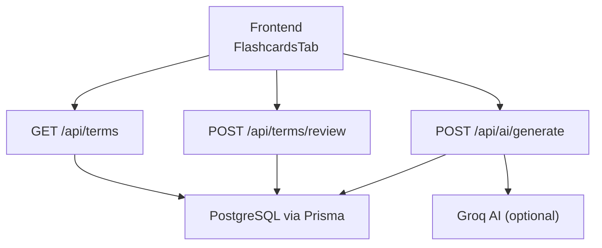
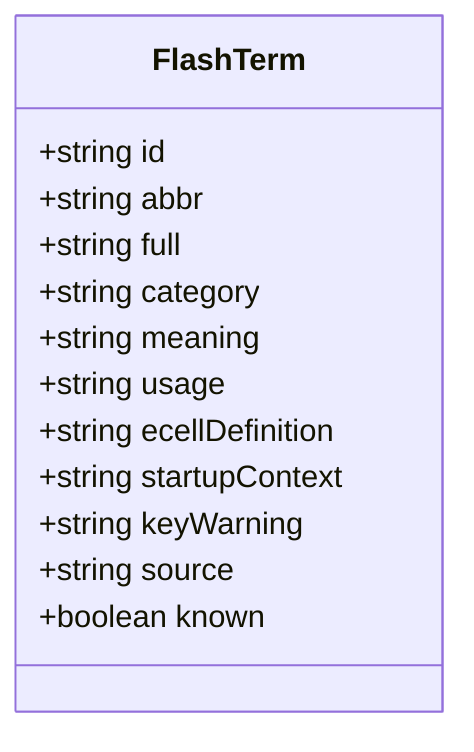
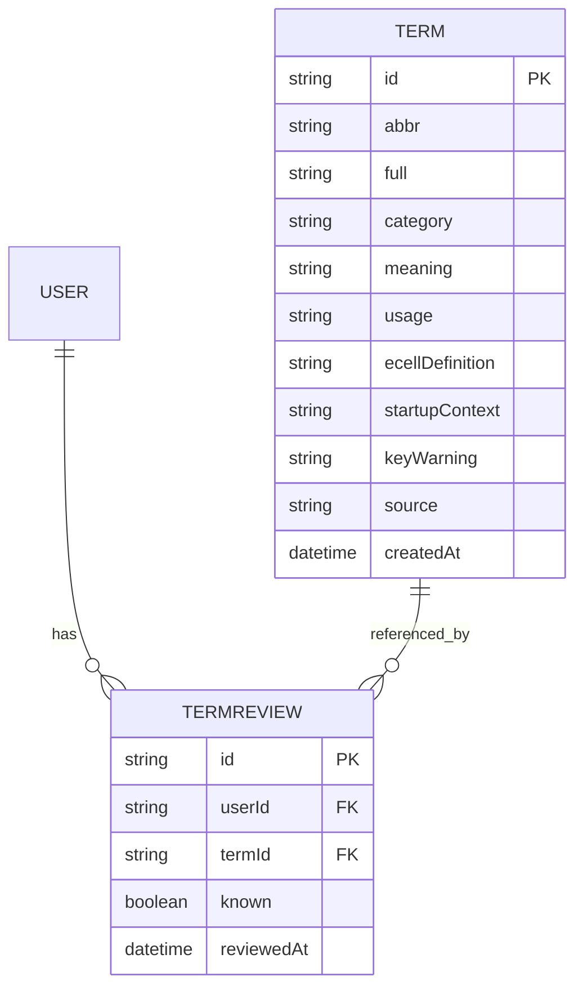
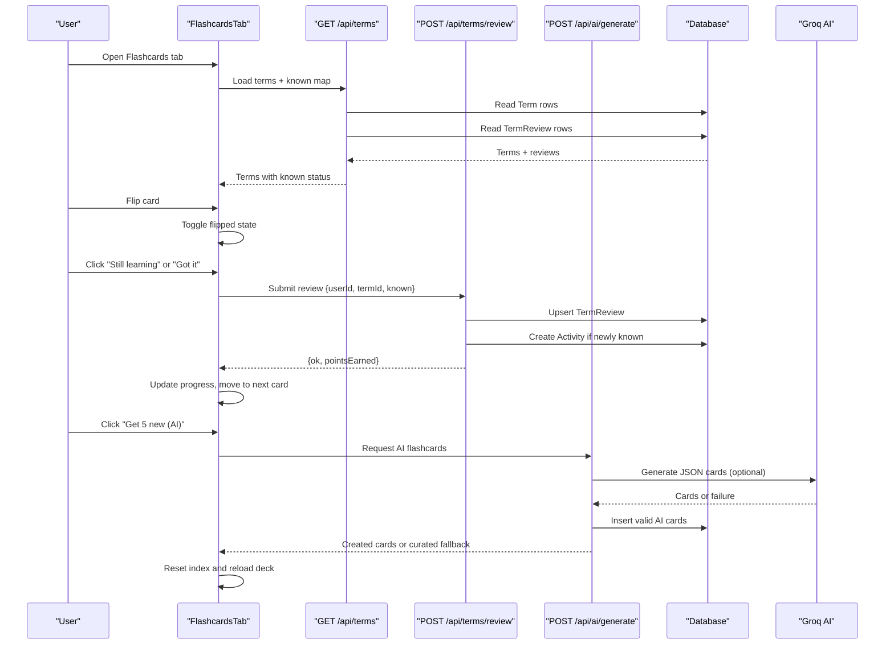
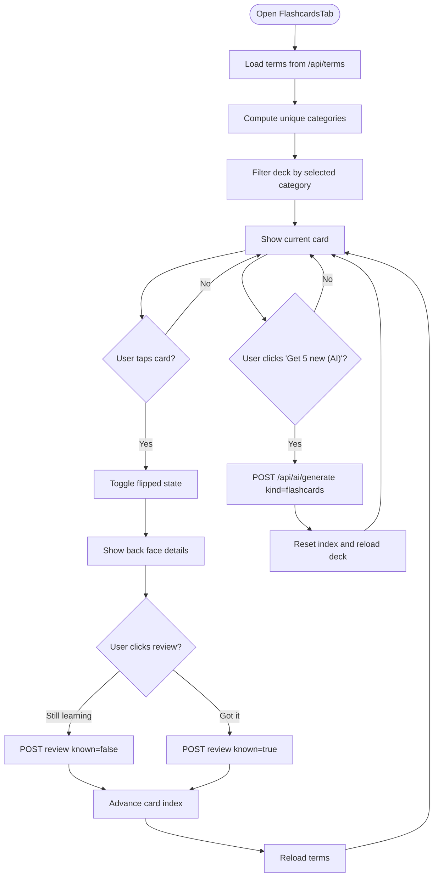
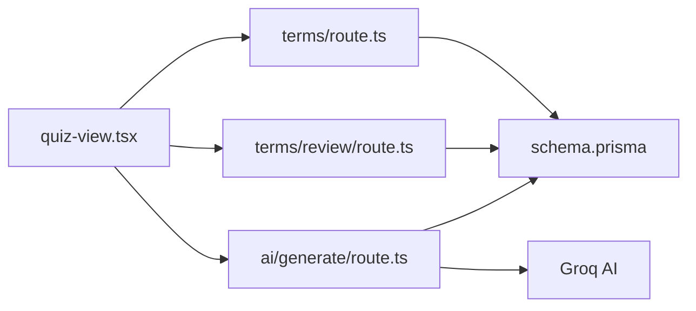

# Flashcard System

<cite>
**Referenced Files in This Document**
- [quiz-view.tsx](file://src/components/welearn/quiz-view.tsx)
- [terms_route.ts](file://src/app/api/terms/route.ts)
- [review_route.ts](file://src/app/api/terms/review/route.ts)
- [ai_generate_route.ts](file://src/app/api/ai/generate/route.ts)
- [schema.prisma](file://prisma/schema.prisma)
- [data_seed.sql](file://supabase/migrations/20261107_data_seed.sql)
</cite>

## Table of Contents
1. [Introduction](#introduction)
2. [Project Structure](#project-structure)
3. [Core Components](#core-components)
4. [Architecture Overview](#architecture-overview)
5. [Detailed Component Analysis](#detailed-component-analysis)
6. [Dependency Analysis](#dependency-analysis)
7. [Performance Considerations](#performance-considerations)
8. [Troubleshooting Guide](#troubleshooting-guide)
9. [Conclusion](#conclusion)

## Introduction
The Flashcard System is a startup-context learning feature inside the WeLearn platform. It presents flip cards for business and entrepreneurship terms, showing definitions, real startup stories, usage examples, E-Cell-specific definitions, and key warnings. Users can filter by category, track progress as “known” versus total, review each card as “Still learning” or “Got it”, and optionally generate new flashcards through an AI integration. The system also integrates with activity tracking and points so that first-time mastery earns rewards.

This documentation explains:
- The `FlashTerm` interface and its fields.
- Card flipping animation and UI behavior.
- Category filtering and progress display.
- The review workflow and point system.
- AI-generated flashcard creation and fallback behavior.
- Data models, API endpoints, and how everything connects.

## Project Structure
The flashcard feature spans three main layers:
- Frontend component: `QuizView` contains the `FlashcardsTab`, which renders the flip cards, filters, progress bar, review buttons, and AI generation button.
- Backend API routes: `/api/terms` loads terms and known status; `/api/terms/review` saves review state and awards points; `/api/ai/generate` creates new flashcards.
- Database schema: Prisma models define `Term`, `TermReview`, and related entities.

**Diagram sources**
- [quiz-view.tsx:268-425](file://src/components/welearn/quiz-view.tsx#L268-L425)
- [terms_route.ts:1-32](file://src/app/api/terms/route.ts#L1-L32)
- [review_route.ts:1-36](file://src/app/api/terms/review/route.ts#L1-L36)
- [ai_generate_route.ts:96-126](file://src/app/api/ai/generate/route.ts#L96-L126)
- [schema.prisma:115-130](file://prisma/schema.prisma#L115-L130)

**Section sources**
- [quiz-view.tsx:268-425](file://src/components/welearn/quiz-view.tsx#L268-L425)
- [terms_route.ts:1-32](file://src/app/api/terms/route.ts#L1-L32)
- [review_route.ts:1-36](file://src/app/api/terms/review/route.ts#L1-L36)
- [ai_generate_route.ts:96-126](file://src/app/api/ai/generate/route.ts#L96-L126)
- [schema.prisma:115-130](file://prisma/schema.prisma#L115-L130)

## Core Components
### FlashTerm Interface
The frontend defines `FlashTerm` to represent a single flashcard. Its fields are:
- `id`: Unique identifier for the term.
- `abbr`: Short abbreviation shown on the front of the card.
- `full`: Full expansion of the abbreviation.
- `category`: Grouping label such as Funding, Finance, Strategy, Ecosystem, Communication.
- `meaning`: General definition used when no E-Cell definition exists.
- `usage`: Example sentence showing how the term is used in context.
- `ecellDefinition`: Optional E-Cell-specific one-line definition.
- `startupContext`: Optional real startup story illustrating why the term matters.
- `keyWarning`: Optional cautionary note for founders.
- `source`: Origin of the card, typically “curated” or “ai”.
- `known`: Per-user review state: `true` if mastered, `false` if still learning, or `null` if not yet reviewed.

**Diagram sources**
- [quiz-view.tsx:46-58](file://src/components/welearn/quiz-view.tsx#L46-L58)

**Section sources**
- [quiz-view.tsx:46-58](file://src/components/welearn/quiz-view.tsx#L46-L58)

### Database Models for Flashcards
The database stores:
- `Term`: Core flashcard content including abbreviation, full name, category, meaning, usage, optional E-Cell definition, startup context, key warning, and source.
- `TermReview`: Per-user review state linking a user to a term, storing whether the term is marked known and when it was last reviewed.

**Diagram sources**
- [schema.prisma:115-130](file://prisma/schema.prisma#L115-L130)
- [schema.prisma:234-245](file://prisma/schema.prisma#L234-L245)

**Section sources**
- [schema.prisma:115-130](file://prisma/schema.prisma#L115-L130)
- [schema.prisma:234-245](file://prisma/schema.prisma#L234-L245)

## Architecture Overview
The flashcard flow combines frontend state, backend APIs, and database persistence.

**Diagram sources**
- [quiz-view.tsx:268-425](file://src/components/welearn/quiz-view.tsx#L268-L425)
- [terms_route.ts:1-32](file://src/app/api/terms/route.ts#L1-L32)
- [review_route.ts:1-36](file://src/app/api/terms/review/route.ts#L1-L36)
- [ai_generate_route.ts:96-126](file://src/app/api/ai/generate/route.ts#L96-L126)

## Detailed Component Analysis

### FlashcardsTab: UI, Animation, Filtering, Progress, and Review
The `FlashcardsTab` component manages:
- Loading terms from `/api/terms`.
- Computing available categories.
- Filtering the current deck by selected category.
- Tracking the current card index and flipped state.
- Displaying progress as known count over total terms.
- Handling review actions.
- Triggering AI generation for new cards.

Key behaviors:
- **Category filtering**: Categories are derived from all loaded terms. Selecting a category resets the card index and flips state.
- **Progress tracking**: Known count is calculated from the full term list where `known === true`; total is the length of all terms.
- **Card flipping**: The card has a front face showing the abbreviation and category, and a back face showing full name, E-Cell definition or meaning, startup context, key warning, and usage.
- **Review workflow**:
  - “Still learning” sets `known = false`.
  - “Got it” sets `known = true`.
  - After review, the UI unflips the card, advances to the next card, and reloads updated data.
- **AI generation**: Calls `/api/ai/generate` with `kind: "flashcards"` and refreshes the deck.

**Diagram sources**
- [quiz-view.tsx:268-425](file://src/components/welearn/quiz-view.tsx#L268-L425)

**Section sources**
- [quiz-view.tsx:268-425](file://src/components/welearn/quiz-view.tsx#L268-L425)

### GET /api/terms: Loading Terms and Known Status
The terms endpoint:
- Accepts `userId` as a query parameter.
- Reads all `Term` rows ordered by abbreviation.
- If `userId` is provided, reads `TermReview` rows for that user.
- Builds a map from term ID to known status.
- Returns terms with merged `known` values.

Error handling returns a generic error response on exceptions.

**Section sources**
- [terms_route.ts:1-32](file://src/app/api/terms/route.ts#L1-L32)

### POST /api/terms/review: Marking Terms Known or Learning
The review endpoint:
- Validates `userId` and `termId`.
- Checks if a `TermReview` already exists.
- If the term is being marked known for the first time, awards 2 points and creates an `Activity` record with action `term_learned`.
- Upserts `TermReview` with `known` and `reviewedAt`.
- Returns `{ ok: true, pointsEarned }`.

This is the core mechanism for progress tracking and gamification.

**Section sources**
- [review_route.ts:1-36](file://src/app/api/terms/review/route.ts#L1-L36)

### POST /api/ai/generate: Creating New Flashcards
The AI generation endpoint supports multiple kinds; for flashcards:
- Requests Groq to produce JSON with up to 5 new business/entrepreneurship terms.
- Filters out very common terms already covered.
- Validates required fields (`abbr`, `full`, `meaning`).
- Skips duplicates based on existing abbreviations.
- Inserts valid cards into `Term` with `source: "ai"`.
- If AI fails or is not configured, falls back to curated cards and returns `fallback: true`.

**Section sources**
- [ai_generate_route.ts:96-126](file://src/app/api/ai/generate/route.ts#L96-L126)

### Flashcard Content Examples
Seed data shows the structure of curated flashcards. Examples include:
- VC: Venture Capitalist, Funding category, definition about firms investing pooled money into high-growth startups for equity.
- Seed: Seed Round, Funding category, definition about the first institutional funding round.
- Series A: Series A Round, Funding category, definition about the first major VC round after traction.
- IPO: Initial Public Offering, Finance category, definition about listing shares on a public exchange.
- Equity: Ownership Share, Finance category, definition about percentage ownership.
- Valuation: Company’s Estimated Worth, Finance category, definition about company price tag.
- Cap Table: Capitalization Table, Finance category, definition about ownership spreadsheet.
- Pitch Deck: Investor Presentation, Communication category, definition about investor slides.
- Elevator Pitch: 30-Second Business Summary, Communication category, definition about concise pitch.
- Moat: Competitive Advantage, Strategy category, definition about defensible advantages.
- Incubator: Startup Incubator, Ecosystem category, definition about early-stage support.
- Accelerator: Startup Accelerator, Ecosystem category, definition about fixed-term programs.
- Term Sheet: Investment Offer Summary, Funding category, definition about non-binding investment terms.
- DD: Due Diligence, Funding category, definition about investor verification.
- Unicorn: $1 Billion Valued Private Startup, Ecosystem category, definition about billion-dollar private companies.

These entries demonstrate how `abbr`, `full`, `category`, `meaning`, and `source` are populated. Some seed records may leave optional fields like `ecellDefinition`, `startupContext`, and `keyWarning` null until enriched.

**Section sources**
- [data_seed.sql:169-251](file://supabase/migrations/20261107_data_seed.sql#L169-L251)

## Dependency Analysis
The flashcard system depends on:
- Frontend React component state for UI interactions.
- Backend API routes for data access and business logic.
- Prisma client for database operations.
- Optional Groq AI for generating new flashcards.
- Activity model for rewarding users when they mark a term known for the first time.

**Diagram sources**
- [quiz-view.tsx:268-425](file://src/components/welearn/quiz-view.tsx#L268-L425)
- [terms_route.ts:1-32](file://src/app/api/terms/route.ts#L1-L32)
- [review_route.ts:1-36](file://src/app/api/terms/review/route.ts#L1-L36)
- [ai_generate_route.ts:96-126](file://src/app/api/ai/generate/route.ts#L96-L126)
- [schema.prisma:115-130](file://prisma/schema.prisma#L115-L130)

**Section sources**
- [quiz-view.tsx:268-425](file://src/components/welearn/quiz-view.tsx#L268-L425)
- [terms_route.ts:1-32](file://src/app/api/terms/route.ts#L1-L32)
- [review_route.ts:1-36](file://src/app/api/terms/review/route.ts#L1-L36)
- [ai_generate_route.ts:96-126](file://src/app/api/ai/generate/route.ts#L96-L126)
- [schema.prisma:115-130](file://prisma/schema.prisma#L115-L130)

## Performance Considerations
- **Client-side filtering**: Category filtering happens in memory using `useMemo`, which is efficient for moderate term counts.
- **Progress calculation**: Known count is computed by filtering the full term array; this is O(n) but acceptable for typical decks.
- **API calls**: Each review triggers a network request; batching could improve performance if many reviews occur rapidly.
- **AI generation**: AI calls are asynchronous and may fail; the fallback ensures usability without AI configuration.
- **Database queries**: Terms are fetched once per session load; review updates use upserts to minimize writes.

[No sources needed since this section provides general guidance]

## Troubleshooting Guide
Common issues and resolutions:
- **Terms fail to load**: Check `/api/terms` response; ensure `userId` is passed correctly and the database is reachable.
- **Review does not save**: Verify `/api/terms/review` receives valid `userId` and `termId`; check for duplicate constraint violations on `TermReview`.
- **Points not awarded**: Points are only awarded when marking a term known for the first time; confirm `Activity` creation and that the term was previously unknown.
- **AI generation fails**: If Groq is not configured, the endpoint returns curated cards with `fallback: true`; verify environment variables and AI configuration.
- **Card not flipping**: Ensure the click handler toggles `flipped` state and that keyboard accessibility keys are supported.

**Section sources**
- [terms_route.ts:1-32](file://src/app/api/terms/route.ts#L1-L32)
- [review_route.ts:1-36](file://src/app/api/terms/review/route.ts#L1-L36)
- [ai_generate_route.ts:96-126](file://src/app/api/ai/generate/route.ts#L96-L126)
- [quiz-view.tsx:268-425](file://src/components/welearn/quiz-view.tsx#L268-L425)

## Conclusion
The Flashcard System provides a focused, interactive way to learn startup terminology through flip cards enriched with real-world context and warnings. It integrates category filtering, progress tracking, and a simple review workflow that rewards mastery. The AI integration expands the deck dynamically while maintaining reliability through curated fallbacks. Together, these components form a practical learning loop tailored for entrepreneurship education.

[No sources needed since this section summarizes without analyzing specific files]