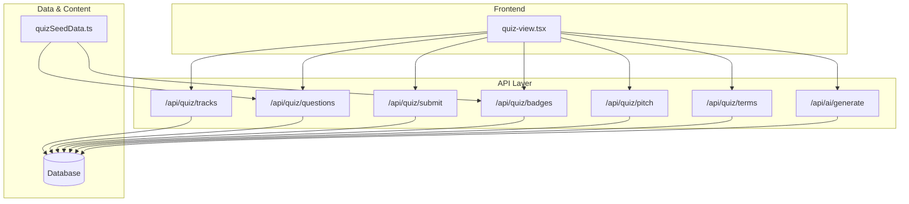
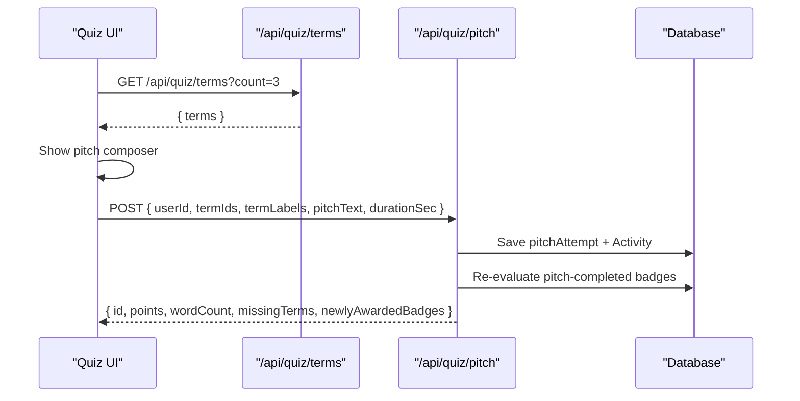
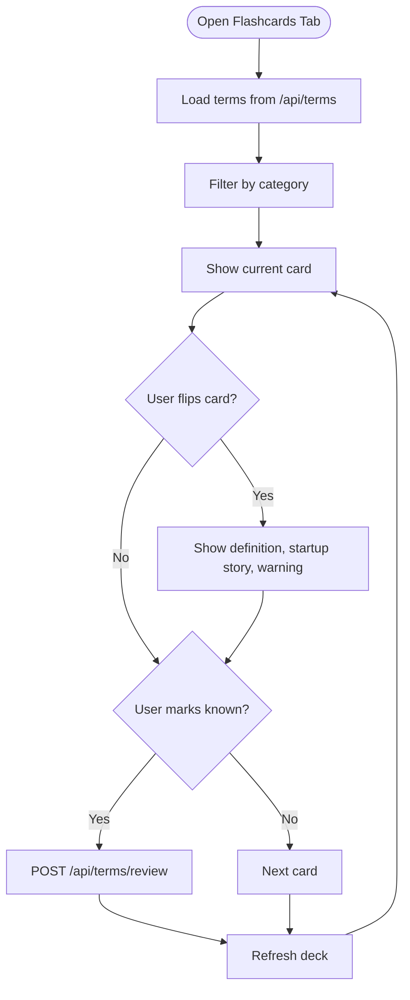
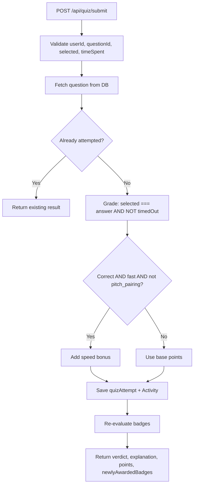
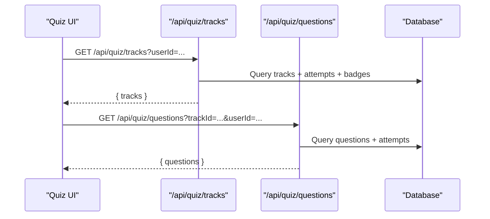
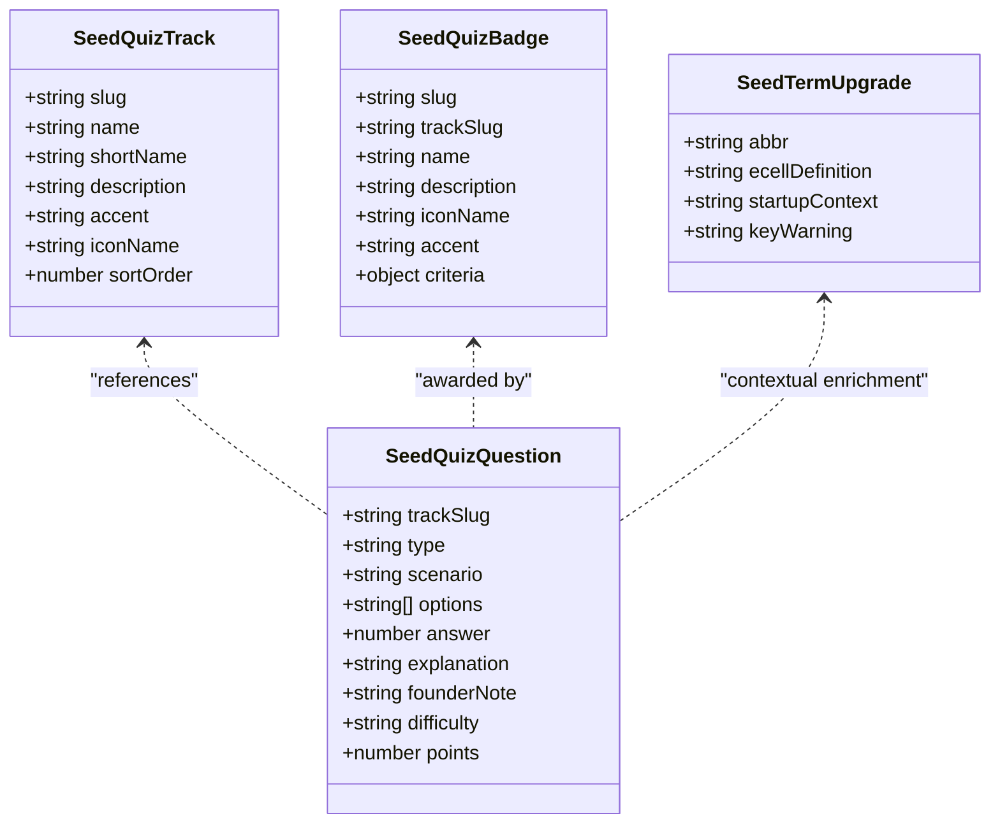
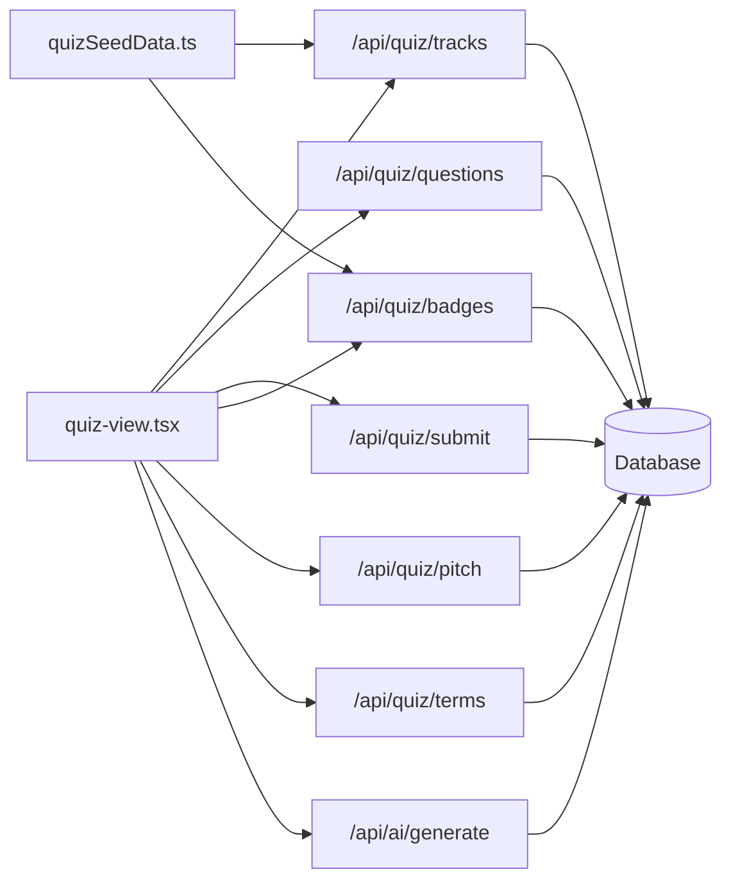

# Founder Quiz Module

<cite>
**Referenced Files in This Document**
- [quizSeedData.ts](file://src/lib/quizSeedData.ts)
- [route.ts (tracks)](file://src/app/api/quiz/tracks/route.ts)
- [route.ts (questions)](file://src/app/api/quiz/questions/route.ts)
- [route.ts (submit)](file://src/app/api/quiz/submit/route.ts)
- [route.ts (badges)](file://src/app/api/quiz/badges/route.ts)
- [route.ts (pitch)](file://src/app/api/quiz/pitch/route.ts)
- [route.ts (terms)](file://src/app/api/quiz/terms/route.ts)
- [route.ts (AI generate)](file://src/app/api/ai/generate/route.ts)
- [quiz-view.tsx](file://src/components/welearn/quiz-view.tsx)
</cite>

## Table of Contents
1. [Introduction](#introduction)
2. [Project Structure](#project-structure)
3. [Core Components](#core-components)
4. [Architecture Overview](#architecture-overview)
5. [Detailed Component Analysis](#detailed-component-analysis)
6. [Dependency Analysis](#dependency-analysis)
7. [Performance Considerations](#performance-considerations)
8. [Troubleshooting Guide](#troubleshooting-guide)
9. [Conclusion](#conclusion)

## Introduction
The Founder Quiz module is an E-Cell training system that teaches startup fundamentals through five curated tracks, founder-mode questions, pitch drills, and flashcards. It combines static seed content with optional AI-generated content, server-side grading, progress tracking, and achievement badges. The module is designed for college entrepreneurship cells to practice real-world founder decisions, spot red flags in pitches, perform quick financial math, and connect business terms into elevator pitches.

At a high level:
- Users explore five E-Cell tracks.
- They answer scenario-based, red-flag, micro-math, and pitch-pairing questions.
- They complete flashcard reviews with startup-context definitions and warnings.
- They earn points, track progress, and unlock badges.
- Administrators or users can optionally generate fresh quiz content via an AI endpoint.

## Project Structure
The Founder Quiz module spans data models, seed content, API routes, and the quiz UI component.

**Diagram sources**
- [quiz-view.tsx:246-258](file://src/components/welearn/quiz-view.tsx#L246-L258)
- [route.ts (tracks):1-68](file://src/app/api/quiz/tracks/route.ts#L1-L68)
- [route.ts (questions):1-60](file://src/app/api/quiz/questions/route.ts#L1-L60)
- [route.ts (submit):1-156](file://src/app/api/quiz/submit/route.ts#L1-L156)
- [route.ts (badges):1-93](file://src/app/api/quiz/badges/route.ts#L1-L93)
- [route.ts (pitch):1-133](file://src/app/api/quiz/pitch/route.ts#L1-L133)
- [route.ts (terms):1-47](file://src/app/api/quiz/terms/route.ts#L1-L47)
- [route.ts (AI generate):178-263](file://src/app/api/ai/generate/route.ts#L178-L263)
- [quizSeedData.ts:45-91](file://src/lib/quizSeedData.ts#L45-L91)

**Section sources**
- [quiz-view.tsx:246-258](file://src/components/welearn/quiz-view.tsx#L246-L258)
- [route.ts (tracks):1-68](file://src/app/api/quiz/tracks/route.ts#L1-L68)
- [route.ts (questions):1-60](file://src/app/api/quiz/questions/route.ts#L1-L60)
- [route.ts (submit):1-156](file://src/app/api/quiz/submit/route.ts#L1-L156)
- [route.ts (badges):1-93](file://src/app/api/quiz/badges/route.ts#L1-L93)
- [route.ts (pitch):1-133](file://src/app/api/quiz/pitch/route.ts#L1-L133)
- [route.ts (terms):1-47](file://src/app/api/quiz/terms/route.ts#L1-L47)
- [route.ts (AI generate):178-263](file://src/app/api/ai/generate/route.ts#L178-L263)
- [quizSeedData.ts:45-91](file://src/lib/quizSeedData.ts#L45-L91)

## Core Components
This section explains the five E-Cell tracks, question types, badge system, pitch pairing, flashcards, scoring, and progress tracking.

### Five E-Cell Tracks
The platform defines five founder-focused tracks. Each track has a slug, display name, short name, description, accent color, icon, and sort order.

| Track | Slug | Short Name | Focus Area |
|---|---|---|---|
| Incubator & Investment | `investment` | Investment | Term sheets, cap tables, valuation, SAFEs, due diligence |
| Growth & Marketing | `growth` | Growth | CAC, LTV, growth hacking, funnels, pricing strategies |
| Operations & Legal | `ops_legal` | Ops & Legal | Due diligence, IP, contracts, escrow, auditing |
| Product & Tech | `product_tech` | Product | MVP, SaaS, UI/UX, scalability, beta testing |
| Macro-Strategy | `strategy` | Strategy | PESTLE, SWOT, economies of scale, tariffs, market structure |

These tracks are defined in the seed data and returned by the tracks endpoint with per-user progress and badge status.

**Section sources**
- [quizSeedData.ts:45-91](file://src/lib/quizSeedData.ts#L45-L91)
- [route.ts (tracks):1-68](file://src/app/api/quiz/tracks/route.ts#L1-L68)

### Question Types
Founder Quiz supports four question types:

| Type | Purpose | Example Context |
|---|---|---|
| Scenario | Founder-mode decision scenarios | Choosing between term-sheet options, MVP strategy, or market-entry frameworks |
| Red Flag | Spot flawed claims in pitch decks or metrics | Unrealistic runway, missing IP assignment, inflated CAC/LTV assumptions |
| Micro Math | Quick founder calculations | Valuation, break-even, churn decay, CAC:LTV ratio |
| Pitch Pairing | Connect three random terms into an elevator pitch | Free-form drill; completion earns points and unlocks the composer |

The seed data documents these types and includes verified examples across all five tracks.

**Section sources**
- [quizSeedData.ts:1-25](file://src/lib/quizSeedData.ts#L1-L25)
- [quizSeedData.ts:93-468](file://src/lib/quizSeedData.ts#L93-L468)
- [route.ts (questions):4-8](file://src/app/api/quiz/questions/route.ts#L4-L8)

### Badge System
Badges reward progress across tracks and activities. Badge criteria include:

| Criteria Kind | Meaning | Example Badge |
|---|---|---|
| `any_correct` | Earned after N total correct answers | First Steps |
| `track_correct` | Earned after N correct answers in a specific track | Investment Apprentice, Growth Hacker, Legally Aware, Product Thinker, Strategist |
| `pitch_completed` | Earned after completing N pitch drills | Pitch Master |
| `all_track_badges` | Earned after collecting all five track-correct badges | Founder Mode: ON |

Badges are stored as structured criteria and evaluated on submit and pitch completion.

**Section sources**
- [quizSeedData.ts:470-543](file://src/lib/quizSeedData.ts#L470-L543)
- [route.ts (submit):4-73](file://src/app/api/quiz/submit/route.ts#L4-L73)
- [route.ts (badges):1-93](file://src/app/api/quiz/badges/route.ts#L1-L93)

### Pitch Pairing Feature
Pitch pairing asks users to connect three random startup terms into an elevator pitch.

Workflow:
1. User selects a pitch-pairing question.
2. The system fetches three random terms from the terms database.
3. The user writes a pitch using those terms.
4. The backend validates length, word count, and whether terms appear in the text.
5. The attempt is saved, activity points are awarded, and badges are re-evaluated.

**Diagram sources**
- [route.ts (terms):1-47](file://src/app/api/quiz/terms/route.ts#L1-L47)
- [route.ts (pitch):1-133](file://src/app/api/quiz/pitch/route.ts#L1-L133)

**Section sources**
- [route.ts (pitch):1-133](file://src/app/api/quiz/pitch/route.ts#L1-L133)
- [route.ts (terms):1-47](file://src/app/api/quiz/terms/route.ts#L1-L47)

### Flashcard Tab
The flashcard tab provides startup-context flip cards. Each card shows:
- Abbreviation and full term
- E-Cell definition or meaning
- Real startup story context when available
- Key warning about common mistakes

Users can:
- Flip cards to reveal definitions and stories
- Filter by category
- Mark terms as known
- Generate new AI-powered flashcards

**Diagram sources**
- [quiz-view.tsx:268-398](file://src/components/welearn/quiz-view.tsx#L268-L398)

**Section sources**
- [quiz-view.tsx:268-398](file://src/components/welearn/quiz-view.tsx#L268-L398)
- [quizSeedData.ts:545-633](file://src/lib/quizSeedData.ts#L545-L633)

### Scoring System
Scoring combines base points, speed bonuses, and activity logging.

Rules:
- Correct answers earn the question’s base points.
- Speed bonus: if answered correctly within a time threshold and not a pitch-pairing question, extra points are added.
- Incorrect answers earn zero points.
- Attempts are idempotent: one graded attempt per question per user.
- Points are recorded as Activity entries for analytics and leaderboards.

**Diagram sources**
- [route.ts (submit):75-156](file://src/app/api/quiz/submit/route.ts#L75-L156)

**Section sources**
- [route.ts (submit):75-156](file://src/app/api/quiz/submit/route.ts#L75-L156)

### Progress Tracking
Progress is tracked per track and per user.

Tracks endpoint returns:
- Track metadata
- Total questions per track
- Attempted count
- Correct count
- Progress percentage
- Whether the track badge is earned

Questions endpoint returns:
- Questions stripped of the correct answer index
- Attempted flag
- Last correctness and points

**Diagram sources**
- [route.ts (tracks):1-68](file://src/app/api/quiz/tracks/route.ts#L1-L68)
- [route.ts (questions):1-60](file://src/app/api/quiz/questions/route.ts#L1-L60)

**Section sources**
- [route.ts (tracks):1-68](file://src/app/api/quiz/tracks/route.ts#L1-L68)
- [route.ts (questions):1-60](file://src/app/api/quiz/questions/route.ts#L1-L60)

## Architecture Overview
The Founder Quiz module follows a clear separation of concerns:
- Seed data defines tracks, questions, badges, and term upgrades.
- API endpoints serve tracks, questions, submissions, badges, pitch attempts, and terms.
- The AI generator creates additional content when configured.
- The UI orchestrates flows and displays results.

**Diagram sources**
- [quizSeedData.ts:5-43](file://src/lib/quizSeedData.ts#L5-L43)
- [quizSeedData.ts:45-91](file://src/lib/quizSeedData.ts#L45-L91)
- [quizSeedData.ts:470-543](file://src/lib/quizSeedData.ts#L470-L543)
- [quizSeedData.ts:545-633](file://src/lib/quizSeedData.ts#L545-L633)

## Detailed Component Analysis

### Tracks Endpoint
Responsibilities:
- Return all five E-Cell tracks.
- Include per-user attempt aggregation.
- Compute progress percentages.
- Indicate whether the track badge is earned.

Key behaviors:
- Orders tracks by sort order.
- Aggregates attempts by track ID.
- Maps earned badge IDs to track badges.

**Section sources**
- [route.ts (tracks):1-68](file://src/app/api/quiz/tracks/route.ts#L1-L68)

### Questions Endpoint
Responsibilities:
- Serve questions for a given track.
- Optionally filter by question type.
- Strip the correct answer index from responses.
- Include attempted status and last result metadata.

Key behaviors:
- Validates allowed question types.
- Loads user attempts for the question set.
- Returns safe client-facing question objects.

**Section sources**
- [route.ts (questions):1-60](file://src/app/api/quiz/questions/route.ts#L1-L60)

### Submit Endpoint
Responsibilities:
- Grade submissions server-side.
- Record attempts idempotently.
- Award speed bonuses.
- Log activity points.
- Evaluate and award badges.

Key behaviors:
- Prevents duplicate graded attempts.
- Enforces time bounds.
- Distinguishes pitch-pairing from graded MCQs.
- Returns newly awarded badge IDs.

**Section sources**
- [route.ts (submit):1-156](file://src/app/api/quiz/submit/route.ts#L1-L156)

### Badges Endpoint
Responsibilities:
- Return all available badges.
- Include user’s earned status.
- Show progress toward each badge.

Key behaviors:
- Parses badge criteria.
- Computes current progress based on attempts and pitch counts.
- Includes track association where applicable.

**Section sources**
- [route.ts (badges):1-93](file://src/app/api/quiz/badges/route.ts#L1-L93)

### Pitch Endpoint
Responsibilities:
- List user pitch attempts.
- Save new pitch attempts.
- Validate term inclusion and pitch length.
- Award points and evaluate pitch-completed badges.

Key behaviors:
- Accepts up to five terms but requires at least three.
- Checks term presence case-insensitively.
- Records word count and duration.
- Logs activity and triggers badge evaluation.

**Section sources**
- [route.ts (pitch):1-133](file://src/app/api/quiz/pitch/route.ts#L1-L133)

### Terms Endpoint
Responsibilities:
- Provide random terms for pitch pairing.
- Prefer terms with E-Cell definitions.
- Fall back to any terms if needed.

Key behaviors:
- Limits count between 3 and 5.
- Shuffles candidates randomly.
- Returns term hints for the UI.

**Section sources**
- [route.ts (terms):1-47](file://src/app/api/quiz/terms/route.ts#L1-L47)

### AI Generator
Responsibilities:
- Generate puzzles, flashcards, debate topics, pitch prompts, case studies, and founder quiz questions.
- Use Groq when configured; otherwise fall back to curated content.

Founder Quiz generation:
- Accepts track slug and question type.
- Builds a prompt tailored to scenario, red flag, or micro-math.
- Saves generated questions with source marked as AI.
- Falls back to curated questions if AI fails or is unconfigured.

**Section sources**
- [route.ts (AI generate):178-263](file://src/app/api/ai/generate/route.ts#L178-L263)

### Quiz UI
Responsibilities:
- Render tabs for quizzes, badges, and flashcards.
- Manage state for terms, categories, flipping, and generation.
- Call APIs for loading, submitting, reviewing, and generating content.

Key behaviors:
- Displays badges grid.
- Implements flashcard flip interactions.
- Calls AI generation for flashcards.
- Handles toast notifications for errors and success.

**Section sources**
- [quiz-view.tsx:246-258](file://src/components/welearn/quiz-view.tsx#L246-L258)
- [quiz-view.tsx:268-398](file://src/components/welearn/quiz-view.tsx#L268-L398)

## Dependency Analysis
The module’s dependencies form a layered architecture:

**Diagram sources**
- [quiz-view.tsx:246-258](file://src/components/welearn/quiz-view.tsx#L246-L258)
- [route.ts (tracks):1-68](file://src/app/api/quiz/tracks/route.ts#L1-L68)
- [route.ts (questions):1-60](file://src/app/api/quiz/questions/route.ts#L1-L60)
- [route.ts (submit):1-156](file://src/app/api/quiz/submit/route.ts#L1-L156)
- [route.ts (badges):1-93](file://src/app/api/quiz/badges/route.ts#L1-L93)
- [route.ts (pitch):1-133](file://src/app/api/quiz/pitch/route.ts#L1-L133)
- [route.ts (terms):1-47](file://src/app/api/quiz/terms/route.ts#L1-L47)
- [route.ts (AI generate):178-263](file://src/app/api/ai/generate/route.ts#L178-L263)
- [quizSeedData.ts:45-91](file://src/lib/quizSeedData.ts#L45-L91)

**Section sources**
- [quiz-view.tsx:246-258](file://src/components/welearn/quiz-view.tsx#L246-L258)
- [route.ts (tracks):1-68](file://src/app/api/quiz/tracks/route.ts#L1-L68)
- [route.ts (questions):1-60](file://src/app/api/quiz/questions/route.ts#L1-L60)
- [route.ts (submit):1-156](file://src/app/api/quiz/submit/route.ts#L1-L156)
- [route.ts (badges):1-93](file://src/app/api/quiz/badges/route.ts#L1-L93)
- [route.ts (pitch):1-133](file://src/app/api/quiz/pitch/route.ts#L1-L133)
- [route.ts (terms):1-47](file://src/app/api/quiz/terms/route.ts#L1-L47)
- [route.ts (AI generate):178-263](file://src/app/api/ai/generate/route.ts#L178-L263)
- [quizSeedData.ts:45-91](file://src/lib/quizSeedData.ts#L45-L91)

## Performance Considerations
- Server-side grading prevents client tampering and ensures consistent scoring.
- Idempotent submission avoids double-counting attempts.
- Batched queries reduce round-trips for progress and badge evaluation.
- Random term selection uses lightweight shuffling.
- AI generation falls back to curated content when the external service is unavailable.

Recommendations:
- Cache frequently accessed track metadata and badge definitions.
- Paginate large question sets if the seed grows significantly.
- Rate-limit AI generation to avoid excessive external calls.
- Monitor speed-bonus thresholds to balance engagement and accuracy.

## Troubleshooting Guide
Common issues and resolutions:

| Symptom | Likely Cause | Resolution |
|---|---|---|
| Missing trackId error | Client did not pass trackId | Ensure `/api/quiz/questions` includes `trackId` |
| No terms available | Database not seeded | Run seeding scripts to populate terms |
| Pitch too short | Text below minimum length | Expand pitch to meet minimum word and character requirements |
| Already attempted | Duplicate submission | Treat response as read-only; do not re-grade |
| Badges not updating | Criteria mismatch or race condition | Verify badge criteria JSON and allow unique constraint fallback |
| AI generation fails | GROQ_API_KEY not configured | Configure environment variable or rely on curated fallback |

**Section sources**
- [route.ts (questions):16-21](file://src/app/api/quiz/questions/route.ts#L16-L21)
- [route.ts (terms):30-32](file://src/app/api/quiz/terms/route.ts#L30-L32)
- [route.ts (pitch):52-58](file://src/app/api/quiz/pitch/route.ts#L52-L58)
- [route.ts (submit):96-109](file://src/app/api/quiz/submit/route.ts#L96-L109)
- [route.ts (submit):65-70](file://src/app/api/quiz/submit/route.ts#L65-L70)
- [route.ts (AI generate):239-262](file://src/app/api/ai/generate/route.ts#L239-L262)

## Conclusion
The Founder Quiz module delivers a comprehensive E-Cell learning experience. It structures knowledge across five tracks, challenges users with realistic founder scenarios, sharpens analytical skills through red-flag audits and micro-math drills, and builds communication confidence via pitch pairing. The flashcard tab enriches vocabulary with startup-context stories and warnings. Server-side grading, progress tracking, and badge evaluation provide measurable outcomes, while optional AI generation keeps content fresh. Together, these components create a robust, scalable training system for aspiring founders.