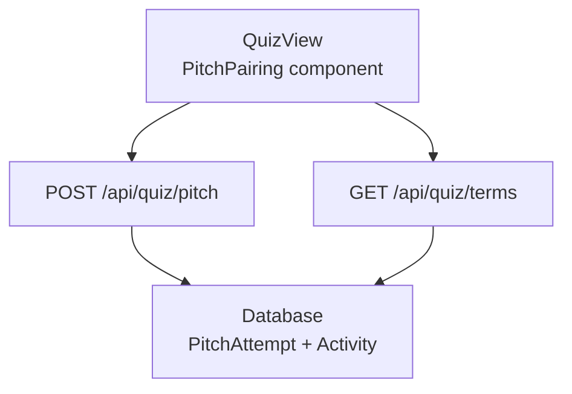
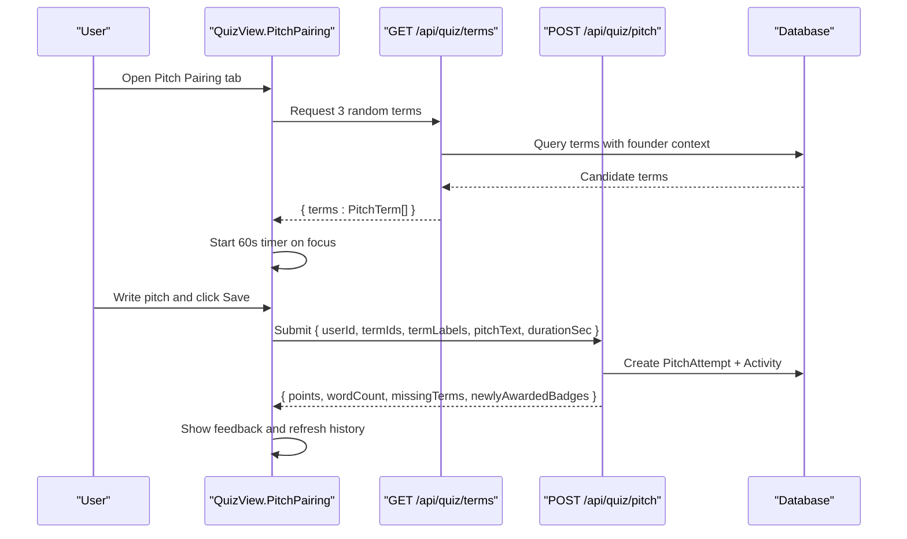
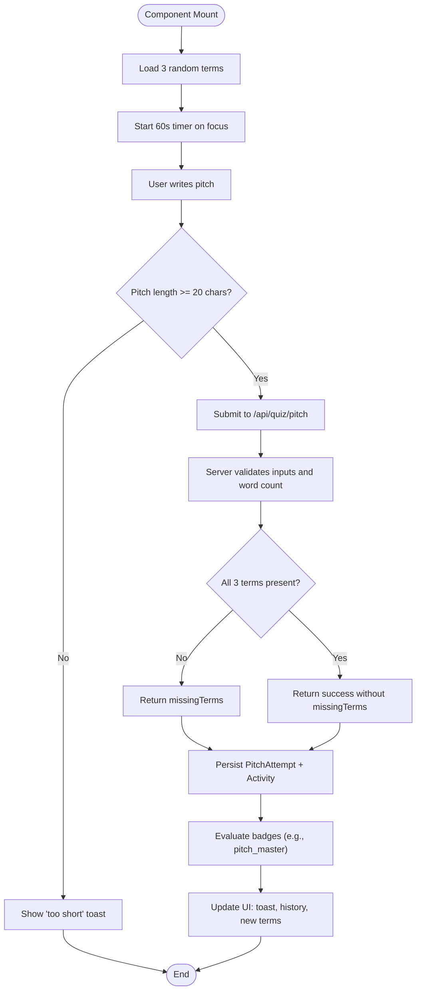
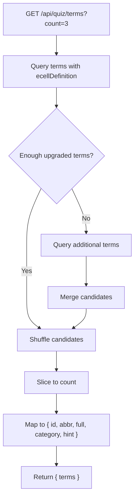
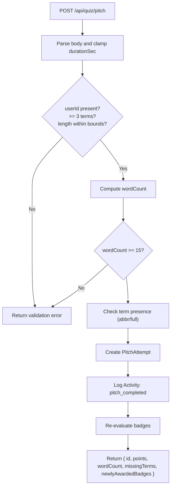
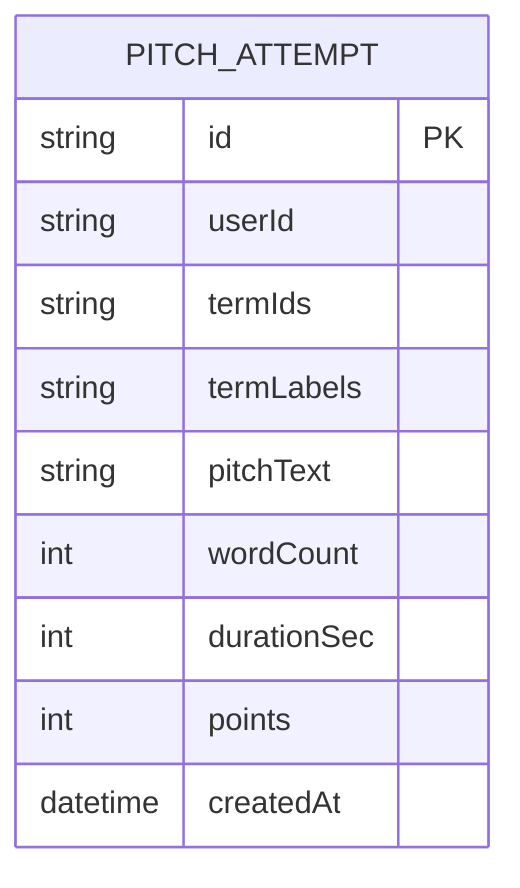
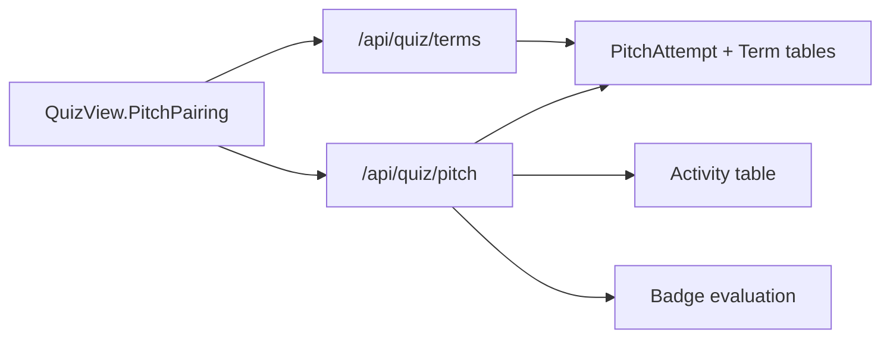

# Pitch Pairing Feature

<cite>
**Referenced Files in This Document**
- [quiz-view.tsx](file://src/components/welearn/quiz-view.tsx)
- [route.ts (pitch)](file://src/app/api/quiz/pitch/route.ts)
- [route.ts (terms)](file://src/app/api/quiz/terms/route.ts)
- [schema.prisma](file://prisma/schema.prisma)
- [seed.sql](file://supabase/migrations/20261107_data_seed.sql)
</cite>

## Table of Contents
1. [Introduction](#introduction)
2. [Project Structure](#project-structure)
3. [Core Components](#core-components)
4. [Architecture Overview](#architecture-overview)
5. [Detailed Component Analysis](#detailed-component-analysis)
6. [Dependency Analysis](#dependency-analysis)
7. [Performance Considerations](#performance-considerations)
8. [Troubleshooting Guide](#troubleshooting-guide)
9. [Conclusion](#conclusion)

## Introduction
The Pitch Pairing feature is a founder-mode drill where users connect three random startup terms with an elevator pitch. The user interface presents three randomly selected terms and asks the user to write a concise, natural pitch that uses all three terms. The system records each attempt, awards points for completion, tracks performance metrics such as word count and duration, and provides feedback when one or more terms are missing from the pitch.

This documentation explains:
- The `PitchTerm` interface used by the UI.
- The term selection algorithm that returns three random terms.
- The `PitchAttempt` structure persisted for each submission.
- Scoring rules, time limits, and performance metrics.
- Examples of how term combinations appear and how the feature integrates with the main quiz interface.

## Project Structure
Pitch Pairing spans the frontend component, two API routes, and the database schema:

**Diagram sources**
- [quiz-view.tsx:892-983](file://src/components/welearn/quiz-view.tsx#L892-L983)
- [route.ts (terms):4-46](file://src/app/api/quiz/terms/route.ts#L4-L46)
- [route.ts (pitch):4-132](file://src/app/api/quiz/pitch/route.ts#L4-L132)
- [schema.prisma:218-232](file://prisma/schema.prisma#L218-L232)

**Section sources**
- [quiz-view.tsx:892-1100](file://src/components/welearn/quiz-view.tsx#L892-L1100)
- [route.ts (terms):1-47](file://src/app/api/quiz/terms/route.ts#L1-L47)
- [route.ts (pitch):1-133](file://src/app/api/quiz/pitch/route.ts#L1-L133)
- [schema.prisma:218-232](file://prisma/schema.prisma#L218-L232)

## Core Components
This section documents the data contracts and processing logic that power Pitch Pairing.

### PitchTerm Interface
The UI defines `PitchTerm` to represent a single startup term presented to the user. It includes:
- `id`: Unique identifier for the term.
- `abbr`: Short abbreviation shown prominently.
- `full`: Full term name.
- `category`: Category label for grouping or filtering.
- `hint`: Optional hint text, sourced from the term’s founder-context definition.

These fields are consumed by the Pitch Pairing card to display the three terms and optional hints.

**Section sources**
- [quiz-view.tsx:104-110](file://src/components/welearn/quiz-view.tsx#L104-L110)

### PitchAttempt Structure
The `PitchAttempt` structure represents a saved pitch submission. It includes:
- `termLabels`: Array of `{ abbr, full }` labels for archival display.
- `pitchText`: The user’s written pitch.
- `wordCount`: Number of words in the pitch.
- `durationSec`: Time spent on the attempt in seconds.
- `points`: Points awarded for completing the drill.
- `createdAt`: Timestamp of the submission.

The server persists additional fields such as `termIds`, `pitchText`, `wordCount`, `durationSec`, `points`, and timestamps.

**Section sources**
- [quiz-view.tsx:112-120](file://src/components/welearn/quiz-view.tsx#L112-L120)
- [schema.prisma:218-232](file://prisma/schema.prisma#L218-L232)

### Term Selection Algorithm
The `/api/quiz/terms` endpoint selects three random terms for the drill:
- It queries terms with founder-context definitions first.
- If there are not enough upgraded terms, it supplements with any available terms.
- It shuffles candidates and slices the requested count (default 3).
- It maps results to `{ id, abbr, full, category, hint }`.

This ensures rich context when possible while guaranteeing availability even with limited data.

**Section sources**
- [route.ts (terms):4-46](file://src/app/api/quiz/terms/route.ts#L4-L46)

### Pitch Submission and Validation
The `/api/quiz/pitch` endpoint handles saving a pitch attempt:
- Validates presence of `userId`, at least three terms, and reasonable pitch length.
- Computes `wordCount` and enforces minimum word thresholds.
- Checks whether all three terms appear in the pitch using case-insensitive matching against both abbreviation and the first word of the full form.
- Persists the attempt and logs an activity entry.
- Awards 15 points and evaluates badges based on completed pitches.

**Section sources**
- [route.ts (pitch):40-132](file://src/app/api/quiz/pitch/route.ts#L40-L132)

## Architecture Overview
The following sequence diagram shows the end-to-end flow from loading terms to saving a pitch and receiving feedback.

**Diagram sources**
- [quiz-view.tsx:911-983](file://src/components/welearn/quiz-view.tsx#L911-L983)
- [route.ts (terms):8-46](file://src/app/api/quiz/terms/route.ts#L8-L46)
- [route.ts (pitch):40-132](file://src/app/api/quiz/pitch/route.ts#L40-L132)
- [schema.prisma:218-232](file://prisma/schema.prisma#L218-L232)

## Detailed Component Analysis

### PitchPairing Component
The `PitchPairing` component orchestrates the drill:
- Loads three random terms via `/api/quiz/terms`.
- Maintains state for the pitch text, countdown timer, saving status, and missing terms feedback.
- Starts a 60-second timer when the textarea receives focus.
- Calculates live word count and displays guidance colors.
- Submits the pitch to `/api/quiz/pitch` with term IDs, labels, text, and elapsed time.
- Displays coach tips if one or more terms were not explicitly used.
- Refreshes history and loads new terms after saving.

**Diagram sources**
- [quiz-view.tsx:911-983](file://src/components/welearn/quiz-view.tsx#L911-L983)
- [route.ts (pitch):40-132](file://src/app/api/quiz/pitch/route.ts#L40-L132)

**Section sources**
- [quiz-view.tsx:892-1100](file://src/components/welearn/quiz-view.tsx#L892-L1100)

### Term Selection Endpoint
The `/api/quiz/terms` endpoint:
- Accepts a `count` parameter (default 3, clamped between 3 and 5).
- Prefers terms with founder-context definitions (`ecellDefinition`).
- Supplements with any terms if insufficient upgraded terms exist.
- Shuffles and returns the requested number of terms mapped to `PitchTerm`.

**Diagram sources**
- [route.ts (terms):8-46](file://src/app/api/quiz/terms/route.ts#L8-L46)

**Section sources**
- [route.ts (terms):1-47](file://src/app/api/quiz/terms/route.ts#L1-L47)

### Pitch Submission Endpoint
The `/api/quiz/pitch` endpoint:
- Parses and validates input fields including `userId`, `termIds`, `termLabels`, `pitchText`, and `durationSec`.
- Enforces minimum and maximum lengths and word counts.
- Performs simple inclusion checks for term abbreviations and the first word of full forms.
- Persists the attempt and logs an activity entry.
- Re-evaluates badges based on completed pitch counts.

**Diagram sources**
- [route.ts (pitch):40-132](file://src/app/api/quiz/pitch/route.ts#L40-L132)

**Section sources**
- [route.ts (pitch):1-133](file://src/app/api/quiz/pitch/route.ts#L1-L133)

### Data Model
The database model for pitch attempts stores:
- `userId`: User who submitted the pitch.
- `termIds`: JSON array of term identifiers.
- `termLabels`: JSON array of `{ abbr, full }` labels.
- `pitchText`: The user’s pitch text.
- `wordCount`: Computed word count.
- `durationSec`: Duration in seconds.
- `points`: Fixed points for completion.
- `createdAt`: Timestamp.

**Diagram sources**
- [schema.prisma:218-232](file://prisma/schema.prisma#L218-L232)

**Section sources**
- [schema.prisma:218-232](file://prisma/schema.prisma#L218-L232)

## Dependency Analysis
Pitch Pairing depends on:
- Frontend component state and timers.
- Two API endpoints for term selection and pitch submission.
- Database models for persistence and activity logging.
- Badge evaluation logic tied to completed pitches.

**Diagram sources**
- [quiz-view.tsx:892-983](file://src/components/welearn/quiz-view.tsx#L892-L983)
- [route.ts (terms):8-46](file://src/app/api/quiz/terms/route.ts#L8-L46)
- [route.ts (pitch):40-132](file://src/app/api/quiz/pitch/route.ts#L40-L132)
- [schema.prisma:218-232](file://prisma/schema.prisma#L218-L232)

**Section sources**
- [quiz-view.tsx:892-1100](file://src/components/welearn/quiz-view.tsx#L892-L1100)
- [route.ts (terms):1-47](file://src/app/api/quiz/terms/route.ts#L1-L47)
- [route.ts (pitch):1-133](file://src/app/api/quiz/pitch/route.ts#L1-L133)
- [schema.prisma:218-232](file://prisma/schema.prisma#L218-L232)

## Performance Considerations
- Term selection performs two queries when upgraded terms are insufficient; consider caching or pre-seeding to reduce variability.
- Pitch submission computes word count and performs simple string matching; this is lightweight but should be monitored under high load.
- Badge re-evaluation iterates over all badges and counts user pitch attempts; consider indexing or incremental checks if badge sets grow significantly.
- The UI calculates word count client-side for immediate feedback; ensure consistent trimming and splitting behavior across environments.

[No sources needed since this section provides general guidance]

## Troubleshooting Guide
Common issues and resolutions:
- Missing terms in the pitch: The server returns `missingTerms`; the UI shows a coach tip encouraging re-attempts until all terms appear naturally.
- Too short pitch: Both client and server enforce minimum lengths; aim for 80–120 words as guided by the UI.
- No terms available: The terms endpoint returns an error if no terms are seeded; seed the database with terms that include founder-context definitions.
- Timer behavior: The timer starts on focus; ensure the textarea is focused before starting to avoid unintended early timeouts.

**Section sources**
- [route.ts (pitch):56-69](file://src/app/api/quiz/pitch/route.ts#L56-L69)
- [quiz-view.tsx:943-983](file://src/components/welearn/quiz-view.tsx#L943-L983)
- [route.ts (terms):30-32](file://src/app/api/quiz/terms/route.ts#L30-L32)

## Conclusion
Pitch Pairing integrates a straightforward yet effective learning loop:
- Randomly select three startup terms with rich context.
- Challenge users to craft a concise elevator pitch within 60 seconds.
- Record attempts, award points, and provide actionable feedback.
- Track performance metrics like word count and duration.
- Encourage mastery through repeated practice and badge progression.

This design balances simplicity with meaningful feedback, making it suitable for founder-mode training and skill development.

[No sources needed since this section summarizes without analyzing specific files]