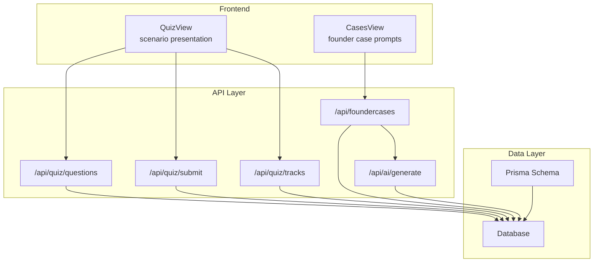
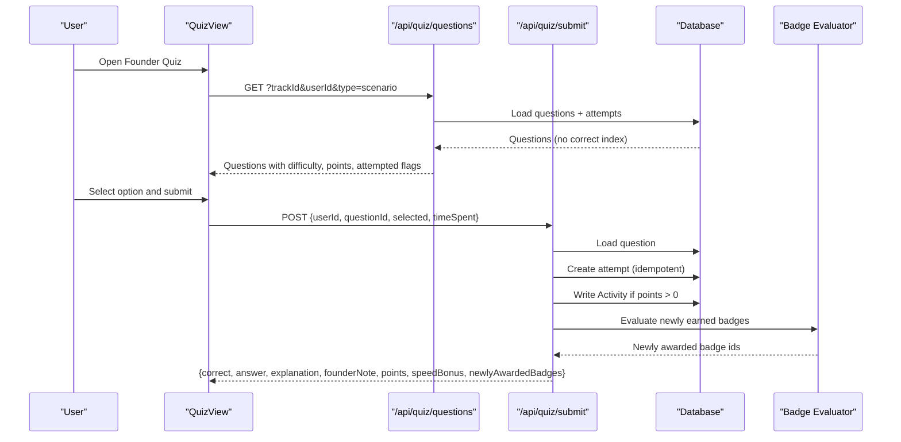
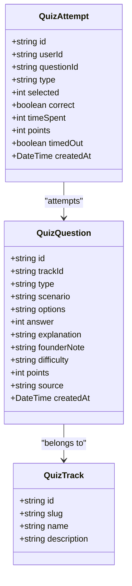
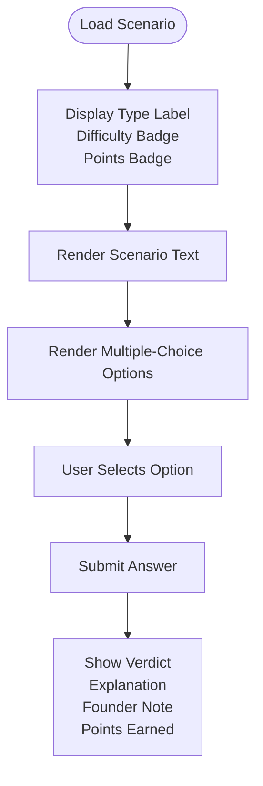
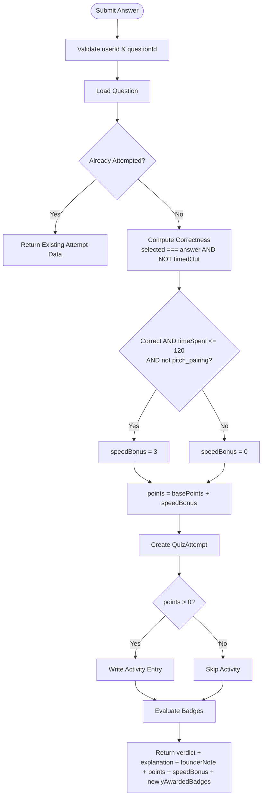
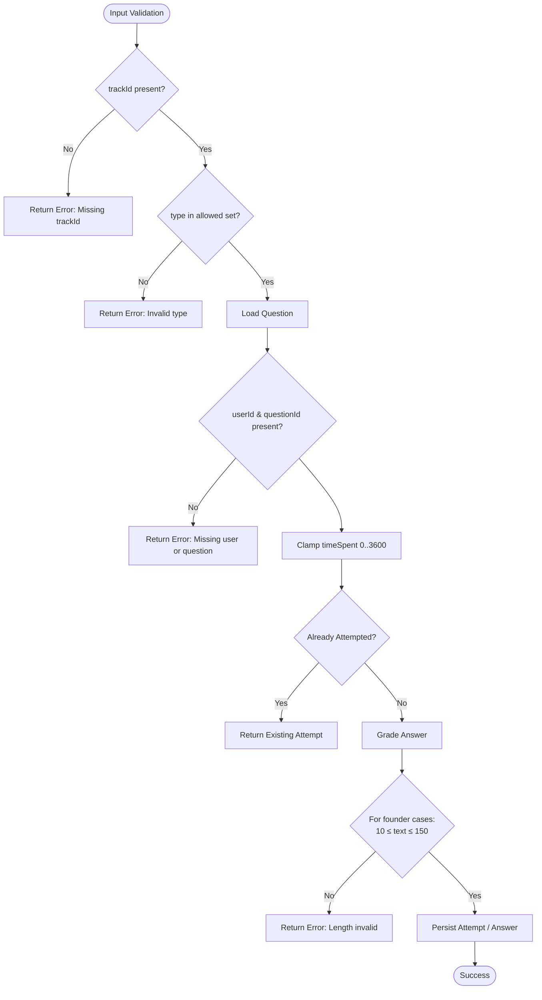
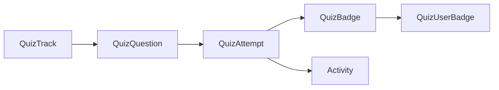
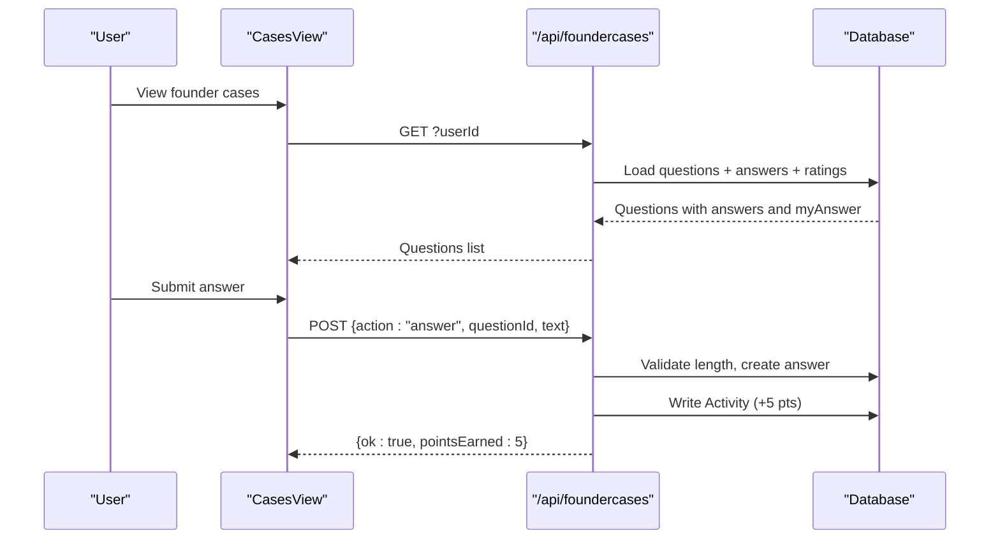
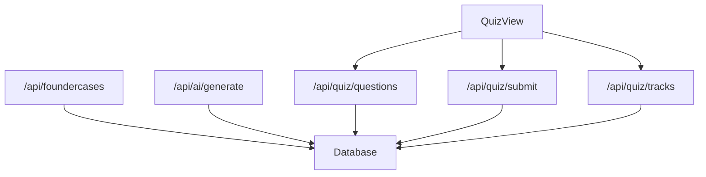

# Founder Mode Scenarios

<cite>
**Referenced Files in This Document**
- [route.ts](file://src/app/api/foundercases/route.ts)
- [quizSeedData.ts](file://src/lib/quizSeedData.ts)
- [schema.prisma](file://prisma/schema.prisma)
- [route.ts](file://src/app/api/quiz/questions/route.ts)
- [route.ts](file://src/app/api/quiz/submit/route.ts)
- [route.ts](file://src/app/api/quiz/tracks/route.ts)
- [route.ts](file://src/app/api/ai/generate/route.ts)
- [cases-view.tsx](file://src/components/welearn/cases-view.tsx)
- [quiz-view.tsx](file://src/components/welearn/quiz-view.tsx)
</cite>

## Table of Contents
1. [Introduction](#introduction)
2. [Project Structure](#project-structure)
3. [Core Components](#core-components)
4. [Architecture Overview](#architecture-overview)
5. [Detailed Component Analysis](#detailed-component-analysis)
6. [Dependency Analysis](#dependency-analysis)
7. [Performance Considerations](#performance-considerations)
8. [Troubleshooting Guide](#troubleshooting-guide)
9. [Conclusion](#conclusion)

## Introduction
This document explains the Founder Mode scenarios question type used by the Founder Quiz and related founder-mode features. It covers how real startup decision-making scenarios are presented, the data model for scenario questions, multiple-choice options, difficulty levels, scoring with speed bonuses, validation rules, feedback fields, and integration with tracks and badges.

Founder Mode scenarios are one of several question types in the quiz system. They simulate realistic founder decisions such as fundraising choices, team-building challenges, product-market fit dilemmas, and growth strategy trade-offs. The system stores validated question metadata, grades submissions server-side, awards points (including speed bonuses), records attempts, and contributes to badge earning mechanics.

## Project Structure
The Founder Mode scenarios feature spans API routes, database schema, seed data, AI generation prompts, and UI components:

**Diagram sources**
- [quiz-view.tsx:142-150](file://src/components/welearn/quiz-view.tsx#L142-L150)
- [route.ts:1-60](file://src/app/api/quiz/questions/route.ts#L1-L60)
- [route.ts:1-156](file://src/app/api/quiz/submit/route.ts#L1-L156)
- [route.ts:1-68](file://src/app/api/quiz/tracks/route.ts#L1-L68)
- [route.ts:1-155](file://src/app/api/foundercases/route.ts#L1-L155)
- [route.ts:178-198](file://src/app/api/ai/generate/route.ts#L178-L198)
- [schema.prisma:151-170](file://prisma/schema.prisma#L151-L170)

**Section sources**
- [quiz-view.tsx:142-150](file://src/components/welearn/quiz-view.tsx#L142-L150)
- [route.ts:1-60](file://src/app/api/quiz/questions/route.ts#L1-L60)
- [route.ts:1-156](file://src/app/api/quiz/submit/route.ts#L1-L156)
- [route.ts:1-68](file://src/app/api/quiz/tracks/route.ts#L1-L68)
- [route.ts:1-155](file://src/app/api/foundercases/route.ts#L1-L155)
- [route.ts:178-198](file://src/app/api/ai/generate/route.ts#L178-L198)
- [schema.prisma:151-170](file://prisma/schema.prisma#L151-L170)

## Core Components
- Scenario question model: stores scenario text, options, correct answer index, explanation, founderNote, difficulty, points, source, and track association.
- Attempt tracking: records user selection, correctness, time spent, points earned, and timeout status.
- Scoring engine: calculates base points plus optional speed bonus; writes activity entries.
- Badge evaluation: computes per-track and cross-track badge eligibility based on attempt history.
- Track progress: aggregates attempted and correct counts per track.
- Founder cases flow: separate open-ended founder prompt-and-answer experience with peer rating and fixed point reward.

**Section sources**
- [schema.prisma:151-188](file://prisma/schema.prisma#L151-L188)
- [route.ts:1-156](file://src/app/api/quiz/submit/route.ts#L1-L156)
- [route.ts:1-68](file://src/app/api/quiz/tracks/route.ts#L1-L68)
- [route.ts:1-155](file://src/app/api/foundercases/route.ts#L1-L155)

## Architecture Overview
The Founder Mode scenarios workflow integrates the quiz UI, server-side grading, and badge system:

**Diagram sources**
- [route.ts:1-60](file://src/app/api/quiz/questions/route.ts#L1-L60)
- [route.ts:1-156](file://src/app/api/quiz/submit/route.ts#L1-L156)
- [schema.prisma:151-188](file://prisma/schema.prisma#L151-L188)

## Detailed Component Analysis

### Scenario Question Data Model
The core data structure for Founder Mode scenarios is stored in the quiz question model. Each scenario includes:
- Scenario text describing a realistic founder dilemma.
- Multiple-choice options array.
- Correct answer index.
- Explanation field providing feedback after submission.
- Optional founderNote field offering practical founder context.
- Difficulty level: easy, medium, or hard.
- Points value for correct answers.
- Source indicating curated or AI-generated content.
- Association to a track (e.g., investment, growth, ops_legal, product_tech, strategy).

**Diagram sources**
- [schema.prisma:151-188](file://prisma/schema.prisma#L151-L188)

**Section sources**
- [schema.prisma:151-188](file://prisma/schema.prisma#L151-L188)

### Scenario Presentation and Difficulty Display
The UI renders scenario questions with:
- Type label “Founder Mode” for scenario questions.
- Difficulty badge: easy, medium, hard.
- Points badge showing base points.
- Attempted state and last result indicator.
- Scenario text displayed prominently.
- Options rendered as selectable choices.

**Diagram sources**
- [quiz-view.tsx:741-794](file://src/components/welearn/quiz-view.tsx#L741-L794)
- [quiz-view.tsx:142-150](file://src/components/welearn/quiz-view.tsx#L142-L150)

**Section sources**
- [quiz-view.tsx:741-794](file://src/components/welearn/quiz-view.tsx#L741-L794)
- [quiz-view.tsx:142-150](file://src/components/welearn/quiz-view.tsx#L142-L150)

### Scoring System and Speed Bonuses
Scoring logic is implemented server-side:
- Base points come from the question’s points field.
- Speed bonus adds extra points when the answer is correct and submitted within a time threshold.
- Incorrect answers yield zero points.
- Attempts are idempotent: only the first graded attempt per question counts for points.
- Activity entries record module, action, detail, and points when points are earned.

**Diagram sources**
- [route.ts:1-156](file://src/app/api/quiz/submit/route.ts#L1-L156)

**Section sources**
- [route.ts:1-156](file://src/app/api/quiz/submit/route.ts#L1-L156)

### Validation Rules for Scenario Data
Validation occurs at both API and UI layers:
- Missing trackId returns an error.
- Allowed question types are enforced: scenario, red_flag, micro_math, pitch_pairing.
- Correct answer index is intentionally omitted from client responses; server grades on submit.
- Attempt submission validates userId and questionId presence.
- Time spent is clamped between 0 and 3600 seconds.
- Timed-out submissions are recorded but cannot earn points.
- For founder cases (open-ended), answer length must be between 10 and 150 characters; duplicate answers are rejected.

**Diagram sources**
- [route.ts:1-60](file://src/app/api/quiz/questions/route.ts#L1-L60)
- [route.ts:1-156](file://src/app/api/quiz/submit/route.ts#L1-L156)
- [route.ts:100-124](file://src/app/api/foundercases/route.ts#L100-L124)

**Section sources**
- [route.ts:1-60](file://src/app/api/quiz/questions/route.ts#L1-L60)
- [route.ts:1-156](file://src/app/api/quiz/submit/route.ts#L1-L156)
- [route.ts:100-124](file://src/app/api/foundercases/route.ts#L100-L124)

### Explanation and FounderNote Fields
After submission, users receive:
- Explanation: why the selected answer is correct.
- FounderNote: optional practical takeaway for founders.
These fields are included in the submit response and can be shown in the UI alongside the verdict.

**Section sources**
- [route.ts:140-151](file://src/app/api/quiz/submit/route.ts#L140-L151)
- [schema.prisma:151-170](file://prisma/schema.prisma#L151-L170)

### Examples of Typical Founder Scenarios
The seed data provides representative scenarios across key founder topics:
- Fundraising decisions: liquidation preference interpretation, term sheet comparisons, valuation math.
- Growth strategy choices: penetration pricing vs conversion optimization, CAC/LTV analysis.
- Product-market fit dilemmas: MVP focus, churn measurement, user testing pitfalls.
- Macro-strategy frameworks: PESTLE application, market sizing realism, economies of scale.

These examples demonstrate:
- Realistic scenario text grounded in Indian startup contexts.
- Four plausible multiple-choice options.
- Clear correct answer index.
- Detailed explanation and founderNote.
- Difficulty levels ranging from easy to hard.
- Points reflecting complexity and learning value.

**Section sources**
- [quizSeedData.ts:93-468](file://src/lib/quizSeedData.ts#L93-L468)

### Integration with Tracks and Badge Mechanics
Tracks organize scenarios into thematic areas:
- Investment & Funding
- Growth & Marketing
- Operations & Legal
- Product & Tech
- Macro-Strategy

Per-track progress is computed from attempts:
- Attempted count
- Correct count
- Total questions
- Progress percentage
- Whether the track-specific badge has been earned

Badge evaluation considers:
- Any correct answer threshold
- Per-track correct thresholds
- Pitch completion thresholds
- Completion of all track badges

**Diagram sources**
- [schema.prisma:151-216](file://prisma/schema.prisma#L151-L216)
- [route.ts:1-68](file://src/app/api/quiz/tracks/route.ts#L1-L68)
- [route.ts:1-73](file://src/app/api/quiz/submit/route.ts#L1-L73)

**Section sources**
- [route.ts:1-68](file://src/app/api/quiz/tracks/route.ts#L1-L68)
- [route.ts:1-73](file://src/app/api/quiz/submit/route.ts#L1-L73)
- [schema.prisma:151-216](file://prisma/schema.prisma#L151-L216)

### Founder Cases Flow (Open-Ended Founder Prompts)
Separate from the multiple-choice Founder Mode scenarios, the founder cases feature presents open-ended founder prompts:
- Users write concise answers (10–150 characters).
- Answers are peer-rated with stars.
- Submitting an answer awards fixed points and creates an activity entry.
- AI generation or curated bank supplies new prompts.

**Diagram sources**
- [route.ts:1-155](file://src/app/api/foundercases/route.ts#L1-L155)
- [cases-view.tsx:870-1069](file://src/components/welearn/cases-view.tsx#L870-L1069)

**Section sources**
- [route.ts:1-155](file://src/app/api/foundercases/route.ts#L1-L155)
- [cases-view.tsx:870-1069](file://src/components/welearn/cases-view.tsx#L870-L1069)

## Dependency Analysis
Key dependencies and relationships:
- QuizView depends on /api/quiz/questions, /api/quiz/submit, and /api/quiz/tracks.
- Foundercases route depends on database models for questions, answers, ratings, and activity.
- AI generation route constructs prompts for founder quiz questions and enforces JSON structure including scenario, options, answer, explanation, founderNote, difficulty.
- Database schema defines entities for questions, attempts, badges, and activities.

**Diagram sources**
- [quiz-view.tsx:142-150](file://src/components/welearn/quiz-view.tsx#L142-L150)
- [route.ts:1-60](file://src/app/api/quiz/questions/route.ts#L1-L60)
- [route.ts:1-156](file://src/app/api/quiz/submit/route.ts#L1-L156)
- [route.ts:1-68](file://src/app/api/quiz/tracks/route.ts#L1-L68)
- [route.ts:1-155](file://src/app/api/foundercases/route.ts#L1-L155)
- [route.ts:178-198](file://src/app/api/ai/generate/route.ts#L178-L198)

**Section sources**
- [quiz-view.tsx:142-150](file://src/components/welearn/quiz-view.tsx#L142-L150)
- [route.ts:1-60](file://src/app/api/quiz/questions/route.ts#L1-L60)
- [route.ts:1-156](file://src/app/api/quiz/submit/route.ts#L1-L156)
- [route.ts:1-68](file://src/app/api/quiz/tracks/route.ts#L1-L68)
- [route.ts:1-155](file://src/app/api/foundercases/route.ts#L1-L155)
- [route.ts:178-198](file://src/app/api/ai/generate/route.ts#L178-L198)

## Performance Considerations
- Server-side grading prevents client manipulation and ensures consistent scoring.
- Idempotent attempt handling avoids duplicate point awards.
- Clamping timeSpent reduces edge-case overhead.
- Aggregating attempts once per track endpoint minimizes repeated queries.
- Using indexes on userId, questionId, and createdAt improves query performance for attempts and activities.

[No sources needed since this section provides general guidance]

## Troubleshooting Guide
Common issues and resolutions:
- Missing trackId: ensure the request includes a valid track identifier.
- Invalid question type: restrict to scenario, red_flag, micro_math, pitch_pairing.
- Duplicate founder case answer: prevent re-submission; return conflict error.
- Answer length violations: enforce minimum and maximum character limits.
- Incorrect scoring: verify that correct answer index is not exposed to the client and that speed bonus conditions are met.
- Badge not awarded: check criteria evaluation logic and attempt aggregation.

**Section sources**
- [route.ts:1-60](file://src/app/api/quiz/questions/route.ts#L1-L60)
- [route.ts:1-156](file://src/app/api/quiz/submit/route.ts#L1-L156)
- [route.ts:100-124](file://src/app/api/foundercases/route.ts#L100-L124)

## Conclusion
Founder Mode scenarios provide a structured, realistic simulation of startup decision-making. The system combines clear scenario text, multiple-choice options, difficulty levels, and robust scoring with speed bonuses. Feedback through explanation and founderNote fields supports learning. Integration with tracks and badges encourages sustained engagement and mastery across key founder competencies. The open-ended founder cases complement the multiple-choice scenarios by fostering peer discussion and practical reasoning.

[No sources needed since this section summarizes without analyzing specific files]