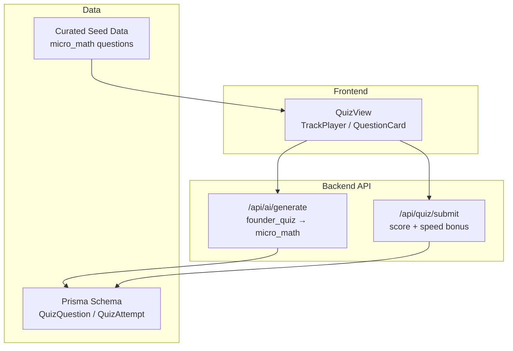
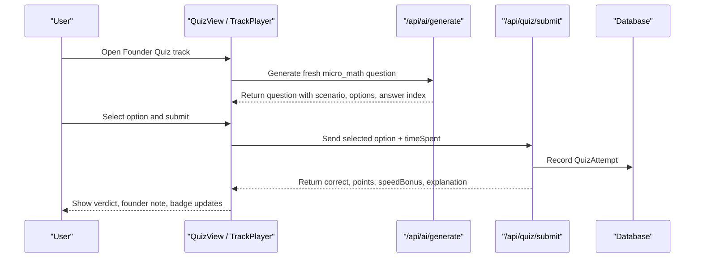
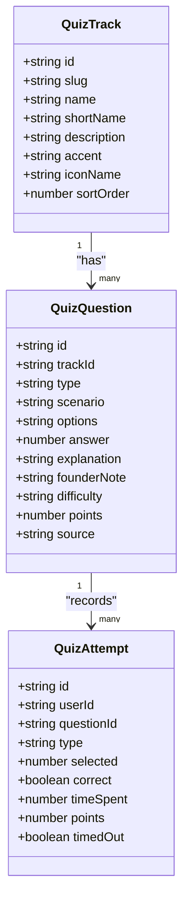
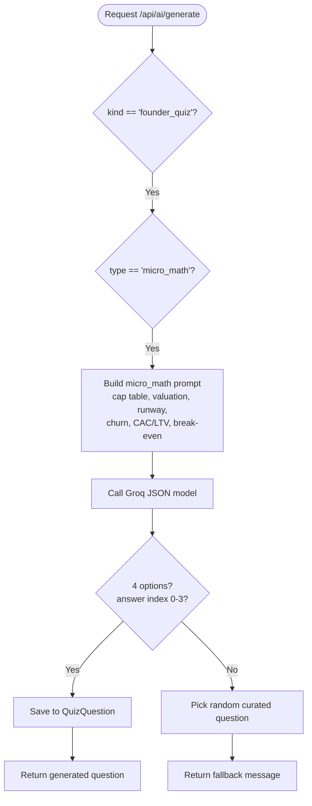
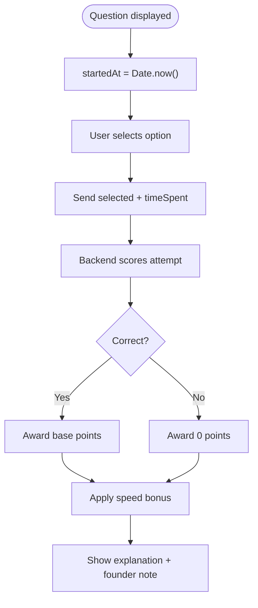
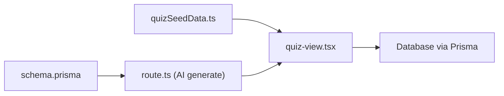

# Micro-Math Drills

<cite>
**Referenced Files in This Document**
- [quizSeedData.ts](file://src/lib/quizSeedData.ts)
- [quiz-view.tsx](file://src/components/welearn/quiz-view.tsx)
- [route.ts (AI generate)](file://src/app/api/ai/generate/route.ts)
- [schema.prisma](file://prisma/schema.prisma)
- [README.md](file://README.md)
</cite>

## Table of Contents
1. [Introduction](#introduction)
2. [Project Structure](#project-structure)
3. [Core Components](#core-components)
4. [Architecture Overview](#architecture-overview)
5. [Detailed Component Analysis](#detailed-component-analysis)
6. [Dependency Analysis](#dependency-analysis)
7. [Performance Considerations](#performance-considerations)
8. [Troubleshooting Guide](#troubleshooting-guide)
9. [Conclusion](#conclusion)

## Introduction
Micro-Math drills are a founder-mode question type focused on quick, practical calculations that startup operators use daily. They train numerical fluency for unit economics, fundraising math, and operational decision-making under time pressure. Typical micro-math scenarios include:

- Customer acquisition cost (CAC) and lifetime value (LTV) computations
- CAC-to-LTV ratios
- Break-even point analysis
- Runway and burn-rate checks
- Valuation and cap-table arithmetic
- Churn compounding and revenue decay
- Profit margin and contribution-margin reasoning

The goal is not just to get the right number, but to build fast mental models that help founders evaluate growth levers, funding needs, pricing, and investor metrics during real conversations.

## Project Structure
Micro-Math drills live inside the Founder Quiz feature. The relevant pieces are:

- Curated micro-math questions in seed data
- UI components that render, filter, and score micro-math questions
- AI generation endpoint that can create new micro-math drills
- Database schema that stores quiz tracks, questions, attempts, and badges

**Diagram sources**
- [quiz-view.tsx:142-150](file://src/components/welearn/quiz-view.tsx#L142-L150)
- [quiz-view.tsx:505-635](file://src/components/welearn/quiz-view.tsx#L505-L635)
- [route.ts (AI generate):178-263](file://src/app/api/ai/generate/route.ts#L178-L263)
- [schema.prisma:137-188](file://prisma/schema.prisma#L137-L188)
- [quizSeedData.ts:116-134](file://src/lib/quizSeedData.ts#L116-L134)

**Section sources**
- [quizSeedData.ts:1-25](file://src/lib/quizSeedData.ts#L1-L25)
- [quiz-view.tsx:142-150](file://src/components/welearn/quiz-view.tsx#L142-L150)
- [route.ts (AI generate):178-263](file://src/app/api/ai/generate/route.ts#L178-L263)
- [schema.prisma:137-188](file://prisma/schema.prisma#L137-L188)

## Core Components
Micro-Math drills are defined by a consistent structure:

| Field | Meaning | Notes |
|---|---|---|
| `trackSlug` | Category such as investment, growth, ops_legal, product_tech, strategy | Determines which founder track the drill belongs to |
| `type` | Always `"micro_math"` for this drill type | Used by UI filters and AI generator routing |
| `scenario` | Startup context with numbers | Usually requires one or two quick calculations |
| `options` | Four string options | Exactly four choices; only one correct index |
| `answer` | Zero-based index of the correct option | Stored as an integer |
| `explanation` | Worked solution and business interpretation | Helps users learn why the answer is correct |
| `founderNote` | Optional founder takeaway | Reinforces when and how founders use this calculation |
| `difficulty` | `"easy"`, `"medium"`, or `"hard"` | Affects points awarded |
| `points` | Base points for the question | Harder questions award more points |

This structure appears both in curated seed data and in AI-generated questions.

**Section sources**
- [quizSeedData.ts:15-25](file://src/lib/quizSeedData.ts#L15-L25)
- [schema.prisma:151-170](file://prisma/schema.prisma#L151-L170)

## Architecture Overview
A micro-math drill flows through three main stages:

1. **Load**: The frontend loads a track and filters questions by type, including `"micro_math"`.
2. **Answer**: The user selects one of four options and submits within a self-timed window.
3. **Score**: The backend records the attempt, calculates correctness, applies a speed bonus, and returns feedback.

**Diagram sources**
- [quiz-view.tsx:542-600](file://src/components/welearn/quiz-view.tsx#L542-L600)
- [route.ts (AI generate):178-263](file://src/app/api/ai/generate/route.ts#L178-L263)
- [schema.prisma:172-188](file://prisma/schema.prisma#L172-L188)

## Detailed Component Analysis

### Micro-Math Question Model
The micro-math model is part of the broader Founder Quiz question model. It shares fields with scenario and red-flag questions, but its content is numeric and calculation-focused.

**Diagram sources**
- [schema.prisma:137-188](file://prisma/schema.prisma#L137-L188)

**Section sources**
- [schema.prisma:137-188](file://prisma/schema.prisma#L137-L188)

### Curated Micro-Math Scenarios
The curated seed data includes several micro-math drills across tracks:

- Investment track: post-money and pre-money valuation calculation
- Growth track: CAC, LTV, and CAC-to-LTV ratio
- Operations & Legal track: break-even cups per month for a coffee cart
- Product & Tech track: churn compounding over multiple months

These examples show the expected complexity: realistic startup numbers, clear inputs, and answers that require either one-step or two-step mental math.

**Section sources**
- [quizSeedData.ts:116-134](file://src/lib/quizSeedData.ts#L116-L134)
- [quizSeedData.ts:191-209](file://src/lib/quizSeedData.ts#L191-L209)
- [quizSeedData.ts:310-322](file://src/lib/quizSeedData.ts#L310-L322)
- [quizSeedData.ts:384-397](file://src/lib/quizSeedData.ts#L384-L397)

### AI Generation of Micro-Math Drills
The AI generator supports a `founder_quiz` kind with a `micro_math` type. When requested, it prompts the model to create a calculation drill that can be solved in about two minutes. The prompt explicitly mentions common founder calculations such as cap table math, valuation, runway, churn, CAC/LTV, and break-even.

Key behaviors:

- Validates that exactly four options exist
- Validates that the answer is a zero-based index between 0 and 3
- Stores generated questions with `source: "ai"`
- Falls back to curated questions if AI is unavailable or malformed

**Diagram sources**
- [route.ts (AI generate):178-263](file://src/app/api/ai/generate/route.ts#L178-L263)

**Section sources**
- [route.ts (AI generate):178-263](file://src/app/api/ai/generate/route.ts#L178-L263)

### Frontend Handling of Micro-Math Drills
The UI treats micro-math drills like other Founder Quiz question types, but highlights them with a dedicated label and icon. Users can filter by `"micro_math"` to practice calculation-heavy questions separately from scenario or red-flag questions.

Important behaviors:

- Type metadata maps `"micro_math"` to the label `"Micro-Math Drill"`
- Filter state supports `"all"`, `"scenario"`, `"red_flag"`, and `"micro_math"`
- Questions are loaded per track, optionally filtered by type
- Each question shows difficulty, base points, and whether it came from AI

**Section sources**
- [quiz-view.tsx:142-150](file://src/components/welearn/quiz-view.tsx#L142-L150)
- [quiz-view.tsx:164-165](file://src/components/welearn/quiz-view.tsx#L164-L165)
- [quiz-view.tsx:542-557](file://src/components/welearn/quiz-view.tsx#L542-L557)
- [quiz-view.tsx:668-687](file://src/components/welearn/quiz-view.tsx#L668-L687)

### Time-Based Scoring and Speed Bonus
Micro-Math drills reward quick mental math through a speed bonus. The frontend measures time spent since the question started loading, sends that duration to the submission endpoint, and displays the resulting speed bonus.

Scoring flow:

1. User opens a question → timer starts
2. User selects an option and submits
3. Frontend computes seconds elapsed
4. Backend evaluates correctness and awards base points plus optional speed bonus
5. UI shows total points and any newly unlocked badges

**Diagram sources**
- [quiz-view.tsx:537-600](file://src/components/welearn/quiz-view.tsx#L537-L600)

**Section sources**
- [quiz-view.tsx:537-600](file://src/components/welearn/quiz-view.tsx#L537-L600)

### Mathematical Problem Formats
Micro-Math problems generally follow these patterns:

| Scenario Type | Inputs | Calculation Pattern | Output Expected |
|---|---|---|---|
| Valuation | Investment amount and equity percentage | Post-money = investment ÷ equity%; Pre-money = post-money − investment | Two valuation numbers |
| CAC/LTV | Ad spend, customers acquired, average order value, gross margin, repeat rate, retention period | CAC = spend ÷ customers; LTV = revenue × margin × repeats × years | Ratio or absolute LTV |
| Break-even | Fixed costs, selling price, variable cost per unit | Contribution = price − variable cost; Break-even = fixed ÷ contribution | Units per period |
| Runway | Cash balance and monthly net burn | Runway = cash ÷ monthly burn | Months |
| Churn compounding | Starting customers, monthly churn rate, number of months | Keep factor = 1 − churn; Future = start × keep^months | Rounded customer count |

These formats are designed to be solvable mentally or with minimal scratch work, matching the “quick calculation” intent.

**Section sources**
- [quizSeedData.ts:116-134](file://src/lib/quizSeedData.ts#L116-L134)
- [quizSeedData.ts:191-209](file://src/lib/quizSeedData.ts#L191-L209)
- [quizSeedData.ts:310-322](file://src/lib/quizSeedData.ts#L310-L322)
- [quizSeedData.ts:384-397](file://src/lib/quizSeedData.ts#L384-L397)

### Option Structures and Precision Requirements
Options are stored as strings, so precision is presentation-level rather than enforced by a numeric field. The system expects:

- Exactly four options
- One correct option identified by a zero-based index
- Numeric answers expressed as readable strings, often rounded where appropriate
- Explanations that show the worked solution and business interpretation

Because options are strings, clarity matters more than exact decimal formatting. For example, churn projections may round to the nearest whole customer, while valuation answers may use lakhs or crores depending on context.

**Section sources**
- [quizSeedData.ts:15-25](file://src/lib/quizSeedData.ts#L15-L25)
- [route.ts (AI generate):200-236](file://src/app/api/ai/generate/route.ts#L200-L236)

### Examples of Typical Micro-Math Scenarios
Below are representative micro-math scenarios covered by the codebase:

- **Valuation drill**: Given an angel investment and equity stake, compute post-money and pre-money valuations.
- **Unit economics drill**: Given ad spend, customers acquired, average order value, gross margin, repeat frequency, and retention period, compute CAC, LTV, and their ratio.
- **Break-even drill**: Given fixed costs, selling price, and variable cost per unit, compute minimum units per month to cover costs.
- **Churn drill**: Given starting customers, monthly churn, and a horizon of several months, project remaining customers after compounding churn.

These examples reinforce founder-relevant numeracy: knowing whether growth is profitable, whether the company can survive until the next fundraise, and whether operational expansion makes economic sense.

**Section sources**
- [quizSeedData.ts:116-134](file://src/lib/quizSeedData.ts#L116-L134)
- [quizSeedData.ts:191-209](file://src/lib/quizSeedData.ts#L191-L209)
- [quizSeedData.ts:310-322](file://src/lib/quizSeedData.ts#L310-L322)
- [quizSeedData.ts:384-397](file://src/lib/quizSeedData.ts#L384-L397)

## Dependency Analysis
Micro-Math drills depend on several layers:

- **Seed data layer**: Curated questions define the baseline learning set.
- **UI layer**: Renders questions, handles filtering, timing, and scoring display.
- **AI generation layer**: Can extend the question bank with new micro-math drills.
- **Schema layer**: Stores tracks, questions, attempts, and badges.

**Diagram sources**
- [quizSeedData.ts:1-25](file://src/lib/quizSeedData.ts#L1-L25)
- [quiz-view.tsx:542-635](file://src/components/welearn/quiz-view.tsx#L542-L635)
- [route.ts (AI generate):178-263](file://src/app/api/ai/generate/route.ts#L178-L263)
- [schema.prisma:137-188](file://prisma/schema.prisma#L137-L188)

**Section sources**
- [quizSeedData.ts:1-25](file://src/lib/quizSeedData.ts#L1-L25)
- [quiz-view.tsx:542-635](file://src/components/welearn/quiz-view.tsx#L542-L635)
- [route.ts (AI generate):178-263](file://src/app/api/ai/generate/route.ts#L178-L263)
- [schema.prisma:137-188](file://prisma/schema.prisma#L137-L188)

## Performance Considerations
For micro-math drills, performance is less about server load and more about cognitive load and response latency:

- Keep scenarios concise so users can parse numbers quickly
- Avoid unnecessary decimals; prefer rounded, founder-friendly numbers
- Use explanations that highlight the key formula first, then walk through the steps
- Ensure AI-generated questions validate option count and answer index before saving
- Use curated fallbacks when AI generation fails to avoid dead ends

The current design already limits option length and answer indices, and falls back to curated content when needed.

[No sources needed since this section provides general guidance]

## Troubleshooting Guide
Common issues and resolutions:

| Issue | Likely Cause | Resolution |
|---|---|---|
| AI micro-math question does not appear | AI not configured or returned invalid payload | Check GROQ configuration; rely on curated fallback |
| Generated question has wrong number of options | Model did not follow prompt constraints | Regenerate or edit the generated question |
| Answer index mismatch | AI returned unexpected index format | Validate answer is between 0 and 3 |
| Speed bonus not showing | Frontend did not send `timeSpent` or backend did not return `speedBonus` | Verify submission payload and response shape |
| Micro-math filter not working | Filter state not passed to question load request | Confirm filter parameter is included in API call |

**Section sources**
- [route.ts (AI generate):200-263](file://src/app/api/ai/generate/route.ts#L200-L263)
- [quiz-view.tsx:542-600](file://src/components/welearn/quiz-view.tsx#L542-L600)

## Conclusion
Micro-Math drills are a focused training tool for startup operators who need to think quickly about unit economics, fundraising math, and operational viability. The implementation combines curated seed questions, a flexible UI, AI generation, and time-aware scoring to simulate the numerical fluency required in investor meetings, board updates, and strategic planning. By practicing CAC/LTV, break-even, runway, valuation, and churn calculations, founders develop the instinct to spot unprofitable growth, mispriced funding terms, and hidden cash-flow risks before they become real problems.

[No sources needed since this section summarizes without analyzing specific files]