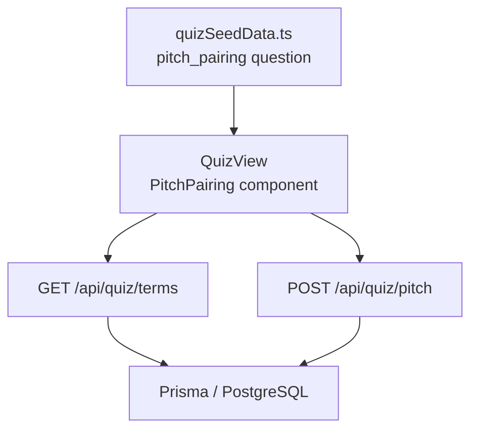
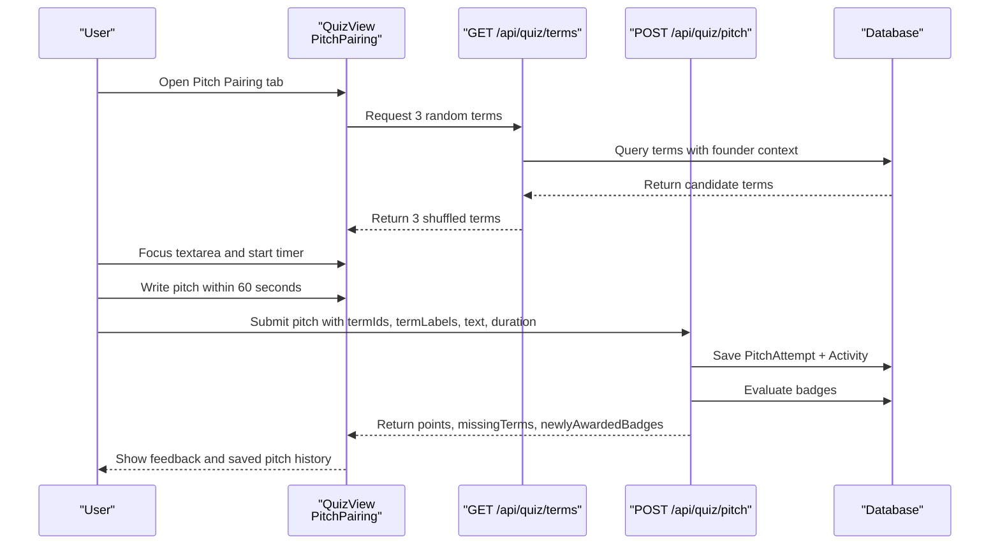
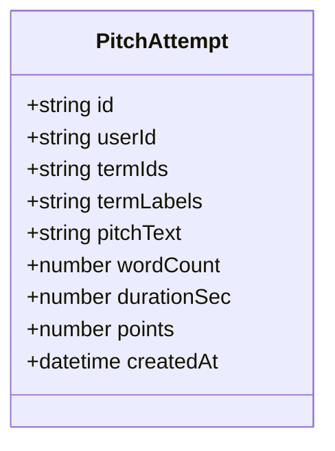
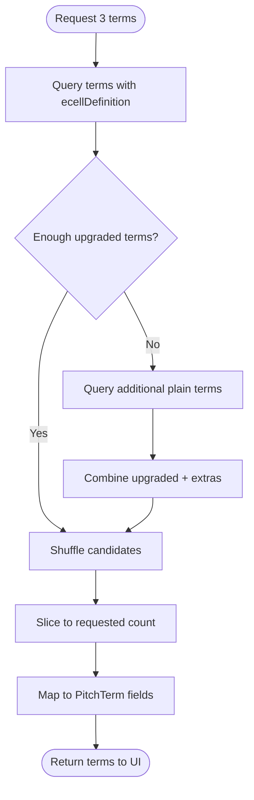
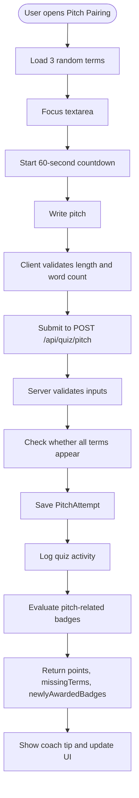
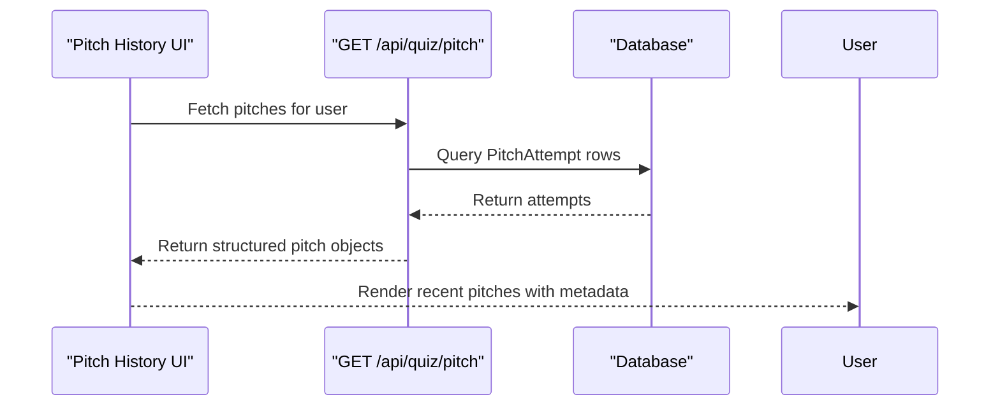
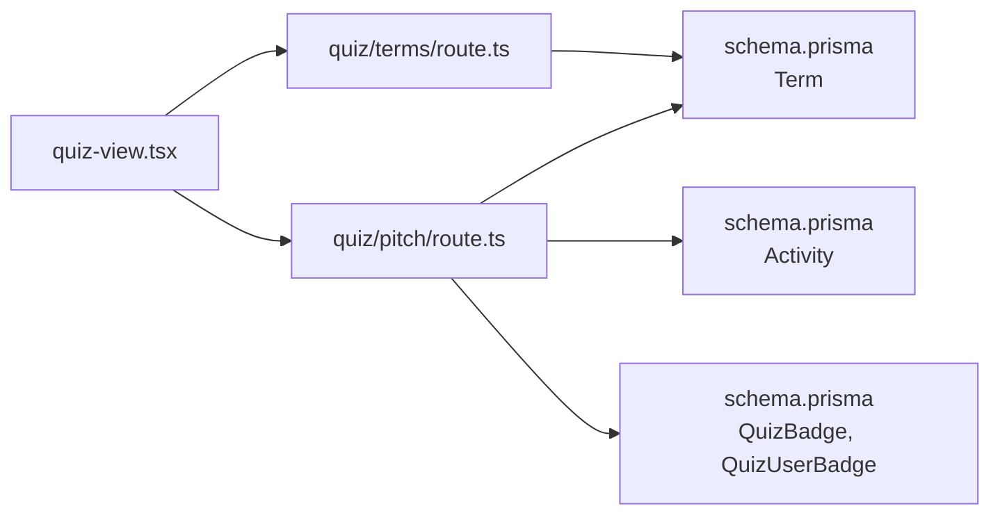

# Pitch Pairing Game

<cite>
**Referenced Files in This Document**
- [quiz-view.tsx](file://src/components/welearn/quiz-view.tsx)
- [route.ts (Pitch API)](file://src/app/api/quiz/pitch/route.ts)
- [route.ts (Terms API)](file://src/app/api/quiz/terms/route.ts)
- [schema.prisma](file://prisma/schema.prisma)
- [quizSeedData.ts](file://src/lib/quizSeedData.ts)
</cite>

## Table of Contents
1. [Introduction](#introduction)
2. [Project Structure](#project-structure)
3. [Core Components](#core-components)
4. [Architecture Overview](#architecture-overview)
5. [Detailed Component Analysis](#detailed-component-analysis)
6. [Dependency Analysis](#dependency-analysis)
7. [Performance Considerations](#performance-considerations)
8. [Troubleshooting Guide](#troubleshooting-guide)
9. [Conclusion](#conclusion)

## Introduction
The Pitch Pairing game is a founder-mode practice drill where users connect three random startup terms into a compelling 60-second elevator pitch. It is part of the Founder Quiz experience and focuses on fluency, creativity, and practical usage of business vocabulary rather than multiple-choice correctness.

Key goals:
- Randomly select three terms from the term database.
- Let users write or speak an elevator pitch that naturally uses all three terms.
- Record each attempt with metadata such as word count, duration, and points.
- Provide feedback through missing-term detection and badge progression.

This document explains the term selection algorithm, the three-term combination system, the pitch generation workflow, the data models, scoring behavior, and the recording and playback features used for delivery practice.

## Project Structure
The Pitch Pairing feature spans client-side UI, server-side APIs, and persistent schema definitions:

- Client UI: `src/components/welearn/quiz-view.tsx`
- Pitch submission API: `src/app/api/quiz/pitch/route.ts`
- Term selection API: `src/app/api/quiz/terms/route.ts`
- Database schema: `prisma/schema.prisma`
- Seed content and quiz metadata: `src/lib/quizSeedData.ts`

**Diagram sources**
- [quiz-view.tsx:892-1118](file://src/components/welearn/quiz-view.tsx#L892-L1118)
- [route.ts (Terms API):1-46](file://src/app/api/quiz/terms/route.ts#L1-L46)
- [route.ts (Pitch API):1-133](file://src/app/api/quiz/pitch/route.ts#L1-L133)
- [quizSeedData.ts:455-467](file://src/lib/quizSeedData.ts#L455-L467)

**Section sources**
- [quiz-view.tsx:892-1118](file://src/components/welearn/quiz-view.tsx#L892-L1118)
- [route.ts (Terms API):1-46](file://src/app/api/quiz/terms/route.ts#L1-L46)
- [route.ts (Pitch API):1-133](file://src/app/api/quiz/pitch/route.ts#L1-L133)
- [schema.prisma:218-232](file://prisma/schema.prisma#L218-L232)
- [quizSeedData.ts:455-467](file://src/lib/quizSeedData.ts#L455-L467)

## Core Components
The Pitch Pairing mechanic consists of four core pieces:

1. **Term Selection Algorithm**
   - The client requests three random terms via `/api/quiz/terms?count=3`.
   - The server prefers terms with founder-context upgrades (`ecellDefinition`) to provide richer hints.
   - If upgraded terms are insufficient, it supplements with any available term.
   - The final list is shuffled and truncated to the requested count.

2. **Three-Term Combination System**
   - Each session shows exactly three terms: abbreviation, full name, category, and optional hint.
   - Users must weave all three terms into one coherent elevator pitch.
   - The UI encourages natural usage rather than definition-style repetition.

3. **Pitch Generation Workflow**
   - A 60-second timer starts when the user focuses the pitch textarea.
   - Word count guidance targets 80–120 words.
   - On save, the client sends term IDs, term labels, pitch text, and elapsed time.
   - The server validates length, word count, and presence of terms.
   - The server records the attempt, awards points, logs activity, and evaluates badges.

4. **Recording and Playback Features**
   - Saved attempts include term labels, pitch text, word count, duration, points, and timestamp.
   - The UI displays recent pitches so users can review their wording and timing.
   - Missing-term feedback helps users iterate until all three terms appear naturally.

**Section sources**
- [route.ts (Terms API):1-46](file://src/app/api/quiz/terms/route.ts#L1-L46)
- [quiz-view.tsx:912-983](file://src/components/welearn/quiz-view.tsx#L912-L983)
- [route.ts (Pitch API):40-133](file://src/app/api/quiz/pitch/route.ts#L40-L133)
- [quiz-view.tsx:1078-1118](file://src/components/welearn/quiz-view.tsx#L1078-L1118)

## Architecture Overview
The end-to-end flow connects the React UI, two Next.js API routes, and the database.

**Diagram sources**
- [quiz-view.tsx:912-983](file://src/components/welearn/quiz-view.tsx#L912-L983)
- [route.ts (Terms API):8-46](file://src/app/api/quiz/terms/route.ts#L8-L46)
- [route.ts (Pitch API):40-133](file://src/app/api/quiz/pitch/route.ts#L40-L133)

## Detailed Component Analysis

### PitchTerm Interface
The `PitchTerm` interface represents a single term presented during the drill.

| Field | Type | Meaning |
|---|---|---|
| `id` | string | Unique term identifier stored with the attempt |
| `abbr` | string | Short abbreviation shown prominently |
| `full` | string | Full term name |
| `category` | string | Business domain such as investment, growth, ops, product, or strategy |
| `hint` | string or null | Founder-context definition used as a learning hint |

The UI renders the abbreviation, full name, and optional hint. The hint comes from the term’s founder-context upgrade when available.

**Section sources**
- [quiz-view.tsx:104-110](file://src/components/welearn/quiz-view.tsx#L104-L110)
- [route.ts (Terms API):34-41](file://src/app/api/quiz/terms/route.ts#L34-L41)
- [schema.prisma:115-130](file://prisma/schema.prisma#L115-L130)

### PitchAttempt Structure
The `PitchAttempt` structure captures everything needed to review a pitch later.

| Field | Type | Meaning |
|---|---|---|
| `id` | string | Attempt identifier |
| `termLabels` | array of `{ abbr, full }` | Archived labels for display |
| `pitchText` | string | The user’s written pitch |
| `wordCount` | number | Calculated word count |
| `durationSec` | number | Time spent writing or speaking before saving |
| `points` | number | Points awarded for completing the drill |
| `createdAt` | string | Timestamp of the attempt |

On the server side, `PitchAttempt` persists term IDs, serialized term labels, pitch text, word count, duration, default points, and creation time.

**Diagram sources**
- [schema.prisma:218-232](file://prisma/schema.prisma#L218-L232)

**Section sources**
- [quiz-view.tsx:112-120](file://src/components/welearn/quiz-view.tsx#L112-L120)
- [route.ts (Pitch API):23-34](file://src/app/api/quiz/pitch/route.ts#L23-L34)
- [schema.prisma:218-232](file://prisma/schema.prisma#L218-L232)

### Term Selection Algorithm
The term selection algorithm prioritizes terms with founder-context upgrades, then falls back to plain terms if necessary.

**Diagram sources**
- [route.ts (Terms API):8-46](file://src/app/api/quiz/terms/route.ts#L8-L46)

Key behaviors:
- Minimum count is enforced; the API accepts up to five but defaults to three.
- Upgraded terms are preferred because they carry richer founder-context hints.
- Shuffling ensures randomness across sessions.
- If no terms exist, the API returns a clear error indicating seeding is required.

**Section sources**
- [route.ts (Terms API):1-46](file://src/app/api/quiz/terms/route.ts#L1-L46)

### Three-Term Combination System
The three-term combination system is intentionally open-ended:
- The UI presents three terms at once.
- Users must use all three terms naturally in one pitch.
- The prompt frames the scenario as meeting a seed investor in an elevator.
- The seed question explicitly states that this is a free-form drill, not a graded multiple-choice question.

Scoring guidance embedded in the seed content emphasizes:
- Leading with the customer problem rather than leading with the term.
- Using terms naturally to demonstrate mastery.
- Earning points for completing the practice, not for grading speech quality.

**Section sources**
- [quiz-view.tsx:1006-1028](file://src/components/welearn/quiz-view.tsx#L1006-L1028)
- [quizSeedData.ts:455-467](file://src/lib/quizSeedData.ts#L455-L467)

### Pitch Generation Workflow
The pitch generation workflow combines client-side timing and validation with server-side persistence and feedback.

**Diagram sources**
- [quiz-view.tsx:912-983](file://src/components/welearn/quiz-view.tsx#L912-L983)
- [route.ts (Pitch API):40-133](file://src/app/api/quiz/pitch/route.ts#L40-L133)

Important details:
- The timer begins when the textarea receives focus.
- The client enforces a minimum pitch length and warns about target word count.
- The server enforces stricter constraints: minimum character length, maximum character length, and minimum word count.
- Duration is calculated as `60 - remainingSeconds`, capped between zero and 300 seconds.
- Missing-term detection compares lowercase pitch text against both abbreviation and the first token of the full term.

**Section sources**
- [quiz-view.tsx:929-983](file://src/components/welearn/quiz-view.tsx#L929-L983)
- [route.ts (Pitch API):40-70](file://src/app/api/quiz/pitch/route.ts#L40-L70)

### Scoring Criteria and Feedback Model
The current implementation does not perform AI-based scoring of creativity, coherence, or business relevance. Instead, it uses a practice-oriented scoring model:

| Criterion | Current Behavior |
|---|---|
| Completion | Awarded 15 points for saving a valid pitch |
| Term Usage | Detected via substring matching; missing terms are reported |
| Length | Enforced through character and word-count limits |
| Timing | Recorded as `durationSec`; not directly scored |
| Creativity | Not automatically scored by the backend |
| Coherence | Not automatically scored by the backend |
| Business Relevance | Not automatically scored by the backend |

Feedback channels:
- Toast messages confirm points and missing terms.
- A coach tip highlights which terms were not explicitly used.
- Badge evaluation can award the “Pitch Master” badge after completing the required number of pitch drills.

If future enhancements add AI evaluation, the current payload already supports sending pitch text and term labels, making it straightforward to attach additional scoring dimensions without changing the core record shape.

**Section sources**
- [route.ts (Pitch API):56-80](file://src/app/api/quiz/pitch/route.ts#L56-L80)
- [route.ts (Pitch API):93-128](file://src/app/api/quiz/pitch/route.ts#L93-L128)
- [quiz-view.tsx:943-983](file://src/components/welearn/quiz-view.tsx#L943-L983)
- [quizSeedData.ts:455-467](file://src/lib/quizSeedData.ts#L455-L467)

### Recording and Playback Features
Recording and playback are text-and-metadata based rather than audio-file based:

- Recording:
  - Saves term IDs and archived term labels.
  - Stores the pitch text.
  - Calculates and stores word count.
  - Records duration in seconds.
  - Awards 15 points.
  - Logs an activity entry under the quiz module.

- Playback:
  - Displays the most recent five saved pitches.
  - Shows word count, duration, points, and timestamp.
  - Renders the archived term labels.
  - Allows users to review wording and timing.

This design supports deliberate practice: users can rewrite pitches, compare previous attempts, and improve term integration over time.

**Diagram sources**
- [route.ts (Pitch API):11-38](file://src/app/api/quiz/pitch/route.ts#L11-L38)
- [quiz-view.tsx:1078-1118](file://src/components/welearn/quiz-view.tsx#L1078-L1118)

**Section sources**
- [route.ts (Pitch API):11-38](file://src/app/api/quiz/pitch/route.ts#L11-L38)
- [route.ts (Pitch API):71-91](file://src/app/api/quiz/pitch/route.ts#L71-L91)
- [quiz-view.tsx:1078-1118](file://src/components/welearn/quiz-view.tsx#L1078-L1118)

## Dependency Analysis
The Pitch Pairing feature has clear boundaries and minimal coupling:

- `quiz-view.tsx` depends on:
  - `/api/quiz/terms` for term selection.
  - `/api/quiz/pitch` for saving and retrieving attempts.
  - Local state for timer, word count, and missing-term feedback.

- `/api/quiz/terms` depends on:
  - Prisma `Term` model.
  - Founder-context upgrade field `ecellDefinition`.

- `/api/quiz/pitch` depends on:
  - Prisma `PitchAttempt` model.
  - Prisma `Activity` model.
  - Prisma `QuizBadge` and `QuizUserBadge` models for badge evaluation.

**Diagram sources**
- [quiz-view.tsx:892-1118](file://src/components/welearn/quiz-view.tsx#L892-L1118)
- [route.ts (Terms API):1-46](file://src/app/api/quiz/terms/route.ts#L1-L46)
- [route.ts (Pitch API):1-133](file://src/app/api/quiz/pitch/route.ts#L1-L133)
- [schema.prisma:115-130](file://prisma/schema.prisma#L115-L130)
- [schema.prisma:218-275](file://prisma/schema.prisma#L218-L275)

**Section sources**
- [quiz-view.tsx:892-1118](file://src/components/welearn/quiz-view.tsx#L892-L1118)
- [route.ts (Terms API):1-46](file://src/app/api/quiz/terms/route.ts#L1-L46)
- [route.ts (Pitch API):1-133](file://src/app/api/quiz/pitch/route.ts#L1-L133)
- [schema.prisma:115-130](file://prisma/schema.prisma#L115-L130)
- [schema.prisma:218-275](file://prisma/schema.prisma#L218-L275)

## Performance Considerations
- Term selection queries prefer upgraded terms but fall back gracefully, avoiding empty results when the database is partially seeded.
- Pitch submission performs lightweight server-side validation before database writes.
- Badge evaluation iterates through all badges and counts user pitch attempts; this is acceptable for small-to-medium user bases but could be optimized with cached counters if scale increases.
- The UI only loads the latest 50 pitch attempts per user, limiting response size.

[No sources needed since this section provides general guidance]

## Troubleshooting Guide
Common issues and resolutions:

| Issue | Cause | Resolution |
|---|---|---|
| No terms available | Database has no terms or no upgraded terms | Seed the database with terms; the API returns a clear error when none exist |
| Pitch too short | Submitted text is under the minimum character or word threshold | Expand the pitch toward the 80–120 word target |
| Missing terms feedback | Server did not detect one or more terms in the pitch | Rewrite the pitch so the abbreviation or full term appears naturally |
| Badge not unlocked | Badge criteria require multiple completed pitches | Complete additional pitch drills until the threshold is met |
| Timer stops unexpectedly | Countdown reached zero | Save the pitch or restart the drill to get new terms |

**Section sources**
- [route.ts (Terms API):27-32](file://src/app/api/quiz/terms/route.ts#L27-L32)
- [route.ts (Pitch API):51-58](file://src/app/api/quiz/pitch/route.ts#L51-L58)
- [route.ts (Pitch API):59-69](file://src/app/api/quiz/pitch/route.ts#L59-L69)
- [route.ts (Pitch API):109-120](file://src/app/api/quiz/pitch/route.ts#L109-L120)
- [quiz-view.tsx:929-939](file://src/components/welearn/quiz-view.tsx#L929-L939)

## Conclusion
The Pitch Pairing game is a focused, practice-first mechanism for building startup communication skills. It combines randomized term selection, a simple three-term constraint, and a timed writing workflow with persistent recording and basic feedback. While it currently does not score creativity, coherence, or business relevance automatically, its structure makes it straightforward to extend with AI-driven evaluation while preserving the existing practice loop.

For users, the most effective approach is repeated iteration: generate new terms, write concise pitches, aim for natural term usage, track timing, and review past attempts to improve clarity and confidence.

[No sources needed since this section summarizes without analyzing specific files]