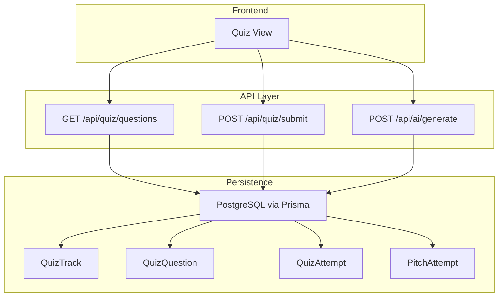
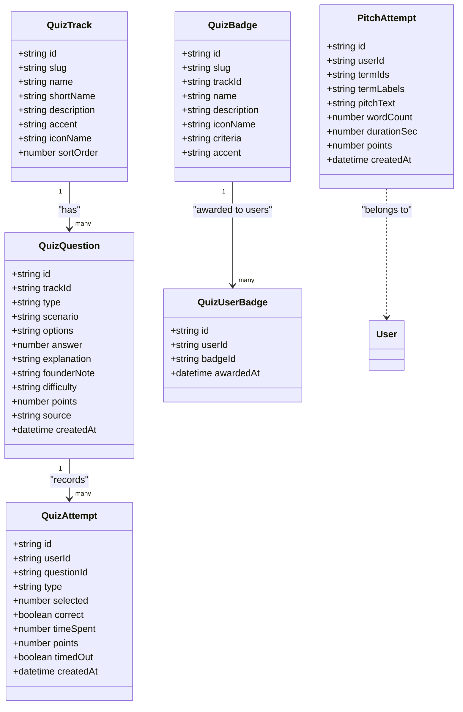
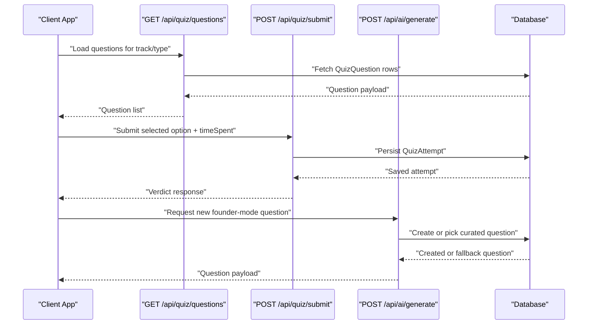
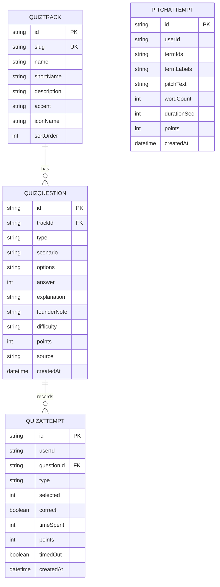
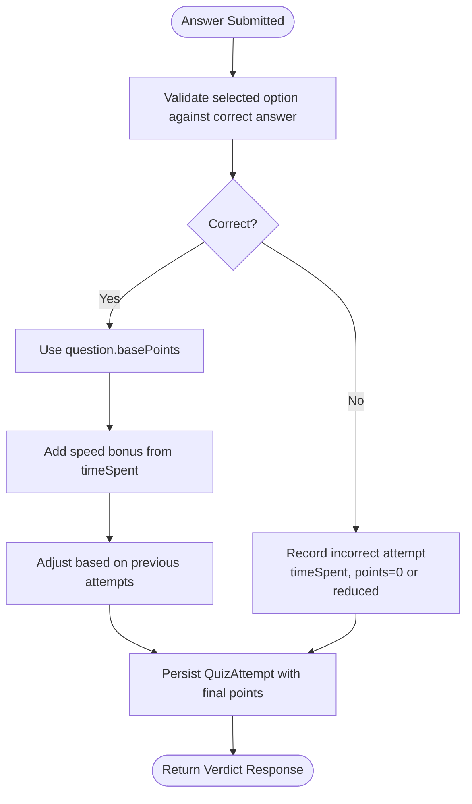
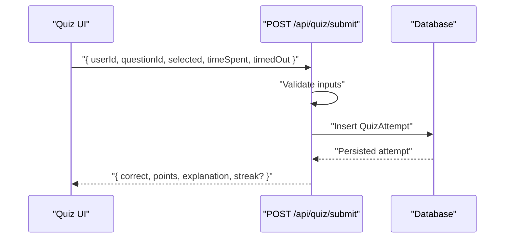
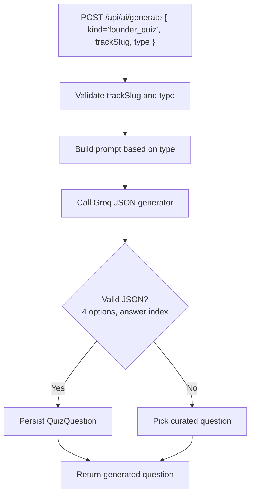
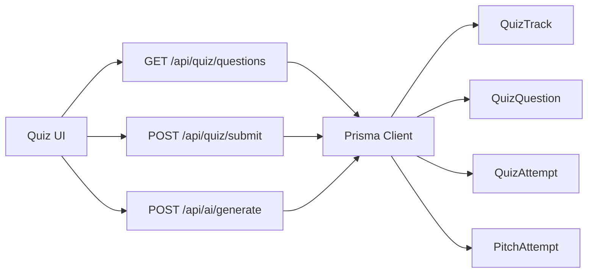

# Question Types Engine

<cite>
**Referenced Files in This Document**
- [schema.prisma](file://prisma/schema.prisma)
- [quizSeedData.ts](file://src/lib/quizSeedData.ts)
- [route.ts (AI generate)](file://src/app/api/ai/generate/route.ts)
- [route.ts (quiz questions)](file://src/app/api/quiz/questions/route.ts)
- [route.ts (quiz submit)](file://src/app/api/quiz/submit/route.ts)
- [data seed SQL](file://supabase/migrations/20261107_data_seed.sql)
</cite>

## Table of Contents
1. [Introduction](#introduction)
2. [Project Structure](#project-structure)
3. [Core Components](#core-components)
4. [Architecture Overview](#architecture-overview)
5. [Detailed Component Analysis](#detailed-component-analysis)
6. [Dependency Analysis](#dependency-analysis)
7. [Performance Considerations](#performance-considerations)
8. [Troubleshooting Guide](#troubleshooting-guide)
9. [Conclusion](#conclusion)

## Introduction
This document explains the Question Types Engine used by the Founder Quiz feature. It covers four question formats:
- Founder Mode scenarios: real startup decision-making multiple-choice questions.
- Red Flag pitch-deck audits: identifying flawed or unrealistic claims.
- Micro-Math drills: quick founder calculations such as valuation, runway, churn, CAC/LTV, and break-even.
- Pitch Pairing: connecting three random terms into a short elevator pitch.

It documents the question data model, validation rules, scoring behavior, examples per type, and the submission workflow with verdict responses.

## Project Structure
The engine is implemented across:
- Database schema defining quiz tracks, questions, attempts, badges, and pitch pairing records.
- Curated seed data providing example questions for all four types.
- AI generation endpoint that can create new scenario, red-flag, and micro-math questions.
- API routes for loading questions and submitting answers.

**Diagram sources**
- [schema.prisma:137-232](file://prisma/schema.prisma#L137-L232)
- [route.ts (quiz questions):4-57](file://src/app/api/quiz/questions/route.ts#L4-L57)
- [route.ts (quiz submit):75-120](file://src/app/api/quiz/submit/route.ts#L75-L120)
- [route.ts (AI generate):178-263](file://src/app/api/ai/generate/route.ts#L178-L263)

**Section sources**
- [schema.prisma:137-232](file://prisma/schema.prisma#L137-L232)
- [quizSeedData.ts:15-25](file://src/lib/quizSeedData.ts#L15-L25)
- [route.ts (AI generate):178-263](file://src/app/api/ai/generate/route.ts#L178-L263)

## Core Components
The engine revolves around these core entities:

- QuizTrack: thematic categories such as investment, growth, operations & legal, product & tech, and macro-strategy.
- QuizQuestion: stores the question text, options, correct answer index, explanation, founder note, difficulty, points, and source attribution.
- QuizAttempt: records each user attempt including selected option, correctness, time spent, points awarded, and timestamp.
- PitchAttempt: stores the three term identifiers and labels along with the free-form pitch text, word count, duration, and fixed points.
- QuizBadge and QuizUserBadge: gamification layer rewarding progress across tracks and activities.

**Diagram sources**
- [schema.prisma:137-232](file://prisma/schema.prisma#L137-L232)

**Section sources**
- [schema.prisma:137-232](file://prisma/schema.prisma#L137-L232)

## Architecture Overview
The system supports both curated content and AI-generated content:

- Curated bank: Seed data defines representative questions for all four types.
- AI generation: The AI endpoint generates scenario, red-flag, and micro-math questions when configured; otherwise it falls back to curated questions.
- Submission: The client submits an answer with timing metadata; the server validates and persists the attempt.

**Diagram sources**
- [route.ts (quiz questions):4-57](file://src/app/api/quiz/questions/route.ts#L4-L57)
- [route.ts (quiz submit):75-120](file://src/app/api/quiz/submit/route.ts#L75-L120)
- [route.ts (AI generate):178-263](file://src/app/api/ai/generate/route.ts#L178-L263)

**Section sources**
- [route.ts (quiz questions):4-57](file://src/app/api/quiz/questions/route.ts#L4-L57)
- [route.ts (quiz submit):75-120](file://src/app/api/quiz/submit/route.ts#L75-L120)
- [route.ts (AI generate):178-263](file://src/app/api/ai/generate/route.ts#L178-L263)

## Detailed Component Analysis

### Data Model and Question Types
The database schema defines the canonical structure for quiz-related data.

- QuizTrack: categorizes questions by domain.
- QuizQuestion:
  - id: unique identifier.
  - trackId: foreign key to QuizTrack.
  - type: one of scenario, red_flag, micro_math, pitch_pairing.
  - scenario: prompt text.
  - options: JSON array of strings.
  - answer: index of the correct option.
  - explanation: feedback shown after answering.
  - founderNote: optional founder-focused takeaway.
  - difficulty: easy, medium, hard.
  - points: base point value.
  - source: curated or ai.
  - createdAt: creation timestamp.
- QuizAttempt:
  - userId, questionId, type, selected, correct, timeSpent, points, timedOut, createdAt.
- PitchAttempt:
  - userId, termIds, termLabels, pitchText, wordCount, durationSec, points, createdAt.

**Diagram sources**
- [schema.prisma:137-232](file://prisma/schema.prisma#L137-L232)

**Section sources**
- [schema.prisma:137-232](file://prisma/schema.prisma#L137-L232)

### Scoring Algorithm
The scoring model combines correctness, speed bonuses, and attempt history:

- Base points: determined by difficulty and stored on the question.
- Speed bonus: additional points are added based on how quickly the user answered.
- Attempt history: repeated attempts can influence the final score, encouraging mastery rather than single-shot guessing.

The exact formula is not fully exposed in the referenced files, but the presence of timeSpent and points fields on QuizAttempt indicates that the server computes a final points value per attempt using these inputs.

**Diagram sources**
- [schema.prisma:172-188](file://prisma/schema.prisma#L172-L188)
- [route.ts (quiz submit):75-120](file://src/app/api/quiz/submit/route.ts#L75-L120)

**Section sources**
- [schema.prisma:172-188](file://prisma/schema.prisma#L172-L188)
- [route.ts (quiz submit):75-120](file://src/app/api/quiz/submit/route.ts#L75-L120)

### Validation Rules
Validation ensures data integrity and safe rendering:

- Type validation:
  - Only allowed types are accepted: scenario, red_flag, micro_math, pitch_pairing.
- Options validation:
  - Must be an array of strings.
- Answer validation:
  - Must be a valid index within the options array.
- Difficulty and points:
  - Difficulty must be one of easy, medium, hard.
  - Points are numeric and derived from difficulty or seed configuration.
- Source attribution:
  - Must be curated or ai.
- Pitch pairing specifics:
  - For pitch_pairing, the options array represents the three terms; the correct answer index is conventionally 0 to unlock the drill flow.

These validations are enforced at the schema level and during AI generation and seeding.

**Section sources**
- [schema.prisma:151-170](file://prisma/schema.prisma#L151-L170)
- [route.ts (AI generate):178-263](file://src/app/api/ai/generate/route.ts#L178-L263)
- [quizSeedData.ts:15-25](file://src/lib/quizSeedData.ts#L15-L25)

### Submission Workflow and Verdict Responses
The submission workflow proceeds as follows:

1. Client loads a question via GET /api/quiz/questions.
2. Client selects an option and submits via POST /api/quiz/submit with selected, timeSpent, and optional timedOut.
3. Server validates the input, compares selected with the correct answer, computes points, and persists a QuizAttempt.
4. Server returns a verdict response indicating correctness, points awarded, and relevant feedback.

**Diagram sources**
- [route.ts (quiz submit):75-120](file://src/app/api/quiz/submit/route.ts#L75-L120)
- [schema.prisma:172-188](file://prisma/schema.prisma#L172-L188)

**Section sources**
- [route.ts (quiz submit):75-120](file://src/app/api/quiz/submit/route.ts#L75-L120)

### Examples of Each Question Type

- Founder Mode scenario:
  - Example: Investment track scenario about liquidation preference and exit waterfall implications.
  - Purpose: Tests founder-mode decision-making under realistic terms-sheet conditions.
  - Reference path: [investment scenario:97-115](file://src/lib/quizSeedData.ts#L97-L115)

- Red Flag pitch-deck audit:
  - Example: Strategy track red flag questioning unrealistic TAM/SOM claims and “zero competitors” assertions.
  - Purpose: Trains founders to spot dangerous market-sizing and competitive assumptions.
  - Reference path: [strategy red flag:416-434](file://src/lib/quizSeedData.ts#L416-L434)
  - Also present in seed SQL: [red flag seed row:345-347](file://supabase/migrations/20261107_data_seed.sql#L345-L347)

- Micro-Math drill:
  - Example: Growth track micro-math calculating CAC and LTV ratio for a D2C brand.
  - Purpose: Reinforces unit economics and margin-aware valuation thinking.
  - Reference path: [growth micro-math:192-209](file://src/lib/quizSeedData.ts#L192-L209)

- Pitch Pairing:
  - Example: Strategy track pitch_pairing entry that unlocks a 60-second elevator pitch drill using three terms.
  - Purpose: Encourages fluent integration of business terminology in storytelling.
  - Reference path: [pitch pairing seed:455-467](file://src/lib/quizSeedData.ts#L455-L467)

**Section sources**
- [quizSeedData.ts:97-115](file://src/lib/quizSeedData.ts#L97-L115)
- [quizSeedData.ts:192-209](file://src/lib/quizSeedData.ts#L192-L209)
- [quizSeedData.ts:416-434](file://src/lib/quizSeedData.ts#L416-L434)
- [quizSeedData.ts:455-467](file://src/lib/quizSeedData.ts#L455-L467)
- [data seed SQL:345-347](file://supabase/migrations/20261107_data_seed.sql#L345-L347)

### AI Generation of Scenario, Red Flag, and Micro-Math Questions
The AI generation endpoint supports three question types:

- Valid track slugs: investment, growth, ops_legal, product_tech, strategy.
- Valid question types: scenario, red_flag, micro_math.
- Prompt mapping:
  - scenario: founder-mode multiple-choice question with four options and explanation.
  - red_flag: “spot the red flag” question with four options and explanation.
  - micro_math: calculation drill requiring a 2-minute founder math exercise with four numeric options and worked solution.
- Output validation:
  - Ensures exactly four options and a valid answer index.
  - Normalizes difficulty and maps points accordingly.
- Fallback behavior:
  - If AI is not configured or output is invalid, picks a curated question from the requested track and type.

**Diagram sources**
- [route.ts (AI generate):178-263](file://src/app/api/ai/generate/route.ts#L178-L263)

**Section sources**
- [route.ts (AI generate):178-263](file://src/app/api/ai/generate/route.ts#L178-L263)

## Dependency Analysis
Key dependencies and relationships:

- Frontend depends on:
  - GET /api/quiz/questions to load questions.
  - POST /api/quiz/submit to record attempts and receive verdicts.
  - POST /api/ai/generate to request new founder-mode questions.
- API endpoints depend on:
  - Prisma client to read/write QuizTrack, QuizQuestion, QuizAttempt, and PitchAttempt.
- Data integrity depends on:
  - Schema constraints and indexes on trackId and type.
  - Validation logic in AI generation and seeding.

**Diagram sources**
- [schema.prisma:137-232](file://prisma/schema.prisma#L137-L232)
- [route.ts (quiz questions):4-57](file://src/app/api/quiz/questions/route.ts#L4-L57)
- [route.ts (quiz submit):75-120](file://src/app/api/quiz/submit/route.ts#L75-L120)
- [route.ts (AI generate):178-263](file://src/app/api/ai/generate/route.ts#L178-L263)

**Section sources**
- [schema.prisma:137-232](file://prisma/schema.prisma#L137-L232)
- [route.ts (quiz questions):4-57](file://src/app/api/quiz/questions/route.ts#L4-L57)
- [route.ts (quiz submit):75-120](file://src/app/api/quiz/submit/route.ts#L75-L120)
- [route.ts (AI generate):178-263](file://src/app/api/ai/generate/route.ts#L178-L263)

## Performance Considerations
- Index usage:
  - QuizQuestion has indexes on trackId+type and type to optimize filtering and selection.
- Query patterns:
  - Loading questions should filter by trackId and type to reduce payload size.
- AI generation:
  - When AI is unavailable, fallback to curated bank avoids blocking the UI.
- Submission latency:
  - Keep timeSpent accurate on the client to ensure meaningful speed bonuses.
- Storage:
  - Avoid storing large explanations or notes beyond necessary limits; schema already constrains field lengths.

[No sources needed since this section provides general guidance]

## Troubleshooting Guide
Common issues and resolutions:

- Unknown generation kind:
  - Ensure kind equals founder_quiz when requesting AI-generated questions.
- Track not found:
  - Verify trackSlug is one of the supported values.
- Invalid question payload:
  - Confirm the AI returned exactly four options and a valid answer index.
- Missing curated fallback:
  - If no curated question matches the requested track and type, add seed data or configure AI.
- Submission errors:
  - Validate that selected is within bounds and timeSpent is non-negative.

**Section sources**
- [route.ts (AI generate):178-263](file://src/app/api/ai/generate/route.ts#L178-L263)
- [route.ts (quiz submit):75-120](file://src/app/api/quiz/submit/route.ts#L75-L120)

## Conclusion
The Question Types Engine integrates curated and AI-generated content to train founders through realistic scenarios, red-flag audits, micro-math drills, and pitch pairing exercises. Its data model captures rich metadata for scoring, while its API layer enforces validation and persistence. By combining correctness, speed, and attempt history, the engine rewards both accuracy and fluency, supporting progressive mastery across founder-mode competencies.

[No sources needed since this section summarizes without analyzing specific files]