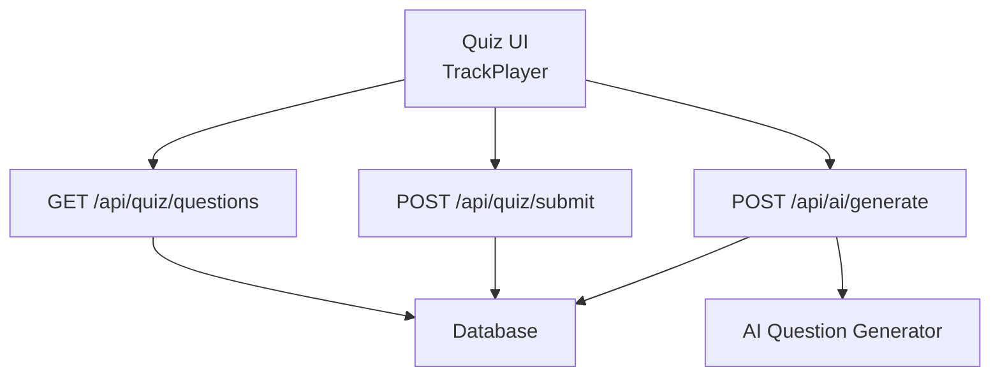
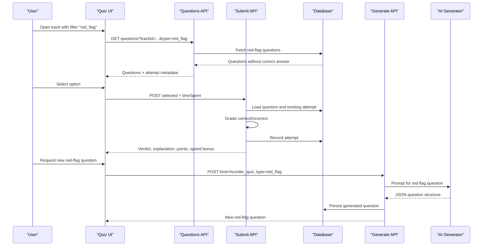
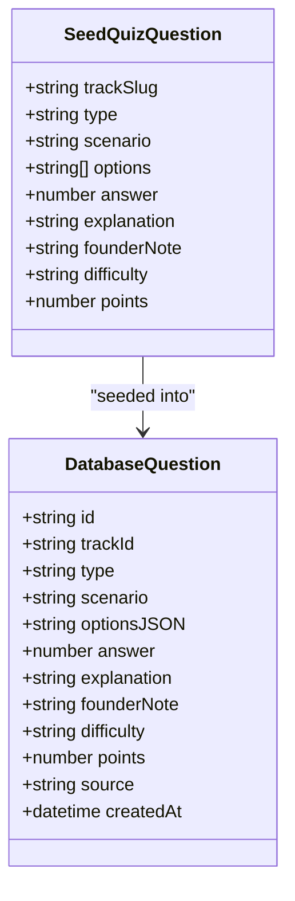
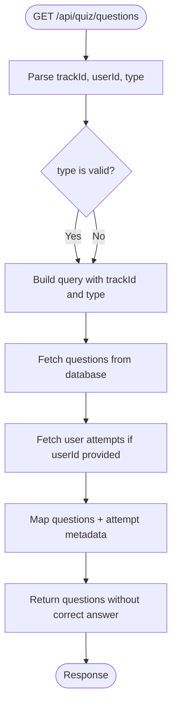
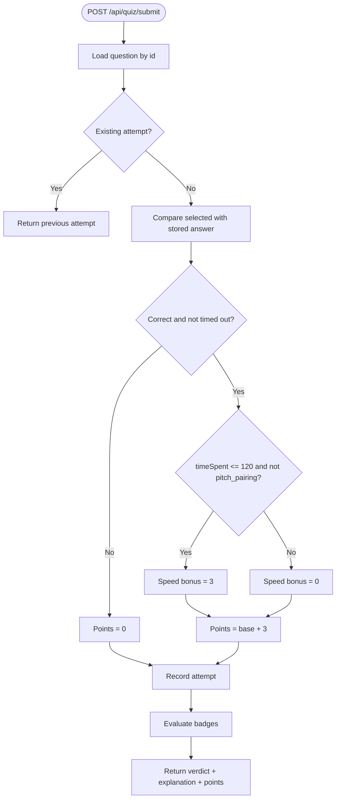
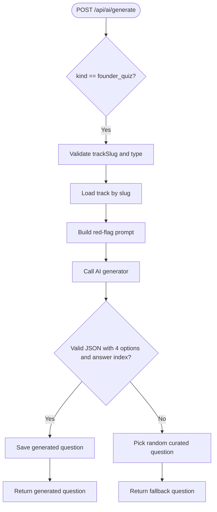
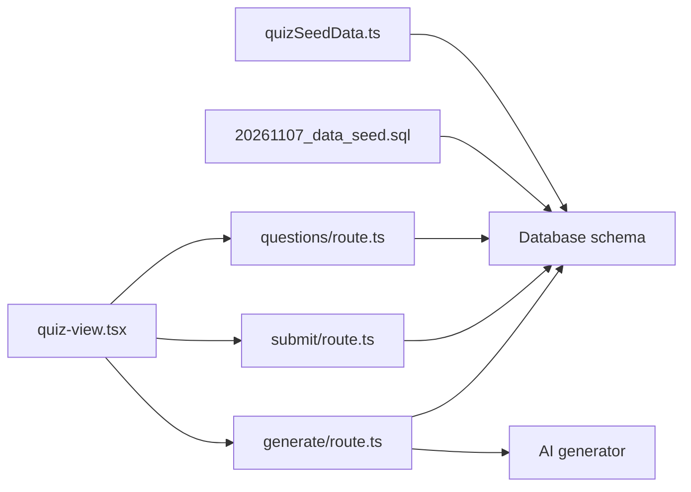

# Red Flag Pitch Audits

<cite>
**Referenced Files in This Document**
- [quizSeedData.ts](file://src/lib/quizSeedData.ts)
- [questions/route.ts](file://src/app/api/quiz/questions/route.ts)
- [submit/route.ts](file://src/app/api/quiz/submit/route.ts)
- [generate/route.ts](file://src/app/api/ai/generate/route.ts)
- [20261107_data_seed.sql](file://supabase/migrations/20261107_data_seed.sql)
- [quiz-view.tsx](file://src/components/welearn/quiz-view.tsx)
</cite>

## Table of Contents
1. [Introduction](#introduction)
2. [Project Structure](#project-structure)
3. [Core Components](#core-components)
4. [Architecture Overview](#architecture-overview)
5. [Detailed Component Analysis](#detailed-component-analysis)
6. [Dependency Analysis](#dependency-analysis)
7. [Performance Considerations](#performance-considerations)
8. [Troubleshooting Guide](#troubleshooting-guide)
9. [Conclusion](#conclusion)

## Introduction
Red Flag Pitch Audits is a founder-mode quiz question type that trains users to spot weak, misleading, or dangerous claims in startup pitch decks and financial narratives. Instead of asking for definitions, it presents realistic pitch excerpts and asks the user to identify which option names the most severe red flag.

Common red-flag themes covered by this question type include:
- Unrealistic market-size or market-share claims (for example, claiming 50% market share in Year 1 with no marketing spend).
- Missing or implausible unit economics (for example, an impossibly low customer acquisition cost or a payback period that ignores cash-collection lag).
- Weak competitive analysis (for example, claiming “zero competitors”).
- Poor financial projections (for example, runway far shorter than the planned next fundraise timeline).
- Product-market-fit confusion (for example, treating online survey intent as proof of real user behaviour).

The goal is not just to test knowledge; it is to build a mental checklist founders and investors can use when reviewing pitches under time pressure.

## Project Structure
The Red Flag Pitch Audit question type lives inside the broader Founder Quiz system. It is defined in seed data, served through a Next.js API route, graded server-side, and rendered in the quiz UI. AI generation also supports creating new red-flag questions when configured.

**Diagram sources**
- [questions/route.ts:4-26](file://src/app/api/quiz/questions/route.ts#L4-L26)
- [submit/route.ts:75-151](file://src/app/api/quiz/submit/route.ts#L75-L151)
- [generate/route.ts:178-262](file://src/app/api/ai/generate/route.ts#L178-L262)

**Section sources**
- [quizSeedData.ts:1-25](file://src/lib/quizSeedData.ts#L1-L25)
- [questions/route.ts:4-26](file://src/app/api/quiz/questions/route.ts#L4-L26)
- [submit/route.ts:75-151](file://src/app/api/quiz/submit/route.ts#L75-L151)
- [generate/route.ts:178-262](file://src/app/api/ai/generate/route.ts#L178-L262)

## Core Components
The Red Flag Pitch Audit question type has four main layers:

1. **Question definition layer**: Seed data defines curated red-flag questions with scenario text, options, correct answer index, explanation, founder note, difficulty, and points.
2. **Question delivery layer**: The questions API returns questions filtered by track and optionally by type, including `red_flag`.
3. **Grading layer**: The submit endpoint grades answers server-side, records attempts, awards points, and evaluates badges.
4. **Generation layer**: When AI is configured, the generate endpoint can produce new red-flag questions using a prompt designed specifically for spotting flawed business logic.

Key responsibilities:
- Red-flag questions are stored with `type: "red_flag"`.
- The client filters and displays them alongside scenario and micro-math questions.
- Grading rewards correctness and speed but does not penalize false positives beyond zero points for incorrect answers.
- Explanations and founder notes reinforce why a claim is a red flag.

**Section sources**
- [quizSeedData.ts:15-25](file://src/lib/quizSeedData.ts#L15-L25)
- [quizSeedData.ts:136-153](file://src/lib/quizSeedData.ts#L136-L153)
- [quizSeedData.ts:211-228](file://src/lib/quizSeedData.ts#L211-L228)
- [quizSeedData.ts:366-383](file://src/lib/quizSeedData.ts#L366-L383)
- [quizSeedData.ts:417-434](file://src/lib/quizSeedData.ts#L417-L434)
- [questions/route.ts:14-21](file://src/app/api/quiz/questions/route.ts#L14-L21)
- [submit/route.ts:111-113](file://src/app/api/quiz/submit/route.ts#L111-L113)
- [generate/route.ts:178-197](file://src/app/api/ai/generate/route.ts#L178-L197)

## Architecture Overview
The end-to-end flow for a Red Flag Pitch Audit question is:

**Diagram sources**
- [questions/route.ts:9-55](file://src/app/api/quiz/questions/route.ts#L9-L55)
- [submit/route.ts:82-151](file://src/app/api/quiz/submit/route.ts#L82-L151)
- [generate/route.ts:178-262](file://src/app/api/ai/generate/route.ts#L178-L262)

## Detailed Component Analysis

### Red Flag Question Data Model
A red-flag question is a structured object containing:
- Track slug indicating the domain, such as investment, growth, ops/legal, product/tech, or macro-strategy.
- Type set to `red_flag`.
- Scenario describing a fictional founder pitch excerpt or financial claim.
- Four options where only one correctly identifies the broken concept(s).
- Correct answer as an index from 0 to 3.
- Explanation showing why the chosen option is the right diagnosis.
- Optional founder note giving practical advice.
- Difficulty level and base point value.

This model ensures every red-flag question teaches both pattern recognition and reasoning.

**Diagram sources**
- [quizSeedData.ts:15-25](file://src/lib/quizSeedData.ts#L15-L25)
- [20261107_data_seed.sql:285-347](file://supabase/migrations/20261107_data_seed.sql#L285-L347)

**Section sources**
- [quizSeedData.ts:15-25](file://src/lib/quizSeedData.ts#L15-L25)
- [20261107_data_seed.sql:285-347](file://supabase/migrations/20261107_data_seed.sql#L285-L347)

### Red Flag Question Examples and Patterns
The seed data includes several representative red-flag scenarios:

| Theme | Example Pattern | What the User Must Identify |
|---|---|---|
| Runway vs fundraise timeline | A founder raises on a SAFE, reports monthly burn and bank balance, and plans Series A months later. | The runway is far shorter than the planned fundraise timeline. |
| Unit economics | A pitch claims very low CAC, high LTV, extremely short payback, and immediate profitability. | CAC is likely undercounted and payback ignores cash-collection lag. |
| Product validation | A founder says they skipped user testing because they surveyed people online. | Survey intent is not evidence of real usage. |
| Market strategy | A deck claims huge TAM, zero competitors, and unrealistic early market share. | SOM is unrealistic and “zero competitors” signals missing research or non-existent demand. |

These examples teach users to look beyond surface numbers and evaluate assumptions, feasibility, and investor expectations.

**Section sources**
- [quizSeedData.ts:136-153](file://src/lib/quizSeedData.ts#L136-L153)
- [quizSeedData.ts:211-228](file://src/lib/quizSeedData.ts#L211-L228)
- [quizSeedData.ts:366-383](file://src/lib/quizSeedData.ts#L366-L383)
- [quizSeedData.ts:417-434](file://src/lib/quizSeedData.ts#L417-L434)

### Question Delivery and Filtering
The questions API supports filtering by track and by question type. For red-flag audits, clients request `type=red_flag`. The server returns questions ordered by source and creation time, strips the correct answer, and attaches attempt metadata so the UI can show whether the user already answered.

Important design choices:
- The correct answer is never sent to the client.
- Attempt history is included so users cannot farm points by repeatedly submitting.
- Red-flag questions are treated identically to other question types during retrieval.

**Diagram sources**
- [questions/route.ts:9-55](file://src/app/api/quiz/questions/route.ts#L9-L55)

**Section sources**
- [questions/route.ts:4-26](file://src/app/api/quiz/questions/route.ts#L4-L26)
- [questions/route.ts:28-55](file://src/app/api/quiz/questions/route.ts#L28-L55)

### Scoring Algorithm
The scoring algorithm for red-flag questions follows the same grading logic as other question types:

1. The server loads the question and checks for an existing attempt.
2. If an attempt already exists, the response is idempotent and returns the previous result.
3. Correctness is determined by comparing the submitted index with the stored answer and ensuring the user did not time out.
4. A speed bonus is awarded when the answer is correct, the time spent is 120 seconds or less, and the question is not a pitch-pairing question.
5. Points equal the base question points plus the speed bonus when correct; incorrect answers receive zero points.
6. Attempts are recorded, activity is logged, and badges are evaluated.

There is no explicit penalty for selecting a wrong option beyond receiving zero points. False positives therefore reduce score relative to faster correct answers rather than subtracting points.

**Diagram sources**
- [submit/route.ts:82-151](file://src/app/api/quiz/submit/route.ts#L82-L151)

**Section sources**
- [submit/route.ts:96-113](file://src/app/api/quiz/submit/route.ts#L96-L113)
- [submit/route.ts:115-151](file://src/app/api/quiz/submit/route.ts#L115-L151)

### AI Generation of Red Flag Questions
When AI is configured, the generate endpoint can create new red-flag questions. The relevant logic:

- Accepts `kind=founder_quiz` with `type=red_flag`.
- Validates the track slug and question type.
- Uses a prompt instructing the AI to present a fictional pitch excerpt or financial claim and ask which business concept is most severely flawed.
- Requires exactly four options and a numeric answer index.
- Persists the generated question with appropriate fields.
- Falls back to a random curated question if AI is unavailable or malformed.

This keeps the red-flag question bank fresh while preserving the same structure used by the quiz UI and grading system.

**Diagram sources**
- [generate/route.ts:178-262](file://src/app/api/ai/generate/route.ts#L178-L262)

**Section sources**
- [generate/route.ts:178-197](file://src/app/api/ai/generate/route.ts#L178-L197)
- [generate/route.ts:195-262](file://src/app/api/ai/generate/route.ts#L195-L262)

### User Interface Integration
The quiz UI renders red-flag questions through the TrackPlayer component. It:
- Supports filtering by `scenario`, `red_flag`, and `micro_math`.
- Tracks the selected option, submission state, and verdict.
- Displays correctness, explanation, founder note, points, and speed bonus.
- Handles already-attempted questions by showing previous results instead of granting extra points.

This makes red-flag questions feel like part of a unified founder-mode training experience rather than a separate assessment.

**Section sources**
- [quiz-view.tsx:501-539](file://src/components/welearn/quiz-view.tsx#L501-L539)
- [quiz-view.tsx:834-861](file://src/components/welearn/quiz-view.tsx#L834-L861)

## Dependency Analysis
The Red Flag Pitch Audit feature depends on several interconnected parts:

Coupling and cohesion observations:
- The question type is cohesive: all red-flag logic is contained within the general quiz pipeline rather than a separate module.
- Coupling is moderate: the UI, API routes, seed data, and database all depend on the shared question contract.
- There is no circular dependency between the API routes.
- External integration points include the AI generator and the database.

**Diagram sources**
- [quizSeedData.ts:1-25](file://src/lib/quizSeedData.ts#L1-L25)
- [20261107_data_seed.sql:285-347](file://supabase/migrations/20261107_data_seed.sql#L285-L347)
- [questions/route.ts:4-26](file://src/app/api/quiz/questions/route.ts#L4-L26)
- [submit/route.ts:75-151](file://src/app/api/quiz/submit/route.ts#L75-L151)
- [generate/route.ts:178-262](file://src/app/api/ai/generate/route.ts#L178-L262)
- [quiz-view.tsx:501-539](file://src/components/welearn/quiz-view.tsx#L501-L539)

**Section sources**
- [questions/route.ts:4-26](file://src/app/api/quiz/questions/route.ts#L4-L26)
- [submit/route.ts:75-151](file://src/app/api/quiz/submit/route.ts#L75-L151)
- [generate/route.ts:178-262](file://src/app/api/ai/generate/route.ts#L178-L262)

## Performance Considerations
For red-flag pitch audits, performance considerations are straightforward:

- Retrieval is a simple database query filtered by track and optional type.
- Attempt lookup uses an in-memory map keyed by question ID.
- Grading is lightweight: one comparison and optional speed-bonus calculation.
- Speed bonuses encourage quick pattern recognition, which aligns with real-world pitch review where investors must scan decks rapidly.
- AI generation adds latency and external dependency risk, so the system falls back to curated content when needed.

Optimization opportunities:
- Cache frequently accessed tracks if traffic grows.
- Precompute badge eligibility thresholds for heavy leaderboards.
- Keep red-flag explanations concise to reduce payload size.

[No sources needed since this section provides general guidance]

## Troubleshooting Guide
Common issues and their likely causes:

| Symptom | Likely Cause | Resolution |
|---|---|---|
| Red-flag questions do not appear | Filter not set to `red_flag` or track mismatch | Ensure the client passes `type=red_flag` and a valid `trackId`. |
| Correct answer appears in the UI | Client received the answer field | Verify the questions API is stripping the answer before returning questions. |
| Repeated submissions give different points | Idempotency check failed | Confirm the submit endpoint checks for existing attempts before grading. |
| No speed bonus awarded | Time spent over 120 seconds or question type mismatch | Check `timeSpent` and ensure the question is not `pitch_pairing`. |
| AI-generated red-flag questions fail | Invalid AI response or missing API key | Use the fallback curated question path and configure the AI provider. |
| Explanation or founder note missing | Seed data or generated question incomplete | Validate the question object contains required fields. |

**Section sources**
- [questions/route.ts:28-55](file://src/app/api/quiz/questions/route.ts#L28-L55)
- [submit/route.ts:96-113](file://src/app/api/quiz/submit/route.ts#L96-L113)
- [generate/route.ts:200-262](file://src/app/api/ai/generate/route.ts#L200-L262)

## Conclusion
Red Flag Pitch Audits is a focused, practical training mechanism for evaluating startup pitches. By presenting realistic scenarios and requiring users to select the most severe red flag, it develops critical evaluation skills for both founders and investors. The implementation is clean and consistent with the rest of the quiz system: curated seed data, server-side grading, speed incentives, explanations, and optional AI generation.

The strongest educational value comes from the combination of:
- Realistic pitch excerpts.
- Clear identification of flawed concepts.
- Explanations that connect symptoms to startup fundamentals.
- Founder notes that translate theory into practice.
- Scoring that rewards quick, confident judgment.

Over time, repeated exposure to these patterns helps users internalize what investors notice first: unrealistic markets, missing unit economics, weak competition analysis, poor financial timelines, and confidence without evidence.

[No sources needed since this section summarizes without analyzing specific files]