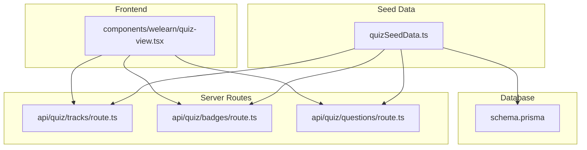
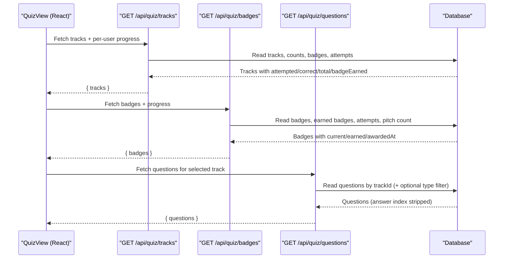
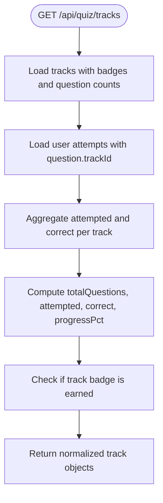
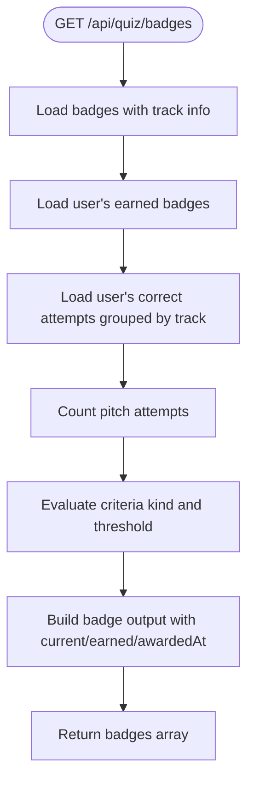
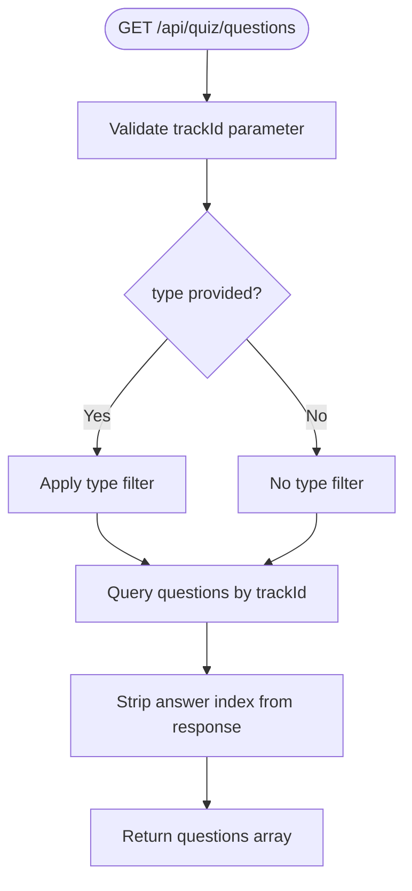
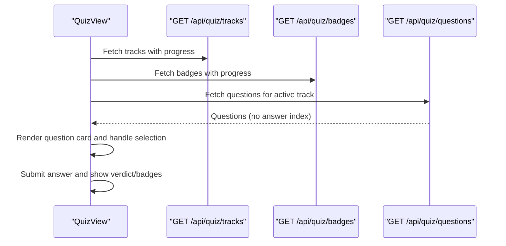
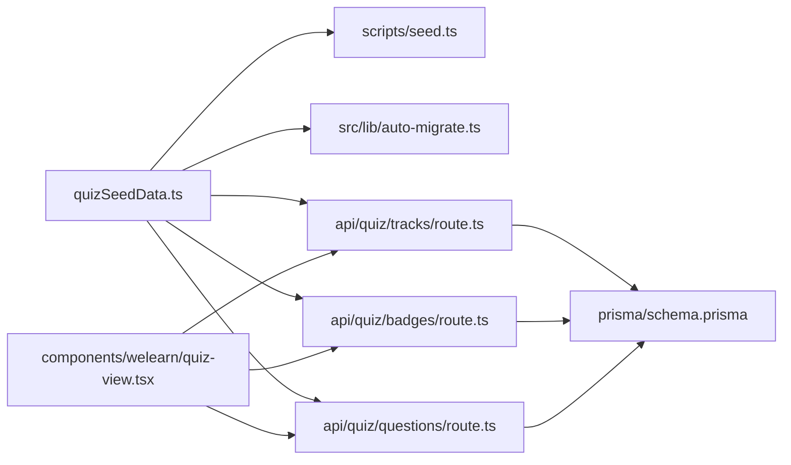

# Quiz Tracks System

<cite>
**Referenced Files in This Document**
- [quizSeedData.ts](file://src/lib/quizSeedData.ts)
- [seed.ts](file://scripts/seed.ts)
- [auto-migrate.ts](file://src/lib/auto-migrate.ts)
- [route.ts (tracks)](file://src/app/api/quiz/tracks/route.ts)
- [route.ts (badges)](file://src/app/api/quiz/badges/route.ts)
- [route.ts (questions)](file://src/app/api/quiz/questions/route.ts)
- [quiz-view.tsx](file://src/components/welearn/quiz-view.tsx)
- [schema.prisma](file://prisma/schema.prisma)
</cite>

## Table of Contents
1. [Introduction](#introduction)
2. [Project Structure](#project-structure)
3. [Core Components](#core-components)
4. [Architecture Overview](#architecture-overview)
5. [Detailed Component Analysis](#detailed-component-analysis)
6. [Dependency Analysis](#dependency-analysis)
7. [Performance Considerations](#performance-considerations)
8. [Troubleshooting Guide](#troubleshooting-guide)
9. [Conclusion](#conclusion)

## Introduction
This document explains the Quiz Tracks System used by the WeLearn Founder Quiz module. It covers the five E-Cell tracks, their metadata, initialization from seed data, per-user progress tracking, badge eligibility logic, API endpoints for fetching tracks and badges, and integration with the main quiz interface.

The system organizes founder-mode learning into five themed tracks:
- Investment (HandCoins)
- Growth (TrendingUp)
- Ops & Legal (Scale)
- Product (Boxes)
- Strategy (Globe2)

Each track has a slug, display name, short name, description, accent color, icon name, and sorting order. User progress is tracked per track using attempted, correct, totalQuestions, and progressPct fields returned by the tracks API. Badge eligibility is determined by criteria such as number of correct answers per track or completion of pitch drills.

## Project Structure
The Quiz Tracks System spans seed data, database schema, server routes, and the React quiz UI:

**Diagram sources**
- [quizSeedData.ts:5-91](file://src/lib/quizSeedData.ts#L5-L91)
- [schema.prisma:147-184](file://prisma/schema.prisma#L147-L184)
- [route.ts (tracks):1-67](file://src/app/api/quiz/tracks/route.ts#L1-L67)
- [route.ts (badges):1-93](file://src/app/api/quiz/badges/route.ts#L1-L93)
- [route.ts (questions):1-26](file://src/app/api/quiz/questions/route.ts#L1-L26)
- [quiz-view.tsx:156-180](file://src/components/welearn/quiz-view.tsx#L156-L180)

**Section sources**
- [quizSeedData.ts:5-91](file://src/lib/quizSeedData.ts#L5-L91)
- [schema.prisma:147-184](file://prisma/schema.prisma#L147-L184)
- [route.ts (tracks):1-67](file://src/app/api/quiz/tracks/route.ts#L1-L67)
- [route.ts (badges):1-93](file://src/app/api/quiz/badges/route.ts#L1-L93)
- [route.ts (questions):1-26](file://src/app/api/quiz/questions/route.ts#L1-L26)
- [quiz-view.tsx:156-180](file://src/components/welearn/quiz-view.tsx#L156-L180)

## Core Components
- Track metadata model: SeedQuizTrack defines slug, name, shortName, description, accent, iconName, sortOrder.
- Five E-Cell tracks are defined in seed data with distinct icons and colors.
- Badges define eligibility criteria including track-correct thresholds and special conditions like pitch completion.
- Server routes compute per-user progress and badge status.
- The quiz UI consumes these APIs to render track cards, questions, and badge progress.

Key responsibilities:
- Seed data: Defines canonical track definitions and badge rules.
- Database schema: Models tracks, questions, attempts, badges, and user-badge associations.
- API routes: Provide normalized responses for tracks, badges, and questions.
- UI: Orchestrates loading, filtering, submission, and feedback.

**Section sources**
- [quizSeedData.ts:5-91](file://src/lib/quizSeedData.ts#L5-L91)
- [quizSeedData.ts:470-543](file://src/lib/quizSeedData.ts#L470-L543)
- [schema.prisma:147-184](file://prisma/schema.prisma#L147-L184)
- [route.ts (tracks):1-67](file://src/app/api/quiz/tracks/route.ts#L1-L67)
- [route.ts (badges):1-93](file://src/app/api/quiz/badges/route.ts#L1-L93)
- [quiz-view.tsx:156-180](file://src/components/welearn/quiz-view.tsx#L156-L180)

## Architecture Overview
The system follows a clear separation between static seed content and dynamic user state:

**Diagram sources**
- [route.ts (tracks):1-67](file://src/app/api/quiz/tracks/route.ts#L1-L67)
- [route.ts (badges):1-93](file://src/app/api/quiz/badges/route.ts#L1-L93)
- [route.ts (questions):1-26](file://src/app/api/quiz/questions/route.ts#L1-L26)
- [quiz-view.tsx:156-180](file://src/components/welearn/quiz-view.tsx#L156-L180)

## Detailed Component Analysis

### Track Metadata and Initialization
Tracks are defined in seed data and persisted to the database during seeding or auto-migration. Each track includes:
- slug: stable identifier used in URLs and queries
- name: full display name
- shortName: compact label
- description: topic summary
- accent: hex color for UI theming
- iconName: Lucide icon name mapped in the UI
- sortOrder: ordering for consistent presentation

Initialization paths:
- scripts/seed.ts upserts tracks by slug and maps slugs to database IDs for linking questions and badges.
- src/lib/auto-migrate.ts seeds tracks if none exist, then seeds questions and badges.

Example track data structure (conceptual):
- id: database-generated unique ID
- slug: e.g., "investment", "growth", "ops_legal", "product_tech", "strategy"
- name: e.g., "Incubator & Investment", "Growth & Marketing", "Operations & Legal", "Product & Tech", "Macro-Strategy"
- shortName: e.g., "Investment", "Growth", "Ops & Legal", "Product", "Strategy"
- description: concise domain summary
- accent: hex color
- iconName: e.g., "HandCoins", "TrendingUp", "Scale", "Boxes", "Globe2"
- sortOrder: integer ordering

Badge eligibility examples (conceptual):
- any_correct: threshold across all tracks
- track_correct: threshold per track
- pitch_completed: threshold based on pitch attempts
- all_track_badges: requires earning all track-correct badges

**Section sources**
- [quizSeedData.ts:5-91](file://src/lib/quizSeedData.ts#L5-L91)
- [quizSeedData.ts:470-543](file://src/lib/quizSeedData.ts#L470-L543)
- [seed.ts:94-118](file://scripts/seed.ts#L94-L118)
- [auto-migrate.ts:520-573](file://src/lib/auto-migrate.ts#L520-L573)

### Per-User Progress Tracking
The tracks endpoint computes per-track progress for a given userId:
- Attempts are fetched once and aggregated by question.trackId
- For each track:
  - attempted: total attempts for that track
  - correct: number of correct attempts
  - totalQuestions: count of questions associated with the track
  - progressPct: rounded percentage of attempted over total
  - badgeEarned: boolean indicating whether the track’s associated badge is already earned

**Diagram sources**
- [route.ts (tracks):11-60](file://src/app/api/quiz/tracks/route.ts#L11-L60)

**Section sources**
- [route.ts (tracks):11-60](file://src/app/api/quiz/tracks/route.ts#L11-L60)

### Badge Eligibility Logic
Badges are fetched with progress indicators:
- Criteria are parsed from JSON and evaluated against user data:
  - any_correct: counts all correct answers across tracks
  - track_correct: counts correct answers per track
  - pitch_completed: counts pitch attempts
  - all_track_badges: counts how many track-correct badges have been earned
- Response includes current progress, earned status, and awarded timestamp when applicable.

**Diagram sources**
- [route.ts (badges):12-88](file://src/app/api/quiz/badges/route.ts#L12-L88)

**Section sources**
- [route.ts (badges):12-88](file://src/app/api/quiz/badges/route.ts#L12-L88)

### Question Loading and Filtering
The questions endpoint returns questions for a specific track, optionally filtered by type:
- Supported types: scenario, red_flag, micro_math, pitch_pairing
- Correct answer index is stripped; grading occurs on submit
- For pitch_pairing, the question acts as a prompt to open the pitch composer

**Diagram sources**
- [route.ts (questions):10-26](file://src/app/api/quiz/questions/route.ts#L10-L26)

**Section sources**
- [route.ts (questions):10-26](file://src/app/api/quiz/questions/route.ts#L10-L26)

### Integration with Main Quiz Interface
The QuizView component orchestrates the user experience:
- Loads tracks, badges, and pitches concurrently
- Displays track picker and filters
- When a track is selected, loads its questions and handles submission
- Shows verdicts, points, speed bonuses, and newly awarded badges

**Diagram sources**
- [quiz-view.tsx:156-180](file://src/components/welearn/quiz-view.tsx#L156-L180)
- [quiz-view.tsx:542-561](file://src/components/welearn/quiz-view.tsx#L542-L561)

**Section sources**
- [quiz-view.tsx:156-180](file://src/components/welearn/quiz-view.tsx#L156-L180)
- [quiz-view.tsx:542-561](file://src/components/welearn/quiz-view.tsx#L542-L561)

## Dependency Analysis
The following diagram shows key dependencies among components:

**Diagram sources**
- [quizSeedData.ts:5-91](file://src/lib/quizSeedData.ts#L5-L91)
- [seed.ts:94-118](file://scripts/seed.ts#L94-L118)
- [auto-migrate.ts:520-573](file://src/lib/auto-migrate.ts#L520-L573)
- [route.ts (tracks):1-67](file://src/app/api/quiz/tracks/route.ts#L1-L67)
- [route.ts (badges):1-93](file://src/app/api/quiz/badges/route.ts#L1-L93)
- [route.ts (questions):1-26](file://src/app/api/quiz/questions/route.ts#L1-L26)
- [quiz-view.tsx:156-180](file://src/components/welearn/quiz-view.tsx#L156-L180)
- [schema.prisma:147-184](file://prisma/schema.prisma#L147-L184)

**Section sources**
- [quizSeedData.ts:5-91](file://src/lib/quizSeedData.ts#L5-L91)
- [seed.ts:94-118](file://scripts/seed.ts#L94-L118)
- [auto-migrate.ts:520-573](file://src/lib/auto-migrate.ts#L520-L573)
- [route.ts (tracks):1-67](file://src/app/api/quiz/tracks/route.ts#L1-L67)
- [route.ts (badges):1-93](file://src/app/api/quiz/badges/route.ts#L1-L93)
- [route.ts (questions):1-26](file://src/app/api/quiz/questions/route.ts#L1-L26)
- [quiz-view.tsx:156-180](file://src/components/welearn/quiz-view.tsx#L156-L180)
- [schema.prisma:147-184](file://prisma/schema.prisma#L147-L184)

## Performance Considerations
- Aggregation efficiency: The tracks endpoint aggregates attempts in memory using a Map keyed by trackId, minimizing repeated lookups.
- Single-pass reads: Both tracks and badges endpoints fetch attempts once and reuse the result for multiple computations.
- Minimal payload: Questions responses strip the correct answer index to reduce exposure and keep payloads lean.
- Sorting: Tracks are ordered by sortOrder to ensure consistent UI presentation without client-side sorting overhead.

[No sources needed since this section provides general guidance]

## Troubleshooting Guide
Common issues and resolutions:
- Missing trackId in questions request: The questions route validates trackId and returns an error if absent. Ensure the frontend passes a valid trackId.
- Empty progress data: If userId is not provided, attempts and earned badges arrays are empty; progress fields default to zero/false. Verify userId is included in API calls.
- Badge not showing as earned: The tracks endpoint checks for a track-specific badge whose criteria include "track_correct". Ensure the badge exists and matches the track.
- Error responses: Both tracks and badges endpoints return structured error messages on failure; inspect the response body for diagnostics.

**Section sources**
- [route.ts (questions):10-16](file://src/app/api/quiz/questions/route.ts#L10-L16)
- [route.ts (tracks):16-30](file://src/app/api/quiz/tracks/route.ts#L16-L30)
- [route.ts (tracks):42-60](file://src/app/api/quiz/tracks/route.ts#L42-L60)
- [route.ts (badges):17-23](file://src/app/api/quiz/badges/route.ts#L17-L23)

## Conclusion
The Quiz Tracks System cleanly separates static track definitions from dynamic user progress. Seed data defines the five E-Cell tracks and badge criteria, while server routes compute per-user metrics and badge eligibility. The React quiz UI integrates these APIs to deliver a cohesive learning experience, including track selection, question delivery, submission feedback, and badge progression. Proper use of slugs, sort orders, and criteria ensures predictable behavior and extensibility for future tracks or badge types.

[No sources needed since this section summarizes without analyzing specific files]